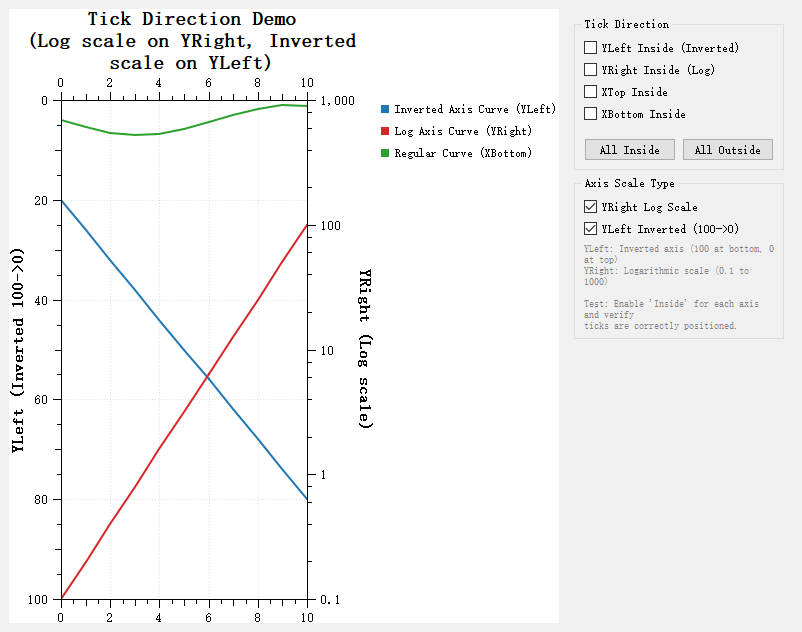
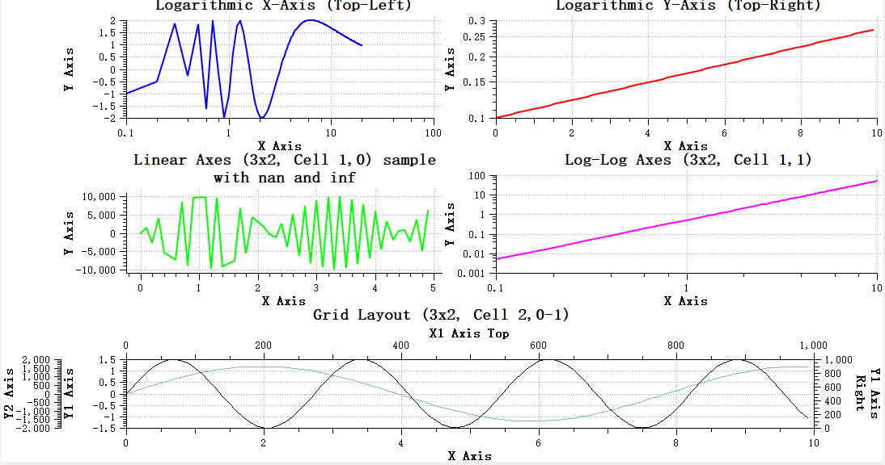
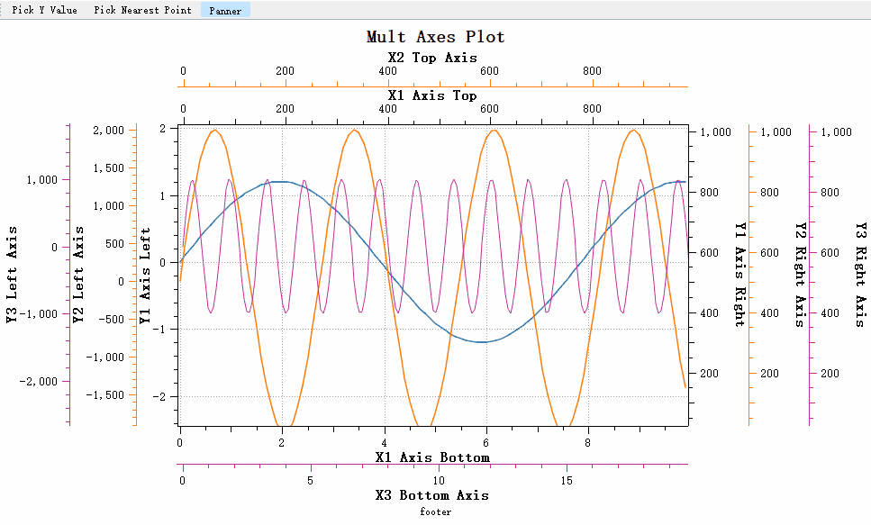
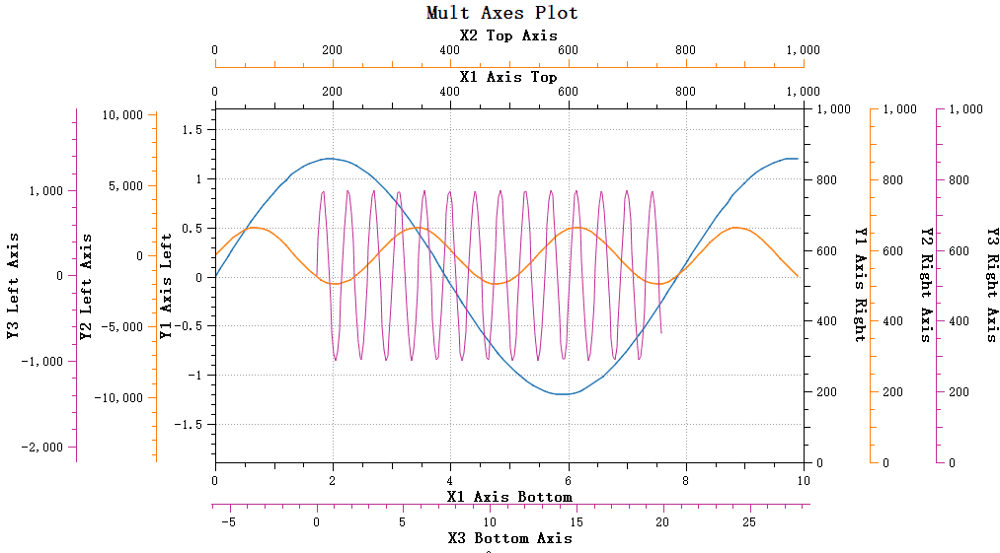
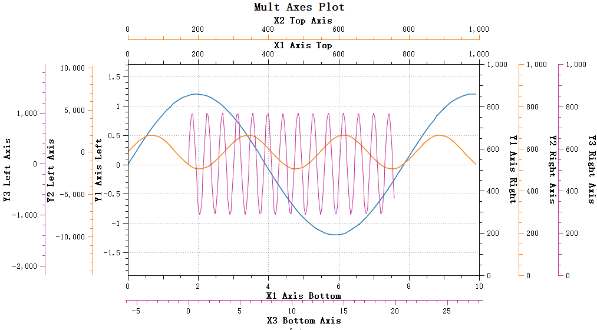
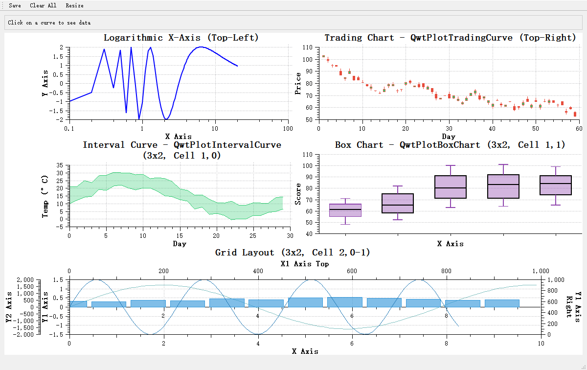

## Unreleased

### Bug Fixes

- Fixed the right axis backbone flickering between its pen width and twice that width while resizing the window at fractional display scaling ( 125 %, 150 %, 175 % ), f.e. 2 and 4 device pixels at a pen width of 2: the backing store of `QwtPlotCanvas` was `qRound( size * ratio )` device pixels and was drawn at the logical origin, but Qt rounds both edges of the paint region independently, so the device footprint of the canvas depends on its position and can be one column/row larger than the pixmap. The canvas is opaque, so nothing painted the uncovered column - it kept stale window content, typically the backbone of the right axis from before the resize, which sits right beside the canvas and doubled its visible width. The backing store is now sized to the device footprint of the canvas and blitted 1:1 in device coordinates whenever the painter maps by a pure uniform scale; other transformations keep the previous path. Integer scaling is unaffected
- Regression test: `tests/axis_corner_test` gained `testCanvasCoversDeviceFootprint()`, which renders the canvas at eight subpixel offsets and checks that every device pixel of the footprint is painted and none beyond it; CTest runs the suite at a device pixel ratio of 1.75 as well

### Build

- `examples/bench/chartbench` fetches its optional QIm submodule during configure when `qim/` is empty: the pinned submodule commit is checked out, a shallow clone is the fallback for release archives without a `.git` directory, and a failed download (no network, no git) only disables the QIm adapter instead of failing the configure step. The attempt is non-interactive, time limited and remembered per build tree; `CHARTBENCH_QIM_AUTOFETCH`, `CHARTBENCH_QIM_DIR`, `CHARTBENCH_QIM_URL`, `CHARTBENCH_QIM_FETCH_TIMEOUT` and `CHARTBENCH_QIM_FETCH_ATTEMPTED` control it

## tag:v7.5.2 (2026-10-23)

### New Features

- **`examples/2D/downsample_demo`: per-paint render time and a 1.2M sample data set**
    - The GUI times every canvas paint ( `TimedPlotCanvas::paintEvent` ) and shows `draw <ms> | <pts>` in the toolbar, so the cost of every dataset / algorithm / view / paint-switch combination is visible right after switching; timing `replot()` itself is not reliable because Qt 6 does not necessarily deliver `QWidget::repaint()` synchronously. The batch mode reports the render time per image as well
    - A third data set with about 1.23 million samples ( one order of magnitude above "many" ) makes the reduction algorithms measurable on data that is too large to be painted without reduction
    - The mapped-point overlay uses the same antialiasing-aware alignment rule as `QwtPlotCurve::drawLines()`, so the dots match the painted curve after the alignment policy change
- **`examples/2D/ticks_inside`: backbone pen width control**
    - A `QDoubleSpinBox` ( 0.5 .. 3.0, in device pixels ) in a new "Backbone Pen Width" group applies `QwtAbstractScaleDraw::setPenWidthF()` to all four axes, so the device pixel pen contract and the corner closure can be exercised interactively at any display scaling

### Bug Fixes

- Fixed antialiased curves being snapped to the device pixel grid: `drawLines()` and `drawDots()` enabled `RoundPoints` whenever the painter used a raster engine, regardless of `QPainter::Antialiasing`, and snapping the mapped vertices before an antialiasing rasterizer destroys the sub-pixel geometry it needs - dense antialiased curves rendered as a visible staircase on shallow flanks. The flags are now tied to `!QPainter::Antialiasing` on top of `QwtPainter::roundingAlignment(painter)`, so non-antialiased raster, PDF/SVG and transformed painters keep their previous behavior; `legendIcon()` snaps only when the icon is recorded without antialiasing, and `WeedOutIntermediatePoints` no longer requires `RoundPoints` (the quad weeding path rounds to device pixels internally), so `FilterPointsAggressive` stays reachable under antialiasing. The measured effect is documented in section 7 of the pixel snapping tech report
- Fixed the scale pen width being multiplied by the device pixel ratio: at 200 % scaling `setPenWidthF(1.0)` painted backbone and ticks 2 device pixels wide, contradicting the hairline promise of the pixel aligned scale rendering and making the same setting look different on 150 % and 200 % screens. The width is rounded to whole device pixels without the device pixel ratio now, so 1.0 (and 0.0) always paints a single device pixel line at any scaling; tick lengths keep translating from logical to device pixels
- Fixed the axis corner square not closing on HiDPI displays: the near (canvas side) edge of a left/top backbone band took the first device pixel of the logical pixel of the scale position, leaving the band `dpr - 1` device pixels away from the canvas edge it frames, and the corner miter extended the backbone by a hardcoded one pixel beyond the end of the scale - a guess that only matched the perpendicular backbone when border distances, pen widths and device pixel ratio happened to line up, leaving a `( pw - 1 ) x ( pw - 1 )` device pixel notch at the outer corner for pen widths above one. The near edge of a band growing away from the canvas is the last device pixel of its logical pixel now, and `QwtScaleWidget::draw()` computes the actual device positions of the perpendicular backbone bands ( `QwtScaleDraw::setCornerTargets()` ) so the miter reaches the far edge of the band adjacent to the canvas instead of a guess, while border ticks keep snapping to its near edge - also ending the backbone exactly at the band instead of clamping it against the scale span, which at device pixel ratios above one left the first device pixel of the span sticking out beyond the band as a one pixel stub at the left corners. A snapped border tick aligns its thickness into the span of the band it sits on, so even pen widths no longer leave it off the band by a device pixel; bands stacked farther out by parasite axes are not crossed, so a backbone never runs through the whole axis stack
- Fixed the inside ticks ( `QwtPlot::TickInside` ) ignoring the device pixel rules of the backbone and the outside ticks: they were stroked as a QPen of `penWidthF()` logical pixels, so at a device pixel ratio of 2 a pen width of 2 painted 4 device pixels against the 2 of the backbone, and at a ratio of 1 a fractional width like 1.5 rasterized to 1 or 2 pixels depending on the subpixel position of each tick. The new `QwtScaleDraw::drawTicksInside()` paints them as device pixel aligned rectangles, `qMax( 1, round( penWidthF ) )` device pixels thick at any ratio, starting at the canvas edge that faces the backbone band; the pen width of the selected state moved into `QwtAbstractScaleDraw::effectivePenWidthF()`, so inside ticks, outside ticks and the backbone share it
- Fixed the backbone miter being clipped at the canvas corners: the axis widget ended flush with the scale whenever the border distance did not reach far enough - most visibly when the outermost major ticks sit clear of the scale borders and the natural border distance hint collapses to 0 - so the miter fell outside of the widget rectangle and paintEvent clipped it, leaving a gap of one logical pixel between the perpendicular backbones at any device pixel ratio. `QwtPlot::doLayout()` grows each visible axis widget toward its shared corners by the gap between the widget border and the perpendicular backbone band ( new `qwt_scale_corner.h/.cpp` helpers ), resolves the corners across the whole family of plots sharing the canvas ( parasite axes included ), and absorbs the extension into the border distances used by `layoutScale()`, so position and length of the scales and the alignment between canvas and scales stay exactly as before; `QwtPlotRenderer` sets the same state from its own layout instead of relying on widget geometries, so exports are deterministic and match the screen. The reserved pixels are excluded from the geometry derived from the contents rectangle ( new `scaleContentsRect()` ), so color bars, inside titles and `scaleRect()` keep the extent of the scale instead of growing with the reservation
- Fixed a one-pass layout lag of the axis border distances: `activate()` read the stored border distances, but the hints only settle once the geometries are applied, so the first layout of a fresh plot ran with the scale maps of the default widget sizes and the next activation corrected the distances without reapplying the rectangles - the widgets kept the transitional size and the scale span drifted off the canvas. `doLayout()` re-runs the activation and the axis geometry pass while the border distances still change ( bounded to three passes ); since the corner reservation grows the axis widgets, hidden plots - which Qt does not relayout through deferred resize events - now also get an explicit `layoutScale()`, so a plot grabbed before it was ever shown converges instead of keeping transitional geometry
- Fixed `QwtPlot::replot()` leaving the axis widgets with stale scale draws: replot only repainted the canvas, and the axis widgets repainted as a side effect of layout changes only, so runtime changes of a scale draw that do not move the layout - `QwtAbstractScaleDraw::setPenWidthF()` above all - stayed invisible until the next layout driven repaint ( measured on a real 200 % display: a new pen width appeared only after an unrelated checkbox toggled the tick direction ). replot() now schedules a repaint of every visible axis widget. Found while verifying the corner fix on screen with the new pen width option of `examples/2D/ticks_inside`
- Regression tests: `tests/axis_corner_test` reworked around a per-widget compose fixture that clips every widget like the screen does - the ticks-inside-border configuration of the HiDPI issue report ( border distance hints collapsed to 0 ), the device pixel contract of `setPenWidthF()`, a 72-case matrix over `alignCanvasToScales`, canvas margin, canvas frame width and fixed canvas sizes, renderer export determinism ( screen painting between two exports must not change a byte ), the parasite plot corner, and full corner squares at pen widths 1/2/3 and device pixel ratios 1 and 2. CTest runs the suite once per ratio ( `QT_SCALE_FACTOR` 1.0 and 2.0 ); the QSKIPs for ratios other than 1 are gone

### Build

- Fixed `ctest --test-dir build` finding no tests: only the test subdirectories called `enable_testing()`, which generates `CTestTestfile.cmake` files unreachable from the build root, so the CI test step silently ran nothing. `enable_testing()` is called before adding the tests directory now
- Fixed the Gitee release sync workflow: the release creation passes `target_commitish`, and the branch push uses the fetched remote-tracking refs, so both a release event ( detached HEAD, no local branches ) and a manual `workflow_dispatch` run sync `master`/`dev` and attach the amalgamation
- The amalgamation templates gained the new `qwt_scale_corner.h/.cpp`, and `src-amalgamate/QwtPlot.{h,cpp}` were regenerated; compile-verified as a single translation unit with `/bigobj`

### Documentation

- **Pixel snapping tech report, section 7** ( `docs/tech-report/point-mapper-rounding.md`, EN/CN ): explains why the Qwt 6.2 baseline snapped ( `roundingAlignment` defaults to true, `isAligning()` checks only the paint engine and transforms, never `QPainter::Antialiasing`, so `drawLines()` enabled `RoundPoints` for an antialiased canvas ) and documents the QWT 7 fix: the 7.x reduction family keeps sub-pixel coordinates and the post-v7.5.1 policy snaps only for non-antialiased painters in `drawLines()`/`drawDots()`/`legendIcon()`, with `WeedOutIntermediatePoints` decoupled. Measured effect: the dense shoulder blend ratio goes from 0.284 to 0.5470 ( matching `--noround` ), sparse data stays at 0.568, and the aggressive path still collapses 199,751 vertices to 7,384
- **README (EN/CN) synced and the 3D module documented**: renamed the Qwt 7.0 headings, fixed the CMake/qmake wording, added the live 3D waterfall screenshot, expanded the 3D section ( Plot + Item architecture, built-in items, a minimal surface example, the sliding-window waterfall API, interaction/export and `QwtFigure` integration ), refreshed the 3D gallery ( qwtplot3d, bar3D, line3D, waterfall3D, figureSurface3D ), normalized the table headers, pointed the documentation links at the current page layout, updated the example paths to `examples/2D`/`examples/3D`, and updated the downsampling list to the six current filters plus `BreakAtNan`
- **Documentation style pass**: landing pages and introductions rewritten in plain technical prose; use guides ( 2D, 3D, general, getting started, EN/CN ) converted from checkmark/bold feature templates to plain bullets or prose, with promotional wording removed and panner class names corrected; the developer and build guides lost their document-definition introductions and checkmark lists; tech report abstracts tightened without touching derivations, code, tables, figures or benchmark numbers; the style guide itself now discourages AI-style prose ( direct subjects, no meta introductions, no promotional adjectives, no bold spam, no emoji, fewer em dashes, no restating summaries )

## tag:v7.5.1 (2026-10-19)

### New Features

- **Adaptive column-reduce downsampling (`QwtPlotCurve::FilterPointsAdaptive`)**
    - New `QwtPointMapper::AdaptiveColumnReduce` mode: single pass O(n) reduction for oversampled smooth curves ( f.e. spectra with many samples per peak ), all pixel quantities in device pixels
    - Density gate: up to 2 visible samples per device pixel column are mapped 1:1, so zooming in restores full fidelity
    - Above the gate the samples are clustered by device pixel column; inside a cluster the first sample, every sample whose mapped y differs by at least one device pixel from the last kept sample and the last sample are kept - in original order at their real sub pixel coordinates, so ramps stay ramps instead of the one pixel staircase of a per-column min/max envelope
    - Columns where that selection would exceed `4 + column y span in device pixels` points ( high frequency noise ) fall back to an ordered first/min/max/last quadruple. The deviation from the original curve is bounded by one device pixel vertically and one column horizontally
    - Takes precedence over all other reduction flags; the default paint attributes stay `ClipPolygons | FilterPointsLTTB`
- **New example `examples/2D/downsample_demo`**
    - Renders dense and sparse synthetic spectra and switches the point reduction algorithm at runtime: none, `FilterPoints`, `FilterPointsAggressive`, `FilterPointsPixel`, `FilterPointsLTTB`, `FilterPointsMinMaxLTTB`, `FilterPointsAdaptive`
    - `--batch [dir]` renders every dataset/algorithm/view combination offscreen and reports the mapped point counts, `--dots` marks every kept vertex, `--noround`/`--nosplit` toggle `QwtPainter::roundingAlignment()`/`polylineSplitting()` and `--dpr` renders at a given device pixel ratio - the controls behind the pixel-snapping measurements

### Bug Fixes

- Fixed `QwtPointMapper` computing its pixel quantities in logical instead of device pixels: the bucket counts of the LTTB/MinMax reductions, the pixel-column bins and the `RoundPoints` quantization step ignored `devicePixelRatio()`, so on high DPI paint devices the reductions lost device resolution and the rounding snapped the polyline to steps of `devicePixelRatio()` device pixels ( visible as stair steps on steep curve segments ). New `setDevicePixelRatio()`/`devicePixelRatio()`; `QwtPlotCurve::drawLines()`, `drawDots()` and `drawSymbols()` pass `QwtPainter::devicePixelRatio()` of the painter device, while the mapped coordinates stay in paint coordinates. Behavior at a ratio of 1.0 is unchanged ( verified byte identical renders )

### Build

- Fixed the MSVC build of `examples/staticExample` failing with "number of sections exceeded object file format limit": the target adds `/bigobj`
- Fixed the Gitee release sync workflow: a release event checks out the tag in detached HEAD, so no local `master`/`dev` exists and the branch push failed with `src refspec master does not match any`, skipping both the release creation and the amalgamation attachments. The workflow materializes the branch refs first, accepts a manual run with a tag (`workflow_dispatch`) and reuses an existing release for the tag instead of failing on creation

### Documentation

- **New tech report "Pixel Snapping in the Curve Pipeline"** ( `docs/tech-report/point-mapper-rounding.md`, EN/CN ): formalizes `QwtPointMapper::RoundPoints`, shows that snapping turns 99.9 % of a smooth dense polyline into exactly horizontal/vertical segments ( 0 % without it ) and quantifies the antialiasing blend ratio in rendered images ( 0.547 -> 0.284 on the dense peak shoulder, unchanged 0.568 on the sparse one ), together with the per-reduction-path cost on one million samples
- **New usage guide "Curve Pixel Alignment"** ( `docs/use-guide/2d/downsampling-pixel-align.md`, EN/CN ): the symptom, the global switch behind it, the recommended setting for screen / export / pixel-exact rendering, and the `downsample_demo` controls to reproduce the comparison; linked from the rendering-performance guide

## tag:v7.5.0 (2026-10-14)

### New Features

- **True LTTB downsampling for curves (FilterPointsLTTB rework)**
    - `FilterPointsLTTB` now implements the real Largest-Triangle-Three-Buckets algorithm ( new `QwtPointMapper::LTTBReduce` flag, `qwtLttbReduce()` ): the visible data is divided into 4 x canvas-width equal-count buckets and each bucket keeps the sample forming the largest triangle with the previously selected point and the average of the next bucket; the first and last sample are always kept
    - Narrow Gaussian peaks keep their shape instead of collapsing into vertical strokes; the activation threshold ( 4 x canvas-width visible samples ) and the output budget ( ~4 points per pixel column ) match the previous MinMax bucket algorithm
    - The MinMax bucket algorithm moved to the new `FilterPointsMinMaxLTTB` paint attribute - it is the exact behavior of `FilterPointsLTTB` in v7.3.2 - v7.4.2
    - Dispatch priority: `PixelColumnReduce` > `LTTBReduce` > `MinMaxReduce` > `WeedOutIntermediatePoints` > `WeedOutPoints`; the default stays `ClipPolygons | FilterPointsLTTB` ( now the shape-preserving LTTB )
    - Regression tests: `tests/downsampling_test`; `examples/bench/renderbench` gains a `FilterPointsMinMaxLTTB` benchmark mode
- **3D waterfall plot item (Qwt3DWaterfall)**
    - New `Qwt3DPlotItem` rendering a sequence of 1D traces (spectra, chromatograms, ...) as stacked curves along the depth axis, with a built-in sliding window: `pushTrace()` appends the newest trace and drops the oldest, no user-side window or depth bookkeeping
    - Axes follow the module convention (value axis up, as in `Qwt3DSurface`): x = bin value, y = trace position in the window (depth), z = amplitude; the depth axis is the one to label with `Qwt3DTextScale`
    - The depth coordinate of a trace is its slot index, so the hull z-range grows monotonically to `[0, traceCapacity()-1]` and then stays pinned - no per-frame depth autoscale jitter in a live waterfall
    - Four geometry styles: `Ribbon` (filled curtain, default), `RibbonMesh` (curtain + outline, outline always drawn after the fill), `Wireframe`, `Tube` (lit, same construction as `Qwt3DLine::Tube`)
    - Three color modes: `ByDepth` (default), `ByAmplitude` (colormap over the sample value), `Solid`; fixed color range via `setColorRange()` for stable live amplitude colors; baseline, opacity and outline controls; one item contributes exactly one legend gradient
    - New example `examples/3D/waterfall3D`: 2D live spectrum + peak hold on top, 3D sliding-window waterfall below, both fed the identical frame; toolbar controls for window size / style / colormap / color mode / opacity; automation hooks `--screenshot`, `--selftest`, `--fps` (measured 51.8 fps at 64 traces x 256 bins with both views updating)
    - New usage guide "3D Waterfall" (EN/CN, with screenshot); RTTI value `Rtti_Plot3DWaterfall = 1004`; theme branch in `Qwt3DTheme::applyToItem()`; classincludes forwarding headers
- **Qwt3DTextScale: user supplied tic labels for the depth axis**
    - Linear scale whose major tic labels come from a string list, so a waterfall depth axis can read "-63", "-48", ..., "0" (frames ago) instead of raw numbers; indices beyond the list fall back to the numeric label
- **Qwt3DColorMapColor: selectable source axis**
    - New `Qwt3DColorSource` enum (`ColorFromX`/`ColorFromY`/`ColorFromZ`) with `setSourceAxis()`/`sourceAxis()`; the active range applies to the selected axis. The default `ColorFromZ` keeps existing surface/bar/line rendering pixel-identical; `ColorFromY` powers amplitude coloring. `Qwt3DWaterfall::setColorMode()` retargets the functor automatically
- **Qwt3DPlot: configurable mouse driven view interaction**
    - `setMouseSpeed()`/`mouseSpeed()` set the drag speeds (rotation turns per widget dimension, exponential gain of drag scaling, world units of drag shifting); the defaults are (0.5, 5, 2), i.e. half a turn per widget dimension, the sensitivity of matplotlib's 3D rotation
    - `setRollMouse()`/`rollMouse()` add an extra gesture for the y axis rotation (the roll, the one angle a plain left drag cannot reach); the middle button carries it by default and the Shift+left assignment keeps working
- **Gap semantics for curve rendering (`QwtPlotCurve::BreakAtNan`)**
    - New curve attribute rendering NaN/Inf samples as gaps instead of bridging them: for `Lines` and `Steps` every run of consecutive finite samples becomes an independent polyline, so gaps stay blank (matplotlib behavior). Off by default - without it gaps are bridged exactly as before
    - Each run is smoothed, fitted, clipped and filled on its own, so neither the smoothing kernel nor the fill area crosses a gap; downsampling budgets apply per run. `Dots`/`Sticks` are unaffected (per-sample styles already leave gaps blank)
    - The finite sample runs are scanned once per data change and cached (invalidated via `dataChanged()`, same lifecycle as the series bounding rect cache), so interactive repaints don't repeat the O(n) scan
    - Documented in the "NaN Handling" usage guide (EN/CN); rendering semantics and the bridging-chord measurements: `docs/zh/tech-report/nan-rendering.md`

### Bug Fixes

- Fixed downsampling destroying the visual shape of narrow peaks and ignoring antialiasing: the default `FilterPointsLTTB` ( MinMax buckets, v7.3.2 - v7.4.2 ) kept only the argmin/argmax sample per bucket, so a peak sampled by more points than its bucket held collapsed into a flat-topped vertical stroke with the shoulders lost, and all reduce paths snapped the mapped coordinates to integer pixels regardless of the `RoundPoints` flag - enabling antialiasing changed nothing. Both reduce algorithms now honor `RoundPoints` ( sub pixel precision when the painter does not align to integers, including the below-threshold fallback ), and the default downsampling is the true LTTB preserving peak shapes. Regression test: `tests/downsampling_test`
- Fixed the amalgamated single-file build ( `src-amalgamate`, consumed by `examples/staticExample` ) not linking since the 3D waterfall landed: the amalgamate templates never listed `qwt3d_waterfall.h/.cpp`, so `Qwt3DTheme::applyToItem()` referenced `Qwt3DWaterfall` setters that had no definition inside the amalgamation. Templates updated and `src-amalgamate` regenerated; the duplicate file-local `clampf()` helper of `qwt3d_waterfall.cpp` was renamed to `clampFloat()` so the single translation unit compiles. Also dropped the Qt5-only `QwtPlotGLCanvas` include from `tests/flat_style_test`, which failed to compile under Qt6 ( `<qgl.h>` does not exist there )
- Fixed the axis backbones not intersecting at the canvas corners and the axis/tick lines rendering with inconsistent widths on HiDPI displays: `QwtScaleDraw` now paints backbone and ticks as device pixel aligned filled rectangles (the pen width truncates to whole device pixels, so `setPenWidthF(1.0)` stays a one pixel hairline at any device pixel ratio), ticks end exactly at the inner edge of the backbone instead of crossing it, ticks at the scale borders snap onto the perpendicular backbone so the corner reads as a clean cross without a one pixel step between the border tick and the perpendicular axis line, and the new `QwtScaleDraw::setCornerMiter()` flags - set by `QwtScaleWidget` from the visibility of the perpendicular axes - extend each backbone by one pen width into the shared canvas corner, so perpendicular backbones meet in a clean L instead of a diagonal step (or, at fractional scaling, an outright gap). Regression test: `tests/axis_corner_test`
- Fixed `Qwt3DPlot::attach()` not recalculating the scene: an item whose data was loaded before `attach()` - with no setter (and therefore no `itemChanged()`) in between - left the plot hull at (0,0,0)-(0,0,0) and the widget rendered blank without any warning. The z-order sort + hull union + coordinate system update is extracted into a private `recalculateScene()`, now also called from `attach()` and `detach()`, so detaching items shrinks the hull correctly as well. Regression tests added (`tests/waterfall_test`)
- Fixed derived `Qwt3DScale` classes being sliced inside `Qwt3DAxis::setScale()`: the `Qwt3DClonePtr` assignment clones via `clone()`, and any derived scale without a `clone()` override silently lost its custom `ticLabel()` (verified pixel-identical rendering). `Qwt3DTextScale` overrides `clone()`; `Qwt3DLinearScale` gains a protected `copyLinearScaleState()` so derived implementations can copy the autoscaler state
- Fixed `Qwt3DWaterfall::pushTrace()` reading past the end of a short trace: incoming frames are fitted into the established bin count (longer truncated, shorter zero-padded)
- Fixed the 3D axis titles never showing on live plots: `Qwt3DCoordinateSystem::destroy()` (called by `init()` on every coordinate system recreation) cleared all axis label strings, and title drawing stayed off unless `setLabel(true)` was called separately. `setLabelString()` now enables drawing for a non-empty title and `init()`/`destroy()` keep the titles; `Qwt3DAxis::label()` exposes the draw flag
- Fixed `Qwt3DCoordinateSystem::init()` resetting every axis scale to `LINEARSCALE` on each recreation: for items whose hull changes per update (a live waterfall) this silently discarded a user-set `Qwt3DTextScale` and fell back to numeric depth labels. `init()` now rebuilds geometry only, and `Qwt3DAxis::scale()` exposes the active scale
- Fixed `Qwt3DWaterfall::Tube` fusing into a single blob and collapsing the frame rate: the sweep radius was isotropic in data space, so under anisotropic view scales neighboring traces overlapped and cross sections stretched into slabs, and every ring station of every trace was rebuilt per frame. The radius is now a per-axis fraction of the hull extents (view-circular, capped below half a slot spacing) and dense traces are decimated to <=129 ring stations (measured 17 -> 62 fps at 128 traces x 256 bins)
- Fixed the 3D view rotation being too fast and quantized to whole degrees: the mouse/keyboard handlers stored `int(round(angle)) % 360`, which discarded the sub degree motion of a slow drag (on a 2000 px wide widget a 1 px move is 0.09 degrees, so the scene did not move at all) and let the angle leave the canonical range; the gain was three full turns per drag across the widget (measured: 200 px -> 220 degrees). Angles are kept as doubles wrapped into [0, 360) and the default gain is half a turn per widget dimension (measured on the same drag: 36 degrees). Regression tests: `tests/plot3d_rotation_test`
- Fixed the MinMax bucket downsampler (`FilterPointsMinMaxLTTB`, `FilterPointsLTTB` before the v7.5.0 rework) emitting phantom vertices for data with non-finite coordinates: the raw-pointer fast path pre-scanned only the y values with `isnan`, so a sample with NaN x could win a bucket extremum and be mapped to `qRound(NaN) == 0` (a fake spike pinned to the left canvas edge), and +/-Inf y values passed the pre-scan into the SIMD path producing `INT_MIN` pixel coordinates. The pre-scan now rejects non-finite y values (`!isfinite`), bucket winners with a non-finite x are caught by a per-bucket post-check that recomputes the bucket with the scalar loop, and the scalar loop skips non-finite x/y samples - aligning the raw-pointer path with the generic `sample()` path. Index-based series (no raw x array) are unaffected. The pre-scan deliberately stays y-only: scanning x as well was measured to cost +11% frame time on 1M clean points (extra memory traffic). Regression tests: `tests/nan_curve_test`
- Fixed `qwtToPolylineFiltered` (the `FilterPoints`/`WeedOutPoints` mapper path) returning a single-vertex polygon holding a NaN coordinate for all-NaN input: the first-non-NaN scan stopped at the last sample and wrote it unconditionally. All-NaN ranges now return an empty polygon, mirroring the early exit of the Quad path, so the "empty polygon == no data" convention holds for callers. Regression tests: `tests/nan_curve_test`

- Fixed the Percentile whisker levels of `QwtBoxStatisticsCalculator` being exchanged: `whiskerLower` took the (100-c)-th percentile and `whiskerUpper` the c-th one, so any coefficient below 50 produced `wl > wu`, an invalid sample and every datum counted as an outlier (64/64 in the technical report's regression case). The levels now follow the coefficient (c = tail percentage, e.g. 5 for the 5th/95th percentiles), `QwtBoxSample` carries a `mean` field that the calculator fills and `QwtPlotBoxChart` draws its mean marker at it (it used to duplicate the median), and the vestigial instance interface (`setWhiskerMethod()`/`setWhiskerCoefficient()`, consumed by no calculation path) is removed. New `tests/box_statistics_test`
- Fixed `QwtClipper::clipCircle` mapping a point above the center to `3*pi/2` on vertical tangents (the opposite of `qwtPolar2Pos` and of its own non-vertical branches), which returned pi too much whenever the center sat exactly on a vertical rectangle edge; the sweep also merges cutting points that coincide within a small angular tolerance (a circle through a rectangle corner is reported by both adjacent edges with a few ulp of difference) and classifies every angular segment on its own, removing the 1-ulp dependent "full circle vs. zero-length arcs" corner cases and the `angles[1]` out-of-bounds read for a single cutting point. New `tests/clipper_test` with directed cases and a brute-force cross check
- Fixed the gl2ps vector export producing undefined surface colors: the feedback buffer records the fixed-function vertex color, which the GLSL render path never writes (fully transparent fills - invisible surfaces - on the machine of the original measurement, data-independent colors elsewhere). `Qwt3DSurface`, the coordinate-system grid/axis lines and the color legend now emit immediate-mode geometry with explicit per-vertex colors while the feedback replay is active (`Qwt3DPlot::isVectorExportActive()`, derived from the GL render mode), so PDF/SVG exports carry the data colors. New `tests/plot3d_vector_export_test` and the `surface_export_check.cpp` probe
- Fixed the Qwt3DIO format registry comparing format strings case-sensitively while the raster keys are the lowercase names of `QImageWriter` (`savePixmap(file, "PNG")` failed silently - the official 3D example hit this); lookups, registrations and the `saveVector`/`savePixmap` format checks are case-insensitive now, unregistered formats produce a qWarning and the example derives the format from the file suffix. New `tests/plot3d_io_test`
- Fixed the 3D lighting and material parameters being discarded: `setLightComponent()`/`setMaterialComponent()`/`setShininess()` store their arguments now and `Qwt3DSurface` uploads them as shader uniforms (light position from `setLightRotation`, per-component ambient/diffuse/specular, shininess); the defaults reproduce the previously hardcoded values pixel for pixel and `illuminate()`/`blowout()` switch the single light, so the 5 theme lighting presets finally differ. New getters and `tests/plot3d_lighting_test`
- Fixed the matplotlib-sourced colormap presets carrying hand approximations: `inferno`/`magma`/`turbo` had their stops compressed into the first ~70% of the reference curve placed over the whole range and `viridis`/`cividis` deviated by up to 17 dE00. The stops are now sampled from the official matplotlib 256-entry tables at the preset positions (generator `docs/assets/algorithms/colormap_stops_gen.py`): stop deviation 0.000, whole-band deviation 0.445-1.380 dE00, `inferno`/`magma` grade A
- Fixed `QwtScaleDiv::setTicks()` storing duplicated tick values (the date engine's `qRound(i*minStep)` collapse) and `QwtAbstractScaleDraw::draw()` painting coinciding ticks twice: the tick lists are sorted and deduplicated, and ticks sitting on a longer tick type are skipped, so every position is painted once with the longest length. New `tests/scale_draw_test`
- Fixed two comments contradicting their implementations: `QwtColorMapPreset::presetFromName()` documents the fallback to Viridis (it never returned -1) and `Qwt3DSurface::setResolution()` documents the index stepping plus the full rebuild/re-upload it actually performs
- Performance: moved the AVX2 argmin/argmax kernel into its own translation unit compiled with `/arch:AVX2` (MSVC) / `-mavx2` (GCC/Clang) via CMake (`qwt_simd_argminmax_avx2.cpp`). Compiled for the x86-64 baseline it mixed legacy SSE into its 256-bit epilogue and returned with a dirty upper YMM state - measured 446 ns of fixed overhead per call (n=16) and a 16x slowdown of scalar code following it in the same thread; after the split the call drops to 13.5 ns, the streaming penalty disappears and the MinMax bucket criterion collapses from ~481 to 4-8 elements. The dispatcher still calls it only after its CPUID check; the amalgamated build inlines the file as before
### Documentation

- **New benchmark example `examples/bench/chartbench` and the four-way plotting library comparison report**: the example drives Qwt, an in-tree QCustomPlot 2.1.0 copy and Qt Charts through one measurement protocol and pulls QIm in as a git submodule; eight suites (sample count, series count, canvas size, data handover vs. repaint, point reduction, frame-time distribution, process memory, startup cost) plus image export, one CSV pair per library and backend, and a driver script that runs the whole matrix. The protocol is part of the result - `QOpenGLWidget` defers a plain `repaint()` to Qt's composition step, so the report documents driving `makeCurrent()`/`paintGL()`/`glFinish()` instead (the naive protocol reports 0.004 ms for a 100k point curve), and the QCustomPlot copy carries the minimal Qt 6 `Q_MOC_RUN`/`Q_NAMESPACE` fix that upstream 2.1.1 has as well. 17 figures and 14 tables are regenerated by `docs/assets/bench/chartbench_experiment.py` from the raw CSVs; Qt Charts' OpenGL series path is reported as a measured negative result (no curve pixels in the framebuffer)

## tag:v7.4.2 (2026-10-10)

### New Features

- **Render smoothing for curve drawing**
    - `QwtPlotCurve` gains the `SmoothAlgorithm` enum ( `NoSmoothing`, `GaussianSmoothing`, `SavitzkyGolaySmoothing` ) with `setSmoothAlgorithm()`, `setSmoothWindow()`, `setSmoothPolynomialOrder()` and `setSmoothPreserveThreshold()`
    - Both algorithms are low pass filters operating on the polyline after downsampling and coordinate translation — only the y coordinates are modified, so the horizontal position of every feature stays exact
    - A non-linear feature preservation step ( enabled by default ) keeps significant peaks and dips at their original position and height: the pixel noise band collapses to a clean line while the data is not distorted
    - Implemented for `QwtPlotCurve::Lines` ( including filled curves ), combinable with the `Fitted` attribute
    - New example `examples/2D/curvesmoothing`: a 100,000 sample spectrum with random jitter — left plot default rendering vs. right plot smoothed, with runtime controls for algorithm / window / SG order / preservation threshold and replot benchmarks
    - New usage guide "Curve Render Smoothing" ( EN/CN, with screenshots )

### Bug Fixes

- Fixed axis backbones being misplaced or missing on the first paint of a plot — the two reported symptoms were a short segment missing at the left of the x axis (x/y backbones not intersecting at the corner, healing only after an axis parameter refresh) and a whole backbone invisible until the next plot update. Root cause: the layout placed the scale widgets using the border distance stored by the previous pass, while the backbone was drawn using the freshly computed one; the corrective relayout is driven by an asynchronous `LayoutRequest` that is regularly missing or late during the initial show sequence. The fix makes placement and drawing use the same border distance in a single pass and guarantees a layout pass before the first paint:
    - `QwtPlotLayoutEngine` `LayoutData::ScaleData::init()` now uses `qMax(getBorderDistHint(), borderDist)` — the exact value `QwtScaleWidget::layoutScale()` draws with — instead of the stale stored border distance, closing the one-pass lag at its source
    - `QwtPlot::doLayout()` refreshes the axis border distances even when the scale rect did not change (tick label content, formats or fonts can alter the hint without changing the geometry)
    - `QwtPlot::event()` runs `updateLayout()` after the `PolishRequest` replot, so the first paint always uses a layout calculated from the final fonts and scale divisions (one extra pass on first show only, no steady-state cost)
    - `QwtScaleWidget::changeEvent()` handles `FontChange`/`ApplicationFontChange` and relayouts on `LocaleChange`: font changes no longer leave extent and border distances stale without a repaint
    - `QwtScaleWidget::setMinBorderDist()` recalculates the scale geometry like all other geometry setters (relevant for `QwtPlot::alignAxisBorderDist()` and `QwtFigure::alignAxes()`)
- Fixed `QwtScaleDraw::setLength()` unconditionally clamping to a positive minimum of 10, which silently turned negative lengths (legitimately used by `QwtPolarGrid` for left/top axes) into +10 and broke polar grid rendering; the upstream clamping semantics are restored (small magnitudes clamped to ±10, larger negative values preserved)
- Fixed `QwtSplineCurveFitter::fitCurve()` discarding the fitted result: the return value of `subPaths.first()` was dropped and an empty polygon was returned, so curves using `Fitted` together with fill could not be drawn at all; upstream behavior is restored (a single subpath returns that subpath's polygon)

## tag:v7.4.1 (2026-09-11)

### New Features

- **Outside axis titles (QwtScaleWidget::TitleOutside)**
    - `QwtScaleWidget` gains the `TitlePlacement` enum (`TitleInside`/`TitleOutside`) with `setTitlePlacement()`/`titlePlacement()`; `QwtPlot` offers the convenience methods `setAxisTitlePlacement()`/`axisTitlePlacement()`
    - In `TitleOutside` mode the title is no longer painted inside the scale widget and no longer contributes to the axis dimension; the layout reserves a caption strip adjacent to the scale widget (below it for YLeft/YRight/XBottom, above it for XTop) and paints the title there as horizontal text, following the scale widget through every relayout
    - `QwtPlotLayout` exposes the caption geometry via `scaleCaptionRect()`; for multi axis (parasite) plots the host layout aggregates the caption height demands of all layers and splits the bottom band between the layer captions at the mid points of neighboring caption columns, keeping them overlap free
    - `QwtPlotRenderer` gains `renderScaleCaption()`, so PNG/SVG/PDF exports include outside titles
    - New example `examples/2D/outsideTitle`: single plot plus host + two parasite multi axis demo with runtime placement toggles and export buttons; the `--export <dir>` argument writes self-test grabs and renderer exports headlessly

- **Axis title position and alignment control**
    - `QwtScaleWidget` gains the `TitlePosition` enum (`TitleCentered`/`TitleAtStart`/`TitleAtEnd`) controlling where the title is painted along the axis backbone, plus `setTitleAlignment()`/`titleAlignment()` for the horizontal alignment inside the title box; `QwtPlot` forwards both via `setAxisTitlePosition()`/`setAxisTitleAlignment()`
    - `TitleCentered` (default) reproduces the legacy layout exactly; `TitleAtStart` is the bottom end for vertical axes / the left end for horizontal axes, `TitleAtEnd` the top/right end; the title keeps its natural orientation, only its position along the backbone changes
    - The `parasitePlot` example demonstrates title position and alignment at runtime

- **Fixed canvas size mode for QwtPlotLayout**
    - `setFixedCanvasSize(axisPos, on)` decouples the canvas dimension from tick label growth: once locked, the canvas dimension stays stable and overflowing labels are clipped by the scale widget paint region (YLeft/YRight fix the canvas width, XBottom/XTop the height)
    - Auto mode captures the canvas edge offsets on the first layout pass after enabling; manual mode `setFixedCanvasSize(QSize)` pins an exact size (a negative component means auto-capture for that direction); `resetFixedCanvasSize()` clears the captured offsets and the manual override
    - `alignScales()` no longer expands the canvas when align-canvas mode would shrink a fixed dimension
    - Mainly intended for parasite plot setups where host and parasite share the canvas area and must not drift apart on label growth

- **QwtPlotAxisWheelInteraction — axis-level wheel zoom and pan**
    - New interaction class installing an event filter directly on the `QwtScaleWidget` (the axis tick area): plain wheel zooms that axis centered at the cursor via `QwtPlot::zoomAxis()`, Ctrl+wheel pans it via `QwtPlot::panAxis()`
    - Works immediately without click-selecting the axis first (unlike `QwtPlotScaleEventDispatcher`); wheel events matching zoom/pan are consumed, all others pass through to the dispatcher
    - Fully configurable: zoom/pan modifiers, zoom factor (default 1.2 per step), pan factor (default 30 pixels per step), enable/disable toggle
    - Designed for inheritance with three virtual override points: `handleWheelEvent()`, `wheelZoom()`, `wheelPan()`
    - The `parasitePlot` example gains an "Axis Wheel" toolbar action demonstrating the class

- **QwtTextScaleDraw — custom text tick labels**
    - New `QwtTextScaleDraw` class maps numerical tick values to custom string labels via a `QMap`, providing more flexibility for displaying categorical or specific text on plot axes

- **Curve symbol auto coloring**
    - `QwtPlotCurve` symbols left at their default (no brush, `#555555` pen) now automatically follow the curve pen color once the curve pen has been auto-colored on `attach()` (symbol brush takes the pen color, symbol pen takes `darker(150)`), so scatter symbols follow the color cycle; user-customized symbols are preserved

- **3D items: RTTI, serialization and data access**
    - New `Rtti3DValues` enum (`Rtti_Plot3DItem`, `Rtti_Plot3DSurface`, `Rtti_Plot3DBar`, `Rtti_Plot3DLine`) with `rtti()` overrides on all 3D plot items, mirroring the 2D `QwtPlotItem` pattern; `Qwt3DPlot::attach()`/`detach()` are now virtual
    - New `qwt3d_serialize.h/.cpp` with `QDataStream` operators for `Triple`, `RGBA`, `ParallelEpiped`, `Qwt3DFunctionData`, `Qwt3DParametricData` and `Qwt3DTheme`
    - Public getters added across the 3D API (color classes, color legend, coordinate system, axis, label, drawable, plot); `Qwt3DSurface::gridData()`/`cellData()`/`isGridData()` moved from protected to public
    - `Qwt3DBar` gains `samples()`, `isGridData()` and grid metadata / z-matrix getters (`gridZValues()` etc.)

- **3D line point shapes**
    - `Qwt3DLine` gains the `PointShape` enum (Dot, Cube, Tetrahedron, Octahedron, Sphere) with `setPointShape()`/`pointShape()` for marker rendering in Dots style
    - The `line3D` example adds a marker shape selector

- **PySide6 bindings for qwtplot**
    - Bindings CMake refactored to a multi-module orchestrator layout (`bindings/core/`, `bindings/plot/`) with a parameterized Shiboken6 tools shim
    - Roughly 95 additional classes bound: pickers and picker machines, zoomers, panners, magnifier, rescaler, overlays, `QwtFigure`, the parasite framework, utility static classes, splines and `QwtPointMapper`
    - Comprehensive test coverage: 52 tests (11 core + 41 plot) including offscreen rendering, signals, and interaction (zoomer, panner, magnifier, picker machines)

### Bug Fixes

- Fixed four parasite plot axis issues:
    - Parasite curves compressed or rendered outside the canvas after a shared-axis drag — the parasite `canvasMap()` now uses the host's paint interval while keeping the parasite's own scale interval
    - Wheel zoom producing wrong ranges or no refresh on shared axes — the wheel position is now mapped to canvas coordinates and `replotAll()` refreshes host and parasites
    - Parasite axis labels truncated during a selection-move drag — new `alignAxisBorderDist()`/`alignAllAxisBorderDist()` compute the maximum border distance across host and parasites; borders realign after every full replot
    - `zoomAxis()` ineffective on inverted axes (e.g. `setAxisScale(yRight, 500, 0)`) — inverted ranges are detected and handled, which also fixes non-linear Y axes where pixel space is always inverted
- Fixed parasite layouts copying stale host rects: the host `doLayout()` now refreshes each parasite layout after its own layout completes, so the parasite copy (and everything derived from it, like caption rects) is based on the final host rects of the current pass
- A `LayoutRequest` received by a parasite plot now also refreshes the host layout, so parasite axis title/dimension changes enter the host band reservation aggregation promptly
- `QwtPlot::setAxisScaleDraw()` no longer silently re-enables outside ticks on axes in `TickInside` mode (previously replacing the scale draw produced double-painted ticks)
- `QwtPlotIntervalCurve` default pen changed from `#555555` to black so the attach-time auto coloring also applies to default-constructed instances
- `Qwt3DBar::setSamples()` now assigns the missing spacing and height properties, ensuring correct bar dimensions

### Build

- New xmake build configuration (`xmake.lua`) as an alternative to CMake, including the `QWTCORE_MAKEDLL`/`QWTCORE_DLL` defines for core library support
- Qt 5 compatibility: `constexpr` replaced with `Q_DECL_CONSTEXPR` in core headers, and `QwtPlotBoxChart` outlier jitter falls back to `qrand()` on Qt < 5.10 (plus version guards in the canvas and scale dispatcher headers)
- Amalgamated single-file sources (`src-amalgamate/QwtPlot.{h,cpp}`) fully regenerated and the amalgamation templates repaired: references to files deleted by the 3D Plot+Item refactor were removed and the new `QwtTextScaleDraw`, `QwtPlotAxisWheelInteraction`, `Qwt3DPlotItem`/`Qwt3DSurface`/`Qwt3DBar`/`Qwt3DLine`, `Qwt3DRenderContext` and serialization sources are now included — the single-file build compiles again with the current 7.x API
- plot3d: gl2ps vector export is now compiled in unconditionally — the `QWT3D_ENABLE_GL2PS` guard and the PUBLIC define handed out by `qwt::plot3d` are gone. The macro was de-facto required anyway (`qwt3d_plot.h`/`qwt3d_io.cpp` reference `Qwt3DVectorWriter` in `saveVector()` regardless of the macro, so a macro-free build could never compile), and the amalgamated single-file build (`staticExample`) no longer needs any extra define

### Refactoring

- plot3d: dropped the meaningless `public Q_SLOTS:` section above `Qwt3DSurface::setResolution()`; `Qwt3DSurface` is not a `QObject`, so it is simply a public method now

### Documentation

- Added fixed canvas size mode usage documentation
- Added outside axis title (TitleOutside) usage guide

## tag:v7.3.6 (2026-07-31)

### New Features

- **Qwt3DBar and Qwt3DLine — New 3D Plot Items**
    - `Qwt3DBar`: 3D bar chart item, supports 1D series + 2D grid (`Qwt3DFunctionData`) data entry, per-bar flat-normal cuboids (6 faces), Filled/FilledMesh/Wireframe styles reusing the surface shader with two-pass edge overlay
    - `Qwt3DLine`: 3D line/curve item, `setSamples` mirroring `QwtPlotCurve`, `LineStyle` supports Lines/Tube/Dots; Tube swept with parallel-transport framing (robust on straight segments) for lighting; Lines/Dots reuse shared line/point shaders
    - Theme integration: `Qwt3DTheme::applyToItem()` extended to dispatch Qwt3DLine/Qwt3DBar (previously only Qwt3DSurface)
    - New examples: `examples/3D/bar3D` (gaussian peak grid) and `examples/3D/line3D` (helix tube)

- **3D Coordinate Box Aspect Ratio Mode**
    - Added `AUTOFILL`/`DATARATIO` aspect ratio modes for the 3D coordinate box

- **qwtplot3d Comprehensive Demo Example**
    - New example project at `examples/3D/qwtplot3d` with MainWindow and dockable settings for surface styles, axes, legends, view/lighting, and enrichments
    - Settings dock UI syncs with applied theme (`syncFromTheme` method)
    - Legend position combo dynamically updates options based on orientation (vertical: Left/Right, horizontal: Top/Bottom)

### Bug Fixes

- Fixed wheel events not being consumed after zoom handling — `QwtPlotScaleEventDispatcher::handleWheelEvent` now accepts the wheel event after zooming a selected axis, and `QwtMagnifier::widgetWheelEvent` returns bool (signature change: `void` → `bool`) so its event filter can accept and consume the event; previously the wheel event kept propagating to parent widgets (e.g. a `QScrollArea` viewport scrolled while the axis/canvas zoom was applied)
- Fixed dangling pointer: recreate `Qwt3DColorMapColor` in `reapplyAll()` because `applyTheme()` replaces and destroys the old functor
- Stabilized exposed axis label anchor positioning — replaced angle-based heuristic with outward screen vector from coordinate box center to axis midpoint, remaining consistent across viewport aspect ratio changes
- Fixed anisotropic tic-length model — tic length was a single world-space value clobbered by `init()` on every data change; now per-axis auto mode (scale × that axis's own data range) with persistent manual override via `setTicLength()`, new `setTicLengthScale()`/`setAutoTicLength()` API (default scale 0.015)

### Refactoring

- **3D Color Classes Become Pure Value Objects**
    - Removed `Qwt3DSurface*`/`Qwt3DPlot*` reverse pointers and `notifyColorChanged()` from `Qwt3DColor`/`Qwt3DStandardColor`/`Qwt3DColorMapColor`; mutators are now silent; z range pushed via `setActiveRange()`; color headers no longer include/forward-declare `qwt3d_surface.h`/`qwt3d_plot.h`; in-place mutation of an attached functor now requires `surface->invalidateColors()`
- **Eliminated Reverse-Pointer Violations (Deferred Smells Resolved)**
    - Introduced `Qwt3DRenderContext` value struct (bundling shaders, matrices, viewport, coordinate-conversion methods); `Qwt3DDrawable::draw()` now takes `const Qwt3DRenderContext&`; removed `m_plot`/`plot()`/`setPlot()` from `Qwt3DDrawable`
    - `Qwt3DFunction::create()` and `Qwt3DParametricSurface::create()` now return data (`Qwt3DFunctionData`/`Qwt3DParametricData`) instead of pushing via back-pointer; removed `m_surface` from `Qwt3DGridMapping`; added vector-based `loadFromData()` overloads to `Qwt3DSurface`
    - Removed dead-code `plot` back-pointer from `Qwt3DEnrichment`

### Documentation

- Added 3D module refactor dev-guide (en/zh): why/how the 3D module was refactored to a Plot+Item architecture, tiered layering, migration table
- Added dedicated Qwt3DBar and Qwt3DLine usage pages (en/zh) with key features, data shapes/styles tables, class diagrams, method tables, tips, and example links
- Refined 3D Plot Introduction overview (en/zh), replacing inline bar/line usage subsections with pointers to the dedicated pages

## tag:v7.3.5 (2026-07-24)

### Breaking Changes

- **3D Module Architecture Refactor — Plot + Item Pattern**
    - Completely refactored the 3D module from the legacy widget-per-plot model to a **Plot + Item** architecture, symmetric with the 2D module (`QwtPlot` + `QwtPlotItem`):
        - `Qwt3DPlot` (QOpenGLWidget): pure rendering window, manages GL context, view transforms, lighting, coordinate system, and item list. No longer holds plotting data.
        - `Qwt3DPlotItem` (new): abstract base class for all 3D drawable items (attach/detach/draw/hull/z/title), mirroring `QwtPlotItem`.
        - `Qwt3DSurface`: concrete surface item using VBO/VAO + GLSL 3.3 Core shaders. Merged logic from the old `gridplot.cpp` and `meshplot.cpp`.
    - Removed `namespace Qwt3D` — all classes now use the `Qwt3D` prefix in the global scope (e.g., `Qwt3DPlot`, `Qwt3DSurface`, `Qwt3DFunction`).
    - Renamed all 3D classes: `Plot3D` → `Qwt3DPlot`, `SurfacePlot` → `Qwt3DSurface`, `Function` → `Qwt3DFunction`, `CoordinateSystem` → `Qwt3DCoordinateSystem`, `Axis` → `Qwt3DAxis`, `ColorLegend` → `Qwt3DColorLegend`, `Color` → `Qwt3DColor`, `StandardColor` → `Qwt3DStandardColor`, `ColorMapColor` → `Qwt3DColorMapColor`, `Qwt3DTheme` (already prefixed, namespace removed), `Mapping` → `Qwt3DMapping`, `GridMapping` → `Qwt3DGridMapping`, `ParametricSurface` → `Qwt3DParametricSurface`, `Scale` → `Qwt3DScale`, `AutoScaler` → `Qwt3DAutoScaler`, `Enrichment` → `Qwt3DEnrichment`, `Drawable` → `Qwt3DDrawable`, `Label` → `Qwt3DLabel`.
    - Deleted stub classes: `GraphPlot`, `MultiPlot`, `VolumePlot` — to be reimplemented as `Qwt3DPlotItem` subclasses if needed.
    - Moved plotting methods from `Qwt3DPlot` to `Qwt3DSurface`: `setPlotStyle()`, `setDataColor()`, `loadFromData()`, `setResolution()`, `setMeshColor()`, `addEnrichment()`, `setFloorStyle()`, `setShading()`, `showNormals()`.
    - Removed `updateData()` — use `plot->update()` or `item->itemChanged()` instead.
    - Removed `setCoordinateStyle()` — use `Qwt3DCoordinateSystem` API directly.
    - `Qwt3DFunction` and `Qwt3DParametricSurface` now target `Qwt3DSurface*` (item) instead of `SurfacePlot*` (widget).

- **3D Module: Modern OpenGL Migration**
    - Replaced ALL legacy OpenGL calls (immediate mode, display lists, fixed-function pipeline, GLU quadrics) with modern OpenGL:
        - VBO (`QOpenGLBuffer`) + VAO (`QOpenGLVertexArrayObject`) for vertex data management.
        - GLSL 3.30 Core shaders for all rendering (surface, line, point, polygon, text).
        - CPU-side `QMatrix4x4` matrix computation (no GL matrix stack).
        - `QOpenGLTexture` for text labels (replacing `glRasterPos3d` + `glDrawPixels`).
        - CPU-generated triangle mesh geometry for Cone/Arrow enrichments (replacing `gluCylinder`/`gluDisk`).
    - Deleted `qwt3d_openglhelper.h` (legacy GL state management utilities).
    - gl2ps vector export wrapped in `QWT3D_ENABLE_GL2PS` conditional compilation (Compatibility Profile fallback).
    - 10 new GLSL shader files in `src/plot3d/shaders/` (surface, polygon, line, point, text — vert+frag pairs).

- **3D Theme System: Plot-level / Item-level Split**
    - `Qwt3DTheme::apply()` now applies plot-level properties (background, coordinate colors, title, lighting) to `Qwt3DPlot` and item-level properties (meshColor, dataColorPreset, plotStyle, shading, smoothMesh) to attached `Qwt3DSurface` items via `dynamic_cast`.

- **3D IO System Adaptation**
    - `Qwt3DNativeReader` now searches `plot->itemList()` for a `Qwt3DSurface` item (creating one if none exists) instead of `dynamic_cast<SurfacePlot*>(plot)`.
    - Renamed IO classes: `IO` → `Qwt3DIO`, `PixmapWriter` → `Qwt3DPixmapWriter`, `VectorWriter` → `Qwt3DVectorWriter`, `NativeReader` → `Qwt3DNativeReader`.

- **3D Examples Updated**
    - All 6 examples in `examples/3D/` updated to the new Plot + Item API.
    - `SIGNAL()/SLOT()` connections migrated to new-style `connect()`.
    - Legacy GL calls in example enrichments replaced with VBO + shader rendering.

## tag:v7.3.4 (2026-07-12)

### New Features

- **Unified NaN/Inf Handling Across All 2D Modules**
    - Unified 5 scattered NaN detection methods (`qwt_is_nan_or_inf`, `!std::isfinite`, `qIsNaN`, `std::isnan`, local bit-level `qwtIsNaN`) into a single `qwt_is_nan_or_inf()` across `src/plot/` and `src/core/`
    - Promoted `isSampleNanOrInf()` from anonymous namespace to public exported API in `qwt_series_data.h`, available for all plot items
    - Added NaN/Inf skipping to 10+ plot items that previously lacked handling:
        - `QwtPlotBarChart`, `QwtPlotHistogram`, `QwtPlotIntervalCurve`, `QwtPlotMultiBarChart`
        - `QwtPlotTradingCurve`, `QwtPlotVectorField`, `QwtPlotBoxChart`, `QwtPlotSpectroCurve`
        - `QwtPolarCurve`, `QwtPlotSpectrogram` (replaced local bit-level `qwtIsNaN`), `QwtPolarSpectrogram`
    - Added NaN/Inf skipping to 4 missing code paths in `QwtPlotCurve`
    - `QwtColorMap::rgb()` and `colorIndex()` now return transparent for NaN/Inf input values
    - Pre-filters NaN/Inf in `QwtBoxStatistics` before sort and statistical calculations
    - Added bilingual NaN handling user guide (`docs/use-guide/nan-handling.md`)

- **nanperf — NaN Performance Benchmark Example**
    - New example at `examples/2D/nanperf/` for benchmarking NaN handling performance
    - `NanDataGenerator` with configurable NaN distribution patterns and unit tests
    - `BenchmarkRunner` with timing harness and analysis across filter modes and data sizes
    - `MainWindow` with 2×2 grid layout, control bar, sweep orchestration, and Markdown report export
    - `FilterModes` and `PlotPanel` components for side-by-side comparison

- **PySide6 Bindings (POC)**
    - Initial PySide6/Shiboken6 binding for `qwt::core` classes
    - Expanded typesystem to cover all core module classes
    - Full functional test suite (`bindings/tests/test_core.py`)
    - CMake integration with `FindPySide6Shiboken.cmake` and `Shiboken6Tools`

- **QwtDate Modernization**
    - Migrated `QwtDate` internals from deprecated `Qt::TimeSpec` to `QTimeZone`
    - Added `qwt::compat::` timezone helper functions in `qwt_qt5qt6_compat.hpp` for Qt 5.12+/Qt6 dual compatibility
    - Updated `qwt_date_scale_draw.cpp` and `qwt_date_scale_engine.cpp` to use new API

### Bug Fixes

- Fixed `QwtVectorFieldSample` NaN check — was checking `vx` twice, missing `vy`
- Fixed `QwtInterval::contains(NaN)` — was incorrectly returning `true`, now returns `false`
- Fixed `qwtBoundingRect` out-of-bounds access and NaN propagation bugs
- Fixed `QwtLinearColorMap::colorIndex()` — comment claimed NaN handling but implementation lacked it
- Fixed `QwtGridData::findValueRange` NaN propagation and `dyMin` calculation bug
- Fixed `QwtPolarSpectrogram` Indexed code path missing NaN guard

### Build

- Ensured UTF-8 narrow string literals on MinGW (CMake `target_compile_definitions` with `UNICODE`/`_UNICODE`)
- Added `qmakeExample` — demonstrates single-file amalgamated build with qmake

### Documentation

- Added qmake single-file build guide (Chinese, `docs/zh/build-guide/qmake-single-file.md`)
- Added qmake usage instructions to bilingual READMEs
- Fixed incorrect default `PaintAttribute` documentation in curve guides and header comment
- Updated downsampling algorithm recommendations in bilingual curve documentation

## tag:v7.3.2 (2026-06-20)

### New Features

- **QwtColorMapPreset Applied to Spectrograms**
    - `QwtPlotSpectrogram` and `QwtPolarSpectrogram` now use Viridis as the default colormap, replacing the legacy blue-to-yellow linear map
    - Spectrogram and polar spectrogram examples updated with preset switching UI controls
    - Classic colormap types remain available for backward compatibility

- **QwtPolarPlot Background Unification**
    - Unified `QwtPolarPlot` background behavior with `QwtPlot`

### Changes

- **3D Default Colormap Migrated to Viridis**
    - `StandardColor::reset()` replaced blue-to-red gradient with viridis preset
    - `Qwt3DTheme` default preset changed from "jet" to "viridis" for consistency with modern visualization standards
    - Refreshed 3D screenshot assets to reflect the updated default colormap

### Documentation

- **Documentation Restructure** — flattened directory hierarchy, added 40+ new user guides
    - Covers curves, charts, 3D plots, interaction tools, and widgets
    - New developer guides: coding standards, comment conventions, PIMPL pattern usage
    - Updated mkdocs.yml navigation for the new flat structure with i18n folder organization
    - Unified screenshot and example path links

## tag:v7.3.1 (2026-06-17)

### New Features

- **qwt::core Shared Library**
    - Extracted `qwt::core` shared library (`qwtcore.dll`) containing color mapping and palette utilities
    - `QwtColorMap` refactored: removed `QwtInterval` dependency, new signature `rgb(vMin, vMax, value)`
    - `QwtColorCycle` migrated from plot module to core
    - New `QwtColorMapPreset` class with 22 scientific colormap presets (viridis, plasma, inferno, magma, cividis, jet, hot, cool, spring, summer, autumn, winter, gray, bone, copper, rainbow, hsv, turbo, coolwarm, rdylbu, rdylgn, spectral)
    - Backward-compatible `QwtColorMapCompat` namespace in `src/plot/qwt_colormap_compat.h` providing `QwtInterval`-based overloads

- **3D Theme System**
    - New `Qwt3DTheme` class with 10 preset themes: Default, Dark, Scientific, Warm, Cool, Matplotlib, EarthTones, Ocean, HighContrast, Presentation
    - New `ColorMapColor` adapter bridging 2D colormaps to 3D color functors
    - 5 lighting presets: NoLighting, FlatLight, Studio, Outdoor, Soft
    - `Plot3D::setTheme()`, `Plot3D::applyTheme()` for one-call theme application
    - `StandardColor::setPreset()` for quick colormap preset switching

### Architecture Changes

- Three-module architecture: `qwtcore.dll` → `qwtplot.dll` + `qwtplot3d.dll`
- `plot` and `plot3d` both link against `core` but remain independent of each other
- Runtime deployment requires `qwtcore.dll` + `qwtplot.dll` (+ `qwtplot3d.dll` if 3D enabled)
- Backward-compatible forwarding headers in `src/plot/` for existing `#include "qwt_color_map.h"` paths
- **Core Module Expansion**: Migrated 24 utility modules from `plot` to `core`, expanding core from 4 modules (color + global) to a complete foundational library of 28 modules:
    - Math utilities: `qwt_math.h/.cpp`, `qwt_simd_argminmax.h/.cpp`
    - Data types: `QwtInterval`, `QwtPoint3D`, `QwtPointPolar`, `QwtSamples`, `QwtBoxStatistics`
    - Geometry: `QwtBezier`, `QwtClipper`
    - Coordinate transforms: `QwtTransform`, `QwtScaleMap`, `QwtScaleDiv`, `QwtScaleEngine`
    - Date/Time: `QwtDate`, `QwtSystemClock`
    - Algorithms & compatibility: `qwt_algorithm.hpp`, `qwt_qt5qt6_compat.hpp`
    - Data containers: `QwtGridData`
    - Data series: `QwtSeriesData`, `QwtPointData`, `QwtSeriesStore`
    - Raster data: `QwtRasterData`, `QwtMatrixRasterData`, `QwtGridRasterData`

### Build System

- New `src/core/CMakeLists.txt` for the core library target
- Updated `src/plot/CMakeLists.txt` to link against `qwt::core`
- Updated `src/plot3d/CMakeLists.txt` to link against `qwt::core` and include theme sources
- Updated amalgamate tool templates to include core module files
- Updated `classincludes/` headers to point to core module paths
- Updated `tools/make-classinclude.py` for new module structure

### Examples

- **figureSurface3D** — added theme switching UI and fixed color legend refresh on theme change

### Bug Fixes

- Fixed 3D animation auto-start crash: deferred animation timer to `showEvent()` to prevent GL context access before widget is visible
- Fixed `figureSurface3D` color legend not refreshing when theme is switched

## tag:v7.3.0 (2026-06-12)

### New Features

- **QwtColorCycle — Color Cycle System**
    - Added `QwtColorCycle` class for managing color palettes with cyclic wrap-around, 7 built-in presets plus custom palettes
    - Integrated with `QwtPlot` — plot items automatically acquire colors from the color cycle on `attach()`
    - Supported items: `QwtPlotCurve`, `QwtPlotMultiBarChart`, `QwtPlotBoxChart`, `QwtPlotHistogram`, `QwtPlotIntervalCurve`, `QwtPlotBarChart`
    - Added color cycle unit tests

- **Curve Downsampling Filters**
    - Added `FilterPointsPixel` and `FilterPointsLTTB` paint attributes to `QwtPlotCurve`
        - `FilterPointsPixel`: pixel-column based downsampling for maximum rendering speed on very large datasets
        - `FilterPointsLTTB`: simplified LTTB (MinMax bucket) algorithm that preserves visual shape while downsampling
    - Changed default paint attribute from `FilterPoints` to `FilterPointsAggressive`
    - `qwtMapPointsQuad` improved NaN/Inf skipping logic and polygon memory pre-allocation

- **SIMD-Accelerated MinMax Bucket Downsampling**
    - Added `qwt_simd_argminmax` module providing SIMD-accelerated argmin/argmax computation
    - Supports SSE2/AVX2/NEON instruction sets with automatic runtime detection
    - Significantly boosts MinMax bucket downsampling performance

- **Picker Enhancements**
    - `QwtPlotSeriesDataPickerGroup` now provides click position (screen and data coordinates) on click events
    - `QwtPlotSeriesDataPicker` extended to handle all `QwtPlotSeriesItem` subtypes:
        - Trading curves (candlestick), interval curves, histograms, vector fields
        - Bar charts, box charts, spectro curves
    - `FeaturePoint` gained a `sampleData` field (QVariant) carrying full sample data (OHLC, interval, vector, etc.)
    - Sample types registered via `Q_DECLARE_METATYPE` for cross-module passing

- **Flat Style Controls**
    - `QwtSimpleCompassRose` — new `flatStyle` property replaces classic two-tone 3D effect with solid colors
    - `QwtWheel` — new `flatStyle` property replaces 3D gradients and borders with flat colors and simple lines
    - `QwtSlider` and `QwtThermo` — new `flatStyle` property for modern flat UI themes
    - `QwtDialNeedle` — multiple flat-style needle designs added
    - `QwtKnob` — defaults to `Flat` mode

### Performance

- `qwtProbeOrientation` and `qwtFindVisibleRange` optimized sampling strategy — probes up to 50 points with a minimum step of 1
- `qwtPixelColumnReduce` — pre-sized polyline vector, direct pointer assignment instead of dynamic appends
- Bins initialization simplified via `QVector` constructor

### Refactoring

- **PIMPL Macro Unification** (180+ files)
    - All classes migrated from manual PIMPL (raw `PrivateData* m_data`) to standard macro pattern
    - Headers use `QWT_DECLARE_PRIVATE(ClassName)`, implementations use `QWT_DECLARE_PUBLIC` + `QWT_PIMPL_CONSTRUCT` + `QWT_D/QWT_DC`
    - `unique_ptr` manages lifetime automatically; all `delete m_data` removed
    - Covers all modules: plot core, axes, text/legend, color maps, canvas, bar charts, interaction, data, splines, widgets, polar, etc.

- **3D Plot Module Overhaul** (53 files)
    - Added `override` specifiers to all virtual functions and destructors
    - `nullptr` replaces `0` for null pointer constants
    - `SurfacePlot` refactored to PIMPL pattern (`QWT_DECLARE_PRIVATE`)
    - `qwt3d_ptr` renamed to `ClonePtr`, unified include guards

- **Modern C++ Adoption**
    - `auto` keyword and range-based for loops throughout the codebase
    - Move semantics and C++11 default member initializers
    - `noexcept` added to trivial getters, setters, and constructors
    - `constexpr` expanded to intervals, axes, scale maps, and math utilities
    - C++ idiom modernization across `src/plot` and `src/plot3d`

### New Examples

- **renderbench** — curve rendering performance benchmark
    - `WindowedSeriesData` for real-time data stream simulation
    - Control panel for adjusting data size, downsampling mode, line width, etc.
    - Generates Markdown-formatted performance reports
    - Located at `examples/bench/renderbench/`
- **staticExample** — rewritten as comprehensive Qwt feature showcase
    - Demonstrates curves, spectrograms, bar charts, box charts, vector fields, and more
    - Modernized color palette and canvas backgrounds across all 2D examples

### Documentation

- Complete curve downsampling algorithm documentation
- Added `QWEN.md` AI Agent guidelines, updated build instructions
- Added English documentation and restructured bilingual documentation site
- Enforced English-only Doxygen comments across all source files
- Large-scale bilingual Doxygen comment completion (40+ batches) covering all core headers

### Bug Fixes

- Fixed Qt6 legend icon appearing blank due to `QwtNullPaintDevice::metric()` returning 0 for device pixel ratio
- Fixed `QwtPlotMarker` arrow endpoints — head and tail were swapped; improved legend icon rendering
- Fixed plot background rendering — now uses dynamic `backgroundRole` from `QPalette::Base` for correct theme-aware coloring

## tag:v7.2.1

- **Inside Tick Display**
    - Added `QwtPlot::TickDirection` enum: `TickOutside` (default) and `TickInside`
    - Added `QwtPlot::setAxisTickDirection()` and `QwtPlot::axisTickDirection()` to control tick direction per axis
    - Inside ticks extend from the canvas edge inward; the backbone and labels remain outside the canvas
    - Inside and outside ticks share the same style settings (length, color, pen width)
    - New example: `examples/2D/ticks_inside/`
    

## tag:v7.2.0

- **Box Chart (Box-and-Whisker Plot)**
    - Added `QwtPlotBoxChart` class for box-and-whisker plots
    - Added `QwtBoxStatisticsCalculator` for automatic statistics computation
    - New data structures: `QwtBoxSample`, `QwtBoxOutlierSample`, `QwtBoxChartData`, `QwtBoxOutlierChartData`
    - Supports both pre-computed and raw data input
    - Box styles: Rect, Diamond, Notch
    - Whisker methods: Tukey (1.5×IQR), percentile, min-max, standard deviation, standard error
    - Vertical and horizontal orientations
    - Automatic outlier detection with custom symbols and jitter display
    - New example: `examples/2D/boxchart/`
    

## tag:v7.0.8

- `QwtFigure` axis alignment — added `addAxisAlignment` to align sub-plot axes
    
- `QwtPointMapper` NaN/Inf handling — prevents coordinate mapping corruption from abnormal data values
- `qwt_series_data.cpp` — NaN/Inf checks added to data range computation
- Fixed missing `QwtSlider` class in amalgamated file (Issue #4)

## tag:v7.0.7

- Moved `QwtScaleWidget::panScale` to `QwtPlot` as `panAxis`; fixed panning on logarithmic axes
- Renamed panner classes to reflect caching behavior:
    - `QwtPanner` → `QwtCachePanner`
    - `QwtPlotPanner` → `QwtPlotCachePanner`
    - `QwtPolarPanner` → `QwtPolarCachePanner`

    `QwtPlotPanner` (new, real-time):
    

- Rewrote `QwtPlotPanner` — now inherits `QwtPicker` for real-time dragging; original cached panner available as `QwtPlotCachePanner`
- Added `QwtCanvasPicker` base class for canvas-specific picker operations
- `QwtPlotPanner` supports linear, logarithmic, and multi-axis real-time panning
- Added `QwtPlotCanvasZoomer` — zooms the entire canvas without axis binding, supports multi-axis zoom
- Renamed `QwtPlotZoomer` → `QwtPlotAxisZoomer`
- `QwtPlotSeriesDataPicker` now inherits `QwtPicker` directly (no longer `QwtPlotPicker`)
- `QwtPlotMagnifier` supports multi-axis scaling
- `QwtScaleMap` — added move semantics
- Added `make-classinclude.py` for exporting the `classincludes` directory

v7.0.7 naming changes:

| Original Name | New Name | Note |
|:--|:--|:--|
| QwtPlotZoomer | QwtPlotAxisZoomer | Renamed — original could only bind 2 axes |
| (new) | QwtPlotCanvasZoomer | Whole-canvas zoomer |
| QwtPanner | QwtCachePanner | Original cannot drag in real-time, hence "Cache" |
| QwtPlotPanner | QwtPlotCachePanner | Same as above |
| QwtPolarPanner | QwtPolarCachePanner | Same as above |
| (new) | QwtPlotPanner | New real-time panner replacing the renamed one |

## tag:v7.0.6

- Added `QwtPlotSeriesDataPicker` for plot data picking
    
    
- Improved parasite plot refresh mechanism — full update on construction
- Changed some interface index types from `int` to `size_t`
- `QwtPlotSeriesDataPicker` supports date axis display
- Fixed `QwtFigureWidgetOverlay` event handling conflicting with axis actions

## tag:v7.0.5

- `QwtScaleWidget` built-in axis actions — pan and zoom
    - Added `scaleRect()` to get the tick region rectangle
    - Added `QwtScaleWidget::BuiltinActions` enum
    - Added `requestScaleRangeUpdate` signal for axis range refresh
    - Added `setSelected`/`isSelected` and `selectionChanged` signal
    - Added action properties: `zoomFactor`, `panScale`, etc.
- Added `QwtPlotScaleEventDispatcher` for axis event handling on plots
- Adjusted `QwtPlot` parasite plot interfaces
- Added `setEnableScaleBuildinActions`/`isEnableScaleBuildinActions`/`setupScaleEventDispatcher` to `QwtPlot`
- Added `QwtPlot::plotList()` — returns all plot objects including parasite and host plots

## tag:v7.0.4

- Implemented parasite plot functionality
- Added parasite plot example
- Added `QwtPlot::updateAxisEdgeMargin` for automatic axis positioning with parasite plots

## tag:v7.0.2

- Extracted `QwtPlotLayoutEngine` class
- Added `QwtPlotParasiteLayout` for parasite axis layout
- Added `QwtPlotTransparentCanvas` — fully transparent canvas
- `QwtFigure` — parasite axis support
- `QwtScaleWidget` — added `setEdgeMargin`/`edgeMargin` for tick-to-edge distance
- Adjusted `QwtScaleWidget` layout to support `edgeMargin`
- Added `parasitePlot` example
- `QwtPlot` — added `rescaleAxes`/`syncAxis` for quick axis adjustment
- NaN and Inf exception handling

## tag:v7.0.1

- Added `QwtFigure` — manages multiple `QwtPlot` instances in a grid layout (similar to Matplotlib Figure)



- Added `figure` example demonstrating `QwtFigure` usage
- Added `QwtFigureWidgetOverlay` for interactive actions on `QwtFigure` — supports dragging and zooming sub-plots

## tag:v7.0.0

- Amalgamated entire project into single `QwtPlot.h` / `QwtPlot.cpp` files in `src-amalgamate/`
- Added `staticExample` example
- Enhanced `QwtPlotBarChart` interface to support pen and brush configuration
- Added `QwtGridRasterData` — supports 2D data tables with grid interpolation on X/Y axes (vs. `QwtMatrixRasterData`)
- `QwtLinearColorMap` — added `stopColors()`, renamed `colorStop()` → `stopPos()`
- Adjusted default initialization for a more modern look

`QwtPlotCanvas` initialization:
```cpp
QwtPlotCanvas::QwtPlotCanvas(QwtPlot* plot) : QFrame(plot), QwtPlotAbstractCanvas(this)
{
    ...

    setLineWidth(0);
    setFrameShadow(QFrame::Plain);
    setFrameShape(QFrame::Box);
}
```

`QwtPlotLayout` initialization:
```cpp
QwtPlotLayout::QwtPlotLayout()
{
...
    setCanvasMargin(-1);
...
}
```

- Removed `QWT_MOC_INCLUDE`
- Adjusted class implementations for single-file amalgamation

------

**Qwt 7.0** is a modified version based on Qwt 6.2.0 source code. It complies with Qwt's open-source license, and the modifications are released as open-source.

Starting from this version, Qwt supports:
- The latest **C++11 standard**
- **CMake build system**

**Modifications in this version:**
1. Enhanced `QwtPlotBarChart` interface to support **pen and brush configuration**
2. Added `QwtGridRasterData` class — supports **2D data tables** with **grid interpolation** on X/Y axes (vs. `QwtMatrixRasterData`)
3. Added `stopColors()` function to `QwtLinearColorMap` and renamed `colorStop()` to `stopPos()`


Qwt 6.2.0

------

0) Requirement for Qt >= 4.8

1) Class Includes added

Include files, that match the class names are available now. So
it is possible to write "#include <QwtPlot>" now instead of "include qwt_plot.h"

2) BSD License for examples

Where possible the code of the examples is available under the 3-clause BSD License

3) MathML text renderer removed

The code can be found at https://github.com/uwerat/qwt-mml-dev now and is intended
to become a standalone lib. Anyone who is interested to work on it, please let me know.

4) Spline interpolation

The broken implementation of QwtSpline has been replaced by a bunch of classes
offering all sort of functionalities around splines.

The most popular spline approximation/interpolation algos have been implemented:

	- Basis
	- Cardinal
	- ParabolicBlending
	- Akima
	- The one used in MS Excel
	- Cubic

An implementation of the de Casteljau's algorithm has been added

	- QwtBezier

5) New plot items

	- QwtPlotVectorField
      A new type of plot item for vector fields

    - QwtPlotGraphicItem
      An item displaying a QwtGraphic image ( f.e used by QwtPlotSvgItem )

6) Plot Canvas

	- QwtAbstractPlotCanvas introduced
	- QwtPlotOpenGLCanvas added to support QOpenGLWidget

7) QwtPlotCurve

	- QwtPlotCurve::FilterPointsAggressive mode added - a fast weeding algo
      for huge datasets with increasing x or y values

	- QwtPlotCurve::closestPoint is virtual now
	- QwtPlotCurve: polygon clipping includes the painter clip
	- QwtPlotCurve::setLegendAttributes added
	- QwtValuePointData added for curves, where the x values are the index
	- a couple of new QwtPlotCurve::setSamples alternatives

8) QwtPlotSpectrogram

	- QwtPlotSpectrogram::setColorTableSize added
	- QwtRasterData::setInterval/interval changed into a pure virtual getter
	- QwtMatrixRasterData::BicubicInterpolation added
	- QwtMatrixRasterData::interval: API cleanup
	- QwtHueColorMap, QwtSaturationValueColorMap added

9) QwtPlotRenderer

	- using QPdfWriter where possible

10)
	- LOG_MIN/LOG_MAX removed, use QwtTransform::LogMin/LogMax instead ( values differ ! )
	- qwt_compat.h removed
	- qwtFuzzyGreaterOrEqual/qwtFuzzyLessOrEqual removed
	- qwtGetMin/qwtGetMax removed

11)
    - Not aligning unknown paint engines ( f.e EMF )
    - QwtNullPaintDevice is using a different type than QPaintEngine::User now

12) Many other changes ...
