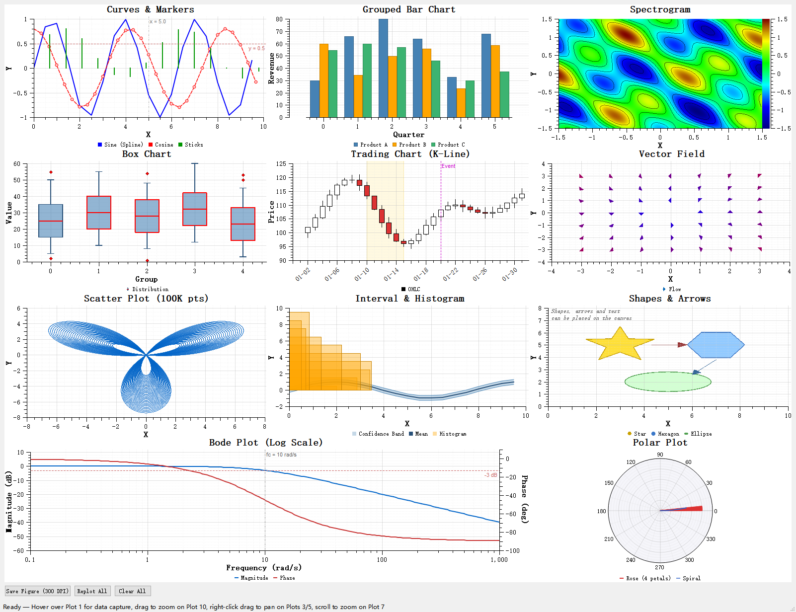

# qmake Single-File Build

Besides [building QWT as shared libraries](build-instructions.md), Qwt also ships an **amalgamated single-file** form that skips the build step entirely. The `src-amalgamate/` directory contains two generated files:

- `QwtPlot.h` — every Qwt header (core + 2D plotting + 3D plotting) merged into one file.
- `QwtPlot.cpp` — every Qwt source file merged into one file.

A single `#include "QwtPlot.h"` gives you the complete Qwt API. You compile these two files directly into your own program; no `qwtcore` / `qwtplot` / `qwtplot3d` library is linked at all.

This page explains how to pull the two files into a **qmake** project: which Qt modules are required, which macros to set (and which to avoid), plus a ready-to-use `.pro` file. The runnable example lives in `examples/qmakeExample/`.

> **Tip**
>
> The single-file route is ideal for quick integration, prototyping and single-file deployment. If you need shared libraries, follow the [CMake build instructions](build-instructions.md) and the [Import Qwt](../use-guide/import-qwt.md) guide instead.

## Prerequisites

- Qt 5.12+ or Qt 6.x with `qmake` on the `PATH`.
- The `src-amalgamate/` directory of this repository. In the examples below it sits two levels above the `.pro` file (`../../src-amalgamate`); in your own project, point the path wherever you keep the two files.

## Required Dependencies

The amalgamation inlines the **entire** Qwt project — core, 2D plotting, 3D plotting, SVG, OpenGL and polar support all collapse into `QwtPlot.cpp`. Unlike the [library build](build-instructions.md) (where `QWT_CONFIG_*` options can switch SVG, OpenGL or 3D off), the single file has no such switches: every feature is always present, so every dependency listed below is mandatory.

| Dependency | Required | Notes |
|------------|----------|-------|
| `core`, `gui`, `widgets` | Yes | Base Qt modules for widgets and plotting. |
| `svg` | Yes | The inlined `QwtPlotSvgItem` always needs it. |
| `concurrent` | Yes | Used by helper classes such as `QwtSamplingThread`. |
| `printsupport` | Yes | `QwtPlotRenderer` printing/export. |
| `opengl` | Yes | Needed by the inlined 3D module and `QwtPlotOpenGLCanvas`. |
| `openglwidgets` | Qt 6 only | Qt 6 splits OpenGL widgets into a separate module; Qt 5 uses the deprecated `QGLWidget` and does not need it. |
| System OpenGL (`GL` + `GLU`) | Yes | The 3D module uses modern OpenGL (GLSL shaders + VBO/VAO) and needs the system GL libraries; GLU is only used by the gl2ps vector-export fallback. GLU always lives in a separate system library, and with some Qt builds (e.g. ANGLE/OpenGL ES based MSVC packages) even `Qt5OpenGL.lib` does not transitively pull in the desktop OpenGL library, so both must be linked explicitly: `-lopengl32 -lglu32` on Windows, `-lGL -lGLU` on Linux. On macOS the OpenGL framework provides both and is already pulled in by `QT += opengl`. |

## Compile-Time Macros

Qwt's `*_global.h` headers turn the per-module `*_EXPORT` macros into `__declspec(dllexport)` / `__declspec(dllimport)` **only when the matching `*_DLL` macro is defined**. With no `*_DLL` macro defined, `*_EXPORT` resolves to nothing — exactly the behavior needed when compiling the amalgamated sources straight into an executable (you are neither building nor consuming a DLL).

| Macro | Default | Effect |
|-------|---------|--------|
| `QWT_DLL` / `QWT_MAKEDLL` | undefined | DLL decoration for the 2D plotting module. **Do not define** — it would add `dllexport`/`dllimport` to symbols compiled into your binary. |
| `QWTCORE_DLL` / `QWTCORE_MAKEDLL` | undefined | DLL decoration for the core module. **Do not define.** |
| `QWT3D_DLL` / `QWT3D_MAKEDLL` | undefined | DLL decoration for the 3D module. **Do not define.** |
| `QWT3D_NODLL` | undefined | Safety switch that force-undefines the 3D DLL macros; only uncomment if your environment predefines `QWT3D_DLL`. |
| `QWT_DEBUG_DRAW` | `0` | Verbose drawing diagnostics. Optional; set to `1` to enable. |
| `QWT_DEBUG_PRINT` | `0` | Verbose printing diagnostics. Optional; set to `1` to enable. |

> **Warning**
>
> `QWT_CONFIG_*` (e.g. `QWT_CONFIG_QWTSVG`) are **CMake build options**, not C++ preprocessor macros. They have no effect on the amalgamated single file — it always contains the full feature set.

You also do **not** need `QT_NO_KEYWORDS` or `CONFIG += no_keywords`: Qwt uses the `Q_SIGNALS` / `Q_SLOTS` macros internally and works with or without Qt keywords.

## Complete .pro Example

Below is the project file used by `examples/qmakeExample/`. Copy it and point `AMALGAMATE_DIR` at your own copy of `src-amalgamate/`.

```pro
######################################################################
# Qwt Examples - Copyright (C) 2002 Uwe Rathmann
# This file may be used under the terms of the 3-clause BSD License
######################################################################

TEMPLATE = app
TARGET   = qmakeExample
CONFIG  += warn_on

# --- amalgamated single file ---
AMALGAMATE_DIR = $$PWD/../../src-amalgamate
INCLUDEPATH += $$AMALGAMATE_DIR
DEPENDPATH  += $$AMALGAMATE_DIR
HEADERS += $$AMALGAMATE_DIR/QwtPlot.h     # auto-moc: all Q_OBJECT macros live here
SOURCES += $$AMALGAMATE_DIR/QwtPlot.cpp   # no Q_OBJECT inside, no moc needed
SOURCES += main.cpp

# --- Qt modules: everything is inlined, so all are mandatory ---
greaterThan(QT_MAJOR_VERSION, 5) {
    QT += core gui widgets svg concurrent opengl printsupport openglwidgets
    CONFIG += c++17
} else {
    QT += core gui widgets svg concurrent opengl printsupport
    CONFIG += c++11
}

# --- system OpenGL GL + GLU ---
win32 {
    LIBS += -lopengl32 -lglu32
}
unix:!macx {
    LIBS += -lGL -lGLU
}
```

> **Tip — Why `QwtPlot.h` goes into `HEADERS`**
>
> The amalgamated header contains all `Q_OBJECT` declarations (50 of them) while `QwtPlot.cpp` contains none. Putting `QwtPlot.h` into `HEADERS` makes qmake's automatic moc generate `moc_QwtPlot.cpp` with all the meta-object code — the qmake equivalent of CMake's `AUTOMOC`. `QwtPlot.cpp` never needs a separate moc step.

## Build Steps

Generate the Makefile with `qmake`, then build with the make tool matching your Qt toolchain:

```shell
cd examples/qmakeExample
qmake qmakeExample.pro
make                # Linux
mingw32-make        # Windows + MinGW
nmake               # Windows + MSVC (run in a Developer Command Prompt)
```

Alternatively, open `qmakeExample.pro` in **Qt Creator** and build from the IDE.

> **Note**
>
> `src-amalgamate/QwtPlot.cpp` is a ~2.4 MB merged source file that inlines the whole Qwt project. The first compile is noticeably slower than a regular example; incremental builds afterwards are fast because only changed files are recompiled.

## C++ Standard

Qt 6 requires C++17; Qt 5 needs at least C++11. The `.pro` above sets this conditionally:

```pro
greaterThan(QT_MAJOR_VERSION, 5) {
    CONFIG += c++17
} else {
    CONFIG += c++11
}
```

## CMake Single-File Build: staticExample

Besides qmake, the repository ships a CMake version of the single-file build as `examples/staticExample/`: it adds `src-amalgamate/QwtPlot.h/.cpp` straight to `add_executable()` without depending on any qwt library target, proving the "two files embed Qwt" promise:

```cmake
add_executable(${QWT_APP_NAME}
    main.cpp
    ${CMAKE_CURRENT_LIST_DIR}/../../src-amalgamate/QwtPlot.h
    ${CMAKE_CURRENT_LIST_DIR}/../../src-amalgamate/QwtPlot.cpp
)
target_include_directories(${QWT_APP_NAME} PUBLIC "${CMAKE_CURRENT_LIST_DIR}/../../src-amalgamate")
```

Build it from the main project with `-DQWT_CONFIG_BUILD_STATIC_EXAMPLE=ON` (the default). Result:



## Troubleshooting

| Problem | Fix |
|---------|-----|
| `unresolved external symbol glu*` or `gl*` (e.g. `glGenLists`, `glOrtho`) | Add the system OpenGL libraries: `-lopengl32 -lglu32` on Windows, `-lGL -lGLU` on Linux. Some Qt builds (ANGLE/OpenGL ES) do not pull the desktop GL libraries in via `Qt5OpenGL.lib`, so link them explicitly. macOS gets both from the OpenGL framework. |
| `Q_OBJECT` / moc errors such as `undefined reference to vtable` | Make sure `QwtPlot.h` is listed in `HEADERS` (not only `SOURCES`) so qmake runs moc on it. |
| `dllexport`/`dllimport` mismatch or `QWT_DLL` redefinition | Remove any `DEFINES += QWT_DLL` (or `QWTCORE_DLL` / `QWT3D_DLL`) lines. A single-file build must keep all DLL macros undefined. |
| Qt 6: `QOpenGLWidget` not found | Add `QT += openglwidgets` (Qt 6 split it into its own module). |
| C++17 feature errors on Qt 6 | Add `CONFIG += c++17`. |
| `QwtPlot.cpp` compiles very slowly | Expected for the first build (~2.4 MB of source). Use incremental builds afterwards; consider a build cache (ccache/clang-cl) for clean builds. |
