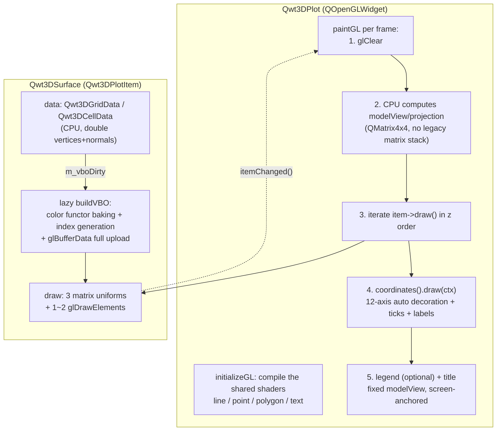
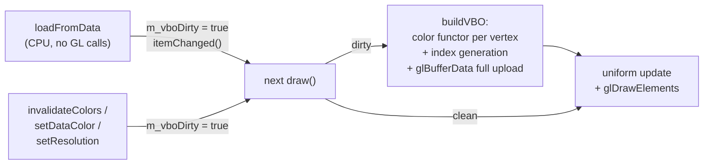

# The 3D Surface VBO/VAO Pipeline: Data Upload, Shader Stages and Mesh-Size Scaling

> **Abstract** — The 3D module of QWT 7.3.3+ (`qwt::plot3d`) has dropped the fixed-pipeline legacy of the old `QwtPlot3D`: `Qwt3DSurface` uses VBO/VAO + GLSL 3.3 Core shaders and does all surface-geometry processing on the GPU, leaving the CPU side with data loading only (`loadFromData` copies the z matrix and computes 4-neighborhood normals), a lazy one-shot build (`buildVBO` bakes vertex colors, generates the triangle/mesh-line indices and uploads everything with `glBufferData`), and 3 matrix uniforms per frame. A frame splits into four segments: fixed floor (coordinate system + labels + compositing) + triangle pass + mesh-line pass + fragment shading. On an Intel UHD 770 iGPU with 113 measured cells (meshes 32²–1024² × 6 plot styles × lighting/MSAA/coordinate-system/resolution switches × two timing bases), each segment scales with the vertex count $V = cols \times rows$; the same matrix gives quantitative bounds for the data update rate and the export paths. Under GPU-completion timing the frame time is approximately $t_0 + k \cdot V$ (least-squares fit $t_0 \approx 4.3$ ms, $k \approx 14.7$ ms per million vertices; the measured NOPLOT floor is 3.0–3.3 ms, and Section 5.3 explains why the intercept lies above the floor), and FILLEDMESH still runs at 51 FPS at 1024² (1M vertices, 2.1M triangles). There is no incremental data-update path: any change triggers a full CPU rebuild + re-upload, and one complete data refresh at 1024² takes 252 ms (a ceiling of 4 Hz). The gl2ps vector export can capture geometry positions through the feedback buffer, but before the fix the vertex colors/alpha came from the fixed-function vertex color in the feedback buffer that the shaders never write, so every surface alpha in the exported PDF/SVG was 0 (invisible). Since v7.5.1 the surface, the coordinate-system grid/axis lines and the color legend emit immediate-mode geometry with explicit per-vertex colors (see the core conclusions). The export time still grows near-linearly with the triangle count (a 1024² PDF takes 145 s / 82.6 MB), so the least-effort path today is still the `grabFramebuffer` raster PNG (about 0.1 s, independent of mesh size).

> **Abstract — Core conclusions**
>
> - Frame time is near-linear in the vertex count, and the fixed floor takes 80% on small meshes: under GPU-completion (glFinish) timing the FILLEDMESH frame time rises from 3.71 ms at 32² to 19.56 ms at 1024², with the affine fit $t = 4.32\,\mathrm{ms} + 14.67\,\mathrm{ms/Mvertex} \cdot V$ ($R^2 = 0.983$); the NOPLOT floor (clear + coordinate system + tick labels + compositing + sync) sits between 3.01–3.27 ms independent of $V$, and at 32² accounts for 82% of the whole frame.
> - The mesh-line pass costs more than the fill pass: at 1024² the triangle pass (FILLED − floor) is 6.88 ms and the mesh-line pass (FILLEDMESH − FILLED) is 9.48 ms, so rasterizing 2.09M 1-px line segments costs more than 2.09M triangles; WIREFRAME (15.37 ms) is 52% slower than FILLED (10.08 ms), and the default FILLEDMESH (19.56 ms) is the most expensive of the common styles.
> - Fragment lighting is nearly free; geometry and bandwidth are the bottleneck: the Blinn-Phong lighting on/off difference at 1024² under GPU-completion timing is −0.09 ms (within noise); the surface's projected area is pinned by AUTOFILL normalization, so the fragment count does not grow with $V$, while the vertex data is re-read every frame (40 MB VBO + 42 MB EBO) at a measured effective triangle-pass bandwidth of about 9.7 GB/s (iGPU shared memory, Section 5.4).
> - Data updates are full rebuilds; there is no incremental path: `loadFromData` (CPU copy + normals) is strictly linear with $b = 1.026$ ($R^2 = 0.9996$, about 177 ns/vertex), and `buildVBO` + upload costs about 63 ns/vertex; `invalidateColors()` and colormap swaps likewise trigger the whole rebuild (76.3 ms at 1024² ≈ the 80.2 ms of the first build); the full refresh cycle at 1024² is 252 ms, capping the refresh rate of streaming data at 4 Hz.
> - The gl2ps vector export works for surface output since v7.5.1: the feedback-captured fills used to have alpha=0 (all 59 ExtGState entries in the PDF were `/ca 0`) because the shader path never writes the fixed-function vertex color; since v7.5.1 `Qwt3DSurface`, the coordinate-system grid/axis lines and the color legend emit immediate-mode geometry with explicit per-vertex colors during the feedback replay, so the exported polygons carry the data colors (directed check with a constant-color functor: the on-page data-color share rises from 0.0% to 53.2% of the polygon area, the rest being mesh lines and label pixmaps; the regression test `tests/plot3d_vector_export_test` fails against the 7.5.0 libraries and passes after the fix). The SVG primitive inflation (15–104×, saturating with mesh size) and the BSP sorting penalty (41–159×) are unchanged; the raster PNG export (constant ~0.1 s) remains the least-effort path.

---

## 1. Introduction: mesh size and the frame budget

A regular grid surface of $cols \times rows$ contains $V = cols \cdot rows$ vertices, about $2V$ triangles and $2V$ mesh-line segments. The frame budget for interactive rendering is 16.7 ms (60 FPS) or 33 ms (30 FPS), so the question formalizes as: given $V$, a draw style and a switch combination, where does the time of one frame go, how does each segment scale with $V$, and what does a single data change cost?

The question has completely different answers on the 2D and 3D sides of QWT. The 2D `QwtPlotOpenGLCanvas` is not a native GL pipeline: every item is still drawn by Qt's OpenGL2 paint engine through `QPainter` onto a `QOpenGLPaintDevice`, with polyline tessellation on the CPU and only filling on the GPU (see ["Raster vs OpenGL Rendering Pipelines"](raster-vs-opengl.md)); the transform and downsampling stage (`QwtPointMapper`) is entirely on the CPU, frame time grows linearly with the sample count, and the backend affects only the rasterization stage. The 3D `Qwt3DSurface` is a genuine GPU geometry pipeline: vertex positions, normals and colors are baked into the VBO once, and each frame only updates 3 matrix uniforms and issues 1–2 `glDrawElements` calls, with all geometry transformation and lighting done inside the shaders. The two therefore scale fundamentally differently: the 2D bottleneck is CPU transformation and rasterization calls; the 3D bottleneck is GPU vertex throughput, primitive rasterization and iGPU shared-memory bandwidth, while the per-frame CPU-side cost is nearly independent of $V$. That is both an advantage (smooth interaction on large meshes) and a measurement trap (submit timing hides the GPU's true cost completely, developed in Section 5.2).

The conclusions rest on 113 measured cells covering meshes from 32² to 1024² (1k–1M vertices), 6 plot styles, four switch classes (lighting/MSAA/coordinate system/resolution), stage-by-stage upload timing and the gl2ps export. All raw data, benchmark sources and analysis scripts ship with the repository; every number can be recomputed.

## 2. The Plot + Item architecture and responsibility boundaries

The class structure of `qwt::plot3d` was refactored in v7.3.3+ into a Plot + Item design symmetric with 2D: `Qwt3DPlot` is a pure rendering window (a `QOpenGLWidget` subclass) managing the GL context, the per-frame view/projection matrices, the lighting switch, the coordinate system, the legend and title, and the z-ordered item list; it holds no plot data at all. Data and drawing logic live entirely in the `Qwt3DPlotItem` subclasses (`Qwt3DSurface` / `Qwt3DLine` / `Qwt3DBar` / `Qwt3DWaterfall`); items are mounted via `attach()` / `detach()` and carry their own VBO/VAO and color functor. For the architectural motivation and a comparison with the old structure, see the [3D plotting architecture tutorial](../use-guide/3d/3d-architecture.md); here we list only the responsibility boundaries relevant to performance.



The notification path matches 2D: any item setter calls `Qwt3DPlotItem::itemChanged()` (`src/plot3d/qwt3d_plotitem.cpp:174-179`), which enters `Qwt3DPlot::itemChanged()` → `recalculateScene()` (`src/plot3d/qwt3d_plot.cpp:879-884, 794-821`): re-sort the item list in z order, take the union of all item hulls, rebuild the coordinate system if necessary, and finally `update()`. This path itself is a light pure-CPU operation (a single `setMeshColor` measures 0.4–6 µs); the real heavy work is triggered by the `m_vboDirty` flag inside the next `draw()`.

The view transform is entirely on the CPU side: `paintGL()` (`qwt3d_plot.cpp:411-520`) assembles the modelView from the rotation/scale/translation state with `QMatrix4x4`, and assembles the ortho/frustum projection from the hull radius; every frame the item passes these two matrices plus the normal matrix as uniforms to its own shader. No `glRotatef`/matrix-stack remnants exist, a hard rule of the module (no legacy GL). The `AUTOFILL` aspect-ratio mode (default) normalizes the three axes into an equal-length cube; the side effect is that the screen-projected area of the surface is independent of mesh size, so the fragment term of Section 4 is a constant.

The theme system `Qwt3DTheme` (10 presets) packages background/mesh/colormap/lighting; `applyTheme()` writes everything into the plot and all attached items in one go (`qwt3d_theme.cpp:442-509`). Among the writes to a surface, the color-related ones (`setDataColor` / `invalidateColors`) trigger a VBO rebuild, while `setPlotStyle` / `setMeshColor` only trigger `itemChanged()` (µs scale, no rebuild); for usage see the [3D plotting tutorial](../use-guide/3d/3d-plot.md). One caveat: a theme's "lighting preset" was only an on/off switch before v7.5.1 (it now feeds the real light/material parameters, see Section 3.3).

## 3. Anatomy of the VBO/VAO pipeline

### 3.1 Vertex layout and index structure

The upload unit is the 40-byte interleaved struct `SurfaceVertex` (`src/plot3d/qwt3d_surface_p.h:23-28`): position `QVector3D` (12 B) + normal `QVector3D` (12 B) + color `QVector4D` (16 B), matching shader attribute locations 0/1/2 (`qwt3d_surface.cpp:1036-1043`). Colors are baked into the buffer at build time by evaluating the color functor per vertex. The default `Qwt3DStandardColor` samples 100 color stops from the viridis preset and then does a linear table lookup by z (`qwt3d_color.cpp:104-115, 124-145`); switching to `Qwt3DColorMapColor` hooks into the 22 scientific colormaps of the core module.

The index structure is generated in `buildGeometry()`/`buildVBO()` (`qwt3d_surface.cpp:848-995, 1002-1063`) following a fixed pattern: the grid-data vertex order is $idx = i \cdot rows + j$ (column-major); each quad emits 2 triangles (6 indices) and 2 mesh lines (4 indices), plus fill-in lines on the right/top boundaries; the triangle indices and the line indices are merged into the same EBO (triangles first, lines after, `qwt3d_surface.cpp:1050-1059`), and drawing segments them by offset. This yields the analytic quantities (verified item by item against the bench's stderr diagnostics):

| cols=rows | Vertices $V$ | Triangles | Triangle indices | Line indices | VBO bytes | EBO bytes |
|---:|---:|---:|---:|---:|---:|---:|
| 32 | 1 024 | 1 922 | 5 766 | 3 968 | 0.04 MB | 0.04 MB |
| 64 | 4 096 | 7 938 | 23 814 | 16 128 | 0.16 MB | 0.16 MB |
| 128 | 16 384 | 32 258 | 96 774 | 65 024 | 0.66 MB | 0.65 MB |
| 256 | 65 536 | 130 050 | 390 150 | 261 120 | 2.62 MB | 2.61 MB |
| 512 | 262 144 | 522 242 | 1 566 726 | 1 046 528 | 10.49 MB | 10.45 MB |
| 1024 | 1 048 576 | 2 093 058 | 6 279 174 | 4 190 208 | 41.94 MB | 41.88 MB |

Three order-of-magnitude judgments follow. First, the EBO is nearly the same size as the VBO (10 uint32 indices per vertex = 40 B, exactly the vertex stride): one full rebuild uploads about $80 \cdot V$ bytes, 83.8 MB at 1024². Second, drawing each frame must also stream these bytes through shared memory once (the indices + the vertices they index); this is the dominant term of large-mesh frame time (bandwidth accounting in Section 5.4). Third, the CPU side permanently holds a double-precision `Qwt3DGridData` (two `DataMatrix` objects for vertices + normals, 48 B per vertex, about 50 MB at 1024²) plus the transient `QVector<SurfaceVertex>` during the build (40 MB), a total memory footprint of about 170 MB for a 1024² surface; under the iGPU shared-memory architecture all of it competes for system bandwidth at the same time.

The `resolution` parameter affects index generation only (the stride skips quads); the vertex array is always built in full (`qwt3d_surface.cpp:871, 874-895, 898-944`).

### 3.2 Upload strategy: lazy, full, no incremental path

The data path has two stages with different trigger points:



The first stage, `loadFromData` (`qwt3d_surface.cpp:293-306`), is pure CPU: it copies the `double**` z matrix into `Qwt3DGridData` (generating the x/y coordinates and the hull along the way), then runs `calcNormalsGrid`, which accumulates per vertex the normalized cross products of the 4 adjacent quads (`qwt3d_surface.cpp:94-151`). The second stage, `buildVBO`, is lazily deferred to the next `draw()` (`qwt3d_surface.cpp:1177-1180`) and does three things: evaluate the color functor per vertex and pack `SurfaceVertex`, generate the two index sets following the pattern of Section 3.1, and upload everything with `QOpenGLBuffer::allocate` (internally `glBufferData`, reallocating the storage).

There is no incremental or partial-update API. Data changes, color changes (`invalidateColors` / `setDataColor`) and even `setResolution` all set `m_vboDirty` and take the same full-rebuild path. The `setResolution` implementation sets `d->m_vboDirty = true` (`qwt3d_surface.cpp:398-407`), so the vertex array is still rebuilt in full and only the indices become sparser; the docstring now states the index stepping plus the full rebuild/re-upload honestly (`qwt3d_surface.cpp:386-397`; before v7.5.1 it claimed "reducing rendered detail without rebuilding the VBO"); the measured res=2 rebuild (a single timing including draw + glFinish) is 42.8 ms, about 53% of the same-basis first-build gross time (first-frame draw 80.2 ms). Comparing against the net-build basis (first frame − steady state = 65.9 ms) would mix bases, so gross times are used consistently here. This matches the structure "vertex loop unchanged, index volume down to 1/4", not the zero rebuild the docstring once implied. The only changes that avoid a rebuild are the matrix/style uniform properties (`setMeshColor`, `setPlotStyle` etc. only trigger `itemChanged`, measured at the µs scale). Switching `setPlotStyle` from FILLED to FILLEDMESH also needs no rebuild (both index sets are always present), a hidden benefit of the merged-EBO design.

The cost of this "full rebuild" strategy is quantified in Section 5.7: one complete data refresh at 1024² (load + rebuild + upload) takes 252 ms.

### 3.3 GLSL 3.3 Core shader stages

The surface shaders are embedded in resource files (`src/plot3d/shaders/surface.vert` / `surface.frag`, compiled into the library via `shaders.qrc`) and lazily compiled and linked at the first `draw()` (`qwt3d_surface.cpp:1186-1195`, a measured one-time cost of about 6 ms); the four shared shaders line/point/polygon/text are compiled in `initializeGL()` (`qwt3d_plot.cpp:352-382`) and serve the coordinate system, the labels and the remaining items.

The vertex shader does all geometry transformation; counting instruction by instruction gives about 80 FLOP (consistent with the 28 + 24 + 28 in the comments of the code block below):

```glsl
void main()
{
    vec4 viewPos = uModelView * vec4(aPosition, 1.0);   // mat4 x vec4: 16 mul + 12 add
    vFragPos = viewPos.xyz;
    vNormal = normalize(uNormalMatrix * aNormal);       // mat3 x vec3: 9 mul + 6 add; normalize ~9
    vColor = aColor;                                    // vertex color pass-through (baked in the VBO)
    gl_Position = uProjection * viewPos;                // 16 mul + 12 add
}
```

The normals are precomputed on the CPU (Section 3.2); the vertex shader only rotates them by the normal matrix and normalizes, leaving the per-fragment normal interpolation (the `vNormal` varying) to the rasterizer. This is a Gouraud/Phong hybrid: lighting is computed per fragment, normals are supplied per vertex.

The fragment shader has three paths; the first two are early-out branches:

```glsl
void main()
{
    if (uUseOverrideColor) { fragColor = uOverrideColor; return; }  // mesh-line / hiddenline pass
    if (!uUseLighting)     { fragColor = vColor; return; }          // default: vertex color pass-through
    // Blinn-Phong: ambient 0.3*c + diffuse max(dot(N,L),0)*c
    //            + specular pow(max(dot(N,H),0), uShininess)*0.5
}
```

The lighting path is about 85–90 FLOP per fragment: four `normalize` calls (norm/lightDir/viewDir/halfwayDir, each containing an rsqrt), two `dot` calls, and one `pow(x, 32)` (drivers usually expand it into the two SFU ops log2/exp2, or into 5 multiplies). What matters is the fragment count: AUTOFILL normalization pins the surface's projected area to a fixed fraction of the viewport, about 150k–270k pixels covered at a 900×600 viewport, independent of $V$. Even at a 1024² mesh the total lighting ALU is only about $2 \times 10^5 \times 90 \approx 18$ MFLOP/frame, under 0.02 ms on the UHD 770 (~1 TFLOPS). This explains the measurement in Section 5.6: the frame-time difference of the lighting switch is within noise.

The implementation status of the first release (wired up in v7.5.1, see the end of the paragraph): the lighting uniforms were hardcoded. `Qwt3DSurface::draw()` writes `uLightPos = (0, 0, 10)` (view space), `uLightColor = white` and `uShininess = 32` as fixed values every frame (that implementation has been replaced by the v7.5.1 wiring; the current uniform upload is at `qwt3d_surface.cpp:1212-1253`); meanwhile the `Qwt3DPlot`-level `setLightComponent` / `setShininess` / `setLightRotation` / `setMaterialComponent` only stored values on the CPU side and did not affect rendering (current implementation: `qwt3d_lighting.cpp:115-134, 103-108, 224-232, 70-87`). Consequently the 5 lighting presets of `Qwt3DTheme` (NoLighting/FlatLight/Studio/Outdoor/Soft) had only two rendering states, "on/off", and `illuminate()`/`blowout()`/`setLightRotation()` likewise could not change any shader uniform. The visual differences between theme presets actually came from the background color and the colormap, not from the lighting. (v7.5.1 update: these setters and `setShininess()` store their arguments now and upload them. `uLightPos` is derived from `setLightRotation`; `uLightAmbient`/`uLightDiffuse`/`uLightSpecular` and `uMaterialAmbient`/`uMaterialDiffuse`/`uMaterialSpecular` come from the light/material components, and `uShininess` from `setShininess`; the defaults reproduce the previously hardcoded values pixel for pixel (0 differing pixels between a build without and with the wiring on the same source base), `illuminate()`/`blowout()` switch the single light, and the 5 theme lighting presets now differ. New getters: `lightComponent()`/`materialComponent()`/`shininess()`/`isLightIlluminated()`; regression test `tests/plot3d_lighting_test`.)

The mapping from the six plot styles to draw calls (`qwt3d_surface.cpp:1263-1342`):

| PLOTSTYLE | draw call | Notes |
|---|---|---|
| `FILLED` | 1 × `glDrawElements(GL_TRIANGLES)` | vertex-color fill, no mesh lines |
| `FILLEDMESH` (default) | two passes: triangles + `GL_LINES` | triangles enable `GL_POLYGON_OFFSET_FILL` against z-fighting; lines use `uOverrideColor` |
| `WIREFRAME` | 1 × `GL_LINES` | mesh lines only |
| `HIDDENLINE` | two passes: background-color triangles + lines | hidden-surface removal by filling with the background color |
| `QWT3D_POINTS` | 1 × `glDrawArrays(GL_POINTS)` | one point per vertex |
| `NOPLOT` | none | draw() returns early |

### 3.4 Coordinate system and labels: fixed overhead rebuilt every frame

`paintGL` draws the coordinate system after the items (`qwt3d_coordsys.cpp:209-232`); unlike the surface, this path has no VBO cache and rebuilds on the fly every frame: `chooseAxes` projects the endpoints of the 12 axes to screen coordinates and runs a 2D convex hull to decide which axes are visible; every visible axis re-runs auto-scaling in `drawTics` (`prepTicCalculation` → `Qwt3DAutoScaler`, `qwt3d_axis.cpp:625-653`), collects the tick-line vertices, and goes through a full `QOpenGLBuffer` create/allocate/destroy cycle (`drawGridLines` at `qwt3d_coordsys.cpp:158-203` is structurally identical to `drawLines` in `qwt3d_axis.cpp`); every tick number is a `Qwt3DLabel`. The text bitmap is cached (`update()` repaints the QImage only when the content changes), but `draw()` creates a new `QOpenGLTexture` from the cached image and uploads it to the GPU every time before drawing the textured quad (`qwt3d_label.cpp:318-428`). In the default scene (the 3–4 axes chosen by auto decoration, several major tick numbers per axis) that is a dozen to a few dozen texture create + upload + destroy cycles per frame.

This is the main component of the measured 3.0–3.3 ms (GPU-completion timing) "fixed floor" (the NOPLOT rows), and the reason frame time drops sharply after `coordinates()->setStyle(NOCOORD)` (Section 5.6). It is independent of $V$, yet accounts for the absolute majority of the frame in small-mesh scenes. The "empty-scene overhead" problem of the 3D surface is structurally the same as the compositing-overhead problem of the 2D GL canvas ([raster-vs-opengl.md](raster-vs-opengl.md), Section 4.3), but the causes differ: 2D is expensive in FBO resolve/blit/compositing, 3D in the per-frame CPU/GL chores of the coordinate system and the labels.

## 4. The frame-time model

Write one frame as the sum of four segments:

$$
T_{\text{frame}}(V) = \underbrace{T_{\text{floor}}}_{\text{clear+coordsys+labels+compositing}} + \underbrace{T_{\text{tri}}(V)}_{\text{triangle pass}} + \underbrace{T_{\text{line}}(V)}_{\text{mesh-line pass}} + \underbrace{T_{\text{frag}}(A)}_{\text{fragment shading}}
$$

$T_{\text{floor}}$ is independent of $V$ (Section 3.4), measured at 3.0–3.3 ms (GPU-completion timing). $T_{\text{tri}}$ consists of vertex fetching ($40\,\mathrm{B} \times V$ of bandwidth) + vertex shading (80 FLOP × V, far below the bandwidth time on an iGPU) + triangle assembly/rasterization (about $2V$ triangles); $T_{\text{line}}$ is the rasterization of $2V$ 1-px line segments: lines enjoy neither early-Z nor the quad-coverage advantage, so their per-primitive cost exceeds that of triangles. $T_{\text{frag}}$ is proportional to the screen coverage area $A$; under AUTOFILL, $A$ is a constant, so the fragment cost of lighting/colormap is independent of $V$.

The theoretical scaling of each segment: $T_{\text{tri}}, T_{\text{line}} = O(V)$ (both bandwidth and primitive throughput are linear), so with the constant floor added the whole frame should take the affine form $t_0 + k \cdot V$; the small-$V$ region is flattened by the floor, appearing on a log-log plot as an S-shaped transition from $V^0$ toward $V^1$. The measurement (Section 5.3) gives a local exponent of 0.61 on the large-mesh segment (512²→1024²), below 1: vertex-cache reuse (a grid vertex is shared by 6 indices) and driver-side optimizations absorb part of the bandwidth, but the exponent is still above the expectation for a same-generation discrete GPU (Section 6.1 estimates a dGPU could compress the surface segment several-fold).

One more basis issue: without `glFinish`, the application thread measures CPU submission time and the GPU work hides in the command queue; under sustained rendering the queue saturates, submission is throttled, and the frame time converges toward the GPU-completion time with periodic long tails (measured p99 up to 480 ms). Section 5 reports both timing bases side by side; conclusions are drawn on the GPU-completion basis.

## 5. Experiments

### 5.1 Methodology and environment

Environment statement (applies to every number in this section): Intel UHD 770 (iGPU), driver 31.0.101.4887, GL 4.6, Qt 5.15.16, QWT 7.4.2 (commit 1b352c1) Release (MSVC2019 /O2), Windows 10; iGPU shared-memory bandwidth, so conclusions for discrete GPUs cannot be extrapolated directly (see Section 6). CPU i7-14700 / 16 GB, a real desktop session, window 900×600, DWM compositing, swapInterval=0 requested (the context reports 1, but the frame times show no 16.7 ms quantization, consistent with the observation in the 2D article). The context reports samples=0: MSAA happens on the internal FBO of `QOpenGLWidget`; `QSurfaceFormat::setSamples(4)` (matching the examples) does take effect, as the MSAA 0/4 comparison in Section 5.6 confirms.

The benchmark program `docs/assets/algorithms/surface3d_bench.cpp` (full compile command in the header comment) uses a scene of a single `Qwt3DSurface`, $z = \sin(2r) e^{-r^2/8}$ over the domain $[-3,3]^2$, viridis vertex colors, BOX coordinate system (auto decoration), no legend, no title. Frame protocol: after 5 warm-up frames, 3 rounds × 100 frames, each frame rotating 0.7° about the z axis (simulating interaction), driven by `update()` + `processEvents()`, with per-frame CPU timing plus a paintGL count (constant at 305/610 per configuration, verifying no missed or extra paints); a between-round median jitter >1.5× triggers a full re-measurement (at most 2 times), and 13 rows of the main matrix + 1 row of the supplement matrix triggered a re-measurement. During the main-matrix run the machine hosted other parallel benchmark agents; part of the p99 long tail is attributable to them, while the medians are protected by the re-measurement protocol. Upload protocol: 3 repetitions, median taken, each stage timing includes `glFinish`. Export protocol: a single timed `saveVector`/`savePixmap` call + output file bytes + SVG primitive count. Data-selection rule: a few configurations in the CSV have duplicate rows for the same configuration (from supplementary measurements; e.g., the 512² noplot finish rows have medians of 3.2705 and 3.0738 ms); the analysis script takes the first matching row, and the 512² floor of 3.271 ms in the text along with its tri/line decomposition follows that choice.

One metrology finding matters for anyone timing GL frames: calling `repaint()` directly on a `QOpenGLWidget` triggers no painting at all (a diagnostic program counted 0 paintGL calls over 20 `repaint()` invocations, while `update()`+`processEvents()` produced exactly one frame each). The bench and any per-frame driving code must go through the `update()` path.

### 5.2 Two timing bases: CPU submit vs GPU completion

Two timings of the same configuration (FILLEDMESH, median, ms):

| cols | Submit timing | GPU-completion timing | Ratio | Submit timing p99 |
|---:|---:|---:|---:|---:|
| 32 | 2.304 | 3.706 | 1.61 | 4.5 |
| 64 | 2.270 | 3.833 | 1.69 | 3.7 |
| 128 | 2.696 | 4.151 | 1.54 | 5.5 |
| 256 | 2.740 | 6.769 | 2.47 | 5.8 |
| 512 | 4.281 | 8.423 | 1.97 | 7.8 |
| 1024 | 3.618 | 19.556 | 5.40 | 479.7 |

On small meshes the two bases are close (the GPU drains within one frame window); at 1024² the submit timing reads only 3.6 ms, 5.4× below the GPU-completion timing, because the CPU stuffs all 300 frames of commands into the driver queue in about 1.1 s while the GPU actually needs about 5.9 s. The difference shows up either as periodic blocking when the queue saturates (p99 479.7 ms) or is deferred to drain at process exit. The 1024² submit-timing data even shows physically impossible inversions like "filled (4.75 ms) slower than filledmesh (3.62 ms)": queue dynamics and concurrent load dominate the median. All conclusive numbers in this article are on the GPU-completion basis; the submit timing serves only to illustrate "the cost the application thread sees" and the interactive-latency floor.

The full style matrix on the submit timing is listed as well (median, ms), for assessing "how long the application thread is blocked": it determines the event loop's latency in responding to the mouse/timers, even if it does not equal the presented frame rate:

| cols | filled | filledmesh | wireframe | hiddenline | points | noplot |
|---:|---:|---:|---:|---:|---:|---:|
| 32 | 2.250 | 2.304 | 2.223 | 2.186 | 2.113 | 2.145 |
| 64 | 2.176 | 2.270 | 2.249 | 2.746 | 2.315 | 2.277 |
| 128 | 2.527 | 2.696 | 2.647 | 2.491 | 2.495 | 2.331 |
| 256 | 2.512 | 2.740 | 3.128 | 2.918 | 2.561 | 2.152 |
| 512 | 3.068 | 4.281 | 3.680 | 4.234 | 2.967 | 2.323 |
| 1024 | 4.749 | 3.618 | 3.850 | 3.195 | 2.885 | 2.226 |

At ≤512² the style order on the submit timing basically matches the completion timing (the differences sit in common CPU costs such as the coordinate system; the style-dependent GPU costs do not appear); the 1024² row is distorted as described above. This also shows that the submit timing mainly measures the per-frame CPU chores of Section 3.4 (the noplot rows at about 2.15–2.33 ms); the surface's own submission cost is just two draw calls, under 0.5 ms at ≤128², but at 512² the filledmesh − noplot submit difference already reaches about 2.0 ms, so the command volume of large meshes is not negligible on the submit basis either.

### 5.3 Frame rate vs mesh size scaling


The full matrix on GPU-completion timing (median, ms; `-` marks configurations where the finish variant was not run):

| cols | filled | filledmesh | wireframe | hiddenline | points | noplot (floor) |
|---:|---:|---:|---:|---:|---:|---:|
| 32 | - | 3.706 | - | - | - | 3.027 |
| 64 | 3.601 | 3.833 | 3.631 | 3.856 | 3.320 | 3.014 |
| 128 | - | 4.151 | - | - | - | 3.157 |
| 256 | 4.312 | 6.769 | 5.472 | - | 3.939 | 3.156 |
| 512 | 6.143 | 8.423 | 9.943 | 8.636 | 7.248 | 3.271 |
| 1024 | 10.078 | 19.556 | 15.370 | 19.098 | 11.809 | 3.201 |

Converted to FPS (GPU-completion timing): FILLEDMESH falls monotonically from 270 FPS at 32² to 51 FPS at 1024²; the boundary of the 60 FPS budget lies between 512² (119 FPS) and 1024²; FILLED still reaches 99 FPS at 1024²; POINTS 85 FPS; WIREFRAME 65 FPS. Under a 30 FPS budget every style meets the target within 1024².

The affine fit of $t = t_0 + k \cdot V$ (FILLEDMESH, all six points): $t_0 = 4.32$ ms, $k = 14.67$ ms per million vertices, $R^2 = 0.983$. $t_0$ sits slightly above the 3.1 ms NOPLOT floor because least squares pulls the transition region around 256² into the intercept; the floor-anchored decomposition is in Section 5.4. The power-law fit gives a global apparent exponent $b = 0.230$ (flattened by the floor); the local exponents are more physical: 0.255 for 128²→512² and 0.608 for 512²→1024², so vertex-cache reuse works at medium sizes and approaches linear beyond 1M vertices. The NOPLOT power-law exponent is 0.011 (its $R^2$ is not meaningful), confirming that the floor is independent of $V$.

### 5.4 Frame decomposition: floor, triangle pass, mesh-line pass


With NOPLOT as the floor, FILLED decomposed into the triangle pass, and FILLEDMESH−FILLED into the mesh-line pass (GPU-completion timing, ms):

| cols | Floor | Surface total | Triangle pass | Mesh-line pass |
|---:|---:|---:|---:|---:|
| 32 | 3.027 | 0.679 | - | - |
| 64 | 3.014 | 0.818 | 0.586 | 0.232 |
| 128 | 3.157 | 0.994 | - | - |
| 256 | 3.156 | 3.613 | 1.156 | 2.457 |
| 512 | 3.271 | 5.152 | 2.872 | 2.280 |
| 1024 | 3.201 | 16.355 | 6.878 | 9.478 |

At 1024² the surface segment of 16.4 ms is 84% of the whole frame, and within it the mesh-line pass (9.48 ms) costs 38% more than the triangle pass (6.88 ms), for the same 2.09M 1-px line segments against 2.09M triangles. The higher per-primitive cost of line segments is a general property of GPU rasterization (low line coverage, poor quad utilization, no early-Z benefit), especially pronounced on an iGPU; the line pass at 512² (2.28 ms) coming in below 256² (2.46 ms) is measurement noise (between-round median differences of about ±5%). Bandwidth accounting: the triangle pass reads the 41.9 MB VBO + 25.1 MB of triangle indices ≈ 67 MB per frame; 6.88 ms corresponds to an effective bandwidth of about 9.7 GB/s, matching the magnitude reachable by iGPU shared memory in a single context. The large-mesh segment therefore runs in the bandwidth/geometry-throughput regime rather than the ALU regime (for contrast: 80 MFLOP of vertex shading at 1 TFLOPS takes only 0.08 ms).

### 5.5 Style matrix

Style ranking at 1024² on GPU-completion timing: FILLED 10.08 < POINTS 11.81 < WIREFRAME 15.37 < HIDDENLINE 19.10 ≈ FILLEDMESH 19.56 ms. Two engineering implications: the default style FILLEDMESH happens to be the most expensive (both passes fully on); HIDDENLINE saves nothing over FILLEDMESH (also two passes, only with background-color triangles). POINTS draws 1M 1-px points with `glDrawArrays`, at a cost between the single triangle pass and the line pass. The same matrix on submit timing (Table B) matches the completion-timing order at ≤512² and is unusable at 1024² due to queue distortion (Section 5.2).

### 5.6 Switch matrix: lighting, MSAA, coordinate system, resolution


Switch comparison for 1024² FILLEDMESH (median, ms; submit | GPU-completion):

| Configuration | Submit timing | GPU-completion timing | Δ (completion timing) |
|---|---:|---:|---:|
| Baseline (BOX, MSAA4, lighting off, res=1) | 3.618 | 19.556 | — |
| Lighting on (Blinn-Phong fragment) | 3.922 | 19.470 | −0.086 |
| Coordinate system NOCOORD | 0.356 | 16.648 | −2.908 |
| MSAA 0 | 3.400 | 13.931 | −5.625 |
| resolution 2 | 4.447 | 9.197 | −10.359 |
| resolution 4 | 2.446 | 6.547 | −13.009 |

First, fragment lighting is free: Δ is within noise (in the full-size detail table below, the signs of the 12 differences are random and the magnitudes ≤0.55 ms, none exceeding the between-round noise band), confirming the constant-fragment model of Section 4, and turning on surface lighting needs no hesitation, but be aware of the lighting-wiring status of Section 3.3: before v7.5.1 it was a fixed-direction Blinn-Phong hardcoded into the shader (it is now adjustable through `setLightRotation` / `setLightComponent` etc.).

Second, MSAA 4× costs 5.6 ms (29%) at 1024²: a ×4 fill rate is a real cost on an iGPU; large-mesh interactive scenes may consider turning it off (the examples default to 4 on).

Third, the coordinate-system floor is 2.9–3.2 ms: NOCOORD knocks the submit-timing frame time from 3.6 ms down to 0.36 ms. Small-mesh high-frame-rate scenes (e.g., a 32²–128² surface in an animation loop) gain the largest proportional benefit from disabling the coordinate system; when coordinate decoration is needed, these 3 ms cannot be avoided (the current implementation rebuilds every frame, see Section 3.4).

Fourth, resolution decimation is the strongest frame-rate knob: res=4 pushes the 1024² frame time back down to 6.5 ms (153 FPS), at the price of geometric fidelity (the index stride skips points; the vertex data is untouched). It also triggers one full rebuild (Section 5.7), so it suits static downsampling rather than per-frame adjustment.

Full-size detail of the lighting difference (median, ms; positive sign = slower with lighting on):

| cols | filled off→on | Δ | filledmesh off→on | Δ |
|---:|---:|---:|---:|---:|
| 32 | 2.250 → 2.387 | +0.137 | 2.304 → 2.788 | +0.484 |
| 64 | 2.176 → 2.094 | −0.082 | 2.270 → 2.730 | +0.460 |
| 128 | 2.527 → 2.371 | −0.157 | 2.696 → 2.536 | −0.160 |
| 256 | 2.512 → 2.509 | −0.003 | 2.740 → 2.530 | −0.211 |
| 512 | 3.068 → 2.639 | −0.429 | 4.281 → 4.267 | −0.014 |
| 1024 | 4.749 → 4.198 | −0.551 | 3.618 → 3.922 | +0.304 |

(Submit timing; the 1024² GPU-completion comparison is 19.556 → 19.470 ms.) Across six sizes × two styles, the signs of the 12 differences are random and the magnitudes ≤0.55 ms, consistent with the model "fragment count constant, lighting ALU negligible"; no configuration shows a systematic lighting cost.

### 5.7 Upload path and data update rate


Stage-by-stage timing (median of 3 repetitions, each stage includes `glFinish`, ms):

| cols | loadFromData (CPU) | first-frame draw (build+upload+draw) | steady-state draw | invalidateColors rebuild | setResolution(2) rebuild | setter (itemChanged) |
|---:|---:|---:|---:|---:|---:|---:|
| 32 | 0.150 | 0.361 | 0.386 | 0.451 | 0.228 | 0.0004 |
| 64 | 0.667 | 0.473 | 0.248 | 0.487 | 0.448 | 0.0010 |
| 128 | 2.740 | 1.594 | 0.446 | 1.365 | 0.738 | 0.0008 |
| 256 | 12.381 | 5.754 | 1.354 | 4.650 | 2.897 | 0.0037 |
| 512 | 45.807 | 17.134 | 4.363 | 18.452 | 10.826 | 0.0049 |
| 1024 | 185.926 | 80.234 | 14.328 | 76.336 | 42.828 | 0.0060 |

`loadFromData` is strictly linear (power law $b = 1.026$, $R^2 = 0.9996$), about 177 ns/vertex. This is the CPU compute cost of the double copy (8 B read + 24 B write ×2 arrays) plus the 4-neighborhood normalized cross products, equivalent to an effective "bandwidth" of only 0.3 GB/s: compute-bound, not memory-bound, and the normal computation takes the bulk. `buildVBO` + upload (first frame − steady state) is 65.9 ms at 1024², about 63 ns/vertex; against the 83.8 MB of VBO+EBO that is an effective bandwidth of 1.3 GB/s, likewise far below the memory ceiling. The bottleneck is the CPU-side serial work of element-by-element `QVector` appends, color-functor calls and the two index loops; `glBufferData` itself is only a small part.

An `invalidateColors()` rebuild costs nearly the same as the first build (1024²: 76.3 vs 80.2 ms). Changing the colormap, adjusting alpha or switching presets all pay the whole pipeline: re-evaluate the color functor over 1M vertices + regenerate the indices + re-upload everything. The lightweight "swap colors only" path one might want does not exist in the current API (the design of baking vertex colors into the VBO couples color to geometry; switching colors to sampling a colormap texture via a uniform is a feasible refactoring direction, but not part of the current implementation).

Adding load + rebuild gives the data refresh cycle (data change → drawable):

| cols | Full refresh cycle | Refresh-rate ceiling |
|---:|---:|---:|
| 32 | 0.15 ms | 6 600 Hz |
| 64 | 0.89 ms | 1 100 Hz |
| 128 | 3.89 ms | 257 Hz |
| 256 | 16.78 ms | 60 Hz |
| 512 | 58.58 ms | 17 Hz |
| 1024 | 251.83 ms | 4.0 Hz |

A 60 FPS streaming surface (new data every frame) is feasible within 256²; 512² caps at 17 Hz; 1024² only 4 Hz. Compared with the rendering side (51 FPS at 1024² when the data is unchanged), the bottleneck is entirely the CPU-side rebuild, not GPU-side drawing. For large-mesh animation, lower the data-update rate, use `resolution` decimation, or alternate loading between two surfaces at the application level.

### 5.8 gl2ps vector export: mechanism, measurements and current limits

The export registry (`qwt3d_io.cpp:306-337`): raster formats go through `Qwt3DPixmapWriter` (`grabFramebuffer` → `QImageWriter`); vector formats EPS/PS/PDF/SVG/PGF go through `Qwt3DVectorWriter` (gl2ps 1.4.3, `src/plot3d/3rdparty/gl2ps/`, compiled in when CMake finds no system gl2ps, linked against `OpenGL::GLU`). The vector path uses gl2ps's classic feedback capture: `gl2psBeginPage` switches GL into the `GL_FEEDBACK` render mode, replays one frame (`plot->grabFramebuffer()`, `qwt3d_io_gl2ps.cpp:230-250`), the driver writes the vertex-processed primitives with their positions and "current color" into the feedback buffer, and gl2ps sorts (SIMPLE/BSP) and emits the vector file, retrying with the buffer grown in 2 MB steps on overflow.

Measurements (single export, ms / bytes / SVG primitives):

| Format | Sort | cols | Time | File size | Captured primitives |
|---|---|---:|---:|---:|---:|
| PDF | SIMPLE | 32 | 107 | 84 KB | - |
| PDF | SIMPLE | 128 | 170 | 1.25 MB | - |
| PDF | SIMPLE | 512 | 9 172 | 19.5 MB | - |
| PDF | SIMPLE | 1024 | 144 737 | 82.6 MB | - |
| PDF | BSP | 64 | 3 862 | 648 KB | - |
| PDF | BSP | 128 | 27 065 | 1.51 MB | - |
| SVG | SIMPLE | 32 | 356 | 24.7 MB | 200 577 |
| SVG | SIMPLE | 64 | 725 | 52.1 MB | 427 990 |
| SVG | SIMPLE | 128 | 813 | 58.1 MB | 473 379 |
| EPS | SIMPLE | 128 | 177 | 1.31 MB | - |
| PNG (raster) | - | 64 | 86 | 132 KB | - |
| PNG (raster) | - | 512 | 84 | 17 KB | - |
| PNG (raster) | - | 1024 | 115 | 8 KB | - |

Note: the PDF/SIMPLE rows in the table are an excerpt (omitting the 64² row at 93.7 ms / 340 KB and the 256² row at 960 ms / 4.96 MB); the fit exponents $b$ below are computed from all 6 CSV points.


PDF/SIMPLE time and size both scale near-linearly with the source triangle count (time $b = 1.05$, size $b = 0.98$, $R^2 = 0.87/1.00$), but the constants are enormous: 1024² (2.09M triangles) takes 145 s and 82.6 MB, three orders of magnitude slower than the PNG of the same scene (0.115 s). BSP sorting explodes in the direction the source comments warn about (41× slower at 64², 159× at 128²) and should not be used for any serious mesh. The captured SVG primitive count shows an anomalous saturation: 104× the source triangle count at 32², 54× at 64², only 14.7× at 128², with the absolute value stopping at about 470k, so feedback capture cannot even be "complete" on large meshes. The exact saturation mechanism is not established here; one unverified candidate hypothesis: the export options include `GL2PS_OCCLUSION_CULL` (`qwt3d_io_gl2ps.cpp:174`), and gl2ps subdivides primitives per pixel to do occlusion culling, while the saturation value of ~470k is of the same order as the ≈540k pixels of the 900×600 viewport, pointing at a viewport-resolution-related ceiling.

More fundamental than time is correctness. Inspecting the output: every SVG polygon has the form `<polygon fill="#6d0000" fill-opacity="0" .../>`, and all 59 transparency ExtGState entries in the PDF are `/ca 0`. The vertex positions are captured correctly (the vertex shader runs as usual in feedback mode), but the colors and alpha come from the fixed-function vertex color in the feedback buffer, which the shaders never write: gl2ps captures the fixed-function primary color per vertex via `GL_3D_COLOR` feedback (`gl2ps.c:6208`; `gl2psGetVertex` reads p[3..6] directly as RGBA), while a GLSL 330 shader does not write `gl_FrontColor` and before the fix the module contained no `glColor*` calls (only `qwt3d_io_gl2ps.cpp:435/476` for text-color save/restore), so what is captured is undefined (measured alpha=0), all fills are fully transparent and the surface is invisible in the vector output. This is not a measurement error; the source declares it as a known limitation (`qwt3d_io_gl2ps.h:14-17`: "gl2ps relies on the Compatibility Profile GL state... vector export may not reflect the correct transformation... full modernization requires generating vector output from VBO vertex data directly", with the `.cpp` docstring saying the same). gl2ps worked in the old `QwtPlot3D` era because drawing then used immediate mode + `glColor`, so the feedback buffer captured the real colors. Fixed in v7.5.1: `Qwt3DSurface` (and the coordinate system grid/axis lines and the legend) now switch to immediate mode during the feedback replay. The vertices are transformed to clip coordinates on the CPU with the same matrices the shaders use, and the colors are supplied per vertex with `glColor4f` (`qwt3dEmitVerticesForVectorExport()`, `qwt3d_io_gl2ps.cpp`), so the feedback buffer records exactly the colors the shader path would have painted; `Qwt3DPlot::isVectorExportActive()` is derived from the GL render mode (`GL_FEEDBACK`). Directed verification (constant red functor, `surface_export_check.cpp`): before the fix not a single on-page polygon carried the data color (0.0%), after it 640 of 2321 polygons covering 53.2% of the polygon area do; `tests/plot3d_vector_export_test` pins the regression down.

The trade-off in the current version is therefore clear: use the raster path for 3D export (`savePixmap`/`save`, constant at about 0.1 s, independent of mesh size, the time being dominated by readback + encoding). Before v7.5.1 the vector path was meaningful only for text/line-segment content (labels via `drawDeviceText`), and the correct fix for surface vectorization is to generate vector output directly from the VBO data, along the lines of the source comments. Two usage-level pitfalls: before v7.5.1 the format registry was case-sensitive (the raster format key is lowercase, `"png"`, and `savePixmap(file, "PNG")` silently returned false), which the official example `examples/3D/qwtplot3d` happened to hit; the PNG file size *decreases* as the mesh grows (64² 132 KB → 1024² 8 KB), because the coarse mesh lines at 64² are high-entropy edges while the sub-pixel mesh lines at 1024² are averaged into smooth gradients by MSAA. The framebuffer content was separately verified at the pixel level (a diagnostic program found 153k non-background pixels in the 1024² scene at the (30°, 0°) viewpoint, with a bounding box covering the viewport center), ruling out the possibility that "large meshes render empty, hence the small files". (v7.5.1 update: the format lookup, registration and format checks are case-insensitive now (`qwt3d_io.cpp:88, 98, 353-363`) and unregistered formats produce a qWarning; the example derives the format from the file suffix (`examples/3D/qwtplot3d/MainWindow.cpp:386-390`) and reports failures; the "surface invisible in vector output" part is fixed as described above. The time and size trade-off still holds.)

## 6. Discussion: failure modes

1. iGPU bandwidth bottleneck; discrete GPUs cannot be extrapolated directly: every number comes from UHD 770 shared memory. The triangle pass's 9.7 GB/s effective bandwidth on a dGPU (hundreds of GB/s of VRAM) would compress the 1024² surface segment several-fold, but the fixed floor (the CPU-side coordinate-system/label rebuild) stays the same, so on a dGPU the floor's share actually rises. The directional conclusions (the line pass costing more than the triangle pass, free lighting, the full-rebuild cost) are mostly architectural and transferable; the absolute values must be re-measured.
2. Submit timing is systematically distorted on large meshes: 1024² submit median 3.6 ms vs completion 19.6 ms, p99 480 ms. Any GL frame timing without synchronization is untrustworthy in the regime "GPU per frame > CPU submission"; the machine hosted parallel benchmark agents during the main-matrix run, and 14 rows triggered the re-measurement protocol; the medians are protected, but the p99 contains an external-interference component.
3. No incremental update is a hard ceiling for streaming scenes: data refresh rate ≤4 Hz (1024²) / 17 Hz (512²). Color changes are full rebuilds too (a direct consequence of the baked-vertex-color design). Applications needing high-frequency data streams should work within 256², or implement chunked surfaces / double-buffer alternation themselves.
4. The 3 ms fixed floor and the per-frame chores: the coordinate system rebuilds its VBO every frame, every label creates a new texture every frame. These costs are independent of $V$ yet determine the frame-rate ceiling (~300 FPS) and the submission latency of small-mesh scenes. NOCOORD bypasses them, but there is no "cache the coordinate-system geometry" switch.
5. The gl2ps vector export used to be unusable for surfaces (fixed in v7.5.1): the feedback capture reads an undefined fixed-function vertex color - fully transparent fills (invisible surfaces, all 59 PDF ExtGState entries `/ca 0`) on the original measurement machine, data-independent noise here (Qt 6.7.3 / Iris Xe: 0.0% on-page data-color share with a constant-color functor). Since v7.5.1 the surface, the grid/axis lines and the legend submit explicit per-vertex colors in immediate mode, so the exported polygons carry the data colors (the regression test fails against the 7.5.0 libraries and passes after the fix). The SVG primitive saturation, the time exploding linearly with size and the BSP penalty remain - vector export suits small to medium meshes, large ones are still better served by the raster path.
6. Lighting and the theme lighting presets were not wired up (wired in v7.5.1): the uniforms used to be hardcoded (light at (0,0,10), shininess 32) and `setLightComponent`/`setShininess`/`setLightRotation`/`setMaterialComponent` only stored values, so the 4 theme lighting presets other than NoLighting rendered identically. Since v7.5.1 the light/material components and the shininess are uploaded as uniforms (their defaults equal the old hardcoded values, leaving the default rendering pixel-identical), the light position follows `setLightRotation`, `illuminate()`/`blowout()` switch the single light, and the presets differ; `tests/plot3d_lighting_test` verifies that the parameters change rendered pixels.
7. The default style is the most expensive: FILLEDMESH's two passes are 94% slower than FILLED at 1024² (GPU-completion timing, 19.56 vs 10.08 ms). Prefer FILLED for large-mesh interaction, or accept resolution decimation.
8. MSAA 4× costs 29% on large meshes: the examples default to 4; on an iGPU it can be turned off for 1024² interaction.
9. `setResolution` documentation used to disagree with the implementation (aligned in v7.5.1): the docstring claimed no rebuild; the implementation sets dirty and does a full rebuild (only the indices become sparse). Adjusting resolution per frame for LOD would pay a rebuild cost of 40–80 ms (1024²) each time, usable only as a static setting. (v7.5.1: the docstring now states the index stepping plus full rebuild/re-upload honestly; the LOD use case stays limited.)
10. The format registry used to be case-sensitive (fixed in v7.5.1): `savePixmap(file, "PNG")` failed silently (the registered key is lowercase) and the official example `examples/3D/qwtplot3d` hit this pitfall. Since v7.5.1 lookups, registrations and the `saveVector`/`savePixmap` format checks are case-insensitive (`qwt3d_io.cpp:88, 98, 353-363`), unregistered formats produce a qWarning, and the example derives the format from the file suffix and reports failures.
11. `QOpenGLWidget::repaint()` is a no-op: per-frame driving requires `update()` + an event pump (or a timer); direct `repaint()` yields 0 frames, confirmed by measurement during bench development; custom render loops take note.
12. Qt version boundary: the measurements cover only Qt 5.15 + Windows/DWM. Qt 6's `QOpenGLWidget` goes through RHI; whether feedback mode (which gl2ps depends on) works under RHI is doubtful, and the vector-export path may fail entirely; the combination of `#version 330` shaders and a default compatibility-profile context (measured 4.6 compatibility) requires an explicit core-profile format on Qt6.

## 7. Code practice

### 7.1 Minimal compilable example

Creating a 3D surface and rendering it interactively takes five steps; the compile/link recipe is the same as the bench's (`qwtplot3d.lib qwtcore.lib` + `Qt5Widgets/Gui/Core/OpenGL` + `opengl32 glu32`):

```cpp
#include <QApplication>
#include <QSurfaceFormat>

#include <cmath>
#include <vector>

#include <qwt3d_plot.h>
#include <qwt3d_surface.h>

int main(int argc, char* argv[])
{
    QSurfaceFormat fmt = QSurfaceFormat::defaultFormat();
    fmt.setDepthBufferSize(24);
    fmt.setSamples(4);            // MSAA, matches the bundled examples
    QSurfaceFormat::setDefaultFormat(fmt);

    QApplication app(argc, argv);

    Qwt3DPlot plot;
    plot.resize(900, 600);

    // z matrix on [-3,3]^2, 128x128 (60+ FPS data-refresh budget, see 5.7)
    const int N = 128;
    std::vector<std::vector<double>> z(N, std::vector<double>(N));
    std::vector<double*> ptrs(N);
    for (int i = 0; i < N; ++i) {
        const double x = -3.0 + 6.0 * i / (N - 1);
        for (int j = 0; j < N; ++j) {
            const double y = -3.0 + 6.0 * j / (N - 1);
            z[i][j] = std::sin(2.0 * std::sqrt(x * x + y * y)) * std::exp(-(x * x + y * y) / 8.0);
        }
        ptrs[i] = z[i].data();
    }

    Qwt3DSurface* surface = new Qwt3DSurface();          // demo-only: nobody deletes it; plot's dtor detaches items but never owns them
    surface->loadFromData(ptrs.data(), N, N, -3.0, 3.0, -3.0, 3.0);
    surface->attach(&plot);                              // attach after load: hull drives the coordsys

    plot.applyTheme(Qwt3DTheme::Scientific);             // pushes colors/style to attached items too
    surface->setPlotStyle(FILLEDMESH);                   // optional override; FILLED is ~2x faster at 1024^2

    plot.enableLighting();                               // Blinn-Phong, free on the GPU (5.6)
    plot.show();
    return app.exec();
}
```

Key points: `loadFromData` may be called before `attach` (`recalculateScene` inside `attach` rebuilds the coordinate system from the hull); `applyTheme` pushes the item-level properties (colormap, style) to the items attached at that moment, and an explicit `setPlotStyle` afterwards can override the theme's choice. No manual refresh is needed after a data change, because `itemChanged()` inside `loadFromData` already triggers `update()`; and if several properties are changed within one frame, only the last trigger matters (the VBO rebuild is lazy and coalesces into the next frame).

### 7.2 Theme, colormap and lighting

The snippet below requires two extra includes, `<qwt3d_theme.h>` and `<qwt3d_colormap_color.h>`:

```cpp
plot.applyTheme("Dark");                       // by name; 10 presets available

Qwt3DTheme theme(Qwt3DTheme::Scientific);      // manual customization
theme.setDataColorPreset("plasma");            // any of the 22 core colormap presets
plot.setTheme(theme);

// swap the colormap on an existing surface (costs a full VBO rebuild, 5.7):
auto* cmap = new Qwt3DColorMapColor("inferno");
surface->setDataColor(cmap);                   // item takes ownership

// color functors are silent value objects: in-place mutation needs an
// explicit invalidate, which re-runs the whole build+upload path:
cmap->setAlpha(0.8);
surface->invalidateColors();                   // ~76 ms at 1024^2 (5.7)
```

See item 6 of Section 6: a theme's lighting preset feeds the real light/material parameters since v7.5.1; before that it was equivalent to nothing more than the `enableLighting()`/`disableLighting()` switch.

### 7.3 Export

```cpp
plot.save("surface.png", "png");               // raster: ~0.1 s, size-independent
plot.saveVector("surface.pdf", "PDF",          // gl2ps feedback capture:
                Qwt3DVectorWriter::PIXEL,      // data colors included since 7.5.1 (5.8)
                Qwt3DVectorWriter::SIMPLESORT);
QPixmap pm = plot.renderPixmap();              // in-memory raster grab
```

Evaluate vector export for large meshes against the numbers of Section 5.8: a 512² PDF already takes 9 s / 19.5 MB; for formal figures, prefer a 2D projection (contours/heatmaps through the `qwt::plot` vector export) or a high-resolution PNG.

### 7.4 Performance tuning quick reference

| Scenario | Recommendation | Basis |
|---|---|---|
| Interactive rotation ≤512² | the default configuration is fine (119+ FPS) | 5.3 |
| 1024² interaction | `FILLED` instead of `FILLEDMESH`, or `setResolution(2..4)` | 5.5/5.6: 19.6→10.1 / 9.2 / 6.5 ms (GPU-completion timing) |
| iGPU + large mesh | `QSurfaceFormat::setSamples(0)` | 5.6: MSAA4 costs 5.6 ms |
| High-frame-rate small surface (animation) | `coordinates()->setStyle(NOCOORD)`, or accept the 3 ms floor | 5.6 |
| Streaming data | mesh ≤256² (60 Hz refresh ceiling); 512² only 17 Hz | 5.7 |
| Colormap swap | budget one full rebuild (76 ms at 1024²); do not swap per frame | 5.7 |
| Export | PNG raster for large meshes; the vector path's time/size explode with mesh size (surface coloring correct since 7.5.1) | 5.8 |
| Per-frame driving | `update()` + event pump; do not use `repaint()` | 5.1/6.11 |

## 8. Summary

The QWT 3D surface pipeline keeps geometry processing entirely on the GPU: the CPU pays only 3 uniforms and 1–2 draw calls per frame, the frame time follows the affine scaling "3 ms fixed floor + about 15 ms per million vertices" on GPU-completion timing, and the default style still reaches 51 FPS at 1024² (1M vertices). Interactive rendering is not the bottleneck; the limits sit at the two ends. On the data side there is no incremental path: every change (including a color swap) is a CPU rebuild at 177 ns/vertex plus an 84 MB-class re-upload, pinning the 1024² data-refresh rate at 4 Hz. On the output side the gl2ps vector export produced fully transparent surfaces because the fixed-function vertex color captured via feedback is never written by the shaders; since v7.5.1 the surface, the grid/axis lines and the legend submit explicit per-vertex colors in immediate mode, so the vector output carries data colors, while the time/size trade-off for large meshes is unchanged and the raster export remains the least-effort path. The rendering side in between still has clear optimization headroom: the mesh-line pass costs more than the triangle pass (the default style happens to run both passes fully on), the per-frame rebuild of the coordinate system and labels contributes the 3 ms floor, MSAA 4× costs 29% on large meshes, and `setResolution` decimation can compress the frame time to 1/3. These conclusions apply to an Intel UHD 770 iGPU, Qt 5.15, Windows/DWM and a single-surface scene; a discrete GPU would rewrite the absolute numbers but not the structural judgments "the CPU rebuild is the streaming bottleneck, lines cost more than fills, lighting is free". The benchmark source, the 113 rows of raw data and the analysis script ship with the repository; every number can be recomputed.

## 9. References

1. QWT sources: `src/plot3d/qwt3d_surface.h/.cpp` (loadFromData, buildVBO, draw, the six PLOTSTYLE branches, the hardcoded lighting uniforms), `qwt3d_surface_p.h` (the 40 B SurfaceVertex layout), `qwt3d_plot.h/.cpp` (the per-frame matrices in paintGL, the shared shaders in initializeGL, recalculateScene/itemChanged), `qwt3d_plotitem.h/.cpp` (the attach/detach/itemChanged contract), `qwt3d_coordsys.cpp` (the per-frame VBO rebuild of the grid-line/tick drawing), `qwt3d_axis.cpp` (the per-frame autoscale and tick labels), `qwt3d_label.cpp` (the per-frame texture upload), `qwt3d_lighting.cpp` (the lighting-parameter stubs), `qwt3d_theme.cpp` (apply and the lighting-preset mapping), `qwt3d_io.cpp` (the format registry, save/saveVector/savePixmap), `qwt3d_io_gl2ps.cpp/.h` (the feedback-capture flow and the known-limitation statement), `src/plot3d/shaders/surface.vert|frag` (the GLSL 3.3 shader sources), `src/plot3d/3rdparty/gl2ps/` (gl2ps 1.4.3).
2. gl2ps project: C. Geuzaine, "gl2ps: an OpenGL to PostScript printing library", https://geuz.org/gl2ps/ (the feedback-buffer capture mechanism and the sorting modes).
3. Examples: `examples/3D/qwtplot3d` (surface + theme + property panel), `examples/3D/waterfall3D` (waterfall plot), `examples/3D/bar3D`, `examples/3D/line3D`, `examples/3D/figureSurface3D`.
4. Companion benchmark: `docs/assets/algorithms/surface3d_bench.cpp` (compile command in the file header), `surface3d_results.csv` (113 rows of raw data + protocol header notes), `surface3d_experiment.py` (analysis and figures; all numbers on stdout).
5. "Raster vs OpenGL Rendering Pipelines" ([raster-vs-opengl.md](raster-vs-opengl.md)): the 2D frame-decomposition methodology, the GL-canvas compositing overhead and the dependence on the machine's GPU state — this article's timing design (the dual submit/completion tracks, the re-measurement protocol) follows that article.
6. "Downsampling Curves for the Screen: LTTB Theory and the QWT7 MinMax Bucket" ([curve-downsampling.md](curve-downsampling.md)): the scaling analysis of the CPU transform stage on the 2D side, forming a contrast with the GPU geometry stage of this article.
7. 3D tutorials: [3D Plot Architecture](../use-guide/3d/3d-architecture.md) (the motivation of the Plot+Item refactor), [3D Plot Introduction](../use-guide/3d/3d-plot.md) (API usage and themes).

*Companion reading:* [Raster vs OpenGL Rendering Pipelines: End-to-End Frame-Time Breakdown and a Selection Criterion](raster-vs-opengl.md) — why the 2D canvas's GPU path is not a native pipeline; [3D Plot Architecture: From QwtPlot3D to Plot + Item](../use-guide/3d/3d-architecture.md) — the tutorial version of this article's architecture section.
