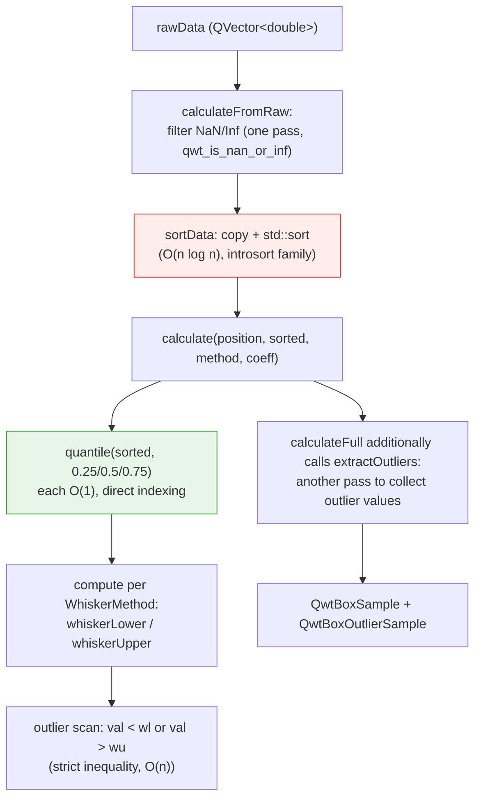
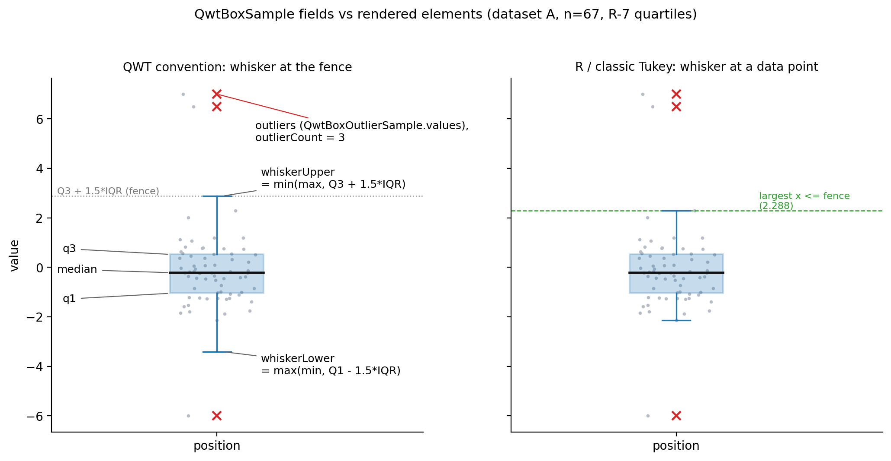
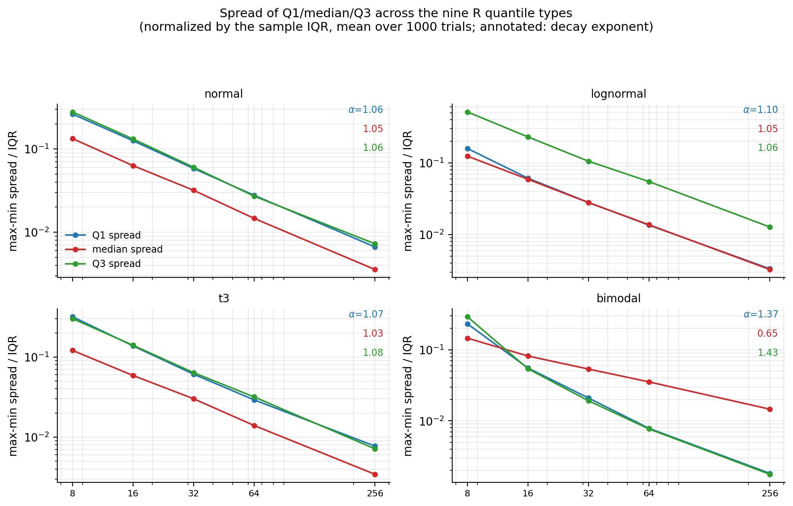
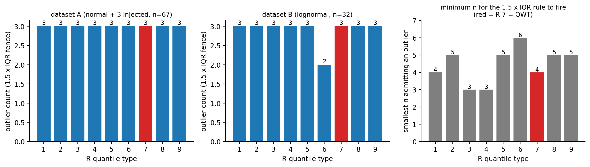
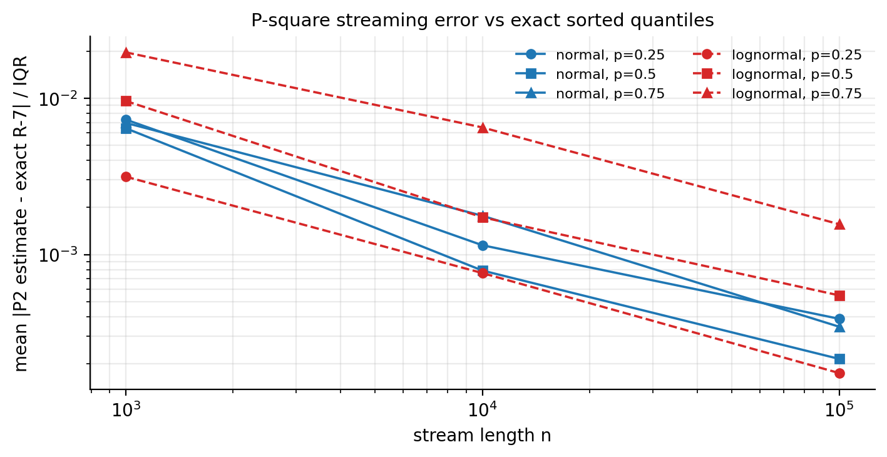
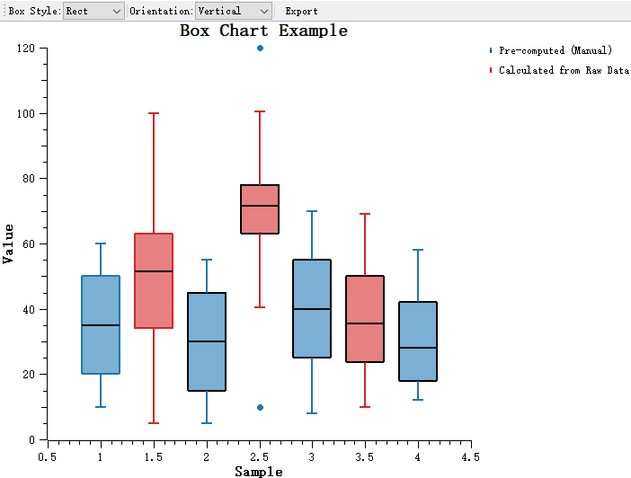

# Box-Plot Quantile Algorithms: The QwtBoxStatisticsCalculator Estimator vs the R-Type Quantiles

> **Abstract** — A box plot compresses a data set into a five-number summary (lower whisker, Q1, median, Q3, upper whisker) plus a list of outliers, but the "sample quantile" itself has no unique definition: on the same sorted data, the nine R-type definitions collected by Hyatt & Sackrow can produce nine different Q1/Q3 pairs, and the IQR outlier fence is built directly on these two numbers, so the choice of estimator propagates all the way to "which points get drawn as outliers". This article dissects the QWT7 core module's `QwtBoxStatisticsCalculator` (`src/core/qwt_box_statistics.h/.cpp`) line by line and compares 34,440 probe quantiles numerically against the nine R-type definitions one by one, proving that its `quantile()` implementation (`index = p·(n−1)` linear interpolation) is **exactly the R-7 type** — the default convention of R, Excel `PERCENTILE.INC` and NumPy. Experiments on four distributions (normal, lognormal, t(3), bimodal) then quantify the quantile disagreement among the nine definitions (at n=8 the Q3 disagreement reaches 0.51×IQR and decays as ≈n⁻¹ with n), the sensitivity of outlier counts (on a lognormal sample R-6 flags one fewer outlier than the other eight), the combinatorial boundary of the 1.5×IQR rule at small samples (under R-7, n=4 can already produce outliers while n≤3 never can, with a proof), and the cost and benefit of sort-based exact computation relative to the P² streaming approximation. All conclusions are grounded in the source code and real run outputs, including two source-level defects: the **swap** of the upper and lower quantile levels in the Percentile whisker method (measured in C++: whiskerLower > whiskerUpper, all 64 points counted as outliers), and the "mean marker" of `QwtPlotBoxChart` actually drawn at the median position.

> **Abstract — Core conclusions**
>
> - `QwtBoxStatisticsCalculator::quantile()` shows **zero mismatches** against the R-7 quantile on 34,440 probes (n=2…256, many ties included, p∈{0.05,…,0.95}), with a maximum absolute difference of 3.55×10⁻¹⁵ (floating-point rounding level); the other eight definitions mismatch on between 19,884 and 26,322 probes
> - Q1/Q3 disagreement among the nine definitions, normalized by the sample IQR, decays at least as fast as n⁻¹ (log-log fitted exponents 1.03–1.43; the only one slower than n⁻¹ is the bimodal median at 0.65): for normal samples at n=8 the mean Q1 disagreement is 0.263×IQR with a p95 of 0.783×IQR; by n=256 it drops to 0.0066×IQR — the "quartiles" of a small-sample box plot inherently carry definition noise on the order of 0.3 IQR
> - Whether the 1.5×IQR rule can fire at all has an exact combinatorial lower bound: under R-7, **n=4 is the smallest detectable sample** (counterexample [0,0,0,1], fence 0.625), and n≤3 never produces outliers (algebraic proof given in the article); the folklore claim that "n=5 cannot produce outliers" does not hold for R-7 ([0,1,2,3,100] flags 100)
> - Outlier counts are insensitive to the estimator but not immune: on the 67-point data set (64 normal + 3 injected) all nine definitions agree on 3; on 32 lognormal points R-6 says 2 while the other eight say 3 — about 9.4% of the points in a right-skewed distribution get flagged "outliers" by the 1.5×IQR rule, which is skewness, not contamination
> - The C++ cross-validation matches the Python replica **bit-for-bit** on 20/20 cases (maximum relative difference 0.000e+00); the same batch of cases confirms the Percentile whisker upper/lower swap defect and the SE method's whisker reaching into the box interior (whiskerUpper=99.97 < q3=108.56)

---

## 1. Introduction: the five-number summary and the non-uniqueness of quantiles

### 1.1 The five numbers a box plot consumes

The box plot, introduced by Tukey (1977), compresses a set of observations $x_1,\dots,x_n$ into a five-number summary plus an outlier set:

$$
\left(\; w_{\text{lo}},\; Q_1,\; \tilde{x},\; Q_3,\; w_{\text{hi}} \;\right), \qquad
\mathcal{O} = \left\{ x_i : x_i \notin [\,w_{\text{lo}},\, w_{\text{hi}}\,] \right\}
$$

where $Q_1 = \hat{Q}(0.25)$, $\tilde{x} = \hat{Q}(0.5)$, $Q_3 = \hat{Q}(0.75)$ are sample quantiles, and Tukey's fence rule gives

$$
w_{\text{lo}} = Q_1 - 1.5\,\mathrm{IQR}, \qquad w_{\text{hi}} = Q_3 + 1.5\,\mathrm{IQR}, \qquad \mathrm{IQR} = Q_3 - Q_1
$$

(when drawing, the whisker endpoints are additionally clamped against the data extremes; see Section 3.3.) The key observation: **the only "degree of freedom" in this pipeline is the definition of $\hat{Q}(p)$**. The population quantile $Q(p) = F^{-1}(p)$ is uniquely determined by the distribution, but its sample estimate $\hat{Q}(p)$ is not — $n$ sorted observations offer only $n$ "natural candidate positions" while $p\in(0,1)$ is continuous, so every definition must commit to "which rank to take, whether to interpolate, and with what interpolation weight".

### 1.2 How large the non-uniqueness is

For sorted data $x_{(1)} \le \cdots \le x_{(n)}$, the most naive conventions already give different answers: with $n=8$ and data $1,\dots,8$, "Q1 = the median of the lower half" gives 2.5, "Q1 = the $\lceil n/4 \rceil$-th order statistic" gives 2, and "Q1 = linear interpolation at the virtual rank $(n-1)\cdot 0.25 + 1 = 2.75$" gives 2.75 — the Q1 of the same data swings between 2 and 2.75, a span of 0.75, which in units of the R-7 IQR of 3.5 is 0.21×IQR. The fence formula then amplifies this difference: $w_{\text{lo}} = 2.5Q_1 - 1.5Q_3$, $w_{\text{hi}} = 2.5Q_3 - 1.5Q_1$; a 0.75 shift in Q1 pushes the lower fence away by 1.9 — directly deciding whether an edge point is drawn as an outlier.

Section 2 tabulates the nine standard definitions (R-1…R-9) together with their statistical properties; Section 3 dissects the QWT implementation stage by stage and proves it belongs to R-7; Section 4 quantifies the practical consequences of the definition choice with reproducible experiments; Section 5 gives the honest failure-mode list (including two source-level defects); Section 6 shows code practice for `QwtPlotBoxChart` and custom statistical conventions.

All experimental numbers in this article come from the run outputs of `docs/assets/algorithms/boxstats_experiment.py` (Python 3.11 + numpy + matplotlib, fixed seeds, no wall-clock timing of any kind) and `docs/assets/algorithms/boxstats_check.cpp` (a C++ harness linking the real `qwtcore.lib`); the two corroborate each other, see Section 4.6.

## 2. The nine definitions of the quantile (R-1 … R-9)

Hyatt & Sackrow (2003) organized the nine `type` parameters of R's `quantile()` into a definition table, and this article adopts their classification. Let $x_{(1)}\le\cdots\le x_{(n)}$ denote the order statistics and $p\in(0,1)$.

### 2.1 Discrete types: R-1, R-2, R-3

The first three definitions return observations only (R-2 allows the average of two adjacent points), with no interpolation:

$$
\text{R-1:}\quad \hat{Q}(p) = x_{(\lceil np \rceil)}
$$

$$
\text{R-2:}\quad \hat{Q}(p) = \begin{cases} \tfrac{1}{2}\left(x_{(np)} + x_{(np+1)}\right), & np \in \mathbb{Z} \\[2pt] x_{(\lceil np \rceil)}, & \text{otherwise} \end{cases}
$$

$$
\text{R-3:}\quad \hat{Q}(p) = x_{(k)}, \quad k = \operatorname{round\text{-}to\text{-}even}(np)
$$

R-1 is the inverse of the empirical distribution function (inverse empirical CDF), satisfying $\hat{Q}(p) = \inf\{x : F_n(x) \ge p\}$; R-2 takes the average of the left and right limits at its discontinuities; R-3, the SAS default, takes the rank closest to $np$ with ties broken toward the even rank. All three are **distribution-free**: they do not assume $F$ continuous, and the returned value is necessarily an observation (except for R-2). The price is that $\hat{Q}(p)$ as a function of $p$ is a staircase — a tiny change in p can flip the rank, which is exactly the dominant source of disagreement among the nine definitions on tied data in Section 4.2.

### 2.2 Continuous types: R-4 … R-9

The last six definitions all share the form "virtual rank $h$ + linear interpolation":

$$
\hat{Q}(p) = (1-\gamma)\, x_{(\lfloor h \rfloor)} + \gamma\, x_{(\lfloor h \rfloor + 1)}, \qquad \gamma = h - \lfloor h \rfloor
$$

(clamped to the endpoints when $h<1$ or $h>n$.) They differ only in $h(p)$:

| Type | $h(p)$ | Equivalent form (Hyatt–Sackrow's $m$) | Common users |
|------|--------|----------------------------------|------------|
| R-4 | $np$ | $m = 0$ | — |
| R-5 | $np + \tfrac12$ | $m = \tfrac12$ | — |
| R-6 | $(n+1)p$ | $m = p$ | Minitab, SPSS |
| **R-7** | $(n-1)p + 1$ | $m = 1-p$ | **R/NumPy/Excel/Julia default** |
| R-8 | $(n+\tfrac13)p + \tfrac13$ | $m = \tfrac{p+1}{3}$ | recommended (approximately median-unbiased) |
| R-9 | $(n+\tfrac14)p + \tfrac38$ | $m = \tfrac38 + \tfrac p4$ | approximately unbiased for normal quantiles |

### 2.3 Statistical properties compared

**Unbiasedness**. Hyatt & Sackrow's simulation study shows that for normal samples, R-1…R-7 systematically underestimate $|Q(p)|$ at tail probabilities (p near 0 or 1) — a negative bias — while R-8 is approximately median-unbiased for any distribution, and R-9 makes $\mathbb{E}[\hat{Q}(p)] \approx Q(p)$ hold for the normal distribution. A box plot consumes only p∈{0.25, 0.5, 0.75}, far from the tails, so the bias differences among the definitions are far smaller than the width of the "disagreement band" quantified in Section 4.3.

**Continuity and attainable values**. R-4…R-9 are continuous functions of $p$ and can take any interpolated value (not necessarily an observation); R-1/R-3 take observations only; R-2 can take the average of adjacent observations. For the median at even $n$: R-1/R-3/R-4 take a single middle point (all $x_{(4)}$ at $n=8$), while the other six take the average of the two middle points, 4.5 (see the measured table in Section 4.2) — "the median of an even sample is the average" is not universal; it depends on the definition.

**Distribution-freeness**. None of the nine definitions assumes a shape for $F$ (all depend only on order statistics), but the $h(p)$ of R-6…R-9 embeds a model of the "expected positions of the order statistics": R-6 corresponds to $\mathbb{E}[F(x_{(k)})] = k/(n+1)$, R-7 to $(k-1)/(n-1)$, and R-8/R-9 to the corrections that make the estimator approximately unbiased. Choosing a definition is, in essence, choosing "which interpolation model of the empirical CDF" to use.

## 3. Anatomy of the QwtBoxStatisticsCalculator implementation

The class lives in `src/core/qwt_box_statistics.h/.cpp` (core module, exported with `QWTCORE_EXPORT`; `src/plot/qwt_box_statistics.h` is a forwarding header). Its entire computation interface consists of static methods that take raw data and produce a `QwtBoxSample` (five-number summary + outlier count) and a `QwtBoxOutlierSample` (list of outlier values); the consumer is `QwtPlotBoxChart` (`src/plot/qwt_plot_boxchart.h/.cpp`). The class also carries a constructor and the instance methods `setWhiskerMethod()`/`setWhiskerCoefficient()`, but the members `m_method`/`m_coefficient` are consumed by no static computation path — legacy dead state (a code smell).

### 3.1 Data flow and sorting strategy



The sorting strategy is a **full `std::sort`** (`qwt_box_statistics.cpp:61-66`), not `std::nth_element`. `calculateFromRaw` touches the data four times in total: one pass to filter (`filtered.append`), another copy inside `sortData`, the $O(n\log n)$ sort, and one pass for the outlier scan; `calculateFull` adds a fifth pass for `extractOutliers`. At peak, three double buffers (raw + filtered + sorted) are alive simultaneously — $24n$ bytes, of which $16n$ bytes are newly allocated by this function. The quantile queries themselves are $O(1)$: after sorting, values are read by direct index, at most two index accesses per p (the interpolation neighbors), no more than 6 in total for the three p's.

The public signature of `calculate()` accepts **already-sorted** data (`static QwtBoxSample calculate(double position, const QVector<double>& sortedData, ...)`), which explains why sorting and statistics are split into two entry points: a caller can invoke `calculate` several times on the same sorted data with different `WhiskerMethod`/coefficient values and pay the sorting cost only once. The full analysis of costs and alternatives is in Section 4.5.

### 3.2 quantile(): R-7 in 0-based form

The core snippet (`qwt_box_statistics.cpp:68-84`; the `// 0-based virtual index` comment is mine):

```cpp
double QwtBoxStatisticsCalculator::quantile(const QVector< double >& sorted, double p)
{
    if (sorted.isEmpty())
        return 0.0;

    const int n        = sorted.size();
    const double index = p * (n - 1);                 // 0-based virtual index
    const int lower    = static_cast< int >(std::floor(index));
    const int upper    = static_cast< int >(std::ceil(index));

    if (lower == upper)
        return sorted[ lower ];

    // Linear interpolation
    const double frac = index - lower;
    return sorted[ lower ] + frac * (sorted[ upper ] - sorted[ lower ]);
}
```

Algebraically, the 0-based virtual index $\text{index} = p(n-1)$ differs from the 1-based virtual rank $h = \text{index} + 1 = (n-1)p + 1$ only by a shift; the interpolation weight is $\gamma = \text{index} - \lfloor\text{index}\rfloor = h - \lfloor h \rfloor$; and the endpoints $p=0 \Rightarrow$ index=0 $\Rightarrow x_{(1)}$, $p=1 \Rightarrow$ index=n−1 $\Rightarrow x_{(n)}$ agree with R-7's clamping. **The implementation equals the R-7 definition term by term**; `median()` is just `quantile(0.5)` and `iqr()` is just `quantile(0.75) − quantile(0.25)`, hence the median of an even sample averages the two middle points and the quartiles can take non-observed values. Section 4.2 runs the numerical comparison of the nine definitions on 34,440 probes: R-7 mismatches nowhere, all the others mismatch en masse; the C++ harness of Section 4.6 then nails this Python conclusion to the real compiled artifact.

One boundary behavior deserves attention: empty input returns `0.0` rather than NaN, and `calculate()` returns an all-zero `QwtBoxSample(position)` for empty data — an empty box will be drawn at value 0 and take part in auto-scaling (see the failure list in Section 5).

### 3.3 The five whisker methods and the outlier rule

The `WhiskerMethod` enum (`qwt_box_statistics.h:32-48`) decides where $[w_{\text{lo}}, w_{\text{hi}}]$ comes from; the default is `Tukey` with coefficient 1.5:

| Method | whiskerLower | whiskerUpper | Semantics |
|------|--------------|--------------|------|
| `Tukey` | $\max(x_{(1)},\; Q_1 - c\cdot\mathrm{IQR})$ | $\min(x_{(n)},\; Q_3 + c\cdot\mathrm{IQR})$ | fence clamped against the data extremes |
| `Percentile` | `quantile(1 − c/100)` | `quantile(c/100)` | **upper/lower levels swapped — defect** (see below) |
| `MinMax` | $x_{(1)}$ | $x_{(n)}$ | no outlier concept |
| `StandardDeviation` | $\max(x_{(1)}, \bar{x} - c\,s)$ | $\min(x_{(n)}, \bar{x} + c\,s)$ | mean ± c×standard deviation (s with ddof=1) |
| `StandardError` | $\max(x_{(1)}, \bar{x} - c\,s/\sqrt{n})$ | $\min(x_{(n)}, \bar{x} + c\,s/\sqrt{n})$ | mean ± c×standard error |

> **Bug — The Percentile method swaps the upper and lower quantile levels**
>
> The source (`qwt_box_statistics.cpp:175-179`) assigns `whiskerLower` = `quantile(1.0 - coefficient/100.0)` (the high quantile) and `whiskerUpper` = `quantile(coefficient/100.0)` (the low quantile). At c=5, whiskerLower=q(0.95) > whiskerUpper=q(0.05), so `QwtBoxSample::isValid()` is necessarily false; and the outlier criterion `val < whiskerLower || val > whiskerUpper` holds for **every** data point — measured in C++ (Section 4.6, case `pctl5`, 64 standard-normal points): whiskerLower=1.860208, whiskerUpper=−1.599655, outlierCount=64/64. Do not use the `Percentile` method until this is fixed; when percentile whiskers are needed, compute them yourself following Section 6 and fill the `QwtBoxSample` by hand.

One deviation of the Tukey branch from textbook convention deserves to be called out separately: **QWT's whisker endpoints are the fence values themselves** (then clamped against the data extremes), whereas the R/classic Tukey convention draws the whiskers to "the most extreme actual data points inside the fence". The two differ whenever data crosses the fence: on dataset A of Section 4.4, QWT gives whiskerUpper=2.879038 while the R-convention endpoint is 2.288083, a difference of 0.591; on the lower side the difference is 1.265. QWT's outlier count (strict inequality `val < wl || val > wu`, `qwt_box_statistics.cpp:214`) is self-consistent with its own fence convention, but the visual extent of the box is systematically longer than the R-style rendering — whiskers will not line up when plots are compared across libraries.

`StandardDeviation`/`StandardError` are not classic box-plot conventions but "mean ± interval" error-bar semantics that merely reuse the outlier scan: every point outside mean±c·s is counted in outlierCount. At c=1 on normal data, about 32% of the points get counted as "outliers" (C++ measurement, case `sd1`: 21/64); the SE interval is narrower — measured 55/64 — and produces whiskerUpper=99.97 < q3=108.56: the whisker endpoint reaches into the box interior, and `drawWhiskers` renders the upper whisker as a segment running downward through the box. These two methods are suited to error-bar overlays, not to outlier detection.

### 3.4 NaN semantics and the sample structure

`calculateFromRaw`/`calculateFull` filter NaN and ±Inf before sorting (`qwt_is_nan_or_inf`, `qwt_math.h`), and the outlier scan skips them as well, so **the statistics are clean with respect to NaN input**. But `calculate()` itself does no filtering — it assumes its argument is sorted and NaN-free; passing data that contains NaN directly yields quartiles polluted by NaN (the result of NaN taking part in comparisons and arithmetic), and passing unsorted data is semantically wrong altogether (the premise "index equals rank" breaks).

`QwtBoxSample` (`src/core/qwt_samples.h:362-443`) inherits `QwtStatisticalSample` (position/lower/upper/center); the mapping from its own fields to the graphical elements is shown in the figure and table below:



| Field | Graphical element (`qwt_plot_boxchart.cpp`) | Notes |
|------|--------------------------------------|------|
| `position` | categorical-axis coordinate of the box center | mapped to x in vertical orientation |
| `q1` / `q3` | lower/upper box edges (`boxInterval()`) | opposite sides of the rectangle for the `Rect` style |
| `median` | horizontal line inside the box (`medianPen`, default width 2) | also written into the inherited `center` field |
| `whiskerLower` / `whiskerUpper` | whisker endpoints + caps | cap width = 0.3 × box width (`drawWhiskers`) |
| `outlierCount` | no graphics; statistics only | drawing uses `QwtBoxOutlierSample.values` |
| `QwtBoxOutlierSample.values` | outlier symbols | default XCross 8×8; changeable via `setOutlierSymbol` |

The box width comes from `boxExtent` (default 0.6 categorical tick units), converted to pixels via `scaledBoxWidth` and clamped by `minBoxWidth` (2px)/`maxBoxWidth`. The notch offset of the `Notch` style, `(q3Pixel − q1Pixel) × 0.1`, is a **purely visual quantity** (`qwt_plot_boxchart.cpp:777`), not the statistical notch $\tilde{x} \pm 1.57\,\mathrm{IQR}/\sqrt{n}$ of McGill et al. (1978) (the 95% confidence interval of the median) — the two "notches" share a name but nothing else. The horizontal jitter of `setOutlierJitter` uses `QRandomGenerator::global()`, so positions differ on every repaint (non-deterministic rendering).

## 4. Experiments

### 4.1 Design and reproduction

Script `docs/assets/algorithms/boxstats_experiment.py` (fixed seeds 20251012/424242/777/9999/31337, Agg backend, all raw numbers printed to stdout, two runs line-identical). The Python side replicates `qwt_box_statistics.cpp` **expression by expression** (including the operand order of `frac * (upper − lower)` and preserving the Percentile branch's swap verbatim); Section 4.6 validates the replica against the real C++ compiled artifact. Per the task constraints, no experiment involves wall-clock timing; the computational-cost section does analytic counting only.

### 4.2 (a) Numerical evidence for the definition lineage

For each n=2…39 and n∈{64,128,256}, 120 data sets are generated (three modes: continuous, integer-rounded to produce many ties, and uniform), and the QWT replica is compared against R-1…R-9 at p∈{0.25, 0.5, 0.75, 0.05, 0.95, 0.1, 0.9} — **34,440 probes** in total:

| Definition | Max absolute difference | Mismatched probes (>10⁻¹²) |
|------|-----------|----------------------|
| R-1 | 4.76956 | 21,717 |
| R-2 | 4.44386 | 19,884 |
| R-3 | 4.76956 | 23,925 |
| R-4 | 4.76956 | 26,322 |
| R-5 | 2.82295 | 22,686 |
| R-6 | 4.44386 | 23,411 |
| **R-7** | **3.55×10⁻¹⁵** | **0** |
| R-8 | 3.07987 | 23,080 |
| R-9 | 2.99941 | 23,007 |

R-7's residual is at the double-precision rounding level (3.55×10⁻¹⁵ appears on large-magnitude data), while the other eight mismatch on thousands to tens of thousands of probes. Together with the algebraic derivation of Section 3.2, **the conclusion QWT = R-7 is doubly confirmed**. A small-sample table that can be checked by hand (stdout verbatim):

$n=8$, data $1,\dots,8$:

| Definition | Q1 | Median | Q3 |
|------|-----|--------|-----|
| R-1 | 2.0000 | 4.0000 | 6.0000 |
| R-2 | 2.5000 | 4.5000 | 6.5000 |
| R-3 | 2.0000 | 4.0000 | 6.0000 |
| R-4 | 2.0000 | 4.0000 | 6.0000 |
| R-5 | 2.5000 | 4.5000 | 6.5000 |
| R-6 | 2.2500 | 4.5000 | 6.7500 |
| **R-7** | **2.7500** | **4.5000** | **6.2500** |
| R-8 | 2.4167 | 4.5000 | 6.5833 |
| R-9 | 2.4375 | 4.5000 | 6.5625 |
| QWT | 2.7500 | 4.5000 | 6.2500 |

Verifying the R-7 column: $h(0.25) = (8-1)\times0.25 + 1 = 2.75$, i.e. $x_{(2)} + 0.75(x_{(3)}-x_{(2)}) = 2 + 0.75 = 2.75$; QWT's 0-based index is $0.25\times7 = 1.75$, and `sorted[1] + 0.75×(sorted[2]−sorted[1])` gives the same value. The median column also demonstrates the claim of Section 2.3: R-1/R-3/R-4 take the single point 4 at even n, the others take the average 4.5.

On data with ties, $[1,1,2,3,5,8,13]$ (n=7), the disagreement is larger: Q1 ranges from 1.0000 (R-1/2/3/4/6) to 1.5000 (R-7=QWT), Q3 from 5.0000 (R-3) to 8.0000 (R-1/2/6) — the rank jumps of the discrete definitions at ties contribute the bulk of the disagreement.

### 4.3 (b) The disagreement band among the nine definitions and its decay

Four distributions (standard normal, right-skewed lognormal(0,1), heavy-tailed t(3), bimodal $\tfrac12 N(-2,0.5^2)+\tfrac12 N(2,0.5^2)$), n∈{8,16,32,64,256}, 1000 Monte Carlo runs per cell; the metric is max−min of the same statistic across the nine definitions, divided by that sample's R-7 IQR (adaptive to the data scale). Mean/p95 (stdout excerpt; the full table is in the script output):

| Distribution | n | Q1 disagreement | Median disagreement | Q3 disagreement |
|------|---|---------|------------|---------|
| normal | 8 | 0.2629 / 0.7833 | 0.1333 / 0.3204 | 0.2789 / 0.8393 |
| normal | 256 | 0.0066 / 0.0212 | 0.0036 / 0.0109 | 0.0073 / 0.0218 |
| lognormal | 8 | 0.1589 / 0.5236 | 0.1242 / 0.3271 | **0.5138 / 1.5684** |
| t3 | 8 | 0.3185 / 0.9174 | 0.1209 / 0.2980 | 0.3014 / 0.8893 |
| bimodal | 8 | 0.2318 / 1.4687 | 0.1457 / 0.4335 | 0.2918 / 1.7027 |
| bimodal | 256 | 0.0018 / 0.0057 | **0.0146 / 0.0513** | 0.0018 / 0.0056 |



Decay exponents from the log-log fits (spread ~ n^−α): normal α = 1.063/1.046/1.060 (Q1/median/Q3), lognormal 1.101/1.050/1.059, t(3) 1.071/1.029/1.077 — **a universal 1/n decay**, matching the analytic expectation: the virtual-rank difference $|\Delta h|$ among the continuous definitions is bounded (e.g. R-6 differs from R-7 by $|2p-1|\le 1$, R-8 from R-7 by $\le\tfrac13$), while the mean spacing of adjacent order statistics is $\approx 1/(n f(Q(p)))$, hence disagreement $\approx |\Delta h|/(n f)$. Order-of-magnitude check at normal n=8 (analytic estimate): the rank span is about 0.75 and $f(Q_1)=\varphi(0.6745)=0.318$, giving a disagreement of ≈ 0.75/(9×0.318) ≈ 0.26σ ≈ 0.2 IQR — the same order as the measured mean of 0.263 IQR (the rank jumps of the discrete types pull the tail up, hence p95=0.78 far exceeds the mean).

Two exceptions deserve recording: the **Q3 disagreement of the lognormal is about 2× that of the normal at the same n** (n=8: 0.514 vs 0.279), because the density at the upper quartile of a right-skewed distribution is lower and the order-statistic spacing larger; and the **median of the bimodal distribution decays only as n^−0.652**, with the median disagreement at n=256 (0.0146) still 8× that of Q1/Q3 (0.0018) — the median falls in the low-density antimodal region between the two peaks, where $f(\tilde{x})\approx 0$ invalidates the denominator of the spacing formula. The implication: when comparing box plots of bimodal data drawn by different software, the median is where definition differences persist longest.

### 4.4 (c) Sensitivity of outlier detection

**Count differences on fixed data sets.** Dataset A: 64 standard-normal points + injected {6.5, 7.0, −6.0} (n=67); dataset B: 32 lognormal(0,1) points. 1.5×IQR fence, each definition using its own Q1/Q3:

| Definition | A count | A fence | B count | B upper fence |
|------|--------|--------|--------|------------|
| R-1 | 3 | [−3.4602, +2.9186] | 3 | +3.4958 |
| R-2 | 3 | [−3.4602, +2.9186] | 3 | +3.9624 |
| R-3 | 3 | [−3.4462, +2.8952] | 3 | +3.4958 |
| R-4 | 3 | [−3.4756, +2.9166] | 3 | +3.4958 |
| R-5 | 3 | [−3.4335, +2.8988] | 3 | +3.9624 |
| R-6 | 3 | [−3.4602, +2.9186] | **2** | +4.2054 |
| **R-7=QWT** | **3** | [−3.4068, +2.8790] | **3** | +3.7194 |
| R-8 | 3 | [−3.4424, +2.9054] | 3 | +4.0434 |
| R-9 | 3 | [−3.4402, +2.9038] | 3 | +4.0232 |

On A all nine definitions detect 3 (the injected points sit far enough from the fence that definition differences cannot budge them); on B, R-6 says 2 and the rest say 3 — **the attribution of edge points does flip with the definition**: R-6's Q3 is higher (+1.8879 vs R-7's +1.6974) and its fence wider. Note also that QWT's whiskerLower=+0.0928 on B is the data minimum (the `max(minVal, fence)` clamp takes effect; the unclamped fence is −1.6726): on all-positive data QWT's lower whisker cannot introduce an outlier-count deviation, but the whisker endpoint is clamped to minVal rather than the fence.

Dataset B itself illustrates the cost of heavy tails and skew: 3/32 = 9.4% of the points are flagged as outliers, whereas the 1.5×IQR rule's design baseline is the normal distribution (fences at ±2.698σ, theoretical false-flag rate $2\Phi(-2.698)\approx 0.70\%$, analytic value). Most "outliers" of a lognormal are natural samples of the right tail.

**The combinatorial boundary at small samples.** Question: "for how small an n can the 1.5×IQR rule never flag any outlier?" This is not a probabilistic question but a combinatorial one, and it has an exact answer. The upper fence is a fixed linear combination of order statistics, $\text{fence}(x) = 2.5\,q_3(x) - 1.5\,q_1(x)$ (the coefficients depend only on n and the definition); the criterion $x_{(n)} > \text{fence}$ becomes $c\cdot x > 0$ with $\sum_i c_i = 0$ (translation invariance). Parameterizing by the non-negative gaps $g_j = x_{(j+1)} - x_{(j)}$ (with $x_{(1)}=0$) gives $c\cdot x = \sum_j d_j g_j$, $d_j = \sum_{i>j} c_i$ — **an outlier configuration exists if and only if some $d_j > 0$**, and the witness configuration is simply "put a 1 in the j-th gap only". Solving this small 11×9 problem for the nine definitions (analytic computation in the script + 400–2000 random-search cross-checks per cell; infeasibility at n−1 is likewise doubly confirmed):

| Definition | Minimal detectable n | Witness data (sorted) | Witness upper fence |
|------|-----------|--------------------|--------------|
| R-1 | 4 | [0, 0, 0, 1] | 0.0000 |
| R-2 | 5 | [0, 0, 0, 0, 1] | 0.0000 |
| R-3 | 3 | [0, 0, 1] | 0.0000 |
| R-4 | 3 | [0, 0, 1] | 0.6250 |
| R-5 | 5 | [0, 0, 0, 0, 1] | 0.6250 |
| R-6 | 6 | [0, 0, 0, 0, 0, 1] | 0.6250 |
| **R-7 (QWT)** | **4** | [0, 0, 0, 1] | 0.6250 |
| R-8 | 5 | [0, 0, 0, 0, 1] | 0.8333 |
| R-9 | 5 | [0, 0, 0, 0, 1] | 0.7812 |



For QWT's R-7 convention, the impossibility at n=3 has an elementary proof: let $x_1\le x_2\le x_3$; R-7 gives $q_1 = \tfrac{x_1+x_2}{2}$ and $q_3 = \tfrac{x_2+x_3}{2}$, hence

$$
\text{fence} - x_3 \;=\; \frac{x_2 + 0.5\,x_3 - 1.5\,x_1}{2} \;\ge\; \frac{x_1 + 0.5\,x_3 - 1.5\,x_1}{2} \;=\; \frac{x_3 - x_1}{4} \;\ge\; 0
$$

(the first step uses $x_2 \ge x_1$.) The lower side follows the same way from the symmetry $Q_{1-p}(-X) = -Q_p(X)$ shared by all nine definitions. And **n=4 detects immediately**: $[0,1,2,100]$ on the real C++ gives Q1=0.75, Q3=26.5, IQR=25.75, fences [0, 65.125], outliers {100} (Section 4.6, case `witness_n4`; the Python replica matches bit-for-bit).

This settles a piece of folklore: "a box plot of n=5 can never show an outlier". For R-7 (QWT) this is **false** — the R-7 quartiles of $[0,1,2,3,100]$ fall exactly on integer ranks (index=1 and 3), the IQR is 2, the upper fence 6, and 100 is cleanly detected (C++ case `witness_n5` measures outliers=1). The claim does hold in the context of conventions that average hinges — e.g. R-2 at n=4, or depth-based hinges at n=4: the extreme point itself is averaged into the hinge, inflating the IQR; the gap argument in this article gives R-2 a minimal detectable n=5. In the n=4 R-7 counterexample, 100 pulls itself into Q3 with an interpolation weight of 0.25 (Q3=26.5), and the fence consequently balloons to 65 — **the extreme participating in the quartile interpolation** is the mechanism behind the small minimal detectable n of R-4/R-7, and also the reason why, among R-6…R-9, the more outward the virtual rank (R-6's h=(n+1)p is the largest; extreme observations enter Q3 with a larger interpolation weight, raising the fence), the larger the minimal detectable n (R-6 needs 6).

**Ties and IQR=0.** Measured under QWT semantics (stdout section C3): $[5,5,5,5,5,5,12]$ gives Q1=Q3=5, IQR=0, whiskers collapsed to [5,5], outliers {12} — a majority of identical values zeroes the IQR and every unequal value becomes an outlier; $[3,3,3,3,3,3,3]$ gives IQR=0 with no outliers (all values equal the fence; the strict inequality never fires). On discrete data (counts, ratings, integer sensor readings) this is the norm, not the exception.

### 4.5 (d) Computational cost: sort-based exact computation vs streaming approximation

**Analytic count for QWT's strategy** (from the Section 3.1 source; no timing): `calculateFromRaw` = $n$ filter tests + one QVector copy + `std::sort` (introsort family, on average $\approx n\log_2 n$ comparisons; the MSVC implementation switches to insertion sort for small intervals) + at most 6 O(1) index accesses + O(1) for the fence + $n$ comparisons for the outlier scan; `calculateFull` adds one more pass of $n$ to collect the outlier values. Total: $O(n\log n)$ time and a peak of $16n$ additional bytes of memory (the filtered and sorted copies alive simultaneously with the input).

Asymptotically one could do better: the five-number summary depends only on ≤6 order statistics of determined rank; 3–6 calls to `std::nth_element` (introselect, average O(n)) would bring the statistics part down to $O(n)$, and collecting the outlier values never required sorted data in the first place. QWT's choice not to do this is a sound engineering trade-off: each box of a box plot corresponds to one group, **n is typically on the order of 5–10⁴**, and the constant of `std::sort` is tiny; the sorted data also serves the multi-method reuse entry point `calculate(sorted)`; and if the user wants to **draw** the outliers (`extractOutliers`/`setOutliers`), the raw values must be kept, so the O(n) memory cannot be saved. The scenario that genuinely calls for asymptotic improvement is "recomputing statistics over 10⁶ points every frame" — and there the right answer is not switching to `nth_element` but incremental maintenance or a streaming approximation.

**The error cost of the streaming approximation**: the P² algorithm (Jain & Chlamtac 1985) tracks one p-quantile in a single pass with 5 markers and O(1) memory. The script implements the full P² (with parabolic/linear dual fallback) and compares it against the exact sorted values (R-7); mean error over 5 independent runs (normalized by the sample IQR / absolute):

| Stream | n | p25 | p50 | p75 |
|----|---|-----|-----|-----|
| normal | 1,000 | 0.00731 / 0.00988 | 0.00643 / 0.00858 | 0.00696 / 0.00937 |
| normal | 10,000 | 0.00115 / 0.00155 | 0.00079 / 0.00105 | 0.00177 / 0.00237 |
| normal | 100,000 | 0.00039 / 0.00052 | 0.00021 / 0.00029 | 0.00035 / 0.00047 |
| lognormal | 1,000 | 0.00315 / 0.00475 | 0.00961 / 0.01423 | **0.01968 / 0.02926** |
| lognormal | 10,000 | 0.00076 / 0.00110 | 0.00173 / 0.00247 | 0.00651 / 0.00938 |
| lognormal | 100,000 | 0.00017 / 0.00025 | 0.00055 / 0.00080 | 0.00156 / 0.00227 |



The error decays with n — a 10× larger n brings a several-fold accuracy gain (measured per-cell decay factors of 2.9–8.1×, not a constant 10×) — and on skewed streams the p75 error is about 3× that of the normal and widens with n (measured 2.8/3.7/4.5× at n=1000/10⁴/10⁵; the marker density cannot keep up with the right tail). At n=1000, an error of 0.003–0.02×IQR is all but harmless for **box positions** (compare Section 4.3: the disagreement among the nine exact definitions alone is 0.16–0.51×IQR, an order of magnitude larger than P²'s approximation error). What P² truly loses is the outliers: it stores no observations, so `extractOutliers` is out of the question, and in-fence counting can only be approximated by building a separate streaming counter. When the stream length is <5, P² has no usable markers (the script falls back to the exact median; measured consistent with numpy: 0.484581). Conclusion: **for the box-plot scenario, "sort + exact quantiles" is the right choice** — group n is small, the computation is one-shot, and the outliers need the raw values; P² suits coarse-grained monitoring of continuous streams too large to store (see the windowed-data discussion in the [real-time streaming report](realtime-streaming.md)).

### 4.6 (f) C++ cross-validation

`docs/assets/algorithms/boxstats_check.cpp` links the real Release build (`build-release/lib/qwtcore.lib` + Qt 5.15.16), reads 20 cases generated on the Python side from stdin (`boxstats_cases.txt`: normal n=5/8/64/256, lognormal, the three small-sample witnesses, ties, constant, single-point, two-point, empty, NaN/Inf-containing, and the Percentile/SD/SE/MinMax methods), calls `QwtBoxStatisticsCalculator::calculateFull` for each case and prints with %.17g. The Python side recomputes with the same replica and compares: **20/20 cases pass, maximum relative difference 0.000e+00 (bit-for-bit identical), outlier value lists identical item by item**. This step transfers the Section 4.2 conclusion "Python replica ≡ R-7" into "real C++ ≡ R-7", while all of the following source behaviors are reproduced on the real binary:

- `witness_n3`: [0,1,2] → fences [0,2], outlierCount=0 (proof instance for the n≤3 impossibility);
- `witness_n4` / `witness_n5`: outlierCount=1 (R-7's minimal detectable n is 4);
- `with_nan`: [1,2,nan,3,inf,4,5] → equivalent to [1..5] after filtering, wl=1/q1=2/med=3/q3=4/wu=5 (NaN filtering correct);
- `pctl5`: whiskerLower=1.860208 > whiskerUpper=−1.599655, outlierCount=64/64 (the Percentile swap defect confirmed);
- `se1`: whiskerUpper=99.9653 < q3=108.5597, outlierCount=55/64 (the SE whisker reaches into the box);
- `empty`: all-zero QwtBoxSample (empty data drawn at value 0).

Compile recipe (MSVC 2019 x64, no timing logic): `cl /O2 /EHsc /std:c++17 /MD`, include directories `src`, `src/core` and the Qt includes, link `qwtcore.lib Qt5Core.lib Qt5Gui.lib`, and add `build-release/bin` and the Qt bin directory to PATH before running. One porting detail: MSVC's `istream >> double` does not accept the "nan"/"inf" literals; the harness reads tokens and parses them with `std::strtod` instead.

## 5. Discussion: an honest failure-mode list

Every item below is backed by a source line number or by the C++ measurements of Section 4.6, ordered by impact:

1. **The Percentile whisker method swaps the upper and lower bounds** (`qwt_box_statistics.cpp:175-179`): whiskerLower takes the 1−c/100 high quantile and whiskerUpper the c/100 low quantile; for any coefficient <50 and non-constant data, `isValid()` is necessarily false and outlierCount equals the sample size (measured c=5: 64/64; constant data gives wl=wu and counts 0; at c≥50 the two levels are no longer swapped — c=95 actually behaves correctly). The fix is to exchange the two values; for the user-side workaround see Section 6.
2. **The "mean marker" is drawn at the median position** (`qwt_plot_boxchart.cpp:708-715`): the `meanVisible && meanSymbol` branch positions the symbol with `valueMap.transform(sample.median)`, while `QwtBoxSample` has no mean field at all. Drawing a true mean requires overlaying a custom item or hiding the mean in the outlier data. The API name does not match the behavior.
3. **Whisker endpoints are fence values, not data points**: systematically inconsistent with the R/matplotlib/seaborn rendering (measured differences of 0.591 on the upper side and 1.265 on the lower); cross-tool plot comparison will inevitably misalign. Inside QWT (counts vs whiskers) everything is self-consistent.
4. **Small-sample combinatorial boundary**: under R-7, outliers are detectable from n=4 up and never at n≤3; the mechanism of the n=4 counterexample is the extreme participating in the Q3 interpolation with weight 0.25 ([0,1,2,100] → Q3=26.5). Box statistics for n<8 are statistically weak; boxes with n≤3 will never show outliers, and users should not read "no outliers" as "clean data".
5. **Ties / IQR=0**: a majority of identical values → IQR=0 → collapsed whiskers, and every unequal value becomes an outlier (measured [5×6,12] → {12}). On discrete data, switch to a custom Percentile-style fence (computed by hand, see Section 6) or turn outliers off entirely.
6. **Heavy tails and skew**: the 1.5×IQR rule's normal-design false-flag rate is 0.70%, but the lognormal measures 9.4% (3/32) — skew mistaken for outliers. On right-skewed (lognormal) distributions the Q3 definition disagreement is again about 2× the normal one (Section 4.3), amplifying the uncertainty twice over.
7. **The Notch style is decorative**: the notch is 10% of the box height (`qwt_plot_boxchart.cpp:777`), unrelated to the $\pm1.57\,\mathrm{IQR}/\sqrt n$ confidence notch of McGill et al. (1978); it cannot support the reading "the notches of two boxes do not overlap → the medians differ significantly".
8. **`calculate()` does not defend against dirty input**: arguments containing NaN or unsorted data silently produce wrong results (NaN propagation / corrupted ranks); only `calculateFromRaw`/`calculateFull` filter and sort. Empty input returns an all-zero sample rather than an invalid marker, so an empty box is drawn at value 0 and affects `boundingRect` auto-scaling.
9. **Non-deterministic outlier jitter**: with `setOutlierJitter > 0`, every repaint re-jitters with `QRandomGenerator::global()`; outlier positions are inconsistent between the exported figure and the screen, and between two screenshots. Keep jitter=0 when reproducible output is needed.
10. **Semantic trap of the SD/SE methods**: they are not box-plot fences. At c=1 on normal data, the SD method counts 21/64 and the SE method 55/64 "outliers", and the SE method even produces wu < q3 (whiskers intruding into the box). Fine as error bars; necessarily wrong as outlier detectors.

## 6. Code practice

### 6.1 Basic usage: from raw data to a box plot

The example program `examples/2D/boxchart` (the toolbar toggles Rect/Diamond/Notch and the horizontal/vertical orientation; Export writes PDF) demonstrates the standard workflow:



```cpp
#include <qwt_plot.h>
#include <qwt_plot_boxchart.h>
#include <qwt_box_statistics.h>
#include <qwt_symbol.h>

QwtPlot* plot = new QwtPlot;

QwtPlotBoxChart* boxes = new QwtPlotBoxChart("sensor-a");
boxes->attach(plot);                    // attach() picks pen/brush from the color cycle automatically

QVector< double > rawData = /* ... raw observations ... */;

// one call yields the five-number summary + outlier values (default Tukey 1.5×IQR, R-7 quantiles)
QwtBoxSample sample;
QwtBoxOutlierSample outliers;
QwtBoxStatisticsCalculator::calculateFull(1.0, rawData, sample, outliers);

boxes->setSamples(QVector< QwtBoxSample >() << sample);
boxes->setOutliers(QVector< QwtBoxOutlierSample >() << outliers);

// outlier symbol and jitter (jitter>0 re-randomizes every frame; set 0 before export, see failure list item 9)
QwtSymbol* sym = new QwtSymbol(QwtSymbol::Ellipse);
sym->setSize(6, 6);
sym->setBrush(Qt::NoBrush);
sym->setPen(QPen(QColor("#d62728"), 1.0));
boxes->setOutlierSymbol(sym);           // the item takes ownership
boxes->setOutlierJitter(0.0);
```

The position argument of `calculateFull` is the categorical-axis coordinate; multiple groups simply mean multiple `QwtBoxSample` values, and `setBoxExtent(0.35)` controls the box width as a fraction of the categorical spacing. `extractOutliers(sample, sorted)` is exposed separately, so the same sorted data can be re-scanned with a different coefficient without recomputing the quartiles.

### 6.2 Custom statistical conventions: R-8 quantiles + manual filling

`QwtBoxSample` is a pure data structure and `QwtPlotBoxChart` **never recomputes statistics** — this gives the user complete freedom over the convention. The way around the built-in R-7 (or the Percentile defect) is to compute the five numbers yourself and fill them in:

```cpp
// R-8 quantile (Hyatt & Sackrow): h = (n + 1/3)*p + 1/3
static double quantileR8(const QVector< double >& sorted, double p)
{
    const int n = sorted.size();
    if (n == 0)
        return 0.0;
    const double h = (n + 1.0 / 3.0) * p + 1.0 / 3.0;   // 1-based virtual rank
    if (h <= 1.0)
        return sorted.first();
    if (h >= n)
        return sorted.last();
    const int j = static_cast< int >(std::floor(h));
    const double g = h - j;
    return (1.0 - g) * sorted[ j - 1 ] + g * sorted[ j ];
}

QVector< double > sorted = rawData;
std::sort(sorted.begin(), sorted.end());                // filter NaN/Inf yourself

const double q1 = quantileR8(sorted, 0.25);
const double q3 = quantileR8(sorted, 0.75);
const double iqr = q3 - q1;

// classic Tukey endpoint convention: whiskers land on the most extreme data points inside the fences (matches R)
const double fLo = q1 - 1.5 * iqr, fHi = q3 + 1.5 * iqr;
double wLo = sorted.first(), wHi = sorted.last();
for (double v : sorted) { if (v >= fLo) { wLo = v; break; } }
for (int i = sorted.size() - 1; i >= 0; --i)
    if (sorted[ i ] <= fHi) { wHi = sorted[ i ]; break; }

QwtBoxSample sample(1.0, wLo, q1, quantileR8(sorted, 0.5), q3, wHi);

QVector< double > outlierValues;
for (double v : sorted)
    if (v < fLo || v > fHi)
        outlierValues.append(v);
QwtBoxOutlierSample outlierSample(1.0, std::move(outlierValues));
```

The same pattern covers: percentile whiskers (bypassing defect 1), a true mean marker (the mean as a single-value `QwtBoxOutlierSample`, or an overlaid `QwtPlotMarker`), and the McGill statistical notch (judge significance yourself from $\tilde{x}\pm1.57\,\mathrm{IQR}/\sqrt n$; the `Notch` style serves visual presentation only).

### 6.3 Selection quick reference

| Scenario | Recommendation |
|------|------|
| ordinary group comparison (default) | `calculateFull` + Tukey 1.5; accept the R-7 convention and the fence-endpoint rule |
| comparing plots with other statistics software | fill in the R endpoint convention by hand (6.2) and state the quantile type |
| discrete data / many ties | expect IQR=0 collapse; switch to percentile fences or disable outliers |
| small groups, n<8 | statistically weak; "no outliers" at n≤3 is a mathematical necessity, not a finding about the data |
| right-skewed / heavy-tailed data | 1.5×IQR mistakes skew for outliers; consider a log axis or SD/SE error-bar semantics |
| million-point streaming monitoring | P² is fine for coarse monitoring (error ≈0.007×IQR @1000 points); exact boxes still require sorting |
| Percentile whiskers | **do not use the built-in method for now** (defect 1); compute by hand per 6.2 |

## 7. Summary

QWT's box-plot statistical convention is explicit and mainstream (R-7 quantiles + Tukey 1.5×IQR fences + fence-value endpoints + a strict-inequality outlier criterion, with NaN filtering at the entry), and the engineering trade-off of "sort + exact computation" together with the error cost of the P² streaming approximation (0.003–0.02×IQR at n=1000, at the price of losing outlier identity) is quantified in Section 4.5.

The practical impact of the estimator choice must be judged per scenario: at n≥64 the mean disagreement among the nine definitions has fallen to 0.008–0.055×IQR (normal 0.027; lognormal Q3 up to 0.055) and at n=256 all are ≤0.015×IQR — the convention debate is largely moot; at n≤16 the definition noise (mean Q3 disagreement at n=8 of 0.28–0.51×IQR, p95 up to 1.70×IQR) is of the same order as the sampling noise, and the differences when comparing plots across software are mostly definitions rather than bugs. Outlier counts are robust while injected points stay far from the fence, but edge-point attribution flips (on dataset B, R-6 differs from the other eight by one point), and small samples carry a hard combinatorial boundary (R-7's minimal detectable n is 4). Applicability: with group n≥8, continuous data and approximately symmetric distributions, the default configuration's conclusions are trustworthy; when these do not hold, state the convention explicitly or take over the statistics by hand per Section 6.

The two source-level defects (the Percentile swap; the mean marker drawn at the median) and several semantic traps are listed in Section 5, each with a workaround.

## 8. References

1. Hyatt, N., Sackrow, L. *An R Tutorial on Quantiles.* R News, 3(2), 2003. (the R-1…R-9 definition table)
2. Tukey, J. W. *Exploratory Data Analysis.* Addison-Wesley, 1977. (box plots and the 1.5×IQR fence)
3. McGill, R., Tukey, J. W., Larsen, W. A. *Variations of Box Plots.* The American Statistician, 32(1), 1978. (the notch confidence gap; QWT's Notch style differs from it, see failure list item 7)
4. Jain, R., Chlamtac, I. *The P² Algorithm for Dynamic Calculation of Quantiles and Histograms Without Storing Observations.* Communications of the ACM, 28(10), 1985.
5. Frigge, M., Hoaglin, D. C., Iglewicz, B. *Some Implementations of the Boxplot.* The American Statistician, 43(1), 1989. (whisker endpoint convention differences)
6. QWT7 sources: `src/core/qwt_box_statistics.h/.cpp` (the statistics pipeline and the five whisker methods), `src/core/qwt_samples.h` (`QwtBoxSample`/`QwtBoxOutlierSample`), `src/plot/qwt_plot_boxchart.h/.cpp` (rendering, Notch/jitter implementation).
7. QWT7 example: `examples/2D/boxchart` (hand-entered five-number summary + `calculateFull`, two items compared).
8. Experiment scripts: `docs/assets/algorithms/boxstats_experiment.py`, `boxstats_check.cpp`, cases in `boxstats_cases.txt` (deterministic seeds, reproducible runs).

*Companion articles:* [Real-Time Streaming Rendering: Windowed Data and Incremental Updates](realtime-streaming.md) — the trade between windowed sorting and the P² approximation when the box-plot input is itself a stream; [SIMD argmin/argmax](simd-argminmax.md) — the same order-statistic problem, where extremes admit SIMD but intermediate quantiles do not.
