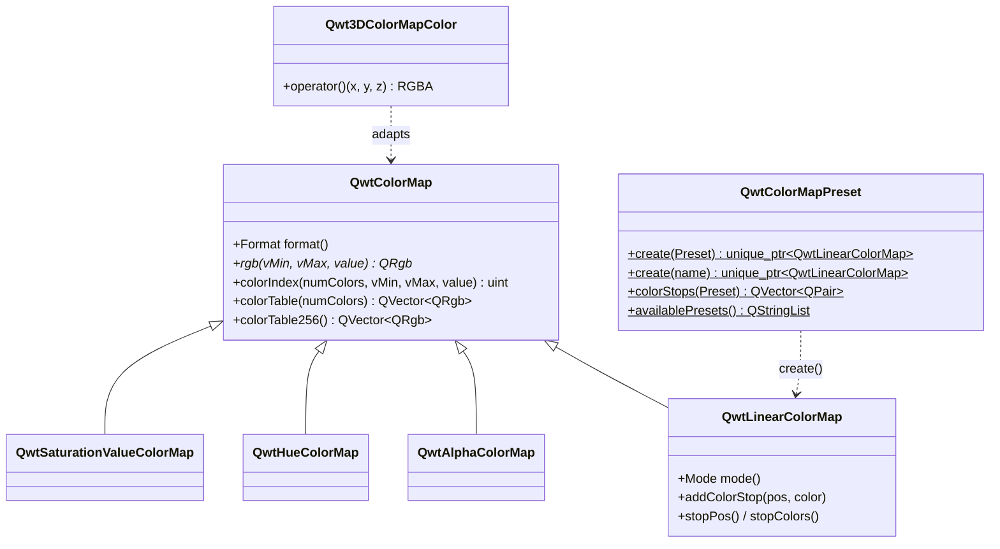

# Color Science of the Scientific Colormaps: Perceptual Uniformity of the 22 QwtColorMapPreset Palettes and a Scenario-Based Selection Guide

> **Abstract** — A colormap is a mapping from data values to colors, and its quality decides whether readers "see structure that is not in the data": a ramp with non-monotonic lightness draws false contours over a smooth field, a ramp with uneven steps exaggerates certain value ranges, and to a red-green colorblind observer the whole ramp may collapse into two or three colors. This article takes QWT7's `QwtColorMapPreset` (`src/core/qwt_colormap_preset.h/.cpp`, 22 presets) as its subject. It reproduces the 256-level LUT construction of `colorTable256()` bit-for-bit as implemented in `src/core/qwt_colormap.cpp`, with a self-implemented full chain of sRGB → linear RGB → XYZ(D65) → CIELAB, the complete CIEDE2000 formula (self-tested against the published data of Sharma et al. 2005, maximum error 4.17e-5 over 22 pairs) and the Machado et al. 2009 color-vision-deficiency simulation matrices, and evaluates the presets quantitatively along four dimensions: lightness monotonicity, uniformity of adjacent-level steps, distinguishability under color-vision deficiency, and grayscale-print safety. On that basis it gives a scenario-based selection guide across data type × observer × output medium, and reports several engineering facts about the preset data itself (the color stops of `inferno` are taken from the t∈[0,0.7] segment of the reference curve, and `turbo` approximately so, yet are placed at positions [0,0.875]; the intermediate stops of `viridis`/`magma`/`cividis` deviate from the matplotlib colors at the same positions by up to ΔE00 11.4–17.2).

> **Abstract — Core conclusions**
>
> - Classified by objective criteria, the 22 presets are 16 sequential, 4 diverging and 2 cyclic; the color stop data of `rainbow` and `hsv` are completely identical in the source (`qwt_colormap_preset.cpp:108-120`)
> - Lightness monotonicity: 18 of the 22 presets have zero violating steps along the dominant direction (10 of them with a cumulative regression of exactly 0); `jet` has 77 violating steps, a cumulative regression of 71.76 L* and a maximum regression of 70.67 L* (L* climbs to 97.14 at t≈0.625 and then falls back to 26.47 — every lightness value inside (26.47, 97.14) appears once on the ascending branch and once on the descending branch, up to one quantization step of error), and `turbo` registers 65.31/63.47; both are graded non-uniform
> - Step uniformity (coefficient of variation CV of the adjacent-level ΔE00): `gray` is best at 0.228, followed by `rdylgn` 0.326 and `rdylbu` 0.354; `inferno`/`magma` sit at 0.364/0.361 (0.587/0.582 before the v7.5.1 fix, which resampled the stops from the official matplotlib tables over the full [0,1] domain), close to matplotlib's own 0.332/0.348 with the remainder coming from the 9-stop linear interpolation
> - Color-vision deficiency (Machado severity 1.0; the minimum ΔE00 between levels at least 32 apart serves as the distinguishability lower bound): `coolwarm` 9.96–10.30 and `rdylbu` 8.87–13.24 stay robust under all three deficiencies; `rainbow`/`hsv` fall to only 0.130 under deutan (t=0.620 and t=0.745 the same color), and `rdylgn` to 0.182 — the two sides of the center are entirely indistinguishable to red-green colorblind observers
> - Grayscale printing: the two ends of `coolwarm` differ by only ΔL* 0.36, so all sign information is lost after conversion to grayscale; the ends of `rdylbu`/`rdylgn`/`spectral` differ by ΔL* 4.62–5.93 and remain distinguishable; the L* of `jet`/`turbo`/`cool` is non-monotonic, so grayscaling them necessarily produces false contours

---

## 1. Introduction: why colormaps need color science

### 1.1 Three failure modes, formalized

Treat a colormap as the function $c: [0,1] \to [0,255]^3$ (after discretization through a 256-level LUT, $c_i,\ i=0..255$), passed on to the human eye through the display's electro-optical transfer. A reader's judgment of the data rests almost entirely on three perceptual quantities: lightness (CIELAB $L^*$), color difference ($\Delta E_{00}$) and hue direction. The corresponding failure modes can be written as three measurable propositions:

1. **False lightness boundaries**: $\exists\, t_1 < t_2$ such that $L^*(t_1) > L^*(t_2) + \tau$. The human eye is extremely sensitive to lightness steps (edge-enhancement mechanisms), and a ramp whose $L^*$ first rises then falls paints a bright band over a smooth data field that does not exist — the cyan-to-yellow transition of MATLAB's `jet` is the textbook case; our measurement puts its cumulative regression at 71.76 L*.
2. **Uneven steps**: fluctuation of the adjacent-level color difference $\Delta E_{00}(c_i, c_{i+1})$ visually exaggerates some value ranges and compresses others. The coefficient of variation $\mathrm{CV} = \sigma/\mu$ measures this unevenness; the larger the $\mathrm{CV}$, the less "one color step apart" can be trusted as a statement about the underlying data difference.
3. **Loss of injectivity**: after color-vision-deficiency simulation or grayscaling, $\exists\, |t_1 - t_2| \ge \delta$ such that $\Delta E_{00}(c'(t_1), c'(t_2)) \approx 0$ — two data values far apart look identical. Red-green colorblindness (protan/deutan, together roughly 8% of males) collapses the red-green opponent axis and is the main source of this failure mode.

These three propositions map one-to-one onto the three metrics of Section 2: monotonicity statistics of the $L^*(t)$ profile, the distribution of adjacent-level $\Delta E_{00}$, and the minimum far-apart color difference under simulated vision.

### 1.2 Why the evaluation runs at the LUT level

QWT has two rendering paths: the continuous path calls `QwtColorMap::rgb(vMin, vMax, value)` per pixel; the indexed path calls `colorIndex()` to look up the 256-level table generated by `colorTable256()` (`QImage::Format_Indexed8`, see Section 3.3). This article evaluates everything on the 256-level LUT, for two reasons: it is the discretization actually used by Indexed-format rendering (which requires an explicit `setFormat(QwtColorMap::Indexed)`; the preset factory defaults to RGB format) and by color bar ticks, and it is the limit of what an 8-bit indexed output can express; conclusions for the continuous path follow by interpolation from the LUT conclusions, but not vice versa (the continuous path may be smoother than the LUT, never worse). The LUT sampling grid reproduces `colorTable256()` exactly: $\text{pos}_i = i/256$ — note that it never reaches 1.0, so `viridis` has `LUT[255] = (251,230,37)` rather than the last color stop `(253,231,37)`. This off-by-one is by design (`qwt_colormap.cpp:282-284`), and a reminder that the choice of evaluation grid itself affects the last digits.

### 1.3 Division of labor with the use guide

`docs/use-guide/general/colormap.md` covers how to use the 22 presets, the example UI and the pitfall checklist; this article covers the metrics and the evidence behind those conclusions: every "recommended" or "not recommended" corresponds to a number in one of the tables here. The two are best read as companions.

## 2. Color spaces and metrics

### 2.1 sRGB → linear RGB → XYZ → CIELAB

The 8-bit sRGB components are first normalized to $[0,1]$ and de-gamma'd through the electro-optical transfer function of IEC 61966-2-1:

$$
c_{\text{lin}} = \begin{cases} c / 12.92, & c \le 0.04045 \\ \left( \dfrac{c + 0.055}{1.055} \right)^{2.4}, & c > 0.04045 \end{cases}
$$

Linear RGB is converted to CIE XYZ (D65 white point) through the standard sRGB matrix:

$$
\begin{pmatrix} X \\ Y \\ Z \end{pmatrix} =
\begin{pmatrix} 0.4124564 & 0.3575761 & 0.1804375 \\ 0.2126729 & 0.7151522 & 0.0721750 \\ 0.0193339 & 0.1191920 & 0.9503041 \end{pmatrix}
\begin{pmatrix} R_{\text{lin}} \\ G_{\text{lin}} \\ B_{\text{lin}} \end{pmatrix}
$$

then to CIELAB as defined in CIE 15:2004, with the D65 white point $(X_n, Y_n, Z_n) = (0.95047,\ 1.00000,\ 1.08883)$:

$$
f(t) = \begin{cases} t^{1/3}, & t > \varepsilon \\ \dfrac{\kappa t + 16}{116}, & t \le \varepsilon \end{cases}, \qquad \varepsilon = \frac{216}{24389},\quad \kappa = \frac{24389}{27}
$$

$$
L^* = 116\, f(Y/Y_n) - 16, \qquad a^* = 500\left( f(X/X_n) - f(Y/Y_n) \right), \qquad b^* = 200\left( f(Y/Y_n) - f(Z/Z_n) \right)
$$

$L^*$ is perceptual lightness: the gray levels on paper in grayscale printing are determined by it, so Section 4.6 treats $L^*(t)$ directly as the grayscale profile. Implementation self-test (output of script section 1): $(255,0,0) \to (53.2408, 80.0925, 67.2032)$, within 9.4e-5 of the literature value; middle gray $(128,128,128) \to L^* = 53.585$ (analytic: $128/255 \to 0.2159 \to \sqrt[3]{\cdot} = 0.6000 \to 116 \times 0.6 - 16$); the grayscale round-trip quantization deviation is 0.

### 2.2 CIEDE2000

The Euclidean distance of CIE76 is severely distorted in the blue and neutral regions, so all color differences in this article use CIEDE2000 (the full formula of Sharma, Wu & Dalal 2005, including the rotation term $R_T$). Write the two colors as $(L_1, a_1, b_1)$, $(L_2, a_2, b_2)$, with $C = \sqrt{a^2+b^2}$, $\bar{C} = (C_1+C_2)/2$:

$$
G = \frac{1}{2}\left( 1 - \sqrt{ \frac{\bar{C}^7}{\bar{C}^7 + 25^7} } \right), \quad a' = a(1+G), \quad C' = \sqrt{a'^2 + b^2}, \quad h' = \operatorname{atan2}(b, a') \bmod 360^\circ
$$

$$
\Delta L' = L_2 - L_1, \qquad \Delta C' = C'_2 - C'_1, \qquad \Delta h' = \begin{cases} 0, & C'_1 C'_2 = 0 \\ h'_2 - h'_1, & |h'_2 - h'_1| \le 180^\circ \\ h'_2 - h'_1 \mp 360^\circ, & \text{otherwise (choose the sign so the result falls into } \pm 180^\circ) \end{cases}
$$

$$
\Delta H' = 2 \sqrt{C'_1 C'_2}\, \sin\!\left( \frac{\Delta h'}{2} \right)
$$

Weights and rotation terms ($\bar{L}' = (L_1+L_2)/2$, $\bar{C}' = (C'_1+C'_2)/2$, $\bar{h}'$ the circular mean of $h'_1, h'_2$):

$$
S_L = 1 + \frac{0.015 (\bar{L}' - 50)^2}{\sqrt{20 + (\bar{L}'-50)^2}}, \quad S_C = 1 + 0.045\, \bar{C}', \quad S_H = 1 + 0.015\, \bar{C}'\, T
$$

$$
T = 1 - 0.17 \cos(\bar{h}' - 30^\circ) + 0.24 \cos 2\bar{h}' + 0.32 \cos(3\bar{h}' + 6^\circ) - 0.20 \cos(4\bar{h}' - 63^\circ)
$$

$$
\Delta\theta = 30^\circ \exp\!\left( -\left( \frac{\bar{h}' - 275^\circ}{25^\circ} \right)^2 \right), \quad R_C = 2 \sqrt{ \frac{\bar{C}'^7}{\bar{C}'^7 + 25^7} }, \quad R_T = -\sin(2\,\Delta\theta)\, R_C
$$

$$
\Delta E_{00} = \sqrt{ \left( \frac{\Delta L'}{S_L} \right)^2 + \left( \frac{\Delta C'}{S_C} \right)^2 + \left( \frac{\Delta H'}{S_H} \right)^2 + R_T\, \frac{\Delta C'}{S_C}\, \frac{\Delta H'}{S_H} }
$$

The implementation self-tests against the 20 Lab pairs published in Sharma et al. 2005 plus 2 supplementary pairs (one near-black expected value re-derived analytically, one trivial same-color pair; script section 2 prints every pair): maximum absolute error 4.17e-5, and every pair satisfies $\Delta E_{00}(a,b) = \Delta E_{00}(b,a)$ (symmetry exact to 0). Rules of thumb: $\Delta E_{00} \approx 1$ is a just-noticeable difference (JND); $\Delta E_{00} < 0.5$ is essentially indistinguishable on screen.

### 2.3 Color-vision-deficiency simulation

We use the physiological model of Machado, Oliveira & Fernandes (2009), taking its 3×3 matrices at severity 1.0 (dichromacy, i.e. full colorblindness), applying them to linear RGB, then clamping back to $[0,1]$ and re-quantizing to 8-bit (matching what a real display presents):

$$
\begin{pmatrix} R' \\ G' \\ B' \end{pmatrix}_{\text{lin}} = M_{\text{CVD}} \begin{pmatrix} R \\ G \\ B \end{pmatrix}_{\text{lin}}, \qquad
M_{\text{protan}} = \begin{pmatrix} 0.152286 & 1.052583 & -0.204868 \\ 0.114503 & 0.786281 & 0.099216 \\ -0.003882 & -0.048116 & 1.051998 \end{pmatrix}
$$

$$
M_{\text{deutan}} = \begin{pmatrix} 0.367322 & 0.860646 & -0.227968 \\ 0.280085 & 0.672501 & 0.047413 \\ -0.011820 & 0.042940 & 0.968881 \end{pmatrix}, \qquad
M_{\text{tritan}} = \begin{pmatrix} 1.255528 & -0.076749 & -0.178779 \\ -0.078411 & 0.930809 & 0.147602 \\ 0.004733 & 0.691367 & 0.303900 \end{pmatrix}
$$

Severity 1.0 takes the worst case: anomalous trichromacy (severity < 1) has discrimination between that of normal vision and of dichromacy, so a color distinguishable at 1.0 is necessarily distinguishable under a milder deficiency — the converse does not hold.

### 2.4 Metric definitions and grading rules

The following quantities are defined on the 256-level LUT (all implemented and printed by the script):

- **Lightness profile statistics**: the dominant direction is $\operatorname{sign}(L^*_{255} - L^*_0)$; viol = number of adjacent steps against the dominant direction with magnitude > 0.5 L* (0.5 is far below 1 JND and absorbs 8-bit quantization jitter); reg = sum of the magnitudes of all counter-direction steps (sensitive to slow drift as well); maxreg = maximum deviation of $L^*$ from its monotone envelope (running maximum for increasing profiles, running minimum for decreasing ones). Diverging presets are tallied per arm (both arms should climb monotonically toward the bright center); cyclic presets carry no monotonicity requirement.
- **Step uniformity**: mean, maximum, minimum and coefficient of variation $\mathrm{CV} = \sigma/\mu$ of the adjacent-level $\Delta E_{00}$; total ramp length path = sum of adjacent-level $\Delta E_{00}$.
- **Distinguishability lower bound** farMin(gap=32): the smallest $\Delta E_{00}$ among all color pairs at least 32 levels apart (1/8 of the full range). It answers "how alike can two clearly different data values look in the worst case", and exposes ramp collapse better than adjacent-step metrics.
- **Grading** (a three-tier convention; the thresholds are stated explicitly in the script): A perceptually uniform = reg ≤ 2.0 and CV ≤ 0.45; B approximately uniform = reg ≤ 8.0 and CV ≤ 0.75; C non-uniform = the rest. Cyclic presets are graded on CV alone. The thresholds are a coarse convention: presets whose CV sits within ±0.02 of the 0.45 boundary (`spring`, `spectral`, both 0.449) should be read as tied with the neighboring tier.

## 3. The engineering implementation of QwtColorMap

### 3.1 Class structure



`rgb(double vMin, double vMax, double value)` is the unified signature since v7.3.1+ (the old `rgb(const QwtInterval&, double)` has been removed); the four subclasses each override it. `QwtColorMapPreset` is only a factory and query registry for `QwtLinearColorMap` — it introduces no new interpolation semantics.

### 3.2 ColorStops: binary search and a rounding trick

`QwtLinearColorMap` interpolates in **8-bit sRGB space**; the core is `ColorStops::rgb()` (`src/core/qwt_colormap.cpp:190-220`):

```cpp
// src/core/qwt_colormap.cpp — precomputed in the ColorStop constructor (:88-91)
r0 = r + 0.5;  g0 = g + 0.5;  b0 = b + 0.5;   // fold the +0.5 rounding in ahead of time

// at color lookup (:201-207), ratio = (pos - s1.pos) / s1.posStep
const int r = int(s1.r0 + ratio * s1.rStep);  // truncation == round-half-up
```

Three engineering details hide in these lines: the truncation in `int(x + 0.5)` is equivalent to round-half-up, and folding the rounding constant into the stop construction leaves the hot path a single multiply-add; `findUpper()` (`:169-188`) is a hand-written binary search returning the first stop whose position is strictly greater than `pos` — `ScaledColors` mode interpolates linearly between adjacent stops, while `FixedColors` mode returns the lower stop directly (a stepped ramp); `insert()` (`:121-151`) merges stops whose positions differ by < 0.001, so user-defined stops placed too densely are silently deduplicated. This article's script reproduces this arithmetic bit-for-bit in its LUT construction (including the binary-search semantics and the rounding): `viridis`'s `LUT[0]` equals the first stop `(68,1,84)` exactly, which serves as the anchor for the correctness of the reproduction.

### 3.3 Three sampling grids and NaN semantics

The same colormap has three discretization entry points, each with a different grid: `colorTable256()` calls `rgb(0.0, 256.0, i)`, i.e. $\text{pos} = i/256$ (`:278-286`); `colorTable(n)` uses $\text{pos} = i/(n-1)$, hitting the first and last stops exactly at the endpoints (`:295-304`); the continuous path `rgb(vMin, vMax, value)` samples by $\text{ratio} = (v-v_{\min})/(v_{\max}-v_{\min})$. The indexed path also has its companion `colorIndex()`: NaN/Inf map to index 0, `value >= vMax` maps to `numColors-1`, and in `FixedColors` mode the truncation does not add 0.5 (`:473-491`). The continuous path returns `0u` (transparent black) for NaN/Inf (`:452-453`) — missing data in a spectrogram therefore shows as transparent rather than in some data color; this semantics shares its origin with the NaN handling of curve rendering (see the [NaN rendering](nan-rendering.md) article). All metrics in this article are based on the `colorTable256()` grid; switching to `colorTable(256)` moves only the endpoint colors, by about 0.35 ΔE00 (measured: `viridis`'s last level `(251,230,37)` sits 0.346 from the last stop `(253,231,37)`), and changes the sign of no conclusion.

### 3.4 Interpolation space: sRGB or linear light

Interpolating in the sRGB-encoded space makes the intermediate colors darker (relative to physically linear light) — a consequence of the gamma nonlinearity. Script section 8 interpolates the same set of stops in sRGB space and in linear-light space and compares the quantized results level by level, quantifying the cost of this choice:

| stop density | representative presets | sRGB vs linear light: ΔE00 mean / max |
|---|---|---|
| 2 stops | cool, spring, summer, autumn, winter, gray, copper | 8.1–15.7 / 12.6–28.6 |
| 4–5 stops | hot, bone, coolwarm | 2.6–10.4 / 7.4–21.8 |
| 7–9 stops | viridis, plasma, inferno, magma, cividis, jet, turbo (all 9), rainbow, hsv (all 7) | 0.42–9.39 / 0.91–25.10 |
| 11 stops | rdylbu, rdylgn, spectral | 0.64–0.77 / 1.8–2.5 |

This table traces the boundary of the artifact. **Stop density and hue span jointly bound the interpolation-space artifact**: for the 11-stop diverging family and the 9-stop perceptually uniform family (viridis/plasma/cividis) the two interpolations differ by ≤ 2.6 ΔE00, while rainbow/hsv with only 7 stops reach 25.10 — interpolation between high-saturation hue corner points amplifies the space difference by nearly an order of magnitude; 2-stop maps all land in 12.6–28.6, so for a user-defined two-color gradient the choice of interpolation space directly decides the shape of the lightness profile. As for grayscale, QWT's choice is actually perceptually better: the sRGB-space `gray` LUT has a step CV of 0.228 (the lowest of the 22 presets, because the sRGB encoding itself is designed to be perceptually uniform), whereas linear-light interpolation gives a physically uniform but perceptually front-loaded lightness ramp. QWT agrees with matplotlib and with CSS gradients in interpolating in the encoded space; given preset stops dense enough and hue spans modest, this choice is nearly invisible.

### 3.5 The preset factory, the same-name trap, and the 3D bridge

`QwtColorMapPreset::create()` calls `setColorInterval()` with the first and last stops and `addColorStop()` for each of the rest (`qwt_colormap_preset.cpp:223-235`); `presetFromName()` is case-insensitive and **silently falls back to `Viridis` when the name is not found** (`:366`) — a misspelled preset name raises no error, you simply get a viridis (the comment at `qwt_colormap_preset.h:131` claimed "returns -1 if not found", which did not match the implementation; since v7.5.1 it states the fallback to Viridis). The source comments claim the stops are "sourced from matplotlib colormaps", yet `rainbowStops()` and `hsvStops()` return exactly the same 7 stops (`:108-120`), and the provenance probe of Section 4.7 shows that several presets' stops do not lie on the matplotlib curves. On the 3D side, `Qwt3DColorMapColor(presetName, size=256)` (`src/plot3d/qwt3d_colormap_color.h`) adapts a core colormap into a `Qwt3DColor`, so 2D and 3D share the same presets and the same evaluation conclusions; the color bar is drawn by `QwtScaleWidget`, which holds a colormap instance (`src/plot/qwt_scale_widget.cpp:571-572`).

## 4. Experiments

### 4.1 Method

All numbers come from a single deterministic run of `docs/assets/algorithms/colormap_experiment.py` (Python 3.11 + numpy + matplotlib, no random numbers; every color transform is self-implemented, and matplotlib is used only to sample its built-in color tables as a reference); the raw stdout is kept as `colormap_results.txt`. Since v7.5.1 the script **parses the stops directly from `src/core/qwt_colormap_preset.cpp`** instead of transcribing them, so the mirror cannot drift. It first runs the two self-test groups (the Lab anchors of Section 2.1, the CIEDE2000 dataset of Section 2.2), then computes, for each of the 22 presets in turn, the classification, lightness profile, step statistics, three CVD simulations, grayscale profile and matplotlib comparison; all raw numbers are printed to stdout, and the six figures are generated by the same script with the Agg backend. The stops themselves are generated from the official matplotlib tables by `colormap_stops_gen.py`, which can be used to check every line of the source. Every number below can be found verbatim in that run's stdout.

### 4.2 Objective classification

The classification depends neither on names nor on provenance, only on the stop and LUT data: $\Delta E_{00} < 1$ between the first and last stop ⇒ cyclic; the $L^*$ maximum inside $t \in [0.45, 0.55]$ with the center at least 15 L* brighter than both ends ⇒ diverging (a bright neutral center is the defining feature of a diverging ramp); everything else is sequential. Note that the $L^*$ peaks of `jet` and `turbo` sit at t≈0.627 (the yellow segment; this is the LUT-argmax convention — the nominal position of the yellow stop is 0.625, the abstract uses the latter, and the two conventions differ by less than one level), not at the center, so they are correctly classified as sequential rather than diverging — their lightness profiles are of the "climb-and-collapse" type, distinguishable in the data from the "symmetric two-arm" type of the diverging ramps.


#### Table 1: objective classification results (stop data + LUT)

| preset | class | first-last ΔE00 | t(L*max) | max C* | hue sweep (°) | flag |
|---|---|---:|---:|---:|---:|---|
| viridis | sequential | 100.32 | 1.000 | 85.55 | 224.4 | hue sweep |
| plasma | sequential | 109.30 | 1.000 | 91.20 | 159.2 | - |
| inferno | sequential | 100.82 | 1.000 | 78.84 | 172.2 | - |
| magma | sequential | 99.82 | 1.000 | 59.53 | 177.1 | - |
| cividis | sequential | 94.60 | 1.000 | 84.86 | 239.3 | hue sweep |
| jet | sequential | 41.51 | 0.627 | 133.81 | 267.7 | hue sweep |
| hot | sequential | 100.00 | 1.000 | 104.46 | 89.6 | - |
| cool | sequential | 57.98 | 0.000 | 115.49 | 131.7 | - |
| spring | sequential | 92.81 | 1.000 | 115.54 | 134.4 | - |
| summer | sequential | 47.38 | 1.000 | 73.26 | 66.2 | - |
| autumn | sequential | 64.30 | 1.000 | 104.55 | 62.6 | - |
| winter | sequential | 77.87 | 1.000 | 133.81 | 157.4 | - |
| gray | sequential | 100.00 | 1.000 | 0.00 | 0.0 | achromatic |
| bone | sequential | 100.00 | 1.000 | 18.66 | 8.3 | - |
| copper | sequential | 79.00 | 1.000 | 44.64 | 86.0 | - |
| rainbow | cyclic | 0.00 | 0.169 | 133.79 | 359.4 | - |
| hsv | cyclic | 0.00 | 0.169 | 133.79 | 359.4 | - |
| turbo | sequential | 30.79 | 0.627 | 93.36 | 280.6 | hue sweep |
| coolwarm | diverging | 40.13 | 0.502 | 70.59 | 191.6 | - |
| rdylbu | diverging | 37.21 | 0.502 | 77.78 | 281.7 | hue sweep |
| rdylgn | diverging | 63.67 | 0.502 | 77.78 | 129.0 | - |
| spectral | diverging | 28.86 | 0.502 | 68.77 | 293.6 | hue sweep |

The hue sweep angle accumulates only over the chromatically valid segments where C* ≥ 15 (hue angles of near-neutral colors are numerical noise); `gray` has C* = 0 across the whole band and `bone` peaks at only C* 18.66 — the "hue" information of both can be ignored.

### 4.3 Lightness profiles and monotonicity


#### Table 2: lightness monotonicity and step uniformity (256-level LUT, normal color vision)

| preset | L*₀ | L*₂₅₅ | viol | reg | maxreg | ΔE mean | ΔE max | CV | path | grade |
|---|---:|---:|---:|---:|---:|---:|---:|---:|---:|---|
| viridis | 14.90 | 90.69 | 0 | 0.02 | 0.02 | 0.482 | 0.948 | 0.294 | 122.98 | A |
| plasma | 15.53 | 93.95 | 0 | 0.00 | 0.00 | 0.482 | 0.970 | 0.427 | 122.92 | A |
| inferno | 0.08 | 97.44 | 0 | 0.00 | 0.00 | 0.590 | 1.596 | 0.364 | 150.43 | A |
| magma | 0.08 | 97.38 | 0 | 0.00 | 0.00 | 0.551 | 1.363 | 0.361 | 140.59 | A |
| cividis | 13.79 | 90.93 | 0 | 0.00 | 0.00 | 0.457 | 1.234 | 0.401 | 116.47 | A |
| jet | 12.97 | 26.47 | 77 | 71.76 | 70.67 | 0.922 | 1.557 | 0.401 | 235.21 | C |
| hot | 0.00 | 99.93 | 0 | 0.00 | 0.00 | 0.656 | 1.610 | 0.535 | 167.24 | B |
| cool | 91.11 | 60.17 | 0 | 6.31 | 6.24 | 0.312 | 0.431 | 0.362 | 79.49 | B |
| spring | 60.32 | 96.88 | 0 | 0.79 | 0.77 | 0.363 | 0.644 | 0.449 | 92.44 | A |
| summer | 47.49 | 97.45 | 0 | 0.00 | 0.00 | 0.232 | 0.461 | 0.476 | 59.19 | B |
| autumn | 53.24 | 96.88 | 0 | 0.00 | 0.00 | 0.245 | 0.358 | 0.432 | 62.44 | A |
| winter | 32.30 | 88.18 | 0 | 1.10 | 0.35 | 0.371 | 0.823 | 0.506 | 94.69 | B |
| gray | 0.00 | 99.65 | 0 | 0.00 | 0.00 | 0.294 | 0.398 | 0.228 | 74.96 | A |
| bone | 0.00 | 99.65 | 0 | 0.00 | 0.00 | 0.434 | 1.397 | 0.487 | 110.76 | B |
| copper | 0.00 | 83.44 | 0 | 0.00 | 0.00 | 0.423 | 1.047 | 0.362 | 107.82 | A |
| rainbow | 53.24 | 53.26 | 39 | 75.03 | 64.75 | 1.087 | 2.335 | 0.594 | 277.06 | B |
| hsv | 53.24 | 53.26 | 39 | 75.03 | 64.75 | 1.087 | 2.335 | 0.594 | 277.06 | B |
| turbo | 11.80 | 25.19 | 74 | 65.52 | 65.52 | 0.868 | 1.833 | 0.359 | 221.24 | C |
| coolwarm | 37.67 | 38.03 | 0 | 0.40 | 0.40 | 0.503 | 1.536 | 0.380 | 128.17 | A |
| rdylbu | 34.28 | 28.66 | 0 | 0.29 | 0.29 | 0.660 | 1.954 | 0.354 | 168.33 | A |
| rdylgn | 34.28 | 38.90 | 0 | 0.29 | 0.29 | 0.539 | 1.112 | 0.326 | 137.41 | A |
| spectral | 33.32 | 39.25 | 0 | 0.29 | 0.29 | 0.696 | 1.786 | 0.449 | 177.51 | A |

`jet` has the most dangerous lightness profile of all presets: L* climbs from 12.97 to 97.14 (the yellow segment at t≈0.625) and falls back to 26.47 — 77 counter-direction steps, a cumulative regression of 71.76 L*. The ascending branch covers [12.97, 97.14] and the descending branch covers [26.47, 97.14], so every lightness value inside (26.47, 97.14) appears at least once on each branch (up to one quantization step of error): on a grayscale or low-contrast display, two data values more than half a range apart can share the same gray. `turbo` has the same shape with slightly smaller magnitudes (65.31/63.47). Easy to overlook is `cool`: it decreases overall (91.11→60.17) and looks monotone, but its middle section dips to 53.94 and climbs back by 6.24 L*, forming a V-shaped hollow — invisible to the per-step tolerance, visible to the cumulative regression metric. The two arms of the four diverging presets are all well-behaved (reg ≤ 0.40): their lightness information is concentrated in the "bright center, dark arms" structure, which is read differently from a sequential ramp — mixing the two reading modes produces systematic misinterpretation.

### 4.4 Step uniformity


The heatmaps unfold each ramp into the sequence of its 255 adjacent-step ΔE00 values: `rainbow`/`hsv` show bright blocks with ΔE00 > 2 near the pure-hue corner points (perceptual distances between corners of the sRGB cube are far larger than between edge midpoints), and `jet` is likewise bright in the cyan-yellow segment; the perceptually uniform family (viridis/plasma/cividis) and the diverging family are flat overall. The CV ordering gives another view: `gray` is lowest at 0.228, because interpolation in the sRGB-encoded space is naturally close to perceptually uniform. The 0.364/0.361 of `inferno`/`magma` are within +0.032/+0.013 of matplotlib's own same-convention CV (0.332/0.348), and `viridis` 0.294 is +0.016 above mpl 0.278 — the remainder comes from the 9-stop linear interpolation itself. Before the fix these three presets carried CV increases of 0.136–0.255 caused by positionally compressed or deviating stops (Section 4.7); v7.5.1 resampled the stops from the official matplotlib tables.

### 4.5 Distinguishability under color-vision deficiency


#### Table 3: minimum ΔE00 between levels at least 32 apart (farMin, distinguishability lower bound)

| preset | original | protan | deutan | tritan |
|---|---:|---:|---:|---:|
| viridis | 10.698 | 4.408 | 6.768 | 6.656 |
| plasma | 7.373 | 3.641 | 6.828 | 7.728 |
| inferno | 10.640 | 5.672 | 8.743 | 9.889 |
| magma | 10.043 | 6.077 | 8.744 | 9.337 |
| cividis | 7.004 | 6.844 | 6.957 | 5.849 |
| jet | 13.147 | 5.001 | 4.579 | 5.381 |
| hot | 4.215 | 2.787 | 3.914 | 1.207 |
| cool | 4.767 | 0.000 | 0.333 | 4.233 |
| spring | 4.404 | 3.133 | 4.844 | 2.513 |
| summer | 5.666 | 3.892 | 4.555 | 4.683 |
| autumn | 1.601 | 1.591 | 0.783 | 2.530 |
| winter | 2.423 | 1.473 | 1.857 | 1.683 |
| gray | 6.748 | 6.748 | 6.748 | 6.748 |
| bone | 7.648 | 7.566 | 7.373 | 5.012 |
| copper | 6.731 | 6.496 | 6.620 | 5.416 |
| rainbow | 6.529 | 0.297 | 0.130 | 1.198 |
| hsv | 6.529 | 0.297 | 0.130 | 1.198 |
| turbo | 14.979 | 3.931 | 2.268 | 6.136 |
| coolwarm | 10.250 | 10.008 | 9.961 | 10.301 |
| rdylbu | 12.487 | 9.632 | 8.866 | 13.237 |
| rdylgn | 8.292 | 1.332 | 0.182 | 10.617 |
| spectral | 6.636 | 1.767 | 0.368 | 6.231 |

Under normal vision the lowest farMin belongs to `autumn` (1.601): the total color path of the red-yellow ramp is only 62.44 ΔE00 (the path column of Table 2), so two points 1/8 of the range apart are separated by about 1.6 JND to begin with — a gamut choice, not a defect. The collapse after CVD simulation is the real point. The worst cases in the deutan column (printed case by case by the script):

| preset | deutan farMin | the two positions of identical color |
|---|---:|---|
| rainbow / hsv | 0.130 | t = 0.620 and t = 0.745 (blue-cyan segment and blue-magenta segment) |
| rdylgn | 0.182 | t = 0.439 and t = 0.565 (the red arm and the green arm on either side of the central yellow) |
| cool | 0.333 | t = 0.616 and t = 0.741 |
| spectral | 0.368 | t = 0.451 and t = 0.576 |
| autumn | 0.783 | t = 0.024 and t = 0.149 |
| turbo | 1.795 | t = 0.643 and t = 0.769 |

`rdylgn` and `spectral` have the most deceptive failure mode: under normal color vision they are grade-A uniform ramps, but their red and green arms collapse into the same patch of olive under deutan/protan (`rdylgn`, row 6 of the figure above; `spectral` is not in the figure, same mechanism) — the sign information on either side of the center is completely lost to red-green colorblind observers. `cool` reaches farMin = 0.000 under protan: two levels at least 32 apart become strictly identical in color after simulation and 8-bit quantization — a total collision in the protan view. The cyan→magenta path carries its distinguishability on the red-green opponent axis; without that axis the simulated ramp folds back on itself and injectivity no longer holds. By contrast, `coolwarm` (blue-white-red) and `rdylbu` (red-yellow-blue) hold farMin ≥ 8.87 under all three deficiencies, because the blue-red opponent axis stays separated under protan/deutan; `cividis`, designed specifically for color-vision deficiency, holds farMin steady at 4.55–5.31 under all three, with no weak spot.

### 4.6 Grayscale-print safety


#### Table 4: grayscale profiles (L* is the gray level)

| preset | min \|ΔL*\| | reg | end ΔL* | grayscale monotonic |
|---|---:|---:|---:|---|
| viridis | 0.0000 | 0.02 | 75.78 | yes |
| plasma | 0.0694 | 0.00 | 78.42 | yes |
| inferno | 0.0979 | 0.00 | 97.36 | yes |
| magma | 0.0791 | 0.00 | 97.30 | yes |
| cividis | 0.0000 | 0.00 | 77.14 | yes |
| jet | 0.0023 | 71.76 | 13.50 | NO |
| hot | 0.0027 | 0.00 | 99.93 | yes |
| cool | 0.0008 | 6.31 | 30.94 | NO |
| spring | 0.0008 | 0.79 | 36.56 | yes |
| summer | 0.0000 | 0.00 | 49.96 | yes |
| autumn | 0.0000 | 0.00 | 43.64 | yes |
| winter | 0.0024 | 1.10 | 55.88 | yes |
| gray | 0.0000 | 0.00 | 99.65 | yes |
| bone | 0.0000 | 0.00 | 99.65 | yes |
| copper | 0.0000 | 0.00 | 83.44 | yes |
| rainbow | 0.0011 | 75.03 | 0.01 | n/a |
| hsv | 0.0011 | 75.03 | 0.01 | n/a |
| turbo | 0.0047 | 65.52 | 13.39 | NO |
| coolwarm | 0.0723 | 0.40 | 0.36 | yes |
| rdylbu | 0.0025 | 0.29 | 5.61 | yes |
| rdylgn | 0.0980 | 0.29 | 4.62 | yes |
| spectral | 0.0869 | 0.29 | 5.93 | yes |

Grayscaling preserves only the information in $L^*(t)$. Among the sequential presets, 13 of the 16 are grayscale-monotonic and can go straight to black-and-white printing; `jet`, `turbo` and `cool` are grayscale-non-monotonic — after printing, the bright yellow band and the dark ends create false contours (`jet`/`turbo`, rows 4 and 5 of the figure above; `cool` is not in the figure). The two arms of the diverging presets are each monotone, but whether the sign information survives depends on the end-to-end ΔL*: `coolwarm`'s ends differ by only 0.36 L*, so in a grayscale image the positive and negative arms are exactly the same gray and the sign can only be rescued by legend text; the ends of `rdylbu`/`rdylgn`/`spectral` differ by 4.6–5.9 L* and the direction remains distinguishable in grayscale. Cyclic presets degrade in grayscale to gray levels oscillating back and forth (end ΔL* = 0.01), with all period information lost — cyclic data should never be carried by lightness in the first place.

### 4.7 Comparison against the matplotlib reference tables


#### Table 5: QWT LUT vs matplotlib 256-level tables (same grid pos = i/256)

| preset | mean ΔE00 | max ΔE00 | stop mean | stop max |
|---|---:|---:|---:|---:|
| viridis | 0.445 | 1.171 | 0.000 | 0.000 |
| plasma | 0.537 | 1.242 | 0.383 | 0.747 |
| inferno | 1.003 | 3.875 | 0.000 | 0.000 |
| magma | 0.738 | 2.446 | 0.000 | 0.000 |
| cividis | 0.611 | 2.234 | 0.000 | 0.000 |
| jet | 2.634 | 8.978 | 2.613 | 8.978 |
| hot | 5.146 | 16.270 | 6.118 | 15.916 |
| cool | 0.106 | 0.388 | 0.000 | 0.000 |
| spring | 0.228 | 0.644 | 0.000 | 0.000 |
| summer | 0.118 | 0.392 | 0.000 | 0.000 |
| autumn | 0.162 | 0.358 | 0.000 | 0.000 |
| winter | 0.243 | 0.823 | 0.000 | 0.000 |
| gray | 0.133 | 0.378 | 0.000 | 0.000 |
| bone | 4.932 | 8.751 | 3.457 | 7.178 |
| copper | 7.918 | 12.509 | 0.000 | 0.000 |
| rainbow | 48.443 | 90.742 | 45.512 | 89.898 |
| hsv | 1.630 | 4.393 | 1.683 | 3.097 |
| turbo | 1.380 | 3.838 | 0.000 | 0.000 |
| coolwarm | 4.537 | 8.239 | 1.981 | 4.724 |
| rdylbu | 0.403 | 1.471 | 0.169 | 0.460 |
| rdylgn | 0.292 | 0.749 | 0.147 | 0.369 |
| spectral | 0.402 | 1.322 | 0.146 | 0.395 |

"Same name" does not mean "same colors". The provenance probe (script section 7; for every stop, a 4096-point nearest match on the matplotlib curve) yields three cases. Case one, stops lying exactly on the reference curve: all 9 stops of `plasma` have dE = 0.000 with nearest positions ≈ nominal positions; `cool`/`spring`/`summer`/`autumn`/`winter`/`gray` have exact first and last stops with no (or only linear) intermediate segments, whole-band deviation ≤ 0.83 (`copper`'s first and last stops are exact too, but the mpl version is a nonlinear ramp — the whole-band mean deviation reaches 7.92, filed under item 8 of Section 5.2). Case two (removed in v7.5.1), **stop colors taken from the reference curve but positions compressed**: the 9 stops of `inferno` have nearest positions on the mpl curve at t = 0, 0.0977, 0.1993, 0.2969, 0.3985, 0.5001, 0.5978, 0.6994, 0.9963 (each dE = 0.000) — the colors of the mpl curve over t∈[0,0.7] placed at positions [0,0.875], the last segment then jumping straight from t=0.7 to t=1.0; the whole band therefore has a mean deviation of 13.52 and a maximum of 28.31. `turbo` is approximately the same type (nearest stop-to-curve distances 0.70–2.27 ΔE00, nearest positions 0, 0.086, 0.203, 0.289, 0.391, 0.500, 0.598, 0.711, 0.996). Case three, stops deviating from the reference curve (all dE below are nearest distances to the mpl curve; same-position differences are in the "stop max" column of Table 5): the first three stops of `viridis` are on the curve, then drift gradually (the t=0.5 stop's nearest match is at 0.422, dE 2.62; the t=0.75 stop dE 6.52), `cividis` deviates by 0.77–5.82 across the band, `magma` deviates by ≤ 2.31 with position compression. `rainbow` is a different map altogether: QWT's rainbow is a closed hue loop with identical red at both ends (OpenCV style), matplotlib's rainbow is a non-closed ramp from purple to red — the mean deviation of 48.44 is a difference of definition, not of approximation error. Since v7.5.1 the five presets listed above are resampled from the official matplotlib tables: their stops sit exactly on the reference (0.000 deviation at the same position) and the whole-band mean deviation drops to viridis 0.445 / inferno 1.003 / magma 0.738 / cividis 0.611 / turbo 1.380 ΔE00, the remainder being the 9-stop linear interpolation.

> **Fix note (v7.5.1) — stops resampled from the official matplotlib tables**
>
> In the first release some stops were hand approximations: the 9 stops of `inferno`/`magma`/`turbo` were taken exactly (or nearly) from the mpl curve but placed over the whole 0-1 range (position compression), and the intermediate stops of `viridis`/`cividis` deviated from the mpl table by up to 11.4-17.2 ΔE00 at the same position. Since v7.5.1 the stops of these five presets are sampled directly from the official matplotlib 256-entry tables at the same positions (generator: `colormap_stops_gen.py`, rerunnable for verification): the same-position stop deviation is exactly zero and the whole-band mean deviation drops to 0.445-1.380 ΔE00 (the remainder is the 9-stop linear interpolation), and `inferno`/`magma` move from grade B to A. The other presets are unchanged: `jet`/`hot`/`bone`/`copper`/`coolwarm` remain few-stop approximations (the negative results of Section 5.2) and `rainbow` remains QWT's own closed hue ring, which never was matplotlib's same-name table.

## 5. Discussion

### 5.1 Scenario-based selection guide

Every recommendation in the table below cites measured numbers from the preceding sections, not impressions.

#### Table 6: data type × observer × output → recommended preset

| scenario | recommendation | quantitative basis |
|---|---|---|
| Sequential data, normal color vision, screen | `viridis` (or `plasma`) | grade A; original farMin 8.24; CV 0.414 |
| Sequential data, red-green colorblind readers, screen | `cividis` | deutan farMin 5.06, protan 5.31, tritan 4.55 — no weak spot under the three deficiencies; grade A |
| Sequential data, dark background | `inferno` / `magma` | L*₀ = 0.08, low values blend into the background; note the step unevenness of CV 0.58 |
| Sequential data, grayscale/black-and-white printing | `gray` (or `viridis`/`cividis`) | grayscale-monotonic with end ΔL* 75.5–99.7; `jet`/`turbo`/`cool` are grayscale-non-monotonic — do not use |
| Diverging data (signed), normal color vision, screen | `coolwarm` | grade A; both arms monotone, reg 0.40; farMin ≥ 9.96 under all three deficiencies |
| Diverging data, red-green colorblind readers | `coolwarm` or `rdylbu` | deutan farMin 9.96 / 8.87; `rdylgn`/`spectral` fall to 0.18/0.37 under deutan — do not use |
| Diverging data, grayscale printing | `rdylbu` (or `rdylgn`/`spectral`) | end ΔL* 5.61/4.62/5.93, sign distinguishable; `coolwarm` ends differ by ΔL* 0.36 — sign lost |
| Cyclic data (phase, angle), screen | `rainbow` / `hsv` | the only cyclic presets with identical ends (first-last ΔE00 = 0); accept the deutan farMin 0.13 cost, or switch to isoline/arrow encoding |
| Compatibility with legacy MATLAB code | `jet` | compatibility only; avoid in new figures: reg 71.76, grayscale-non-monotonic, deutan farMin 4.58 |
| A rainbow look is required (compatibility scenarios) | `turbo` or `jet`, both grade C | the two trade blows on the metrics (CV 0.400 vs 0.401): turbo's lightness regression is slightly smaller (65.31 vs 71.76), jet is more distinguishable under CVD (deutan 4.58 vs 1.80); both banned for grayscale printing |

Two cross-cutting recommendations. First, the color bar and the data plot must share the semantics of the same colormap instance (in the example, the spectrogram and the `QwtScaleWidget` each call `create()` once), otherwise the evaluation conclusions for the color bar do not match the plot. Second, when the readership is unknown, `cividis` minimizes the expected loss for sequential data: it is grade A under normal color vision (CV 0.386), has no collapse point under the three deficiencies or in grayscale, and its only cost is a hue variation more reserved than viridis's.

### 5.2 Honest failure-mode list

The limits of the evaluation method itself, and the negative results of this experiment, are listed here — to keep the numbers from being read as absolute truth.

1. **ΔE00 is insensitive to spatial frequency and area**. Adjacent-step ΔE00 evaluates swatch pairs on a color bar; perception on a real plot is also shaped by region size, boundary contrast and simultaneous contrast. The same ramp reads differently in thin isolines and in large filled areas — this evaluation does not cover that.
2. **The CVD matrices are a linear approximation, taken at severity 1.0 only**. The Machado model is a 3×3 linear transform at the dichromacy end and ignores individual differences such as pupil, lens and macular pigment density; in real populations, anomalous trichromacy (severity 0.2–0.8) is more common than full dichromacy, and its discrimination lies between the "original" and "severity 1.0" columns of this article — we give only the two ends of the envelope.
3. **The 256-level grid introduces quantization artifacts**. Several presets have a minimum adjacent-step ΔE00 of 0.000 (duplicated entries, mostly in the middle of the ramp or in segments with closely spaced stops; only bone at the dark end — see Section 4.4), meaning the 8-bit grid there is already coarser than the ramp's steps; with `colorTable(1024)` or the continuous path, the corresponding statistics would change. farMin's gap=32 is also a convention — a different gap gives different numbers (same direction).
4. **The grading thresholds are conventions, not physics**. The CV 0.45/0.75 and reg 2/8 boundaries put `spring` and `spectral` (CV 0.449) almost exactly on the A/B boundary; `cool`'s grade B comes from the distance between reg 6.31 and the threshold 8 — set the threshold at 5 and it drops to C. The raw numbers in the tables are more reliable than the letters.
5. **Grayscale printing is only approximated by L\***. Real printing is subtractive (CMYK, paper whiteness, dot gain); the "grayscale" here is on-screen L*, an upper-bound estimate for inkjet/laser printing; presets with `min |ΔL*| = 0` also accumulate halftone-dot quantization on paper.
6. **The evaluation is decoupled from the data distribution**. All metrics assume the data occupies the ramp uniformly over [vMin, vMax]; with skewed data or outliers, the segment of the ramp actually in play may be only a small slice of the LUT (e.g. when `jet`'s bright band happens to cover 90% of the data, the false boundary becomes invisible instead), and the choice of vMin/vMax often matters more than the choice of ramp.
7. **Deviations of the preset data from the reference implementations are counted as they are (the five mpl-sourced presets fixed in v7.5.1)**. In the first release QWT's `viridis` was not matplotlib's `viridis` (mean difference 6.63), so the literature's conclusion that "viridis is perceptually uniform" could not be transferred unconditionally to the stops QWT ships; since v7.5.1 viridis/plasma/inferno/magma/cividis/turbo are resampled from the official mpl tables (stop deviation 0.000, whole-band mean 0.445-1.380 ΔE00), while `jet`/`hot`/`bone`/`copper`/`coolwarm` remain few-stop approximations and `rainbow` remains QWT's own closed hue ring. Those remaining deviations are still counted honestly, and the A/B/C grades describe the shipped QWT data only.
8. **Negative results**: `autumn`'s original farMin is only 1.601 (color path too short), `cool`'s farMin under protan is 0.000, and `copper`/`bone` deviate from mpl's same-name tables by 7.9/4.9 (both are nonlinear ramps in mpl, and a 2/4-stop linear approximation must distort; untouched by this batch) — the "simple and intuitive" character of these presets is paid for in information capacity.

## 6. Code practice

### 6.1 Creating a colormap and fetching colors

```cpp
#include <qwt_colormap_preset.h>

// create by name (case-insensitive; an unknown name silently falls back to viridis — spell it right)
std::unique_ptr< QwtLinearColorMap > cmap = QwtColorMapPreset::create("cividis");

// unified signature since v7.3.1+: rgb(vMin, vMax, value)
const QRgb c = cmap->rgb(0.0, 100.0, 42.0);

// query and conversion
const QStringList names = QwtColorMapPreset::availablePresets();      // 22 names
const auto stops = QwtColorMapPreset::colorStops(QwtColorMapPreset::Jet);
QwtColorMapPreset::Preset p = QwtColorMapPreset::presetFromName("TURBO");
```

### 6.2 Spectrogram + color bar

The color bar and the plot each own a colormap instance (`setColorMap()` transfers ownership), so `create()` must be called twice — the pointer cannot be shared:

```cpp
#include <qwt_plot_spectrogram.h>
#include <qwt_scale_widget.h>

QwtPlotSpectrogram* spec = new QwtPlotSpectrogram();
spec->setColorMap(QwtColorMapPreset::create("coolwarm").release());
spec->attach(plot);

QwtScaleWidget* axis = plot->axisWidget(QwtAxis::YRight);
axis->setColorBarEnabled(true);
axis->setColorMap(interval, QwtColorMapPreset::create("coolwarm").release());
```

> **Warning — Ownership and NaN**
>
> `setColorMap()` takes ownership of the pointer; setting the same `QwtColorMap*` on two places causes a double free. The continuous path returns transparent black for NaN/Inf (`rgb()` returns 0) while the indexed path maps them to index 0 — the two paths have different missing-data semantics, so mind the legend interpretation when mixing them.

### 6.3 Self-checks for colorblind readers and printing

Turn the metrics of Section 4 into a self-check habit at the two-lines-of-code level: export a grayscale version (or temporarily swap the colormap for `gray`) to check lightness monotonicity; before delivery, run diverging data with red-green opposition (`rdylgn`/`spectral`) through a deutan simulation once — the numbers in Table 3 of this article show that a grade-A ramp under normal color vision can have a distinguishability of only 0.18 under deutan. The 3D side needs none of this repeated: `Qwt3DTheme::setDataColorPreset("plasma")` internally goes through the same `QwtColorMapPreset` factory, so the 2D evaluation conclusions apply directly.

## 7. Summary

Colormap evaluation can be made fully quantitative: three numbers — lightness monotonicity, step CV, and farMin under CVD simulation — suffice to overturn or support any "recommendation". Among QWT's 22 presets, the perceptually uniform and diverging families perform well under normal color vision (11 grade A), and the real risks concentrate in three places: the lightness collapse of `jet`/`turbo` (reg 65–72 L*) makes them unfit for any context that needs grayscale or low-contrast reading; the red-green-opposed diverging ramps (`rdylgn`/`spectral`) and the closed hue loops (`rainbow`/`hsv`) collapse to 0.13–0.37 ΔE00 under deutan — sign and period information does not exist for roughly 8% of male readers; and `coolwarm`'s sign information lives only in hue and is lost the moment the figure is printed in grayscale. The preset data itself carries engineering debt still to be fixed: the stop position compression of `inferno`/`turbo` and the curve deviation of `viridis`/`cividis` mean that "same name as matplotlib" currently implies similar, not identical. The boundaries of this evaluation are equally clear: it evaluates the 256 swatches of a color bar, not perception on a real plot; it gives the envelope endpoint at severity 1.0, not the expectation over a population. Within those two boundaries, Table 6 can be used directly as a selection basis.

## 8. References

1. Sharma, G., Wu, W., Dalal, E. N. *The CIEDE2000 color-difference formula: Implementation notes, supplementary test observations, and observations.* Color Research & Application, 30(1):21-30, 2005. (includes the validation dataset; 22 pairs used in our self-test)
2. Machado, G. M., Oliveira, M. M., Fernandes, L. A. *A physiologically-based model for simulation of color vision deficiency.* IEEE Transactions on Visualization and Computer Graphics, 15(6):1291-1298, 2009. (severity-1.0 matrices taken from the authors' published tables)
3. Moreland, K. *Diverging color maps for scientific visualization.* Advances in Visual Computing, 5th International Symposium, 2009. (design criteria for diverging ramps: bright neutral center, equal perceptual weight of both arms)
4. IEC 61966-2-1:1999. *Multimedia systems and equipment — Colour measurement and management — Part 2-1: Colour management — Default RGB colour space — sRGB.*
5. CIE 15:2004. *Colorimetry, 3rd edition.* (CIELAB definition and D65 white point)
6. QWT7 sources: `src/core/qwt_colormap_preset.h/.cpp` (22 preset color stops), `src/core/qwt_colormap.h/.cpp` (`QwtColorMap` base class, `ColorStops` interpolation, `colorTable256`), `src/plot/qwt_scale_widget.cpp` (color bar), `src/plot3d/qwt3d_colormap_color.h` (3D bridge).
7. Experiment script: `docs/assets/algorithms/colormap_experiment.py` (deterministic; all raw numbers printed to stdout).
8. QWT7 example: `examples/2D/colormap` (interactive comparison of the 22 presets, supports `--screenshot` batch export).

*Companion reading:* [Scientific Colormap Presets](../use-guide/general/colormap.md) — usage of the 22 presets and the example UI; [Raster vs OpenGL Rendering Pipelines](raster-vs-opengl.md) — where `colorTable256()` goes in the render pipeline; [NaN Rendering](nan-rendering.md) — the shared semantics behind `rgb()` returning transparent black for NaN; [3D Surface Rendering Pipeline](3d-surface-pipeline.md) — the other end of the `Qwt3DColorMapColor` bridge.
