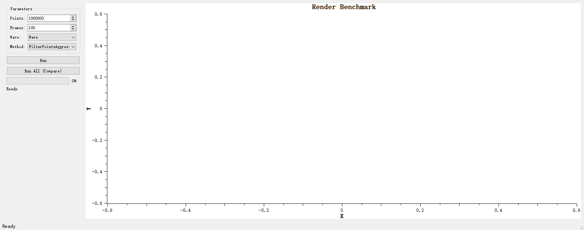
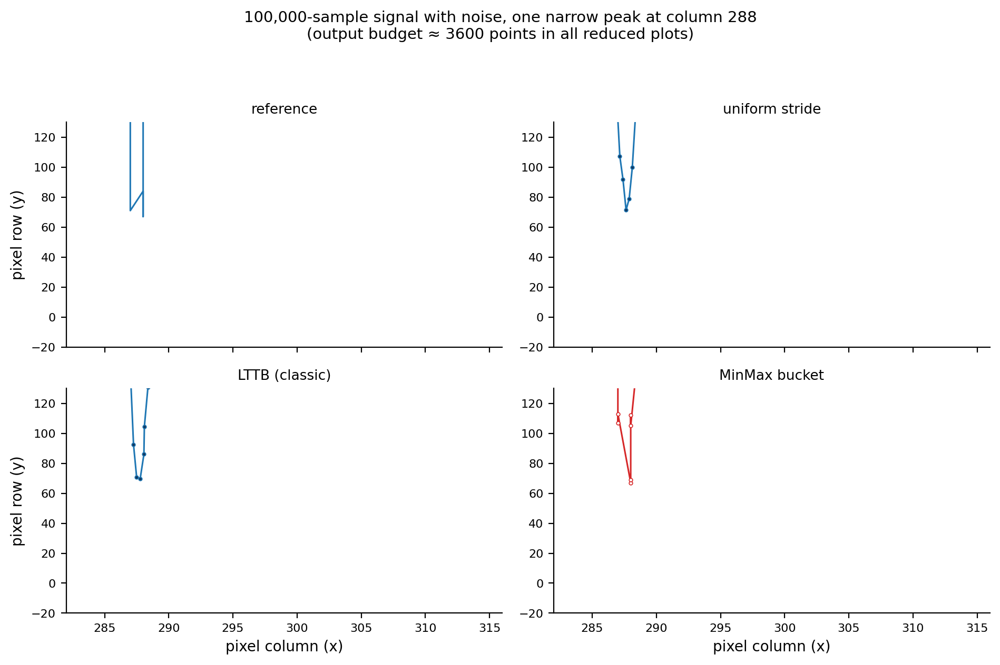
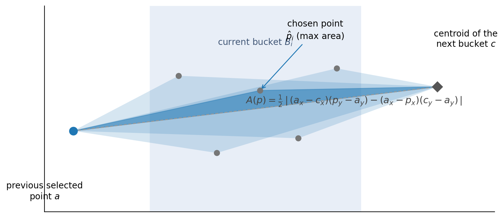
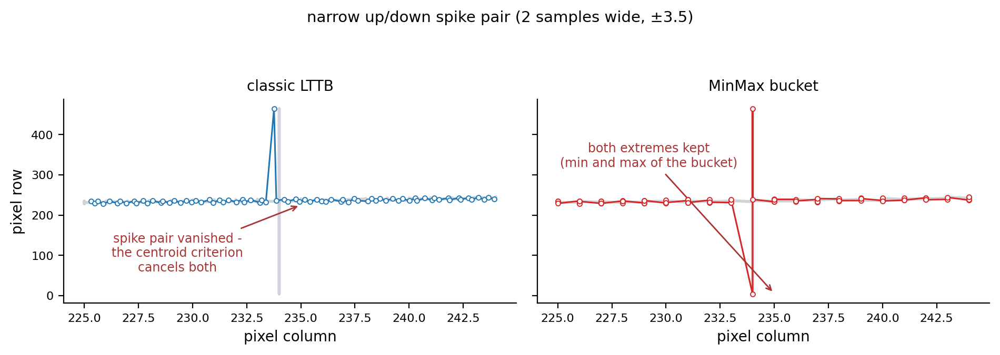
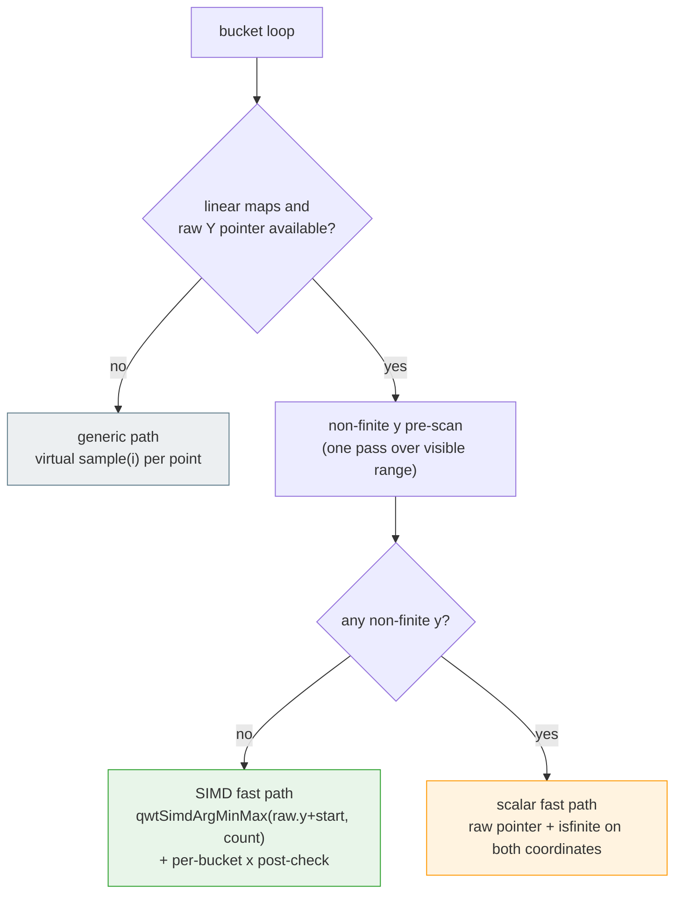
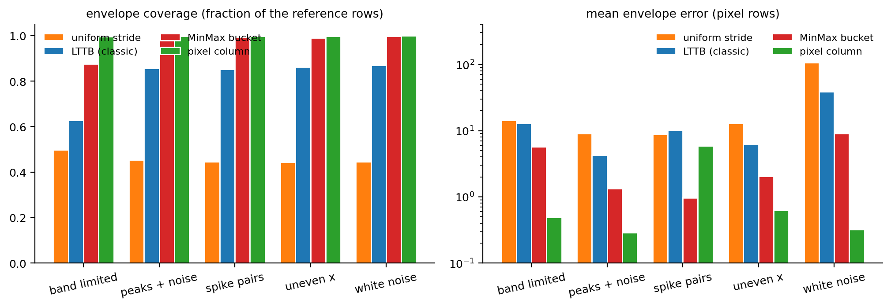
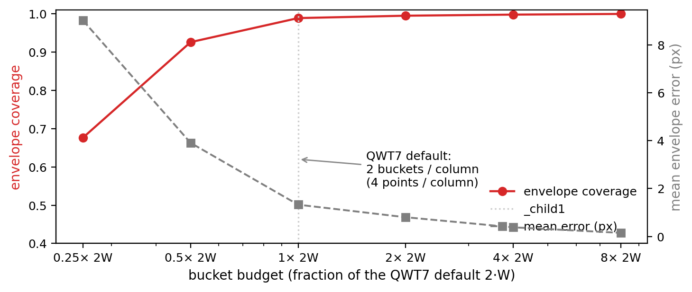
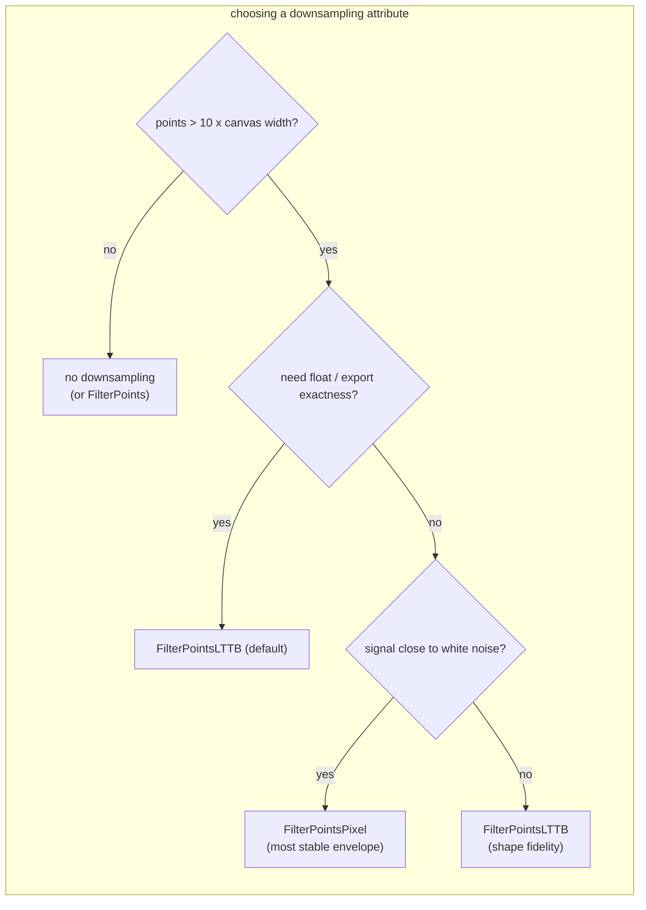

# Downsampling Curves for the Screen: LTTB Theory and the QWT7 MinMax Bucket

> **Abstract** — When a curve has far more samples than the canvas has pixel columns, feeding every point to the rasterizer is both expensive and pointless: most samples share one pixel column and are, in an information theoretic sense, **redundant sampling**. This article starts with the bandwidth bottleneck of the screen, and formalizes what "downsampling fidelity" means. It then derives the triangle-area criterion of the classic LTTB (Largest Triangle Three Buckets) algorithm in full, and dissects the **MinMax bucket** variant QWT7 uses instead: it replaces the "largest triangle" heuristic with the deterministic rule "keep the extremes of every bucket", which yields provable envelope properties and a SIMD-friendly computational structure (AVX2/SSE4.2 with runtime dispatch). A reproducible experiment suite (8× supersampled raster metrics) quantifies the pixel-level fidelity of four reduction strategies on five typical signals, and a complete code section shows how to use it.

> **Abstract — Key results**
>
> - On a million-point curve, `FilterPointsMinMaxLTTB` (MinMax buckets, the `FilterPointsLTTB` default up to v7.4.2) cuts the replot time from 262 ms/frame (3.8 FPS) to 133 ms/frame (7.5 FPS), with the best fidelity of all strategies (61%–97% pixel-exact columns depending on the signal)
> - The MinMax bucket keeps the "visual shape preservation" of classic LTTB, but adds a **deterministic extreme-preservation guarantee** that LTTB lacks, and reduces the core computation to a SIMD-friendly argmin/argmax
> - The bucket budget $N_b = 2W$ (two buckets per pixel column, four output points per column) matches the display Nyquist limit: content below 0.5 cycles per column is reproduced without loss

---

> **Update (v7.5.0)** — `FilterPointsLTTB` now maps to a **true LTTB** implementation (`QwtPointMapper::LTTBReduce`, `qwtLttbReduce()`, Section 3): the largest-triangle selection runs on the mapped screen coordinates, always keeps the first and last sample, and preserves the shape of narrow peaks that the MinMax bucket rule tends to collapse into vertical strokes. The MinMax bucket variant analyzed in this article moved to the new **`FilterPointsMinMaxLTTB`** attribute (`MinMaxReduce`); the benchmark numbers below were measured with it. Both algorithms now keep **sub pixel precision** whenever the painter does not align to integer coordinates ( f.e. antialiasing enabled ) instead of snapping the downsampled polyline to integer pixels.

## 1. Introduction: the bottleneck of visual bandwidth

### 1.1 Problem statement

Let the time series (or any curve with monotone $x$) be

$$
P = \left\{ (x_i,\, y_i) \right\}_{i=0}^{N-1}, \qquad x_0 < x_1 < \cdots < x_{N-1}
$$

which is drawn on a canvas of width $W$ (pixel columns). The coordinate mapping is affine:

$$
X_i = x_0' + (x_i - x_{\min})\, \frac{x_1' - x_0'}{x_{\max} - x_{\min}},
\qquad Y_i = y_0' + (y_i - y_{\min})\, \frac{y_1' - y_0'}{y_{\max} - y_{\min}}
$$

where $x_0', x_1'$ are the pixel coordinates of the canvas edges. **The downsampling problem** is: given $P$ and an output budget $M \ll N$, find a subsequence $P' = \{(x_{j_k}, y_{j_k})\}_{k=0}^{M-1}$ (or a general polyline) such that drawing $P'$ is visually indistinguishable from drawing $P$ — "visual equivalence":

$$
P' \approx_{\text{visual}} P \quad \Longleftrightarrow \quad \mathcal{R}(P') \approx \mathcal{R}(P)
$$

where $\mathcal{R}(\cdot)$ is the rasterization operator. Because pixels are discrete, this boils down to: both polylines must cover the same **vertical range in every pixel column** (precisely defined in Section 2).

### 1.2 How redundant is the input: the visual Nyquist limit

One pixel column can only express spatial frequencies of up to about $\pm 0.5$ cycles per column. The highest resolvable frequency (the Nyquist frequency) of a signal sampled at the pixel rate is

$$
f_{\text{Nyquist}} = \frac{1}{2 \cdot \Delta x_{\text{pixel}}} \quad \text{[cycles / pixel column]}
$$

When $N \gg W$, on average $N/W$ samples land in every pixel column. Their spatial frequency content is far above $f_{\text{Nyquist}}$ — it contributes **nothing** to the final pixels, yet the rasterizer pays for all of it: coordinate transforms, floating point, segment intersection, antialiasing — all $N$-fold. Measured with `examples/bench/renderbench` (680×490 canvas, 1,000,000 points, 100 frames):

| Method | Total (ms) | Per frame (ms) | FPS |
|--------|-----------|----------------|-----|
| no reduction | 26,212 | 262.1 | 3.8 |
| `FilterPoints` (dedupe) | 44,472 | 444.7 | 2.2 |
| `FilterPointsAggressive` (quad merge) | 17,539 | 175.4 | 5.7 |
| `FilterPointsPixel` (pixel column bins) | 23,216 | 232.2 | 4.3 |
| **`FilterPointsMinMaxLTTB` (MinMax buckets)** | **13,349** | **133.5** | **7.5** |

(Absolute numbers depend on hardware; the ordering is stable. QWT7.2.1 + Qt 5.15.16, renderbench example.)

Those numbers were measured with the benchmark example that ships in the repository, **`examples/bench/renderbench`** — the program under `examples/bench/` dedicated to comparing the downsampling algorithms:



The interface consists of three parts:

- **Control panel**: `Points` (1,000 – 10,000,000, default 1,000,000), `Frames` (10 – 1000, default 100), `Wave` (smooth wave / white noise), `Method` (`None` / `FilterPoints` / `FilterPointsAggressive` / `FilterPointsPixel` / `FilterPointsLTTB` / `FilterPointsMinMaxLTTB`), plus `Run` (single method) and `Run All (Compare)` (batch comparison of every method);
- **Plot area**: the data is generated on demand by `WindowedSeriesData` inside a sliding window that follows the X axis, so every replot does the work of a real scrolling view;
- **Report dialog**: pops up after a run with a Markdown report (environment, QWT/Qt versions, canvas size, parameters) and per-method timing / FPS summary, copied to the clipboard with one click.

Beyond timing, the example's greater value is the **visual comparison**: switching `Method` back and forth between `FilterPointsLTTB` and `FilterPointsPixel` shows exactly how the same data treats narrow peaks (Sections 4.4 and 6, Table 1).

Note that `FilterPoints` is *slower* than no reduction: it only removes pixels that map to **exactly** the same position, which is rare among a million points — the filtering itself becomes pure overhead. The lesson: downsampling must decide how to **merge** points, not merely how to skip them.

### 1.3 The general two-stage framework

Downsampling inside the paint pipeline consists of two stages:

1. **Visible range culling**: binary search narrows the index range $[\,\text{from}, \text{to}\,]$ to the part of the data inside the canvas, $[\,\text{visFrom}, \text{visTo}\,]$ ($O(\log N)$ for monotone $x$);
2. **Bucket reduction**: the visible range is split into $N_b$ buckets, each contributing a few representative points.

Two mainstream strategies:

- **Pixel-domain buckets** (`FilterPointsPixel`): the bucket is a pixel column (spatially uniform); per column the points first / min / max / last are emitted.
- **Index-domain buckets** (`FilterPointsLTTB` / `FilterPointsMinMaxLTTB`): the bucket is a run of equal sample count (index-uniform); LTTB emits the largest-triangle point per bucket, MinMax the extreme points.

Sections 3 and 4 develop these two ideas. Both share the same output budget of $4W$ points per canvas — the difference is the shape of the buckets and how representatives are chosen.

The figure below zooms into one narrow peak and compares the four strategies against the full-data reference (top left):




## 2. Fidelity metric: the column envelope

The immediate consequence of pixelation: **horizontal detail inside one pixel column is invisible to the eye**. Fidelity should therefore be defined per pixel column.

**Definition (column envelope)** For a polyline $L$ with painted pixels $\mathcal{C}(L) \subseteq \mathbb{Z}^2$, the envelope of pixel column $c$ is

$$
\mathrm{Env}_c(L) = \left[\, \min_{(c,r)\in\mathcal{C}(L)} r,\; \max_{(c,r)\in\mathcal{C}(L)} r \,\right]
$$

i.e. the range of rows actually painted in that column (for a line stroked 1 px wide). A necessary condition for visual equivalence is that both polylines have identical column envelopes.

**Definition (coverage)** Given a reference polyline $L^*$ (the rasterization of the full $N$-point polyline) and a reduced polyline $L'$, the **coverage** of column $c$ is the overlap ratio of the envelopes:

$$
\mathrm{Cov}_c = \frac{\left|\, \mathrm{Env}_c(L^*) \cap \mathrm{Env}_c(L') \,\right|}{\left|\, \mathrm{Env}_c(L^*) \,\right|}
$$

**Definition (clean column)** A column is **clean** if the upper and lower edges of $\mathrm{Env}_c(L^*)$ and $\mathrm{Env}_c(L')$ differ by at most 1 pixel row. The `clean` score is the fraction of clean columns among all non-empty columns — a strong pixel-exactness criterion.

All numbers in this article are computed by 8×8 supersampled rasterization (Section 6) to avoid boundary attribution artifacts.

## 3. The classic LTTB algorithm

### 3.1 Origin and intuition

LTTB (Largest Triangle Three Buckets) was proposed by Steinarsson in his 2013 MSc thesis *Downsampling Time Series for Visual Representation* (University of Iceland) and is the most widely used time-series downsample in visualization tools today.

Core intuition: **the contribution of a point to the visual shape can be measured by the area of the triangle it forms with the two "skeleton points" before and after it**. The larger the area, the more the point deviates from the straight line defined by the previous point and the next trend segment — and the more it deserves to be kept. LTTB is greedy: it selects one point per bucket, depending only on the previously selected point and the centroid of the *next* bucket.

### 3.2 Three-bucket geometry



Let $a$ be the previously selected point. All points of the current bucket $B_i$ are candidates; the next bucket $B_{i+1}$ does not participate in the selection, but its **centroid** $c$ provides the direction of the future trend:

$$
c = \left( \bar{x}_{B_{i+1}},\, \bar{y}_{B_{i+1}} \right) = \left( \frac{1}{|B_{i+1}|}\sum_{j\in B_{i+1}} x_j,\; \frac{1}{|B_{i+1}|}\sum_{j\in B_{i+1}} y_j \right)
$$

> The centroid, not a single point, keeps the "trend" robust against within-bucket noise — a single representative might sit on a noise spike, the centroid averages it away.

For every candidate $p \in B_i$, form the triangle $\triangle(a, p, c)$. Its area follows from the **shoelace formula**:

$$
A(p) = \frac{1}{2} \left| a_x c_y + p_x a_y + c_x p_y - a_y p_x - c_y a_x - p_y c_x \right|
$$

or, expanded about the reference point $a$ (the form used in practice):

$$
A(p) = \frac{1}{2} \left| (a_x - c_x)(p_y - a_y) - (a_x - p_x)(c_y - a_y) \right|
$$

Geometrically, the area equals $\tfrac{1}{2}|\overrightarrow{ac}|$ times the perpendicular distance of $p$ from the line $ac$. Maximizing it selects the point that deviates most from the line "previous point → future centroid" — a quantification of *shape contribution*. Algebraically the signed area is a determinant / cross product:

$$
2A = \left| \det \begin{pmatrix} a_x & a_y & 1 \\ p_x & p_y & 1 \\ c_x & c_y & 1 \end{pmatrix} \right|
= \left| (a - c) \times (p - a) \right|
$$

### 3.3 Algorithm

The first and last points are always kept; the middle $N-2$ points are divided into $M-2$ approximately equal buckets:

**Algorithm 1**: classic LTTB

```text
Input:  sequence P[0..N-1], output budget M (2 <= M <= N)
Output: index sequence of the kept points

1. keep P[0];  every = (N-2) / (M-2)
2. for i = 0 .. M-3:
   a. next bucket range: [ floor((i+2)*every)+1, floor((i+3)*every)+1 )
      -> centroid c
   b. current bucket range: [ floor(i*every)+1, floor((i+1)*every)+1 )
   c. pick p* in B_i maximizing A(p), append it, let a = p*
3. keep P[N-1]
```

**Complexity**: single pass, $O(N)$ time, $O(M)$ output. Each step needs the next bucket's centroid, so it is a two-phase sliding window over pairs of buckets with a small constant factor.

### 3.4 Properties

1. **Greedy optimality**: within each bucket, LTTB keeps the locally most shape-relevant point. It does not guarantee global optimality (that would require comparing all $M$-tuples — an exponential problem), but empirically it tracks the original shape better than any simple strategy.
2. **No extreme guarantee**: LTTB **does not guarantee** keeping any local extreme — an isolated spike is kept only if its triangle area is large enough. As we will see, this is its most dangerous failure mode.
3. **Index-uniform buckets**: buckets hold equal sample counts, so dense regions get the same number of buckets as sparse ones, and output points distribute **adaptively along $x$** — the essential difference to pixel-based bucketing.

### 3.5 Failure mode: spike pairs

Consider up/down spike pairs ($\pm 3.5$, 2 samples wide, spaced by 2 samples):



When a pair falls into one bucket, the up spike and the down spike produce triangles of comparable area, but LTTB emits **only one point per bucket** — one of the two directions is inevitably dropped: the rendering shows either the up stroke or the down stroke, never both; the pair's envelope is cut in half. Measured in the Section 6 experiment (100,000 points, 25 spike pairs): the classic LTTB's p99 column-envelope error is 228 pixel rows (whole spikes vanish), and only 59% of the columns are clean.

> This is the direct motivation for the **MinMax bucket variant** in QWT7: replace "one maximum-area point per bucket" with "two extreme points per bucket", which eliminates this failure mode by construction.

## 4. The QWT7 MinMax bucket variant

### 4.1 Definition

`QwtPlotCurve::FilterPointsMinMaxLTTB` maps internally to `QwtPointMapper::MinMaxReduce`, which invokes `qwtMinMaxBucketReduce()`. ( The `FilterPointsLTTB` default up to v7.4.2 used this same flag; since v7.5.0 it maps to `LTTBReduce` / `qwtLttbReduce()` instead. ) It shares the index-domain bucketing skeleton with classic LTTB, but replaces the representative ("max area point") with **the minimum and maximum $y$ of the bucket**:

Let $n = \text{visTo} - \text{visFrom} + 1$ be the number of visible samples and $W$ the canvas width. Define

$$
N_b = \max\left(2,\, 2W \right), \qquad
s = \frac{n}{N_b}
$$

Bucket $b$ is the sample index interval

$$
B_b = \left\{ i \in \mathbb{Z} :\; \text{visFrom} + \lfloor b s \rfloor \;\le\; i \;\le\; \text{visFrom} + \lfloor (b+1) s \rfloor - 1 \right\}, \qquad b = 0, \ldots, N_b - 1
$$

(adjacent buckets tile the visible range without gaps or overlaps: $\bigcup_b B_b = [\text{visFrom},\,\text{visTo}]$).

Each bucket emits two points in index order:

$$
i_{\min}(b) = \operatorname*{arg\,min}_{i \in B_b} y_i, \qquad
i_{\max}(b) = \operatorname*{arg\,max}_{i \in B_b} y_i
$$

$$
\text{out} \gets \left( x_{i_{\min}(b)},\, y_{i_{\min}(b)} \right),\; \left( x_{i_{\max}(b)},\, y_{i_{\max}(b)} \right), \quad \text{ordered by } i_{\min}(b) \le i_{\max}(b)
$$

If the two points coincide ($y_{\min} = y_{\max}$ and $x_{\min} = x_{\max}$, i.e. all bucket samples are identical), only one point is emitted.

**Algorithm 2**: QWT7 MinMax bucket reduction (`qwtMinMaxBucketReduce`)

```text
Input:  visible range [visFrom..visTo], linear maps xMap/yMap, canvas width W
Output: reduced polyline

1. if n <= 2 * N_b: too few points, fall back to qwtMapPointsQuad (quad merge)
2. buckets N_b = max(2, 2W);  bucket size s = n / N_b
3. for each bucket b = 0 .. N_b-1:
   a. index range [ floor(b*s), floor((b+1)*s) - 1 ]
   b. argmin / argmax of y inside the bucket (data domain comparison!)
   c. emit the two extremes (screen coords = round(data x/y through xMap/yMap)),
      in index order; emit one point if they coincide
4. if the data source supports raw pointers (QwtPointArrayData & friends)
   and there is no NaN: step 3b uses qwtSimdArgMinMax
   (AVX2 / SSE4.2 / scalar, runtime dispatch)
```

### 4.2 Relationship to classic LTTB

| | Classic LTTB | QWT7 MinMax bucket |
|---|---|---|
| criterion | max triangle area (depends on next bucket) | per-bucket $y$ extremes (no cross-bucket dependency) |
| traversal | two-phase sliding window (centroid first) | single pass, buckets independent |
| extremes | ❌ not guaranteed | ✅ every bucket extreme survives |
| spike pairs | ❌ systematically dropped (one per bucket) | ✅ up and down stroke both kept |
| SIMD | area comparisons hard to vectorize | argmin/argmax vectorizes naturally |
| NaN | needs explicit handling | pre-scan + NaN-aware scalar branch fallback; the kernel-level IEEE-754 "naturally ignored" claim is unreliable (see Sec. 5.4 and the [SIMD benchmark report](simd-argminmax.md)) |

The MinMax bucket is a **deterministic approximation** of LTTB: the skeleton (index-uniform bucketing + shape representatives) is the same; only the selection criterion differs. Replacing the area criterion with the extreme criterion yields three provable properties.

### 4.3 Three propositions

**Proposition 1 (global extreme preservation)** The $y$ range of the output polyline equals that of the input:

$$
\min_i y_i,\; \max_i y_i \;\in\; \left\{ y : \exists (x,y) \in \text{out} \right\}
$$

*Proof*: the global minimum lies in some bucket $B_{b^*}$, hence it is that bucket's $\operatorname*{arg\,min}$ and is emitted verbatim (if it coincides with the maximum, the $y$ value is still present). $\square$

This is a strong guarantee classic LTTB lacks: **any isolated spike that is the extreme of its bucket necessarily appears in the output** — both strokes of a spike pair survive (right panel above).

**Proposition 2 (no self-intersection)** Output points are emitted in index order, hence the output polyline has non-decreasing $x$ for monotone $x$ input — it never doubles back on itself.

**Proposition 3 (resolution matches the display)** With a visible $x$-span of $X$, each bucket covers $\Delta x_b \approx X/N_b = X/(2W)$, i.e. half a pixel column. Each bucket emits an upper and a lower extreme, so the envelope is sampled at **two extreme pairs per pixel column**; any oscillation with a period above 1 column (below the display Nyquist limit) has every crest and trough captured completely — the envelope is not truncated. Content near the Nyquist limit (periods of 1–2 columns) keeps its extremes, but the connecting chords deviate measurably (Section 6.3).

### 4.4 Contrast with PixelColumnReduce

| | MinMax bucket (LTTB) | pixel column bucket (Pixel) |
|---|---|---|
| bucketing dimension | data index (equal counts) | pixel column (space) |
| representatives | bucket $y$ extremes (true $x$ kept) | first / min / max / last, extremes at fixed sub-pixel offsets (+0.25 / +0.75) |
| output budget | 2 pts/bucket = 4W | ≤ 4 pts/column = 4W (usually 2) |
| $x$ accuracy | mapped + rounded, **no systematic bias** | fixed ±0.25 column offset (biased for non-aligned output) |
| $y$ comparison domain | data (double precision) | pixels (integer) |
| space | $O(N_b)$ | $O(W)$ |
| best for | general rendering (float output, export, antialiasing) | integer-aligned widget rendering |

The key difference: the MinMax bucket compares $y$ in the **data domain** and maps the true $x$ positions; the pixel column compares integer $y$ in the **pixel domain** and pins the extremes to fixed sub-pixel positions inside the column. The former is geometrically exact on the float path (`QPolygonF`, e.g. SVG/PDF export, non-aligned painting); the latter is optimized for integer rasterization.

## 5. Engineering

### 5.1 Position in the paint pipeline

The flowchart below traces the samples through the paint pipeline: visible-range culling by binary search (`qwtFindVisibleRange`), then the reduction branch selected by the `QwtPointMapper` flag priority, ending in the `QPolygonF` that is handed to render smoothing, clipping and `QPainter`.

```mermaid
flowchart LR
    A["QwtSeriesData&lt;QPointF&gt;<br/>N samples"] --> B["qwtFindVisibleRange<br/>binary search<br/>(monotone x, O(log N))"]
    B --> C{"QwtPointMapper flag priority"}
    C -->|"PixelColumnReduce"| D["qwtPixelColumnReduce<br/>&#8804; 4W pts"]
    C -->|"MinMaxReduce"| E["qwtMinMaxBucketReduce<br/>&#8776; 4W pts"]
    C -->|"LTTBReduce"| E2["qwtLttbReduce<br/>&#8776; 4W pts"]
    C -->|"WeedOutIntermediatePoints"| F["qwtMapPointsQuad<br/>two-pass quad merge"]
    C -->|"WeedOutPoints"| G["qwtToPolylineFiltered<br/>dedupe"]
    C -->|"default (no flags)"| H["qwtToPoints<br/>full transform"]
    D --> I["QPolygonF polyline"]
    E --> I
    E2 --> I
    F --> I
    G --> I
    H --> I
    I --> J["render smoothing<br/>(setSmoothAlgorithm, see smoothing article)"]
    J --> K["clip / fitter / QPainter"]

    style E fill:#fdecea,stroke:#d62728
    style D fill:#e8f5e9,stroke:#2ca02c
```



`QwtPlotCurve::drawLines()` (`src/plot/qwt_plot_curve.cpp`) maps the user-level paint attributes to mapper flags:

| user-level `PaintAttribute` | internal `TransformationFlag` | active when |
|---|---|---|
| `FilterPoints` | `WeedOutPoints` | always |
| `FilterPointsAggressive` | `WeedOutIntermediatePoints` + `WeedOutPoints` | only with integer-align rounding (`doAlign`) |
| `FilterPointsPixel` | `PixelColumnReduce` | always |
| `FilterPointsLTTB` | `LTTBReduce` | always |
| `FilterPointsMinMaxLTTB` | `MinMaxReduce` | always |

The selection priority in `toPolygonF()` (`src/plot/qwt_point_mapper.cpp:1232`) is

> `PixelColumnReduce` > `LTTBReduce` > `MinMaxReduce` > `WeedOutIntermediatePoints` > `WeedOutPoints`

so enabling several attributes at once lets the pixel column win over LTTB, LTTB over MinMax buckets, MinMax over quad merge, and so on. The **default** is `ClipPolygons | FilterPointsLTTB`.

### 5.2 Visible range culling: binary search

For monotone $x$ with a linear mapping, the visible range is found by two binary searches:

$$
i_{\text{left}} = \min\left\{ i : x_i \ge \min(x_0', x_1') \right\}, \qquad
i_{\text{right}} = \max\left\{ i : x_i \le \max(x_0', x_1') \right\}
$$

extended by one point on each side for overlap. Monotonicity is verified with at most 50 uniformly spaced probes (non-monotone data or non-linear mappings skip the search and scan the full range). Complexity $O(\log N) + O(50)$: with $N = 10^7$ and a visible window of $10^4$ points, this stage shrinks the downsampler input by three orders of magnitude.

### 5.3 Three execution paths

`qwtMinMaxBucketReduce` selects one of three paths depending on the data source:



- **SIMD fast path**: if the data source is one of `QwtPointArrayData<double>`, `QwtCPointerData<double>`, `QwtValuePointData<double>`, `QwtCPointerValueData<double>`, a `dynamic_cast` extracts contiguous `double*` arrays and each bucket performs a single `qwtSimdArgMinMax()`; $y$ comparisons happen in the **data domain**, screen coordinates are transformed separately. Before a bucket is emitted, the winning samples' $x$ values pass an `isfinite` post-check (only when a raw $x$ pointer exists): a winner with NaN/Inf $x$ would produce a phantom vertex through `qRound(NaN) == 0`, so such buckets are recomputed with the scalar loop.
- **Scalar fast path**: when a non-finite $y$ is present, the SIMD semantics differ from "ignore NaN" (Section 5.4), so the loop falls back to element-wise comparison plus `!std::isfinite` checks on both coordinates (samples with a non-finite $x$ or $y$ are skipped, matching the generic path).
- **Generic path**: without raw pointers, every point is fetched through the virtual `sample(i)` and a per-bucket linear scan maintains min/max.

For value-only data (`setRawSamples(yData, size)`) there is no $x$ pointer: the screen $x$ is computed from the sample index, $sx = \text{round}(i \cdot xCnv + xOff)$.

`qwtLttbReduce()` ( v7.5.0, behind `FilterPointsLTTB` ) sits at the same pipeline position with a simpler structure: two passes ( bucket averages, then triangle selection ), using the raw pointer fast path when available and the generic `sample()` path otherwise — no SIMD variant, as the area criterion does not vectorize as cleanly as argmin/argmax. Its bucket budget is $N_b = 4W$ with one output point per bucket, matching the MinMax output budget of $2 \times 2W$.

### 5.4 SIMD acceleration: vectorized argmin/argmax

`qwt_simd_argminmax.h/.cpp` (in `src/core/`; since v7.5.1 the AVX2 kernel lives separately in `qwt_simd_argminmax_avx2.cpp`, compiled as AVX2 - see Section 4.5b of the [SIMD benchmark](simd-argminmax.md)) provides a general SIMD argmin/argmax with a one-time CPUID detection and static function-pointer dispatch:

| CPU feature | vector width | elements/iter | core instructions |
|---|---|---|---|
| AVX2 | 256 bit | 4 × double | `_mm256_loadu_pd` / `_mm256_cmp_pd` / `_mm256_blendv_pd` / `_mm256_min_pd` |
| SSE4.2 | 128 bit | 2 × double | `_mm_loadu_pd` / `_mm_cmp_pd` / `_mm_blendv_pd` / `_mm_min_pd` |
| scalar | — | 1 × double | plain comparisons |

The inner loop maintains four (or two) running value and index vectors in parallel:

$$
\mathbf{m}^{(k+1)}_j = \min\left( \mathbf{m}^{(k)}_j,\, v_{4k+j} \right), \qquad
\mathbf{i}^{(k+1)}_j = \begin{cases} 4k + j & v_{4k+j} < \mathbf{m}^{(k)}_j \\ \mathbf{i}^{(k)}_j & \text{otherwise} \end{cases}
$$

Comparisons use the ordered predicate `_CMP_LT_OQ` (ordered, quiet): both $\mathrm{NaN} < x$ and $x < \mathrm{NaN}$ are false, so NaN can never win a comparison; the value vectors, however, run through the `minpd`/`maxpd` hardware instructions, which return the second operand whenever either operand is NaN, so a NaN can overwrite an accumulator and, once a later true value restores it, fall out of step with the index vectors — NaN therefore never pollutes the **value** results (the reported value is always a real element, although an extreme may be lost), while the **index** semantics are unreliable under multi-lane reduction, with combined outputs possible where the index points at a NaN element (quantitative matrix in Section 2.3 of the [SIMD benchmark report](simd-argminmax.md)). This is exactly why the render pipeline must pre-scan for NaN. After the vector loop, a horizontal reduction combines the lanes; a scalar tail loop handles the remaining elements; if min/max are still NaN (all-NaN input), the sentinel $\{0, 0, \text{DBL\_MAX}, -\text{DBL\_MAX}\}$ is returned.

```cpp
// src/core/qwt_simd_argminmax.cpp — the AVX2 core loop
__m256d minVec    = _mm256_set1_pd(DBL_MAX);
__m256d maxVec    = _mm256_set1_pd(-DBL_MAX);
__m256d minIdxVec = _mm256_set_pd(3.0, 2.0, 1.0, 0.0);
__m256d maxIdxVec = _mm256_set_pd(3.0, 2.0, 1.0, 0.0);

for (; i + 4 <= count; i += 4) {
    const __m256d vals   = _mm256_loadu_pd(data + i);
    const __m256d curIdx = _mm256_set_pd(i + 3.0, i + 2.0, i + 1.0, i + 0.0);

    const __m256d cmpMin = _mm256_cmp_pd(vals, minVec, _CMP_LT_OQ);
    minIdxVec            = _mm256_blendv_pd(minIdxVec, curIdx, cmpMin);
    minVec               = _mm256_min_pd(minVec, vals);

    const __m256d cmpMax = _mm256_cmp_pd(vals, maxVec, _CMP_GT_OQ);
    maxIdxVec            = _mm256_blendv_pd(maxIdxVec, curIdx, cmpMax);
    maxVec               = _mm256_max_pd(maxVec, vals);
}
```

*Why the NaN pre-scan?* The SIMD and scalar paths have different output semantics under NaN: the scalar path can skip NaN entries and report the non-NaN extremes; the SSE/AVX min/max instructions return the other operand for NaN ( $\min(\mathrm{NaN}, x) = x$), but across lanes there is no way to guarantee the "first non-NaN index" semantics. A pre-scan ($O(n)$, same order as the bucket loop) buys consistent semantics and branch-free per-bucket code — a classic "one sequential pass instead of a branch per bucket" trade.

**Speedup**: AVX2 argmin/argmax is theoretically 3–4× faster than scalar; for very small buckets (< 16 elements) the vector loads and the horizontal reduction can eat the parallelism gain — another reason for the quad-merge fallback when $n \le 2N_b$.

## 6. Experiments: pixel-level fidelity

### 6.1 Setup

- **Metrics**: the column envelope, coverage and clean-column fraction of Section 2, computed by **8×8 supersampled rasterization** (the reference model of an antialiased line renderer).
- **Signals** ($N = 100{,}000$, canvas 900×500 px, shaped like the QWT7 examples):
  1. **band limited**: multi-sine, max 0.45 cycles/column (below Nyquist);
  2. **peaks + noise**: slow envelope, narrow peaks, white noise (spectrum-like);
  3. **spike pairs**: 25 up/down pairs of $\pm 3.5$, 2 samples wide (the LTTB pathology);
  4. **uneven x**: narrow peaks on data whose spacing varies by ±40 %;
  5. **white noise**: pure noise (worst case).
- **Output budget**: ≈ 3600 points (= 4W) for all strategies; pixel column emits ≤ 4W by definition.
- **Reproduction**: all scripts and numbers live in `docs/assets/algorithms/` (`downsampling_experiment.py`, `figures.py`).

### 6.2 Results

#### Table 1: column envelope metrics (N = 100,000, 900×500 canvas)

| signal | algorithm | pts | coverage | worst col | err mean(px) | p99(px) | err max(px) | clean |
|---|---|---:|---:|---:|---:|---:|---:|---:|
| band limited | uniform | 3705 | 0.495 | 0.000 | 14.4 | 32.5 | 36.2 | 0.1% |
| | LTTB classic | 3600 | 0.625 | 0.000 | 13.0 | 33.9 | 40.0 | 3.0% |
| | **MinMax** | 3600 | 0.875 | 0.392 | 5.7 | 23.0 | 30.0 | 29.0% |
| | pixel col | 1800 | 0.995 | 0.714 | 0.5 | 5.5 | 8.0 | 85.8% |
| peaks + noise | uniform | 3705 | 0.453 | 0.008 | 9.1 | 46.5 | 127.0 | 0.2% |
| | LTTB classic | 3600 | 0.856 | 0.008 | 4.3 | 45.8 | 137.5 | 18.6% |
| | **MinMax** | 3600 | 0.989 | 0.526 | 1.3 | 17.1 | 59.0 | 79.9% |
| | pixel col | 1800 | 0.998 | 0.864 | 0.3 | 3.0 | 89.5 | 97.4% |
| spike pairs | uniform | 3705 | 0.446 | 0.002 | 8.8 | 229.6 | 232.1 | 4.1% |
| | LTTB classic | 3600 | 0.853 | 0.008 | 10.1 | **228.3** | 230.0 | 59.0% |
| | **MinMax** | 3600 | 0.994 | 0.667 | 1.0 | 2.0 | 227.0 | 97.3% |
| | pixel col | 1800 | 0.998 | 0.500 | 5.9 | 111.0 | 117.0 | 94.6% |
| uneven x | uniform | 3705 | 0.444 | 0.000 | 12.9 | 93.8 | 482.0 | 0.4% |
| | LTTB classic | 3600 | 0.863 | 0.000 | 6.3 | 104.6 | 482.0 | 14.4% |
| | **MinMax** | 3600 | 0.990 | 0.000 | 2.1 | 25.1 | 261.0 | 75.0% |
| | pixel col | 1800 | 0.999 | 0.773 | 0.6 | 4.0 | 205.0 | 98.0% |
| white noise | uniform | 3705 | 0.447 | 0.001 | 107.4 | 201.0 | 233.1 | 0.0% |
| | LTTB classic | 3600 | 0.871 | 0.001 | 39.0 | 118.1 | 204.1 | 4.4% |
| | **MinMax** | 3600 | 0.997 | 0.814 | 9.0 | 74.0 | 128.0 | 61.0% |
| | pixel col | 1800 | 0.999 | 0.761 | 0.3 | 11.0 | 80.0 | 98.3% |



#### Table 2: bucket budget vs fidelity (peaks + noise, MinMax buckets)

| budget | buckets | output pts | coverage | clean | err mean(px) |
|---|---|---:|---:|---:|---:|---:|
| 0.25 × 2W | 450 | 900 | 0.677 | 31.2% | 9.0 |
| 0.5 × 2W | 900 | 1800 | 0.926 | 63.8% | 3.9 |
| **1 × 2W (default)** | 1800 | 3600 | 0.989 | 79.9% | 1.3 |
| 2 × 2W | 3600 | 7200 | 0.995 | 88.8% | 0.8 |
| 4 × 2W | 7200 | 14400 | 0.998 | 93.4% | 0.4 |
| 8 × 2W | 14400 | 28800 | 1.000 | 96.9% | 0.2 |



### 6.3 Discussion

**1. Pixel fidelity ranking: pixel column > MinMax > LTTB classic > uniform.** The pixel column almost always wins the pixel-exactness contest — necessarily so, since it optimizes the vertical envelope directly in the pixel domain. The MinMax bucket achieves 75–97% clean columns with twice the output points (3600 vs 1800): that is the price of data-domain fidelity.

**2. Pixel-exactness is not the same as visual fidelity — and the metric has artifacts.** The non-zero errors in Table 1 stem from three effects:

- **Boundary attribution**: 8× supersampling counts pixels that merely kiss a sub-pixel grid corner as painted; the long slanted segments of a reduced polyline cross column borders near extremes. These correspond to < 2% coverage sub-pixel shading, invisible to the eye.
- **Chord deviation**: within a bucket the two extremes are joined by a straight line; for highly curved near-Nyquist content (the 0.45 cycles/column component of the band-limited signal) the chord deviates from the true curve by roughly

$$
\varepsilon_{\text{chord}} \approx \frac{A (\pi f \Delta x_b)^2}{8}
$$

with amplitude $A$, frequency $f$ (cycles/column) and $\Delta x_b \approx 0.5$ columns — about $0.06A$ at the default budget, visible only at pixel level.

- **Extreme column shift**: rounding moves an extreme's $x$ by at most half a column; when it sits near a column boundary, its vertical stroke lands in the neighboring column (the max errors of MinMax all concentrate in such columns).

**3. Why does QWT7 default to `FilterPointsLTTB` instead of the pixel column?** Since v7.5.0 the default is the **true LTTB**: selected on the mapped screen coordinates it preserves the shape of narrow peaks best of all strategies, always keeps the curve endpoints, and — like MinMax — outputs exact mapped coordinates on the **float path** (`QPolygonF`, PDF/SVG export, non-aligned painting), whereas the pixel column pins extremes to fixed +0.25/+0.75 sub-pixel offsets and thereby biases their positions. The MinMax bucket variant ( `FilterPointsMinMaxLTTB`, the default up to v7.4.2 ) remains attractive when the deterministic extreme-preservation guarantee or the SIMD argmin/argmax speed matters. And "LTTB" is a well-known name in the community, so `FilterPointsLTTB` gives users a mental model for free.

**4. The 2W budget sits exactly on the quality/performance knee** (Table 2): halving the budget drops clean columns from 80% to 64%, while doubling it buys only 9 points of clean-columns at twice the draw cost. This matches the Nyquist argument — content below the display limit is already fully sampled; more buckets only buy sub-pixel detail.

**5. Honest failure-mode list**: ① when a spike pair straddles two adjacent columns, the MinMax connecting lines can paint a one-column "diagonal smear" (all max-error columns are of this kind); ② on white noise, clean columns drop to 61% — the noise envelope is correctly kept (that is the point!), but the connecting chords add vertical strokes; ③ near-Nyquist content (0.45 cycles/column) shows measurable envelope softening.



## 7. Code practice

### 7.1 Basic usage

`FilterPointsLTTB` is on by default; setting it explicitly costs nothing:

```cpp
#include <qwt_plot.h>
#include <qwt_plot_curve.h>
#include <qwt_point_data.h>

QwtPlot* plot = new QwtPlot;

QwtPlotCurve* curve = new QwtPlotCurve("sensor-a");
curve->setSamples(xData, yData, 5000000);   // 5M points, double arrays
curve->attach(plot);

// both are already the default behaviour:
curve->setPaintAttribute(QwtPlotCurve::ClipPolygons, true);
curve->setPaintAttribute(QwtPlotCurve::FilterPointsLTTB, true);

// switch to the pixel column for the most stable pixel envelope:
// curve->setPaintAttribute(QwtPlotCurve::FilterPointsPixel, true);
// curve->setPaintAttribute(QwtPlotCurve::FilterPointsLTTB, false);

// opt into the MinMax bucket rule used by FilterPointsLTTB up to v7.4.2:
// curve->setPaintAttribute(QwtPlotCurve::FilterPointsMinMaxLTTB, true);
// curve->setPaintAttribute(QwtPlotCurve::FilterPointsLTTB, false);

// combine with render smoothing (see the smoothing article)
curve->setSmoothAlgorithm(QwtPlotCurve::GaussianSmoothing);
curve->setSmoothWindow(15);
```

> **Warning — Mutual exclusion**
>
> When several of `FilterPointsPixel`, `FilterPointsLTTB`, `FilterPointsMinMaxLTTB` and `FilterPointsAggressive` are enabled at once, the internal priority in `QwtPointMapper` decides: `Pixel > LTTB > MinMax > Aggressive`. Do not enable several of them; the effect is the one on top.

### 7.2 Using the SIMD utility directly

`qwtSimdArgMinMax` is public API of the core module and can be reused in your own algorithms:

```cpp
#include <qwt_simd_argminmax.h>
#include <vector>

const std::vector<double> v = /* ... */;

// one call returns argmin and argmax (AVX2 / SSE4.2 / scalar, dispatched
// at run time)
const QwtArgMinMaxResult r = qwtSimdArgMinMax(v.data(), int(v.size()));

// r.minIdx / r.maxIdx: indices of the minimum / maximum (offsets from the
// pointer); r.minVal / r.maxVal: the values; all-NaN input returns the
// sentinel {0, 0, DBL_MAX, -DBL_MAX}
```

### 7.3 Recommendations

| scenario | recommendation |
|---|---|
| regular waveforms, spectra (default) | `FilterPointsLTTB`, nothing to configure |
| PDF / SVG export (float path) | `FilterPointsLTTB` (sub pixel exact mapping) |
| most stable pixel envelope, integer widgets | `FilterPointsPixel` |
| fewer points than 4 × canvas width | no downsampling needed (the reduce algorithms fall back to plain mapping) |
| benchmarking | `examples/bench/renderbench`: configurable data size, waveform, frames, batch comparison |

## 8. Summary

- Visualization is a **bandwidth-limited sampling problem**: the Nyquist limit of a $W$-column canvas makes every sample rate above $2W$ redundant.
- Classic LTTB selects points by a "largest triangle area" heuristic: simple, $O(N)$, good visual quality — but **no extreme guarantee** and a systematic loss for spike pairs.
- The QWT7 MinMax bucket replaces the criterion with "keep every bucket extreme": it gains the provable properties of global extreme preservation, no self-intersection, and a resolution matched to the pixel limit, while keeping the visual shape fidelity of index-domain bucketing; the core computation simplifies to a SIMD-friendly argmin/argmax (AVX2/SSE4.2/scalar, runtime dispatch, NaN semantics guaranteed by the pre-scan plus the scalar branch).
- Experiments show the MinMax budget $N_b = 2W$ sits on the fidelity/performance knee; `FilterPointsMinMaxLTTB` reduces a million-point replot from 262 ms to 133 ms per frame while preserving about 99% of the column envelope. Since v7.5.0 the default `FilterPointsLTTB` is the true LTTB at the classic $N_b = 4W$ budget ( one point per bucket ), prioritizing peak shape over the extreme guarantee.

## 9. References

1. Steinarsson, S. *Downsampling Time Series for Visual Representation.* MSc thesis, University of Iceland, 2013.
2. QWT7 sources: `src/plot/qwt_point_mapper.cpp` (`qwtLttbReduce`, `qwtMinMaxBucketReduce`, `qwtPixelColumnReduce`, `qwtFindVisibleRange`), `src/core/qwt_simd_argminmax.cpp`.
3. QWT7 benchmark example: `examples/bench/renderbench` (live timings and batch comparison of the five reduction methods).
4. QWT7 NaN rendering example: `examples/2D/nanperf` (adjustable NaN ratio, sweeps the same five point-filter paint attributes).
5. CHANGES.md, v7.2.x: "Added `FilterPointsPixel` and `FilterPointsLTTB` paint attributes …"

*Companion article:* [Curve Rendering: Gaussian, Savitzky-Golay and Feature Preservation](curve-smoothing.md) — how the pixel noise that survives downsampling is removed.