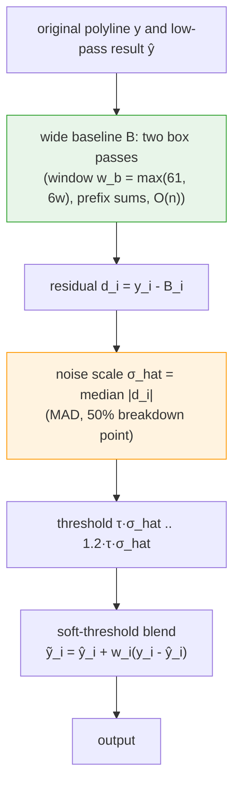
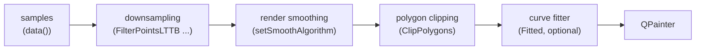

# Curve Rendering, Denoised: Gaussian Convolution, Savitzky-Golay Regression and Feature Preservation

> **Abstract** — Downsampling solves "too many points to draw"; smoothing solves "it still looks like noise". The MinMax bucket keeps the extremes of every bucket, so the extremes of random jitter survive as well: on a 100,000-sample spectrum drawn on a 900×500 canvas, the reduced polyline still has a noise band about 65 pixel rows thick. The render smoothing added in v7.4.2 applies a low-pass filter to the polyline in the paint pipeline, using either Gaussian weighted convolution or Savitzky-Golay local polynomial regression. Both change only the $y$ coordinates and never touch the sample data. The derivation starts from the bias-variance decomposition and covers the Savitzky-Golay moment conditions, the parity argument that makes order 2 and order 3 identical, and the identity that the noise gain equals the centre coefficient. Feature preservation is the third piece: a wide baseline, a MAD (median absolute deviation) noise estimate and a soft-threshold blend restore peaks and dips to their original position and height. Numerical experiments and complete code accompany the properties.

> **Abstract — Key results**
>
> - The Gaussian kernel ($\sigma = w/4$) suppresses noise best (residual noise 28.6% of the input at $w=15$), but its peak attenuation has a closed form $b/\sqrt{b^2+\sigma^2}$: a kernel with $\sigma=3.75$ cuts a peak of width $b=3$ by 35% of its height
> - The Savitzky-Golay kernel is the convolution form of a local polynomial least-squares fit: any polynomial of degree $\le p$ passes undistorted (polynomial reproduction theorem), so peak shapes survive, at the cost of about 36% more residual noise than the Gaussian at the same window ($\sqrt{g}=0.389$ vs $0.287$)
> - Feature preservation makes attenuation selective instead of indiscriminate: at the default $\tau=3$, the top row of a narrow peak and the bottom row of a deep dip stay row-identical to the unsmoothed rendering, while the noise band collapses from 65.4 px to 6.1 px (Gaussian + LTTB, 900×500 canvas, measured)

---

## 1. Introduction: why downsampling cannot remove the noise

Proposition 1 of the companion article (global extreme preservation) yields an immediate, counter-intuitive corollary:

**Corollary (noise survival)** If the input contains random jitter, the jitter almost surely produces extremes in every bucket; the MinMax bucket keeps every bucket extreme ⇒ the noise extremes survive intact. The reduced polyline is no cleaner than the input: it has fewer points and the same fuzz.

Measured (the same 100,000-sample spectrum as in the companion article, 900×500 canvas, MinMax reduction): the mean column-envelope thickness of the polyline is 65.4 pixel rows; stroked with a 1 px pen, that is a 60-row-wide fuzzy band.

Why not smooth the data instead?

1. The data is an asset. Samples are used for analysis, export and other tools; render smoothing removes the fuzz but leaves `data()` untouched.
2. Render-layer smoothing is zoom-invariant. It operates on the per-frame polyline, so the window counts *rendered points*; zooming in just spreads those points over more pixels, keeping the visual amount of smoothing constant (Section 6). A fixed-window filter on the data layer would smooth more aggressively when you zoom in.

`Fitted` does not help either: it is *interpolation* (a spline through every point), and interpolation reproduces noise exactly instead of filtering it. What is needed is a low-pass filter.

## 2. Formalizing the problem

### 2.1 Signal model

Let the reduced polyline be $(x_i, \hat{y}_i)$ ($y$ in pixel rows) and assume

$$
\hat{y}_i = f(x_i) + \varepsilon_i, \qquad \varepsilon_i \sim \mathcal{N}(0, \sigma^2), \quad \text{i.i.d.}
$$

where $f$ is the "true shape" (smooth, low-frequency) and $\varepsilon$ the render noise (jitter, spikes). We want an estimate $\hat{f}$ with small mean squared error. For any estimator, the bias-variance decomposition holds:

$$
\mathbb{E}\left[ (\hat{f} - f)^2 \right] = \underbrace{\left( \mathbb{E}[\hat{f}] - f \right)^2}_{\text{bias}^2} + \underbrace{\operatorname{Var}[\hat{f}]}_{\text{variance}}
$$

- Bias comes from over-smoothing: peaks shrink and shapes round off, which is irreversible data distortion;
- Variance comes from under-smoothing: residual noise, the visible fuzz.

The two kernels pick opposite points on this trade-off: the Gaussian minimizes variance (more bias), Savitzky-Golay minimizes bias (more variance). Feature preservation (Section 5) tries to minimize both simultaneously: the low-variance estimate in the noise regions, the zero-bias estimate in the feature regions.

### 2.2 Linear shift-invariant filters

Both kernels are linear shift-invariant (LSI) filters; the output is a convolution:

$$
\hat{f}_i = \sum_{j=-m}^{m} c_j\, \hat{y}_{i+j}, \qquad m = \frac{w-1}{2}
$$

with odd window $w$. Two basic constraints:

1. Unity DC gain (a constant signal stays constant): $\sum_j c_j = 1$;
2. Zero phase (no horizontal shift): the kernel is symmetric, $c_{-j} = c_j$.

Zero phase means the frequency response is real and even: $H(\omega) = c_0 + 2\sum_{j=1}^m c_j \cos(j\omega)$. There is no phase distortion: a peak can only be attenuated *in place*, never displaced.

### 2.3 Frequency-domain view

A low-pass filter is characterized by its frequency response. Two scalar summary statistics are used throughout:

- Noise gain $g = \sum_j c_j^2$: after filtering, the variance of white noise is $\sigma^2 g$ (direct computation of $\operatorname{Var}\sum c_j \varepsilon_j$ under the i.i.d. assumption). The residual standard ratio $\sqrt{g}$ quantifies noise suppression;
- -3 dB cutoff frequency: $|H(f_c)| = 1/\sqrt{2}$.

The two are linked: an earlier cutoff implies a smaller noise gain.

## 3. Gaussian kernel smoothing (GaussianSmoothing)

### 3.1 Definition

The continuous Gaussian kernel and the QWT7 discretization:

$$
G_{\sigma}(t) = \frac{1}{\sqrt{2\pi}\,\sigma}\, e^{-t^2 / 2\sigma^2}, \qquad
c_j = \frac{e^{-j^2 / 2\sigma^2}}{\sum_{k=-m}^{m} e^{-k^2 / 2\sigma^2}}, \qquad
\sigma = \max\left(1,\ \frac{w}{4}\right)
$$

The denominator normalizes the DC gain to 1. The window choice $w = 4\sigma$ spans $\pm 2\sigma$, the Gaussian body (95.4% of the mass), so truncation error is negligible.

### 3.2 Frequency-domain properties

The Fourier transform of a Gaussian is a Gaussian (Gaussians are fixed points of the Fourier transform family):

$$
\mathcal{F}\left[ G_\sigma \right](f) = e^{-2\pi^2 \sigma^2 f^2}
$$

Hence the -3 dB cutoff has a closed form:

$$
f_c = \frac{\sqrt{\ln 2}}{2\pi \sigma} \approx \frac{0.1325}{\sigma}
$$

Measured on the discrete kernel (Section 7): at $w=15$ ($\sigma=3.75$), $f_c = 0.0394$ cycles/point, close to the closed form 0.0353 (truncation pushes the cutoff slightly up). With one polyline point per pixel column, $f_c = 0.0394$ means structure with periods shorter than about 25 columns gets thinned, which is the quantitative source of "Gaussian smoothing rounds off narrow peaks".

### 3.3 The peak attenuation theorem: a closed form

**Theorem (peak attenuation)** Let the signal feature be a Gaussian bump of width $b$ (standard deviation), $f(t) = h\, e^{-t^2/2b^2}$. Convolving with a Gaussian kernel of standard deviation $\sigma$ yields a Gaussian again; variances add and area is conserved:

$$
f * G_\sigma (t) = h \cdot \frac{b}{\sqrt{b^2 + \sigma^2}} \cdot \exp\!\left( -\frac{t^2}{2(b^2+\sigma^2)} \right)
$$

*Proof*: the product of two Gaussians is a Gaussian (complete the square in $e^{-u^2/2b^2} e^{-(t-u)^2/2\sigma^2}$); the variance of the convolution is the sum $b^2 + \sigma^2$, and the normalizer shrinks like $1/\sqrt{b^2+\sigma^2}$. Since convolution conserves area ($\int f = \sqrt{2\pi} b h$), the height scales with the width ratio. $\square$

**Corollary (peak retention)**

$$
R(b) = \frac{b}{\sqrt{b^2 + \sigma^2}}
$$


Numbers ($w = 15$, $\sigma = 3.75$):

| peak width $b$ (pts) | Gaussian measured | theory | SG $p=2$ | SG $p=4$ |
|---|---|---|---|---|
| 1 | 0.270 | 0.258 | 0.368 | 0.551 |
| 2 | 0.493 | 0.471 | 0.667 | 0.868 |
| 3 | 0.653 | 0.625 | 0.847 | 0.968 |
| 5 | 0.828 | 0.800 | 0.965 | 0.997 |
| 8 | 0.923 | 0.905 | 0.993 | 1.000 |
| 12 | 0.964 | 0.954 | 0.999 | 1.000 |

Narrow features 1–3 points wide, exactly the "features" Section 5 must protect, lose 35% to 73% of their height under the Gaussian kernel. Without protection, narrow peaks visibly shrink as well as round off.

### 3.4 The scale-space interpretation

Gaussian convolution is also one time step of the heat (diffusion) equation. Let

$$
\frac{\partial u}{\partial s} = \frac{1}{2}\frac{\partial^2 u}{\partial t^2}, \qquad u(t, 0) = f(t)
$$

then $u(t, s) = f * G_{\sqrt{s}}(t)$: convolving with a Gaussian of standard deviation $\sqrt{s}$ is exactly "evolving the signal to scale $s$". This identifies Gaussian smoothing as a scale-space filter, the 1-D counterpart of the Gaussian pyramids and edge-detection scale space of image processing. The choice $\sigma = w/4$ simply fixes an evolution time.

### 3.5 Boundary handling: mirror extension

At the polyline ends there are no neighbours, so the signal must be extended. QWT7 mirrors the samples (`qwtReflectIndex`): indices outside the segment are reflected about the boundary sample,

$$
i < \text{lo} \Rightarrow i' = 2\cdot\text{lo} - i, \qquad
i \ge \text{hi} \Rightarrow i' = 2(\text{hi}-1) - i
$$

i.e. an even extension about the boundary sample itself ($y_{-k} = y_k$, no duplicated boundary point). An even extension has zero derivative at the boundary (Neumann condition), so the smoothed polyline keeps a horizontal tangent at the ends, with no step artifact. Non-finite samples split the polyline into segments (`qwtConvolvePolyline`), each convolved independently; segments shorter than the kernel pass through untouched, so small fragments are not distorted.

### 3.6 Cost

Direct convolution is $O(n \cdot w)$. The Gaussian has no prefix-sum shortcut (unlike the box), but $n$ is the *reduced* polyline length (a few thousand points on a typical canvas) and $w \le 31$, so the cost is negligible: a complete replot of the 100,000-sample spectrum stays at the ~0.1 ms level with or without smoothing (measured with the example's `Run Benchmark`). The kernel is regenerated per replot; that cost is equally negligible.

## 4. Savitzky-Golay kernel smoothing (SavitzkyGolaySmoothing)

### 4.1 History and intuition

Savitzky and Golay (1964, *Analytical Chemistry*) introduced "smoothing by simplified least squares procedures", the classic tool of spectroscopy. The idea is to fit a polynomial of degree $p$ to the $w$ points of every window by least squares, and take the polynomial's value *at the window centre* as the output. The fit is linear ⇒ the whole operation is equivalent to a convolution with a fixed kernel, whose coefficients only depend on $(w, p)$: they can be precomputed once.

### 4.2 Derivation: from least squares to the convolution kernel

Fit the polynomial

$$
g(t) = \sum_{k=0}^{p} a_k t^k
$$

over the window $[-m, m]$, minimizing

$$
J(\mathbf{a}) = \sum_{j=-m}^{m} \left( \hat{y}_{i+j} - \sum_{k=0}^p a_k j^k \right)^2
$$

With $\mathbf{y} = (\hat{y}_{i-m}, \ldots, \hat{y}_{i+m})^\top$ and the Vandermonde design matrix $V \in \mathbb{R}^{w \times (p+1)}$,

$$
V = \begin{pmatrix}
(-m)^0 & (-m)^1 & \cdots & (-m)^{p} \\
\vdots & \vdots & & \vdots \\
m^0 & m^1 & \cdots & m^{p}
\end{pmatrix}
$$

the normal equations $V^\top V \mathbf{a} = V^\top \mathbf{y}$ give $\mathbf{a} = (V^\top V)^{-1} V^\top \mathbf{y}$. The centre output is $g(0) = a_0 = \mathbf{e}_1^\top \mathbf{a}$, i.e.

$$
\hat{f}_i = \underbrace{\mathbf{e}_1^\top (V^\top V)^{-1} V^\top}_{=\, \mathbf{c}^\top} \mathbf{y}
\qquad\Longrightarrow\qquad
\mathbf{c}^\top = \mathbf{e}_1^\top (V^\top V)^{-1} V^\top
$$

SG smoothing is therefore a convolution with the kernel $\mathbf{c}$, which depends only on $(w, p)$.

The QWT7 implementation (`qwtSavitzkyGolayKernel`) works with the *moment form* of the normal equations. Define the window moments

$$
\mu_k = \sum_{j=-m}^{m} j^k, \qquad k = 0, \ldots, 2p
$$

Then $(V^\top V)_{kl} = \mu_{k+l}$ (a Hankel matrix) and the right-hand side is $\mathbf{e}_1$; solving $(V^\top V)\mathbf{a} = \mathbf{e}_1$ and substituting back yields

$$
c_j = \sum_{k=0}^{p} a_k j^k, \qquad j = -m, \ldots, m
$$

### 4.3 Moment conditions: the parity argument and $p=2 = p=3$

The odd moments of a symmetric window vanish: $\mu_1 = \mu_3 = \cdots = 0$. Hence $V^\top V$ block-decouples into even and odd coefficient blocks; the right-hand side $\mathbf{e}_1$ lives entirely in the even block, so all odd coefficients of $\mathbf{a}$ are zero: SG kernels are always even (zero phase).

Another corollary: order 2 and order 3 produce the identical kernel (for $w \ge 5$); the cubic coefficient is zero, so the extra degree of freedom is never used. Verified coefficient-by-coefficient at $w = 9$ in the experiment suite. Likewise orders 0 and 1 both give the moving average kernel (the linear term vanishes at the centre evaluation).

**Explicit kernel** ($w=5$, $p=2$): moments $\mu_0=5,\ \mu_2=10,\ \mu_4=34$; the normal equations

$$
\begin{pmatrix} 5 & 0 & 10 \\ 0 & 10 & 0 \\ 10 & 0 & 34 \end{pmatrix}
\begin{pmatrix} a_0 \\ a_1 \\ a_2 \end{pmatrix}
= \begin{pmatrix} 1 \\ 0 \\ 0 \end{pmatrix}
\;\Longrightarrow\;
a_0 = \frac{17}{35},\quad a_1 = 0,\quad a_2 = -\frac{1}{7}
$$

$$
\mathbf{c} = \frac{1}{35}\,(-3,\ 12,\ 17,\ 12,\ -3)
$$

This is the $[-3,12,17,12,-3]/35$ smoothing kernel that appears throughout the literature. For general windows the kernel is computed by solving the moment equations numerically ($O(p^3)$ Gaussian elimination, negligible for $p \ll w$).

### 4.4 The polynomial reproduction theorem

**Theorem (polynomial reproduction)** If the input is a polynomial of degree $\le p$, $f(i) = \sum_{k\le p} \beta_k i^k$, then SG($w, p$) reproduces it exactly.

*Proof*: $f$ is exactly representable by the $p$-degree polynomial over the window ⇒ the least-squares residual is zero ⇒ $g \equiv f$ and the centre value $g(0) = f(0)$. $\square$

**Corollary (peak shape retention)** Locally, a peak top is approximated by its Taylor expansion, and the linear term vanishes at a critical point:

$$
f(t) \approx f(0) + \frac{f''(0)}{2} t^2
$$

Hence SG($p=2$) passes the local shape of a peak undistorted, which is why it outperforms the Gaussian at peak-keeping (Section 3.3's table: at $w=15$ a 3-point peak loses 35% under the Gaussian, only 15% under SG, and almost nothing at order 4).

### 4.5 The noise gain identity

The SG noise gain has a closed form:

**Proposition** For any SG kernel, $\sum_j c_j^2 = c_0$ (the sum of the squared coefficients equals the centre coefficient).

*Proof*: $\mathbf{c} = V (V^\top V)^{-1} \mathbf{e}_1$, hence

$$
\sum_j c_j^2 = \mathbf{c}^\top \mathbf{c}
= \mathbf{e}_1^\top (V^\top V)^{-1} V^\top V (V^\top V)^{-1} \mathbf{e}_1
= \mathbf{e}_1^\top (V^\top V)^{-1} \mathbf{e}_1 = a_0 = c_0
$$

where the middle step uses $(V^\top V)^{-1} V^\top V = I$. $\square$

Numerically verified (experiments): $w=5$: $0.485714 = 17/35$; $w=15, p=2$: $c_0 = 0.151131$. Hence the residual noise is $\operatorname{Var}(\hat f) = c_0 \sigma^2$: the centre coefficient of an SG kernel gives the fraction of noise that remains.

### 4.6 Frequency response and low-frequency flatness

The moment conditions dictate the low-frequency expansion. Let $\nu_k = \sum_j c_j j^k$ be the kernel moments; polynomial reproduction is equivalent to $\nu_k = \delta_{k0}$ for $0 \le k \le p$. Then

$$
H(\omega) = \sum_j c_j e^{-i\omega j} = \sum_{k\ge 0} \frac{(-i\omega)^k}{k!} \nu_k
= 1 + \sum_{k \ge p+1} \frac{(-i\omega)^k}{k!} \nu_k
$$

Symmetry kills the odd order $p+1$ term, so for even $p$:

$$
H(\omega) = 1 - \frac{\nu_{p+2}}{(p+2)!}\,\omega^{p+2} + O(\omega^{p+4})
$$

i.e. the SG response is flat to order $p+1$ at low frequencies, the frequency-domain form of polynomial reproduction: trends and wide features pass losslessly until the $\omega^{p+2}$ term becomes significant.

Quantitative comparison of the three filters at $w = 15$ (measured):

| kernel | $\sqrt{g}$ (residual noise) | -3 dB cutoff (cycles/point) |
|---|---|---|
| moving average (= SG $p=0,1$) | 0.258 | 0.0295 |
| Gaussian | 0.287 | 0.0394 |
| SG $p=2,3$ | 0.389 | 0.0717 |
| SG $p=4$ | 0.489 | 0.1158 |


At the same window, the SG cutoff is nearly twice as high as the Gaussian's: it keeps more high-frequency content (peak shape) at the price of ~36% more residual noise. Increasing the window recovers the noise suppression ($w=31$: SG $\sqrt{g} = 0.270$).

## 5. Feature preservation: the nonlinear post-processing

Every linear low-pass filter attenuates features narrower than its window; the attenuation formula of Section 3.3 is the fixed price. Feature preservation (`setSmoothPreserveThreshold()`, on by default) is a nonlinear post-processing step: it identifies the peaks that were flattened and the dips that were filled in, and restores them to their original position and height.

### 5.1 The algorithm

The flowchart below summarizes the feature-preservation pass: a wide two-box baseline estimates the background, the median absolute residual gives the noise scale, and a soft threshold blends the original polyline back wherever the low-pass result deviates by more than the threshold.



The baseline is two consecutive box (moving average) passes over the polyline, an approximation of a Gaussian kernel computable in $O(n)$ with prefix sums. Its window $w_b = \max(61, 6w)$ (the code rounds it up to an odd value, $6w+1$ for $w \ge 11$) is wide enough to follow the overall shape (the slow envelope) but not the narrow features. Mathematically the baseline is the convolution of the signal with a triangular (Bartlett) kernel.

The noise scale is the median absolute deviation (MAD), computed as the median of the absolute residuals:

$$
\hat{\sigma} = \operatorname*{median}_i \left| y_i - B_i \right|
$$

The median makes the estimate robust: spikes occupying less than half of the points cannot influence it at all, which is exactly the "how wide is the noise band" measure we want. For pure Gaussian noise, $\operatorname{median}|\varepsilon| = 0.6745\sigma$, so a threshold $\tau \hat{\sigma}$ corresponds to about $0.6745\tau\sigma$. The default $\tau = 3$ is about $2.02\sigma$: under the pure-noise null hypothesis, only ~4.3% of the points exceed the threshold and would be misclassified as features.

The soft-threshold blend assigns every point a weight:

$$
w_i = \begin{cases}
0 & |d_i| \le \tau\hat{\sigma} \\[2pt]
\dfrac{|d_i| - \tau\hat{\sigma}}{0.2\,\tau\hat{\sigma}} & \tau\hat{\sigma} < |d_i| < 1.2\,\tau\hat{\sigma} \\[2pt]
1 & |d_i| \ge 1.2\,\tau\hat{\sigma}
\end{cases}
\qquad\qquad
\tilde{y}_i = \hat{y}_i + w_i\,(y_i - \hat{y}_i)
$$

- $w_i = 0$: a noise point, so take the smoothed value (lowest variance);
- $w_i = 1$: a feature core point, so restore the original value fully (zero bias);
- $0 < w_i < 1$: a blend zone that keeps the transition continuous and free of steps.


### 5.2 Mathematical nature

1. Continuous but piecewise-linear in $|d_i|$: the output is continuous in the input, while the behaviour on the two sides of the threshold differs deliberately. The amplitude threshold separates "fluctuations hidden in noise" from "structure several noise scales above it".
2. A shrinkage estimator: $\tilde{y}_i$ is a convex combination of $\hat{y}_i$ and $y_i$, with the shrinkage decreasing monotonically in $|d_i|$. Conceptually it belongs to the family of Donoho's wavelet soft-thresholding and Huber-style robust regression: the amount of deviation decides how much the point is trusted.
3. Relation to median and bilateral filters: pixel-domain denoising typically uses median filters or bilateral filters (spatial proximity plus range similarity). Here "range similarity" is replaced by an explicit deviation from a wide baseline; the price is one $O(n)$ baseline computation, the gain is exact restoration of features instead of approximate preservation.
4. The factor 1.2 is a soft edge: the upper end of the blend zone is $1.2\tau\hat{\sigma}$ (`qwt_curve_smoothing.cpp`), and the blend width scales with the threshold itself, so larger thresholds blend over more samples and cannot create isolated discontinuities.

### 5.3 Parameter semantics and failure modes

| $\tau$ | behaviour |
|---|---|
| 0 (off) | pure linear low-pass: peaks and dips attenuate per the Section 3.3 formula |
| 1 | only the most prominent peaks are protected; much noise remains smoothed |
| 3 (default) | everything above about $2\sigma$ is preserved; the noise band collapses to a thin line |
| 6 | medium spikes are absorbed into the smoothing; shallow features begin to flatten |

Failure modes: ① if the noise scale is underestimated (e.g. correlated rather than i.i.d. noise), `median|d|` is too small ⇒ the threshold is too low ⇒ noise points get "restored", and the protection fails; ② a true bump wider than the baseline window $w_b$ (a slow hump) is followed by the baseline, hence not flagged as a feature and gets smoothed. That is by design ("what the baseline follows is background"), though users should know it; ③ adjacent points in the blend zone get slightly different weights, which can create a barely visible ripple (in the measurements the blend zone involves only ~1–2% of the points).

## 6. Position and order in the paint pipeline

The flowchart below places render smoothing in the paint pipeline: it runs on the downsampled polyline, before polygon clipping and the optional curve fitter, so it always operates in screen space and never touches the samples in `data()`.



Three design decisions and their reasons:

1. After the downsampling. The smoothing input is the reduced polyline (≈ 4W points), not the raw data. This makes the window count *rendered points*, which gives zoom invariance. Under a zoom factor $\alpha$, the polyline grows by $\alpha$ points and the window covers $\alpha$ times less $x$-span, so $\sigma = w/4$ is constant in *screen space* and "how much smoothing" does not change while zooming. A data-domain filter would flatten features more aggressively the more you zoom in.

2. Only $y$ is modified. The convolution acts on the values; the $x$ coordinates are copied verbatim. Every feature keeps its horizontal position pixel-exact, peaks never drift sideways, and horizontal smoothing cannot fold the polyline back on itself.

3. Before the curve fitter. The `Fitted` spline receives an already de-noised polyline; interpolation no longer amplifies the noise (interpolation reproduces it, see Section 1). Both settings compose.

Like the downsampling stage, the smoothing is stateless and reentrant: polylines can be painted from several threads (`QwtPlotDirectPainter`, background printing) without synchronization.

## 7. Experiments

### 7.1 End-to-end measurement

Using the same generator as `examples/2D/curvesmoothing` (100,000 samples: slow envelope, humps, three narrow peaks, $\sigma=0.15$ white jitter, 1% upward spikes, 0.8% dropouts, one deterministic deep dip), the pipeline is MinMax bucket reduction (`FilterPointsMinMaxLTTB`; `FilterPointsLTTB` mapped to it up to v7.4.2) followed by smoothing (900×500 canvas, pixel-row metric):

| configuration | mean noise band (px) | peak top row | dip bottom row |
|---|---:|---:|---:|
| reduction only (default) | **65.4** | 0.0 | 499.0 |
| Gaussian $w=15,\ \tau=3$ | **6.1** | **0.0** | **499.0** |
| Gaussian $w=15,\ \tau=0$ (pure low-pass) | 4.1 | 38.5 | 369.0 |
| SG $w=15,\ p=2,\ \tau=3$ | 11.3 | 0.0 | 499.0 |


The measurements show:

1. The noise band drops from 65.4 to 6.1 px (4.1 px for the pure low-pass), so the fuzz collapses to a thin line;
2. At $\tau=3$ the peak top row (0.0) and the dip bottom row (499.0) are identical to the unsmoothed rendering: feature preservation restores what the filter flattened. Compare $\tau=0$: the peak top drops to row 38.5 and the dip bottom rises to 369, which is 38.5 and 130 rows of height/depth loss. This is the same phenomenon as the "26 px peak / 63 px dip" recorded in the example documentation (900 px canvas);
3. The SG residual band is 11.3 px against 6.1 px for the Gaussian, consistent with the theoretical $\sqrt{g}$ ratio (0.389 vs 0.287, predicted 1.36×, measured 1.85×; the residual mismatch comes from spikes and dropout noise not being Gaussian).

### 7.2 Theory vs measurement

| quantity | theory | measured |
|---|---|---|
| Gaussian residual noise $\sqrt{g}$ (w=15) | 0.287 | 0.286 ± 0.001 (Monte Carlo) |
| SG identity $g = c_0$ (w=15, p=2) | 0.151131 | 0.151131 |
| -3 dB cutoff (Gaussian w=15) | 0.0353 | 0.0394 |
| peak retention $R(3)$ (Gaussian w=15) | 0.625 | 0.653 |

(Monte Carlo: 40,000 Gaussian-white samples filtered by the kernels; the standard-deviation ratios coincide with the theory curves across all window sizes, see `fig_smooth_noisegain.png`.)

All scripts and numbers are in `docs/assets/algorithms/` (`smoothing_experiment.py`, `figures.py`).

## 8. Code practice

### 8.1 API

| setter | default | meaning |
|---|---|---|
| `setSmoothAlgorithm()` | `NoSmoothing` | `GaussianSmoothing` / `SavitzkyGolaySmoothing` |
| `setSmoothWindow()` | 9 | polyline points per window; odd ≥ 3, even rounded up |
| `setSmoothPolynomialOrder()` | 3 | SG polynomial order, clamped to $1 \ldots w-2$ |
| `setSmoothPreserveThreshold()` | 3.0 | feature preservation in units of the noise scale; 0 = off |

### 8.2 Complete example

The listing below is a minimal, self-contained program: `makeSpectrum()` generates 100,000 spectrum-like samples, and the same data is plotted twice with `QwtPlotCurve`, once through the default pipeline and once with Gaussian smoothing plus feature preservation, for a direct side-by-side comparison.

```cpp
#include <qwt_plot.h>
#include <qwt_plot_curve.h>
#include <qwt_point_data.h>

#include <QApplication>
#include <cmath>
#include <random>

// 1. spectrum-like samples: envelope + narrow peaks + white jitter
QVector<QPointF> makeSpectrum(int n)
{
    std::mt19937 rng(0xC0FFEE);
    std::normal_distribution<double> jitter(0.0, 0.15);

    QVector<QPointF> v;
    v.reserve(n);
    for (int i = 0; i < n; i++) {
        double y = 1.0 + 0.3 * std::sin(i / 8000.0);
        y += 3.0 * std::exp(-0.5 * std::pow((i - 30000.0) / 5000.0, 2));
        y += 5.0 * std::exp(-0.5 * std::pow((i - 15000.0) / 300.0, 2));  // narrow peak
        y += jitter(rng);                                                // pixel noise
        v += QPointF(i, y);
    }
    return v;
}

// 2. two curves: default rendering vs smoothing
QwtPlotCurve* makeCurve(QwtPlot* plot, const QVector<QPointF>& samples,
                        QwtPlotCurve::SmoothAlgorithm algo)
{
    QwtPlotCurve* curve = new QwtPlotCurve();
    curve->setSamples(samples);
    curve->setPaintAttribute(QwtPlotCurve::FilterPointsLTTB, true);   // reduction

    if (algo != QwtPlotCurve::NoSmoothing) {
        curve->setSmoothAlgorithm(algo);
        curve->setSmoothWindow(15);          // Gaussian: sigma = 3.75
        curve->setSmoothPolynomialOrder(3);  // SG only (2 and 3 are equal)
        curve->setSmoothPreserveThreshold(3.0);
    }
    curve->attach(plot);
    return curve;
}

int main(int argc, char** argv)
{
    QApplication app(argc, argv);

    const QVector<QPointF> samples = makeSpectrum(100000);

    QwtPlot plot;
    plot.resize(900, 500);

    QwtPlotCurve* plain  = makeCurve(&plot, samples, QwtPlotCurve::NoSmoothing);
    QwtPlotCurve* smooth = makeCurve(&plot, samples, QwtPlotCurve::GaussianSmoothing);
    plain->setPen(QColor("#888888"));
    smooth->setPen(QColor("#1f77b4"));

    plot.replot();
    plot.show();
    return app.exec();
}
```

The grey curve shows a noise band 60+ pixel rows thick; the blue curve's band collapses to ~6 px, while the top pixel row of the narrow peak is identical in both curves, and `data()` was never touched.

The snippet above is a minimal version of what the official example, `examples/2D/curvesmoothing`, demonstrates. That example puts the default rendering and the smoothed rendering side by side in one window and exposes every parameter as a live control:


From left to right:

- Left plot (plain): the 100,000-sample spectrum through the default pipeline (`FilterPointsLTTB` reduction only); the noise shows as a coarse vertical fringe;
- Right plot (smooth): the same samples plus render smoothing; the noise band collapses to a thin line while the narrow peaks and the deep dip stay where they are;
- Bottom controls: `Algorithm` (Gaussian / Savitzky-Golay), `Window`, `SG Order`, `Preserve` (feature preservation threshold), `Downsampling` (`None ( raw samples )` / `FilterPoints` / `FilterPointsAggressive` / `FilterPointsPixel` / `FilterPointsLTTB` (default) / `FilterPointsMinMaxLTTB`, applied to both plots), plus a `Run Benchmark` button that replots both plots 50 times each;
- The `last` label under each plot shows its most recent replot time; the smoothing overhead is in the sub-millisecond range (measured at the ~0.1 ms level).

The example is best read picture-first: set `Preserve` to 0 and the same narrow peak immediately shrinks, which is $R(b) = b/\sqrt{b^2+\sigma^2}$ from Section 3.3 on screen.

### 8.3 Parameter selection guide

| goal | suggestion |
|---|---|
| general denoising (spectra, acquired signals) | Gaussian, $w = 9\ldots 21$, $\tau = 3$ |
| keep narrow peak shapes | SG, $p = 2$ (= 3), window 21–31 to compensate the noise |
| pure low-pass (features not needed) | $\tau = 0$; peaks and dips attenuate per $R(b)$ — know your peak widths first |
| strong noise, weak features | combine `FilterPointsPixel` with smoothing (noise band ~2.7 px, see the example docs) |
| interactive tuning | `examples/2D/curvesmoothing`: switch algorithm / window / order / threshold live, run 50-replot benchmarks |

> **Tip — What the window counts**
>
> The window counts *polyline points*, not samples: after MinMax reduction the polyline has ≈ 4W points, so window 15 covers about 4 pixel columns horizontally. The span scales with the pixel ratio while zooming, so the smoothing strength is constant in screen space (Section 6).

## 9. Summary

Downsampling keeps the extremes, so noise survives; render smoothing removes it with a low-pass filter in the paint pipeline and never modifies the sample data. Gaussian smoothing is a $\sigma = w/4$ weighted window and the strongest noise suppressor ($\sqrt{g}=0.287$ at $w=15$), with peak attenuation $R(b)=b/\sqrt{b^2+\sigma^2}$. Savitzky-Golay is the convolution form of local polynomial least squares; polynomial reproduction keeps peak shapes ($p=2$ loses about 15% on a 3-point peak) at the price of ~36% more residual noise, and its moment conditions give $p=2 = p=3$ and $g=c_0$. Feature preservation combines a wide baseline, a MAD noise scale and a soft-threshold blend: at the default $\tau=3$ peak tops and dip bottoms are restored row-identically, and the noise band drops from 65.4 to 6.1 px. The stage is stateless and reentrant and costs $O(nw)$ with $n \approx 4W$, so a full replot of the 100,000-sample spectrum stays at ~0.1 ms.

## 10. References

1. Savitzky, A., Golay, M. J. E. *Smoothing and Differentiation of Data by Simplified Least Squares Procedures.* Analytical Chemistry, 36(8), 1627–1639, 1964.
2. Steinarsson, S. *Downsampling Time Series for Visual Representation.* MSc thesis, University of Iceland, 2013.
3. Donoho, D. L. *De-noising by soft-thresholding.* IEEE Transactions on Information Theory, 41(3), 613–627, 1995.
4. Witkin, A. *Scale-space filtering.* IJCAI, 1983.
5. QWT7 sources: `src/plot/qwt_curve_smoothing.cpp` (kernels, convolution, feature preservation), `src/plot/qwt_plot_curve.cpp` (pipeline, `drawLines`).
6. QWT7 example: `examples/2D/curvesmoothing` (100,000-sample noisy spectrum, smoothing comparison).

*Companion article:* [Downsampling Curves for the Screen: LTTB Theory and the QWT7 MinMax Bucket](curve-downsampling.md), on how the polyline that smoothing operates on is produced.