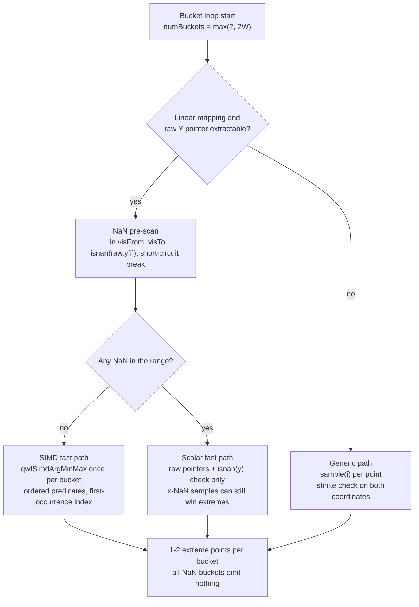
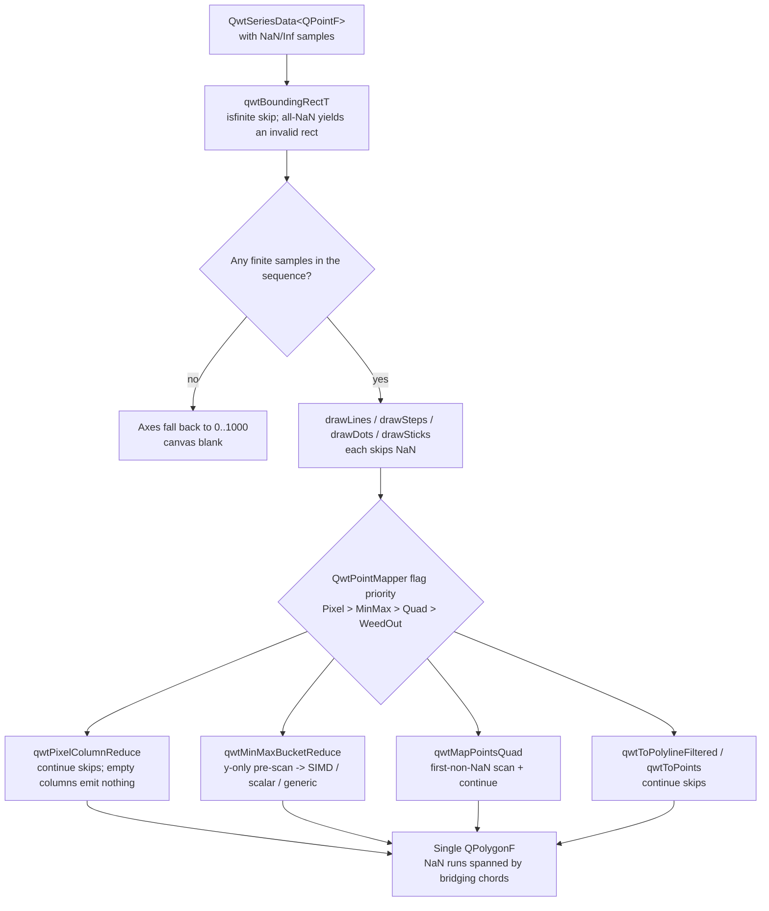
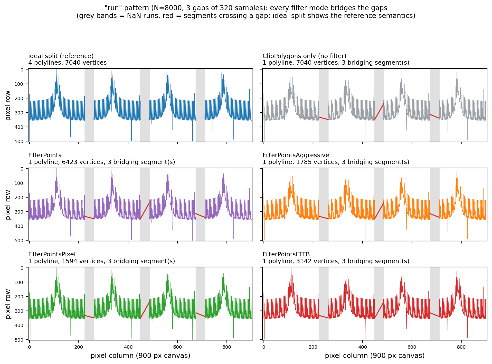
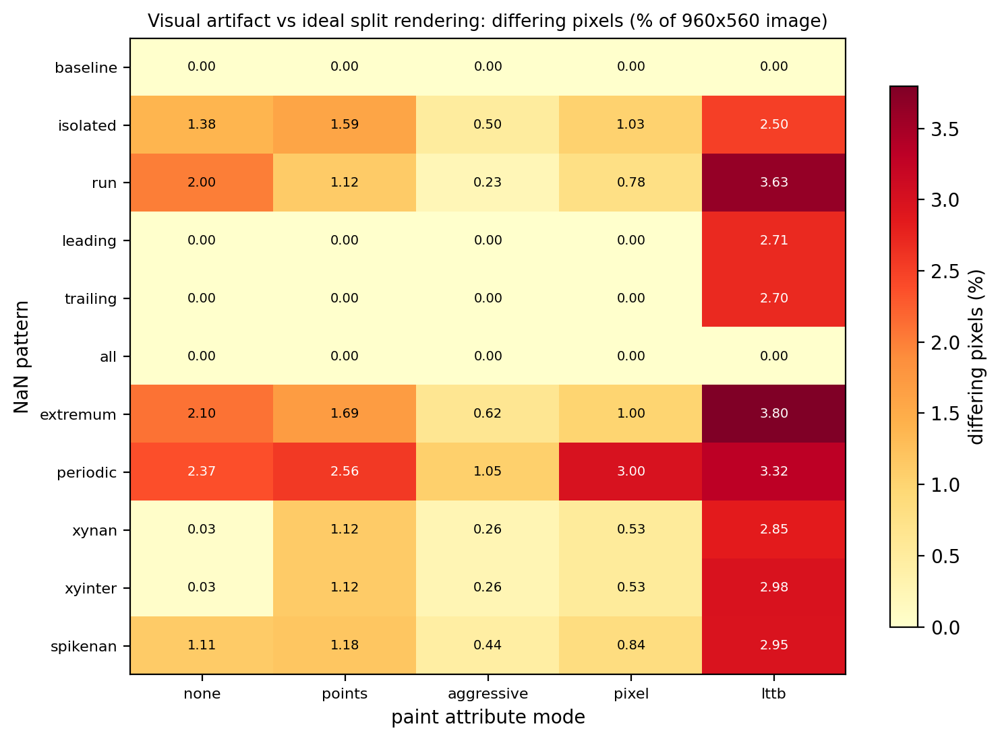
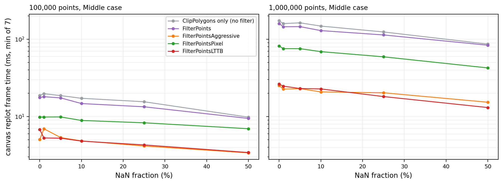
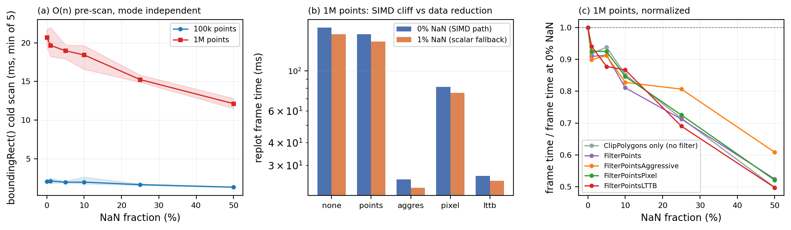
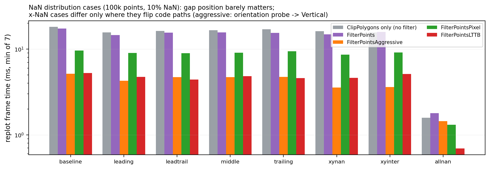

# NaN Rendering Semantics and Their Performance Cost

> **Abstract** — Missing values in scientific data almost always enter the plotting pipeline as IEEE-754 `NaN`: a sensor dropping offline, a division by zero, a failed interpolation/extrapolation step, an explicit hole from an upstream pipeline. A renderer facing NaN has only three semantic choices — split the polyline at the gap (matplotlib's choice), skip the sample and join the two sides, or draw it as 0 — and the three mean completely different things visually. This article reads QWT7's `qwt_point_mapper.cpp` and `qwt_plot_curve.cpp` line by line and gives the exact output semantics on NaN data of five paint attributes (`ClipPolygons` without filtering / `FilterPoints` / `FilterPointsAggressive` / `FilterPointsPixel` / `FilterPointsLTTB`): QWT7 implements the **skip semantics** — every Lines-family path outputs a single continuous polyline, and NaN runs are "bridged" over by a chord instead of being split; this conclusion is confirmed jointly by a 3090-group polygon-hash comparison between a line-by-line Python reimplementation and the real library (100% agreement) and by a per-pixel visual scan of 960×560 offscreen renders (0.23%–3.80% of pixels differ from the ideal split reference). On the performance side, the boundingRect cold scan is a single $O(n)$ sequential read, about 12–22 ms for one million points; the SIMD argmin/argmax path degrades globally to scalar as soon as any NaN appears, but in frame-level measurements this "**cliff**" is masked by the data-reduction gains and the rasterization-dominant term (delta = −0.29 at 100k points, delta = +0.03 at 1M points, consistent with the nanperf example's conclusions).

> **Abstract — Core conclusions**
>
> - QWT7's NaN semantics are **skip-not-split**: in the semantics matrix of 14 NaN patterns × 5 paint attributes, every Lines-family path produces exactly 1 bridging chord for every interior NaN run (`run` pattern: 3 gaps → 3 bridging chords, no exception among the five modes); only per-sample styles like `Dots` / `Sticks` are naturally correct.
> - Semantic-reimplementation cross-validation: the line-by-line Python reimplementation and the real `qwtplot.dll` output agree on **3090/3090 (100%)** polygon hashes across 15 directed cases + 250 random cases × 2 canvases × 6 paths; 90 directed-case groups match bit-for-bit vertex by vertex.
> - Visual artifacts (per-pixel comparison against the ideal rendering of "break at NaN, everything else unchanged", 960×560): among the interior-gap patterns, `FilterPointsAggressive` is closest to the ideal (0.23%–1.05% differing pixels) and `FilterPointsLTTB` deviates the most (2.50%–3.80%), of which about 2.7 percentage points come from bucket-boundary reshuffling rather than bridging.
> - Performance: 1M-point Middle case — frame time (min-of-7) decreases overall as the NaN ratio goes from 0% to 50% (individual 1%/5% cells rebound within measurement noise): no-filter 173.7→86.5 ms, `FilterPointsLTTB` 26.3→13.1 ms; boundingRect cold scan 21.7→11.5 ms; all-NaN data takes only 0.6–1.7 ms per frame, the canvas is blank, and the axes fall back to 0–1000.
> - Beyond the first item of the failure list there are two measured traps: the `FilterPointsLTTB` raw-pointer path's pre-scan checks only y, so a sample whose x is NaN and y is finite, if it happens to be a bucket extremum, lands in canvas column 0 via `qRound(NaN)==0` (measured, MSVC x64 + Qt 5.15) and forms a spurious spike; and `+Inf` can pass through the `isnan`-only pre-scan into the SIMD path, producing `INT_MIN` pixel coordinates.

---

## 1. Introduction: where NaN comes from and what the renderer should do

### 1.1 Three sources

NaN in engineering data is not an anomaly; it is the routine way of encoding things. A sensor drops offline within a sampling interval and the acquisition side writes `qQNaN()` as a placeholder; a physical quantity is divided by a denominator crossing zero, and IEEE-754 dictates the result is `±Inf` or `NaN`; a data-cleaning pipeline replaces outliers with explicit holes, and downstream NaN means "no measurement here". What the three sources have in common: NaN carries **positional information** (the $i$-th sample is missing) and **missingness information** (the value is unknown), and any rendering that treats NaN as a numeric value loses both at once.

### 1.2 Formalizing the rendering semantics

Let the sample sequence be $P=\{(x_i,y_i)\}_{i=0}^{N-1}$, and denote the maximal contiguous runs of finite samples by $S_1,S_2,\dots,S_k$. The **ideal split semantics** is defined by: the rendering operator $\mathcal{R}$ satisfies

$$
\mathcal{R}_{\text{ideal}}(P) = \bigcup_{j=1}^{k} \mathcal{R}(S_j)
$$

that is, each contiguous run renders independently, with no connecting primitive between runs; a missing run leaves a blank on the canvas. This is the behavior of matplotlib's polylines and the eye's intuitive reading of "missing data". The **skip semantics** instead deletes the NaN samples from the sequence and renders the whole:

$$
\mathcal{R}_{\text{skip}}(P) = \mathcal{R}\left( \bigcup_{j} S_j \text{(concatenated in original order)} \right)
$$

Concatenation introduces a **bridging chord** between adjacent runs — the segment connecting the last point of $S_j$ to the first point of $S_{j+1}$, which has no basis in the data at all. The **draw-as-zero semantics** (treating NaN as 0) destroys even the positional information and is out of scope. The difference among the three semantics becomes more glaring the larger the $y$ values differ across a gap and the wider the gap: a bridging chord can span half the canvas, welding two unrelated signals together.

QWT7's choice is the skip semantics. This is not a documentation claim but a fact visible line by line in the five mapping paths of `src/plot/qwt_point_mapper.cpp`: every path's main loop is `if (qwt_is_nan_or_inf(sample)) continue;` — the sample is dropped and vertices keep appending to the same `QPolygonF`. Section 3 gives the per-path evidence; Section 4 answers with quantitative experiments how many pixels exactly the bridging chords get wrong.

### 1.3 Beyond polylines: NaN semantics in the other primitives

The same isfinite check carries different semantics in the other branches of the pipeline; reading them side by side helps see that "skip" is a general principle in QWT rather than a polyline special case. `QwtPlotSpectrogram` renders NaN cells as transparent pixels (writes 0 when `hasGaps && qwt_is_nan_or_inf(value)`, `qwt_plot_spectrogram.cpp` lines 598/620; the earlier bit-level `qwtIsNaN` has been removed and the current predicate intercepts Inf as well), and provides the `QwtRasterData::WithoutGaps` flag so gap-free data skips the per-cell check — in raster semantics "gap means transparent" holds naturally because pixels have no connection relation. The CONREC contour algorithm detects NaN via an accumulated sum (the cell is skipped when `qwt_is_nan_or_inf(zSum)`, `qwt_raster_data.cpp` line 373, again intercepting Inf too), exploiting NaN's absorption law under addition. For the scatter and symbol paths (`qwtToPointsFiltered`, `drawSymbols`), skipping NaN is the correct semantics, for the same reason as `Dots`/`Sticks`. **Only primitives with a notion of "connection" — polylines and steps — expose the divergence between skip and split**, which is exactly the scope of this article.

### 1.4 Division of labor with the existing documentation

The use guide [NaN Data Handling](../use-guide/general/nan-handling.md) answers "how to configure and how to generate the data"; Sections 5.3 and 5.4 of [Curve Downsampling](curve-downsampling.md) already give the structure diagrams of the MinMax bucket's three paths and the NaN pre-scan. This article is the principles view: it writes the propagation of IEEE-754 comparison semantics through every layer of the rendering pipeline as verifiable propositions, and supplies three sets of numbers — the semantics matrix, the visual artifacts, and the performance cost — with reproducible experiments.

## 2. IEEE-754 comparison semantics and pipeline propagation

### 2.1 Ordered predicates: NaN is "invisible" to comparisons

IEEE-754 dictates that every comparison except `!=` returns false for NaN: $\mathrm{NaN} < x$, $\mathrm{NaN} > x$, $\mathrm{NaN} \le x$ are all `false`. This rule propagates through the rendering pipeline layer by layer, with different effects at each:

- **boundingRect layer** (`qwtBoundingRectT` in `src/core/qwt_series_data.cpp`, around lines 217–262): the Qwt 6 era relied on `qMin/qMax` to extend the bounds; NaN made all comparisons false, so the bounds either stopped extending or were polluted into invalid values. QWT7 switched to an explicit `isSampleNanOrInf(sample)` skip (one `continue` in each of the two loops), and the bounding rectangle is determined by finite samples only. An all-NaN sequence returns the invalid rectangle `QRectF(1,1,-2,-2)` (measured: `boundingRect_allNan_valid=0`, `x=1`, `width=-2`).
- **Autoscaling layer** (two sites, different mechanisms): `QwtPlot::rescaleAxes()` (`src/plot/qwt_plot.cpp` lines 1908–1911) checks the finiteness of all four sides with `qwt_is_nan_or_inf` before merging bounding rectangles; the autoscaling at replot time goes through `QwtPlot::updateAxes()` (`src/plot/qwt_plot_axis.cpp` lines 862–869), which merges intervals only when `width()/height() >= 0` — the invalid rectangle `(1,1,-2,-2)` of an all-NaN sequence has negative width and height and is skipped entirely, the axis interval stays invalid and falls back to the `AxisData` default range 0–1000 (same file, lines 43–44; measured `autoscale_allNan_x_upper=1000`), and nothing is drawn on the canvas.
- **SIMD argmin/argmax layer** (`src/core/qwt_simd_argminmax.cpp`, AVX2 main loop lines 150–164): comparisons use the ordered predicates `_CMP_LT_OQ` / `_CMP_GT_OQ`; NaN can never win a comparison and never enters the index vectors; the horizontal reduction and the scalar tail likewise use ordered comparisons. So "NaN is ignored naturally" holds at the level of **value semantics**.

The NaN-detection predicates used by the layers are not uniform; this table is the index for the failure list later:

| Layer | Predicate | What is checked | Intercepts Inf? |
|---|---|---|---|
| `qwtBoundingRectT` / curve styles / Quad / Pixel / generic bucket path | `qwt_is_nan_or_inf` = `!isfinite` | both x and y coordinates | yes |
| MinMax pre-scan (lines 597–604) | `std::isnan` | y only | no |
| MinMax scalar bucket loop (lines 652–655) | `std::isnan` | y only | no |
| `qwtSimdArgMinMax` fallback (lines 223–224) | `std::isnan(result.minVal/maxVal)` | reduction result | partially (returns the sentinel `{0,0,DBL_MAX,-DBL_MAX}` when the result is still NaN) |

Predicate strength decreases from left to right: the dual-coordinate isfinite is the strongest form, the single-coordinate isnan the weakest. Items 3 and 4 of the Section 5 list are direct consequences of the two weakest rows.

### 2.2 Index semantics are unreliable: why the pre-scan is still needed

Correct value semantics does not mean correct (value, index) pairs. The instruction maintaining the running value in the AVX2 main loop is `_mm256_min_pd(minVec, vals)`, and `MINPD` returns the **second operand** when either operand is NaN: if a lane reads NaN, that lane's running value becomes NaN; on the next round `vals < NaN` is false, so the index vector is not updated, but the running value is restored to the new value by `_mm256_min_pd(NaN, vals)` — a "value is new, index is old" mismatch, and the emitted extremum welds one sample's $y$ to another sample's $x$. This is exactly why `qwtMinMaxBucketReduce` runs a NaN pre-scan before the raw-pointer fast path (`qwt_point_mapper.cpp` lines 597–604): as soon as the pre-scan finds any NaN, the whole range switches to the scalar bucket loop (lines 641–695), trading one $O(n)$ sequential read for the per-bucket branches and the mismatch risk. The pre-scan short-circuits with a `break`: NaN-free data pays the full $O(n)$ cost, NaN data pays only up to the first NaN — an asymmetry visible in the frame-time curves of Section 4.4.

Walk through the mismatch with an 8-sample bucket (single-lane view, min side):

| Round | vals | cmp = vals < minVec (LT_OQ) | minVec (after MINPD) | minIdx |
|---|---|---|---|---|
| 0 | 5.0 | true (5 < DBL_MAX) | 5.0 | 0 |
| 1 | NaN | false | NaN (MINPD returns the second operand) | 0 |
| 2 | 3.0 | false (3 < NaN is false!) | 3.0 | 0 ← should be 2 |
| 3 | 4.0 | false | 3.0 | 0 |

Round 2's true minimum 3.0 enters the running value but loses its own index because the ordered comparison against NaN is false; at the end of the bucket the output is (value=3.0, index=0), while the sample at index 0 has value 5.0. In the SIMD branch of `qwtMinMaxBucketReduce` this mismatch becomes a direct mismatch between `raw.x[minI]` and `r.minVal` — a data point that does not exist geometrically. The pre-scan changes the whole path from "defend in every bucket" to "decide once, reroute the whole range" — a classic engineering trade of one sequential scan for the branches of the hot loop.



### 2.3 Rounding functions: where NaN and Inf finally land

The mapped pixel coordinates pass through rounding functions, where NaN/Inf receive definite (but unexpected) integer values. Qt 5.15 implements `qRound(double)` as `d >= 0 ? int(d+0.5) : int(d - double(int(d-1)) + 0.5) + int(d-1)`; on MSVC x64, `int(NaN)` goes through `cvttsd2si` and yields the "integer indefinite value" `INT_MIN`, and adding two `INT_MIN`s wraps around to 0 in int32. Measured (`nan_mapper_check probes`):

| Input | `qRound` result (MSVC x64, Qt 5.15.16) | Rendering consequence |
|---|---|---|
| `NaN` | `0` | spurious vertex lands in canvas column 0 |
| `+Inf` | `-2147483648` (`INT_MIN`) | flies off the canvas, clipped away by `ClipPolygons` |
| `-Inf` | `0` | spurious vertex lands in canvas column 0 |

The floating-point rounding `qwtRoundValueF` (`floor(v+0.5)` / `ceil(v-0.5)`) instead lets NaN pass through unchanged: `QPolygonF` keeps a `(NaN, NaN)` vertex. These two tables are the arithmetic roots of two traps in the Section 5 failure list.



## 3. NaN handling in the five paths, one by one

### 3.0 From user attributes to mapper flags

`QwtPlotCurve::drawLines` (`qwt_plot_curve.cpp` lines 532–628) translates user-level attributes into mapper flags: `FilterPoints` → `WeedOutPoints`; `FilterPointsAggressive` → `WeedOutIntermediatePoints` (only when integer alignment `doAlign` is true, lines 558–561) + `WeedOutPoints`; `FilterPointsPixel` → `PixelColumnReduce`; `FilterPointsLTTB` → `MinMaxReduce`. The priority in `toPolygonF` is `PixelColumnReduce > MinMaxReduce > WeedOutIntermediatePoints > WeedOutPoints` (`qwt_point_mapper.cpp` line 1232). The analysis below follows this order; the mode names follow the nanperf example's `FilterModes.h`.

### 3.1 No filtering (ClipPolygons only): `qwtToPoints`

`qwtToPoints` (lines 869–929) is the most naive path: iterate over `[from,to]`, `continue` when `qwt_is_nan_or_inf(sample)` is true, otherwise transform, round per `RoundPoints`, and append. The invalid-bounding-rect branch does a single `resize(numPoints)` after the appending (line 925; the comment on the line above, line 924, explicitly says that after adding the NaN check this must be resized too). Semantics: remove NaN, keep order, one polyline — the bridging-chord count equals the number of interior NaN runs. All-NaN input yields an empty polygon.

### 3.2 FilterPoints: `qwtToPolylineFiltered`

`qwtToPolylineFiltered` (lines 956–998) first scans for the first non-NaN sample:

```text
realFrom = from; sample0 = series->sample(from)
while (realFrom < to && qwt_is_nan_or_inf(sample0)): realFrom++, sample0 = series->sample(realFrom)
points[0] = round(transform(sample0))          # note: sample0 is no longer checked here
for i = realFrom+1 .. to:
    if qwt_is_nan_or_inf(sample(i)): continue  # skip, do not split
    p = round(transform(sample(i)))
    if points[pos] != p: points[++pos] = p     # dedupe consecutive pixel duplicates
```

Unlike the Quad path, there is **no** all-NaN early exit here: if the entire sequence is NaN, the loop stops at `realFrom == to` and `points[0]` is built from the last sample — with finite x and NaN y this yields a single-vertex polygon like `(899, NaN)` (semantics matrix, `all` row: `points` mode, 1 vertex, 1 garbage coordinate). A single-vertex polyline draws nothing under the rasterizer — the `all` row of the visual scan differs by 0 — but the polygon is non-empty: one of the odds and ends in the Section 5 list.

### 3.3 FilterPointsAggressive: `qwtMapPointsQuad`

Two-pass quad merge (lines 218–345): the first pass skips NaN over the sequence and scans for the first non-NaN sample, and **does** have an all-NaN early exit (lines 235–236, `if (realFrom >= to && qwt_is_nan_or_inf(sample0)) return polyline;`); the second pass merges again on the integer polygon. NaN samples are removed by `continue` in the first pass, so the extreme statistics within a pixel column/row see only finite samples; the connection across a gap falls out naturally from the polyline after both merge passes — still a bridge. The orientation probe `qwtProbeOrientation` (lines 82–110) classifies a sequence whose x contains NaN as Vertical because `(NaN > prev) != isIncreasing`, changing the order of the two merge passes: in sweep B, the aggressive frame times of the `xynan`/`xyinter` cases (3.57/3.60 ms) are about 24% lower than `middle` (4.70 ms) — the source is the change in output vertex count caused by this path flip, not less work.

### 3.4 FilterPointsPixel: `qwtPixelColumnReduce`

Pixel-column bucketing (lines 422–535): the main loop `continue`s past NaN and then accumulates first/min/max/last per column; in the output phase, columns with `count == 0` are not emitted at all. So the columns corresponding to a NaN run are **empty columns**, and the polyline connects the column left-adjacent to the gap directly to the right-adjacent column — the bridging chord here appears as a long chord spanning the empty columns. The sub-pixel placement within a column (+0.2/+0.25/+0.75/+0.8, lines 508–531) matches what Section 4.4 of [Curve Downsampling](curve-downsampling.md) describes; NaN does not change the placement rules, only which columns are non-empty.

```text
# NaN behavior of qwtPixelColumnReduce (linear fast path, lines 451-471)
visFrom, visTo = findVisibleRange(xMap, series, from, to)   # x-NaN can make it fall back to the full range
bins[col] = {firstY, minY, maxY, lastY, count} for col in 0..W-1
for i in visFrom .. visTo:
    if qwt_is_nan_or_inf(sample(i)): continue               # both-coordinate check
    col = qRound(x*cnv+xOff) - xMin
    if col out of [0, W): continue
    bins[col] accumulates first/min/max/last                 # NaN occupies no column
for col in 0..W-1:
    if bins[col].count == 0: continue                        # empty column -> gap
    emit (x+0.25, minY), (x+0.75, maxY) [+ boundary first/last]
# Result: a single polyline; the column vertices on either side of an empty column are joined by one chord
```

Not emitting empty columns is an advantage in the "sparse sampling without NaN" scenario (no spurious points inserted between columns), but under NaN it turns the gap into an **invisible** gap: the polyline stays topologically connected, only missing a few columns of vertices. In the visual scan, the bulk of the pixel mode's 0.785% differing pixels under the run pattern is these chords spanning the empty columns.

### 3.5 FilterPointsLTTB: the three paths of `qwtMinMaxBucketReduce`

The bucketing skeleton is in Sections 4 and 5.3 of [Curve Downsampling](curve-downsampling.md); only the three NaN-side details are added here. First, the skeleton of the scalar bucket loop (lines 641–695) — all three failure points hide in its predicates:

```text
# qwtMinMaxBucketReduce scalar fast path (hasNaN == true)
for b in 0 .. numBuckets-1:
    [start, end] = sample index range of bucket b (int(b*s) truncation)
    first = true
    for i in start .. min(end, visTo):
        y = raw.y[i]
        if isnan(y): continue            # y-only check: x-NaN samples compete for extremes as usual  <-- list #3
        if first: (minIdx, maxIdx, minY, maxY) = (i, i, y, y); first = false
        else:     ordered comparisons update min/max (first-occurrence index semantics)
    if not first:
        sxMin = qRound(raw.x[minIdx]*xCnv + xOff)   # = qRound(NaN) = 0 when minIdx points at an x-NaN sample
        emit 1-2 vertices in minIdx/maxIdx order
# The SIMD path (hasNaN == false) is isomorphic, but its pre-scan predicate is likewise isnan(y): Inf passes through  <-- list #4
```

On this skeleton: first, **the pre-scan checks y only** (lines 597–604, `std::isnan(raw.y[i])`): a sample with NaN x and finite y does not trigger the scalar fallback. Second, **the scalar fast path checks y only** (lines 652–655): x-NaN samples compete for the bucket extremes as usual, and once one wins, its screen x is computed by `qRound(raw.x[minIdx]*xCnv+xOff)`, i.e. `qRound(NaN)=0` — the spurious vertex is pinned to column 0. The probe experiment (y artificially set to the global maximum at the x-NaN position) measured `xnan_lttb_fakeLeft=1`, with polygon evidence vertex `(0,21)`; the generic path on the same data (`lttbgen`, lines 696–747, using the both-coordinate `qwt_is_nan_or_inf` check) gives 0. In the semantics matrix, the `xyinter` case's lttb vertex count 3567 against lttbgen's 3215 — the extra 352 vertices are exactly these spurious points. Third, all-NaN buckets emit nothing (emit is skipped while the `first` flag stays true), but bucket numbers are not reshuffled: NaN samples still occupy the bucket budget, finite samples on the two sides of a gap can be assigned to the same bucket, and extreme selection therefore differs from split rendering — the second source of the larger LTTB visual difference in Section 4.3. The handling of `+Inf` is subtler: the pre-scan's `isnan` lets it through, `Inf` wins the `_CMP_GT_OQ` comparison normally in the SIMD path, and the screen y becomes `qRound(±Inf)=0` or `INT_MIN` (`inf` case: lttb garbage-coordinate count 1). The bucket-count fallback threshold `numPoints <= 2*numBuckets` (line 578) counts the total visible samples including NaN (`numPoints = visTo - visFrom + 1`, line 571 — NaN samples count as well), so the NaN ratio does not change numPoints and therefore does not affect the bucketing/Quad path selection.

### 3.6 Curve style layer: Steps / Dots / Sticks

`drawSteps` (`qwt_plot_curve.cpp` lines 781–853) skips NaN and then builds the step polygon alternating "corner point + sample point". Under the default vertical orientation the corner point is $(x_{j-1}, y_j)$ (lines 819–821), so a gap renders as: a vertical jump first, at the x of the last finite sample **before the gap**, then a horizontal tread at the y **after the gap** across the whole gap. Pixel probes confirm: `steps_bridge_tread_upper=1`, `steps_bridge_riser=1`, `steps_gap_at_pre_level=0` — the step crosses horizontally above the gap and the riser moves forward to the gap's left edge, the opposite of the ideal split (which draws neither).

```text
# Gap geometry of drawSteps (lines 801-836, inverted = default vertical orientation)
retained = [i for i in from..to if isfinite(x[i]) and isfinite(y[i])]   # NaN skipped
pts = []
for k, i in enumerate(retained):
    (xi, yi) = round(transform(x[i], y[i]))
    if k > 0:
        pts += inverted ? (pts[-1].x, yi)      # the vertical jump happens at the "previous" sample's x
                          : (xi, pts[-1].y)    # the horizontal tread happens at the "current" sample's x
    pts += (xi, yi)
# Net effect of a gap [a,b): jump vertically to y_b at x_{a-1}, then tread horizontally at y_b across [x_{a-1}, x_b]
```

`drawSticks` (lines 640–686) and the `MinimizeMemory` branch of `drawDots` (lines 741–756) draw each primitive per sample independently; skipping NaN is the correct semantics, as the probes `sticks_at_nan=0 / sticks_at_valid=1` and `dots_minmem_at_nan=0 / dots_minmem_at_valid=1` confirm. The use guide's table saying "Sticks/Steps/MinimizeMemory do not check NaN" was written for an earlier version; since commit `17d0d13` (fix(nan): add NaN skip to 4 missing paths in QwtPlotCurve) the current source has added the skip check at these four places, though the skip semantics itself is unchanged.

### 3.7 Visible-range binary search: conservative behavior under x-NaN

`qwtFindVisibleRange` (lines 349–418) verifies monotonicity with at most 50 probe points and gives up narrowing — falling back to the full range — as soon as any probe hits NaN. If an isolated x-NaN dodges the probes, every NaN comparison inside the binary search is false, equivalent to treating the sample as "within the visible range": the search can only **over-scan** (include extra off-canvas samples), never truncate data. The probe experiment — 100k points, x-NaN at positions 12345/50000/77777, full-range and zoomed (30000–60000) axes — measured polygon x coverage of 0.25–899.75 (pixel) and 0–899 (lttb), i.e. the full canvas width, no truncation.

### 3.8 Semantics matrix

The full matrix of the directed cases (N=8000, 900×500 canvas, y scale from the finite-sample extremes) is printed by `nan_experiment.py`; the tables below extract the vertex-count and bridging-count columns. `bridged` is the number of polygon segments spanning interior NaN runs; `intGaps` is the number of interior NaN runs.

| Mode | baseline | isolated | run | periodic | xynan | xyinter | all |
|---|---|---|---|---|---|---|---|
| none vertices | 8000 | 7992 | 7040 | 7200 | 7200 | 7200 | 0 |
| points vertices | 7296 | 7290 | 6423 | 6582 | 6565 | 6565 | 1 (NaN vertex) |
| aggressive vertices | 2022 | 2021 | 1785 | 1993 | 1820 | 1820 | 0 |
| pixel vertices | 1800 | 1800 | 1594 | 1799 | 1622 | 1622 | 0 |
| lttb vertices | 3572 | 3572 | 3142 | 3366 | 3215 | 3567 | 0 |
| lttbgen vertices | 3572 | 3572 | 3142 | 3366 | 3215 | 3215 | 0 |

| Mode | isolated (8 gaps) | run (3 gaps) | periodic (159 gaps) | extremum (4 gaps) | leading/trailing (0 interior gaps) |
|---|---|---|---|---|---|
| none / points / aggressive / pixel / lttb / lttbgen | 8/8 | 3/3 | 159/159 | 4/4 | 0/0 |
| steps (style) | 8/8 | 3/3 | 159/159 | 4/4 | 0/0 |
| dots / sticks (style) | 0/8 | 0/3 | 0/159 | 0/4 | 0/0 |

The numerator and denominator of `bridged/intGaps` in the table are identical across all Lines-family paths and Steps: every interior gap is spanned by exactly one chord, no mode splits, and no mode misses a run (leading/trailing gaps produce no bridging — they only shorten the polyline — hence 0). The 12-point worked example (y = 1,2,NaN,0,NaN,NaN,3,NaN,2,1,NaN,0, 12×8 canvas) compresses this into one line: the five Lines modes output exactly the same 7-vertex polyline `(0,5)(1,2)(3,7)(6,0)(8,2)(9,5)(11,7)` — the NaN between indices 1 and 3 is spanned by one chord from row 2 to row 7; Steps outputs 13 vertices, jumping vertically to row 7 at x=1 first and then treading horizontally across the gap.



## 4. Experiments

### 4.1 Method and reproducibility

The scripts and raw data of all three experiment groups are in the repository: `docs/assets/algorithms/nan_experiment.py` (line-by-line Python reimplementation + semantics matrix + figures), `nan_mapper_check.cpp` (real-library semantics harness: directed matrix, random campaign, offscreen visual scan, behavior probes), `nan_bench.cpp` (performance sweep, mirroring nanperf's `NanDataGenerator` and `BenchmarkRunner` decomposition), `nan_results.csv` (raw measurements), `nan_mapper_hashes.csv` (cross-validation hashes). The correspondence between the Python reimplementation and the C++ is **line by line**: both rounding-function quantization forms (the `qwtToPoints` family uses `transform()`'s $p_1+(v-t_1)c$ form, the Quad/Pixel/MinMax linear fast paths use the $vc + (p_1 - t_1 c)$ form), `qwtFindVisibleRange`'s probes and two binary searches, the flush order of the Quad two-pass merge, MinMax's bucket boundary `int(b*s)` truncation and (value, index) first-occurrence semantics, and Qt 5.15 `qRound`'s int32 wrap-around — all replicated from the source; the single exception is Quad's first vertex: C++ uses `qwtRoundValue(xMap.transform(...))` (`qwt_point_mapper.cpp` line 242), while the Python side uniformly takes the linear fast path's `fast()` form (`nan_experiment.py` line 273); the two are numerically equivalent on the test signals, corroborated by the 100% hash agreement. Cross-language data always uses rational signals containing only addition, subtraction, multiplication and division (transcendental functions are not guaranteed bit-identical across libm implementations), and the random campaign shares an xorshift64\* stream. Cross-validation scale: 15 directed cases × 6 paths + 250 random cases × 2 canvases (40×30 and 900×500) × 6 paths = **3090 polygon hashes, 100.00% agreement**; in addition, 90 directed-case groups underwent vertex-by-vertex bit comparison (including the `(899,NaN)` degenerate vertex), all agreeing — that comparison was a one-off manual verification process: the committed `nan_mapper_hashes.csv` stores only vertex counts and quantized hashes; the C++ harness's `%.17g`-precision `V` vertex records were not committed and can only be regenerated by recompiling and rerunning the harness. The visual scan renders 960×560 images offscreen with `QwtPlotRenderer`: the actual render is a single curve containing NaN; the ideal reference is multiple curves split at the finite runs (same mode attribute, same pen width, same antialiasing), compared pixel by pixel in ARGB.

The semantics harness provides four subcommands: `nan_mapper_check matrix` prints the full vertex sequences and polygon hashes of the directed cases; `random <count> <seed>` runs the random campaign (data and hashes emitted in the same stream; the Python side regenerates the data with the same seed and compares); `visual <outdir>` runs the offscreen visual scan and writes the rendered PNGs of the `run` and `xyinter` modes to disk for manual review; `probes` runs the behavior probes (Steps/Sticks/Dots pixel probes, boundingRect and autoscale bounds, x-NaN/Inf spurious vertices, visible-range truncation). `QwtPointMapper` is exported with `QWT_EXPORT` in `qwt_point_mapper.h`, so the semantic verification of the Lines-family paths drives the mapper directly instead of guessing through pixels; Steps/Sticks/Dots live inside `QwtPlotCurve`'s private draw functions and are instead verified at the behavior level by "probing pixels after rendering" (checking on a 1:1 canvas grab whether the neighborhood of a specific data coordinate got painted). `nan_bench` has four entry points: sweep A (the main NaN ratio × point count × mode sweep), B (nanperf's eight cases × mode), C (all-NaN/empty-data degenerate), and `single` (single-configuration tightened re-measurement).

### 4.2 Semantic verification results

The semantics matrix (the two tables of Section 3.8) gives the core correctness conclusion: **the skip semantics holds on all five paths without exception**, the bridging-chord count is identically equal to the interior-gap count; `Dots`/`Sticks` are naturally correct because they are per-sample independent; under all-NaN input every path outputs an empty polygon except `points`, which leaves a single NaN vertex. The random campaign (NaN ratios 0–60%, x-NaN ratios 0–10%, including 4% all-NaN cases) pressed all the boundary situations (empty runs, single-point runs, alternating x/y NaN, both sides of the bucket fallback threshold) into the 100% agreement rate.

The random campaign's construction deliberately covers the boundaries of the path branches: sample counts of 3–502, so that the 40×30 canvas's bucket fallback threshold $2N_b=160$ falls inside the value range (both sides of the bucketing and Quad fallbacks get pressed), while the 900×500 canvas's threshold of 3600 is always above the sample count (MinMax's internal Quad fallback branch is taken by every case); the directed cases' N=8000 covers the true bucketing path. The y-NaN ratio is sampled uniformly over 0–60%, the x-NaN ratio over 0–10%, with an all-NaN case inserted every 25 cases. Each case runs all 6 paths under both canvases (5 user modes + `lttbgen`, the forced generic path); hashes are compared doubly as (vertex count, quantized vertex sequence modulo $2^{32}-5$) — the vertex count is compared separately so that degenerate differences like "empty polygon vs single NaN vertex" cannot hide behind a hash coincidence. 250 cases × 2 canvases × 6 paths = 3000 random comparisons plus 90 directed comparisons, all agreeing; the directed cases additionally get a vertex-by-vertex `%.17g`-level comparison — 90/90 bit-identical including the `(899, NaN)` degenerate vertex (a one-off manual comparison: the committed hash artifacts do not contain the raw vertex sequences, so this item cannot be re-verified directly, see 4.1).

> **Note — Boundaries of the cross-validation**
>
> Hash agreement proves the Python reimplementation and the real library are bit-identical at the **mapping-layer output**; it does not cover rasterization (QPainter), clipping (QwtClipper), or layout. The NaN-related behavior of the latter three is covered independently by the offscreen rendering scan of Section 4.3 and the behavior probes of Section 4.2.

### 4.3 Visual correctness scan

Fixed signal (N=20000, containing 4 narrow +2.4 spikes and one −3.1 deep trough) × 11 NaN patterns × 5 modes; the differing-pixel fraction (%) against the ideal split rendering:

| Mode | none | points | aggressive | pixel | lttb |
|---|---|---|---|---|---|
| baseline (no NaN) | 0.000 | 0.000 | 0.000 | 0.000 | 0.000 |
| isolated | 1.385 | 1.587 | 0.502 | 1.030 | 2.504 |
| run | 2.004 | 1.116 | 0.229 | 0.785 | 3.627 |
| leading | 0.000 | 0.000 | 0.000 | 0.000 | 2.713 |
| trailing | 0.000 | 0.000 | 0.000 | 0.000 | 2.700 |
| all | 0.000 | 0.000 | 0.000 | 0.000 | 0.000 |
| extremum | 2.104 | 1.692 | 0.624 | 1.004 | 3.798 |
| periodic | 2.371 | 2.558 | 1.054 | 2.996 | 3.322 |
| xynan | 0.035 | 1.121 | 0.258 | 0.528 | 2.848 |
| xyinter | 0.035 | 1.121 | 0.258 | 0.528 | 2.975 |
| spikenan | 1.113 | 1.183 | 0.440 | 0.836 | 2.953 |



Reading the table takes three layers. First layer: baseline and all being all-zero is the sanity check — without NaN the actual render is pixel-identical to the single-run ideal render, and with all-NaN both sides are a blank canvas. Second layer: among the patterns with interior gaps, every mode is non-zero — the bridging chords are the bulk of the difference; aggressive is lowest (0.23%–1.05%) because the quad merge squeezes the two sides of a gap into the same column, leaving the shortest chords; none is among the highest (1.1%–2.4%) because it keeps all finite samples and the chord crosses the gap at the original slope. The third layer is LTTB's two extra terms: leading/trailing have no interior gaps and the other four modes differ by 0, yet LTTB shows 2.7% — this is not bridging but **bucket-boundary reshuffling**: the ideal reference spreads about 1750–1800 buckets over 18000 finite samples, while the actual curve spreads the same number of buckets over 20000 samples (NaN placeholders included) (the bucket count is twice the canvas pixel width; the canvas width was not committed separately at the time and can only be estimated from the 960-pixel-wide render minus margins), and the misaligned bucket boundaries select different extremes; the LTTB differences of the isolated/run patterns also stack the same reshuffling term (the ideal reference's short runs additionally trigger the `n <= 2N_b` Quad fallback). The 0.035% in the none column of xynan/xyinter also does not all come from line caps/joins at the split points: its difference bounding box (columns 454–546, rows 281–283) forms a narrow horizontal band, indicating that the bridging chord itself (the actual render spans the split point with one chord; the ideal reference has two disconnected endpoints there) accounts for about half, the rest being rasterization differences of the caps/joins, negligible in magnitude.

The spatial distribution of the differing pixels (the vis rows of `nan_results.csv` carry difference bounding boxes) supports the attribution above: under the run pattern, none's difference bounding box is columns 269–959, rows 247–522, spanning all three gaps and the signal region to their right, with a maximum channel deviation of 224/255 — the bridging chords painted in full; aggressive's bounding box narrows to columns 270–768 under the run pattern (the third chord is absorbed by the column merge into the vertical stroke of an adjacent column), the deviation still full-scale. Under the periodic pattern (N=20000 for the visual scan, about 400 periodic gaps 5 samples wide; the CSV's ideal reference idealSegs=400, 399 interior gaps), pixel rises to 3.00%, above none's 2.37%: when empty columns are dense, the +0.25/+0.75 sub-pixel placement offsets every column's vertical stroke by half a sub-pixel from the ideal reference, and after antialiasing blending every pixel of the whole curve participates in the difference — a superposition of the metric and the placement rules, not a new semantic error.

The conclusion, phrased as the question "which mode draws NaN data wrong": **every Lines mode draws chords that do not exist in the data; LTTB additionally changes the shape of the finite regions through bucket reshuffling**. If the business requires "gap means blank", the only correct approach is to split on the data side (Section 6); if the requirement is only "gaps must not be glaring", aggressive's column merge squeezes the chords into vertical strokes with the smallest visual difference, at the cost of the column-merge fidelity loss discussed in Section 6.3 of [Curve Downsampling](curve-downsampling.md). The two goals cannot be had at once; the choice belongs to the data-semantics side, not the renderer side.

### 4.4 Performance sweep

Protocol: 900×500 canvas, fixed axis ranges (X 0..N−1, Y −1.5..1.5), `ImmediatePaint`, offscreen platform; boundingRect is 5 cold-cache scans (cache invalidated with `setSamples` before each), taking the minimum; replot is 3 warm-up frames + 7 timed frames, taking the minimum and median, with extra batches appended when (median−min)/min > 30% within a batch (at most 4 rounds). Environment: i7-14700, Intel UHD 770, Qt 5.15.16, QWT Release (MSVC2019 /O2), Windows 10; absolute numbers vary with hardware, relative relations are stable.

Frame time (replot, min-of-7, ms), Middle case:

| NaN% | 100k none | points | aggressive | pixel | lttb | 1M none | points | aggressive | pixel | lttb |
|---|---|---|---|---|---|---|---|---|---|---|
| 0 | 18.77 | 17.62 | 5.03 | 9.85 | 6.81 | 173.67 | 159.48 | 25.16 | 81.66 | 26.25 |
| 1 | 19.73 | 18.04 | 6.94 | 9.85 | 5.28 | 159.25 | 145.02 | 22.62 | 75.59 | 24.69 |
| 5 | 18.65 | 17.42 | 5.34 | 9.87 | 5.25 | 162.95 | 145.54 | 22.93 | 75.50 | 23.04 |
| 10 | 17.21 | 14.72 | 4.84 | 8.89 | 4.81 | 147.95 | 129.30 | 20.82 | 69.09 | 22.76 |
| 25 | 15.53 | 13.36 | 4.15 | 8.30 | 4.29 | 124.22 | 113.65 | 20.29 | 59.24 | 18.13 |
| 50 | 9.81 | 9.44 | 3.38 | 6.96 | 3.42 | 86.50 | 83.65 | 15.31 | 42.54 | 13.06 |

boundingRect cold scan (min-of-5, ms, min–max interval over the five modes):

| NaN% | 100k | 1M |
|---|---|---|
| 0 | 2.0–2.3 | 19.6–21.7 |
| 10 | 1.8–2.7 | 16.6–19.6 |
| 50 | 1.3–1.4 | 11.5–12.8 |
| 100 (all NaN, sweep C) | 0.51–0.56 | not measured |
| empty data (sweep C) | 0.0000 | not measured |

The boundingRect measurement convention needs a separate note: it measures a **cold-cache** scan — `setSamples` is called before each timing to invalidate `QwtPlotSeriesItem`'s cached rectangle — so the numbers represent the one-off cost "right after the data updates", not a per-frame cost. The table gives the min–max interval over the five modes rather than a single value because this scan is independent of the paint attribute (the same `qwtBoundingRectT` code), and the differences between modes are purely cache-state noise; the interval width is about 2 ms at 1M points, exactly the magnitude of memory-system noise. nanperf reports about 8.6 ms for 100k points in the GUI scenario, four times this article's offscreen ~2 ms; the difference comes from panel layout and the event loop's cache state. The two agree on the direction of response to the NaN ratio (nanperf drops to 3.2 ms at 99% NaN; this article drops to 1.3–1.4 ms at 50% and 0.5 ms at all-NaN).





Three readings. First, **frame time decreases overall with the NaN ratio** (individual 1%/5% cells rebound within measurement noise, see 1M none 1%→5% in the table above); the normalized curves of the modes are close but do not fully coincide (panel (c) of the cost-breakdown figure `fig_nan_breakdown` above: at 50%, none/points/pixel/lttb drop to about 0.50, aggressive slightly higher at about 0.61): NaN's net effect is data reduction — fewer finite samples to transform, rasterize, and clip. The 1M-point no-filter mode drops from 173.7 ms to 86.5 ms (0→50%), LTTB from 26.3 ms to 13.1 ms. Second, boundingRect's O(n) scan likewise eats the data reduction: 1M points drop from about 21 ms to about 12 ms, because skipped samples do not participate in the min/max extension; at all-NaN, 100k points take only 0.5 ms (just the isfinite decision), and empty data 0. Third, **the SIMD cliff is invisible at frame level**: by nanperf's `analyze()` convention, the 0%→1% ratio for 100k-point LTTB is 0.776 against a mean ratio of 1.064 for the other modes, delta = −0.29 (LTTB benefits more from data reduction); at 1M points the ratios are 0.941 against 0.915, delta = +0.03 (marginal). At 100k points there is even a counterintuitive cell: LTTB at 0% (SIMD path) is 1.5 ms slower than at 1% (scalar path) — with buckets of about 55 samples, the fixed overhead of one `qwtSimdArgMinMax` call per bucket (vector loads and horizontal reduction) exceeds the parallelism gain (Section 5.4 of [Curve Downsampling](curve-downsampling.md) makes the same argument for this threshold), stacked with the full $O(n)$ read at 0% that the pre-scan cannot short-circuit. Frame time is rasterization-dominated (mapping is only a small part of the 173.7 ms of 1M no-filter), and the SIMD/scalar difference of the bucket reduction is buried inside it; observing the pure reduction cost requires a microbenchmark — this article does not overstep to conclusions.

Distribution-case sweep (sweep B, 100k points, 10% NaN, replot min, ms):

| Case | none | points | aggressive | pixel | lttb |
|---|---|---|---|---|---|
| baseline | 18.20 | 17.41 | 5.17 | 9.59 | 5.26 |
| leading | 15.66 | 14.53 | 4.27 | 9.03 | 4.73 |
| leadtrail | 16.25 | 15.55 | 4.72 | 8.95 | 4.42 |
| middle | 16.59 | 15.67 | 4.70 | 9.09 | 4.82 |
| trailing | 16.99 | 15.48 | 4.74 | 9.42 | 4.60 |
| xynan | 16.20 | 14.87 | 3.57 | 8.60 | 4.61 |
| xyinter | 15.70 | 15.87 | 3.60 | 9.11 | 5.13 |
| allnan | 1.58 | 1.79 | 1.44 | 1.31 | 0.69 |



Gap position (leading/middle/trailing/leadtrail) affects frame time within ±10%, consistent with nanperf's "position does not affect performance" conclusion; the differences of the two x-NaN cases come from Section 3.3's orientation-probe flip (aggressive) and Section 3.5's spurious-vertex extra rasterization (xyinter's lttb is about 6% slower than middle). Degenerate data (sweep C): all-NaN frame time 0.63–1.72 ms, empty data 0.54–0.56 ms — the noise floor of "drawing axes only"; combined with Section 3.1's invalid bounding rect and the 0–1000 axis fallback, the complete behavior of an all-NaN curve is **blank canvas + default axes + no crash**.

Converting to frame rate (fps = 1000/frame-time minimum) aligns with nanperf's tables: at 100k points and 10% NaN, lttb is about 208 fps and none about 58 fps; at 1M points and 0% NaN, lttb about 38 fps and none about 5.8 fps; at 1M points and 50% NaN, lttb about 77 fps. The all-NaN 100k curve reaches about 1576 fps with lttb — by then the frame time is entirely the noise floor of the axes and canvas clearing, independent of the data volume. The absolute values nanperf reports on the GUI thread with grid and panel layout (100k, no NaN, lttb about 12.4 ms) are higher than this article's offscreen single-curve values (5.26 ms); the difference comes from scene composition, not pipeline semantics. The two agree on the ordering among modes and on the overall trend of frame time decreasing with the NaN ratio.

### 4.5 Measurement integrity notes

Other benchmark tasks ran in parallel on the machine during timing. The first round of sweep A had 2 configurations with within-batch spread above 30% (1M pixel 0%, 1M none 10%); extra batches were appended and re-measured per protocol. A subsequent full re-run (adopted as this article's main data) has spread < 25% on all 110 rows and mutually corroborates with the single-configuration tightened re-measurements (sweep=S rows): pixel 1M 0% has 3 min-of measurements in total, 76.3/81.7/85.2 ms (two re-measurements plus the main data; interval 76.3–85.2); none 1M 10% has only 1 re-measurement batch, 2 measurements together with the main data, 138.9/147.9 ms. The only non-converged cell is lttb 1M 0%: the main session's min-of is 26.3 ms, two independent re-measurements give min-of 31.8/34.9 ms with corresponding medians 35.4/37.3 ms (both the min and median conventions are listed together, not mixed with the article-wide min-of main convention); the batch-level raw data was not committed, so the within-batch spread cannot be re-verified — all that can be given is (median−min)/min = 6.8% and 11.5% for the two re-measurement rows. The two session clusters are each internally relatively stable and clearly separated from each other, attributed to clock state under concurrent load; the min-of protocol keeps the quiet-session value, `nan_results.csv` retains the re-measurement records as sweep=S rows, and readers may take the conservative value themselves. The relative relations (the ordering among modes, the overall trend of frame time decreasing with the NaN ratio) are consistent across all sessions.

## 5. Discussion: an honest failure-mode list

> **Update record (v7.5.0)**
>
> This article is a point-in-time snapshot from 2026-10; the conclusions and measured numbers in the body stay as they were. Three items of the list below have since been fixed, and one has gained a library-level outlet:
>
> - **#3 (LTTB x-NaN phantom vertex) and #4 (Inf passing the pre-scan) are fixed**: the pre-scan predicate is now `!isfinite(y)` (rejecting Inf); non-finite x values are caught by a per-bucket post-check in the SIMD path, and affected buckets are recomputed with the scalar loop; the scalar bucket loop skips samples with a non-finite x or y — the raw-pointer path now matches the generic path's semantics and no longer emits `(0, y)` phantom vertices or `INT_MIN` garbage coordinates (regression tests: `tests/nan_curve_test`). Note: scanning x in the pre-scan as well was measured to cost +11% frame time on 1M clean lttb points (double array memory traffic), hence the per-bucket post-check design.
> - **#5 (FilterPoints single vertex on all-NaN) is fixed**: `qwtToPolylineFiltered` gained an all-NaN early exit; all-NaN input returns an empty polygon, restoring the "empty polygon = no data" convention.
> - **#1/#2 (bridging semantics) gained a library-level outlet**: the `QwtPlotCurve::BreakAtNan` curve attribute (off by default) switches Lines/Steps to split semantics — every finite run is rendered, filled and smoothed independently, gaps stay blank; data-side splitting (Section 6.1) remains available.
> - **#6/#7/#8 unchanged**: #6 is inherent to bucketed downsampling, #7 has no visual loss, and the use-guide lag of #8 has been synced with the fixes (both EN and ZH).

| # | Failure | Trigger condition | Measured evidence | Impact |
|---|---|---|---|---|
| 1 | Bridging chord: a NaN run is spanned by a segment that does not exist in the data | any interior NaN run + any Lines mode/Steps | bridged equals intGaps throughout the semantics matrix; visual difference 0.23%–3.80% | the gap is "welded shut" and misread as a continuous signal |
| 2 | Steps' bridging geometry is worse: the vertical jump moves forward to the gap's left edge | Steps + interior gap | probes tread=1, riser=1, pre_level=0 | the step changes level before the gap |
| 3 | LTTB raw-pointer path's x-NaN spurious vertex: the pre-scan and the scalar bucket loop check y only; when an x-NaN sample wins a bucket extreme, screen x = `qRound(NaN)` = 0 | x contains NaN and that sample is a bucket extremum | `xnan_lttb_fakeLeft=1`, polygon contains (0,21); xyinter vertices 3567 vs generic path 3215 | a spurious spike appears at the canvas's left edge |
| 4 | Inf passes through the `isnan`-only pre-scan into the SIMD path | y contains ±Inf | `inf` case: lttb garbage coordinates 1; `qRound(+Inf)=INT_MIN`, `qRound(-Inf)=0` | spurious lines at the top/bottom edges or flying points |
| 5 | FilterPoints outputs a single-vertex (x, NaN) polygon on all-NaN | all-NaN + FilterPoints | matrix all row, points: 1 vertex, 1 garbage | the polygon is non-empty; downstream assuming "empty = no data" misjudges |
| 6 | LTTB bucket reshuffling: NaN occupies the bucket budget; the shape of the finite regions changes with gap position | any NaN + LTTB | leading/trailing visual difference 2.7% (nonzero with no bridging at all) | not equivalent to "rendering run by run"; export/comparison scenarios need care |
| 7 | The visible-range binary search over-scans for isolated x-NaN that dodge the probes | sparse x-NaN + zoomed axis | probes: coverage is still the full canvas width, no truncation | extra computation only, no visual loss |
| 8 | Documentation lag: the use guide says Sticks/Steps/MinimizeMemory do not check NaN | — | the current source has `isSampleNanOrInf` checks at all four places (commit 17d0d13) | documentation-only issue; the semantics remains skip |

Items 1 and 2 of the list are semantic choices, not defects: the skip semantics is QWT7's **improvement direction** relative to Qwt 6 (in the 6 era NaN produced wild pixel coordinates), and split semantics was never promised. What genuinely deserves reporting to the maintainers is items 3 and 4: they make paths that "checked NaN" still emit geometrically nonexistent vertices. Item 3's fix cost is low — add one isfinite check on x in each of the pre-scan and the scalar bucket loop (or switch to `qwt_is_nan_or_inf` on the (x,y) pair) to align with the generic path; until it is fixed, data whose x contains NaN should be treated as a no-go zone for the LTTB raw-pointer path. Item 4 likewise: replacing the pre-scan predicate `isnan` with `!isfinite` blocks Inf. Item 5 is harmless but breaks the downstream convention "empty polygon = no data" and deserves a note in the API documentation. Item 6 is an inherent property of bucketed downsampling (bucket boundaries depend on sample counts): split rendering and whole-sequence rendering are mathematically nonequivalent, and documentation is the only remedy. Item 7 is confirmed by probes to have no visual loss; recording it suffices. Item 8 reminds readers that the lagging conclusions between this article and the use guide are more than one — style-coverage content appears in two places in the guide (the drawing-style coverage table and its warning, and the "Choosing a Drawing Style" paragraph of "Best Practices"), and the autoscale code snippet also disagrees with the current source; the current source is authoritative in all cases (this revision has corrected the guide in sync).

Comparison with the nanperf example: nanperf's 8-case matrix (Baseline/Leading/LeadingTrailing/Middle/Trailing/XyNan/XyInterleavedNan/AllNan) is mirrored verbatim by sweep B, and its `BenchmarkRunner`'s three-part boundingRect/replot/fps decomposition and SIMD-cliff delta convention are inherited by `nan_bench.cpp`; this article extends it with six more semantic patterns (isolated/periodic/extremum/xonly/inf/spikenan), the per-pixel visual scan, and the 1M-point scale. The deltas recorded in nanperf's documentation (−0.19 at 1%, +0.03 at 99%) and this article's (−0.29 at 100k, +0.03 at 1M) have the same sign and magnitude; the conclusion "the SIMD cliff is negligible, data reduction dominates" is mutually corroborated by two independent implementations. The difference is that this article explains the mechanism behind "negligible" in more detail: the cliff is masked not because the scalar fallback is cheap, but because the rasterization-dominant term of the frame time and the pre-scan short-circuit effect cancel it in the same direction.

The skip semantics also buys something, and the discussion should be symmetric. A single `QPolygonF` keeps the downstream pipeline simple: `ClipPolygons`'s one clip pass, render smoothing (Gaussian/Savitzky-Golay, see [the curve smoothing article](curve-smoothing.md))'s continuous neighborhood windows, and the `Fitted` attribute's curve fitting all assume the input is one connected polyline; split semantics would require every one of these stages to be changed to "process run by run + no filtering across runs", otherwise the smoothing kernel would cross the gap and pollute the two sides' signals with each other — the bridging chord at least keeps the smoothing window's behavior identical to the NaN-free case (at the cost of losing half a window's fidelity on each side of the gap). On performance, the skip semantics' mapping cost is independent of NaN position (sweep B's ±10%), and in implementation the five paths need only one `continue`, with no segment table or inter-segment state to maintain. In other words: QWT7 trades gap visibility for pipeline uniformity — a trade that pays off for monitoring-wall-type scenarios and does not for scientific-publication-type scenarios; the criterion is whether readers will read the bridging chord as data.

> **Warning — A gap is not a blank**
>
> In QWT7, a polyline containing NaN does **not** leave a blank at the gap. Any downstream that reads NaN as "disconnected" (reports, alarm screenshots, paper figures) must split explicitly on the data side, or accept the bridging chord and explain it in the caption.

## 6. Code practice

### 6.1 Data side: the only way to make a gap a gap

For the ideal split semantics, cut the sequence into multiple runs at NaN before feeding it to the curve, one curve per run — exactly how the visual scan's ideal reference is constructed:

```cpp
#include <qwt_plot.h>
#include <qwt_plot_curve.h>
#include <cmath>

// Split a NaN-marked series into one curve per finite run: the only way
// to obtain gap semantics with the current (skip-based) mapper.
void attachSplit(QwtPlot* plot, const QVector<double>& x, const QVector<double>& y)
{
    int start = -1;
    for (int i = 0; i <= x.size(); ++i) {
        const bool finite = (i < x.size()) && std::isfinite(x[i]) && std::isfinite(y[i]);
        if (finite && start < 0) {
            start = i;
        } else if (!finite && start >= 0) {
            QwtPlotCurve* c = new QwtPlotCurve();
            c->setSamples(x.mid(start, i - start), y.mid(start, i - start));
            c->attach(plot);          // each run is downsampled and clipped independently
            start = -1;
        }
    }
}
```

The cost is the item-management overhead as the number of runs grows, plus the independent downsampling budget per run (short runs fall back to the quad merge); below about a hundred runs no perceptible difference is expected (this article made no quantitative measurement of multi-item overhead). If the business can accept bridging (e.g. gaps narrower than one pixel column), a single curve + skip semantics saves memory.

### 6.2 Mode selection and data hygiene

| Scenario | Recommendation |
|---|---|
| gaps must display as blank | split on the data side (6.1), any mode |
| bridging accepted, frame rate pursued | default `FilterPointsLTTB`; the gain is larger at high NaN ratios (13.1 ms at 1M points, 50%) |
| levels on the two sides of the gap are close, chords unobtrusive | `FilterPointsAggressive` (lowest visual difference, 0.23%–1.05%) |
| x coordinates may contain NaN | clean x first: the LTTB raw-pointer path has the x-NaN spurious-vertex trap (list #3); the other paths are safe |
| data may contain ±Inf | clean with `qwtRemoveNanOrInf`: the pre-scan checks `isnan` only, so Inf enters the SIMD path (list #4) |
| all-NaN / empty sequence | no special handling needed: invalid bounding rect, axes fall back to 0–1000, blank canvas, no crash; but the automatic axes are meaningless — an explicit `setAxisScale` is recommended |
| Sticks / Dots | skipping is the correct semantics, use directly; Steps has bridging (list #2) |

The "best practices" section of the use guide [NaN Data Handling](../use-guide/general/nan-handling.md) gives the tutorial view of marking missing samples with `qQNaN()` and of `boundingRect` skipping them automatically; Sections 2 and 3 of this article explain the comparison semantics behind those behaviors, and the Section 5 list supplements their boundaries. The two articles agree completely on "skip"; the guide's formerly lagging content involved the two style-coverage places (the coverage table and its warning, the best-practices paragraph) and the autoscale code snippet (list #8, corrected in sync in this revision) — the current source is authoritative in all cases.

### 6.3 Performance-side practice

boundingRect's cold-scan cost (about 12–22 ms at 1M points) occurs once per data change (`QwtPlotSeriesItem` caching), so scrolling-window scenarios need not worry; but if the series object is rebuilt every frame (a common pattern for streaming data), this $O(n)$ enters the per-frame budget — and there, the higher the NaN ratio, the cheaper it gets (pre-scan short-circuit + skipped extension). When it must be recomputed every frame and the data has no NaN, keeping the default suffices; when the data contains NaN and LTTB is used, remember that the scalar and SIMD bucket loops are almost the same price at frame level (Section 4.4, third reading) — there is no need to clean NaN just to "keep SIMD".

### 6.4 Data hygiene before entering the LTTB raw-pointer path

Against list items 3 and 4, the cheapest defense is to clean x and y jointly by (x,y) pair before `setSamples`. Note that the core module's `qwtRemoveNanOrInfCopy` (`src/core/qwt_math.h`) is a template that filters NaN/Inf elements from a **single container**: calling it separately on the x and y containers breaks index alignment the moment the two sides drop different numbers of elements — the most common wrong pattern. The correct approach is a joint filter loop with a both-coordinate predicate:

```cpp
#include <qwt_math.h>
#include <qwt_plot_curve.h>

// Sanitize before feeding the LTTB raw-pointer path: drop every sample whose
// x OR y is NaN/Inf, filtered jointly over (x, y) pairs so the two vectors
// stay index-aligned. This kills the phantom-vertex and Inf hazards (items
// 3, 4 of the failure list). Gaps are still bridged afterwards - split first
// (6.1) if gap semantics are required.
QVector<double> xs, ys;
xs.reserve(xRaw.size());
ys.reserve(yRaw.size());
for (int i = 0; i < xRaw.size(); ++i) {
    if (!qwt_is_nan_or_inf(xRaw[i]) && !qwt_is_nan_or_inf(yRaw[i])) {
        xs.append(xRaw[i]);
        ys.append(yRaw[i]);
    }
}
curve->setSamples(xs, ys);
```

Equivalently, organize the data as `QVector<QPointF>` and call `qwtRemoveNanOrInfCopy` directly — its predicate lands on the both-coordinate overload `qwt_is_nan_or_inf(const QPointF&)`, filtering by (x,y) pair naturally, which is exactly why that overload exists. Be clear, too, about this cleaning's semantic boundary: it removes "samples whose x or y is NaN/Inf"; for y-only gaps this is precisely the opposite of split semantics (the two sides are still bridged after removal) — it solves the spurious-vertex and Inf problems, not the gap-semantics problem. If the data source guarantees monotone finite x (as the vast majority of time-series acquisition does), confirming that y has no Inf suffices to avoid item 4, and item 3 cannot trigger.

## 7. Summary

QWT7 has governed NaN from a "crash source" (Qwt 6's polluted bounding rects and wild pixels) into a "skipped sample": all five mapping paths, the four curve styles, and the whole bounding-rect-and-autoscale chain carry explicit isfinite checks — and the price of this governance is a semantic choice: skip-not-split. This article's semantics matrix, 3090 cross-validations, and per-pixel visual scan quantify the consequences of that choice down to the pixel: every interior gap produces exactly one bridging chord in all Lines modes, the difference against the ideal split rendering lies between 0.23% and 3.80% of pixels, and LTTB stacks a bucket-reshuffling term on top. The performance-side conclusion is far milder: NaN's net effect is data reduction — both frame time and pre-scan cost decrease with the NaN ratio, and the SIMD cliff is masked at frame level (delta −0.29 / +0.03). The boundaries remain clear: readers who need "gap means blank" must split on the data side themselves; data whose x contains NaN or Inf must be cleaned before entering the LTTB raw-pointer path. Whether the skip semantics is QWT's long-term answer (e.g. introducing a split flag at the mapper layer) is a design question; this article's job is only to measure the status quo and its cost clearly.

- **Semantic judgment**: QWT7's NaN handling is "crash-prevention governance", not "gap-semantics design"; using it as matplotlib-style splitting produces systematic misreading, and bridging chords are unacceptable in scenarios with wide gaps and large level differences.
- **Correctness boundary**: the skip semantics happens to be correct on `Dots`/`Sticks`, happens to be wrong on Lines/Steps, and adds one more layer of bucket-reshuffling bias on LTTB; the same data changes semantics as soon as the style changes, and the interface layer makes no uniform promise.
- **Performance boundary**: NaN introduces no superlinear cost — the pre-scan and the bucket loop are both $O(n)$ with small constants; the frame-time gain comes from data reduction, with speedups of 1.6–2.0× across modes at 1M points and 50% NaN (aggressive 1.64, points 1.91, pixel 1.92, lttb 2.01, none 2.01).
- **Measurement boundary**: frame-level measurements cannot isolate the pure difference between the SIMD and scalar bucket reductions (rasterization dominates); this article reports frame-level facts and mechanism hypotheses only; lttb 1M/0% has a session-level double cluster of 26 vs 32–37 ms (re-measurement min-of 31.8/34.9, medians 35.4/37.3), taken per the min-of protocol with the re-measurement rows retained.
- **Maintenance boundary**: list items 3 and 4 (x-NaN spurious vertex, Inf passing through the pre-scan) are low-cost fixable inconsistencies; item 6 (bucket reshuffling) is a mathematical inevitability of bucketed downsampling — the former deserve an issue, the latter deserves documentation.

## 8. References

1. IEEE Computer Society. *IEEE Standard for Floating-Point Arithmetic (IEEE 754-2019)*: ordered/unordered comparison predicates and NaN propagation rules.
2. QWT7 sources: `src/plot/qwt_point_mapper.cpp` (`qwtToPolylineFiltered` 956–998, `qwtMapPointsQuad` 218–345, `qwtFindVisibleRange` 349–418, `qwtPixelColumnReduce` 422–535, `qwtMinMaxBucketReduce` 560–802, `qwtToPoints` 869–929, `toPolygonF` 1223–1254).
3. QWT7 sources: `src/plot/qwt_plot_curve.cpp` (`drawLines` 532–628, `drawSticks` 640–686, `drawDots` 698–768, `drawSteps` 781–853), `src/core/qwt_series_data.cpp` (`qwtBoundingRectT`), `src/core/qwt_simd_argminmax.cpp` (the AVX2/SSE4.2/scalar three paths and the `_CMP_LT_OQ` ordered predicate).
4. QWT7 example: `examples/2D/nanperf` (`NanDataGenerator`'s eight-case matrix, `FilterModes.h`'s five modes, `BenchmarkRunner`'s boundingRect/replot/fps decomposition and SIMD-cliff delta analysis).
5. This article's companion experiments: `docs/assets/algorithms/nan_experiment.py`, `nan_mapper_check.cpp`, `nan_bench.cpp`, `nan_results.csv`, `nan_mapper_hashes.csv`.
6. Commit `17d0d13` "fix(nan): add NaN skip to 4 missing paths in QwtPlotCurve": where the four skip checks for Sticks/Steps/Dots-MinimizeMemory were introduced.

*Companion reading:* [Downsampling Curves for the Screen: LTTB Theory and the QWT7 MinMax Bucket](curve-downsampling.md) — where the three paths and the bucket budget come from; [NaN Data Handling (use guide)](../use-guide/general/nan-handling.md) — the tutorial view of configuration and data preparation.
