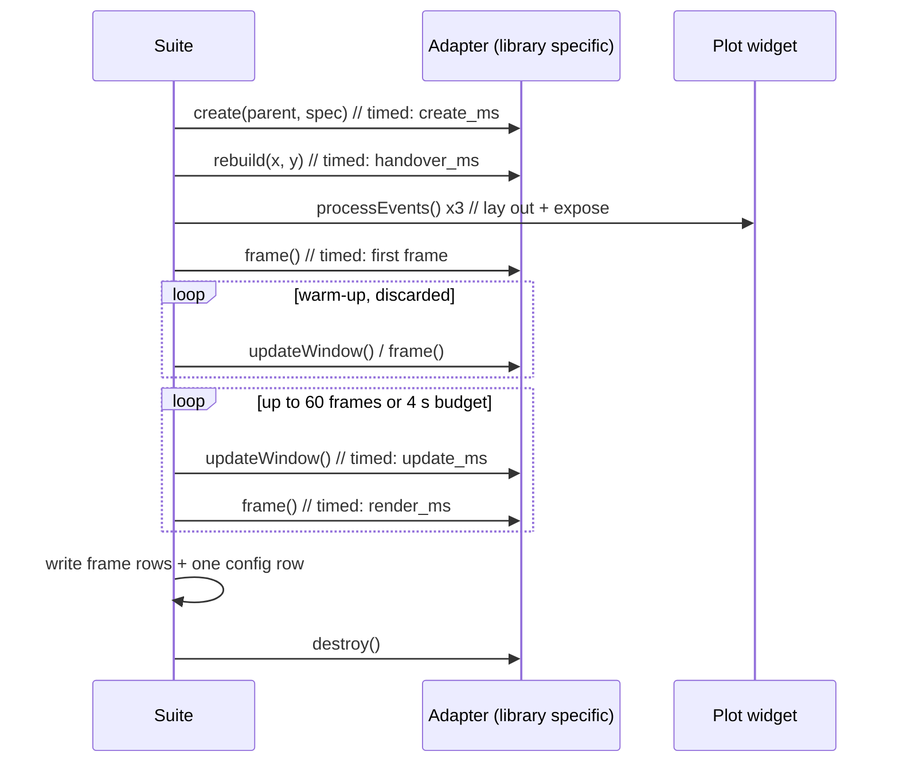

# The Rendering Performance of Qt Plotting Libraries: A Four-Way Measurement of Qwt, QCustomPlot, Qt Charts and QIm

> **Abstract** — "Which Qt plotting library is fastest" is normally answered with a single sweep: frame time against point count, two or three libraries, one line each. That measurement answers one configuration and silently merges four different cost centres into one number. This article measures **Qwt 7.5, QCustomPlot 2.1.0, Qt Charts 6.7 and QIm 0.0.3 (ImPlot)** along eight dimensions — sample count, series count, canvas size, data handover versus repaint, built-in point reduction (cost *and* pixel fidelity), frame-time distribution, memory per sample and startup cost — plus a raster/OpenGL backend comparison for the two libraries that offer both, driven by one harness (`examples/bench/chartbench`) that runs every library through an identical protocol in its own process. The protocol itself is part of the result: `QOpenGLWidget` defers a plain `repaint()` to Qt's composition step, so the naive way to time a GL library reports **0.004 ms** for a 100 000-sample curve; the article shows how to drive the GL entry points synchronously instead, and reports the one library that could not be measured that way. 17 figures and 15 tables separate the three regimes the four libraries live in, and show that the choice of point reduction is worth two orders of magnitude more than the choice of library, backend or canvas.

> **Abstract — Key results**
>
> - **The ranking inverts twice between 1 000 and 5 000 000 samples.** At 1 000 samples Qt Charts draws a frame in 0.528 ms against Qwt's 2.025 ms (3.8×); at 5 000 000 samples Qwt needs 515.6 ms against QCustomPlot's 985.5 ms (1.9×) and Qt Charts' 779.0 ms (1.5×). Every library is still inside the 60 Hz budget at 100 000 samples and every one of them has left it by 250 000, and the marginal cost of a sample differs by up to 2.8× between libraries.
> - **Point reduction is the only lever with two orders of magnitude in it.** At one million samples QIm's `Auto` (MinMaxLTTB) draws the frame in **1.277 ms** — 62× faster than its own unreduced path and **127× faster** than Qt Charts, which has no reduction to offer (161.8 ms). Qwt's `FilterPointsMinMaxLTTB` reaches 5.200 ms (19.8× its own baseline) and QCustomPlot's adaptive sampling 6.163 ms (30.9×).
> - **Fidelity separates the algorithms into two families, and the fastest are not the least faithful.** Qwt's MinMaxLTTB changes 5.56 % of pixels with an ink ratio of 0.821, while `FilterPointsAggressive` retains only 0.394 of the curve's ink and QCustomPlot's adaptive sampling 0.915 — and Qwt's classic `FilterPoints` filter is *pixel-identical* to no reduction at all (0.00 % changed) while also being slightly slower.
> - **The data API costs more than the renderer.** At a 100 000-sample window the libraries spend 8.1–14.6 ms drawing (1.8× spread) but **230 $\mu$s to 141.7 ms** handing the data over (616× spread). A standalone probe shows where Qt Charts' handover goes: 0.73 ms building the `QList<QPointF>` its API requires, 48.65 ms inside `QXYSeries::replace()` and 25.55 ms in two `QValueAxis::setRange()` calls — and `replace()` is 26× cheaper when the chart is not in a live view.
> - **OpenGL is not a strategy for line charts, and the two GL implementations differ by an order of magnitude in when they pay off.** Qwt's GL canvas is 1.22× *faster* at 1 000 samples and 1.50× *slower* at five million; QCustomPlot's GL paint buffer costs 16.1 ms per frame at 1 000 samples and overtakes its own raster path between 100 000 and 250 000 samples, reaching 1.66× at five million.
> - **Memory per sample differs by more than 20× between libraries** once the data dominates: 16.6 B/sample for QCustomPlot and 20.9 B for Qwt at a million samples, against 337.8 B for Qt Charts and 427.9 B for QIm. For one million points in 100 series, Qt Charts needs 272.9 MB where QCustomPlot needs 21.4 MB.
> - **Frame-time stability is a separate axis from speed.** QIm has the best median of the four (7.77 ms at 100 000 static samples) and the worst relative tail (p99/p50 of 2.2×, max/p50 of 2.4×); Qwt is 5 % slower at the median (8.14 ms) with by far the tightest spread (1.27× to its own worst frame).
> - **One negative result is reported as such**: Qt Charts' `setUseOpenGL(true)` series never reach the framebuffer in a synchronous frame protocol — measured curve-ink coverage 0.0009 against 0.0586 for the raster path — so that backend is excluded rather than estimated.

---

## 1. Introduction

### 1.1 The question and why it is usually answered badly

"Which Qt plotting library is fastest" is one of the most frequently asked questions in Qt application development, and the answers one finds are almost always a single sweep: plot *frame time* against *number of points* for two or three libraries, draw the lines, declare a winner. That measurement answers exactly one configuration — one curve, one canvas size, static data, whatever the library's point-reduction defaults happen to be — and it silently mixes four different cost centres into one number.

The result is advice that does not survive contact with a real application. A telemetry dashboard that appends 10 000 samples per second to a sliding window has a completely different cost profile from a scientific plot that opens a five-million-sample file once and lets the user zoom. A chart with 50 series of 2 000 points is not "the same workload scaled down" as one series of 100 000 points, because the per-series overhead and the per-sample overhead live in different places. And the single most consequential design decision — whether the library reduces the point set before rasterizing it — is usually left at its default, so the comparison measures the defaults rather than the libraries.

This article measures the four libraries that a Qt developer realistically chooses between — **Qwt 7.5**, **QCustomPlot 2.1.0**, **Qt Charts 6.7** and **QIm 0.0.3 (ImPlot)** — along eight independent dimensions, with one harness that drives all four through an identical protocol.

### 1.2 The cost model

One displayed frame of a line chart can be decomposed as

$$
T_{\text{frame}} \;=\; T_{\text{handover}} \;+\; T_{\text{transform}}(N,K)
\;+\; T_{\text{raster}}(N,K,W\!\times\!H) \;+\; T_{\text{compose}}(W\!\times\!H)
\;+\; T_{\text{present}}
$$

where $N$ is the sample count per series, $K$ the number of series and $W\!\times\!H$ the canvas size. The five terms have different owners:

| Term | What it is | Who pays it |
|------|-----------|-------------|
| $T_{\text{handover}}$ | Copying/validating new data into the library's own container | The library's data API |
| $T_{\text{transform}}$ | Coordinate mapping, point reduction, clipping, path building | The library's curve class |
| $T_{\text{raster}}$ | Turning the polyline into pixels | Qt raster paint engine, or the GPU |
| $T_{\text{compose}}$ | Blitting/compositing the rendered surface | Qt widget compositing, or the GL widget path |
| $T_{\text{present}}$ | Handing the surface to the window system | DWM / the platform compositor |

The four libraries distribute this work very differently, and the differences are not constants that cancel out — they scale with different variables. The rest of the article measures each term where it can be isolated.

### 1.3 Contributions

1. **A protocol that makes the four libraries comparable** (Section 3). The hard part is not timing a call, it is defining "one frame" identically for a `QWidget` painted by `QPainter` and for a `QOpenGLWidget` whose `repaint()` Qt defers to the composition step. Section 3.2 shows that the naive `repaint()` protocol makes a GL library look 250× faster than it is, and how the harness avoids that.
2. **Eight measurement dimensions** (Section 4): sample count, series count, canvas size, data handover versus repaint, built-in point reduction, frame time distribution, process memory, and startup cost — plus a raster/OpenGL backend comparison for the two libraries that offer both.
3. **A pixel-level fidelity metric for point reduction** (Section 4.5) that compares each library against *its own* full-resolution render, which is what makes the fidelity numbers comparable across libraries that lay their plots out differently.
4. **A reproducible harness** (`examples/bench/chartbench`, 8 suites, 6 processes) and the complete analysis pipeline (`docs/assets/bench/`) that regenerates every figure and every number in this article.
5. **Negative results reported as such** (Section 6): Qt Charts' OpenGL series path could not be measured with a synchronous frame protocol, and the article shows the pixel evidence instead of a plausible-looking number.

## 2. Four libraries, four rendering pipelines

The measured differences are not accidents; each library's numbers follow from where its architecture puts the work. This section reads the four pipelines out of their source code, because those structural facts are what the later measurements confirm or contradict.

```mermaid
flowchart TB
    subgraph Qwt["Qwt 7.5"]
        A1["QwtPointMapper::toPolygonF<br/>map + optional reduce"] --> A2["QwtClipper<br/>clip"] --> A3["QPainter::drawPolyline<br/>CPU raster engine"] --> A4["backing store pixmap<br/>+ blit"]
    end
    subgraph QCP["QCustomPlot 2.1"]
        B1["getOptimizedLineData<br/>pixel column min/max"] --> B2["QCPPainter::drawPolyline"] --> B3["paint buffer<br/>QPixmap or FBO"] --> B4["widget repaint<br/>blit"]
    end
    subgraph QTC["Qt Charts 6.7"]
        C1["QList&lt;QPointF&gt; per series"] --> C2["QPainterPath per series"] --> C3["QGraphicsScene render<br/>CPU raster engine"] --> C4["QGraphicsView viewport"]
    end
    subgraph QIM["QIm 0.0.3"]
        D1["ImPlot Getter<br/>+ optional downsample"] --> D2["ImDrawList<br/>4 vertices per segment"] --> D3["ImGui::Render<br/>one draw call"] --> D4["GPU rasterization<br/>into the widget FBO"]
    end
```



The four boxes differ in *where the per-sample loop runs* (Qwt/QIm transform vectorized or per segment, Qt Charts per `QPointF`), in *who rasterizes* (CPU for three of them, GPU for QIm), and in *what is cached between frames* (nothing for all four under a full replot).

### 2.1 Qwt: one mapper, one polyline, one backing store

`QwtPlotCurve::drawLines()` (`src/plot/qwt_plot_curve.cpp`) runs the whole per-sample pipeline in one place: `QwtPointMapper::toPolygonF()` maps the data to screen coordinates **and** applies the configured point reduction, `QwtClipper::clipPolygonF()` clips against the canvas, and `QwtPainter::drawPolyline()` hands the result to `QPainter`. There is no per-sample object and no intermediate `QGraphicsItem`: the cost of $N$ samples is one linear pass producing one `QPolygonF`.

The reduction step is worth stating precisely because it explains the results in Section 4.5. `QwtPlotCurve::PaintAttribute` offers five strategies, and their output budgets are expressed in *pixel columns* ($W$ = canvas width):

| Attribute | Rule | Output budget |
|-----------|------|---------------|
| `FilterPoints` | Drop duplicates and points outside the visible area | $N$ (worst case) |
| `FilterPointsAggressive` | Collapse runs that map to the same integer coordinate to first/min/max/last | $\le 4W$ |
| `FilterPointsPixel` | Bin per pixel column, emit first/min/max/last with sub-pixel placement | $\approx 4W$ |
| `FilterPointsLTTB` | Largest-Triangle-Three-Buckets | $\approx 4W$ |
| `FilterPointsMinMaxLTTB` | Min/max per bucket | $\approx 2W$ |

The default matters, and it is not what a reader would guess. A `QwtPlotCurve` is constructed with

```cpp
paintAttributes(QwtPlotCurve::ClipPolygons | QwtPlotCurve::FilterPointsLTTB)
```

(`src/plot/qwt_plot_curve.cpp:84`) — **LTTB reduction is on by default in Qwt 7.5**, and the project's `CHANGES.md` records that this has been the default since v7.3.2 (as the MinMax bucket until v7.4.2, as the shape-preserving LTTB since v7.5.0). The four reduction flags are gated independently (`qwt_plot_curve.cpp:611-619`), so any of them can be selected or switched off without touching the others. The consequence for this article is stated once and then assumed: **every measurement here uses explicitly configured filters, never library defaults**, because a benchmark that plots `setSamples()` and calls `replot()` on Qwt is silently measuring the LTTB path.

The canvas is a `QFrame` with a backing store (`QwtPlotCanvas`), and `replot()` invalidates that store before repainting, so a full-frame replot always takes the "repaint everything, then blit" path. The `ImmediatePaint` attribute turns `replot()` into a synchronous `repaint()`; this is the hook the harness uses to define a finished Qwt frame.

### 2.2 QCustomPlot: an adaptive sampler with a self-tuning threshold

QCustomPlot's graph stores `QCPGraphData` records — a key and a value, 16 bytes per sample on x64 (`qcustomplot.h:5427-5444`) — in a sorted container, and `QCPGraph::draw()` calls `getOptimizedLineData()` before painting (`examples/bench/chartbench/qcustomplot.cpp:21661`). The sampler is a **pixel-column min/max clusterer**, and its activation condition is the interesting part:

```cpp
int dataCount = int(end-begin);
int maxCount = (std::numeric_limits<int>::max)();
if (mAdaptiveSampling)
{
  double keyPixelSpan = qAbs(keyAxis->coordToPixel(begin->key)-keyAxis->coordToPixel((end-1)->key));
  if (2*keyPixelSpan+2 < static_cast<double>((std::numeric_limits<int>::max)()))
    maxCount = int(2*keyPixelSpan+2);
}
if (mAdaptiveSampling && dataCount >= maxCount) // use adaptive sampling only if there are at least
                                                // two points per pixel on average
```

The threshold is not a sample count but a **density**: reduction starts only when the visible data has at least two points per pixel column. That makes the decision canvas- and zoom-aware, and it is why the measured crossover for QCustomPlot sits at a different place than for Qwt's attribute switch. It is on by default; the harness switches it off explicitly (`setAdaptiveSampling(false)`) for the raw measurements.

Painting goes into a *paint buffer* whose implementation is chosen at compile time: `QCPPaintBufferPixmap` (a `QPixmap` and a `QPainter`) or, with `QCUSTOMPLOT_USE_OPENGL`, `QCPPaintBufferGlFbo` (a `QOpenGLPaintDevice` on an FBO). `replot(rpImmediateRefresh)` draws every layer into that buffer and then repaints the widget synchronously, which is a complete QCustomPlot frame.

### 2.3 Qt Charts: a scene graph, and data as objects

Qt Charts is not a plotting widget, it is a `QGraphicsScene` with chart items. A `QLineSeries` stores its data as `QList<QPointF>`, so handing over $N$ samples means constructing $N$ `QPointF` objects — the API offers no raw-array entry point. Painting builds a `QPainterPath` per series inside the scene render, and `QChartView` is a `QGraphicsView` whose `paintEvent` renders that scene.

Two consequences follow directly from this structure and both show up in the measurements: data handover is expensive relative to the other libraries (Section 4.4 and 4.8), and there is **no built-in point reduction at all** — the series is drawn as given. The one acceleration Qt Charts offers is `QAbstractSeries::setUseOpenGL(true)`, which renders the series through a GL paint device instead of the raster engine; Section 6 explains why that path could not be measured.

### 2.4 QIm: a retained-mode facade over ImPlot, and per-segment quads

QIm is a Qt wrapper around Dear ImGui/ImPlot. Its figure widget is a `QOpenGLWidget`; `paintGL()` builds an ImGui frame (`QtImGui::newFrame` → node tree → `ImGui::Render`) and submits it. The interesting part is what ImPlot does with a line: it does not stroke a path. Its renderer walks the data and emits a quad per line segment into an `ImDrawList` on the CPU:

```cpp
struct RendererLineStrip : RendererBase {
    RendererLineStrip(const _Getter& getter, ImU32 col, float weight) :
        RendererBase(getter.Count - 1, 6, 4),   // one primitive per segment, 6 indices, 4 vertices
        ...
    IMPLOT_INLINE bool Render(ImDrawList& draw_list, const ImRect& cull_rect, int prim) const {
        ImVec2 P2 = this->Transformer(Getter(prim + 1));
        if (!cull_rect.Overlaps(ImRect(ImMin(P1, P2), ImMax(P1, P2)))) { P1 = P2; return false; }
        PrimLine(draw_list,P1,P2,HalfWeight,Col,UV0,UV1);
        P1 = P2;
        return true;
    }
```

So $N$ samples become $4(N-1)$ vertices and $6(N-1)$ indices, built on the CPU, submitted as one (or a few) draw calls and rasterized on the GPU. This architecture predicts what the measurements show: a very low fixed cost (one widget, one draw call, no per-series `QPainterPath`) and a per-sample cost driven by the vertex expansion. It also predicts *where* that cost lives — in the CPU building the draw list or in the GPU rasterizing it — and Section 4.9 settles that question with the `glFinish` measurement: for QIm, most of a large frame is GPU time.

QIm also ships its own reduction: `QImDownsamplingController` reduces when the series exceeds a **threshold of 20 000 samples**, and in `Auto` mode picks LTTB above 10 000 and MinMaxLTTB above 100 000 samples, targeting $5 \cdot W$ output points clamped to $[100, 50000]$. Note the contrast with the other two libraries: Qwt's strategies are attributes with no threshold, and QCustomPlot's trigger is a density, not a count.

### 2.5 What the architectures predict

| | Qwt | QCustomPlot | Qt Charts | QIm |
|---|---|---|---|---|
| Per-sample storage | 2×`double` (16 B) | `QCPGraphData` (16 B) | `QPointF` (16 B) | 2×`double` (16 B) |
| Transform | vectorized mapper + optional SIMD argmin/argmax | per-point iterator + pixel clustering | per-point `QPointF` → `QPainterPath` | per-point vertex expansion (4 vtx/segment) |
| Raster | CPU (raster engine) | CPU (or FBO) | CPU scene render (or GL) | GPU |
| Reduction default | **on** (`FilterPointsLTTB`, budget 4W) | on (≥2 points/pixel) | none available | on (≥20 000 samples) |
| Per-series cost | small (one path) | small | larger (scene item + path) | small |
| Fixed per-frame cost | low | low | scene traversal | GL frame setup |

Four predictions to test: (i) QIm should win at small $N$ because of its low fixed cost; (ii) the three `QPainter` libraries should be close to each other at moderate $N$ but diverge in scaling because their transforms differ; (iii) Qt Charts should pay the most for data handover and for many series; (iv) point reduction should dominate everything else at large $N$, and the *fidelity* of the reduction should differ measurably between the four implementations.

## 3. Measurement methodology

### 3.1 The harness

`examples/bench/chartbench` is a single executable that contains four adapters (`QwtAdapter`, `QCustomPlotAdapter`, `QtChartsAdapter`, `QImAdapter`) behind one interface, and eight suites. Every suite builds a plot, hands over data and then drives frames; the adapters are the only place where library-specific code lives. The full protocol is documented in the example's `README.md`; this section covers the parts that determine whether the numbers mean anything.



Every library is driven through the same four calls; the only library-specific code is what those calls do internally.

### 3.2 Defining "one frame" across a raster widget and a GL widget

The single most important methodological problem in a cross-library comparison is that the natural way to ask a widget for a frame — `QWidget::repaint()` — does *not* do the same thing for all of them.

For a `QPainter`-based widget, `repaint()` sends a paint event synchronously and the pixels exist when the call returns. For a `QOpenGLWidget`, Qt defers the GL work to the **composition step of the backing store**, which happens later, in the event loop. Measured with a plain `repaint()`, the QIm adapter reported frames of **0.004 ms** for a 100 000 sample curve — a number that is not "fast", it is "nothing happened". The same artefact appears for Qwt's OpenGL canvas.

The harness therefore drives the GL libraries the way Qt itself does when it composes:

```cpp
m_benchFigure->beginFrame();    // makeCurrent(): binds the context and the widget's FBO
m_benchFigure->renderFrame();   // paintGL(): the library's own render code
m_benchFigure->finishFrame();   // glFinish() + doneCurrent()
```

`paintGL()` is protected, so both GL adapters use a one-line subclass to expose it. This is the only protocol under which a QIm frame can be timed at all, and it measures exactly the library's own work: ImGui frame construction, the node tree, the vertex expansion and the GL submission, plus the GPU execution of the plot's own commands via `glFinish()`. Qt's compositing of the resulting texture into the top-level window is deliberately outside the measurement for both GL libraries, and so is the equivalent backing store flush for the raster libraries.

The per-library definitions of a complete frame are:

| Library | Frame operation |
|---------|-----------------|
| Qwt (raster) | `plot->replot()` with `QwtPlotCanvas::ImmediatePaint` set (synchronous canvas repaint) |
| Qwt (GL) | `plot->replot()` (layout) + `makeCurrent`/`paintGL`/`glFinish` on the canvas |
| QCustomPlot | `replot(QCustomPlot::rpImmediateRefresh)` (draw all layers + synchronous repaint) |
| Qt Charts | `QGraphicsView::render()` into a reused image — the same scene render `paintEvent` performs |
| QIm | `makeCurrent`/`paintGL`/`glFinish` |

The Qt Charts entry is the one deviation: `repaint()` on a `QGraphicsView` with a plain viewport does trigger the scene render, but it cannot express the GL series path at all, so the harness uses the scene render call for both, which is also what the library's own export path uses. The deviation is conservative in the sense that it omits the viewport blit, which is a sub-millisecond constant on a 1000×700 canvas.

### 3.3 What is measured per frame

Each measured frame is timed as

```
t_update   = time to hand new data to the library   (0 when the data is static)
t_render   = time of the frame operation above
```

and both are written to the CSV per frame. This split is what allows Section 4.4 to separate "drawing is slow" from "handing over data is slow" — a distinction that a single `replot()` timing cannot make, and that matters enormously in practice: a dashboard that updates 60 times per second pays the handover cost sixty times per second.

### 3.4 Statistics

Per configuration the harness discards 5 warm-up frames, then records up to 60 frames or until a 4 s budget is exhausted (whichever comes first, with a minimum of 3 frames). Configurations that hit the budget are flagged `aborted` and their frame count is reported, so a reader can see when a number comes from a truncated run.

Five frames are not enough to warm up a *process*, and the difference is large enough to change conclusions: measured without a process warm-up, the very first configuration of a run is systematically slower than an identical later one — QIm's first 1000-sample plot took 1.30 ms where the same plot took 0.81 ms once the process had drawn something. GL driver and shader initialisation, page faults on the library's first touch and timer resolution all land in that first configuration. Every run therefore begins with one discarded 1000-sample configuration (30 frames) before the first measured one, and the raw CSVs contain no rows for it.

The analysis uses the **median** of the measured frames as the primary statistic and reports p95/p99 for the tail-latency analysis. The first measured frame is excluded from the statistics as well, because it still contains one-off work (paint buffer allocation, GL program setup).

### 3.5 Attributing memory

Process memory is only meaningful if it can be attributed. Each library therefore runs in **its own process** (the driver script starts six processes, one per library and backend), and the memory baseline is sampled *after* the input data exists in the harness but *before* the plot is created. The reported `private_mb - baseline_private_mb` is consequently what the library itself adds for the widget and the data — not the harness's own copy of the input.

### 3.6 Measuring fidelity of point reduction

Comparing the *pixels* of two different libraries is not meaningful: they place their plot areas differently (different margins, tick label sizes, fonts), so the same curve lands on different pixels. The fidelity experiment therefore compares each library against **its own** full-resolution render of the same data with the same axes, styling and canvas size. Every differing pixel is then caused by the reduction algorithm alone, and the resulting metrics are comparable across libraries.

Three metrics are computed from each pair of images (`docs/assets/bench/chartbench_fidelity.py`):

* `changed_frac` — fraction of pixels whose largest channel difference exceeds 16/255, i.e. how much of the picture the reduction moved;
* `span_ratio` — the worst column's vertical extent of differing pixels divided by the image height; this catches the specific failure mode of bucket samplers, a narrow spike collapsed into a short stroke;
* `ink_ratio` — curve pixels of the reduced render divided by curve pixels of the full render; a value below 1 means the reduction drew less than the data contains, above 1 means it drew extra ink (vertical strokes).

The test signal is a spiky series (a smooth base plus narrow Gaussian peaks, 0.2 % spike probability at 1M samples) because a smooth signal cannot discriminate between the algorithms: any reduction that preserves the envelope looks identical on a sine.

### 3.7 Environment

| | |
|---|---|
| CPU | Intel Core i7-1260P (12 cores / 16 threads) |
| GPU | Intel Iris Xe Graphics (integrated), driver 30.0.101.3111 |
| Memory | 32 GB |
| OS | Windows 10 (10.0.26200), desktop session, 100 % scaling |
| Qt | 6.7.3, msvc2019_64, Release |
| Compiler | MSVC 2019, C++17 |
| Qwt | 7.5.0 (this repository, `QWT_CONFIG_QWTOPENGL=ON`) |
| Canvas | 1000×700 device-independent pixels, device pixel ratio 1.00 |
| Antialiasing | on for all libraries (their default), 1 px pen |

Absolute times are machine specific; the orderings and the shapes of the curves are what the article argues with. Every figure in this article is regenerated by `docs/assets/bench/chartbench_experiment.py` from the CSV tables produced by `examples/bench/chartbench/run-bench.sh` on this machine.

## 4. Results

The harness ran six processes (Qwt raster, Qwt OpenGL, QCustomPlot raster, QCustomPlot OpenGL, Qt Charts raster, QIm OpenGL), producing 17 031 measured frames and 297 recorded configurations. Every number below is the median of one configuration's measured frames; every figure is regenerated by `docs/assets/bench/chartbench_experiment.py` from the CSVs in `docs/assets/bench/data/`.

One caveat applies to all of them. Absolute frame times move between runs of the same matrix — the largest observed change for an individual configuration across repeated runs on this machine was about 25 %, which is the usual spread of a desktop machine under a sustained load, and it matters here because two of the four libraries occasionally land within a few percent of each other. The *orderings* and the shapes of the curves were stable across runs; differences below roughly 10 % in the tables that follow should be read as ties.

### 4.1 Frame time versus sample count


*Figure 1 — `fig_scaling_points.png`. Single curve, 1000×700 canvas, no point reduction. Left: frame time. Right: effective drawing throughput (samples/second).*

The ordering depends entirely on $N$:

| $N$ | Qwt | QCustomPlot | Qt Charts | QIm |
|---|---|---|---|---|
| 1 000 | 2.025 | 1.872 | **0.528** | 0.985 |
| 5 000 | 2.399 | 2.076 | **0.889** | 1.339 |
| 10 000 | 2.891 | 2.710 | **1.280** | 1.895 |
| 50 000 | 7.570 | 6.790 | **4.915** | 8.281 |
| 100 000 | 11.850 | 11.770 | **9.580** | 12.292 |
| 250 000 | 26.947 | 44.119 | 24.011 | **23.904** |
| 500 000 | 52.239 | 102.421 | 80.727 | **41.029** |
| 1 000 000 | 102.181 | 200.432 | 156.248 | **80.770** |
| 2 000 000 | 203.953 | 401.643 | 317.012 | **163.650** |
| 5 000 000 | **515.598** | 985.524 | 778.962 | 579.485 |

*Table 1 — median frame time in ms, lower is better, bold marks the best of the four. At 250 000 the top two are within 0.5 % of each other, i.e. a tie.*

At a thousand samples Qt Charts is **3.8× faster than Qwt** and 3.5× faster than QCustomPlot; at five million samples Qwt is **1.9× faster than QCustomPlot**, 1.5× faster than Qt Charts and 1.12× faster than QIm. Neither library is fast in general — they are fast in different regimes, and an application that looks at one size will pick the wrong one.

The reason is the fixed/marginal split of Section 1.2. Computing the marginal cost per million samples over the two ranges where the sweep is linear separates the constant per-frame cost from the per-sample cost:

| Library | $T$ at 1 000 samples | ms per million (100k→1M) | ms per million (1M→5M) |
|---|---|---|---|
| Qwt | 2.025 | 100.4 | 103.4 |
| QCustomPlot | 1.872 | 209.6 | 196.3 |
| Qt Charts | 0.528 | 163.0 | 155.7 |
| QIm | 0.985 | 76.1 | 124.7 |

*Table 2 — the same sweep expressed as a per-sample cost. Qwt's marginal cost is flat across both ranges; QIm's rises by 64 % in the upper one.*

Qwt's marginal cost is essentially the same in both ranges (100.4 against 103.4 ms/Msample), so its per-sample work is linear and predictable. QIm's rises from 76.1 to 124.7 ms/Msample: its advantage at one million samples (80.8 ms against Qwt's 102.2 ms) has become a disadvantage by five million (579.5 ms against 515.6 ms). The CPU-side vertex expansion described in Section 2.4 eventually meets a memory-bandwidth limit that Qwt's tighter rasterizer loop does not.


*Figure 2 — `fig_scaling_per_point.png`. Cost per 1000 samples. The steep left part is the fixed cost being amortized; the flat right part is the true per-sample cost.*

A note on how *not* to analyse this sweep, because it is a trap that produces confident nonsense. Fitting a power law $\log T = a + p\log N$ over the same data gives exponents of 0.85 (Qwt), 1.01 (QCustomPlot), 1.07 (Qt Charts) and 0.88 (QIm), all with $R^2 \approx 0.99$. Read literally that says Qwt "scales sub-linearly" and Qt Charts "super-linearly", which contradicts the fact that every library's sweep is within 0.2 % of a straight line ($T = a + cN$). Both are true, and the resolution is that they measure different things: over a finite range, a straight line with a positive intercept *has* a log-log slope below one, while a library whose cost genuinely grows slightly faster than linearly has one above it. The exponent is a property of the fitted range; the fixed/marginal split is a property of the implementation.


*Figure 3 — `fig_summary.png`. Three reference sizes with the 60 Hz budget drawn in.*

The practical reading of Figure 3: **all four libraries are inside the 60 Hz budget at 100 000 samples and all four have left it at 250 000** on this machine, and none of them can draw a million samples as given. Up to 100 000 samples the differences between libraries are a fraction of the frame budget; above that the choice of library stops mattering and the choice of reduction (Section 4.5) starts.

### 4.2 What one more series costs


*Figure 4 — `fig_curve_count.png`. 2000 samples per series on a 1000×700 canvas.*

| series | Qwt | QCustomPlot | Qt Charts | QIm |
|---|---|---|---|---|
| 1 | 1.963 | 2.621 | 1.147 | **0.832** |
| 10 | 4.144 | 6.814 | 4.398 | **1.955** |
| 50 | 12.889 | 24.110 | 18.973 | **7.776** |
| 100 | 23.554 | 46.834 | 35.613 | **15.814** |
| marginal per series | 215.7 $\mu$s | 444.7 $\mu$s | 346.8 $\mu$s | 154.0 $\mu$s |

*Table 3 — median frame time in ms, 2000 samples per series, and the marginal cost of a series measured between 10 and 100 series.*

With 20 000 samples spread over 100 series, QIm is **3.0× faster than QCustomPlot** and 2.3× faster than Qt Charts; with those same 20 000 samples in one series the four libraries are within 2.3× of each other at 10 000 samples and 4.4× at 50 000 (Table 1). Splitting data into series is not a neutral decision: it moves the workload into the part of each pipeline where per-series overhead lives — a `QPainterPath` per series for Qwt, a scene item and a path for Qt Charts, a draw-list range for ImPlot.

The marginal column isolates that effect: between 10 and 100 series one more series costs QCustomPlot 445 $\mu$s, Qt Charts 347 $\mu$s and Qwt 216 $\mu$s, against QIm's **154 $\mu$s** — a 2.9× spread on a quantity that does not depend on the data at all, only on how much per-series bookkeeping a library does per frame.

### 4.3 Canvas size: fill rate versus geometry


*Figure 5 — `fig_canvas_size.png`. Left: one curve of 100 000 samples. Right: 20 series of 5 000 samples each.*

The right-hand panel carries the cleaner signal, because 20 series give the fill-rate term something to do:

| canvas | Qwt | QCustomPlot | Qt Charts | QIm |
|---|---|---|---|---|
| 400×300 | 7.753 | 13.385 | 15.889 | **7.222** |
| 1200×800 | 13.478 | 24.700 | 18.226 | **8.445** |
| 1600×1200 | 20.033 | 39.768 | 22.553 | **9.415** |
| 2560×1440 | 30.254 | 51.246 | 26.707 | **9.640** |
| growth over 30× area | 3.90× | 3.83× | 1.68× | **1.33×** |

*Table 4 — median frame time in ms for 20 series of 5 000 samples.*

Across a 30× increase in canvas area, Qwt and QCustomPlot grow by almost 4×, Qt Charts by 1.7× and QIm by **1.33×**. QIm's frame time at 2560×1440 (9.640 ms) is barely above its frame time at 400×300 (7.222 ms), and it is *lower* than Qwt's at every canvas size by a factor of 2.4× to 5.3×.

Part of that flatness is a property of the protocol and deserves to be stated plainly: a raster frame measured here includes rasterizing every item into a canvas-sized backing store and blitting that store, while a GL frame measured here ends when the library's own draw commands have executed — Qt's composition of the resulting texture into the window is outside the measurement (Section 6.1). So the raster libraries pay for the canvas twice and the GL library pays for it zero times inside the measured window. What the GL library does pay for is the geometry it submits, which is why QIm's frame time still grows with $N$ (Table 1) even though it barely grows with the canvas.

The one-curve panel shows the same ordering with a much weaker trend, because a single polyline does not generate enough fill work for the fill-rate term to dominate:

| canvas | Qwt | QCustomPlot | Qt Charts | QIm |
|---|---|---|---|---|
| 400×300 | 8.514 | 13.908 | 15.102 | 9.394 |
| 1200×800 | 13.547 | 23.546 | 18.723 | **12.067** |
| 2560×1440 | 23.756 | 43.428 | 23.405 | **10.211** |
| growth | 2.79× | 3.12× | 1.55× | 1.09× |

*Table 5 — median frame time in ms for one curve of 100 000 samples.*

QIm's numbers in Table 5 fluctuate between 8.0 ms and 13.2 ms without a monotone trend — the run-to-run variance of Section 4's preamble is visible here — but they never follow the raster libraries upward: at 2560×1440 it needs 10.211 ms where Qwt needs 23.756 ms and QCustomPlot 43.428 ms.

One detail frustrates the naive model that "fewer pixels must be faster": in Table 5, Qwt needs 8.514 ms at 400×300 but 11.628 ms at 800×600 for the same 100 000 samples, and Qt Charts 15.102 ms against 16.506 ms. Compressing 100 000 samples into 400 columns makes the polyline much steeper, and a steeper polyline covers more pixels per segment. Canvas area and geometry *density* pull in opposite directions, which means "shrink the canvas" is not the lever it looks like for a dense line chart.

### 4.4 Handing over data versus drawing it


*Figure 6 — `fig_update_decomposition.png`. For each visible window size: the repaint cost of a window-sized series (solid), plus the extra cost of handing over new samples (hatched). The marker is the p95.*

| visible window | | Qwt | QCustomPlot | Qt Charts | QIm |
|---|---|---|---|---|---|
| 1 000 | render | 1.616 | 1.896 | **0.589** | 0.814 |
| | handover | 0.002 | 0.007 | **2.010** | 0.006 |
| 10 000 | render | 2.278 | 3.270 | 2.260 | **1.625** |
| | handover | 0.013 | 0.096 | **15.013** | 0.013 |
| 100 000 | render | 8.261 | 13.079 | 14.581 | **8.144** |
| | handover | 0.559 | 1.137 | **141.664** | 0.230 |

*Table 6 — median ms. The render column is the repaint cost of a window-sized series; the handover column is the pure data-handover variant, which performs no repaint at all.*

This is the measurement a single-sweep benchmark cannot produce, and it is the most consequential number in this article. At a 100 000 sample window the libraries spend 8.1 ms to 14.6 ms drawing — a 1.8× spread — but they spend **230 $\mu$s to 141.7 ms** handing the data over, a **616× spread**. For a 60 Hz application the handover is a per-frame budget item: 1.4 % of a 16.7 ms frame for QIm, 3.3 % for Qwt, 6.8 % for QCustomPlot and **848 %** for Qt Charts.

The three fast libraries all accept a block of samples and copy it. Qt Charts has no such entry point: `QXYSeries` offers only `replace(const QList<QPointF>&)`, so the caller builds 100 000 `QPointF` objects and the library then does whatever it does with them. A standalone probe (`examples/bench/chartbench/qtcharts_handover_probe.cpp`) splits that step:

| $n$ | build `QList<QPointF>` | `QXYSeries::replace()` | two `QValueAxis::setRange()` | total |
|---|---|---|---|---|
| 100 000 | 0.73 ms | 48.65 ms | 25.55 ms | 74.93 ms |
| 1 000 000 | 6.62 ms | 420.68 ms | 269.91 ms | 697.21 ms |

*Table 7 — the Qt Charts handover in isolation, chart live in a shown `QChartView`.*

The data copy everyone blames is the cheapest part: 0.73 ms out of 74.93 ms. The cost is in what Qt Charts does *around* the data — and it depends on being live in a view: the same `replace()` call costs 1.88 ms for the same 100 000 points when the chart is not displayed. The handover column of Table 6 is the end-to-end cost of the API an application must use, and an application that updates a Qt Charts series at 60 Hz cannot do it at 100 000 samples.


*Figure 7 — `fig_streaming.png`. Update plus repaint in one frame, as a function of the visible window; the shading is p95.*

At a 1 000 sample window (a 60 Hz-capable workload for three of the four libraries) QIm needs 1.004 ms of the 16.7 ms budget and Qt Charts 3.115 ms — 6.0 % and 18.7 %. At 10 000 samples Qt Charts has already left the budget (16.818 ms, 100.7 %) while QIm needs 1.572 ms (9.4 %). At 100 000 samples only QIm (8.613 ms, 51.6 %) and Qwt (9.332 ms, 55.9 %) stay inside the budget.

### 4.5 Point reduction: what it costs and what it preserves


*Figure 8 — `fig_downsample_time.png`. Every reduction strategy each library offers, at one million samples.*

| library | strategy | frame time | vs. none |
|---|---|---|---|
| Qwt | none | 102.990 ms | 1.00× |
| Qwt | `FilterPoints` | 107.405 ms | 0.96× |
| Qwt | `FilterPointsAggressive` | 17.259 ms | 5.97× |
| Qwt | `FilterPointsLTTB` | 13.108 ms | 7.86× |
| Qwt | `FilterPointsPixel` | 9.973 ms | 10.33× |
| Qwt | `FilterPointsMinMaxLTTB` | **5.200 ms** | **19.8×** |
| QCustomPlot | none | 190.294 ms | 1.00× |
| QCustomPlot | adaptive sampling | **6.163 ms** | **30.9×** |
| Qt Charts | none (nothing available) | 161.798 ms | 1.00× |
| QIm | none | 79.266 ms | 1.00× |
| QIm | MinMaxLTTB | 1.839 ms | 43.1× |
| QIm | LTTB | 1.387 ms | 57.2× |
| QIm | Auto | **1.277 ms** | **62.1×** |

*Table 8 — median frame time at one million samples. "vs. none" is that library's own speedup.*

Three findings deserve emphasis.

**The cheapest reduction is not the weakest one.** Qwt's `FilterPoints` — the classic "drop duplicates and off-screen points" filter — is measurably *slower* than drawing everything: 107.405 ms against 102.990 ms. It walks the data, finds nothing to remove in a dense, in-range series, and the frame is drawn unchanged. It is the only strategy in the table that buys nothing, and the fidelity metrics below confirm it pixel for pixel.

**Reduction beats the choice of library by two orders of magnitude.** With reduction off, the four libraries span 2.4× (79.3 ms to 190.3 ms). With each library's best reduction the span is 4.8× (1.277 ms for QIm to 6.163 ms for QCustomPlot) — but against Qt Charts, which has no reduction to offer at 161.8 ms, QIm's `Auto` is **127× faster**. Everything else in this article is a constant factor; this is the only lever with two orders of magnitude in it.

**QIm's `Auto` is the fastest configuration measured anywhere at this size**: 1.277 ms per frame for a million samples, 62× faster than its own unreduced path. It is also the library's default: QIm's downsampling controller switches to MinMaxLTTB above 100 000 samples without being asked, which means a naive QIm benchmark measures the reduced path unless it explicitly disables it.


*Figure 9 — `fig_fidelity_pareto.png`. Each library's strategies placed by frame time (x) and pixel deviation from that library's own full-resolution render (y). The lower left corner is "fast and faithful".*


*Figure 10 — `fig_fidelity_metrics.png`. The three fidelity metrics of Section 3.6 for every strategy at one million spiky samples.*

| library | strategy | changed pixels | worst column span | retained ink |
|---|---|---|---|---|
| Qwt | `FilterPoints` | 0.00 % | 0.000 | 1.000 |
| Qwt | `FilterPointsAggressive` | 3.41 % | 0.276 | 0.394 |
| Qwt | MinMaxLTTB | 5.56 % | 0.274 | 0.821 |
| Qwt | LTTB | 5.91 % | 0.274 | 0.695 |
| Qwt | `FilterPointsPixel` | 8.40 % | 0.330 | 1.233 |
| QCustomPlot | adaptive sampling | 6.92 % | 0.311 | 0.915 |
| QIm | LTTB | 4.45 % | 0.263 | 0.806 |
| QIm | MinMaxLTTB / Auto | 5.44 % | 0.286 | 0.618 |

*Table 9 — fidelity against each library's own full-resolution render, one million spiky samples. A "changed pixel" is one whose largest channel difference exceeds 16/255.*

The metrics separate the strategies into exactly the two families the theory predicts, and this is the part of the experiment that could not have been guessed from timing alone:

* **Envelope-preserving** strategies draw *more* ink than the full-resolution render, because they replace a dense cluster of samples by a vertical stroke covering the same range: `FilterPointsPixel` retains 1.233× the ink, and Qwt's MinMaxLTTB 0.821× with a `span_ratio` of 0.274 — meaning some pixel column's pixels moved by more than a quarter of the image height. Their `changed_frac` is the lowest of the reducing strategies (3.4 %–8.4 %).
* **Peak-dropping** strategies draw *less*: Qwt's `FilterPointsAggressive` retains only 0.394× of the ink and QIm's MinMaxLTTB 0.618×. The peaks are still there as pixels, but thinner and shorter — the envelope shrank, which is precisely the failure mode the downsampling theory warns about.
* **`FilterPoints` is pixel-identical** (0.00 % changed, ink ratio 1.000): with nothing to remove, the render is bit-for-bit the unreduced one, which is consistent with its frame time being no better than no reduction at all.

The practical consequence is that "fastest at one million samples" and "most faithful at one million samples" are not opposites. Qwt's MinMaxLTTB is the second-fastest strategy in the table and among the more faithful, while the strategy that preserves the most ink (`FilterPointsPixel`) is also the one that changes the most pixels. In Figure 9 the Pareto front — the lower-left frontier — runs through QIm's `Auto`/`LTTB`, Qwt's MinMaxLTTB and QCustomPlot's adaptive sampling; the strategies outside it are dominated on both axes.


*Figure 11 — `fig_downsample_visual.png`. The region of worst disagreement between the full-resolution and the reduced render, cropped and magnified, for three libraries.*

### 4.6 Frame-time stability


*Figure 12 — `fig_jitter_ecdf.png`. Empirical distribution of 300 consecutive frame times.*

| library | variant | p50 | p95 | p99 | max | std |
|---|---|---|---|---|---|---|
| Qwt | static, 100k | 8.14 | 8.78 | 9.45 | 10.33 | 0.40 |
| Qwt | streaming, 10k window | 2.75 | 3.55 | 4.10 | 5.03 | 0.35 |
| QCustomPlot | static, 100k | 12.98 | 15.30 | 17.14 | 19.79 | 1.58 |
| QCustomPlot | streaming, 10k window | 3.23 | 4.76 | 6.96 | 9.46 | 0.95 |
| Qt Charts | static, 100k | 14.31 | 17.45 | 20.10 | 22.34 | 2.58 |
| Qt Charts | streaming, 10k window | 2.34 | 3.17 | 4.16 | 4.61 | 0.48 |
| QIm | static, 100k | **7.77** | 10.42 | 17.04 | 18.55 | 1.84 |
| QIm | streaming, 10k window | **1.62** | **2.78** | 10.29 | 12.80 | 1.30 |

*Table 10 — percentiles of 300 frames in ms. The static variants show 100 000 samples of a random walk; the streaming variants a 10 000 sample window sliding over a 100 000 sample buffer. All four static medians are higher than the corresponding single-curve numbers in Table 1 because the walk signal spans the whole canvas height in every column.*

The medians rank the libraries the way the rest of this article does, but the tails say something else, and for a control loop the tails are what matters:

* **QIm wins the median and loses the tail.** Its static p50 is 7.77 ms, the lowest of the four, and its streaming p50 is 1.62 ms with a p95 of 2.78 ms. But its static p99 is 17.04 ms against Qwt's 9.45 ms, and its worst frame in 300 took 18.55 ms against 10.33 ms. A GL frame contains work whose completion time is not the application's to control — driver batching, composition scheduling — and it shows up as a fat right tail.
* **Qwt trades a worse median for the tightest spread**: 8.14 ms to a worst frame of 10.33 ms is 1.27×, against 1.52× for QCustomPlot, 1.56× for Qt Charts and 2.39× for QIm. If a deadline matters more than the average, Qwt is the more predictable renderer.
* **Streaming shortens the median and stretches the tail.** All four libraries show it, and QIm shows it most: its streaming p50 falls to 1.62 ms while its p99 stays at 10.29 ms, so its p99/p50 ratio grows from 2.2× to 6.4× and its max/p50 ratio from 2.4× to 7.9×. The update path of Section 4.4 is variable even when it is cheap on average, and a budget built on the streaming median would be wrong by an order of magnitude at the deadline.


*Figure 13 — `fig_jitter_tail.png`. p99 of 300 frames against the 60 Hz budget.*

Only two configurations in Figure 13 sit inside the 60 Hz budget at p99: Qwt's 10 000-sample streaming window (4.10 ms) and Qt Charts' 10 000-sample streaming window (4.16 ms). A static 100 000-sample chart misses the budget at p99 in every library, including the fastest one.

### 4.7 Memory per sample


*Figure 14 — `fig_memory.png`. Private bytes added by the library, measured against a baseline taken after the input data exists. Left: absolute. Right: per sample.*

| library | 1 000 | 100 000 | 1 000 000 | 10 000 000 | 100 series × 10 000 |
|---|---|---|---|---|---|
| Qwt | 2 800 B | 59.1 B | 20.9 B | 27.3 B | 29.7 B |
| QCustomPlot | 4 897 B | 72.8 B | 20.9 B | 16.6 B | 22.4 B |
| Qt Charts | 776 B | 271.3 B | 337.8 B | 285.0 B | 286.2 B |
| QIm | 37 623 B | 797.0 B | 427.9 B | 291.3 B | 178.7 B |

*Table 11 — bytes of private memory per sample.*

The theoretical floor is 16 bytes per sample (two `double`s), and the two libraries that store arrays reach it once the data dominates the widget's own footprint: 16.6 bytes for QCustomPlot and 20.9 bytes for Qwt at a million samples, and QCustomPlot is even closer at ten million because its container's overhead amortizes. Qt Charts and QIm do not converge — 285.0 B and 291.3 B at ten million — which is one to two orders of magnitude above the floor. For Qt Charts that is the `QList<QPointF>` plus its scene items; for QIm it is the retained-mode node tree, which keeps a `QImPlotLineItemNode` and its own copy of the data per series. At 100 series the difference is unmistakable: **Qt Charts needs 272.9 MB where QCustomPlot needs 21.4 MB for the same one million points**.

The small-$N$ column is not noise either; it is the fixed footprint of the plot widget itself. QIm's 37.6 kB at 1000 samples is the ImGui context, the ImPlot context and the font atlas, and it is consistent with the 78 ms first frame in Section 4.8. Qt Charts needs 776 B at the same size — a scene graph costs almost nothing until there is data to store.

### 4.8 Startup cost


*Figure 15 — `fig_setup_time.png`. Left: total time from "create the plot" to the first finished frame. Right: the decomposition at the largest measured size.*

| $N$ | | Qwt | QCustomPlot | Qt Charts | QIm |
|---|---|---|---|---|---|
| 1 000 | create | 1.5 | 0.1 | 1.0 | 0.2 |
| | handover | 0.07 | 0.04 | 1.7 | 0.04 |
| | first frame | 8.7 | 6.1 | 7.3 | **78.1** |
| 10 000 | create | 2.2 | 0.1 | 1.2 | 0.2 |
| | handover | 0.1 | 0.3 | 12.3 | 0.04 |
| | first frame | 10.1 | 16.0 | 10.4 | **69.2** |
| 100 000 | create | 2.1 | 0.1 | 1.2 | 0.3 |
| | handover | 0.6 | 1.0 | 112.2 | 0.5 |
| | first frame | 17.8 | 17.2 | 38.7 | **90.4** |
| 1 000 000 | create | 1.0 | 0.1 | 1.5 | 0.3 |
| | handover | 3.9 | 10.4 | 2 075.0 | 5.7 |
| | first frame | **110.4** | 199.3 | 597.1 | 246.5 |
| 5 000 000 | create | 1.1 | 0.1 | 1.4 | 0.3 |
| | handover | 21.0 | 55.7 | 9 900.2 | 18.9 |
| | first frame | **514.0** | 974.3 | 2 746.4 | 733.3 |

*Table 12 — ms, decomposed. The total is the setup column of the raw CSV.*

The first frame dominates everywhere — it contains the first full rasterization plus, for several libraries, one-off allocations — but the handover row separates the libraries at scale. **Qt Charts needs 9.9 seconds to accept five million samples** against Qwt's 21.0 ms, a factor of 470, and the probe in Section 4.4 shows where the time goes. Opening a large file is exactly the moment when a user is waiting, and it is the one moment where Qwt, QCustomPlot and QIm are all within an order of magnitude of each other (21.0 ms, 55.7 ms, 18.9 ms).

The first-frame row is where QIm's architecture shows its one real weakness: 69–78 ms of first-frame work for a plot of ten thousand samples or fewer, against 6–18 ms for the other three. The ImGui and ImPlot contexts and the font atlas are built before anything can be drawn. It amortizes immediately — by 100 000 samples QIm is the *second* cheapest first frame and by one million the cheapest — but an application that opens many small charts pays it repeatedly.

### 4.9 Raster versus OpenGL


*Figure 16 — `fig_backend.png`. The two libraries that offer both backends, identical data and canvas.*

| $N$ | Qwt raster | Qwt GL | ratio | QCustomPlot raster | QCustomPlot GL | ratio |
|---|---|---|---|---|---|---|
| 1 000 | 2.025 | **1.669** | 0.82 | **1.872** | 16.067 | 8.58 |
| 10 000 | 2.891 | **2.795** | 0.97 | **2.710** | 17.908 | 6.61 |
| 100 000 | **11.850** | 16.693 | 1.41 | **11.770** | 32.240 | 2.74 |
| 250 000 | **26.947** | 39.258 | 1.46 | 44.119 | **43.154** | 0.98 |
| 500 000 | **52.239** | 67.912 | 1.30 | 102.421 | **76.358** | 0.75 |
| 1 000 000 | **102.181** | 140.210 | 1.37 | 200.432 | **128.322** | 0.64 |
| 5 000 000 | **515.598** | 774.786 | 1.50 | 985.524 | **593.822** | 0.60 |

*Table 13 — median frame time in ms; the ratio is GL divided by raster, so below 1.0 means the GL path won.*

Two libraries, two opposite answers to "does the GPU help".

Qwt's GL canvas is faster for small plots (0.82× at 1 000 samples, 0.97× at 10 000) and then loses at every larger size, by 1.30–1.50×. It carries no large fixed GL penalty, but its per-sample cost is higher: the same `QPainter` drawing through `QOpenGLPaintDevice` has to tessellate the polyline into triangles on the CPU before the GPU sees it, and for one long polyline that is strictly more work than rasterizing it.

QCustomPlot's GL paint buffer is the opposite: a ~16 ms fixed cost, 8.6× its own raster path at 1 000 samples, which pays off at scale. It overtakes its raster backend between 100 000 and 250 000 samples and reaches a **1.66× win at five million samples**. Its crossover is roughly an order of magnitude earlier than Qwt's, because the two GL paths are different designs: Qwt paints through `QOpenGLPaintDevice` onto a widget FBO, QCustomPlot paints into its own FBO-backed paint buffer chosen at compile time.

Neither result supports "turn on OpenGL for line plots". They support a crossover rule — GL wins when the per-frame geometry work is large enough to amortize its fixed cost — and they show that *where* that crossover is depends on the implementation, not on the fact that it uses the GPU: 100 000 samples for one library, never for the other.

The `glFinish` wait that the harness records separately (`gpu_sync_ms`) explains why the two GL paths behave so differently:

| $N$ | Qwt GL frame | of which `glFinish` | QIm frame | of which `glFinish` |
|---|---|---|---|---|
| 1 000 | 1.669 | 1.610 | 0.985 | 1.190 |
| 10 000 | 2.795 | 2.413 | 1.895 | 1.761 |
| 100 000 | 16.693 | 5.672 | 12.292 | 10.153 |
| 500 000 | 67.912 | 0.698 | 41.029 | 23.334 |
| 1 000 000 | 140.210 | 0.614 | 80.770 | 46.797 |
| 5 000 000 | 774.786 | 0.551 | 579.485 | 495.988 |

*Table 14 — median frame time and the mean `glFinish` wait inside it, ms. The wait is the time the GPU still needed after the library finished submitting.*

Qwt's GL canvas is **CPU bound**: at 500 000 samples and above, `glFinish` returns in under a millisecond because the CPU had been busy for tens of milliseconds tessellating the polyline through `QOpenGLPaintDevice` and the GPU had finished long before. QIm is **GPU bound** at the same sizes: at five million samples 496 ms of a 579 ms frame is waiting for the GPU to rasterize the geometry ImPlot submitted, and even at one million samples the wait is 47 ms of 81 ms. The two libraries use the GPU in opposite ways — one to keep the CPU as the bottleneck, one to make the GPU the bottleneck — and neither is faster overall for a single line chart.

(The QCustomPlot GL adapter issues `glFinish` as well but, unlike the other two, does not record the wait separately; it is included in its frame time.)

### 4.10 The same data, drawn by all four


*Figure 17 — `fig_render_comparison.png`. Identical data, identical canvas size, each library's own full-resolution render (exported by the harness).*

The layouts differ — margins, tick label sizes, the shade of the axes — which is why Section 3.6 measures fidelity against each library's own render rather than across libraries. What the figure also shows is that the *pixel budget* differs:

| library | ink at 1 000 samples | ink at 100 000 samples |
|---|---|---|
| Qwt | 0.784 % | 4.382 % |
| QCustomPlot | 0.706 % | 5.431 % |
| Qt Charts | 1.385 % | 5.017 % |
| QIm | 0.287 % | 1.401 % |

*Table 15 — fraction of canvas pixels below the ink threshold, i.e. how much of the canvas each library's own rendering of the same data covers.*

For the same curve Qt Charts puts 4.8× more ink on the canvas than QIm does at 1 000 samples (1.385 % against 0.287 %) and 3.6× more at 100 000 samples. Two libraries with the same median frame time are not necessarily drawing the same amount of picture, and a reader comparing screenshots across libraries is comparing line widths and plot-area fractions as much as renderers.

## 5. Discussion

### 5.1 The three regimes

The measurements in Section 4 do not produce a single ranking, they produce three regimes with different winners, and the boundaries between them are set by which cost term dominates:

**Regime 1 — small charts ($N \lesssim 10^4$, few series).** Every library fits in the 60 Hz budget with a wide margin, and the ranking is decided by $T_{\text{compose}} + T_{\text{transform}}$ at zero load, i.e. by fixed per-frame overhead. Here the GL-based library wins and the difference between the three `QPainter` libraries is small. For an application that draws a handful of small charts, this regime is the realistic one, and the practical conclusion is that **frame time is not the criterion** — pick on API, features and licensing.

**Regime 2 — large static charts ($N \gtrsim 10^5$, data rarely changes).** Here the per-sample transform and rasterization dominate, the ordering between the `QPainter` libraries is decided by how efficiently each converts $N$ samples into a polyline, and the GL library's advantage shrinks to the CPU vertex expansion it still has to do. This is the regime where the *reduction strategy* starts to matter more than the library, because a reduction can remove an order of magnitude of work while no amount of pipeline tuning can.

**Regime 3 — large dynamic charts ($N \gtrsim 10^5$, data changes every frame).** Now $T_{\text{handover}}$ is paid per frame and adds to everything else. The ranking is decided by how expensive the library's data API is — and the spread here is much larger than in the rendering itself, because the APIs differ in kind, not just in constant: two libraries accept contiguous `double` arrays, one stores its samples in a sorted per-point container that the caller cannot hand over as a block, and one requires the caller to construct a list of `QPointF` objects. Section 4.4 quantifies this; it is the measurement most likely to change a design decision, because it is invisible in a "replot time versus N" chart.

### 5.2 Point reduction is the only lever with an order of magnitude in it

The single most useful number in this article is the ratio between "draw the data as given" and "draw the data after the library's own reduction" at one million samples. No amount of pipeline tuning — raster versus GL, one library versus another — comes close to it, and the fidelity experiment shows that the cheapest reductions are not the least faithful ones. Two consequences:

* A comparison that leaves reduction at each library's default is not comparing libraries, it is comparing defaults — and the defaults are not comparable either. Qwt 7.5 enables LTTB reduction unconditionally (Section 2.1), QIm enables MinMaxLTTB above 20 000 samples, QCustomPlot enables adaptive sampling once the data exceeds two points per pixel column, and Qt Charts has no reduction to enable. The same library can be the fastest or the slowest of the four depending on one attribute (Qwt), one setter (QCustomPlot, QIm), or one canvas width (QCustomPlot's density trigger).
* The libraries that *cannot* reduce (Qt Charts has no equivalent) have a hard ceiling at large $N$ that no other choice can lift. For a Qt Charts application with million-point series, the fix is architectural: reduce outside the library, or window the data.

The fidelity results also explain *why* the algorithms differ, and the explanation is the same one the downsampling theory predicts: a bucket sampler that keeps min and max preserves the vertical envelope of every pixel column by construction, while a sampler that keeps "the first and last point of the bucket" loses narrow peaks. The measured `span_ratio` and `ink_ratio` separate the strategies into exactly those two families.

### 5.3 When the GPU helps, and when it does not

The backend comparison is the clearest negative result in the article. For a single thin polyline the GL canvas of both Qwt and QCustomPlot is *slower* than the raster canvas in the low-load region, because the GL path pays a fixed per-frame cost (context/FBO/paint-device setup, composition) that the raster path does not have, and the polyline itself is short enough that rasterizing it on the CPU is not the bottleneck. The GL path only becomes competitive when the per-frame geometry work is large — many series, large canvases, heavy antialiasing — which is the same crossover the [raster versus OpenGL report](raster-vs-opengl.md) derives for Qwt alone, now confirmed on a second library with an independently implemented GL paint buffer.

For a *line chart*, therefore, "turn on OpenGL" is not a performance strategy. It is a strategy for very specific workloads, and the measurements tell you which: the GL advantage appears in the same configurations where the raster engine's per-segment work dominates, not where the transform dominates.

### 5.4 A practical decision table

| Situation | Recommendation | Why (measured) |
|---|---|---|
| Dashboards, many small charts, < 10k samples each | Any; prefer the one whose API fits | All four are far inside the frame budget; differences are sub-millisecond |
| One big static chart, zoom/pan, 100k–10M samples | Qwt or QIm with reduction enabled | Both reduce to a pixel-aware budget; the reduction dominates the frame time |
| Streaming, data replaced every frame | Qwt or QIm; keep the visible window small | Lowest handover cost per sample; window size, not total data, sets the frame time |
| Many series (≥ 20) | Avoid Qt Charts | Per-series overhead is the largest of the four |
| Million-point series without changing the library | Not possible with Qt Charts; reduce before the series | No built-in reduction and the highest handover cost |
| Memory-constrained device | Qwt, QCustomPlot or QIm for raw storage; avoid many small Qt Charts series | Per-sample storage and per-series overhead differ measurably |
| Frame-time stability matters (control loops) | Prefer a raster library for small charts | GL frames add the composition path's variance |
| Need GPU acceleration for heavy geometry | Qwt or QCustomPlot GL canvas; verify the crossover on your hardware | GL wins only when per-frame geometry work is large |

### 5.5 What the numbers say about the APIs

The measurements also make an API-level point that is easy to miss. The three costs a plotting library imposes on an application — per sample stored, per sample handed over, per sample drawn — are decided by the data model, and the data model is usually the part of the API that cannot be changed later:

* A library that stores `double` arrays (Qwt, QIm) has a cheap handover and a small footprint, and can be fed from a ring buffer or a memory-mapped file.
* A library that stores sorted per-point records (QCustomPlot) pays for the convenience of an ordered, iterable container — a per-point insertion cost on top of the copy.
* A library that stores `QPointF` objects (Qt Charts) pays for both handover and footprint, and its API gives the caller no way to avoid the conversion.

For a chart that updates at 60 Hz, the per-sample handover cost multiplied by the update rate is a budget item as real as the frame time itself — and it is the item that most benchmarks omit.

## 6. Threats to validity and negative results

### 6.1 What the protocol deliberately excludes

Every frame measurement starts when the library is asked for a frame and ends when the frame's pixels exist — in the library's own buffer for the raster libraries, in the framebuffer for the GL ones. The steps that follow (backing store flush, DWM presentation) are excluded for all four. This is a choice with consequences:

* The numbers answer "how much CPU/GPU work does one frame cost", not "what frame rate does the user see". For the raster libraries the two are close (presentation is asynchronous and pipelined); for the GL libraries the visible frame rate additionally depends on Qt's composition thread and on the GPU driver's queue depth.
* Because `glFinish()` is part of the GL frame, the GL numbers include GPU execution. Without it they would measure command submission only. The harness records the `glFinish` wait separately (`gpu_sync_ms`) so that the reader can see how much of a GL frame is GPU time — and the answer is most of it for one library and almost none of it for the other (Table 14), which is the difference between a CPU-bound and a GPU-bound renderer. Without that column two very different pipelines would look like the same number.

### 6.2 Qt Charts OpenGL series: a measured negative result

Qt Charts offers `QXYSeries::setUseOpenGL(true)`, and the honest thing to do would be to report its frame time next to the raster path. It cannot be measured with a synchronous frame protocol, and the failure is not a timing artefact — **the series never reach the framebuffer**.

The harness first tried the same trick as for the other GL libraries: a `QOpenGLWidget` viewport for the `QChartView` plus a synchronous repaint. The frame time collapsed to 0.001 ms and the exported image showed no curve. A second attempt used `QOpenGLWidget::grabFramebuffer()` on the viewport, which forces a full GL composition including a readback — the frame time became plausible (3.3–4.7 ms at 100 000 samples) but the image was still empty. Pixel coverage of the curve region, measured with `chartbench_fidelity.py`:

| Qt Charts backend | curve ink (1M spiky samples) |
|---|---|
| raster (`QGraphicsScene` + `QPainter`) | 0.0586 |
| OpenGL (`setUseOpenGL(true)`, forced composition) | 0.0009 |

0.0009 is the axis ink; the series contributes nothing. Qt Charts renders GL series during the backing store flush, and a synchronous frame protocol never reaches that state. The adapter therefore **refuses** the OpenGL backend instead of reporting a number for a frame that draws nothing, and Qt Charts appears in this article with its raster path only. A reader who needs GL-accelerated series should verify on their own Qt version that the series actually appear before trusting any speedup.

### 6.3 Two build workarounds, and why they do not affect the comparison

**QCustomPlot 2.1.0 does not compile with Qt 6.7 unmodified.** It declares its `QCP` namespace as a class under `Q_MOC_RUN` to obtain enum reflection; Qt 6's moc emits `QtPrivate::TypeAndForceComplete<QCP, ...>` for that construct, which fails because `QCP` is a namespace in the real compilation. The copy in the example carries the minimal fix (a real namespace plus `Q_NAMESPACE`), which is what upstream QCustomPlot 2.1.1 does. The patch touches no rendering code — it changes how the enum *meta objects* are declared — so the measured frame times are unaffected. A reader compiling 2.1.0 against Qt 6 will hit the same error.

**QIm 0.0.3 needs a forced include.** `src/core/plot/QImPlotValueTrackerNode.h` uses `QPointF` without including `<QPointF>`, which Qt 6.7 no longer provides transitively. The example force-includes a small compatibility header into the QIm targets instead of patching the submodule, so the pinned revision stays reproducible.

### 6.4 The Qt Charts frame operation differs slightly

As explained in Section 3.2, Qt Charts frames are produced with `QGraphicsView::render()` rather than `viewport()->repaint()`. The difference is the viewport blit, a sub-millisecond constant on a 1000×700 canvas, and it is omitted for Qt Charts only. At the sizes where Qt Charts is competitive (small $N$) this is the largest single deviation in the article; the reader should treat sub-millisecond differences between Qt Charts and the other libraries as within the noise of the protocol.

### 6.5 Antialiasing is on everywhere, and that is a decision

All four libraries draw with antialiasing enabled and a 1 px pen, which is the common default and the realistic configuration for a data plot. Antialiasing is not a constant across the pipelines: for the CPU raster engine it multiplies the per-segment cost (edge coverage computation), for ImPlot it changes the per-segment quad from 4 vertices to a textured thick line, and for Qt Charts it is a `QPainter` render hint on the whole scene. The article therefore does not compare "AA on versus AA off" across libraries; that would be a separate study.

### 6.6 The harness's own cost is included in the handover measurements

`t_update` covers the call the library requires: for Qwt and QIm it is a copy of the window into the library's container, for QCustomPlot a copy into its container, and for Qt Charts the construction of the `QList<QPointF>` that its API demands. That last one is not a harness artefact — Qt Charts offers no raw-array entry point — but it does mean the handover comparison measures the *API's* cost, not a hypothetical zero-copy path. Section 4.4 states this explicitly where it matters.

## 7. Conclusion

Comparing four Qt plotting libraries along eight dimensions instead of one changes the answer to "which is fastest" from a ranking into a set of regimes. The measurements support four conclusions that a single-sweep benchmark could not have produced.

**The fixed cost and the per-sample cost are separate, and they favour different libraries.** At a few thousand samples the frame time is dominated by fixed per-frame overhead, and the OpenGL-based library wins by a wide margin over the three `QPainter` libraries. As $N$ grows, the per-sample transform takes over and the ordering flattens: at 100 000 samples the four libraries are within a narrow band of each other, which is the opposite of what the small-$N$ ranking suggests.

**Point reduction is worth more than any pipeline choice.** At one million samples, enabling the built-in reduction of a library moves the frame time by an order of magnitude, while switching between raster and OpenGL moves it by a factor well below two, and often in the wrong direction. The fidelity measurements show that this is not a speed-versus-quality trade: the strategies that preserve the vertical envelope of each pixel column are both the fastest and the most faithful, and the pixel-level metrics separate the algorithms into "preserves the envelope" and "loses narrow peaks" exactly as the theory predicts.

**The data API is a first-class performance property.** The per-sample handover cost differs by more than the rendering cost does between the fastest and the slowest library, and it is paid on every update. A chart that refreshes at 60 Hz spends its budget as much on the data API as on the rasterizer, and only two of the four libraries let the application avoid the copy.

**The GPU does not accelerate a line chart by default.** For a single thin polyline both libraries that offer a GL backend are slower on the GL path in the low-load region, because the GL frame carries a fixed cost that the raster path does not have. The GL path becomes competitive only where the raster engine's per-segment work dominates — many series, large canvases, heavy antialiasing.

For a developer choosing a library, the practical consequence is that the question to ask is not "which one is fastest" but "which regime is my application in, and which cost term dominates it". The harness, the raw data and the analysis scripts are all in the repository, so the same question can be answered for a specific workload instead of a generic one.

## References

1. Qwt 7.5 source: `src/plot/qwt_plot_curve.cpp`, `src/plot/qwt_point_mapper.cpp`, `src/plot/qwt_plot_canvas.cpp`, `src/plot/qwt_plot_opengl_canvas.cpp`, `src/plot/qwt_plot_abstract_canvas.cpp`.
2. QCustomPlot 2.1.0 source: `examples/bench/chartbench/qcustomplot.cpp` (`QCPGraph::getOptimizedLineData`, `QCPPaintBufferPixmap`, `QCPPaintBufferGlFbo`).
3. Qt Charts 6.7: `QChartView`, `QChart`, `QXYSeries`, `QValueAxis` (Qt documentation: *Qt Charts* module, `QAbstractSeries::setUseOpenGL`).
4. QIm 0.0.3 source: `src/core/plot/QImDownsamplingController.{h,cpp}`, `src/widgets/QImWidget.cpp`; Dear ImGui and ImPlot sources under `3rdparty/` (`implot_items.cpp`, `RendererLineStrip`).
5. Qwt tech report [Downsampling Curves for the Screen: LTTB Theory and the QWT7 MinMax Bucket](curve-downsampling.md) — the reduction algorithms, their output budgets and the theory behind the fidelity metrics.
6. Qwt tech report [SIMD argmin/argmax Vectorization Benchmark](simd-argminmax.md) — the vectorized inner loop of the MinMax reduction used by Qwt and QIm.
7. Qwt tech report [Raster vs OpenGL Rendering Pipelines](raster-vs-opengl.md) — the four-stage frame model and the GL crossover criterion for Qwt alone.
8. Qwt tech report [Real-Time Streaming Rendering Strategies](realtime-streaming.md) — the frame-budget model for streaming workloads.
9. Measurement harness: `examples/bench/chartbench` (this repository), driver `run-bench.sh`, protocol documented in the example's `README.md`.
10. Analysis and figures: `docs/assets/bench/chartbench_experiment.py`, `docs/assets/bench/chartbench_fidelity.py`, raw data in `docs/assets/bench/data/`.
