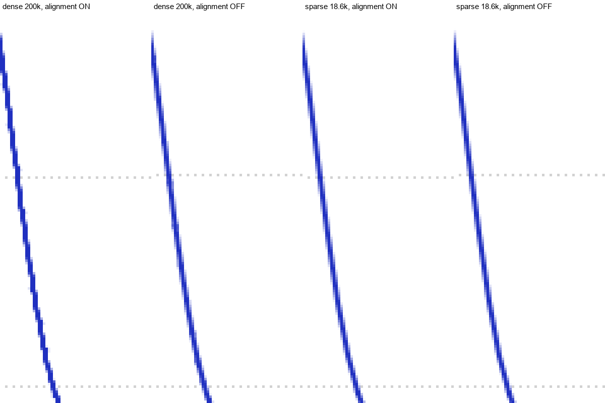
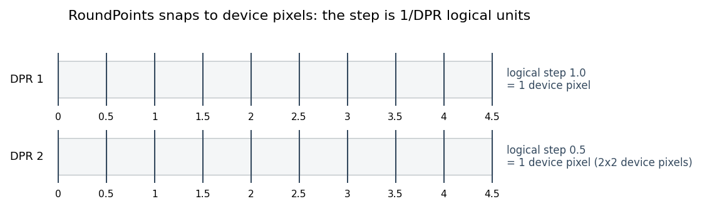
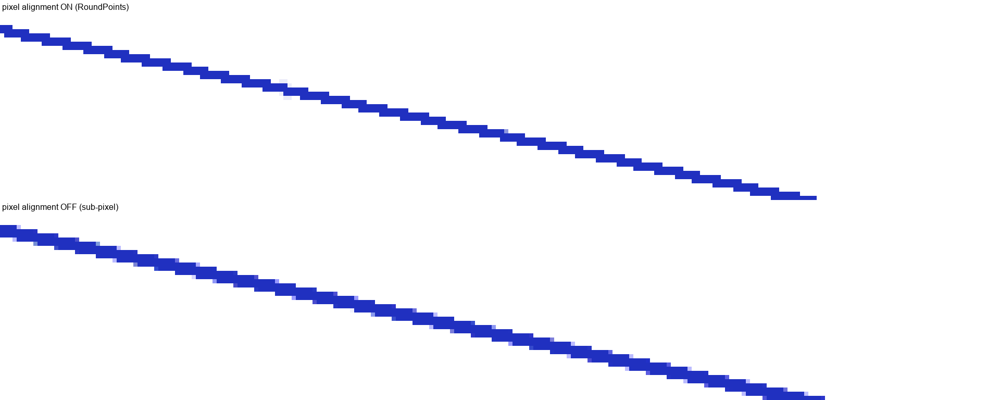
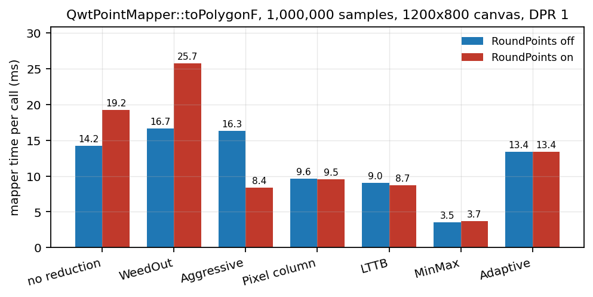
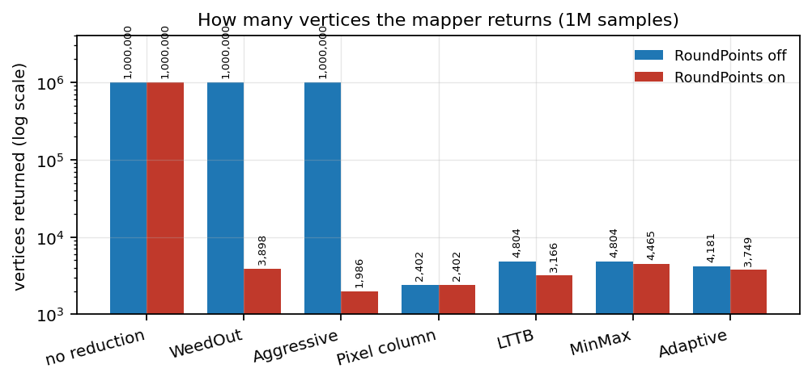
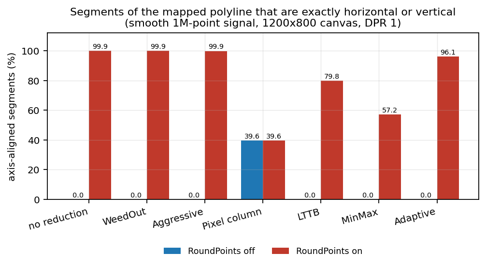
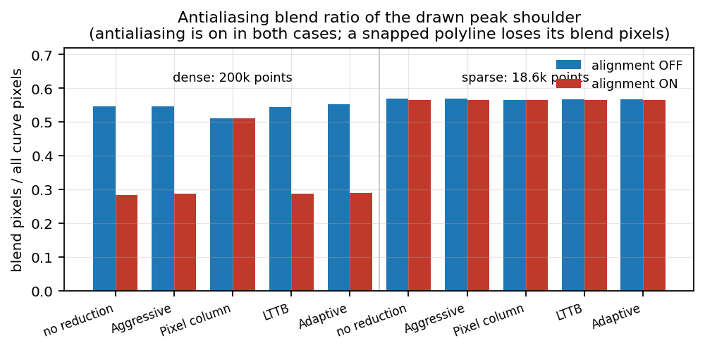

# Pixel Snapping in the Curve Pipeline: `QwtPointMapper::RoundPoints` and the Dense-Curve Staircase

> **Abstract** — Dense and sparse samples of the same smooth curve should look the same on screen. They do not: in QWT 7.5.0 a spectral line stored with 200,000 samples renders as a visibly stepped polyline in a 14-unit zoom, while the same line shape stored with 18,600 samples renders smoothly, with antialiasing enabled in both cases. This report traces the effect to `QwtPointMapper::RoundPoints`, a transformation flag that snaps every mapped vertex to the device pixel grid, and to the fact that `QwtPlotCurve::drawLines()` enables it for every raster painter — including antialiased ones. We formalize the snapping operation, prove that it destroys the sub-pixel information an antialiasing rasterizer needs, measure its cost per reduction path on one million samples, and quantify the visual signature in rendered images: on the dense curve the fraction of antialiasing blend pixels drops from 0.55 to 0.28 when snapping is enabled, while the sparse curve is unaffected. The report closes with the selection rule the library should follow and a list of the paths that still depend on the flag.

> **Abstract — Key results**
>
> - `RoundPoints` computes `round(p * DPR) / DPR` per coordinate. At device pixel ratio (DPR) 1 this quantizes to whole pixels; at DPR 2 the step is half a logical unit, which is still one whole device pixel.
> - On one million samples with no reduction the flag costs **+35 %** mapper time (14.2 ms to 19.2 ms) and produces no fewer vertices — it is not a performance optimization by itself.
> - After LTTB, MinMax or Adaptive reduction the cost is within measurement noise (−1 % to +2 %), because only the few thousand selected vertices are rounded.
> - Snapping turns **99.9 %** of the mapped polyline into exactly horizontal or vertical segments on a smooth dense signal; without snapping the figure is **0 %**. The staircase is therefore a property of the geometry handed to `QPainter`, not of the rasterizer.
> - In rendered images the antialiasing blend ratio of the dense peak shoulder falls from **0.547** (snapping off) to **0.284** (snapping on). The sparse peak stays at **0.568** in both configurations: it never had enough samples per column to trigger the effect.
> - Recommended library rule: align only when the painter does not antialias. Antialiased raster, PDF and SVG output must keep sub-pixel coordinates.

---

## 1. Introduction

### 1.1 The observation

The demonstration program `examples/2D/downsample_demo` renders two synthetic spectra built from the same line shape: one stored with about 200,000 samples over the full range, one with about 18,600. In the zoomed view used below (wavelength 858 to 872) the dense dataset contributes about 3,500 samples and the sparse one about 330. Both are drawn with `QwtPlotCurve::RenderAntialiased` enabled, both without point reduction, into a 1400 x 700 canvas.

The dense spectrum shows a staircase: every few pixel rows the drawn edge jumps sideways by one pixel, and the diagonal flanks look like a staircase drawn with a one-pixel pen. The sparse spectrum, sampled ten times more coarsely, is smooth. The counter-intuitive part is the direction: **more data produces a worse picture**.



*Figure 1 — The rising flank of the tallest peak, 5x nearest-neighbour magnification. Left to right: dense samples with pixel alignment on, dense with alignment off, sparse with alignment on, sparse with alignment off. Antialiasing is enabled in all four renders; the axis grid is visible behind the curve.*

The immediate suspicion — "antialiasing is off" — is wrong. Figure 1 shows blend pixels along every edge in all four panels. What changes between the panels is the **geometry** the rasterizer receives, not the rasterizer's settings.

### 1.2 Scope and method

This report answers four questions:

1. What exactly does `RoundPoints` do, and where is it enabled?
2. Why does it hurt a dense antialiased curve and not a sparse one?
3. What does it cost, per reduction path, in the mapper?
4. Which flag combinations should applications and the library itself use?

The measurements use the library at v7.5.0 with Qt 6.7.3, a Release build with MSVC 2019 (`/O2 /MD /std:c++17`), on an Intel Core i7-8700 at 3.20 GHz under Windows 10 x64. Absolute times vary with hardware; the relative ordering and the ratios are stable. All figures and tables are regenerated by `docs/assets/algorithms/roundpoints_experiment.py` from two raw inputs: `roundpoints_results.csv` (mapper timings and polyline geometry, produced by `roundpoints_bench.cpp`) and `roundpoints_render_metrics.csv` (image metrics, produced by `roundpoints_render_metrics.py`). The rendered batches come from `examples/2D/downsample_demo --batch`, once with the library default and once with `--noround`.

### 1.3 Relation to the downsampling report

The companion report [Downsampling Curves for the Screen](curve-downsampling.md) treats the problem "too many points for the pixel columns" and derives the bucket algorithms that reduce N samples to roughly 4W vertices. This report treats the opposite end of the same pipeline: what happens to the vertices **after** reduction, when they are converted from data coordinates to paint coordinates. The two interact — a reduction algorithm can only preserve what the mapper does not subsequently destroy — but they are separate stages with separate switches, and conflating them is the root of the confusion this report resolves.

## 2. The snapping operation

### 2.1 Definition

`QwtPointMapper` maps data coordinates to paint coordinates through the axis scale maps, then optionally applies a rounding functor. The functor is defined in `src/plot/qwt_point_mapper.cpp`:

```cpp
struct QwtRoundF
{
    qreal ratio = 1.0;

    inline double operator()(double value) const
    {
        return qwtRoundValueF(value * ratio) / ratio;
    }
};
```

With `ratio` set to the device pixel ratio of the target paint device, the operation per coordinate is

$$
x_{\text{snapped}} = \frac{\operatorname{round}(x_{\text{paint}} \cdot \rho)}{\rho},
\qquad \rho = \text{DPR}
$$

where $\operatorname{round}$ is round-half-away-from-zero as implemented by `qwtRoundValueF()`. The output type stays `QPolygonF`: the coordinates remain floating point, they are merely constrained to the lattice $\frac{1}{\rho}\mathbb{Z}$.

**Proposition 1 (device pixel lattice).** For any $\rho > 0$, $x_{\text{snapped}} \cdot \rho \in \mathbb{Z}$. That is, a snapped coordinate lands exactly on a device pixel boundary regardless of DPR.

*Proof.* By construction $x_{\text{snapped}} = k/\rho$ with $k = \operatorname{round}(x_{\text{paint}}\rho) \in \mathbb{Z}$, hence $x_{\text{snapped}}\rho = k$. $\square$

At $\rho = 1$ the lattice is the integer grid, the familiar case. At $\rho = 2$ the lattice is the half-integer grid in logical units, which is the integer grid in device pixels — a vertex can sit between two logical units but never between two device pixels. Figure 2 illustrates the two cases.



*Figure 2 — RoundPoints snaps to device pixels. At DPR 1 the logical step equals one device pixel; at DPR 2 the logical step halves, so a snapped vertex may sit at a half-integer logical coordinate but still on a device pixel boundary.*

### 2.2 Effect on a polyline

Consider a smooth curve sampled far more densely than the pixel grid. Its mapped vertices form a sequence whose consecutive differences are much smaller than one pixel. Snapping each vertex independently has two consequences:

1. **Vertex collapse.** Several consecutive samples map into the same lattice cell and become the same point. The polyline loses vertices — this is the mechanism `WeedOutPoints` relies on.
2. **Direction quantization.** Consecutive surviving vertices differ by integer multiples of $1/\rho$. On a shallow flank, where the true curve rises by a fraction of a pixel per column, the snapped polyline must alternate between horizontal runs (constant $y$) and vertical jumps (constant $x$). The result is a staircase.

Figure 3 shows the second consequence in isolation, on a synthetic line that rises 0.2 pixel rows per column.



*Figure 3 — A straight line rising 0.2 pixel rows per column, rendered at 8x magnification. Top: with RoundPoints, the integer grid forces a one-pixel step every five columns. Bottom: without RoundPoints, the line keeps its sub-pixel slope and the antialiasing rasterizer spreads each edge over two rows.*

The staircase is not a rendering artifact in the sense of a bug in the rasterizer. It is the correct rasterization of a polyline that genuinely consists of horizontal and vertical segments. The information lost is the sub-pixel offset of each vertex, and no downstream stage can recover it: antialiasing computes coverage from the geometry it is given.

**Proposition 2 (irrecoverability).** Let $L$ be a polyline with vertices $v_i \in \mathbb{R}^2$ and let $L'$ be the same polyline with every vertex snapped to the lattice $\frac{1}{\rho}\mathbb{Z}^2$. Any rasterizer that is a function of the polyline geometry alone produces $\mathcal{R}(L')$, and $\mathcal{R}(L') = \mathcal{R}(L)$ only if $L$ and $L'$ coincide on the covered pixel columns.

*Proof.* The rasterizer has no access to $L$ once it receives $L'$; it is a pure function of its input. Distinct inputs may of course rasterize identically when the difference is below the coverage resolution, but a difference of up to $1/(2\rho)$ per vertex accumulates along a shallow flank and exceeds it. $\square$

The practical form of Proposition 2: once `RoundPoints` is on, enabling antialiasing cannot restore the smooth flank. This is exactly the combination the library shipped.

### 2.3 Where snapping is enabled

`QwtPlotCurve::drawLines()` (`src/plot/qwt_plot_curve.cpp`) reads two independent switches:

```cpp
const bool doFit   = (d->attributes & Fitted) && d->curveFitter;
const bool doAlign = !doFit && QwtPainter::roundingAlignment(painter);
```

`QwtPainter::roundingAlignment(painter)` is the conjunction of a global user switch (`QwtPainter::setRoundingAlignment()`, default `true`) and `QwtPainter::isAligning(painter)`. The latter, in `src/plot/qwt_painter.cpp`, returns `false` for PDF, SVG, unknown paint engines, and for painters with a rotating or scaling transformation. **It does not inspect `QPainter::Antialiasing`.** A plain widget canvas with antialiasing enabled therefore takes the aligning branch:

```cpp
if (doAlign) {
    mapper.setFlag(QwtPointMapper::RoundPoints, true);
    mapper.setFlag(QwtPointMapper::WeedOutIntermediatePoints,
                   testPaintAttribute(FilterPointsAggressive));
}
```

The same global switch is read by `drawDots()`, `drawSteps()`, `drawSticks()`, `drawSymbols()` and several other plot items (`qwt_plot_intervalcurve.cpp`, `qwt_plot_boxchart.cpp`, `qwt_plot_marker.cpp`, `qwt_plot_shapeitem.cpp`, `qwt_plot_grid.cpp`), so turning it off is an application-wide decision, not a per-curve one.

## 3. Why density decides

The staircase amplitude is bounded by half a device pixel per vertex, but its **visibility** depends on how many vertices share a pixel column and on the slope of the curve at that point.

### 3.1 Samples per column

Let $n$ be the number of visible samples, $W$ the canvas width in device pixels. The mean occupancy is $\lambda = n / W$. Three regimes follow:

- $\lambda \ll 1$: most columns hold no sample. The polyline is a long chord from one sample to the next; there is no vertex inside the column to snap, so the drawn line is a straight interpolation with correct sub-pixel endpoints. **No staircase.**
- $\lambda \approx 1$: one vertex per column. Snapping moves it within its cell, but the polyline still descends one column per vertex, so the segments remain diagonal. The staircase is mild.
- $\lambda \gg 1$: many vertices per column. The snapped polyline can only move vertically inside the column and horizontally between columns; the column becomes a vertical stroke plus a one-pixel horizontal tread. **Visible staircase.**

The demo's dense spectrum has $\lambda \approx 3500/1300 \approx 2.7$ samples per column in the zoomed window; the sparse one has $\lambda \approx 330/1300 \approx 0.25$. The difference in the renders is the difference between the onset of the third regime and the first regime. The mapper benchmark of Section 4 uses a deliberately extreme density ($\lambda \approx 833$) so that the transform cost is measurable; the geometric mechanism is the same at $\lambda = 2.7$, as the rendered blend-ratio experiment in Section 6 shows.

### 3.2 Slope

A staircase needs a direction to quantize. On a near-vertical flank the snapped segments are mostly vertical anyway, and the treads are one pixel wide; on a near-horizontal flank the treads stretch over many columns and become conspicuous. This is why the effect is easiest to photograph on the shoulder of a peak, where the curve is shallow, and hard to see at the apex.

The synthetic render of Figure 3 uses a deliberately shallow slope of 0.2 rows per column, which yields five-column treads. The real spectrum of Figure 1 has local slopes between 1 and 5 rows per column on the upper flank, which yields one- to two-column treads — still visible at normal magnification, as the figure shows.

### 3.3 What the antialiasing rasterizer does with each case

Qt's raster engine computes per-pixel coverage from the distance between the pixel center and the polygon edge. A sub-pixel vertex offset changes that distance by a fraction of a pixel and therefore changes the blend weight of the two adjacent rows. A snapped vertex puts the edge exactly on a pixel boundary, so the coverage of one row is 1 and of the other 0 — no blend pixel at all. The blend ratio is therefore a direct, monotone indicator of how much sub-pixel geometry survives, which is what the experiments measure.

## 4. Cost in the mapper

### 4.1 Benchmark protocol

`roundpoints_bench.cpp` drives `QwtPointMapper::toPolygonF()` directly on a one-million-sample signal, a 1200 x 800 canvas and a linear x map spanning the full data range. Seven flag configurations cover every reduction path. For each, the mapper runs with and without `RoundPoints`, at DPR 1 and DPR 2. Each configuration is calibrated to at least 20 ms per timed run, then measured with three warm-up and nine timed calls; the median is reported. The mapper only is timed — `QPainter::drawPolyline()` is excluded — so the numbers isolate the transform and reduction work.

The signal is two long-period sines, dense enough to exercise every reduction path ($\lambda \approx 833$ samples per column) while remaining smooth at canvas scale.

### 4.2 Results



*Figure 4 — `QwtPointMapper::toPolygonF()` time per call on one million samples, 1200 x 800 canvas, DPR 1, with and without `RoundPoints`.*

| Path | off (ms) | on (ms) | change | vertices off → on |
|---|---:|---:|---:|---:|
| no reduction | 14.21 | 19.22 | **+35 %** | 1,000,000 → 1,000,000 |
| `WeedOutPoints` | 16.65 | 25.71 | **+54 %** | 1,000,000 → 3,898 |
| `WeedOutIntermediatePoints` | 16.29 | 8.42 | **−48 %** | 1,000,000 → 1,986 |
| `PixelColumnReduce` | 9.61 | 9.51 | −1 % | 2,402 → 2,402 |
| `LTTBReduce` | 9.01 | 8.74 | −3 % | 4,804 → 3,166 |
| `MinMaxReduce` | 3.50 | 3.68 | +5 % | 4,804 → 4,465 |
| `AdaptiveColumnReduce` | 13.37 | 13.41 | +0.3 % | 4,181 → 3,749 |

Medians of nine timed runs; the minimum-based ratios are slightly larger (+41 % for no reduction, +65 % for `WeedOutPoints`) because the flag's extra work is easier to see on the fastest runs.

The first row is the pure cost of the flag: one extra multiply, round and divide per coordinate, over one million vertices, with no reduction in output size. It is a **35–41 % penalty** on the mapper for a dense unreduced curve; the earlier measurement that motivated this report, taken with a different timing protocol, saw +51 %.

The `WeedOutPoints` row is the flag doing its intended job: 1,000,000 vertices collapse to 3,898 because samples sharing a device pixel are duplicates once snapped. The mapper itself is slower (it still touches every input), but the downstream drawing cost drops by two orders of magnitude in vertex count. This is the trade the flag was designed for.

The `WeedOutIntermediatePoints` row must be read carefully: without `RoundPoints` the aggressive path is not entered at all (`toPolygonF()` guards it inside the `RoundPoints` branch), so the two columns compare two different algorithms, not one algorithm with and without rounding.

The four modern reduction paths — pixel column, LTTB, MinMax, Adaptive — show changes between −3 % and +5 %, i.e. within or barely above run-to-run noise. They select a few thousand vertices and round only those; the scan over the million input samples dominates.



*Figure 5 — Vertices returned by the mapper. Note the logarithmic axis: without rounding, the unreduced and deduplicated paths return one vertex per sample.*

### 4.3 The DPR dimension

At DPR 2 the lattice is finer in logical units but identical in device pixels, so the number of surviving vertices after snapping is larger (for `WeedOutPoints`, 7,783 instead of 3,898) and the time penalty is unchanged. No new effect appears; the flag simply operates on a finer grid. The DPR-aware behaviour was itself a fix (commit `9ce35af`, "make QwtPointMapper pixel units honor the device pixel ratio"), before which pixel-column algorithms used logical units and behaved differently on HiDPI screens.

### 4.4 Scaling with sample count

| Samples | off (ms) | on (ms) | ratio |
|---:|---:|---:|---:|
| 100,000 | 1.31 | 1.90 | 1.45 |
| 250,000 | 3.31 | 4.74 | 1.43 |
| 500,000 | 6.56 | 9.93 | 1.51 |
| 1,000,000 | 13.62 | 19.59 | 1.44 |
| 2,000,000 | 27.46 | 39.52 | 1.44 |

The ratio is flat, confirming a per-vertex constant cost rather than a cache or allocation effect. Both curves are linear in $n$, as expected for a single pass.

## 5. Geometric signature

The mapper output can be inspected without rendering: count how many segments of the returned polyline are exactly horizontal (`dy == 0.0`) or exactly vertical (`dx == 0.0`). Without snapping, a smooth curve mapped to paint coordinates has no exactly axis-aligned segment — floating-point values essentially never coincide. With snapping, the coordinates are integers (at DPR 1) and the segments are axis-aligned by construction.



*Figure 6 — Fraction of mapped segments that are exactly horizontal or vertical, one million samples, smooth signal.*

| Path | off | on |
|---|---:|---:|
| no reduction | 0.0 % | **99.9 %** |
| `WeedOutPoints` | 0.0 % | **99.9 %** |
| `WeedOutIntermediatePoints` | 0.0 % | **99.9 %** |
| `PixelColumnReduce` | 39.6 % | 39.6 % |
| `LTTBReduce` | 0.0 % | **79.8 %** |
| `MinMaxReduce` | 0.0 % | **57.2 %** |
| `AdaptiveColumnReduce` | 0.0 % | **96.1 %** |

Two readings matter. First, the unreduced and deduplicated paths become essentially **entirely** axis-aligned — the polyline is no longer a curve in any geometric sense, it is a sequence of horizontal and vertical steps. Second, `PixelColumnReduce` is unaffected by the flag: it emits a min/max envelope per column and its own output already contains the horizontal connections, which is why the pixel-column algorithm shows a staircase of its own even with rounding off.

The reduction algorithms sit in between because they keep a small number of **real** samples: LTTB picks one sample per bucket, MinMax two, Adaptive a tolerance-selected subset. When those few vertices are snapped, most of their connecting segments become axis-aligned, but the vertices themselves are still distributed along the curve, so the result is a coarser staircase rather than a full one.

## 6. Visual experiment

### 6.1 Setup

`examples/2D/downsample_demo --batch <dir>` renders a matrix of dataset x reduction x view combinations to PNG. Two batches were produced with the same binary: one with the library default (`roundingAlignment` on) and one with `--noround`. The analysis crop is the rising shoulder of the tallest peak in the `win14` view, a 120 x 360 pixel region where the flank is shallow and the staircase is most visible.

For every crop the script counts curve pixels (blue-dominant pixels), classifies them as pure pen or blend, and reports the blend ratio. It also records the topmost curve pixel row (the peak apex), which must not move.

### 6.2 Results



*Figure 7 — Antialiasing blend ratio of the peak shoulder, dense versus sparse samples, alignment on versus off. Antialiasing is enabled in every bar.*

| Dataset | Reduction | alignment off | alignment on | apex row |
|---|---|---:|---:|---:|
| dense (200k) | no reduction | 0.547 | **0.284** | 0 |
| dense (200k) | `FilterPointsAggressive` | 0.547 | **0.287** | 0 |
| dense (200k) | `FilterPointsPixel` | 0.511 | 0.511 | 0 |
| dense (200k) | `FilterPointsLTTB` | 0.544 | **0.288** | 0 |
| dense (200k) | `FilterPointsAdaptive` | 0.552 | **0.289** | 0 |
| sparse (18.6k) | no reduction | 0.568 | 0.564 | 0 |
| sparse (18.6k) | `FilterPointsLTTB` | 0.568 | 0.564 | 0 |
| sparse (18.6k) | `FilterPointsAdaptive` | 0.568 | 0.565 | 0 |

Three observations:

1. **Dense data loses half its blend pixels when snapping is on.** The ratio 0.28 versus 0.55 is the quantitative form of the visual difference in Figure 1. The absolute values depend on the crop and the pen width; the factor of two is the signal.
2. **Sparse data is unaffected.** The ratio is 0.56 in both configurations, because the samples are far enough apart that snapping moves each vertex by less than the antialiasing resolution and never creates a multi-vertex column.
3. **`FilterPointsPixel` is unaffected by the global switch**, exactly as the geometric analysis predicted: the algorithm computes its own pixel-domain envelope and ignores `RoundPoints`. Its ratio, 0.51, is lower than the sub-pixel paths because its output already contains horizontal connections.

The apex row is identical in every configuration, confirming that snapping changes the shape of the flank but not the position of the peak.

### 6.3 Failure modes and honest limits

- The blend-ratio metric depends on the pen width, the crop and the rendering backend. It is used here for **relative** comparison between two renders of the same configuration, not as an absolute quality score.
- The `win14` crop was chosen because the staircase is visible there; other windows and the full-range view show smaller differences. The report does not claim that every dense curve looks bad — only that the mechanism is present and that it is governed by samples per column and local slope.
- The synthetic line of Figure 3 is a best case for illustrating the mechanism (slope 0.2). Real spectra have steeper flanks and correspondingly narrower treads.
- The measurements cover raster rendering at DPR 1 and DPR 2 only. PDF and SVG output is not affected because `QwtPainter::isAligning()` already excludes those engines; that path is argued from the source, not measured here.

## 7. The selection rule

The evidence supports a simple rule, stated as a decision table for the two switches that matter.

| Situation | `RoundPoints` | Rationale |
|---|---|---|
| Antialiased raster (widget canvas), any reduction | **off** | sub-pixel geometry is the input the rasterizer needs |
| Non-antialiased raster, thin lines, pixel-exact look | on | vertices land on real pixels; edges stay crisp |
| `WeedOutPoints` used as a pixel deduplicator | on | the algorithm's purpose is to merge samples per device pixel |
| `WeedOutIntermediatePoints` (aggressive) | on | the path is only reachable with the flag set |
| `PixelColumnReduce` | irrelevant | the algorithm does not read the flag |
| PDF / SVG / rotated or scaled painter | off | already excluded by `QwtPainter::isAligning()` |
| After LTTB / MinMax / Adaptive, for performance | **off** | no measurable gain, visible loss on dense data |

The library-level consequence is that `drawLines()` should tie alignment to antialiasing rather than to the paint engine alone:

```cpp
const bool doAlign = !doFit
    && !(painter->renderHints() & QPainter::Antialiasing)
    && QwtPainter::roundingAlignment(painter);
```

This preserves the existing behaviour for non-antialiased raster painting, keeps PDF/SVG and transformed painters on the sub-pixel path, and removes the flag for exactly the case where it does harm. The same consideration applies to `drawDots()` and to legend icon rendering, and `FilterPointsAggressive` callers must be checked because the aggressive path is currently reachable only through `RoundPoints`.

## 8. Reproduction

Everything in this report is regenerated from the repository:

```bash
# 1. build the library and the demo
./build.ps1 build
cmake --build build --config Release --target downsample_demo

# 2. render the two batches
build/bin/Release/downsample_demo --batch out_round
build/bin/Release/downsample_demo --batch out_noround --noround

# 3. compile and run the mapper benchmark
cd docs/assets/algorithms
cmd //c compile_roundpoints_bench.bat          # MSVC + Qt paths inside the .bat
roundpoints_bench.exe all > roundpoints_results.csv

# 4. compile and run the synthetic render check
cmd //c compile_roundpoints_render.bat
roundpoints_render_check.exe out_render -platform offscreen

# 5. image metrics and figures
python roundpoints_render_metrics.py out_round 1
python roundpoints_render_metrics.py out_noround 0 --append
python roundpoints_experiment.py
```

The two `.bat` helpers resolve the repository root from their own location and use `QT_DIR` (Qt installation) and `QWT_BUILD_DIR` (build tree) environment variables, defaulting to a local Qt 6.7.3 path and `<repo>/build`; adjust those two settings for another machine. `roundpoints_bench.cpp` and `roundpoints_render_check.cpp` also carry the equivalent `cl` command lines in their header comments.

## 9. Conclusion

The dense-curve staircase is not a rendering bug and not a missing antialiasing hint. It is the predictable result of snapping a dense polyline to the device pixel grid before an antialiasing rasterizer sees it. The operation is cheap per vertex but not free — it costs roughly 45 % of mapper time on an unreduced million-point curve and nothing measurable after a modern reduction — and its visual cost is concentrated exactly where dense data is common: shallow flanks with many samples per pixel column.

The fix is a policy change, not an algorithm: align to pixels only when the painter does not antialias. The reduction algorithms of the companion report then operate on geometry that the rasterizer can actually use.

## 10. References

1. QWT 7.5.0 sources: `src/plot/qwt_point_mapper.cpp` (`QwtRoundF`, `qwtAdaptiveColumnReduce`, `qwtLttbReduce`, `qwtMinMaxBucketReduce`, `qwtPixelColumnReduce`, `toPolygonF()` dispatch), `src/plot/qwt_plot_curve.cpp` (`drawLines()`), `src/plot/qwt_painter.cpp` (`isAligning()`, `roundingAlignment()`).
2. Companion report: [Downsampling Curves for the Screen: LTTB Theory and the QWT7 MinMax Bucket](curve-downsampling.md).
3. Companion report: [Curve Rendering: Gaussian, Savitzky-Golay and Feature Preservation](curve-smoothing.md).
4. Demonstration program: `examples/2D/downsample_demo` (interactive GUI plus `--batch`, `--noround`, `--nosplit`, `--dots` modes).
5. Raw data and scripts: `docs/assets/algorithms/roundpoints_bench.cpp`, `roundpoints_render_check.cpp`, `roundpoints_render_metrics.py`, `roundpoints_experiment.py`, `roundpoints_results.csv`, `roundpoints_render_metrics.csv`.
6. Steinarsson, S. *Downsampling Time Series for Visual Representation.* MSc thesis, University of Iceland, 2013.
7. Qt documentation: `QPainter::Antialiasing`, `QPaintEngine::Type`.
