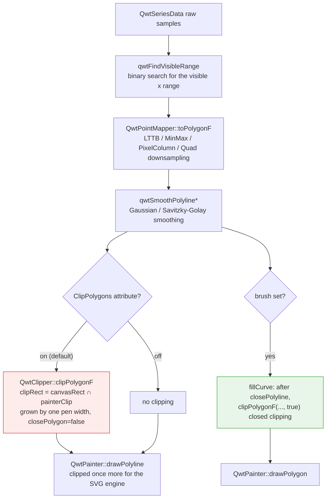
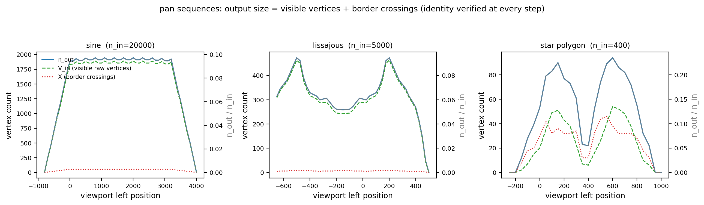
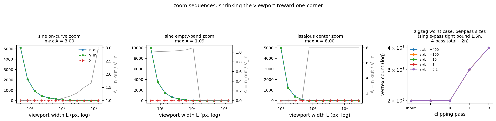
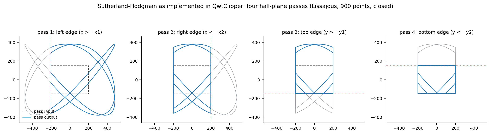
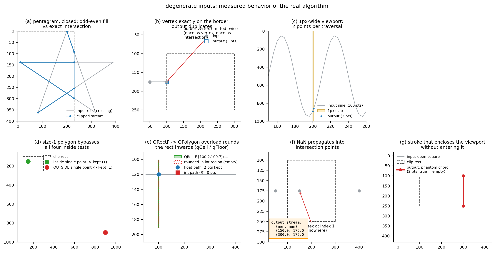

# The Polygon Clipper (QwtClipper): Correctness, Vertex Amplification and Degenerate Inputs

> **Abstract** — Before a plotting library hands a million-point polyline to the rasterizer, it cuts away the invisible part with an axis-aligned rectangle. In QWT7 this step belongs to the `QwtClipper` namespace in `src/core/qwt_clipper.cpp`, whose core is the four-pass half-plane Sutherland–Hodgman algorithm (polygons/polylines) plus an angular-sweep circle clipper (`clipCircle`). Clipping is put back into the render pipeline and formalized: the clip rectangle is jointly determined by the canvas rectangle, the painter clip region and the pen width, and every public function receives algorithm identification, pseudocode and a correctness argument. A Python reimplementation aligned with the source operation by operation, together with a C++ harness that calls the real implementation in `qwtcore.dll` directly, runs 2337 bit-exact cross-validation cases and measures vertex amplification under pan/zoom sequences. Degenerate inputs (self-intersection, collinearity, 1px viewports, boundary coincidence, duplicate points, NaN, and the like) are recorded one by one, followed by a failure-mode list that does not shy away from negative results: three reproducible counterexamples in which `clipCircle` returns wrong arc segments when the circle center falls exactly on the left/right edge line of the clip rectangle or the circle passes exactly through a rectangle corner (all three were fixed in v7.5.1; Section 4.4 carries the re-measurement data).

> **Abstract — Key results**
>
> - Cross-validation: the Python reimplementation and the real `QwtClipper` (`qwtcore.dll`; re-measured 2026-10-13 with Qt 5.14.2 msvc2017_64, originally Qt 5.15.16; the 20 semantic probes agree on both) agree bit-exactly on 2337/2337 across 1323 polygon cases and 1014 circle cases (`%.17g` full-precision comparison); the reimplementation can serve as a trusted model for the analysis that follows
> - Exact accounting identity for vertex counts: every half-plane pass satisfies $n_{k+1} = V_k + X_k$ (kept vertices + intersections), holding 169/169 across all 169 sequence steps of the pan/zoom runs; in the global relation $n_{out} = V_{in} + X_{\partial R} + \Phi$, $\Phi \equiv 0$ for $x$-monotone polylines (73/73 steps), with a steady-state amplification $A = n_{out}/V_{in} \approx 1.029$
> - The "ghost boundary points" with $\Phi > 0$ appear only on closed, non-monotone manifolds: a Lissajous curve still outputs 8 points when it misses the viewport entirely (the viewport rectangle boundary traversed once forward and once backward); over the zoom sequences $\Phi$ reaches 10 and $A$ reaches 8.0; yet after rasterization under the even-odd and the non-zero winding fill rules, the pixel difference from the exact intersection is 0/160000 in both cases, i.e. fill semantics are unaffected and only stroking is affected
> - `clipCircle` agrees exactly with the brute-force angular-sampling ground truth on 300 random circles (worst symmetric difference 0.000000 rad); the three wrong-arc counterexamples recorded at first release (center exactly on the left/right edge line, symmetric difference $\pi$ rad; circle passing exactly through a rectangle corner, symmetric difference up to $2\pi$ rad and dependent on a 1-ulp floating-point rounding) are all fixed in v7.5.1: the directed cases re-measure a symmetric difference of zero (one apparent residual of 1.7e-5 for the center-on-a-corner case, ground-truth sampling error) and 300/300 random circles agree. Radius 0 still returns the empty set (the geometric fact that QRectF::contains rejects a zero-width rectangle; the Doxygen comment does not mention this exception)
> - Intersection coordinates on the integer path are truncated toward zero by `static_cast<int>` (error $<1$ px, sign-dependent); the `QRectF → QPolygon` overload rounds inward with `qCeil/qFloor` (a float rectangle narrower than 1 with no integer coordinate inside necessarily clips to empty on the integer path); a single-point polygon bypasses all four inside tests and is kept verbatim

---

## 1. Introduction: where clipping sits in the render pipeline, and problem formalization

### 1.1 Problem formalization

The clip region is the axis-aligned rectangle $R = [x_1, x_2] \times [y_1, y_2]$, whose borders are given by the rectangle's `x()`, `x()+width()`, `y()`, `y()+height()`, with the four half-plane tests $x \ge x_1$, $x \le x_2$, $y \ge y_1$, $y \le y_2$, all inclusive: points on the border count as "inside". The clipped object $S$ is a sequence of points (an edge stream): with `closePolygon = true` the first and last points are implicitly joined and $S$ is treated as a closed polygon; with `false` it is treated as an open polyline. The output is the clipped stream of $S$ against $R$, containing both the vertices of $S$ that fall inside $R$ and the intersections of the edges of $S$ with $\partial R$.

The definition deliberately does not say "the output is the polygon $S \cap R$": for open polylines and self-intersecting manifolds, "the intersection polygon" has no unique definition, whereas Sutherland–Hodgman produces a definite edge stream. Sections 2 and 5 characterize precisely the relation between this edge stream and the various "ground truths" (even-odd fill, non-zero winding fill, stroke).

The clip window is convex (the intersection of four half-planes), and this single property dictates the algorithm choice. Per-segment Liang–Barsky or Cohen–Sutherland parametric clipping intersects every segment independently and outputs mutually unrelated segments; reconstructing the region boundary then requires another stitching pass. Weiler–Atherton and Greiner–Hormann clip against arbitrary clip polygons, even regions with holes, at the cost of intersection search structures and in/out flag bookkeeping. For an axis-aligned convex window, Sutherland–Hodgman decomposes the problem into four independent half-plane passes, each $O(n)$, with no search structure and reusable buffers; it is the cheapest correct algorithm under this constraint, and QWT's choice matches the applicability conditions of the original 1974 paper exactly.

### 1.2 Why software clipping

QPainter clips by itself, yet QWT still maintains a software clipper, for three reasons all traceable in the source:

1. The SVG engine ignores clipping. `qwtIsClippingNeeded()` at `qwt_painter.cpp:108` returns true only for `QPaintEngine::SVG`, and the comment states "The SVG paint engine ignores any clipping"; in that case `QwtPainter::drawPolygon/drawPolyline/drawLine` (`qwt_painter.cpp:511–616`) must clip on their own.
2. The raster engine is slow for coordinates far outside the viewport. The comment at `qwt_polar_grid.cpp:717` reads "Qt4 is horrible slow, when painting primitives, with coordinates far outside the visible area.", and `:775–777` adds one more sentence right after it: "We need to clip.".
3. Performance under deep zoom. The documentation of `QwtPlotCurve::ClipPolygons` says: "In situations, where points are far outside the visible area (f.e when zooming deep) this might be a substantial improvement for the painting performance" (`qwt_plot_curve.h:224–226`).

### 1.3 Position in the pipeline

The order inside `QwtPlotCurve::drawLines()` (from `src/plot/qwt_plot_curve.cpp:583`) is: binary search for the visible range → `QwtPointMapper` downsampling → render smoothing → clipping → fitting/painting. Clipping comes after smoothing, so that the smoothing filter sees complete neighborhoods:



Stroking and filling take the open and closed semantics respectively, which is the key to the failure modes later: the same algorithm, with the value of `closePolygon` deciding whether the output edge stream is a "string of polyline fragments" or a "region boundary".

### 1.4 Complete table of clip call sites

| Call site | File:line | Semantics | Clip rectangle source |
|---|---|---|---|
| `QwtPlotCurve::drawLines` | `qwt_plot_curve.cpp:656,664` | open polyline | `canvasRect ∩ painterClip`, grown by `effectivePenWidth` |
| `QwtPlotCurve::drawSteps` | `qwt_plot_curve.cpp:936` | open polyline | same as above |
| `QwtPlotCurve::fillCurve` | `qwt_plot_curve.cpp:1213` | closed polygon | `canvasRect ∩ painterClip` (not grown) |
| `QwtPlotIntervalCurve::drawTube` | `qwt_plot_intervalcurve.cpp:526,545,548` | closed fill / open stroke | fill uses `canvasRect.adjusted(-1,-1,1,1)`; stroke grows by the pen width |
| `QwtPlotShapeItem::draw` | `qwt_plot_shapeitem.cpp:433` | each subpath closed | `canvasRect` grown by the pen width |
| `QwtPolarCurve` | `qwt_polar_curve.cpp:441` | open polyline | inverse transform of the painter window, grown by `qCeil(max(1, penWidth))` |
| `QwtPolarGrid` radial lines | `qwt_polar_grid.cpp:726` | open polyline (2 points) | `canvasRect` |
| `QwtPolarGrid` concentric circles | `qwt_polar_grid.cpp:780` | `clipCircle` → arcs | `canvasRect` |
| `QwtPainter` wrappers | `qwt_painter.cpp:511–616` | open/closed | SVG engine only: `painter->clipRegion().boundingRect()` |

`drawDots`/`drawSymbols` do not use `QwtClipper`; they rely on `QwtPointMapper::setBoundingRect(clipRect)` and `WeedOutPoints` to cull points outside the viewport during mapping. One more clarification: the v7 `QwtClipper` has no `clipLine`/`clipPolyline`. The public API is only `clipPolygon` (two overloads), `clipPolygonF`, the three `clipped*` copying versions and `clipCircle`; open polylines uniformly take the Sutherland–Hodgman path with `closePolygon = false`.

## 2. Algorithm and correctness

### 2.1 Sutherland–Hodgman: four half-plane passes

`QwtPolygonClipper<Polygon, Rect, T>::clipPolygon` (`qwt_clipper.cpp:154`) runs one pass each for the left, right, top and bottom edges, ping-ponging the intermediate results between the two buffers `points1`/`points2` (left→2, right→1, top→2, bottom→1, finally landing back in the argument reference). Pseudocode of a single `clipEdge` pass (`:172`):

```text
Algorithm 1  clipEdge(points, edge, closePolygon)
Input: point stream points[0..n-1], half-plane test isInside, intersection function intersection
Output: clipped point stream out

1. if n < 2: if n == 1 then out += points[0] (no inside test!); return out
2. if closePolygon:                      # handle the implicit closing edge first
     if isInside(p0): { if !isInside(p_{n-1}): out += I(p0, p_{n-1}); out += p0 }
     else if isInside(p_{n-1}): out += I(p0, p_{n-1})
   else: if isInside(p0): out += p0        # open polyline: no implicit closing edge
3. for i = 1..n-1, let p1 = points[i], p2 = points[i-1]:
     if isInside(p1): { if !isInside(p2): out += I(p1, p2); out += p1 }
     else if isInside(p2): out += I(p1, p2)
4. return out
```

where $I(p_1, p_2)$ is the intersection of the segment $p_2 p_1$ with the current clip line. Take the left edge as an example (`:58–67`): $\text{isInside}(p) \equiv p.x \ge x_1$,

$$
I(p_1, p_2) = \left( x_1,\; p_2.y + (x_1 - p_2.x)\cdot \frac{p_1.y - p_2.y}{p_1.x - p_2.x} \right)
$$

The division happens in `double` and the result is `static_cast` back to the coordinate type (truncation toward zero on the integer path, see 2.3). The full definitions for the four edges follow; note that every intersection is anchored at the previous point $p_2$:

$$
\begin{aligned}
\text{Left}:&\quad \mathrm{in}(p) \equiv p.x \ge x_1, & I = \Big( x_1,\; p_2.y + (x_1 - p_2.x)\tfrac{p_1.y - p_2.y}{p_1.x - p_2.x} \Big) \\
\text{Right}:&\quad \mathrm{in}(p) \equiv p.x \le x_2, & I = \Big( x_2,\; p_2.y + (x_2 - p_2.x)\tfrac{p_1.y - p_2.y}{p_1.x - p_2.x} \Big) \\
\text{Top}:&\quad \mathrm{in}(p) \equiv p.y \ge y_1, & I = \Big( p_2.x + (y_1 - p_2.y)\tfrac{p_1.x - p_2.x}{p_1.y - p_2.y},\; y_1 \Big) \\
\text{Bottom}:&\quad \mathrm{in}(p) \equiv p.y \le y_2, & I = \Big( p_2.x + (y_2 - p_2.y)\tfrac{p_1.x - p_2.x}{p_1.y - p_2.y},\; y_2 \Big)
\end{aligned}
$$

The order of operations in the formulas (coordinate differences first, then divide, multiply, add) is not a typesetting detail: cross-validation requires the Python reimplementation to be bit-identical to the C++ output, and under IEEE-754 changing the association order changes the last bit. The 2337/2337 bit-exact agreement validates two things at once: the reimplementation is faithful, and MSVC `/O2` (default `/fp:precise`, no FMA contraction) preserved the operation order written in the source.

**Proposition 1 (per-pass accounting identity)** For an input with $n \ge 2$, a single pass outputs $|out| = V + X$, where $V$ is the number of input vertices satisfying `isInside` and $X$ is the number of `intersection` calls in this pass. *Proof*: steps 2 and 3 emit at most once per input vertex ($p_0$ in step 2, $p_i, i \ge 1$ in step 3), and only when the vertex lies inside the half-plane; every emitted intersection corresponds to one and only one `intersection` call, and conversely every call emits exactly one point. The two kinds of emission do not overlap, hence $|out| = V + X$. For $n < 2$ the identity fails (a single point is copied unconditionally), the only exception. $\square$

**Proposition 2 (convex-window correctness, proof sketch)** For a simple polygon and a convex clip window, induct on the pass number: after pass $k$, the point stream is exactly the boundary stream of the region $S \cap H_1 \cap \dots \cap H_k$. The induction step is the classic argument (Sutherland & Hodgman, 1974): each edge of the stream emits $\{p_1\}$, $\{I\}$, $\{I, p_1\}$, $\varnothing$ in the four cases "in→in, in→out, out→in, out→out" respectively, matching the boundary construction of half-plane clipping one for one; the implicit closing edge of a closed stream is supplied by step 2. $\square$ Self-intersecting input violates the "simple polygon" premise; Section 4.3 characterizes its actual semantics with rasterization experiments.

**Proposition 3 (per-pass amplification bound)** A single pass satisfies $|out| \le 2n$ (loose bound); the tight bound is $1.5n + O(1)$, attained by an alternating in/out zigzag stream. *Proof*: each input segment $(p_2, p_1)$ contributes at most $[\,p_1 \text{ inside}\,] + [\,\text{the segment crosses the clip line}\,] \le 2$; summing over segments gives $|out| \le 2n$. But crossing implies exactly one endpoint inside; charging each crossing segment to both its inside endpoint and its outside endpoint gives $X \le 2V$ and $X \le 2(n - V)$, i.e. $X \le 2\min(V, n - V)$: when $V \le n/2$, $|out| = V + X \le 3V \le 1.5n$; when $V > n/2$, $|out| \le V + 2(n - V) = 2n - V < 1.5n$. Hence "all vertices inside and all segments crossing" cannot hold simultaneously, and $2n$ is unreachable within a single pass; the tight bound is attained at $V = n/2$ with every segment crossing (an alternating in/out zigzag stream). $\square$ The measured zigzag (Section 4.2) reaches a maximum per-pass ratio of $1.500$ ($2000 \to 2999 = 1.5n - 1$), exactly approaching the tight bound; $\approx 2n$ is a property accumulated over the four passes ($2000 \to 3998$); each pass outputs at most $1.5$ times its input, but the intersections of the four passes each count independently.

### 2.2 Open-polyline semantics, splicing and ghost boundary points

With `closePolygon = false`, step 2 supplies no implicit closing edge, so the output is a head-to-tail concatenation of several "visible fragments": the exit intersection of fragment $k$ and the entry intersection of fragment $k+1$ are adjacent in the stream. Since $R$ is convex, the segment joining any two of its points stays inside $R$, so these splice chords are never drawn outside the viewport, but they are drawn. More insidious are the "ghost boundary segments": two intersections produced by one pass (both on the left edge line, say) are adjacent in the stream and form an implicit segment along the clip line; later passes clip this implicit segment again as real geometry, and if it crosses a subsequent clip line it creates new intersections out of nothing. Denote these points by $\Phi$; the global relation becomes

$$
n_{out} = V_{in} + X_{\partial R} + \Phi,
$$

where $X_{\partial R}$ is the number of intersections of the input segments with the four boundary segments of $R$ (restricted to the extent of the borders). For an $x$-monotone open polyline (the norm for time-series curves), each vertical clip line is crossed at most once, implicit segments on the left edge line cannot appear, and $\Phi \equiv 0$; for closed, non-monotone manifolds $\Phi$ can be large: Section 4.2 measured the Lissajous curve, with the viewport missing it entirely, at $V_{in} = 0$, $X_{\partial R} = 0$ yet $n_{out} = 8$: the output is 8 points tracing the viewport rectangle boundary once forward and once backward.

### 2.3 Three coordinate-domain instantiations and rounding semantics

The template `QwtPolygonClipper<Polygon, Rect, T>` is instantiated three times, corresponding to three public entry points:

| Entry point | Rectangle | Points | Clip region |
|---|---|---|---|
| `clipPolygonF(QRectF, QPolygonF)` | float | float | $[l, l+w] \times [t, t+h]$, endpoints inclusive |
| `clipPolygon(QRect, QPolygon)` | integer | integer | $[x, x+w] \times [y, y+h]$, endpoints inclusive, i.e. $w+1$ columns |
| `clipPolygon(QRectF, QPolygon)` | float→integer | integer | $[\lceil l \rceil, \lfloor r \rfloor] \times [\lceil t \rceil, \lfloor b \rfloor]$, rounded inward |

All three rounding facts rest on measurements or source evidence. First, the integer path's clip region has one more column than `QRect::right()` ($= x + w - 1$), because `clipEdge` uses `m_clipRect.x() + m_clipRect.width()` (harness probe: `QRect(0,0,10,10).right() == 9`, while the clip upper bound is 10). Second, the float-rectangle-to-integer-polygon overload first applies `qCeil(left)/qFloor(right)/qCeil(top)/qFloor(bottom)` (`:371–374`), a conservatively inward rounding: a float rectangle narrower than 1 with no integer inside necessarily clips to empty on the integer path, while the float path still delivers 2 intersections (measured in Section 4.3: the same rectangle `(100.2, 100.7, 0.5, 90.3)` yields 2 points on the F path and 0 on the R path). Third, integer intersection coordinates are truncated toward zero by `static_cast<int>` rather than rounded to nearest, with an error inside $(-1, 1)$ that is sign-dependent (negative coordinates biased toward zero, positive coordinates biased down); this is an analytic conclusion; the float path has no such error.

Division by zero is unreachable: the left/right passes' `isInside` depends only on $x$, and differing inside states of the two endpoints imply $p_1.x \ne p_2.x$, so the denominator of `intersection` is non-zero; the top/bottom passes are symmetric. NaN coordinates make every comparison false (always "outside"), but NaN propagates into the intersections (Section 4.3).

The toward-zero truncation bias can be written as follows, with $y^\*$ the true intersection coordinate and $\mathrm{trunc}$ the `static_cast<int>`:

$$
e = \mathrm{trunc}(y^\*) - y^\* = -\,\mathrm{frac}(y^\*), \qquad \mathrm{frac}(y) \equiv y - \mathrm{trunc}(y) \in (-1, 1), \qquad |e| < 1
$$

where $\mathrm{frac}(\cdot)$ is the signed truncated fractional part (same sign as $y$; note this differs from the floor-based fractional part $y - \lfloor y \rfloor \in [0, 1)$, the two differ by 1 for negative coordinates): positive coordinates are always biased down ($e \le 0$), negative coordinates always biased up ($e \ge 0$), and the bias direction flips on either side of $y = 0$. The measured 1px integer viewport exposes this bias directly: on the pre-rounded input, the segment $(200, 890) \to (204, 764)$ intersects $x = 201$ at a true value of 858.5; truncation toward zero gives 858 (round-half-away-from-zero would give 859), and both the harness and the reimplementation output `(201, 858)`; the synthetic examples $y^\* = -0.5$ truncate to 0 while rounding gives $-1$, and $y^\* = 2.7$ truncate to 2 while rounding gives 3. The float path has no such bias, so the same geometry can produce outputs differing by 1 px between the F and I paths; this is by design: the integer path serves integer rasterization, the float path serves geometrically exact export.

### 2.4 clipCircle: angular sweep and arc pairing

`QwtCircleClipper::clipCircle` (`:254`) does not use the polygon algorithm; it computes the intersections of the circle with the rectangle's four lines, converts them to angles, sorts them and pairs them into "visible arc" intervals:

```text
Algorithm 2  clipCircle(rect, pos, radius)
1. compute cuttingPoints against the four edges Left, Top, Right, Bottom:
     vertical edge x: if |pos.x - x| < radius (strict!), off = sqrt(r^2 - (pos.x-x)^2)
       candidates (x, pos.y ± off), keep only y ∈ [top, bottom] (inclusive)
     horizontal edge y: symmetric, candidates (pos.x ± off, y), keep only x ∈ [left, right]
2. if no cutting points: cRect = bounding rect of the circle; if rect.contains(cRect) return [(0, 2π)], else []
3. angles = sort(toAngle(pos, p) for p in points)      # [0, 2π)
4. merge duplicate angles within 1e-9 rad (adjacent: a corner is registered by both adjacent edges; wrap-around: angles[0]+2π vs angles[last])
5. per segment classification (wrap-around segment included):
     for i, a0 in angles:# a1 = next angle, angles[0] + 2π for the last segment
       mid = a0 + 0.5*(a1-a0); if rect.contains(polar2pos(pos, r, mid)) emit [a0, a1]
   (since v7.5.1; the first release used a single global midpoint probe to pick the (a0,a1),(a2,a3),... or (a1,a2),... pairing)
```

The angle convention matches `qwtPolar2Pos` (`qwt_point_polar.h:161`, $y = p_y - r\sin a$) and `QPainter::drawArc` (0° at 3 o'clock, counter-clockwise positive): the non-vertical branch of `toAngle` maps screen "bottom-right" to $(3\pi/2, 2\pi)$ and "top-left" to $(\pi/2, \pi)$. The vertical special case (`to.y <= from.y` returns $\pi/2$, otherwise $3\pi/2$ when `from.x == to.x`) follows the same convention since v7.5.1; the first release contradicted it (see failure mode 7 in Section 5 for the history).

**Correctness argument**: when the circle crosses the rectangle boundary transversally, the number of intersections is even and in/out alternate along the circumference, so pairing adjacent angles after sorting recovers the visible arcs. Since v7.5.1 the sweep first merges duplicate cutting points within an angular tolerance of $10^{-9}$ rad (a corner is registered by both adjacent edges and the two coordinates can differ by a few ulp) and then classifies every angular segment - the wrap-around one included - with its own midpoint probe: localizing the classification means duplicated or missing points (tangency) cannot flip the verdict for the other segments, and a single cutting point no longer reads `angles[1]`. The intervals are emitted unwrapped (the upper bound may exceed $2\pi$); the consumer at `qwt_polar_grid.cpp:788–793` computes `span = max − min` (`span < 0 → += 360`), which holds for both spellings. At most 8 cutting points; complexity $O(k \log k)$. Tangency is excluded by the strict inequality `|Δ| < radius` and falls into step 2's containment fallback: an internally tangent circle returns $[0, 2\pi]$, an externally tangent one returns empty, both correct (measured symmetric difference 0 in Section 4.4).

Pairing correctness presupposes "alternation": the sorted angles cut the circumference into $k$ gaps, and in the transversal case the gaps' in/out states strictly alternate. The first release derived all pairings from a single global midpoint probe, so the two premises could be broken in two ways: vertical cutting points receiving mirrored angles (the alternating sequence is shifted), and corners being registered twice by the two adjacent edges (a gap degenerates to length 0, the midpoint probe lands on the rectangle boundary). These are exactly the two counterexample families of Section 5; the merge plus per-segment classification of v7.5.1 removes the dependence on the alternating sequence and the global probe.

Step 2's `QRectF::contains(QRectF)` on Qt 5 (identical probes on 5.14.2 and 5.15.16) behaves differently from the common impression; the harness's 20 probes yield the empirical rule: the argument rectangle is first normalized for negative width/height; degenerate widths ($w = 0$, or widths absorbed by floating point, e.g. $50 + 10^{-300} = 50$) always return false; $w = 10^{-13}$ returns true; otherwise the comparison is endpoint-inclusive. Direct consequence: a circle of radius 0 (bounding rectangle of width 0) never reaches the $[0, 2\pi]$ branch and returns the empty set.

### 2.5 Public API to algorithm mapping

| Function | Algorithm | Remarks |
|---|---|---|
| `clipPolygon(const QRect&, QPolygon&, bool)` | Sutherland–Hodgman, integer domain | in-place |
| `clipPolygon(const QRectF&, QPolygon&, bool)` | same, rectangle rounded inward first | in-place |
| `clipPolygonF(const QRectF&, QPolygonF&, bool)` | same, double precision | in-place, the render pipeline's main entry |
| `clippedPolygon` ×2 / `clippedPolygonF` | copy, then call the above | pure-function versions |
| `clipCircle(const QRectF&, const QPointF&, double)` | angular sweep (Algorithm 2) | returns `QVector<QwtInterval>` |

## 3. Implementation anatomy

### 3.1 Buffers and the early-out

`clipPolygon` opens with an early-out disabled by `#if 0` (`:156–159`): return immediately if the clip rectangle contains the polygon's bounding box. Being disabled means every call runs all four passes in full, including the most common case of a polygon entirely inside the viewport. All four passes are $O(n)$ inside tests plus buffer copies, with no intersection computation, costing roughly four linear traversals; for a $10^5$-point polyline that is hundreds of thousands of array writes per frame (the $4 \times 10^5$ order). Enabling the early-out would require one $O(n)$ bounding-box computation, so the net gain depends on the hit rate, and the source conservatively opts out. The ping-pong buffers' `reserve(qMin(256, n))` (`:162`) only lowers the allocation peak for small polygons.

### 3.2 Constructing the clip rectangle

In `drawLines` the clip rectangle is not the canvas rectangle itself (`qwt_plot_curve.cpp:601–604`):

```cpp
clipRect = qwtIntersectedClipRect(canvasRect, painter);   // canvasRect ∩ painter clip region
const qreal pw = QwtPainter::effectivePenWidth(painter->pen());
clipRect = clipRect.adjusted(-pw, -pw, pw, pw);           // grown by one pen width
```

The pen-width growth keeps a stroke of half-width $pw/2$ from being half cut by the software clipper at the canvas edge; `qwtIntersectedClipRect` (`:45`) further intersects with `painter->clipBoundingRect()`, ensuring that shared-canvas scenarios such as parasite plots never paint outside the host region. `fillCurve` does not grow (a fill needs no stroke margin), and `QwtPlotIntervalCurve`'s fill path grows by a fixed 1.0. All these growth amounts feed directly into $x_1, x_2, y_1, y_2$ of Section 2.1, so "the clip rectangle being a few pixels larger than the canvas" is design, not error.

### 3.3 Attribute switches

`ClipPolygons` is a default paint attribute of `QwtPlotCurve` (`qwt_plot_curve.cpp:84`: `ClipPolygons | FilterPointsLTTB`). Turning it off does not change on-screen correctness (the raster engine clips by itself), but it forfeits the performance benefits of Section 1.2 (SVG export and deep zoom can both degrade); the polar-grid concentric circles mentioned in Section 1.2 are controlled by `QwtPolarGrid::ClipGridLines` instead, not by `ClipPolygons`.

Orthogonal to clipping but stacking with it is `QwtPainter`'s polyline splitting (`qwt_painter.cpp:150`, `splitSize = 6`): aimed at the raster engine's short-line defects and performance characteristics, it cuts the post-clipping stream into chunks of at most 7 points with stride 6 (adjacent chunks share 1 point: `i += splitSize` and `n = qMin(splitSize + 1, …)` at `qwt_painter.cpp:170–171`) before handing them to `drawPolyline`. When splitting is active (raster engine with pen width > 1, or an engine-defect match), the $n_{out}$ measured here directly determines the number of draw calls $\lceil n_{out}/6 \rceil$; ghost points and splice chords are thus further cut into independent small draw units, amplifying the visibility of the artifacts.

## 4. Experiments

### 4.1 Design

The experiment script `docs/assets/algorithms/clipper_experiment.py` (Python 3.11 + numpy + matplotlib, Agg backend, seed 20261012) contains a reimplementation aligned with the source operation by operation: the multiply-add order of the intersection formulas, the toward-zero truncation of `static_cast<int>`, `qCeil/qFloor`, the edge order Left→Right→Top→Bottom, the vertical special case of `toAngle`, the merge of cutting points within 1e-9 rad, the per-segment midpoint probe `from + 0.5*(to-from)`, all copied verbatim, so that IEEE-754 double-precision results can be compared bit for bit. The cross-validation harness `docs/assets/algorithms/clipper_check.cpp` reads the case files generated by the script, calls the real `qwtcore.dll`, and prints all output coordinates with `%.17g`; the build recipe is in that file's header comment (MSVC 2019 `/O2 /std:c++17`, linking `qwtcore.lib` under `build-release/lib`). The harness does no wall-clock timing (machine parallel load is untrustworthy), and no timing numbers are reported.

Case scale: 1323 polygon cases (three modes: float / integer / float-rectangle×integer-point; half open and half closed, covering boundary snapping, duplicate points, collinearity, self-intersection, single points, empty, negative-width rectangles, $\pm 10^6$ large coordinates, $10^{-13}$ subpixel gaps, NaN vertices and one 5000-point Lissajous ghost case), and 1014 circle cases (1000 random + 14 constructed counterexamples). Result: polygons 1323/1323, circles 1014/1014, 2337/2337 bit-exact in total. The harness also prints Qt semantics probes used to align the reimplementation: `QRectF::contains(QPointF)` includes all four edges (`(10,5)` and `(5,10)` both return true for `QRectF(0,0,10,10)`); the empirical rule for `QRectF::contains(QRectF)` is in Section 2.4. Beyond semantics alignment, the cross-validation also corrected one toolchain deviation: MSVC's `istringstream >> double` parses the `nan` token in the case files unreliably (runtime probe `nan_parse_isnan` measured 0), so the harness switched to `strtod` (parsing guaranteed by C99/C++11) for reading coordinates, without which the NaN cases could not enter the bit-exact comparison.

**Table 1: cross-validation case families**

| Family | Count | Coverage |
|---|---:|---|
| F random (half open / half closed) | 700 | float rectangles and points, $n \in [0, 60]$; every 5th case snaps half the points to the rectangle border, every 7th injects exact duplicate points |
| I random (half open / half closed) | 300 | integer rectangles and points, with boundary snapping |
| R random (half open / half closed) | 300 | float rectangles (width down to 0.2) × integer points, stressing the inward-rounding path |
| Structured adversarial (polygon) | 23 | empty, single point inside/outside, horizontal crossing, fully outside, coinciding with the rectangle, along the border, grazing, duplicate points, self-intersecting quadrilateral, collinear open/closed, zigzag, $\pm 10^6$ large square, $10^{-13}$ triangle, NaN open/closed, I-path self-intersecting quadrilateral coinciding with a rectangle corner, R-path rectangles with no integer column and of zero size, negative-width rectangle, 5000-point Lissajous ghost case |
| C random | 1000 | random rectangles, centers, radii |
| C adversarial | 14 | vertical swap ×2, corner duplication ×2, internally tangent, fully inside, fully outside, circle containing the rectangle, internally/externally tangent, center at a corner, radius 0, center on the top edge line, corner tangency |

Signal set: a dense sine polyline ($N = 20000$, $y = 500 + 450\sin(2\pi x/60)$, open), a closed Lissajous curve ($N = 5000$, $x = 480\sin(3t+0.5)$, $y = 380\sin 4t$, self-intersecting), a random star-shaped simple polygon ($N = 400$, closed), and a zigzag polyline ($N = 2000$, $y \in \{0, 1000\}$ alternating, open, worst case). Pan sequences sweep the viewport across the data domain; zoom sequences shrink the viewport toward their fixed targets (a point on the sine curve, an empty band of the sine, the Lissajous center, the maximum-radius vertex of the star) in 0.6 steps, from full containment down to 3.6 px.

### 4.2 Vertex amplification

**Table 2: pan sequence summary** (viewport sizes: sine 800×600, Lissajous 300×300, star 250×250)

| Signal | $n_{in}$ | Steps | Per-pass identity | Steps with $\Phi = 0$ | max $\Phi$ | max $A$ | Steady-state $A$ | Steady-state $n_{out}/n_{in}$ |
|---|---:|---:|---:|---:|---:|---:|---:|---:|
| Sine (open, $x$-monotone) | 20000 | 49 | 49/49 | 49/49 | 0 | 2.000 | 1.029 | 0.0944–0.0972 (steps 8–40, viewport fully inside the data domain) |
| Lissajous (closed, self-intersecting) | 5000 | 47 | 47/47 | 1/47 | 10 | 1.116 | 1.02–1.07 | 0.05–0.09 |
| Star-shaped polygon (closed, simple) | 400 | 26 | 26/26 | 4/26 | 4 | 6.000 | 1.65–3.67 | 0.055–0.235 |

The sine's steady-state row (step 16: $V_{in} = 1890$, $X = 54$, $n_{out} = 1944$) shows how the theoretical relation is used: $A = 1 + X/V_{in} = 1 + 54/1890 = 1.029$, i.e. the amplification is determined entirely by "viewport boundary crossings / visible vertices"; the 54 crossings correspond to about 13 sine periods inside the viewport entering and leaving through the top and bottom borders (4 times per period) plus 2 at the left and right borders. Step 0's $A = 2.000$ is a boundary-coincidence artifact: the viewport's right border falls exactly on the polyline's first point $x = 0$; $V_{in} = 1$, $X = 1$; the intersection coincides with the vertex and is emitted twice.

**Table 3: zoom sequence summary** (square viewports, side length $L$ contracting as $0.6^k$)

| Sequence | Steps | Steps with $\Phi = 0$ | max $\Phi$ | max $A$ | Final-step $n_{out}$ |
|---|---:|---:|---:|---:|---:|
| Sine · corner on the curve | 12 | 12/12 | 0 | 3.000 | 3 ($L = 7.256$, $V_{in} = 1, X = 2$) |
| Sine · empty band (crossing-dominated) | 12 | 12/12 | 0 | 1.091 | 0 (viewport misses the curve once $L \le 56$) |
| Lissajous · center | 12 | 1/12 | 10 | 8.000 | 8 ($V_{in} = 0, X = 0$, all ghost points) |
| Star · maximum-radius vertex | 11 | 0/11 | 2 | 5.000 | 5 ($V_{in} = 1, X = 2, \Phi = 2$) |

Zooming into the Lissajous center is a complete specimen of ghost boundaries: once $L \le 129.6$ the curve no longer enters the viewport ($V_{in} = X_{\partial R} = 0$), yet the implicit bridge segments left on the clip lines by the four passes re-clip each other, and the final output is 8 points: each of the four corners of the viewport rectangle $[-64.8, 64.8]^2$ appears twice, the boundary traversed once forward and once backward. This case also entered the cross-validation set, and the real C++ implementation outputs exactly the same 8 points.

The ghost-point generation process can be read off the per-pass point counts (the pass trace the script prints for the same case): $5000 \to 2721 \to 442 \to 150 \to 8$. In the left pass's output, every exit/entry intersection pair where the curve "leaves the left half-plane and comes back" is adjacent in the stream (all vertices in between are cut away), forming vertical implicit segments along the left edge line; the right pass accepts these points wholesale (they satisfy $x \le x_2$) and produces implicit segments along the right edge line the same way; the top pass clips the left and right vertical implicit segments to the top border, and the intersections are exactly the rectangle's top-left and top-right corners (in the trace, the first two points of the top pass's output are $(-64.8, -64.8)$ and a far point on the left edge line); the bottom pass finishes, compressing the remnants of the four implicit segments into the rectangle's four corners, each twice, so an input where "the curve is entirely outside the viewport" outputs the complete boundary of the viewport rectangle. Every pass satisfies Proposition 1's accounting identity (e.g. $2721 = V_L + X_L$); the error comes not from any single pass but from the algorithmic semantics of "bridge segments treated as real geometry by the later passes".

**Table 4: zigzag worst case** ($N = 2000$, viewport $[0,2000] \times [500 - h/2, 500 + h/2]$, identical results for $h$ from 400 down to 0.1)

| Pass | L | R | T | B |
|---|---:|---:|---:|---:|
| Output points | 2000 | 2000 | 2999 | 3998 |
| Per-pass ratio | 1.000 | 1.000 | 1.500 | 1.333 |

When every segment crosses both the top and bottom clip lines, the T pass reaches $1.5n$ ($V = 1000$ inside vertices + $X = 1999$ intersections) and the B pass stacks it to $3998 \approx 2n$, the same order as Proposition 3's $2n$ bound. Note this is a constructed worst-case input: a real curve in a 1px-high viewport measures $n_{out} = 28$ (100-point sine, Section 4.3), because the crossing count is determined by the signal frequency, not the point count.

The hand-off between the experiment and the production pipeline needs a word: $n_{in}$ in this section is the raw signal, whereas production `clipPolygonF` receives the stream after `QwtPointMapper` downsampling (default `FilterPointsLTTB`, at most about $4W$ points) and smoothing. This difference does not affect the section's conclusions: Sutherland–Hodgman's cost and amplification depend only on the stream fed in and its geometric relation to the viewport; downsampling changes $n_{in}$ itself (from $10^6$ down to the $10^3$ order), equivalent to shifting the starting point of the four passes several orders of magnitude to the left. Conversely, the two default attributes are exactly complementary: `FilterPointsLTTB` compresses the vertex count along $x$, `ClipPolygons` cuts the excursions beyond the viewport along $y$: the 54 steady-state boundary crossings in Table 2 are precisely the part of the work that downsampling cannot eliminate because it keeps extremes by design.







### 4.3 Degenerate inputs, measured one by one

**Table 5: degenerate input behavior** (clip rectangle `(100, 100, 200, 150)` unless noted; all verified consistent by the C++ cross-check)

| Case | Input | $n_{out}$ | Measured behavior |
|---|---|---:|---|
| Single point inside the viewport | 1 point | 1 | kept |
| Single point outside the viewport | 1 point `(900,900)` | 1 | **kept verbatim**: the `n < 2` branch performs no inside test, for both open and closed semantics |
| Empty polygon | 0 points | 0 | empty |
| Fully outside (all four sides) | 2 points | 0 | empty, open and closed alike |
| Open polyline enclosing the viewport | 4-corner square (open) | 2 | ghost chord `(300,100)-(300,250)`: the ground truth is empty; stroking draws a vertical line on the right border |
| Closed polygon enclosing the viewport | 4-corner square (closed) | 4 | outputs the viewport's four corners: correct as a **filled region** (the intersection is the whole viewport), wrong as a stroke |
| Vertex exactly on the border | `(100,175)→(50,90)` | 2 | the border vertex is emitted twice (once as a vertex, once as an intersection): `[(100,175),(100,175)]` |
| Graze and leave | 3 points | 3 | the same border point emitted three times |
| Interior duplicate points | 4 points (two duplicate pairs) | 4 | duplicates kept verbatim; duplicates trigger no intersection (both endpoints share the same inside state, the denominator is never evaluated) |
| Fully collinear (open) | 20-point line $y = 2x$ | 4 | `[(100,200),(100,200),(120,240),(125,250)]`: duplicated entry intersection |
| Fully collinear (closed) | same, closed | 6 | degenerate round-trip stream, `(100,200)` appears three times |
| 1px-wide viewport (float) | 100-point sine | 3 | `[(200,889.71),(200,889.71),(201,858.41)]`: duplicated border vertex + right-border intersection |
| 1px-high viewport (float) | 100-point sine | 28 | every top/bottom crossing contributes 2 points, proportional to the signal frequency rather than $N$ |
| 1px-wide viewport (integer) | same, rounded | 3 | `(201, 858)`: true intersection 858.4094 truncated toward zero |
| Zero-height integer rectangle | `(0,500,400,0)` | 34 | the region degenerates to the line $y = 500$ yet is non-empty; outputs 34 collinear points |
| Sub-integer-width rectangle (R path) | `(100.2,100.7,0.5,90.3)` | 0 | region empty after `qCeil/qFloor` inward rounding |
| Same rectangle (F path) | same as above | 2 | the float path delivers `(100.2,120),(100.7,120)` |
| NaN vertex | 4 points incl. `(nan,nan)` | 3 | NaN is always "outside", but intersections get polluted: output contains `(nan, 100.0)` |

Fill semantics for self-intersecting input are checked by even-odd / non-zero winding rasterization on a 400×400 pixel grid; the ground truth is "the pixel lies inside $R$ and the even-odd (or winding) test on the input stream says inside":

**Table 6: fill equivalence for self-intersecting streams** (clip rectangle `(0,0,230,400)`)

| Input | $n_{in}$ | $n_{out}$ | Even-odd fill diff | Winding fill diff |
|---|---:|---:|---:|---:|
| Pentagram {5/2} (closed) | 5 | 7 | 0 px | 0 px |
| Pentagram (open) | 5 | 7 | 0 px | 0 px |
| Star-shaped simple polygon (control) | 60 | 47 | 0 px | — |
| Lissajous (closed, self-intersecting) | 2000 | 1111 | 0 px | 0 px |

In this test group the Sutherland–Hodgman edge-stream output matches the exact set intersection pixel for pixel (0/160000) under both Qt fill rules. This does not contradict the textbook warnings about clipping self-intersecting polygons: the warnings target the expectation that "the output should be the boundary of a simple polygon", whereas QWT's consumers (`QPainter::drawPolygon`, `QPainterPath`) interpret the edge stream only by the fill rule, under whose even-odd/winding counts bridge segments and duplicate points cancel in pairs. Hand the output to a consumer that expects a simple boundary (area, winding-number queries, boolean operations) and the result is untrustworthy.



### 4.4 clipCircle against brute-force ground truth

The ground truth comes from sampling 720000 equally spaced angles (membership decided with the probe-confirmed `QRectF::contains(QPointF)` semantics); symmetric differences are in radians. The table is the v7.5.1 re-measurement (same script, fixed library):

**Table 7: clipCircle cases** (returned arc measure / ground-truth measure / symmetric difference, in rad)

| Case | Returned | Ground truth | Symmetric diff | Verdict |
|---|---:|---:|---:|---|
| General four-corner arc (rect 100×80, r=60) | 0.576168 | 0.576168 | 0.000000 | correct |
| Fully inside | 6.283185 | 6.283185 | 0.000000 | correct |
| Fully outside | 0 | 0 | 0.000000 | correct |
| Circle containing the rectangle | 0 | 0 | 0.000000 | correct |
| Tangent to all four sides | 6.283185 | 6.283185 | 0.000000 | correct (tangency takes the containment fallback) |
| Externally tangent | 0 | 0.000009 | 0.000009 | correct (the ground-truth side is a sampling artifact) |
| Tangent to the left side | 1.459453 | 1.459453 | 0.000000 | correct |
| Center on the left edge line (rect 10², c=(0,8), r=3) | 2.300518 | 2.300518 | 0.000000 | correct (was 5.442120 / 3.141601 before v7.5.1) |
| Center on the right edge line (c=(10,3), r=4) | 2.418861 | 2.418861 | 0.000000 | correct (was 5.560444 / 3.141584 before) |
| Circle exactly through the four corners (r=√5000) | 0.000000 | 0 | 0.000000 | correct (used to return the full circle, symmetric difference $2\pi$) |
| Circle exactly through the four corners 2 (r=√32500) | 0 | 0 | 0.000000 | correct (empty interval list since v7.5.1, previously 4 zero-length arcs by floating-point luck) |
| Center on a rectangle corner (c=(0,0), r=50) | 1.570796 | 1.570796 | 0.000017 | correct (was 4.712398 / 3.141601; the residual 1.7e-5 is ground-truth sampling error) |
| Radius 0 (center inside) | 0 | 6.283185 | 6.283185 | the empty set is consistent with the geometry of QRectF::contains; the $2\pi$ in the ground-truth column is a zero-radius sampling artifact (a point has measure 0), a case the comment does not cover (see Section 2.4) |
| 300 random circles | — | — | worst 0.000000 | 300/300 agree |

All three error families have clear mechanisms (failure modes 7 and 8 in Section 5), and all are measure-zero configurations: none of the 300 random circles hits them. After the fix the directed cases of the three families all measure a symmetric difference of zero (one apparent residual of 1.7e-5 for the center-on-a-corner case, ground-truth sampling error; re-measurement in `clipper_results.txt`). Before the fix, the pair of "circle exactly through the four corners" cases were geometrically isomorphic yet ended oppositely: the first returned the full circle (symmetric difference $2\pi$, the largest possible error), the second returned 4 zero-length arcs (fully correct); the only difference was whether the last floating-point bit of the midpoint probe $r\cos(\pi/4)$ rounded to the inside or the outside of the rectangle boundary. Same code, same class of input, two outcomes. This is exactly what "pairing depended on 1 ulp" meant; the merge plus per-segment classification of v7.5.1 returns an empty interval list for both cases (measure 0, matching the ground truth), so the pair of counterexamples no longer exists.


### 4.5 Reproduction

All numbers in this section come from the stdout of a single run (the script prints the complete tables line by line; the excerpts below show representative rows). Reproduction takes two steps:

```powershell
# 1) Build the C++ cross-validation harness (MSVC 2019 x64 + Qt 5.14.2 msvc2017_64 + prebuilt qwtcore)
#    v7.5.1 re-measurement: qwtcore comes from the in-repo Qt 5 build directory
#    (build-qt5); the script overrides the runtime PATH via QWT_QT5_BIN /
#    QWT_CORE_BIN (their defaults point at a local Qt 5.14.2)
#    Initialize the MSVC x64 environment with vcvars64.bat first; if cl cannot find the SDK headers/libs, append the
#    ucrt / shared / um directories of Windows Kits 10 (e.g. 10.0.18362.0) (and ucrt\x64, um\x64 under Lib) to INCLUDE / LIB, then run:
cl /nologo /O2 /EHsc /std:c++17 /MD /DQWTCORE_DLL /I<repo>\src /I<repo>\src\core /I<qt>\include /I<qt>\include\QtCore /I<qt>\include\QtGui <repo>\docs\assets\algorithms\clipper_check.cpp /Fe:clipper_check.exe /link /LIBPATH:<repo>\build-release\lib /LIBPATH:<qt>\lib qwtcore.lib Qt5Core.lib Qt5Gui.lib
#    Put the resulting clipper_check.exe into the directory given by the script's --scratch (default D:/tmp/qwt-scratch/clipper)

# 2) Run all experiments: self-test -> cross-validation -> pan/zoom -> degenerate -> circles -> figures
python docs\assets\algorithms\clipper_experiment.py
```

The script first runs 5 smoke cases (expected outputs recorded from the real C++ run, guarding against drift in the reimplementation itself), then generates the case files and invokes the harness; when the harness executable is missing it prints `XCHECK SKIPPED` and continues with the pure-Python experiments. The figures `fig_clip_overview/amplify_pan/amplify_zoom/degenerate/circle.png` are written under `docs/assets/algorithms/`. The whole run is deterministic (seed 20261012, Agg backend, no wall-clock timing); repeated runs produce byte-identical stdout and images.

## 5. Discussion: failure modes

1. **Splice chords and enclosing chords of open polylines**. With `closePolygon = false` the output is a string of fragments, and the fragments are joined into chords by `drawPolyline`; convexity guarantees the chords stay inside $R$ (the artifact is never drawn outside the canvas), but it is a visible artifact. The worst shape is "an open polyline enclosing the viewport without entering it": the measured output is the 2-point ghost chord `(300,100)-(300,250)` against an empty ground truth. The downsampling stage cannot stop it: the visible-range binary search extends by one point only along $x$, while dive-out-and-return excursions along $y$ (the curve plunging below the canvas and coming back) enter the clipper verbatim. The trigger conditions are demanding (the curve loops into an enclosing ring outside the viewport), but closed data under deep zoom (hysteresis loops, say) is not impossible.
2. **Ghost boundary points of closed non-monotone manifolds** ($\Phi$). When the Lissajous misses the viewport entirely it outputs the 8-point rectangle boundary (per-pass counts $5000 \to 2721 \to 442 \to 150 \to 8$); over the zoom sequences $\Phi$ reaches 10 and $A$ reaches 8.0. Fill semantics are unaffected (Table 6, all 0); stroke semantics are wrong. For $x$-monotone polylines (the main time-series scenario) $\Phi \equiv 0$, measured on 73/73 steps.
3. **Single-point passthrough**. The $n < 2$ branch performs no inside test, so an isolated point outside the viewport passes through all four passes verbatim. Harmless for `drawPolyline` (a single point draws no line); a trap for downstream code that expects "everything is inside the window after clipping".
4. **Integer-path rounding**. Toward-zero truncation of intersections brings a sign-dependent bias of $<1$ px; the integer clip region is $w+1$ columns; the `QRectF → QPolygon` overload rounds inward, so a rectangle of sub-integer width with no integer coordinate inside necessarily clips to empty (when an integer coordinate is inside, the region shrinks to 1 column instead of empty; the F path yields 2 intersections for the same rectangle). Code that needs pixel-level exactness should be aware that the integer path's endpoint-inclusive region is one column larger than the nominal rectangle.
5. **Boundary coincidence produces duplicate vertices**. The inside tests include equality, so a vertex on the border is emitted twice, once as a vertex and once as an intersection (three times in the grazing case). Duplicate points do not break filling (zero area), but downstream "dedup/chord-length" logic will see zero-length segments.
6. **NaN propagation**. A NaN vertex always tests "outside", yet writes NaN into the output coordinates through the intersection formula (measured `(nan, 100.0)`). Unlike the NaN semantics of the downsampling article (SIMD comparisons ignore NaN natively), NaN at the clipping layer spreads; data containing NaN should be cleaned during the mapping stage.
7. **clipCircle's vertical special case had the sign reversed (fixed in v7.5.1)**. When `from.x == to.x`, `toAngle` mapped a point lower on the screen to $\pi/2$ and one higher to $3\pi/2$, contradicting `qwtPolar2Pos` and the function's own non-vertical branch (since v7.5.1 the branches agree; the directed left/right edge cases re-measure a symmetric difference of 0.000000 rad and are pinned down by `tests/clipper_test`). Vertical cutting points arise only when the center's $x$ coordinate exactly equals the rectangle's left/right border; the sorted order is then scrambled and pairing flips: the left-edge-line case returns an arc measure of 5.442120 rad against a ground truth of 2.300518 rad, and the extra 3.141601 rad is exactly the left half of the circle at $x < 0$ (the half entirely outside the rectangle). In a polar grid, translating the pole onto an integer pixel of the canvas edge line is enough to hit it.
8. **clipCircle's corner duplication broke pairing (fixed in v7.5.1)**. When the circle passes exactly through a rectangle corner, the same point was registered once by each of the two adjacent edges, the sorted angles contained a duplicate, the "midpoint in test" landed on the boundary, and correctness depended on a 1-ulp floating-point rounding. In the measured pair of isomorphic cases, one returned the full circle (symmetric difference $2\pi$), the other zero-length arcs (correct). Since v7.5.1 duplicate angles are merged within a tolerance and every angular segment gets its own midpoint probe; after localizing the classification a duplicate affects only its own segment, so the 1-ulp dependence of "full circle vs. zero-length arcs" is gone (both cases re-measure as empty interval lists).
9. **Radius 0 contradicts the comment (a geometric fact the comment does not cover)**. The Doxygen comment claims "returns $[0, 2\pi]$ when the circle is fully inside the clip rectangle", but Qt 5's `QRectF::contains(QRectF)` returns false for a zero-width argument rectangle (the 20-probe empirical rule), so radius 0 returns the empty set. No effect at the drawing level (a zero-radius arc is invisible); the behavior is a geometric fact and the source comment still does not cover this exception (`tests/clipper_test` documents it); choose a non-zero minimum radius if the "zero radius inside" semantics is needed.
10. **Four passes with no early-out**. The `#if 0` bounding-box early-out is disabled, so even fully visible polygons pay four $O(n)$ traversals. No wall-clock numbers are reported (the harness forbids timing by contract); the structural account is: four passes total $4n$ inside tests and up to four buffer copies, the same order as one bounding-box computation ($n$ compare-adds); the net gain of the early-out depends on the hit rate of "fully visible", and the source conservatively opts out. For dashboard-style data always inside the canvas, turning `ClipPolygons` off is the more direct saving (Section 6.4).
11. **Theoretical risk of an odd cutting-point count (fixed in v7.5.1)**. The first release assumed an even count and read `angles[1]` directly to build the midpoint probe: if floating-point rounding kept one of a paired intersection near a corner and dropped the other, the odd count caused an out-of-bounds read (`QVector::operator[]` has no bounds check in release builds). The per segment classification of v7.5.1 is safe for any $k \ge 1$ - a single cutting point only decides between "full circle minus one point" and the empty set - so no out-of-bounds path is left (`tests/clipper_test` covers the vertical edge lines, corner duplication and tangency cases).

## 6. Code practice

### 6.1 Manual clipping in custom items

The `clipped*` family returns copies and suits a functional style; the `clip*` family modifies in place and suits buffer reuse:

```cpp
#include <qwt_clipper.h>
#include <qpolygon.h>

// Float path: identical to QwtPlotCurve internals; stroke semantics use closePolygon = false
QPolygonF polyline = myMappedData;                 // already mapped to canvas coordinates
const QRectF clipRect = canvasRect.adjusted(-pw, -pw, pw, pw);
QwtClipper::clipPolygonF(clipRect, polyline, false);   // in place, no copy allocated
QwtPainter::drawPolyline(painter, polyline);

// Fill semantics must use true: bridge segments of a closed stream cancel in pairs under even-odd/winding fill
QPolygonF filled = myMappedData;
QwtClipper::clipPolygonF(clipRect, filled, true);
painter->setPen(Qt::NoPen);
QwtPainter::drawPolygon(painter, filled);

// Integer path: widget-aligned rendering; note the region is [x, x+w] inclusive (w+1 columns)
QPolygon intPoly = alignedPoints;
QwtClipper::clipPolygon(QRect(0, 0, width(), height()), intPoly, false);
```

> **Warning — After open-polyline clipping, do not assume "points are inside the window"**
>
> With `closePolygon = false` the output may contain isolated points outside the viewport (single-point passthrough), duplicated border points and NaN intersections; an open polyline enclosing the viewport additionally yields a ghost chord. Downstream code doing bounding boxes, hit testing or deduplication must filter again on its own.

### 6.2 Polar concentric circles

`clipCircle`'s return value feeds `drawArc` directly; wrap-around intervals are handled by the consumer:

```cpp
const QVector<QwtInterval> arcs = QwtClipper::clipCircle(canvasRect, pole, radius);
for (const QwtInterval& intv : arcs) {
    if (intv.minValue() == 0.0 && intv.maxValue() == 2 * M_PI) {
        QwtPainter::drawEllipse(painter, outerRect);          // full-circle fast path
    } else {
        double from = qwtDegrees(intv.minValue());
        double span = qwtDegrees(intv.maxValue()) - from;
        if (span < 0.0)
            span += 360.0;                                    // wrap-around arc
        painter->drawArc(outerRect, qRound(from * 16), qRound(span * 16));
    }
}
```

> **Historical bug — pole on the border, and circles through corners (fixed in v7.5.1)**
>
> Before v7.5.1, when the center's $x$ lay exactly on the left/right border pixel of the canvas, or the radius made the circle pass exactly through a canvas corner, `clipCircle` returned extra arc segments (symmetric difference up to $2\pi$ in the old Table 7); since v7.5.1 the sweep merges duplicate cutting points within a tolerance and classifies every segment on its own, the directed cases re-measure a symmetric difference of zero (Table 7), and no perturbation workaround is needed any more.

### 6.3 Choosing the coordinate domain: the F / I / R paths

| Path | Entry point | Best for | Cost |
|---|---|---|---|
| F | `clipPolygonF` / `clippedPolygonF` | float rendering, antialiased painting, SVG/PDF export | no rounding bias, geometrically exact |
| I | `clipPolygon(QRect, QPolygon)` | integer-aligned widget rendering | region is $w+1$ columns; intersections truncated toward zero ($<1$ px, sign-dependent) |
| R | `clipPolygon(QRectF, QPolygon)` | integer data, float window | inward rounding guarantees integer points never leave the float window; rectangles of sub-integer width with no integer coordinate inside necessarily clip to empty |

```cpp
// Export path: float geometry exact, intersections introduce no rounding bias
const QPolygonF exportPoly = QwtClipper::clippedPolygonF(pageRectF, mapped, true);

// Widget path: consistent with doAlign's rounded rendering; note the region includes the x+w column
QPolygon widgetPoly = alignedPoints;
QwtClipper::clipPolygon(QRect(0, 0, canvasWidth, canvasHeight), widgetPoly, false);
```

There is only one selection rule: **who consumes the output**. Use I/R for output going to the integer raster grid, F for output going to float paths (export, `QPainterPath`, antialiasing); mixing them carries the rounding semantics of Section 2.3 into pipelines that must stay unbiased.

### 6.4 Switches and performance impact

| Scenario | Recommendation | Rationale |
|---|---|---|
| Default curves (time series, spectra) | keep `ClipPolygons` on | $\Phi \equiv 0$, $A \approx 1.03$; clipping costs four linear passes |
| Deep zoom (viewport ≪ data domain) | must be on | out-of-bounds coordinates are performance poison for the raster/SVG engines |
| SVG/PDF export | must be on | the SVG engine ignores painter clipping; without it the export breaks |
| Data always inside the canvas (dashboards) | may be off | saves four traversals; correctness unaffected |
| Closed self-intersecting shapes (`QwtPlotShapeItem`) | on, keeping the closed semantics of `ClipPolygons` | Table 6: filling is pixel-exact |

## 7. Summary

QwtClipper is a textbook algorithm put into production: four Sutherland–Hodgman passes plus an angular-sweep circle clipper, fewer than 500 lines of code, yet carrying the visibility contract of the entire 2D render pipeline. Its behavior has clear boundaries. The per-pass identity $n_{k+1} = V_k + X_k$ holds without exception on 169/169 sequence steps, the global amplification is determined by the number of boundary crossings, and the steady-state cost for $x$-monotone polylines is only 2.9% extra vertices. Correctness depends on how the output is consumed: the edge-stream output matches the exact intersection pixel for pixel under both the even-odd and the non-zero winding fill rules, but the same edge stream, stroked, draws splice chords and ghost boundaries, so a correctness statement must name its semantics. Failures in degenerate configurations are structural rather than incidental: the sign of `toAngle`'s vertical special case, the pairing ambiguity of corner duplication (both fixed in v7.5.1), single-point passthrough and NaN intersection pollution all follow from the branch structure of the source, and the experiments turn them from possible into reproducible coordinates. In practice, $x$-monotone time-series or spectral data and filled shapes can rely on the default configuration; self-intersecting strokes, polar grids with the pole on the border (before v7.5.1), and downstream code treating the clip output as a simple polygon need the defenses listed in Section 5.

## 8. References

1. Sutherland, I. E., Hodgman, G. W. *Reentrant Polygon Clipping.* Communications of the ACM, 17(1):32–42, 1974.
2. Liang, Y.-D., Barsky, B. A. *A New Concept and Method for Line Clipping.* ACM Transactions on Graphics, 3(1):1–22, 1984. (The comparison route of parametric segment clipping; QWT does not use it; open polylines take Sutherland–Hodgman's `closePolygon = false` path.)
3. Foley, J. D., van Dam, A., Feiner, S. K., Hughes, J. F. *Computer Graphics: Principles and Practice,* 2nd ed., Chapter 3 (Clipping). Addison-Wesley, 1990.
4. QWT7 sources: `src/core/qwt_clipper.h`, `src/core/qwt_clipper.cpp` (`QwtClip::LeftEdge/RightEdge/TopEdge/BottomEdge`, `QwtPolygonClipper`, `QwtCircleClipper`).
5. QWT7 call sites: `src/plot/qwt_plot_curve.cpp` (`drawLines`/`drawSteps`/`fillCurve`), `src/plot/qwt_plot_intervalcurve.cpp`, `src/plot/qwt_plot_shapeitem.cpp`, `src/plot/qwt_polar_curve.cpp`, `src/plot/qwt_polar_grid.cpp`, `src/plot/qwt_painter.cpp` (`qwtIsClippingNeeded`).
6. Qt 5 (5.14.2/5.15.16): the semantics of `QRectF::contains` characterized empirically by the 20 runtime probes in `docs/assets/algorithms/clipper_check.cpp` (endpoint inclusion, degenerate-width rejection, negative width/height normalization).
7. Experiments and reproduction: `docs/assets/algorithms/clipper_experiment.py` (reimplementation + all measurements + figures), `docs/assets/algorithms/clipper_check.cpp` (C++ cross-validation harness, 2337 cases compared bit-exactly; build recipe in the file's header comment).

*Companion reading:* [Downsampling Curves for the Screen: LTTB Theory and the QWT7 MinMax Bucket](curve-downsampling.md): the visible-range binary search and bucketed downsampling before clipping; [Curve Rendering, Denoised: Gaussian Convolution, Savitzky-Golay Regression and Feature Preservation](curve-smoothing.md): the smoothing stage before clipping; [NaN rendering semantics](nan-rendering.md): the mapping-layer NaN handling to contrast with failure mode 6 of this report.
