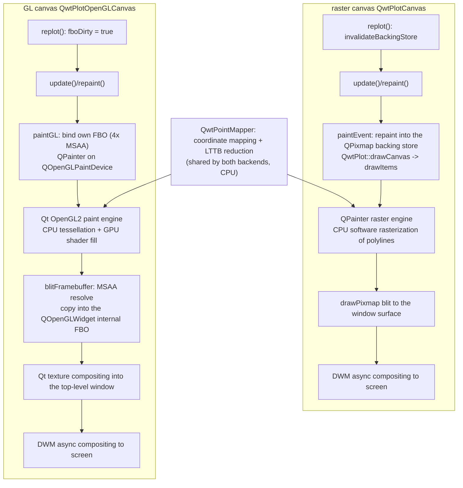
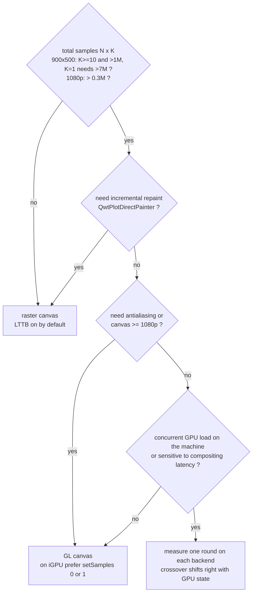

# Raster vs OpenGL Rendering Pipelines: End-to-End Frame-Time Breakdown and a Selection Criterion

> **Abstract** — QWT ships two canvases: the software-rasterized `QwtPlotCanvas` and the `QOpenGLWidget`-based `QwtPlotOpenGLCanvas`. Intuition says "the GPU must be faster", but the source code shows that the GL canvas implements no native GL pipeline for curves: `initializeGL()` is an empty function, every item is still drawn through `QPainter` onto a `QOpenGLPaintDevice` (Qt's OpenGL2 paint engine), followed by MSAA resolve, FBO blit, `QOpenGLWidget` texture compositing and DWM presentation. This article breaks a frame into four stages — data transform, rasterization, compositing/resolve, and blit/present — and quantifies each with 253 measured cells (1k–5M points × 1–50 curves × 900×500/1920×1080 canvases × three backends × several redraw modes and switches), then derives a quantitative criterion for "when OpenGL is worth it": on an Intel UHD 770 iGPU, the GL canvas's item-drawing stage runs 2.2–4.6× faster than the raster engine in the heavy-load region, but every frame pays an extra fixed compositing overhead (2.4–3.4 ms under concurrent GPU load; on a quiet GPU about 0.2 ms of CPU submission plus 1.2–7.9 ms of GPU completion), and the crossover of the two curves falls inside $N \cdot K \approx 0.3\text{–}7\,\mathrm{M}$ total samples, depending on canvas size and the machine's GPU state.

> **Abstract — Core conclusions**
>
> - **The GL canvas accelerates rasterization only, not the transform**: the LTTB reduction in `QwtPointMapper` (about 1.26 ms per million points, taken from the 5M×50 cell at 900×500) is completely identical on both backends; in the item-drawing stage (timed in place around `QwtPlot::drawCanvas`) GL is 2.2–4.6× faster than raster in the heavy-load region but only about 1.3× in the light-load region (1M×10 curves: 19.8 ms vs 50.1 ms), and rasterizing a single 3848-point polyline costs 0.044 ms on the GL engine vs 3.84 ms on the raster engine.
> - **GL's price is compositing**: an empty scene costs 0.57 ms (900×500) / 3.39 ms (1920×1080) per full frame on raster; GL costs 2.39 ms / 4.54 ms in a desktop session with concurrent GPU load, and on a quiet GPU only 0.19 ms of CPU submission — but `glFinish` shows GPU completion still adds 1.2–7.9 ms.
> - **Selection criterion (900×500, LTTB on, AA off)**: for a single curve with ≤5M points the raster canvas is steadier (at 1k points GL is 4.8× slower); GL overtakes when $K \ge 10$ and $N \cdot K \gtrsim 1\,\mathrm{M}$ (i.e. 10 curves of 100k points each; for $K = 1$ the fitted crossover moves out to about $7\,\mathrm{M}$), or at 1920×1080 when $N \cdot K \gtrsim 0.3\,\mathrm{M}$ (1M×10: 27.4 ms vs 49.2 ms, 0.56×); when antialiasing is required GL's advantage widens sharply (turning AA on makes raster 1.8–2.0× more expensive, GL only 1.0–1.14×).
> - **Incremental repaint only pairs with the raster canvas**: with raster + BackingStore, `QwtPlotDirectPainter` paints the item twice (14.1 ms for a 1M×1 single curve — slower than the 5.5 ms of a full-frame replot; 4.6 ms with the cache off), while on the GL canvas it turns bimodal and unstable (0.13–1.1 ms, the re-measurement protocol exhausted); it cannot be relied on.
> - **At extreme point counts the backend stops mattering**: at 5M×50 (250 million points) the 316 ms transform stage dominates the frame (raster 707 ms / GL 534 ms); the right move there is downsampling or windowing, not switching canvases.

---

## 1. Introduction: the frame-budget model

The cost of one `replot()`, from call to pixels on screen, can be written as a sum of four stages:

$$
T_{\text{frame}} = T_{\text{xform}}(N, K) + T_{\text{rasterize}}(P, A) + T_{\text{compose}}(W \times H, S) + T_{\text{present}}(W \times H)
$$

where $N$ is the sample count per curve and $K$ the number of curves; $P = K \cdot \min(N,\, 4W)$ is the vertex count of the downsampled polyline ($W$ is the canvas width in pixels; the LTTB bucket budget is $2W$ with 2 points per bucket — see the curve-downsampling article); $A$ denotes antialiasing on/off; $S$ is the MSAA sample count on the GL side. The four stages sit in different physical places on the two backends:

| stage | raster canvas | GL canvas |
|---|---|---|
| $T_{\text{xform}}$: coordinate mapping + LTTB reduction | CPU (`QwtPointMapper`, SIMD argmin/argmax) | same as left, identical |
| $T_{\text{rasterize}}$: polyline rasterization | CPU software rasterization (Qt raster paint engine) | GPU (Qt OpenGL2 paint engine, CPU-side tessellation + vertex upload) |
| $T_{\text{compose}}$: compositing | backing store blit to the window surface | MSAA resolve + FBO blit + `QOpenGLWidget` texture compositing |
| $T_{\text{present}}$: presentation | DWM asynchronous compositing | DWM asynchronous compositing (swap queued) |

On the raster side, all four stages complete synchronously on the application thread, so the frame time is CPU time; on the GL side, $T_{\text{rasterize}}$ and part of $T_{\text{compose}}$ are asynchronous GPU work — the application thread sees only command submission, unless `glFinish` is called explicitly or the queue saturates. This asymmetry is the root of both the measurement methodology and the diverging conclusions of this article; Section 3 develops it.

The problem, formalized: given $(N, K, W \times H, A)$ and a redraw mode, which backend yields the smaller $T_{\text{frame}}$? The answer is not a single threshold but a contest among the relative sizes of the four stages: $T_{\text{xform}}$ is backend-independent and grows linearly with $N \cdot K$; $T_{\text{rasterize}}$ grows with $P$ (that is, $K \cdot \min(N, 4W)$) and favors GL; $T_{\text{compose}} + T_{\text{present}}$ is the fixed per-backend overhead, higher for GL under concurrent GPU load (empty scene at 900×500: raster 0.57 ms vs GL 2.39 ms, Section 4.3) and growing with $W \times H$ and $S$. The crossover therefore depends on $N \cdot K$, on $K$, on the canvas area and on the machine's GPU state all at once.

## 2. Source-code structure of the two pipelines

### 2.1 The raster canvas: backing store and the two paintEvent paths

`QwtPlotCanvas` is a `QFrame` subclass whose constructor enables three paint attributes by default (`src/plot/qwt_plot_canvas.cpp:59-61`): `BackingStore | Opaque | HackStyledBackground`. `BackingStore` holds a `QPixmap` the size of the canvas, and `paintEvent()` (`qwt_plot_canvas.cpp:185-256`) takes one of two paths accordingly: when the backing store is valid and its size matches, painting is a single `painter.drawPixmap(0, 0, *d->backingStore)`; when it is invalid, the pixmap is reallocated, `QwtPainter::fillPixmap()` fills the background, `drawCanvas()` repaints every item, and the result is blitted to the window.

The catch is that `replot()` invalidates the backing store first, every time (`qwt_plot_canvas.cpp:288-296`):

```cpp
void QwtPlotCanvas::replot()
{
    invalidateBackingStore();
    if (testPaintAttribute(QwtPlotCanvas::ImmediatePaint))
        repaint(contentsRect());   // synchronous
    else
        update(contentsRect());    // asynchronous, coalesced by the event loop
}
```

In a full-frame replot scenario, therefore, the backing store takes the "full repaint + blit" path on every frame; its benefit appears only under partial invalidation (rubber-band overlays, incremental painting with `QwtPlotDirectPainter`). The header comment states this positioning explicitly: "Disabling the cache might improve the performance for incremental paints (using QwtPlotDirectPainter)" (`qwt_plot_canvas.h:59-67`). `ImmediatePaint` decides whether replot takes the synchronous `repaint()` or the asynchronous `update()`.

Curve rasterization itself lives in `QwtPlotCurve::drawLines()` (`src/plot/qwt_plot_curve.cpp:532-628`): `QwtPointMapper::toPolygonF()` performs the coordinate mapping and the LTTB/MinMax reduction, `QwtClipper::clipPolygonF()` clips, and `QwtPainter::drawPolyline()` finally hands the result to QPainter. `QwtPainter` carries one special optimization for the raster engine: when the pen width exceeds 1, the polyline is split into 6-point segments submitted in batches (`src/plot/qwt_painter.cpp:124-178`, comment "Raster paint engine is much faster when splitting the polygon"); 1 px lines go through a single `drawPolyline`.

### 2.2 The GL canvas: QPainter-on-FBO, no native GL pipeline

`QwtPlotOpenGLCanvas` inherits from `QOpenGLWidget` and `QwtPlotAbstractGLCanvas` (`src/plot/qwt_plot_opengl_canvas.h:55`). Four source-code facts determine its actual rendering path:

First, `initializeGL()` is an empty implementation whose comment reads "No operation - reserved for some potential use in the future" (`qwt_plot_opengl_canvas.cpp:184-187`). Qwt sets up no shader, no VBO, no drawing pipeline of its own for curves.

Second, the default constructor forces 4× MSAA: `QSurfaceFormat fmt = format(); fmt.setSamples(4);` (`qwt_plot_opengl_canvas.cpp:65-66`).

Third, `paintGL()` (`qwt_plot_opengl_canvas.cpp:190-251`), when the `BackingStore` attribute is on (the default, `qwt_plot_abstract_canvas.cpp:566`) and the hardware supports blit, maintains its own `QOpenGLFramebufferObject` (sample count taken from the construction format, CombinedDepthStencil attachment); when `fboDirty`, it binds that FBO, constructs a `QOpenGLPaintDevice` and draws all items through `QPainter` via `draw()`; then `QOpenGLFramebufferObject::blitFramebuffer(nullptr, d->fbo)` performs the MSAA resolve and copies into the internal FBO of `QOpenGLWidget`; finally Qt's compositing mechanism composites the texture into the top-level window, and DWM presents it.

Fourth, `invalidateBackingStore()` merely sets `fboDirty = true` (`qwt_plot_opengl_canvas.cpp:159-163`), and `QwtPlotAbstractGLCanvas::replot()` calls it every frame (`qwt_plot_abstract_canvas.cpp:755-764`) — as with the raster canvas, the GL "backing store" only saves the repaint for redraws without a replot (overlay movement, window activation); under a full-frame replot the FBO is repainted in full every frame.

The bench's diagnostic output (stderr, the `# gl:` lines) on Qt 5.15.16 + Intel UHD 770 confirms the engine identity: opening a `QPainter` on the widget inside `paintGL` and opening one on the `QOpenGLPaintDevice` both report `paintEngine()->type()` as `QPaintEngine::OpenGL2`; even opening a `QPainter` on the `QOpenGLWidget` outside a paint event yields the OpenGL2 engine with `active=1`. The GL context itself reports `samples=0` — MSAA happens on Qwt's own FBO, not on the context's default framebuffer. The Qt documentation of `QOpenGLWidget` is consistent with this: rendering goes into an FBO, Qt's window-compositing mechanism composites the texture into the top-level window, and a top-level window containing a `QOpenGLWidget` switches as a whole to the OpenGL compositing path.



### 2.3 The replot flow and autoReplot

`QwtPlot::replot()` (`src/plot/qwt_plot.cpp:690-712`) runs `updateAxes()` (autoscaling recomputes the scale divisions), then `sendPostedEvents(LayoutRequest)`, and finally lands on the canvas through `invokeMethod(canvas, "replot")`. Note that `autoReplot` defaults to **true** (`qwt_plot.cpp:198`): any `setSamples()`/`attach()` triggers a full-frame repaint, so streaming applications must call `setAutoReplot(false)` and drive repainting uniformly from a refresh timer — otherwise uncontrollable duplicate repaints leak into the frame budget. `drawCanvas()` (`qwt_plot.cpp:1105-1115`) builds the `QwtScaleMap` of each axis and then calls `drawItems()`, which walks the item list and draws the items one by one — the in-place timing in this article is implemented by overriding exactly this virtual function.

### 2.4 QwtPlotDirectPainter: two paths and measured behavior on GL

`QwtPlotDirectPainter::drawSeries()` (`src/plot/qwt_plot_directpainter.cpp:183-258`) has two paths. When the canvas is a `QwtPlotCanvas` and the backing store is valid, the item is first painted into the backing-store pixmap; if `FullRepaint` is set, `canvas->repaint()` ends it there. Otherwise — note that `qobject_cast<QwtPlotCanvas*>` necessarily fails for `QwtPlotOpenGLCanvas` — the generic branch runs: record the item and interval, install an event filter, `canvas->repaint(clipRegion)`; the event filter intercepts `QEvent::Paint`, paints only that series with `QPainter(canvas)` (or blits the backing store directly under `CopyBackingStore`) and returns true, skipping the canvas's own paintEvent.

This means that under the default raster-canvas + BackingStore combination, one `drawSeries()` paints the item twice (once into the pixmap, once onto the window through the filter); the measurements in Section 4.8 confirm this. The measured behavior on the GL canvas is more subtle: `QPainter(canvas)` outside a paint event gets the OpenGL2 engine (painting into the `QOpenGLWidget`'s FBO), yet the `QOpenGLWidget`'s own update mechanism still runs `paintGL` every frame (the paint count matches the frame count; with `fboDirty=false` at that point, `paintGL` only does the blit and compositing); meanwhile the frame times are bimodally distributed (two clusters at 0.13 ms and 1.1 ms; the re-measurement protocol exhausted its two retries), showing that whether `QPainter` successfully begins outside a paint event on a `QOpenGLWidget` is unstable — matching the Qt documentation's constraint that QPainter should only be used inside paintGL. Conclusion: the incremental-repaint path is designed for the raster canvas and is not dependable on the GL canvas.

### 2.5 Effect of the compile switch on API availability

`QWT_CONFIG_QWTOPENGL` (`CMakeLists.txt:57`, default ON) decides whether `qwt_plot_opengl_canvas.h/.cpp` take part in the build (`src/plot/CMakeLists.txt:271-284`). When OFF, the header does not exist and `#include <qwt_plot_opengl_canvas.h>` fails to compile outright — the availability of the GL canvas is decided at compile time; there is no runtime fallback path. The GL code in the examples is wrapped in `#ifndef QWT_NO_OPENGL` (`examples/2D/refreshtest/Settings.h:43`), but that macro is never defined anywhere in the CMake build systems of the library or the examples (only the playground's qmake script playground.pri ever defined it), and refreshtest's CMakeLists is not conditioned on `QWT_CONFIG_QWTOPENGL` either — the guard is effectively dead, and with the option OFF the examples still fail to compile on the missing header. Qt5 builds additionally compile the legacy `QwtPlotGLCanvas` (based on `QGLWidget`, removed in Qt6; `src/plot/CMakeLists.txt:278-281`), which this article does not cover.

## 3. Frame-time decomposition methodology

### 3.1 Measurement basis

Each measured frame is defined as `plot.replot(); app.processEvents();` (widget mode), timed by `QElapsedTimer` at nanosecond resolution; the timed interval covers paintEvent/paintGL and the window-system flush. On Windows, application-side presentation is asynchronous: the raster path's flush is a bit-block transfer to the window redirection surface, the GL path queues through swapBuffers, and after either, DWM composites at its own pace. The bench requests `swapInterval=0`; the GL context actually reports `swapInterval=1`, yet measured frame times sit far below 16.7 ms with no vsync quantization — with DWM compositing enabled, the application-side swap does not block. Both backends therefore measure the "CPU-visible frame time", excluding DWM's final presentation latency; the basis is symmetric — but GL's GPU work can lag behind that window, which Section 3.4 addresses.

Protocol: 3 warmup frames + 7 rounds × 30 frames (each frame timed individually); the minimum of the 7 round means (min-of-7) is the cell's score `iter_min`, with the median/max and pooled per-frame statistics recorded alongside; if $(\text{iter\_med} - \text{iter\_min}) / \text{iter\_min} > 30\%$ the whole protocol is re-measured (at most 2 times) and the retry count goes into the CSV's `retries` column. Of the 253 cells, 20 triggered a re-measurement (10 of them the bimodal GL empty-scene/direct cells — 4 direct, 6 empty-scene — still scattered after two retries; see Section 6); across all cells the iteration scatter (med−min)/min has a median of 0.048 and a p90 of 0.180. Paint-event counts (paintEvent for raster, paintGL for GL) verify exactly one paint per frame: for main-matrix cells in full mode the count is 216 = 210 (measurement) + 3 (warmup) + about 3 initialization/calibration paints, ruling out missed paints from `update()` coalescing.

### 3.2 Decomposition tools

| tool | stage covered | description |
|---|---|---|
| `drawCanvas` in-place timing | item-drawing stage | the bench subclass overrides the `QwtPlot::drawCanvas()` virtual and times all of `drawItems` inside the real pipeline (raster = software rasterization, GL = OpenGL2 engine); the mean goes into the CSV's `drawcanvas_ms` column |
| `mapper` mode | $T_{\text{xform}}$ | drives `QwtPointMapper::toPolygonF()` directly (`QWT_EXPORT`, linkable from qwtplot.dll), with no rasterization at all |
| empty scene (curves=0) | fixed per-backend overhead | background fill, blit/resolve, compositing, flush, event pump |
| `renderto` mode | offscreen full reference | `QwtPlotRenderer::render()` → QImage: layout activation + scale rulers + items per frame, no window system |
| `items` mode | offscreen item reference | `drawItems()` → QImage |
| `--finish` | GPU async margin | `glFinish()` at the tail of `paintGL`; the difference against not finishing = how far the GPU lags behind CPU submission |

The decomposition identity (widget mode, pairing per-frame medians with drawCanvas means):

$$
T_{\text{frame}} = \underbrace{T_{\text{mapper}}}_{\text{transform}} + \underbrace{(T_{\text{drawCanvas}} - T_{\text{mapper}})}_{\text{in-canvas rasterization}} + \underbrace{T_{\text{empty}}}_{\text{backend fixed}} + \underbrace{\varepsilon}_{\text{load-dependent increment}}
$$

### 3.3 Two measurement limitations that must be stated

**Offscreen context effect.** The same 3820-point polyline into the same backing-store QPixmap costs about 1.36–1.65 ms painted inside paintEvent, but about 2.33 ms painted with a fresh QPainter outside a paint event; controls over QImage/QPixmap, ARGB32/RGB32, and reusing the painter 5 times taking the minimum cannot eliminate the difference, and the mechanism is unknown (candidate explanations: warm-up of internal raster-engine state, memory/cache context). The offscreen `items`/`renderto` numbers are therefore systematically high and serve only as a reference upper bound for the export/print path, never as decomposition anchors; the decomposition exclusively uses the in-place `drawCanvas` timing.

**Dependence on the machine's GPU state (drift across measurement eras).** Raster frame times are highly stable across all measurement windows (100k×1: 2.51–2.59 ms); GL shows two states. In the main-matrix window (17:45–18:10, sharing the machine with two other parallel benchmark agents) the empty scene costs 2.39 ms and 100k×1 costs 4.21 ms; in the paired-supplement and control windows (after 19:12) the empty scene costs 0.19 ms and 100k×1 costs 1.04 ms, while the `glFinish` variants cost 2.60–3.19 ms. Both states have self-consistent explanations: on a quiet GPU the command queue does not saturate — the application thread returns as soon as it submits (frame time ≈ CPU submission) and GPU completion lags; under concurrent GPU load the queue saturates or GPU time slices are preempted, submission blocks, and frame time ≈ GPU completion time. The main-matrix GL numbers are of the same magnitude as the `glFinish` numbers (1M×10: 27.4 vs 27.8 ms), showing that they represent "sustained operation with the GPU as the pacing resource" — exactly the normal regime of real-time plotting; the paired blocks represent burst/short-run measurements. Both bases are given and labeled below.

### 3.4 Environment

Intel UHD Graphics 770 iGPU (shared memory, driver 31.0.101.4887, GL 4.6.0) + Core i7-14700 + 16 GB, Windows 10 19045, 1920×1080 display; Qt 5.15.16 (msvc2019_64); QWT 7.4.2 (commit 1b352c1), build-release with Ninja + MSVC 19.26, `/MD /O2 /Ob2 /DNDEBUG`; vsync off (swapInterval=0 requested). All performance tables were measured in this environment; absolute numbers vary with hardware (discrete GPUs especially), and Section 6 states the applicability limits of the relative relationships and conclusions.

### 3.5 Reproduction

The benchmark program `docs/assets/algorithms/raster_opengl_bench.cpp` carries the complete compile command in its header comment (MSVC 2019 x64 + Qt 5.15 + the build-release qwtplot/qwtcore import libraries); running it requires a real desktop session (GL mode is meaningless on the offscreen platform) with the Qt and QWT bin directories added to PATH. A single-cell invocation looks like:

```bash
raster_opengl_bench.exe gl 1000000 10 30 --w 900 --h 500 --msaa 4
#            mode  points/curve  curves  frames/round   canvas size      FBO samples
```

stdout emits one CSV line (27 columns: configuration + iteration min/med/max + pooled per-frame statistics + drawCanvas mean/call count + paint counts); stderr emits diagnostics (GL vendor/renderer/version, paint-engine type per context, actual canvas size, segment timings, paint counts, retry records). Analysis and figures: `python raster_opengl_experiment.py`, which reads `raster_opengl_results.csv` and prints every analyzed number. The CSV header comments record the GPU/driver/CPU/Qt/QWT/compile configuration, the protocol and the concurrent-load notes.

## 4. Experiments

### 4.1 Matrix

The main matrix is points {1k, 10k, 100k, 1M, 5M} × curves {1, 10, 50} × canvas {900×500, 1920×1080} × backend {raster, gl, renderto}, plus the `items`/`mapper` reference modes, empty-scene baselines, a redraw-mode subset (full/direct/window), a switch subset (cache, immediate, MSAA, finish, AA, filter), and the paired-supplement and control blocks marked frames=31/32 — 253 rows of raw data in total (`docs/assets/algorithms/raster_opengl_results.csv`). The curves are a superposition of two sines; LTTB downsampling is on by default and antialiasing off (matching the `QwtPlotCurve` library defaults), pen width 1 px.

### 4.2 Main matrix: end-to-end frame time


900×500 canvas (min-of-7, ms/frame; `dc` is the in-place item-drawing stage):

| points | curves | raster | gl | renderto | dc raster | dc gl | mapper | gl/raster |
|---:|---:|---:|---:|---:|---:|---:|---:|---:|
| 1k | 1 | 0.603 | 2.898 | 0.246 | 0.073 | 0.055 | 0.013 | 4.81 |
| 100k | 1 | 2.506 | 4.209 | 1.794 | 2.035 | 0.845 | 0.703 | 1.68 |
| 1M | 1 | 5.466 | 5.997 | 4.227 | 5.053 | 1.889 | 1.411 | 1.10 |
| 5M | 1 | 10.190 | 10.944 | 8.742 | 9.772 | 7.066 | 5.817 | 1.07 |
| 100k | 10 | 18.535 | 15.485 | 16.211 | 18.701 | 7.895 | 7.100 | 0.84 |
| 1M | 10 | 49.231 | 27.396 | 45.234 | 50.107 | 19.810 | 17.538 | 0.56 |
| 5M | 10 | 93.739 | 75.623 | 136.188 | 95.836 | 68.751 | 63.316 | 0.81 |
| 100k | 50 | 87.795 | 51.229 | 81.765 | 87.781 | 39.669 | 35.725 | 0.58 |
| 1M | 50 | 238.141 | 123.758 | 268.873 | 242.857 | 96.347 | 88.165 | 0.52 |
| 5M | 50 | 707.475 | 534.480 | 696.452 | 697.211 | 493.196 | 316.112 | 0.76 |

1920×1080 canvas (same basis):

| points | curves | raster | gl | renderto | dc raster | dc gl | gl/raster |
|---:|---:|---:|---:|---:|---:|---:|---:|
| 1k | 1 | 3.574 | 4.473 | 0.573 | 0.143 | 0.080 | 1.25 |
| 10k | 1 | 5.559 | 8.159 | 2.759 | 2.358 | 1.547 | 1.47 |
| 100k | 1 | 11.282 | 9.245 | 5.607 | 7.612 | 2.032 | 0.82 |
| 1M | 1 | 16.481 | 13.755 | 10.610 | 12.886 | 3.419 | 0.83 |
| 5M | 1 | 27.582 | 18.164 | 23.846 | 25.586 | 8.952 | 0.66 |
| 1k | 10 | 6.042 | 5.825 | 1.779 | 1.819 | 0.462 | 0.96 |
| 10k | 10 | 24.691 | 20.135 | 20.047 | 23.639 | 14.396 | 0.82 |
| 100k | 10 | 57.026 | 26.917 | 49.791 | 56.207 | 18.500 | 0.47 |
| 1M | 10 | 117.309 | 50.331 | 122.760 | 124.871 | 29.641 | 0.43 |
| 5M | 10 | 231.332 | 156.266 | 249.224 | 235.311 | 101.214 | 0.68 |
| 1k | 50 | 8.694 | 8.756 | 5.152 | 5.577 | 1.974 | 1.01 |
| 10k | 50 | 102.046 | 83.214 | 53.944 | 101.456 | 70.570 | 0.82 |
| 100k | 50 | 256.096 | 112.050 | 257.640 | 258.814 | 77.132 | 0.44 |
| 1M | 50 | 573.751 | 297.318 | 575.161 | 650.508 | 142.240 | 0.52 |
| 5M | 50 | 1572.087 | 719.226 | 1104.761 | 1619.559 | 381.367 | 0.46 |

Converted to frame rates against the budget: at 900×500, raster 100k×1 gives 399 FPS and gl 238 FPS — both far above the 60 FPS budget (16.7 ms); at 1M×10, raster's 20.3 FPS already breaks the budget while gl's 36.5 FPS still meets it; at 1M×50 neither is interactive (4.2 / 8.1 FPS). At 1920×1080, raster 100k×1 drops to 89 FPS and gl to 108 FPS; 1M×10 gives 8.5 / 19.9 FPS. The usable region of the 60 FPS interactive budget cannot be summarized by $N \cdot K$ alone — $K$ itself presses on the budget just as hard (the per-curve polyline rasterization cost accumulates linearly in $K$, the $c \cdot K$ term of the Section 5.1 fit): at 900×500 the raster backend stays within budget for a single curve at any $N \le 5\,\mathrm{M}$ (5M×1 costs only 10.2 ms), while for multiple curves it roughly requires $K \ge 10$ and $N \cdot K \lesssim 10^5$ (10k×50 already reaches 43.3 ms); the GL backend pushes the $K = 10$ boundary out to $N \cdot K \approx 10^6$ (100k×10 costs 15.5 ms) but can do nothing for $K = 50$ (at 10k×50 both backends exceed the budget, 37.5 / 43.3 ms). The complete criterion is in the Section 5.1 fit and the Section 5.2 decision chart.

Three things can be read directly off the tables. For a single curve with a small data volume GL trails across the board — 1k×1 costs 2.898 vs 0.603 ms (4.8×), because GL's fixed compositing overhead (2.4–2.8 ms in that window) far exceeds everything else in the frame; as the curve count grows GL overtakes and the gap widens — 1M×10 costs 27.4 vs 49.2 ms (0.56×), because rasterization cost accumulates linearly in $K$ while the GL engine's per-polyline cost is an order of magnitude lower; by 5M×50 the two backends converge again (707 vs 534 ms), because the 316 ms transform stage already accounts for nearly 60% of the GL frame and 45% of the raster frame — the backend choice no longer matters. At 1920×1080, raster's fixed overhead grows with area to 3.39 ms (0.57 ms at 900×500) and the crossover shifts left across the board: GL is ahead from 100k×1 onward.

`renderto` (`QwtPlotRenderer` → QImage) is the cheapest option at small workloads (no window system, no compositing) but is not faster than the widget path at large workloads (136.2 vs raster's 93.7 ms at 5M×10): it re-runs layout activation and scale-ruler painting every frame and suffers the offscreen context effect of Section 3.3. Its proper use is export (the PDF/SVG/PNG print path), not as a substitute for interactive rendering.

### 4.3 Empty scene: fixed per-backend overhead

| backend | 900×500 | 1920×1080 | basis |
|---|---:|---:|---|
| raster | 0.566 | 3.391 | main-matrix window, min-of-7 |
| gl | 2.390 | 4.537 | main-matrix window (GPU under concurrent load) |
| gl (msaa=4) | 0.191 | 0.249 | paired block, quiet GPU, CPU-submission basis |
| gl (msaa=0) | 0.187 | 0.214 | paired block, quiet GPU |
| renderto | 0.210 | 0.478 | layout + scale rulers, no window system |
| items | 0.022 | 0.173 | QImage fill only |

Raster's fixed overhead grows superlinearly with canvas area (0.57 → 3.39 ms; area ×4.6 against cost ×6.0, about 30% above linear), composed of background fill, backing-store blit and window flush, all CPU-synchronous. GL's fixed overhead differs by an order of magnitude between the two bases: on a quiet GPU the CPU submission costs only 0.19 ms, and the difference among MSAA 0/1/4 is ≤0.06 ms (900×500); in the 1920×1080 paired block msaa=4 costs 0.57 ms more than msaa=0 (100k×1: 2.517 vs 1.946 ms) — the resolve cost of 4× MSAA only shows up on a large canvas. Under concurrent GPU load GL's fixed overhead rises to 2.4–4.5 ms: resolve, blit and compositing are themselves GPU work, competing for the same iGPU with the desktop's other GPU consumers.

### 4.4 Stacked decomposition


Decomposition at 900×500 on the per-frame-median basis (ms):

| backend | load | frame | transform | in-canvas rasterization | fixed | load-dependent increment |
|---|---|---:|---:|---:|---:|---:|
| raster | 100k×1 | 2.648 | 0.698 | 1.337 | 0.571 | 0.043 |
| gl | 100k×1 | 4.301 | 0.698 | 0.147 | 2.777 | 0.680 |
| raster | 1M×10 | 51.120 | 17.817 | 32.290 | 0.571 | 0.443 |
| gl | 1M×10 | 31.254 | 17.817 | 1.993 | 2.777 | 8.667 |
| raster | 5M×50 | 743.077 | 318.113 | 379.098 | 0.571 | 45.295 |
| gl | 5M×50 | 554.444 | 318.113 | 175.083 | 2.777 | 58.472 |

The transform stage is identical on both backends (they share `QwtPointMapper`); the rasterization stage is an order of magnitude to several times lower on GL; the fixed stage is 4.9× higher on GL (that window's basis); GL's "load-dependent increment" reaches 8.7 ms at 1M×10 — mostly GPU completion time spilling into the frame window (the `glFinish` experiment gives 7.9 ms of the same magnitude, Section 4.6) — with no counterpart on the raster backend (CPU rasterization is synchronous). At 5M×50 the raster rasterization stage (379 ms) is higher than the naive expectation for "50 polylines × 3600 points": it includes memory-bandwidth interference from alternating transform and rasterization write streams and clock throttling under sustained load, so the decomposition here should be read as an estimate accurate to about ±30%. Note also that the table's "load-dependent increment" ε is clamped to non-negative in the script: several raster cells have a raw ε slightly below 0 (e.g. about −3 ms at 1M×50, where the drawCanvas mean slightly exceeds the frame median minus the fixed stage); the table records 0 for all of them.

### 4.5 The item-drawing stage: the two engines head to head


The in-place `drawCanvas` timing (left panel) shows: the item stage grows with the total sample count $N \cdot K$; cell by cell in the heavy-load region, raster's item stage is about 2.2–2.7× GL's (reaching 3.0–4.6× at 1920×1080, narrowing to about 1.3× in the light-load region); the ratio of fitted slopes is only about 1.4× (the 900×500 interaction-model fit gives raster $b = 2.58$ ms per million points vs GL $b = 1.87$ ms per million points — raster's fitted slope absorbs the alternating interference between the transform and rasterization write streams). A single-point contrast is more extreme: timing the same 3848-point polyline with the real painter inside `drawCanvas`, the bench measures `QwtPainter::drawPolyline` at 0.044 ms on the GL engine vs 3.84 ms on the raster engine (1M×1 load, one diagnostic sample; the 3820 points in Section 3.3 come from a different dbg diagnostic probe — the two probes' mapped bounding boxes differ slightly, so the LTTB output point count for the same data differs slightly) — a factor of 87. The reason: the raster engine runs CPU scan conversion segment by segment for 1 px non-antialiased polylines, while the OpenGL2 engine tessellates the polyline into triangles for the GPU to fill in parallel, leaving the CPU only the submission cost.

The right panel (frame − drawCanvas) is "everything outside the items": the raster backend plateaus at 0.5–1 ms and barely grows with load; the GL backend plateaus at 2–3 ms under small loads (fixed compositing) and turns upward under large loads as GPU completion time grows. In this figure the GL curve always stays above raster — the two never cross; the crossover shows up in the total-frame-time curves, drawn in the Section 4.2 end-to-end figure (fig_rgl_fps) and the Section 5.1 fit figure (fig_rgl_crossover). Separately, several heavy-load raster cells have a negative raw iter_min − dc (the dc mean exceeds the frame-time minimum); those points are automatically dropped on the log axis.

### 4.6 Switch matrix: MSAA, glFinish, FBO reuse, ImmediatePaint, cache


Paired block (frames=31, all variants run back to back, 900×500, min-of-7, ms):

| load | msaa=0 | msaa=1 | msaa=4 | msaa=4 + glFinish | msaa=4, no FBO reuse |
|---|---:|---:|---:|---:|---:|
| gl 100k×1 | 1.250 | 1.264 | 1.036 | 3.189 | 0.965 |
| gl 1M×1 | 1.698 | 1.788 | 1.931 | 3.137 | 1.739 |
| gl 100k×10 | 8.216 | 8.247 | 8.365 | 11.154 | 8.246 |
| gl 1M×10 | 20.250 | 19.758 | 19.933 | 27.802 | 19.426 |

Four conclusions. First, the `glFinish` difference (same msaa=4 basis: 2.2 / 1.2 / 2.8 / 7.9 ms) is exactly how far the GPU lags behind CPU submission, and it grows with the rasterization workload; any GL frame time without finish is on the "submission basis" and converges toward the finish basis under sustained operation (as the main-matrix data confirm). Second, at 900×500 on a quiet GPU the MSAA sample count affects frame time by ≤0.5 ms and non-monotonically (the msaa 0/1/4 ranges across the four loads are 0.23/0.23/0.15/0.49 ms in order, close to the noise floor — the resolve is absorbed asynchronously by the GPU); at 1920×1080, msaa=4 costs 0.57 ms more than msaa=0; but during concurrent-GPU-load windows, MSAA resolve competes with the desktop for the GPU and amplifies into a visible cost — on an iGPU, frame-rate-sensitive scenarios should use `setSamples(0)` or 1. Third, turning `BackingStore` off (bypassing Qwt's own FBO + blit and painting directly into the `QOpenGLWidget`'s internal FBO) is slightly faster on a quiet GPU (0.965 vs 1.036 ms), a difference within the noise; the attribute's real purpose remains repaint-free overlay scenarios. Fourth, `ImmediatePaint` (`repaint()` instead of `update()`) is essentially neutral for raster (2.525 → 2.726 / 49.634 → 49.309 ms) and equally neutral for GL (strictly paired at msaa=4: 0.971 → 0.990 / 19.483 → 19.390 ms) — the saved UpdateRequest round trip is not a visible cost; what the refreshtest example gains by enabling it by default is synchronous repaint semantics, not frame rate.

The raster-side BackingStore pair (supp2): 100k×1 costs 2.525 ms on / 1.940 ms off; 1M×10 costs 49.634 ms on / 49.153 ms off. In full-frame replot scenarios turning the cache off is faster — it saves one pixmap allocation and blit, consistent with the header comment's positioning (the cache serves incremental/overlay scenarios).

Antialiasing pairs (same block; the gl columns are strictly paired AA off/on at the same msaa=4, avoiding mismatches against the msaa=0 ladder rows):

| load | raster AA off → on | factor | gl AA off → on | factor |
|---|---:|---:|---:|---:|
| 100k×1 | 2.525 → 4.513 | 1.79 | 0.986 → 1.128 | 1.14 |
| 1M×1 | 5.342 → 10.371 | 1.94 | 1.925 → 2.049 | 1.06 |
| 100k×10 | 18.493 → 35.362 | 1.91 | 8.321 → 8.395 | 1.01 |
| 1M×10 | 49.634 → 99.710 | 2.01 | 19.501 → 19.886 | 1.02 |

The raster engine's antialiasing is coverage-sample blending on the CPU, and the cost nearly doubles; on the GL side AA is carried by the engine's stroke tessellation and the FBO's MSAA, and the frame time barely changes. If the product requires antialiased curves, the 1M×10 comparison is 99.7 ms vs 19.9 ms (5×) — the GL canvas's strongest selling point.

### 4.7 Stress test without downsampling

With LTTB off (`filter=none`, 1 curve, 900×500, adjacent runs): 100k points cost raster 8.185 / gl 4.399 ms; 1M points cost raster 68.727 / gl 41.426 ms. Against the LTTB-on values of 2.506 / 5.466 ms (100k×1 main matrix): without downsampling, raster's rasterization cost explodes linearly in $N$ (68.7 ms at 1M points ≈ 69 ns per point of CPU scan conversion), while the GL engine's GPU fill is far less sensitive to the point count (41.4 ms, of which about 19 ms is the transform stage). These data also say: downsampling and switching backends are two orthogonal optimization axes, and downsampling first usually pays more (see the curve-downsampling article for details).

### 4.8 Redraw modes: full frame, DirectPainter, scrolling window


900×500, min-of-7 (ms/frame):

| backend | load | full replot | DirectPainter (repaint curve 0) | scrolling window (span = N/4) |
|---|---|---:|---:|---:|
| raster | 100k×1 | 2.506 | 5.145 | 2.452 |
| raster | 1M×1 | 5.466 | 14.084 | 8.279 |
| raster | 100k×10 | 18.535 | 5.310 | 17.171 |
| raster | 1M×10 | 49.231 | 13.507 | 71.477 |
| gl | 100k×1 | 4.209 | 0.191 (bimodal) | 1.896 |
| gl | 1M×10 | 27.396 | 0.137 (bimodal) | 59.470 |

The raster + DirectPainter behavior is fully explained by the source structure: for a single 1M×1 curve, direct is even slower than full (14.084 vs 5.466 ms) because with BackingStore on the item is painted twice (backing store + window; the `drawcanvas` column's 5.53 ms is a single item pass); turning the cache off drops it to 4.577 ms, and the `CopyBackingStore` attribute (the second pass replaced by a full blit) gives 9.075 ms. With multiple curves direct's advantage appears: at 1M×10, repainting a single curve costs 13.507 ms vs full's 49.231 ms. The scrolling-window mode (shifting the display window by $N/4$ each frame, `setRawSamples` + `setAxisScale` + replot, mimicking renderbench's streaming scenario) is instead slower than full on raster at 1M×10 (71.5 vs 49.2 ms): every frame the Y-axis autoscaling must scan the visible window's bounding box and recompute all scale rulers and layout, and the saved rasterization cannot offset those costs.

The direct numbers on the GL canvas (0.13–0.19 ms) are below the empty-scene fixed overhead and physically cannot include the complete FBO compositing — as Section 2.4 describes, this path is bimodally unstable on `QOpenGLWidget` (iter_med about 1.0–1.1 ms; across the four cells the scatter (med−min)/min reaches 7.2×; two retries exhausted). They cannot serve as a valid measurement, still less as a basis for choosing a backend. Pair incremental-repaint scenarios with the raster canvas.

The paint counts provide corroborating evidence: in raster + direct mode the canvas paintEvent count is 3 (initial paints only), showing that all 210 measurement frames took the event filter's incremental path and the canvas's own paintEvent was correctly skipped; in GL + direct mode the paintGL count is 624/623 — these cells exhausted their retries=2 re-measurements, the three protocol rounds drove about 630 frames in total (210 measurement frames per round), and paintGL still ran about once per frame: the `QOpenGLWidget`'s own update mechanism keeps triggering blit and compositing every frame on top of the incremental painting — "incremental" does not save the compositing stage.

### 4.9 Size scaling

Both raster's fixed overhead and its item rasterization grow with canvas area: empty scene 0.57 → 3.39 ms, full-frame 100k×1 2.51 → 11.28 ms (900×500 → 1920×1080). GL's fixed overhead spans 2.39 → 4.54 ms over the same range (main-matrix window), growing more slowly — compositing is GPU work, so a 4.6× area increase is only a fill-rate question for the GPU. The consequence is a left-shifted crossover: at 1920×1080 GL is ahead from 100k×1 (9.245 vs 11.282 ms) and reaches 0.43× at 1M×10. Large/high-resolution screens are the GL canvas's second natural habitat.

### 4.10 Transform-stage scaling: the bucket-density effect

The transform stage is backend-independent but not simply $O(N \cdot K)$ — the mapper-mode measurements (min-of-7, ms) show that the per-point cost depends strongly on the "samples per bucket":

| load (points per curve × curves) | 900×500 | 1920×1080 | samples per bucket (900×500) |
|---|---:|---:|---:|
| 1k×1 | 0.013 | 0.022 | quad-merge fallback |
| 10k×1 | 0.611 | 1.224 | 5.6 |
| 100k×1 | 0.703 | 1.261 | 55.6 |
| 1M×1 | 1.411 | 2.124 | 555.6 |
| 5M×1 | 5.817 | 6.862 | 2777.8 |
| 10k×10 | 5.345 | 11.579 | 5.6 |
| 100k×10 | 7.100 | 12.541 | 55.6 |
| 1M×10 | 17.538 | 25.514 | 555.6 |
| 5M×10 | 63.316 | 71.694 | 2777.8 |
| 1M×50 | 88.165 | 130.704 | 555.6 |
| 5M×50 | 316.112 | 358.459 | 2777.8 |

At 10k points per curve (about 5.6 samples per bucket) the horizontal-reduction overhead of SIMD argmin/argmax dominates: the per-point cost is about 53 ns (from the 10k×10 cell; about 61 ns at 10k×1), more than 7× the cost at 100k points per curve (55.6 samples per bucket, about 7 ns/point); at ≤3.6k points per curve `qwtMinMaxBucketReduce` falls back to the quad merge, whose cost is nearly zero. At 1920×1080 the bucket count doubles ($N_b = 2W$), buckets for the same point count are sparser, and the transform is therefore more expensive (10k×1: 1.224 vs 0.611 ms). The selection lesson of this effect: in medium-point-count × many-curve loads (such as 10k×50) the transform stage is amplified by bucket density, while at 5M×50 the 316 ms transform stage (a memory-bandwidth-limited scan at about 12.6 GB/s) dominates the frame outright — in both cases switching backends cannot save you; adjust the downsampling budget or the display-window size instead.

## 5. Selection criterion

### 5.1 Fitted models and the crossover

Fitting the operational model $\text{frame} = a + b \cdot (N \cdot K) + c \cdot K$ to the 15 main-matrix cells per backend and size (the $c \cdot K$ term captures the saturation of "per-curve polyline rasterization" once $N > 4W$; the naive form $a + bN + cK$ reaches an $R^2$ of only 0.56–0.63 and was discarded):

| backend | canvas | $a$ (ms) | $b$ (ms/million points) | $c$ (ms/curve) | $R^2$ |
|---|---|---:|---:|---:|---:|
| raster | 900×500 | −4.44 | 2.62 | 1.19 | 0.982 |
| gl | 900×500 | −0.22 | 2.00 | 0.55 | 0.993 |
| raster | 1920×1080 | −4.68 | 5.74 | 3.09 | 0.976 |
| gl | 1920×1080 | 5.16 | 2.61 | 1.58 | 0.973 |

Setting the two models equal yields the frame-level crossover: $N \cdot K^* = 6.84\,\mathrm{M}$ at 900×500 (main-matrix-window basis, GL's fixed overhead including concurrent GPU load) and $3.14\,\mathrm{M}$ at 1920×1080. The item stage's crossover (drawCanvas fit) is lower: $1.61\,\mathrm{M}$ / $2.64\,\mathrm{M}$. On the quiet-GPU + glFinish basis (paired block) the crossover shifts further left, to $N \cdot K \approx 0.3\text{–}1\,\mathrm{M}$: at 100k×1, gl+finish's 3.19 ms still slightly loses to raster's 2.53 ms, while at 1M×1 it is 3.14 vs 5.34 ms — already ahead. Point-by-point measured comparison (900×500): at K=1 GL never wins (1.07–4.81× slower); at K=10 it wins from 100k points up (0.84/0.56/0.81); at K=50 it wins from 10k points up (0.87/0.58/0.52/0.76).


### 5.2 Criterion and decision chart

Merging the three measurement bases into an engineering criterion (900×500, LTTB on, AA off, iGPU):

- $N \cdot K \lesssim 10^5$ with $K = 1$: raster canvas. GL's fixed compositing overhead takes 57–82% of the frame; there is no room for a payoff.
- $K \ge 10$ and $N \cdot K \gtrsim 10^6$ (i.e. $N \ge 10^5$ per curve): the GL canvas starts to break even; for $K = 1$ the 900×500 crossover moves out to $N \cdot K \approx 7 \times 10^6$ (fitted); at 1920×1080 the threshold drops to $3 \times 10^5$.
- Antialiasing required: the threshold drops another order of magnitude — raster's AA cost (about 2×) puts GL ahead from $N \cdot K \gtrsim 10^5$.
- Incremental repaint (DirectPainter / oscilloscope-style appends): raster canvas, with BackingStore off or CopyBackingStore on depending on the scenario.
- $N \cdot K \gtrsim 10^8$: the backend is irrelevant; downsample or window first (the transform stage dominates).



### 5.3 Extrapolation to discrete GPUs (speculative, not measured)

Every number in this article comes from an iGPU (shared memory, competing for bandwidth with the CPU and DWM). On a discrete GPU three quantities change at once, in opposite directions: GL's advantage in $T_{\text{rasterize}}$ widens (dedicated fill rate and video-memory bandwidth), but the cross-device copy "FBO → window surface" inside $T_{\text{compose}}$ may introduce extra synchronization and transfer costs (the texture-sharing path between a discrete GPU and DWM is driver-dependent), and `QOpenGLWidget`'s texture compositing still returns to the window system. Qualitative expectation: the item-stage crossover shifts left (GL wins earlier), while the absolute fixed overhead does not necessarily fall. **This section is extrapolation; discrete-GPU conclusions must be measured** — the bench source and scripts can be reused directly.

## 6. Discussion: an honest failure-mode list

1. **iGPU conclusions do not extrapolate directly to discrete GPUs**: under the shared-memory model, GL's resolve/blit competes with CPU rasterization for the same bandwidth pool; on a discrete GPU that competition disappears but cross-device compositing appears. See 5.3.
2. **The machine's GPU state is a first-order variable**: GL's fixed overhead is 2.4–4.5 ms in concurrent-GPU-load windows and 0.19–0.25 ms on the CPU-submission basis in quiet windows — an order of magnitude apart; raster is unaffected (a stable 0.57 ms). The crossover is therefore an interval ($0.3\text{–}7\,\mathrm{M}$), not a single point. Any GL benchmark should report the machine's GPU state; this article records it explicitly with comparison blocks from three windows (frames=30/31/32):

    | quantity (900×500, min-of-7, ms) | main-matrix window 17:45–18:10 | paired block 19:12–19:24 | control block 19:40 |
    |---|---:|---:|---:|
    | gl empty scene (msaa=4) | 2.390 | 0.191 | 0.214 |
    | gl 100k×1 | 4.209 | 1.036 | 0.989 |
    | gl 100k×1 + glFinish | — | 3.189 | 2.597 |
    | gl 1M×10 | 27.396 | 19.933 | 19.721 |
    | gl 1M×10 + glFinish | — | 27.802 | 26.814 |
    | raster 100k×1 | 2.506 | 2.525 | 2.586 |
    | raster 1M×10 | 49.231 | 49.634 | 49.702 |

    The raster rows vary by ≤3.2% across windows; the GL rows jump unevenly between the "concurrent load" and "quiet" states (empty scene 12.5×, 100k×1 about 4.1×, 1M×10 only 1.37×), and in the quiet state the gap between the no-finish and finish values is exactly the GPU completion time — the three columns mutually corroborate the basis analysis of Section 3.3. The main-matrix GL numbers are of the same magnitude as the finish basis and represent a conservative estimate for sustained operation; the paired/control blocks represent an optimistic estimate for burst measurements. Both should inform the choice: the former determines the steady-state frame rate, the latter the lower bound of interaction latency.

3. **Measurement basis**: a GL frame time without `glFinish` is on the "CPU submission" basis and converges toward the "GPU completion" basis under sustained operation (the main matrix ≈ the finish basis); swapInterval is requested as 0 but the context reports 1, and with DWM compositing enabled the application-side swap does not block, hence no vsync quantization — moving to fullscreen-exclusive or a direct-compositing Linux environment requires re-measuring the fixed-overhead part of the conclusions.
4. **QOpenGLWidget is not a native GL window**: it is a texture widget, and opening a QPainter outside a paint event has no guaranteed behavior (the DirectPainter bimodality comes from exactly this); the compositing cost changes again when multiple QOpenGLWidgets are mixed inside one top-level window or overlap ordinary widgets. When native window semantics are required (fullscreen exclusive, lowest latency), neither Qwt canvas fits.
5. **Driver-version sensitivity**: the OpenGL2 paint engine's performance depends on the driver's tessellation/upload strategy; the 0.044 ms per polyline on Intel 31.0.101.4887 is not guaranteed to reproduce on other drivers (older drivers or the ANGLE backend especially).
6. **Qt-version boundary**: this article measures Qt 5.15 only. Qt 6's `QOpenGLWidget` compositing path is similar, but QPainter's GL backend was rewritten on RHI, so the item-stage numbers need re-measuring; the legacy `QwtPlotGLCanvas` does not exist under Qt6.
7. **Offscreen context effect**: painting the same polyline outside a paint event is about 1.7× slower than inside one (mechanism unknown), so the `items`/`renderto` numbers serve only as an upper-bound reference; the true performance of the export path should be measured with `QwtPlotRenderer` against the target device (PDF/SVG/printer).
8. **Statistical limitations**: `drawcanvas_ms` is a mean that includes warmup calls (3–6 of the 216 calls are calibration/warmup paints, diluting by about 3%); min-of-7 suppresses occasional spikes but not systematic window-to-window differences; the decomposition at the 5M×50 corner contains memory-bandwidth interference, with an error of ±30%.

## 7. Code practice

### 7.1 Switching canvases

The Canvas tab of `examples/2D/refreshtest` turns every switch in this article into UI: Paint Cache (`BackingStore`), Paint On Screen, Immediate Paint, OpenGL (`Plot.cpp:141-176`). The minimal switching code:

```cpp
#include <qwt_plot_canvas.h>
#include <qwt_plot_opengl_canvas.h>   // requires QWT_CONFIG_QWTOPENGL=ON

// switch to the OpenGL canvas; on an iGPU, control MSAA and swapInterval explicitly
QSurfaceFormat fmt = QSurfaceFormat::defaultFormat();
fmt.setSwapInterval(0);      // disable vsync for high-frame-rate/benchmark scenarios
fmt.setSamples(0);           // turn off the 4x MSAA of Qwt's own FBO (library default 4)
plot->setCanvas(new QwtPlotOpenGLCanvas(fmt, plot));

// switch back to the raster canvas (refreshtest's default shape: BackingStore off, ImmediatePaint on, see its Settings.h:40-42;
// the QwtPlotCanvas constructor enables BackingStore by default, so disable it explicitly)
QwtPlotCanvas* canvas = new QwtPlotCanvas(plot);
canvas->setFrameStyle(QFrame::NoFrame);
canvas->setPalette(Qt::white);
canvas->setPaintAttribute(QwtPlotCanvas::BackingStore, false);
canvas->setPaintAttribute(QwtPlotCanvas::ImmediatePaint, true);
plot->setCanvas(canvas);
```

### 7.2 Incremental repaint and streaming data

`examples/2D/oscilloscope` (`Plot.cpp:118, 187-212`) is the canonical DirectPainter usage: paint only the newly added sample segment, and set the clip region from the data's bounding box to reduce the backing-store copy volume; `examples/2D/realtime/IncrementalPlot.cpp:44, 92` applies the same pattern to growing curves. The preconditions are written into the class comment (`qwt_plot_directpainter.h:51-53`): nothing may trigger a replot in between, and there must be nothing to erase. For scrolling-window scenarios (data wrap-around), switch to full-frame replot or the `WindowedSeriesData` pattern of `examples/bench/renderbench` — the window data in Section 4.8 of this article is that pattern's cost profile.

```cpp
#include <qwt_plot_directpainter.h>

plot->setAutoReplot(false);                       // mandatory off for streaming data
QwtPlotDirectPainter* dp = new QwtPlotDirectPainter(plot);

// paint only the new segment each cycle; raster canvas + BackingStore off avoids the double paint
static_cast<QwtPlotCanvas*>(plot->canvas())
    ->setPaintAttribute(QwtPlotCanvas::BackingStore, false);
dp->setClipRegion(clipRect);                      // bounding box mapped to pixels
dp->drawSeries(curve, m_paintedPoints - 1, numPoints - 1);
```

### 7.3 Refresh cadence

The `autoReplot` default of true is the most common performance trap in streaming applications: every `setSamples()` triggers a full-frame repaint. refreshtest's Update combo box further distinguishes two refresh kinds: Repaint repaints only the canvas (`QMetaObject::invokeMethod(canvas(), "replot", Qt::DirectConnection)`, skipping `updateAxes` and layout when the axes do not change), while Replot runs the full `QwtPlot::replot()`. Oscilloscope-style applications with fixed axes should choose the former.

### 7.4 Export and offscreen rendering

`QwtPlotRenderer` (the `renderto` mode) re-runs layout and scale rulers every frame; do not substitute it for replot in interactive scenarios. Its value is export: `renderTo()` into PDF/SVG/high-resolution PNG takes the floating-point geometry path, unrelated to the widget-path performance in this article.

### 7.5 Tuning quick reference

| scenario | recommendation | basis |
|---|---|---|
| single curve ≤1M points, 900×500, no AA | raster canvas, default attributes | 4.2: GL 1.1–4.8× slower |
| K≥10 and N·K≥1M (900×500; K=1 needs N≈7M) | GL canvas | 4.2/5.1: 0.43–0.84× |
| 1080p interactive | GL canvas (or accept raster's 3.4 ms fixed blit) | 4.9 |
| antialiasing required | GL canvas; AA costs raster ≈2× | 4.6 |
| iGPU + GL canvas | `setSamples(0)` or 1; MSAA resolve is amplified under concurrent GPU load | 4.3/4.6 |
| oscilloscope-style data appends | raster canvas + DirectPainter; BackingStore off or CopyBackingStore on | 4.8 |
| scrolling-window streaming | full-frame replot + fixed display window; mind the per-frame autoscale bounding-box scan cost | 4.8 |
| timer-driven refresh | `setAutoReplot(false)` + ImmediatePaint | 2.3/4.6 |
| N·K ≥ 1e8 | downsample/window first; backend irrelevant | 4.2/4.10 |
| PDF/SVG/PNG export | QwtPlotRenderer, outside the interactive frame budget | 4.2/7.4 |

## 8. Summary

In QWT 7, the GL canvas is "QPainter-on-FBO": it moves polyline rasterization from the CPU to the GPU (the item stage is 2.2–4.6× faster in the heavy-load region, antialiasing nearly free), at the price of a fixed per-frame resolve/blit/compositing overhead and a sensitivity to the machine's GPU state. On an Intel UHD 770, the raster canvas wins across the board for single-curve small-data scenarios at 900×500 (by up to 4.8×); GL overtakes (down to 0.43×) once the curve count reaches ≥10 and the total sample count crosses $10^6$ (or $3 \times 10^5$ at 1080p, any curve count), or whenever antialiasing is required; above $10^8$ points both backends are dominated by the transform stage and the optimization effort should turn to downsampling. Incremental repaint is the raster canvas's exclusive advantage; the DirectPainter path on the GL canvas is unstable. All of these boundaries rest on measurements with an iGPU + Qt5 + Windows/DWM; the numbers under a discrete GPU, Qt6 or a Linux compositor must be re-measured with the same method — the bench source, raw data and analysis scripts ship with the repository, and every number in the criterion can be recomputed.

## 9. References

1. QWT sources: `src/plot/qwt_plot_canvas.h/.cpp` (backing store, paintEvent, replot), `src/plot/qwt_plot_opengl_canvas.h/.cpp` (FBO, QOpenGLPaintDevice, blit, empty initializeGL), `src/plot/qwt_plot_abstract_canvas.h/.cpp` (GL base-class attributes, drawCanvas/drawUnstyled), `src/plot/qwt_plot_directpainter.h/.cpp` (the two incremental-repaint paths), `src/plot/qwt_plot.cpp` (replot/drawCanvas/drawItems), `src/plot/qwt_plot_curve.cpp` (drawLines mapper flags), `src/plot/qwt_painter.cpp` (drawPolyline splitting strategy), `src/plot/CMakeLists.txt:271-284` (QWT_CONFIG_QWTOPENGL).
2. Qt documentation: `QOpenGLWidget` (FBO rendering and top-level-window compositing behavior, the QPainter-inside-paintGL constraint), `QOpenGLPaintDevice` / `QOpenGLFramebufferObject` (blitFramebuffer and MSAA resolve).
3. Examples: `examples/2D/refreshtest` (canvas/cache/immediate-repaint switch panel), `examples/2D/oscilloscope` (DirectPainter incremental painting), `examples/2D/realtime` (IncrementalPlot), `examples/bench/renderbench` (WindowedSeriesData scrolling window and downsampling comparison).
4. This article's companion benchmark: `docs/assets/algorithms/raster_opengl_bench.cpp`, `raster_opengl_results.csv` (253 rows of raw data), `raster_opengl_experiment.py` (analysis and figures).
5. *Downsampling Curves for the Screen: LTTB Theory and the QWT7 MinMax Bucket* (curve-downsampling.md): the transform stage's algorithm and SIMD implementation.

*Companion reading:* [Real-Time Streaming Rendering Strategies: Ring Buffers, DirectPainter and a Frame-Budget Model](realtime-streaming.md) — how the streaming scenario of Section 4.8 is engineered; [Curve downsampling: LTTB and the MinMax bucket](curve-downsampling.md) — why the transform stage is backend-independent.
