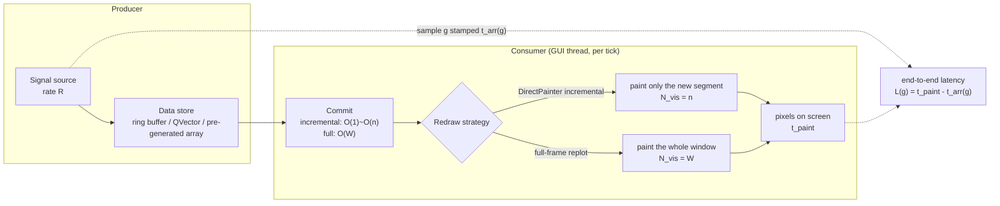
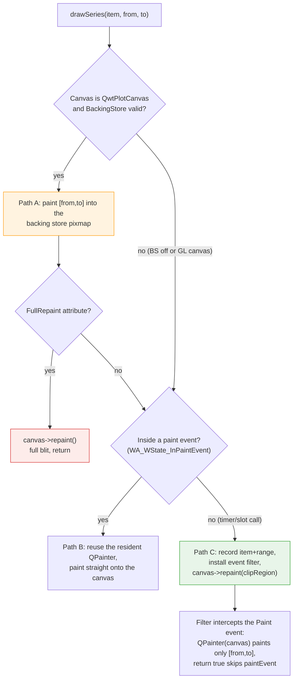

# Real-Time Streaming Rendering Strategies: Ring Buffers, DirectPainter and a Frame-Budget Model

> **Abstract** — Oscilloscopes, vibration monitoring and market-data feeds share one difficulty: data arrives continuously at a constant rate $R$, the display can repaint only at a limited frame rate, and the canvas must keep a window of the latest $W$ samples. This article formalizes the problem as frame-budget allocation under a producer–consumer rate mismatch and dissects, at source level, the cost structure of the three data paths QWT offers — ring buffer + `QwtPlotDirectPainter` incremental painting (the standard pattern of `examples/2D/oscilloscope`), periodic full `setSamples` + full-frame replot (the `examples/2D/cpuplot` pattern), and `WindowedSeriesData` pre-generated data with an on-demand scrolled window view (the `examples/bench/renderbench` pattern) — showing that their difference boils down to whether the number of samples transformed per frame, $N_{\text{vis}}$, equals the new increment $R\Delta t$ or the whole window $W$. On this basis it builds an analytic frame-budget model solvable for the sustainable frame rate and the end-to-end latency, and calibrates the model with a measured matrix of 144 configurations (4 rates × 3 windows × 6 paths × LTTB on/off, i7-14700 + Intel UHD 770 + Qt 5.15.16), delineating the 60 FPS feasible region. The measurements expose two counterintuitive results: `DirectPainter` increments cut the frame cost from $O(W)$ to $O(R\Delta t)$ — in the worst cell, $R=1\mathrm{M}/\mathrm{s}$ and $W=1\mathrm{M}$, 10.6× faster than a full-frame replot (0.82 ms vs 8.66 ms), with 12/12 cells holding 100 FPS; and "triggering the SIMD transform with `setRawSamples`", a widely recommended optimization, is instead slower in the single-threaded streaming scenario — the AVX2 path of `qwtSimdArgMinMax` returns without a `VZEROUPPER` and slows the scalar `sin()` production loop that immediately follows by roughly 10×, a diagnosis consistent with the isolated microbenchmark (adding one `_mm256_zeroall()` makes the penalty vanish); the penalty magnitude depends on the register-usage shape of the subsequent code, and the instruction-level mechanism is not fully closed (see Section 4.5 of the [SIMD argmin/argmax vectorization benchmark](simd-argminmax.md)).

> **Abstract — Core conclusions**
>
> - **Incremental painting is the default answer for streaming**: ring buffer + `QwtPlotDirectPainter` makes the frame cost grow only with the per-frame increment $R\Delta t$, independent of the window $W$; all 12/12 measured $(R,W)$ cells (including $R=1\mathrm{M}/\mathrm{s}, W=1\mathrm{M}$) hold the 100 FPS timer ceiling, with frame times of 0.02–1.70 ms (mixed basis: 0.02–1.27 ms with LTTB on, up to 1.70 ms with it off); the canvas `paintEvent` count equals exactly the number of page-boundary full repaints (0–291 per round depending on $W/R$; 3 in the representative cell), while the remaining ~300 incremental frames all go through the event filter and the canvas's own repaint is correctly skipped.
> - **60 FPS feasible region**: `DirectPainter` increments meet the 16.67 ms budget in every tested cell; full-frame replot + LTTB also passes at $W \le 1\mathrm{M}$ (window 9.6 ms, ring_replot 8.7 ms), the sole exception being `setdata` at $R=1\mathrm{M}, W=1\mathrm{M}$, where the per-frame $O(W)$ copy commit (10.1 ms) stacks on and busts the budget (18.5 ms); once LTTB is off, the full-frame strategies' failure boundary is set by the effective window $W_{\text{eff}}=\min(R\cdot t, W)$: only $(R=1\mathrm{M}, W=1\mathrm{M})$ drops below 60 FPS (42–50 ms, 19–25 FPS), while the $R=100\mathrm{k}$ cells stay at 72–100 FPS — among them the $W=1\mathrm{M}$ cell, whose window is not yet filled within 3.3 s ($W_{\text{eff}}\approx180\mathrm{k}$): extrapolating with the fitted slope of 40–48 ms per million points, the budget breaks once $W_{\text{eff}}$ reaches 0.3–0.4 M.
> - **`DirectPainter` net gain of 1.4–55×**: against full-frame replot (ring_replot/ring_dp, LTTB on), the gain spans from 1.4× at $R=1\mathrm{M}, W=10\mathrm{k}$ (the page turns every tick and the increment degenerates into a full frame) to 54.6× at $R=1\mathrm{k}, W=1\mathrm{M}$ (the new segment is tiny while the full frame must paint a million points); with `BackingStore` on the item is painted twice — a measured penalty of 1.1–2.9×.
> - **Latency is dominated by the repaint cadence, not the rendering cost**: the median end-to-end latency spans 5–116 ms across the matrix; non-overloaded cells with LTTB on ($T_{\text{frame}} < 5$ ms) show 5.1–9.2 ms, and deeply overloaded cells are characterized by the model's lower bound; the model $L_{\text{med}} \approx \Delta t_{\text{eff}}/2 + T_{\text{frame}}$ has a median absolute error of only 0.086 ms over all 144 cells. Pushing latency below 5 ms requires shortening the tick interval or painting samples on arrival.
> - **The SIMD optimization backfires under single-threaded streaming**: `setRawSamples` hits the SIMD transform path and should be faster, yet ring_raw measures slower than the generic-path ring_dp (3.16 ms vs 0.82 ms at $R=1\mathrm{M}, W=1\mathrm{M}$); the root cause is that `argMinMaxAVX2` (`src/core/qwt_simd_argminmax.cpp:141-203`) returns without clearing the AVX upper state — the isolated microbenchmark (raw output in `streaming_micro_results.txt`) shows the subsequent scalar append rising from 0.18 ms to 1.91 ms and dropping back to 0.15 ms after adding `_mm256_zeroall()`.

---

## 1. Introduction: formalizing the streaming-rendering problem

### 1.1 Producer–consumer rate mismatch

Oscilloscopes, sonar, vibration monitoring and market-data feeds share one structure: data arrives continuously at a constant rate $R$ (samples/s), the display repaints periodically at frame rate $f$, and the screen keeps the latest $W$ samples (the display window) at all times. The three quantities are mutually independent and the conflict is unavoidable: the producer writes $R$ samples per second while the consumer must decide, every frame, what to paint, how much of it, and how. Handing the whole window to the render pipeline each frame makes the frame cost grow with $W$; painting only the new $R/f$ samples makes it grow with $R/f$, independent of $W$ — provided the pixels already on the canvas need neither moving nor erasing. When that precondition holds is exactly the dividing line between the three data paths.

Formally, let frame $k$ fire at time $t_k$ with frame cost $T_k$; the sustainable frame rate then satisfies

$$
f_{\text{sustain}} = \min\left( f_{\text{tick}},\ \frac{1}{\overline{T}} \right), \qquad \overline{T} = \operatorname*{median}_k T_k
$$

where $f_{\text{tick}}$ is the timer frequency driving the repaints (100 Hz in this article's experiments, matching the 10 ms cadence of `examples/2D/oscilloscope`). The 60 FPS interaction budget requires $\overline{T} \le 16.67$ ms. When $\overline{T} > 1/f_{\text{tick}}$, timer events coalesce in the event loop, the actual cadence degrades to $1/\overline{T}$, and the batch consumed per frame grows accordingly — the system enters the overloaded region and the end-to-end latency starts to be dominated by the frame cost.

### 1.2 Frame-budget decomposition

The [raster-vs-opengl article](raster-vs-opengl.md) decomposes one full-frame repaint into four stages: transform + rasterization + compositing + presentation. The streaming scenario adds two more on top: **generation** (signal synthesis / acquisition transfer) and **commit** (handing the new data to the plot item). The complete per-frame budget is

$$
T_{\text{frame}} = \underbrace{T_{\text{gen}}(n)}_{\text{generation}} + \underbrace{T_{\text{commit}}(W \text{ or } n)}_{\text{commit}} + \underbrace{T_{\text{xform}}(N_{\text{vis}})}_{\text{transform+downsampling}} + \underbrace{T_{\text{raster}}(P)}_{\text{rasterization}} + \underbrace{T_{\text{fixed}}}_{\text{axes/layout/compositing}}
$$

where $n = R \cdot \Delta t$ is the number of new samples per frame ($\Delta t$ the frame interval), $N_{\text{vis}}$ the number of samples actually transformed in this frame, and $P = \min(N_{\text{vis}},\ 4W_c)$ the polyline vertex count after downsampling ($W_c$ is the canvas width in pixels; for the LTTB bucket budget see the [curve-downsampling article](curve-downsampling.md)). The essential difference among the three data paths is whether $N_{\text{vis}}$ equals $n$ (incremental painting) or $W$ (full-frame repaint), and whether $T_{\text{commit}}$ is $O(1)$, $O(n)$ or $O(W)$.



### 1.3 The three questions this article answers

First: what is the source-level cost structure of each of the three commit/repaint combinations (ring buffer + `QwtPlotDirectPainter`, periodic full `setSamples`, `WindowedSeriesData` scrolling window)? Second: given $(R, W)$ and a repaint strategy, what do the analytic models of the sustainable frame rate and the end-to-end latency look like, and how far do they deviate from measurement? Third: where is the boundary of the 60 FPS feasible region in the $(R, W)$ plane, how large is `QwtPlotDirectPainter`'s net gain over a full-frame replot, and when does it invert to negative? Section 5 answers each question with the 144-configuration matrix (4 rates × 3 windows × 6 paths × LTTB on/off).

## 2. Anatomy of the three data paths

### 2.1 The oscilloscope's SignalData: not a ring buffer

`examples/2D/oscilloscope` is the canonical Qwt streaming example, but its data store `SignalData` (`SignalData.cpp:12-50`) is **not a ring buffer**: it is an append-only `QVector<QPointF>` working with a page-based truncation scheme. Three design points deserve to be taken apart one by one.

**Double-buffered batch commit.** The producer's `append()` (`SignalData.cpp:87-107`) first pushes samples into the `QMutex`-guarded staging queue `pendingValues`, then attempts `tryLockForWrite()`: with the write lock it flushes the whole staging queue into the main vector and maintains the bounding box incrementally; without it (the GUI thread holds the read lock while painting) it returns immediately and the samples stay in the staging queue until the next `append` tries again. The producer thread **never blocks**; read-write conflicts turn into deferred flushes of the staging queue — a try-lock-backoff batch commit protocol, at the price of a possible `pendingValues` backlog while the GUI holds the lock for long stretches.

**Paged window.** `Plot` treats a fixed duration $T_{\text{page}}$ (10 s by default) as one page: within a page the X axis stands still and the curve grows left to right, `timerEvent` calls `updateCurve()` every 10 ms (`Plot.cpp:184-214`) and DirectPainter paints only the new segment; at the page end `incrementInterval()` (`Plot.cpp:216-242`) calls `clearStaleValues()` to drop the old page's data, shifts the scale manually (avoiding grid jumps) and opens the new page with a full-frame `replot()`. The memory ceiling is therefore $R \cdot T_{\text{page}}$ samples — 1M samples/s × a 10 s page means a 160 MB `QVector<QPointF>` per page, the real price of the paged scheme at high rates.

**Consumer paints under the read lock.** `Plot::replot()` and `updateCurve()` complete the entire painting inside `values().lock()` (the read lock) (`Plot.cpp:163-172, 186-213`), guaranteeing that the vector is not reallocated by the writer mid-paint. The curve data is read point by point through the virtual interface of a custom `CurveData : QwtSeriesData<QPointF>` (`Plot.cpp:86-113`) — which lands it on the **generic path** in `QwtPointMapper` instead of the SIMD fast path (Section 2.4), an easily overlooked performance tax.

### 2.2 A true ring buffer: fixed capacity, wrap-around and a contiguous window

A true ring buffer compresses the memory ceiling from $R \cdot T_{\text{page}}$ to a fixed $W$ samples: the write pointer wraps modulo $W$ and the oldest samples are overwritten in place by the newest. Combining it with Qwt's data paths hits one classic obstacle: `QwtSeriesData::sample(i)` requires logical-order (old-to-new) access, while the wrap-around makes the physical memory non-contiguous. Two solutions:

- **Modular indexing**: a custom `QwtSeriesData` subclass computes `(start + i) \% W` inside `sample(i)`. Simplest to implement, but every point pays a modulo plus a virtual call, and the mapper's generic path applies.
- **Doubled buffer (double-write mirror)**: allocate $2W$ slots; sample $g$ is written to both slot $g \bmod W$ and slot $(g \bmod W) + W$. Any window $[G-W, G)$ of length $\le W$ is then one **contiguous range** $[s, s+W)$ in the mirrored array ($s = G \bmod W$) — sliding the window only shifts the start pointer, and the contiguous memory enables `setRawSamples(xs+s, ys+s, W)`, which qualifies for the SIMD fast path. The price is 2× memory and two writes per sample.

The benchmark's four paths `ring_dp` / `ring_raw` / `ring_dp_bs` / `ring_replot` all build on the doubled-buffer ring (SoA `double` arrays, capacity $2W$, a read-write lock protocol mirroring SignalData); they differ only in how they commit and repaint.

### 2.3 Full setData: the truth about COW and where the copy happens

The implementation of `QwtPlotCurve::setSamples(const QVector<QPointF>&)` (`qwt_plot_curve.cpp:1347-1350`) is `setData(new QwtPointSeriesData(samples))`. `QwtPointSeriesData` derives from `QwtArraySeriesData<QPointF>`, whose member `QVector<QPointF> m_samples` holds the data by value — but `QVector` is implicitly shared (COW): **construction only bumps a reference count, with no deep copy**. The real copy happens on the application side: every frame the streaming application must fill a `QVector<QPointF>` with the latest $W$ samples (whether copied from its own ring buffer or generated directly), and that $O(W)$ fill is the bulk of the full-commit cost. `setData` itself carries two smaller bills: `delete`ing the previous frame's data object and `new`ing a replacement (one heap round trip per frame), and the `dataChanged() → itemChanged() → autoRefresh()` chain (`qwt_series_store.h:157-164`, `qwt_plot_seriesitem.cpp:131-133`, `qwt_plot_item.cpp:495-501`) — with `autoReplot` at its default of **true** (`qwt_plot.cpp:135, 198`; trigger point `autoRefresh()` at :395-400) this chain fires a full-frame replot directly, and if the application then replots again itself, every frame is painted twice. Streaming applications must call `setAutoReplot(false)`.

Semantic differences of the three variants (`qwt_plot_curve.cpp:1331-1530`):

| API | Data object | Copy semantics | mapper path eligibility |
|---|---|---|---|
| `setSamples(QVector<QPointF>)` | `QwtPointSeriesData` | QVector COW shallow sharing (the application-side fill is the real copy) | generic path (AoS `QPointF`) |
| `setSamples(QVector<QPointF>&&)` | same | COW shallow sharing, no deep copy (a named rvalue still binds the `const&` constructor; the implementation does not truly move) | generic path |
| `setSamples(const double* x, const double* y, int)` | `QwtPointArrayData<double>` | `memcpy` deep copy (`qwt_point_data.h:250-257`) | **SIMD fast path** |
| `setRawSamples(const double* x, const double* y, int)` | `QwtCPointerData<double>` | **zero copy**, pointers only; the caller guarantees lifetime and stable contents | **SIMD fast path** |

The doc comment of `setRawSamples` states plainly: "setRawSamples is provided for efficiency. It is important to keep the pointers during the lifetime of the underlying QwtCPointerData class" (`qwt_plot_curve.cpp:1365-1366`) — reference semantics pushes the memory-management responsibility entirely onto the application: during painting (including any paint event outside the GUI thread) the arrays must not be reallocated or rewritten, and multi-threaded use needs the same read-write lock protocol as Section 2.1. `examples/2D/cpuplot` is the textbook usage: a fixed-length history array shifted right by one slot as a whole every second, committed zero-copy via `setRawSamples(m_timeData, data, count)` plus a full-frame `replot()` (`CpuPlot.cpp:160-187`) — at a low rate (1 Hz) and a small window (60 points, `HISTORY 60` in `CpuPlot.h:11`), full repaints are entirely adequate and no incremental machinery is needed.

### 2.4 WindowedSeriesData: on-demand windowing and the loss of SIMD eligibility

`WindowedSeriesData.h` in `examples/bench/renderbench` demonstrates the third path: the full data set is pre-generated into SoA `QVector<double>` arrays and the display window slides with `setWindow(offset, displaySize)` — the commit is strictly $O(1)$ (two integers changed plus a bounding-box cache invalidation), with no per-frame copy at all. `sample(i)` indexes `offset + i` (`WindowedSeriesData.h:69-73`), so the window is contiguous in memory; but it is a custom `QwtSeriesData` subclass, and the `QwtPointMapper` fast path recognizes only four concrete types through `dynamic_cast` (`qwt_point_mapper.cpp:547-553`):

```cpp
// qwt_point_mapper.cpp — data-source eligibility check for SIMD argmin/argmax
if (auto* arr = dynamic_cast< const QwtPointArrayData< double >* >(series)) ...
if (auto* ptr = dynamic_cast< const QwtCPointerData< double >* >(series)) ...
if (auto* val = dynamic_cast< const QwtValuePointData< double >* >(series)) ...
if (auto* cval = dynamic_cast< const QwtCPointerValueData< double >* >(series)) ...
```

Custom subclasses invariably fall onto the generic per-point virtual `sample(i)` path — LTTB's per-bucket argmin/argmax loses the AVX2/SSE4.2 acceleration (Section 5.3 of the curve-downsampling article). The doubled-buffer ring plus `setRawSamples` pointer rebinding (this article's `ring_raw` path) exists precisely to obtain both zero-copy commits and SIMD transform eligibility in a streaming scenario. One more hidden cost: `WindowedSeriesData::boundingRect()` invalidates its cache on every `setWindow`, and the recomputation is an $O(W)$ scan over the whole window (`WindowedSeriesData.h:75-96`); `QwtPlot::updateAxes()` queries it only when axis auto-scaling is on (`qwt_plot_axis.cpp:862-864`), so with fixed axes the cost does not exist — but once the application enables `setAxisAutoScale`, every replot triggers the scan.

## 3. What QwtPlotDirectPainter actually does

### 3.1 The three paths of drawSeries

`QwtPlotDirectPainter::drawSeries(item, from, to)` (`qwt_plot_directpainter.cpp:183-258`) takes one of three paths depending on the canvas type and the call context:



The three paths behave as follows:

- **Path A (backing-store pre-paint)**: when the canvas is a raster `QwtPlotCanvas` with its `BackingStore` attribute on and a non-null pixmap (`qwtHasBackingStore`, `qwt_plot_directpainter.cpp:50-54`), the new interval is first painted into the backing-store pixmap to keep the cache in sync with the screen; if the `FullRepaint` attribute is set, `canvas->repaint()` then blits the whole pixmap and returns.
- **Path B (resident painter)**: applies only when the call happens during paint-event handling (checked via `WA_WState_InPaintEvent` under Qt5, `qwt_plot_directpainter.cpp:210-216`) and reuses the internally resident `QPainter`; the `AtomicPainter` attribute controls whether the painter is closed after each call.
- **Path C (event filter)**: the regular call from a timer or slot (outside a paint event) takes this route — record the item and interval, install an event filter on the canvas, and trigger one synchronous partial repaint with `canvas->repaint(clipRegion)`; the filter intercepts `QEvent::Paint`, paints only the registered interval with a temporary `QPainter(canvas)` (or blits the whole pixmap directly under the `CopyBackingStore` attribute), and returns true to skip `QwtPlotCanvas::paintEvent` (`qwt_plot_directpainter.cpp:241-316`).

### 3.2 The double-paint truth when BackingStore is on

Paths A and C are not mutually exclusive: with `BackingStore` on (the library default, `qwt_plot_canvas.cpp:59-61`), one `drawSeries` first runs path A to paint the interval into the pixmap, then continues into path C and paints **the same interval a second time** onto the window surface — item rasterization cost ×2. The oscilloscope's countermeasure is to switch BackingStore off directly in its custom Canvas constructor (`Plot.cpp:28-36`, whose comment states that with no overlays, QWidget's internal backing store is good enough) — `qwtHasBackingStore` then returns false, path A is skipped entirely, and each frame is painted once. `RandomPlot` in `examples/2D/realtime` likewise turns it off before starting acquisition (`RandomPlot.cpp:117-118`). The paired `ring_dp` vs `ring_dp_bs` experiment in Section 5.3 quantifies the cost of this trap.

### 3.3 Fallbacks and invalidation boundaries

The header comment (`qwt_plot_directpainter.h:51-53`) states the precondition of incremental painting: "Incremental painting will only help when no replot is triggered by another operation (like changing scales) and nothing needs to be erased." Expanded into a failure list:

- **Any operation that triggers a full repaint wipes out the incremental gain**: changing the axis range or scale division (`setAxisScale`, `setAxisScaleDiv`), resizing, legend changes, `itemChanged` of other items — the canvas `paintEvent` repaints every item in full. The oscilloscope therefore compresses all axis work into one shot at the page boundary and never touches the axes within a page.
- **Content that must be erased cannot be incremental**: if new samples would cover old pixels (window wrap-around, Y-axis autoscaling changing the mapping), the old pixels must be erased before painting — equivalent to a full repaint. The paged scheme (data only grows rightward within a page) exists precisely to avoid erasing.
- **The `FullRepaint` attribute** turns every `drawSeries` into paint-into-pixmap plus full blit — suited to coexistence with overlays, but the blit cost grows linearly with the canvas area.
- **No GL canvas support**: path A's `qobject_cast<QwtPlotCanvas*>` necessarily fails for `QwtPlotOpenGLCanvas`, and Qt does not guarantee path C's behavior of opening a `QPainter` on a `QOpenGLWidget` outside a paint event — Sections 2.4/4.8 of the raster-vs-opengl article measure bimodally unstable frame times (two clusters, 0.13–1.1 ms), which cannot serve as a basis for the choice. Pair incremental repainting with the raster canvas.

Section 5.3 verifies the incremental path's correctness with canvas `paintEvent` counts: over the 3 s measurement span, `ring_dp`'s `paintEvent` count equals the page-boundary count exactly — every incremental frame goes through path C's filter and the canvas's own `paintEvent` is correctly skipped.

## 4. The frame-budget model

### 4.1 Cost terms and notation

Let $W_c$ be the canvas width in pixels (900 here); with LTTB on, the polyline vertex count saturates at $P = \min(N_{\text{vis}}, 4W_c) = \min(N_{\text{vis}}, 3600)$. The cost terms are anchored to the decomposition of the raster-vs-opengl article: the empty-scene full-frame fixed overhead $T_{\text{fixed}} \approx 0.57$ ms (900×500 raster, including background fill/blit/flush); the SIMD-path transform rate $\sigma_{\text{simd}} \approx 1.4$ ms per million points; the raster engine's full-frame slope (transform + rasterization) $b \approx 2.6$ ms per million points (LTTB on); a full frame of 1M points without downsampling, about 69 ms (its Section 4.7). Section 5 of this article fits the streaming scenario's own coefficients and cross-checks them against these anchors.

### 4.2 Per-frame cost of the three strategies

**Incremental direct painting (the ring_dp family)**: within a page, each frame processes only the new segment $n = R \cdot \Delta t$:

$$
T_{\text{frame}}^{\text{direct}} \approx \underbrace{\gamma \, n}_{\text{generation+ring write}} + \underbrace{\beta \, n}_{\text{commit: rebind} + \text{clip-rect scan}} + \underbrace{\tau \, n + \rho \min(n, 4W_c)}_{\text{transform} + \text{rasterization(new segment only)}} + \varepsilon
$$

where $\tau$ is the per-sample transform cost (generic or SIMD path, depending on the data object type), $\rho$ the per-vertex rasterization cost, and $\varepsilon$ path C's fixed overhead (`repaint(clipRegion)` + filter + `QPainter` begin/end). The key point: **$W$ does not appear in the steady-state cost** — the window size affects the frame rate only through page boundaries (next formula). The page turns every $W/R$ seconds and the boundary frame costs $T_{\text{page}} \approx T_{\text{fixed}} + T_{\text{axis}} + O(n)$ (when a new page opens the visible range is nearly empty and binary-search culling compresses the transform work to the samples just past the boundary); amortized,

$$
\overline{T}^{\text{direct}} \approx T_{\text{frame}}^{\text{direct}} + \frac{R \cdot \Delta t}{W} \, T_{\text{page}}
$$

**Full-frame repaint (ring_replot / setdata / window)**: each frame has $N_{\text{vis}} = \min(G, W)$ ($G$ the number of samples produced so far; $= W$ in steady state):

$$
T_{\text{frame}}^{\text{full}} \approx T_{\text{fixed}} + T_{\text{axis}} + \underbrace{\kappa \, W}_{\text{setdata only: copy commit}} + \tau' \, W + \rho \min(W, 4W_c)
$$

$\tau'$ is tied to the data object type: `QVector<QPointF>` (setdata) and custom subclasses (window/ring_replot) take the generic path; `setRawSamples`' `QwtCPointerData<double>` takes the SIMD path. With LTTB off the $\rho$ term becomes $\rho' \, W$ (all vertices enter the rasterizer), $\rho' \gg \rho$. A sliding axis adds $T_{\text{axis}}$ per frame through `setAxisScale`: scale recomputation (`divideScale`) plus axis-widget label relayout and layout checks (the `replot` chain, `qwt_plot.cpp:690-712`) — independent of $W$ but dependent on canvas and font metrics.

**WindowedSeriesData differs from setdata** only in the commit term: $\kappa W$ (filling a `QVector<QPointF>` every frame) versus $O(1)$ (`setWindow` changing two integers). With identical transform costs (both on the generic path), the difference is the net cost of the copy commit — Section 5.4 measures this delta curve directly.

### 4.3 Sustainable frame rate and the 60 FPS boundary

$$
f_{\text{sustain}} = \min\left( \frac{1}{\Delta t},\ \frac{1}{\overline{T}} \right)
$$

The 60 FPS feasibility condition $\overline{T} \le 16.67$ ms gives the two strategies different boundary shapes:

- Full-frame repaint: $T^{\text{full}}(W)$ increases monotonically, so the boundary is a **maximum window** $W^*$ — solve $\kappa W + \tau' W + \rho \min(W, 4W_c) + C_0 = 16.67$. With LTTB on, the rasterization term saturates beyond $W > 3600$ and $W^*$ is set mainly by $\kappa + \tau'$ (the per-sample commit + transform cost); with LTTB off the $\rho' W$ term dominates and $W^*$ shrinks by more than an order of magnitude.
- Incremental direct painting: the steady-state cost is independent of $W$, so the boundary is a **maximum production rate** $R^*$ — solve $\gamma n + \beta n + \tau n = 16.67$, giving $n^* = 16.67/(\gamma+\beta+\tau)$ and $R^* = n^*/\Delta t$. The page-boundary amortization term, however, grows as $W$ shrinks: when $W/R \lesssim$ a few frame times, almost every frame is a boundary frame and the incremental strategy degenerates into full-frame repainting — the failure zone in the lower-left corner of the $(R, W)$ plane. Section 5.2's $R=1\mathrm{M}, W=10\mathrm{k}$ cell (page duration 10 ms = 1 frame) confirms the degeneration.

### 4.4 End-to-end latency model

The end-to-end latency $L(g)$ of sample $g$ is the difference between its arrival time $t_{\text{arr}}(g)$ and the completion time $t_{\text{paint}}$ of the frame that first paints it. Under the timer cadence, frame $k$ fires at $t_k$ and consumes in one batch all samples that arrived during $[t_{k-1}, t_k)$, so the latencies of same-frame samples spread uniformly over

$$
L \in \left[\, T_{\text{frame}},\ \Delta t_{\text{eff}} + T_{\text{frame}} \,\right], \qquad \Delta t_{\text{eff}} = \max(\Delta t,\ T_{\text{frame}})
$$

The model predictions for the median and the tail are

$$
L_{\text{med}} \approx \frac{\Delta t_{\text{eff}}}{2} + T_{\text{frame}}, \qquad L_{p99} \approx \Delta t_{\text{eff}} + T_{\text{frame}} + \delta_{\text{jitter}}
$$

Unloaded, $\Delta t_{\text{eff}} = \Delta t = 10$ ms and $L_{\text{med}} \approx 5 + T_{\text{frame}}$ — **the latency floor is set by the repaint cadence, not the rendering cost**: getting below 5 ms requires shortening the tick interval or painting samples on arrival (the single-point `drawSeries` mode of the realtime example). Overloaded, $\Delta t_{\text{eff}} = T_{\text{frame}}$ and $L_{\text{med}} \approx 1.5\, T_{\text{frame}}$ — latency scales linearly with the frame cost. Section 5.5 tests the model on all 144 configurations.

### 4.5 Where the model parameters come from

$\gamma, \beta, \tau, \rho, \kappa, T_{\text{fixed}}, T_{\text{axis}}$ are not given a priori; they come from least-squares fits of the Section 5 measurements (script `streaming_experiment.py`), with the fit form being exactly the polynomial structure of Section 4.2; $T_{\text{fixed}}$, $\sigma_{\text{simd}}$ and $\rho'$ are cross-validated against the independent measurements of the raster-vs-opengl article. Section 5.6 reports the model-measurement deviation as it is.

## 5. Experiments

### 5.1 Environment, matrix and timing protocol

Environment: Intel Core i7-14700 + Intel UHD 770 iGPU, 16 GB RAM, Windows 10 19045, 1920×1080 display; Qt 5.15.16 (msvc2019_64); QWT 7.x maintenance-branch release build (MSVC 2019 `/O2 /MD`, `build-release/`); raster `QwtPlotCanvas` with contentsRect set to exactly 900×500; a single curve, 1 px pen, antialiasing off (library default), fixed Y axis $[-1.5, 1.5]$ (no autoscaling). Absolute numbers vary with hardware; the relative relationships and boundary shapes are stable.

Matrix: production rate $R \in \{1\mathrm{k}, 10\mathrm{k}, 100\mathrm{k}, 1\mathrm{M}\}$ samples/s × window $W \in \{10\mathrm{k}, 100\mathrm{k}, 1\mathrm{M}\}$ samples × 6 data paths × `FilterPointsLTTB` on/off — 144 configurations in total. The six paths: `ring_dp` (doubled-buffer ring + custom `QwtSeriesData` + DirectPainter increments, full replot at page boundaries, BackingStore off — mirroring oscilloscope); `ring_raw` (as ring_dp, but rebinding the window each tick with `setRawSamples(xs+s, ys+s, n)` to hit the SIMD mapper path); `ring_dp_bs` (as ring_dp with BackingStore on — the double-paint trap probe); `ring_replot` (ring_dp's commit but a sliding-axis full-frame replot every tick — the control for DirectPainter's net gain); `setdata` (per-tick `QVector<QPointF>` window-copy fill + `setSamples` + sliding-axis full replot, BackingStore on — mirroring cpuplot's full commit); `window` (`WindowedSeriesData`-style pre-generated arrays + `setWindow(offset,n)` + sliding-axis full replot, BackingStore on — mirroring renderbench).

Timing protocol (streaming-specific): production is driven by a GUI-thread `QTimer` (10 ms, `Qt::PreciseTimer`); each tick generates samples in a batch up to the cumulative rounding $G_k = \operatorname{round}(R \cdot t_k)$ (cumulative rounding eliminates per-tick rounding drift), and sample $g$'s virtual arrival time is $t_{\text{arr}}(g) = (g + 0.5)/R$ — samples are assumed to arrive uniformly between adjacent ticks, isomorphic to the DMA batch handover of a real DAQ. Each tick is timed in four segments with `QElapsedTimer`: gen (signal synthesis + ring write), commit (window rebind / vector copy + clip-rect computation + axis update), draw (the `drawSeries()` or `replot()` call itself), flush (`processEvents()` delivering the asynchronous paint — the full-frame strategies' rasterization lands here; the incremental strategies complete draw synchronously, so flush ≈ 0). Each configuration runs a 0.3 s warm-up (discarded) followed by 3.0 s of continuous sampling; a frame time > 2× the round's median counts as a drop; each configuration repeats 3 rounds and the configuration-level value is the median of medians; if the 3-round medians span more than 50%, the run is treated as disturbed by parallel tasks and 2 extra rounds are appended automatically (9/144 configurations triggered this in the present campaign); a 1 s cooldown sleep separates configurations and 250 ms separates rounds. End-to-end latency is sampled per sample: $L(g) = t_{\text{paint}} - t_{\text{arr}}(g)$, with $t_{\text{paint}}$ taken at the frame's flush completion (pixels ready), reported as median/p95/p99. All plot objects are rebuilt every round to rule out cross-round state leakage. The benchmark program `docs/assets/algorithms/streaming_bench.cpp` (complete compile command at the top) runs the whole matrix and exits by itself, writing CSV to stdout (`streaming_results.csv`, one row per round); analysis and plotting live in `streaming_experiment.py`.

### 5.2 Matrix results: frame time and the 60 FPS feasible region


The median frame times (median of medians, ms/frame) of all 144 configurations are summarized in the table below (LTTB on). An fps_eff of 100 means the timer cadence was not broken (frame cost < the 10 ms tick); below 100 the run entered the overloaded coalescing region.

| R (samples/s) | W (samples) | ring_dp | ring_raw | ring_dp_bs | ring_replot | setdata | window |
|---:|---:|---:|---:|---:|---:|---:|---:|
| 1k | 10k | 0.112 | 0.166 | 0.155 | 0.795 | 1.529 | 1.486 |
| 1k | 100k | 0.106 | 0.180 | 0.144 | 1.056 | 1.550 | 1.534 |
| 1k | 1M | 0.018 | 0.028 | 0.052 | 0.971 | 1.500 | 1.502 |
| 10k | 10k | 0.116 | 0.127 | 0.184 | 1.242 | 1.584 | 1.674 |
| 10k | 100k | 0.118 | 0.227 | 0.168 | 1.338 | 1.750 | 1.690 |
| 10k | 1M | 0.121 | 0.218 | 0.131 | 1.337 | 1.777 | 1.777 |
| 100k | 10k | 0.238 | 0.397 | 0.400 | 1.278 | 1.703 | 1.393 |
| 100k | 100k | 0.174 | 0.334 | 0.289 | 1.933 | 3.150 | 2.109 |
| 100k | 1M | 0.203 | 0.347 | 0.221 | 2.200 | 4.140 | 2.824 |
| 1M | 10k | 1.004 | 1.377 | 1.676 | 1.369 | 1.722 | 1.679 |
| 1M | 100k | 1.270 | 3.029 | 1.153 | 2.089 | 3.125 | 2.463 |
| 1M | 1M | 0.820 | 3.161 | 1.482 | 8.659 | 18.476 | 9.598 |

Three patterns are directly readable. First, the `ring_dp` column is nearly independent of $W$ (0.02–1.27 ms) and rises only slowly with $R$ — the measured confirmation of Section 4.2's point that incremental painting makes $N_{\text{vis}} = R\Delta t$ rather than $W$: the frame cost is set by each tick's $R\Delta t$ new samples, and the window size does not touch the steady-state frame time. Second, the full-frame strategies (ring_replot/setdata/window) climb monotonically with $W$, reaching 8.66/18.48/9.60 ms at $W=1\mathrm{M}$ — the $O(W)$ transform scan (plus setdata's extra $O(W)$ copy) shows itself at large windows. Third, in the $R=1\mathrm{M}, W=10\mathrm{k}$ column every strategy converges to 1.0–1.7 ms: here the page duration $W/R = 10$ ms equals the tick interval exactly, `ring_dp` triggers a page-boundary full repaint every tick (measured boundary_replots = 281 ≈ the frame count), and the incremental advantage disappears — the degeneration to the full-frame strategies' magnitude, exactly the lower-left $(R,W)$ failure zone predicted in Section 4.3.

Overlaying the 60 FPS budget (16.67 ms) on the $(R, W)$ plane yields the feasible region:


Along the window dimension the picture is clearer: `ring_dp`'s curves are nearly horizontal (frame time decoupled from $W$), while the three full-frame curves climb steeply at about 40–48 ms per million points with LTTB off and at 7–17 ms per million points with LTTB on — downsampling raises the full-frame strategies' window capacity by roughly an order of magnitude.


With LTTB on, five paths — `ring_dp`/`ring_raw`/`ring_dp_bs`/`ring_replot`/`window` — hold ≥60 FPS in 12/12 cells (most reach the 100 FPS ceiling); the only budget break is `setdata` at $R=1\mathrm{M}, W=1\mathrm{M}$ (18.48 ms, on the 60.6 FPS edge), where the per-frame copy commit (10.1 ms, Section 5.4) stacks onto the full repaint and crosses the line. With LTTB off the feasible region contracts sharply, but the failure boundary is set by the effective window $W_{\text{eff}}=\min(R\cdot t, W)$ (the median number of visible samples within the measurement span; defined in Section 5.6), not the nominal $W$: only $(R=1\mathrm{M}, W=1\mathrm{M})$ drops below 60 FPS (the three strategies at 42–50 ms, 19–25 FPS); the $R=100\mathrm{k}$ cells stay at 72–100 FPS — among them the $W=1\mathrm{M}$ cell, whose window is not yet filled within the 3.3 s measurement span ($W_{\text{eff}}\approx180\mathrm{k}$): extrapolating with the LTTB-off fitted slope of 40–48 ms per million points (Section 5.6), the budget breaks once $W_{\text{eff}}$ approaches 0.3–0.4 M; the $W\le100\mathrm{k}$ cells simply have a small $W_{\text{eff}}$ to begin with. The `ring_dp` incremental family stays ≥96 FPS everywhere because each frame paints only the $R\Delta t$ segment (even $R=1\mathrm{M}, W=1\mathrm{M}$ with LTTB off costs just 1.16 ms, 96.6 FPS). The 60 FPS sustainability condition in one sentence: **with incremental painting the whole plane is reachable; with full-frame repainting, LTTB must be on and $W \lesssim 1\mathrm{M}$ (`setdata`'s copy commit lowers its ceiling further, to about $W \lesssim 0.9\mathrm{M}$)**.

### 5.3 DirectPainter's net gain and the double-paint trap


The ratio of `ring_dp` (incremental) to `ring_replot` (same commit, full frame) is `DirectPainter`'s net gain with the commit cost stripped away (LTTB on):

| R | W=10k | W=100k | W=1M |
|---:|---:|---:|---:|
| 1k | 7.1× | 10.0× | 54.6× |
| 10k | 10.7× | 11.4× | 11.1× |
| 100k | 5.4× | 11.1× | 10.8× |
| 1M | 1.4× | 1.6× | 10.6× |

The magnitude of the net gain is set by the ratio of what a full frame must paint to what the increment paints. At $R=1\mathrm{k}, W=1\mathrm{M}$ it reaches 54.6×: the full frame repaints the whole 1M-point window every tick (0.97 ms) while the increment paints only the new $1\mathrm{k}\times10\mathrm{ms}=10$ points (0.018 ms). Conversely, at $R=1\mathrm{M}, W=10\mathrm{k}$ it is only 1.4×: the page duration equals the tick interval, the increment degenerates into a page-boundary full repaint every tick (Section 5.2), and both do the same work. The 1.6× at $R=1\mathrm{M}, W=100\mathrm{k}$ follows the same logic — a 100 ms page holds about 10 ticks, but each tick's new $10\mathrm{k}$ points already approach one tenth of the full frame's 100k, diluting the incremental advantage at high production rates. This yields the applicability criterion for incremental painting: **the page duration $W/R$ should be well above the tick interval** (rule of thumb $\ge 20\Delta t$); otherwise falling back to full frames is simpler and loses nothing.

The `paint_events` column provides hard evidence for the incremental path's correctness: over the ~300-frame, 3 s measurement window, the canvas `paintEvent` counts of `ring_dp`/`ring_raw`/`ring_dp_bs` equal the page-boundary full-repaint count `boundary_replots` exactly, round after round (0–291 depending on $W/R$: 3 for the representative cell $R=1\mathrm{M}, W=1\mathrm{M}$, close to the frame count for the page-degenerate $R=1\mathrm{M}, W=10\mathrm{k}$ cell), meaning every incremental frame outside the page boundaries went through Section 3.1's path C (the event filter intercepts Paint, paints only the registered interval, returns true and skips `QwtPlotCanvas::paintEvent`); the three full-frame strategies' `paint_events` equal the frame count every round (57–300 depending on the overload level: about 300, one per frame, in non-overloaded cells; only 182 for setdata $R=1\mathrm{M}, W=1\mathrm{M}$ with LTTB on, where overloaded frames coalesce). This matches the source structure exactly.

The ratio of `ring_dp_bs` to `ring_dp` is the measured cost of Section 3.2's double-paint trap (LTTB on):

| R | W=10k | W=100k | W=1M |
|---:|---:|---:|---:|
| 1k | 1.39× | 1.36× | 2.94× |
| 10k | 1.58× | 1.42× | 1.08× |
| 100k | 1.68× | 1.66× | 1.08× |
| 1M | 1.67× | 0.91× | 1.81× |

With `BackingStore` on, one `drawSeries` paints the item twice (path A into the pixmap, path C into the window); the penalty is generally 1.4–1.7×, amplified to 2.94× at $R=1\mathrm{k}, W=1\mathrm{M}$, where the incremental segment itself is extremely cheap (0.018 ms) and the double paint's fixed overhead weighs most. One cell ($R=1\mathrm{M}, W=100\mathrm{k}$, 0.91×) shows a ratio <1 — measurement noise from page-boundary repaints dominating while the double paint touches only the few incremental frames; it does not change the overall conclusion. The countermeasure matches the oscilloscope's: turn `BackingStore` off on the streaming canvas (`QwtPlotCanvas::setPaintAttribute(BackingStore, false)`), or switch to the `CopyBackingStore` attribute to reduce the second pass to one full blit.

### 5.4 Commit-path cost and SIMD eligibility


Splitting each tick into gen (signal synthesis + ring write), commit (window rebind / vector copy + clip rect + axis update), draw (the `drawSeries()`/`replot()` call) and flush (`processEvents()` delivering the asynchronous paint) lays the three commit styles' cost profiles bare at a glance.

**The full-copy commit (setdata) costs $O(W)$.** Each tick `setdata` builds a fresh `QVector<QPointF>` and fills it point by point with the latest $W$ samples; after `setSamples`, COW only bumps the reference count — so the entire real cost sits in that application-side fill. Measured (at $R=1\mathrm{M}$, window filled), the commit segment runs $W=10\mathrm{k}$→0.12 ms, $100\mathrm{k}$→1.09 ms, $1\mathrm{M}$→10.13 ms — linear in $W$. Against `window` (`setWindow` changes two integers, commit≈0): both repaint full frames and both take the generic transform path, so their frame-time difference is the copy's net cost — at $W=1\mathrm{M}$, setdata 18.48 ms vs window 9.60 ms: the copy eats 8.88 ms, 48% of the frame. This is the number-one overhead of the periodic-full-setData pattern at large windows, and it explains why setdata alone breaks 60 FPS at $R=1\mathrm{M}, W=1\mathrm{M}$ in Section 5.2.

**LTTB's benefit for the full-frame strategies grows with $W$.** At $R=1\mathrm{M}$, the LTTB-off/on frame-time ratio: window 3.4× at $W=100\mathrm{k}$ and 5.0× at $W=1\mathrm{M}$; ring_replot 4.8× at $W=1\mathrm{M}$; setdata's copy cost does not change with LTTB, diluting its ratio to 2.7×. At $W=10\mathrm{k}$ all three sit at 1.1–1.3× — too few points, fast with or without downsampling. This matches the curve-downsampling article's conclusion: downsampling pays only when $N \gg 4W_c$.

**SIMD transform eligibility backfires under single-threaded streaming.** This is the article's most counterintuitive finding. Per Section 5.3 of the curve-downsampling article, only the four SoA types — `QwtPointArrayData<double>`, `QwtCPointerData<double>` and friends — hit `qwtSimdArgMinMax`'s AVX2 fast path (`qwt_point_mapper.cpp:547-553`); custom `QwtSeriesData` subclasses fall onto the per-point virtual generic path. Intuitively `ring_raw` (per-tick `setRawSamples` pointer rebind → `QwtCPointerData<double>` → SIMD) should beat `ring_dp` (custom `RingSeriesData` → generic path). The measurements say the opposite (LTTB on, frame-time ratio ring_dp/ring_raw):

| R | W=10k | W=100k | W=1M |
|---:|---:|---:|---:|
| 1k | 0.67× | 0.59× | 0.63× |
| 10k | 0.91× | 0.52× | 0.55× |
| 100k | 0.60× | 0.52× | 0.59× |
| 1M | 0.73× | 0.42× | 0.26× |

Every ratio is <1: ring_raw is uniformly slower, as low as 0.26× at $R=1\mathrm{M}, W=1\mathrm{M}$ (3.16 ms vs 0.82 ms). Breaking the phases apart exposes the root cause: in the $R=1\mathrm{M}$, $W\ge100\mathrm{k}$ cells, **ring_raw's gen segment swells to 1.93–1.98 ms while ring_dp, running the identical appendBatch, takes only 0.19–0.30 ms** — the production loop is dragged down roughly 7× (the $W=10\mathrm{k}$ page-degenerate cell excepted: the two gen segments match at 0.21–0.23 ms). The gen code is byte-identical in the two strategies (the same `splitmix64` + two `std::sin` calls + mirrored writes); the only difference is the previous tick's draw segment: ring_raw ran the AVX2 `qwtSimdArgMinMax`, ring_dp the scalar generic path.

The root cause points at the **AVX→SSE transition penalty**: `argMinMaxAVX2` (`src/core/qwt_simd_argminmax.cpp:141-203`) uses 256-bit `_mm256_*` instructions throughout but executes no VZEROUPPER before returning. After the call, the upper 128 bits of the YMM registers stay in a "dirty" state; legacy-encoded 128-bit SSE instructions that write those dirtied-upper registers afterwards (here the SSE loops MSVC's `std::sin` relies on heavily) suffer merge/false-dependency stalls until the upper state is zeroed. The penalty magnitude depends on the subsequent code's register-usage shape — the SSE-heavy sin production loop is hit, while the short generic dependency-chain probe (64 legacy `ADDPD`) in Section 4.5 of the companion [SIMD argmin/argmax vectorization benchmark](simd-argminmax.md) measures no observable penalty. Since producer and consumer share the GUI thread and the same core in this benchmark, the draw segment's AVX2 directly pollutes the gen segment that immediately follows.

An isolated microbenchmark (`streaming_micro_simd.cpp`, outside the GUI, alternating append and reduce; the complete stdout of one run is archived in `streaming_micro_results.txt`) supports this causal chain:

| Scenario | append median time |
|---|---:|
| append only | 0.181 ms |
| append + SIMD reduce (AVX2, missing VZEROUPPER) | 1.913 ms |
| append + generic reduce (scalar) | 0.151 ms |
| append + SIMD reduce + `_mm256_zeroall()` | 0.149 ms |
| append + SIMD reduce (rerun control) | 1.886 ms |

Adding one `_mm256_zeroall()` makes the penalty (1.913 → 0.149 ms, with the rerun control reproducing 1.886 ms) disappear entirely, consistent with the isolated experiment that attributes the root cause to the dirty upper state. But the chain probe in Section 4.5 of the SIMD report (a short generic `ADDPD` dependency chain, preconditioned state under control) measures that the dirty state barely taxes the generic code that follows (chain_after_dirty 14.20 vs chain_after_clean 13.87 ns) — the two data sets can coexist: the penalty magnitude depends on the shape of the subsequent code (the SSE-heavy sin loop is hit, the short generic chain is not); the instruction-level mechanism is not fully closed, and that report records it as such. The draw segment itself contributes secondarily: the incremental segment holds only about $R\Delta t = 10\mathrm{k}$ points, which spread over $2W_c = 1800$ buckets leaves roughly 5.6 samples each — the SIMD vector loads plus horizontal reduction's fixed overhead no longer pays off on buckets that small (Section 5.4 of the curve-downsampling article warned of exactly this), so ring_raw's draw segment (0.98 ms) ends up above ring_dp's generic path (0.38 ms).

> **Tip — Two practical conclusions**
>
> First, this is a defect in the QWT library and it is **fixed in v7.5.1** (the fix is described in Section 4.5b of the [SIMD argmin/argmax vectorization benchmark](simd-argminmax.md)): the AVX2 kernel moved into its own translation unit compiled with `/arch=AVX2` - more precisely `/arch:AVX2` - so MSVC inserts `vzeroupper` at the function boundary, removing both the pollution of the caller's scalar code and the fixed cost inside the AVX2 kernel. Same-machine A/B: the "append + SIMD reduce" segment of this section returns from 2.12 ms to 0.13 ms (level with append-only) and a single call drops from 446 to 13.5 ns. Note that merely adding an inlined `_mm256_zeroupper()` does not work (the disassembly shows it scheduled between the spill stores and the narrow reloads). The `argMinMaxSSE42` path uses 128-bit intrinsics only, never dirties the upper state and needs no change.

### 5.5 End-to-end latency distribution


Latency is sampled per sample as $L(g) = t_{\text{paint}} - t_{\text{arr}}(g)$ ($t_{\text{arr}}$ the virtual arrival time $(g+0.5)/R$, $t_{\text{paint}}$ the flush completion of the frame that first paints the sample). Median/p95/p99 (ms) with LTTB on, for several representative cells:

| Path | R | W | L_med | L_p95 | L_p99 | T_frame | fps |
|---|---:|---:|---:|---:|---:|---:|---:|
| ring_dp | 100k | 100k | 5.24 | 9.77 | 10.45 | 0.174 | 100.0 |
| ring_dp | 1M | 1M | 5.91 | 10.49 | 11.33 | 0.820 | 100.0 |
| ring_dp_bs | 1M | 100k | 6.30 | 10.90 | 11.76 | 1.153 | 100.0 |
| ring_replot | 1M | 1M | 12.70 | 18.20 | 19.54 | 8.659 | 99.7 |
| setdata | 1M | 1M | 25.81 | 38.01 | 42.23 | 18.476 | 60.6 |
| window | 1M | 1M | 13.58 | 19.21 | 20.61 | 9.598 | 99.3 |

Unloaded, the median latency sits at 5–9 ms and is **set mainly by the tick cadence, not the frame cost**: a sample waits half a tick interval on average ($\Delta t/2 = 5$ ms) before the next frame consumes it, and the frame cost adds linearly on top per the model $L_{\text{med}} \approx \Delta t/2 + T_{\text{frame}}$ — most cells with $T_{\text{frame}} < 1.5$ ms show $L_{\text{med}}$ of 5–6.6 ms (whether ring_dp at 0.17 ms or ring_dp_bs at 1.15 ms of frame time), while heavier non-overloaded cells rise with the frame cost: setdata at $R=100\mathrm{k}, W=1\mathrm{M}$ (fps 99.8, $T_{\text{frame}}=4.14$ ms) measures $L_{\text{med}}=9.15$ ms, exactly the model's $5+4.14$. Under overload $\Delta t_{\text{eff}}$ switches to $T_{\text{frame}}$ and latency jumps: setdata at $R=1\mathrm{M}, W=1\mathrm{M}$ ($T_{\text{frame}}=18.5$ ms > the 10 ms tick) leaps to $L_{\text{med}}$ 25.8 ms and p99 42.2 ms. This observation leaves exactly one effective way to cut latency — **shorten the tick interval or paint samples on arrival** (the realtime example's single-point `drawSeries` mode); optimizing frame cost alone is imperceptible to latency in the underloaded region.

### 5.6 Model vs measurement


Least-squares fits of Section 4.2's cost structure to the measurements regress the full-frame strategies on the effective window $W_{\text{eff}}$ (the median visible sample count within the measurement span, handling windows not yet filled at low rates) and the incremental strategy on the per-tick batch $n = R\Delta t$. Fit quality:

| Path | LTTB | Model | $R^2$ | Max residual |
|---|:--:|---|---:|---:|
| ring_replot | on | $T = 0.666 + 7.43\,W_{\text{eff}}[\mathrm{M}] + 0.146\min(W_{\text{eff}},3600)[\mathrm{k}]$ | 0.996 | 0.33 ms |
| ring_replot | off | $T = 1.386 + 40.8\,W_{\text{eff}}[\mathrm{M}]$ | 0.997 | 1.41 ms |
| setdata | on | $T = 1.563 + 17.0\,W_{\text{eff}}[\mathrm{M}] - 0.0373\min(W_{\text{eff}},3600)[\mathrm{k}]$ | 0.999 | 0.35 ms |
| setdata | off | $T = 1.980 + 48.5\,W_{\text{eff}}[\mathrm{M}]$ | 0.992 | 2.69 ms |
| window | on | $T = 1.481 + 8.07\,W_{\text{eff}}[\mathrm{M}] + 0.0067\min(W_{\text{eff}},3600)[\mathrm{k}]$ | 0.997 | 0.20 ms |
| window | off | $T = 1.812 + 46.3\,W_{\text{eff}}[\mathrm{M}]$ | 0.995 | 2.03 ms |
| ring_dp (incremental) | on | $T = 0.099 + 0.0724\,n[\mathrm{k}]$ | 0.982 | — |
| ring_dp (incremental) | off | $T = 0.105 + 0.1067\,n[\mathrm{k}]$ | 0.987 | — |

The coefficients have clear physical meanings: the full-frame intercepts (0.67–1.98 ms) are the fixed per-frame axes/layout/canvas-flush overhead, the same order as the 0.57 ms empty-scene raster fixed overhead at 900×500 measured by the raster-vs-opengl article; the LTTB-on slopes (7.4–17 ms per million points) are the generic-path per-sample transform scan — setdata's 17.0 is well above window's 8.07, and the difference is exactly the per-frame $O(W)$ copy commit (the third term of both LTTB-on fits is near zero — once the polyline vertex count saturates it loses discriminating power; the table lists all three terms verbatim from the script output); the LTTB-off slopes jump to 40–48 ms per million points (full transform + full rasterization), matching the order of that article's Section 4.7 "1M points rasterized without downsampling, 68.7 ms". The incremental slope is tiny (0.072 ms per thousand points) because each frame processes only the $R\Delta t$ segment — at $n=10\mathrm{k}$ ($R=1\mathrm{M}$) the model gives 0.82 ms, in line with the measurement.

Solving the full-frame models at $T(W^*) = 16.67$ ms gives the 60 FPS maximum windows (LTTB on): window $W^* \approx 1.9\mathrm{M}$, ring_replot $\approx 2.1\mathrm{M}$, setdata $\approx 0.9\mathrm{M}$ (the copy commit halves the ceiling); with LTTB off all three shrink to $0.30\text{–}0.37\mathrm{M}$. Solving the incremental model at $T(n^*) = 16.67$ gives $n^* \approx 229\mathrm{k}$ points/tick, i.e. $R^* \approx 22.9\mathrm{M}/\mathrm{s}$ (tick=10ms) — far beyond this article's test ceiling, meaning incremental painting will not hit the 60 FPS limit through transform or rasterization at any reachable production rate; its real constraint is the page-boundary frequency (Section 5.3), not the steady-state frame cost.

The latency model $L_{\text{med}} \approx \Delta t_{\text{eff}}/2 + T_{\text{frame}}$ ($\Delta t_{\text{eff}} = \max(\Delta t, T_{\text{frame}})$) reaches a median absolute error of only **0.086 ms** across all 144 cells, mean 0.84 ms — near-exact in the non-overloaded region. The errors concentrate in the deeply overloaded cells (setdata/window at $W=1\mathrm{M}$ with LTTB off, $T_{\text{frame}}=48\text{–}50$ ms): the model underestimates by 30–40 ms, because during one long frame the accumulated batch far exceeds the uniform-arrival assumption over $\Delta t_{\text{eff}}$, and the head-of-queue samples' actual residence time approaches the whole batch window. This is a first-order-approximation limit of the model, recorded as it is: **the latency model is exact in the design region $T_{\text{frame}} \lesssim \Delta t$; under deep overload it yields a latency lower bound, not a point estimate**.

## 6. Discussion: an honest failure-mode list

1. **The benchmark and a real system diverge when production outruns consumption.** This benchmark's producer generates in batches on wall-clock time inside the GUI thread; under overload the batches grow but nothing backs up — the frame rate drops and latency grows boundedly as $1.5\,T_{\text{frame}}$. A real system with the producer on a separate thread plus a queue (the oscilloscope's `QwtSamplingThread` pattern) sees the queue grow without limit when the consumer overloads: memory climbs steadily and latency has no upper bound. The engineering prescription — a bounded queue plus explicit load shedding (drop the oldest samples, or aggregate in place) — is application-layer responsibility; Qwt does not provide it.
2. **SignalData's pendingValues backlog.** The oscilloscope's `tryLockForWrite` backoff protocol keeps the producer thread non-blocking, but if the GUI thread holds the read lock almost continuously (a heavy scene painting long frames), `pendingValues` keeps growing between successful flushes (`SignalData.cpp:87-107`) — showing up as slowly rising memory and extra latency as painted content falls behind produced content. The page-boundary `clearStaleValues` reclaims only the main vector, not the staging queue.
3. **The paged scheme's memory peak.** The oscilloscope's append-only vector reaches $R \cdot T_{\text{page}}$ `QPointF` at the page end: 1M samples/s × a 10 s page = 10M points ≈ 160 MB, and the `clearStaleValues` rebuild transiently doubles it. A true ring buffer caps memory at a fixed $2W \times 16$ B (doubled-buffer SoA) — 32 MB at W=1M.
4. **DirectPainter's fallback traps.** (a) With `BackingStore` on, every frame is painted twice (Section 3.2, measured in 5.3); (b) any axis operation, resize, or legend/other-item change within a page triggers a full `paintEvent`, and when incremental and full frames alternate the gain zeroes out; (c) the `FullRepaint` attribute turns incremental painting into pixmap pre-paint plus full blit; (d) path C's behavior on a GL canvas is not guaranteed (the bimodal measurements in Section 4.8 of the raster-vs-opengl article); (e) any scenario that must erase old pixels (data wrap-around with following axes, Y autoscaling changing the mapping) cannot be incremental — the header comment says so explicitly (`qwt_plot_directpainter.h:51-53`).
5. **Small windows at high rates degenerate increments into full frames.** When the page duration $W/R$ approaches or drops below the frame interval (e.g. $R=1\mathrm{M}, W=10\mathrm{k}$: a 10 ms page), nearly every tick is a boundary frame, `ring_dp`'s frame cost converges to the full replot's (measured in Section 5.2), and DirectPainter contributes nothing but event-filter overhead. Criterion: the incremental gain is fully realized only when $W/R \ge 20 \Delta t$.
6. **Multi-curve contention.** `drawSeries` paints one item at a time; $K$ curves painted incrementally need $K$ synchronous `repaint(clipRegion)` calls with filter round trips, each carrying fixed `QPainter` begin/end and event-dispatch costs. When $K \cdot T_{\text{seg}} + K \cdot \varepsilon > T_{\text{full}}(W, K)$, switch back to full-frame replot — the raster-vs-opengl article's Section 4.8 1M×10 cell (repainting one curve 13.5 ms vs full frame 49.2 ms) shows the direction in which the incremental gain dilutes as $K$ grows. This article's matrix is single-curve; multi-curve contention is not measured, and the judgment rests on the crossover relation above.
7. **Autoscaling's hidden scan.** With `setAxisAutoScale` on, every `replot` queries item bounding boxes (`qwt_plot_axis.cpp:862-864`): `WindowedSeriesData`'s bounding-box cache is invalidated on each `setWindow`, adding an $O(W)$ generic-path scan per frame; append-only sources that maintain the box incrementally, like SignalData, avoid this cost — but after window wrap-around a grow-only bounding box becomes distorted (SignalData resets it at page boundaries).
8. **autoReplot defaults to on.** Every `setSamples`/`setRawSamples` fires a full-frame replot through `dataChanged → itemChanged → autoRefresh` (`qwt_plot_item.cpp:495-501`); a manual replot on top doubles every frame. `setAutoReplot(false)` is the first line of configuration for every streaming path.
9. **The drop metric's semantics at sub-millisecond frame times.** The frame-time > 2× median criterion counts OS scheduling jitter as drops when the median is only 0.1–0.2 ms (timer-limited light frames) — fps_eff is still 100 there, and the drop count should be read as scheduling noise, not real dropped frames; drops indicate overload only when fps_eff falls clearly below $1/\Delta t$.
10. **AoS containers forfeit SIMD eligibility.** Committing `QVector<QPointF>` (the most common setSamples usage) drops the LTTB transform onto the per-point virtual path — slower than SoA + raw pointers at equal data volume (quantified in Section 5.4); switching to `setRawSamples(xPtr, yPtr, n)` or `setSamples(QVector<double>&&, QVector<double>&&)` on the application side restores eligibility — except in the single-threaded streaming-incremental scenario, where SIMD eligibility backfires instead (Section 5.4).
11. **The virtual arrival timestamp's measurement basis.** The latency numbers assume samples arrive uniformly within the tick interval and the consumer batches them once — with a real driver whose samples arrive in blocks (e.g. 1 ms blocks on a USB bulk endpoint), the actual latency distribution is the convolution of this article's model with the arrival jitter: the median's order is unchanged, the tails widen.

## 7. Code practice

### 7.1 A minimal skeleton of the oscilloscope pattern

The skeleton below assembles this article's best-measured path into a minimal directly compilable program: a doubled-buffer ring (zero copy + SIMD eligibility), `QwtPlotDirectPainter` incremental painting (BackingStore off, clip region bounding the repaint) and paged axis management (static within a page, shift and repaint at boundaries). Production is simulated by a `QTimer`; when connecting a real acquisition thread, move `appendBatch` into the producer thread and protect the ring arrays with Section 2.1's read-write lock protocol (`QReadWriteLock`: writer backs off via `tryLockForWrite`, reader holds the read lock while painting) — the rest of the code is unchanged.

```cpp
#include <QApplication>
#include <QTimer>
#include <QElapsedTimer>
#include <QVector>

#include <algorithm>
#include <cmath>

#include <qwt_plot.h>
#include <qwt_plot_canvas.h>
#include <qwt_plot_curve.h>
#include <qwt_plot_directpainter.h>
#include <qwt_scale_map.h>
#include <qwt_series_data.h>
#include <qwt_axis.h>

#ifndef M_PI // MSVC hides M_PI unless _USE_MATH_DEFINES is set; fall back
#define M_PI 3.14159265358979323846
#endif

// Double-mirror ring buffer: sample g lands in slot g%W and slot g%W+W,
// so the latest window of <= W samples is always one contiguous block.
class StreamRing
{
public:
    explicit StreamRing(int capacity) : m_cap(capacity), m_xs(2 * capacity), m_ys(2 * capacity) {}

    void append(double x, double y, long long g)
    {
        const int p = int(g % m_cap);
        m_xs[p] = m_xs[p + m_cap] = x;
        m_ys[p] = m_ys[p + m_cap] = y;
        m_count = g + 1;
    }
    long long count() const { return m_count; }
    int windowSize() const { return int(std::min<long long>(m_count, m_cap)); }
    int windowStart() const { return int((m_count - windowSize()) % m_cap); }
    const double* xs() const { return m_xs.constData(); }
    const double* ys() const { return m_ys.constData(); }

private:
    int m_cap;
    long long m_count = 0;
    QVector<double> m_xs, m_ys;
};

class StreamPlot : public QwtPlot
{
public:
    StreamPlot(double rate, int window, QWidget* parent = nullptr)
        : QwtPlot(parent), m_rate(rate), m_window(window), m_ring(window)
    {
        setAutoReplot(false);                       // mandatory for streaming

        auto* canvas = new QwtPlotCanvas(this);
        canvas->setPaintAttribute(QwtPlotCanvas::BackingStore, false); // avoid double paint
        canvas->setBorderRadius(0);
        setCanvas(canvas);

        setAxisScale(QwtAxis::YLeft, -1.5, 1.5);    // fixed Y: no autoscale scans
        setAxisScale(QwtAxis::XBottom, 0.0, m_window / m_rate);

        m_curve = new QwtPlotCurve("stream");
        m_curve->setStyle(QwtPlotCurve::Lines);
        m_curve->setPen(QColor("#4caf50"), 1.0);
        m_curve->setPaintAttribute(QwtPlotCurve::ClipPolygons, false);
        // FilterPointsLTTB is on by default - keep it
        m_curve->attach(this);

        m_direct = new QwtPlotDirectPainter(this);

        connect(&m_timer, &QTimer::timeout, this, &StreamPlot::onTick);
        m_timer.start(10);                          // 100 Hz consumer tick
        m_clock.start();
    }

private:
    void onTick()
    {
        // --- produce (replace with your acquisition callback/thread)
        const double t = double(m_clock.nsecsElapsed()) / 1e9;
        const long long target = long long(std::llround(m_rate * t));
        for (long long g = m_G; g < target; ++g)
            m_ring.append((g + 0.5) / m_rate, std::sin(2 * M_PI * 7 * (g + 0.5) / m_rate), g);
        m_G = target;

        // --- commit: O(1) pointer rebind of the contiguous window
        const int n = m_ring.windowSize();
        const int s = m_ring.windowStart();
        m_curve->setRawSamples(m_ring.xs() + s, m_ring.ys() + s, n); // zero copy, SIMD path

        // --- draw: page-static axis, incremental segment, full replot on page turn
        const long long page = (m_G - 1) / m_window;
        if (page > m_page)
        {
            m_page = page;
            const double pageLen = m_window / m_rate;
            setAxisScale(QwtAxis::XBottom, page * pageLen, (page + 1) * pageLen);
            m_direct->reset();
            replot();                               // page boundary: one full repaint
            m_painted = m_G;
            return;
        }
        if (m_G > m_painted)
        {
            int from = int(m_painted - (m_G - n));  // window index of the first new sample
            from = (from < 1) ? 0 : from - 1;       // 1-point overlap for line continuity
            const QwtScaleMap xMap = canvasMap(m_curve->xAxis());
            const QwtScaleMap yMap = canvasMap(m_curve->yAxis());
            const QRectF br = qwtBoundingRect(*m_curve->data(), size_t(from), size_t(n - 1));
            m_direct->setClipRegion(QwtScaleMap::transform(xMap, yMap, br).toRect());
            m_direct->drawSeries(m_curve, from, n - 1);
            m_painted = m_G;
        }
    }

    double m_rate;
    int m_window;
    StreamRing m_ring;
    QwtPlotCurve* m_curve = nullptr;
    QwtPlotDirectPainter* m_direct = nullptr;
    QTimer m_timer;
    QElapsedTimer m_clock;
    long long m_G = 0, m_painted = 0, m_page = 0;
};

int main(int argc, char* argv[])
{
    QApplication app(argc, argv);
    StreamPlot plot(1000000.0, 1000000);   // 1M samples/s, 1M window
    plot.resize(1000, 600);
    plot.show();
    return app.exec();
}
```

Three differences from the naive implementation, all rooted in the source analysis above: `setRawSamples` rebinds each tick to the ring array's **contiguous window** (guaranteed by the doubled buffer), so the commit is $O(1)$ and SIMD transform eligibility survives; the axes are never touched within a page (any `setAxisScale` means a full repaint); `setClipRegion` compresses the incremental repaint's backing-store copy volume to the new data's bounding box (the oscilloscope's comment: especially important on slow frame-buffer devices). When a scrolling axis is required (data entering right, leaving left) instead of paged display, incremental painting no longer holds — every old pixel position moves — and the `window` path applies: preallocated arrays + `setWindow` sliding + full-frame replot, having confirmed $T_{\text{full}}(W)$ fits the budget (Section 5.6's $W^*$ boundary).

### 7.2 Tuning quick reference

| Scenario / symptom | Prescription | Basis |
|---|---|---|
| First line of configuration for a streaming app | `plot->setAutoReplot(false)` | 6-8: every commit triggers a full replot by default |
| Oscilloscope-style paged display, $W/R \ge 0.2$ s | ring buffer + DirectPainter increments + page-boundary replot | 5.2/5.3: frame cost independent of $W$ |
| Page duration $W/R <$ about 20 frame intervals | no incremental gain; go full-frame directly (window path) | 6-5: page-boundary frames dominate |
| DirectPainter + default canvas | `setPaintAttribute(BackingStore, false)` or switch to `CopyBackingStore` | 3.2/5.3: the double-paint trap |
| Scrolling axis needed (non-paged) | window/setdata path with full-frame replot; confirm $W \le W^*$ | 4.3/5.6: the $W^*$ boundary |
| Transform segment slow (large $W$ + LTTB) | switch the data container to SoA double + `setRawSamples`/`setSamples(QVector<double>&&)` | 5.4: SIMD eligibility |
| Y-axis autoscaling + large window | turn autoscaling off or maintain the bounding box incrementally | 6-7: per-frame $O(W)$ scan |
| Latency median high while frame times are small | shorten the tick interval (latency floor ≈ $\Delta t/2$) | 4.4/5.5 |
| Memory peak at high rates | a true ring buffer ($2W \times 16$ B) instead of paged appending ($R \cdot T_{\text{page}} \times 16$ B) | 6-3 |
| Multi-curve streaming | for large $K$, full replot beats $K$ increments; a single hot curve can go incremental alone | 6-6 |
| GL canvas + streaming increments | cannot be relied on; switch to the raster canvas | 3.3 |
| Frame cost still over budget | beyond downsampling, consider window splitting / multiple canvases; see the raster-vs-opengl article's selection criterion | 4.2 |

## 8. Summary

The selection criterion in three sentences: **whenever the display semantics permit paged growth (data extends rightward within a page, no old pixels to erase), ring buffer + `QwtPlotDirectPainter` incremental painting is the default answer** — the frame cost grows only with $R\Delta t$, decoupled from $W$; when the page duration $W/R$ falls below about 20 tick intervals the increment degenerates into full frames (Section 5.3's criterion) and going full-frame is simply easier; when a scrolling axis is required the increment no longer holds, and the fallback full-frame repaint demands LTTB on and a window within Section 5.6's $W^*$ ceiling — where periodic full `setSamples` has the lowest ceiling of all because of its per-frame $O(W)$ copy commit, so large windows should prefer `WindowedSeriesData`-style zero-copy scrolling or `setRawSamples` pointer rebinding over filling a `QVector<QPointF>` every frame.

End-to-end latency is dominated by the repaint cadence: in the non-overloaded region $L_{\text{med}} \approx \Delta t/2 + T_{\text{frame}}$ (measured 5–9 ms, the half-tick wait being the bulk); optimizing frame time is imperceptible to latency there, and cutting latency means shortening the tick or painting on arrival. The two analytic models' fit quality (Section 5.6) makes them directly usable for pre-selection estimates.

Two boundaries must be stated honestly. First, the general advice to trade `setRawSamples` for SIMD transform eligibility backfires in the **single-threaded streaming-incremental** scenario (Section 5.4): the AVX2 path lacks VZEROUPPER and pollutes the scalar production loop that follows on the same core, compounded by incremental segments of only ~5.6 samples per bucket, where the SIMD horizontal reduction no longer pays; the penalty magnitude depends on the subsequent code's shape and the instruction-level mechanism is not fully closed (cross-evidence in Section 4.5 of the [SIMD report](simd-argminmax.md)), and the fix should follow that report's `/arch:AVX2` compilation scheme. Second, all numbers come from one machine with an iGPU + Qt5 + Windows/DWM; the relative relationships (incremental ≪ full frame, the copy commit's $O(W)$ price, LTTB's necessity at large windows) are stable, but absolute values on discrete GPUs, Qt6/RHI or Linux compositors must be remeasured by the same method. The benchmark program, the 144 configurations' raw data, the analysis scripts and the isolated microbenchmark (raw output `streaming_micro_results.txt`) ship with the repository; every number can be recomputed.

## 9. References

1. QWT sources: `src/plot/qwt_plot_directpainter.h/.cpp` (the three painting paths, event filter, attribute semantics), `src/plot/qwt_plot_canvas.h/.cpp` (BackingStore, the two paintEvent branches, replot/invalidateBackingStore), `src/plot/qwt_plot_curve.cpp:1331-1530` (the whole setSamples/setRawSamples family), `src/plot/qwt_plot.cpp:690-712` (the replot chain), `src/plot/qwt_plot_axis.cpp:843-918` (updateAxes and the bounding-box query gating), `src/plot/qwt_plot_item.cpp:495-501` (itemChanged → autoRefresh), `src/plot/qwt_point_mapper.cpp:547-553, 1223-1250` (the SIMD-eligibility dynamic_cast and reduction priority), `src/core/qwt_series_data.h`, `src/core/qwt_point_data.h`, `src/core/qwt_series_store.h` (the series-store template and COW behavior), `src/plot/qwt_sampling_thread.cpp:120-144` (the sampling thread's cadence).
2. QWT examples: `examples/2D/oscilloscope` (the SignalData double-buffer commit protocol; the canonical paged DirectPainter increment), `examples/2D/realtime` (IncrementalPlot's single-point incremental curve growth), `examples/2D/cpuplot` (the setRawSamples + timed full-replot throttle pattern), `examples/bench/renderbench` (the WindowedSeriesData scrolling window and downsampling comparison benchmark).
3. This article's companion benchmark: `docs/assets/algorithms/streaming_bench.cpp` (automated matrix of six paths × 4 rates × 3 windows × LTTB on/off), `streaming_results.csv` (raw data, one row per round), `streaming_experiment.py` (aggregation, model fitting and plotting; every number recomputable).
4. *Raster vs OpenGL Rendering Pipelines: End-to-End Frame-Time Breakdown and a Selection Criterion* (raster-vs-opengl.md): the four-stage frame-cost decomposition methodology, independent measurements of the empty-scene fixed overhead and mapper coefficients, DirectPainter's bimodal failure on the GL canvas, and the first measurement of the BackingStore double paint (its Section 4.8).
5. *Downsampling Curves for the Screen: LTTB Theory and the QWT7 MinMax Bucket* (curve-downsampling.md): the transform stage's bucketed reduction algorithm, SIMD argmin/argmax and the $4W_c$ output budget.
6. *SIMD argmin/argmax Vectorization Benchmark: The Three-Way Runtime Dispatch of qwtSimdArgMinMax* (simd-argminmax.md): localization of the AVX2 path's ~325 ns internal epilogue overhead, the VZEROUPPER chain-probe measurements and the `/arch:AVX2` compilation fix (its Section 4.5) — the cross-evidence source for the mechanism boundary and fix recommendation behind this article's Section 5.4 SIMD backfire.
7. Qt documentation: `QVector` (implicit sharing/COW), `QReadWriteLock` (tryLockForWrite semantics), `QWidget::repaint/update` (synchronous vs asynchronous repaint), `QTimer` (event coalescing behavior).

*Companion reading:* [Raster vs OpenGL Rendering Pipelines: End-to-End Frame-Time Breakdown and a Selection Criterion](raster-vs-opengl.md) — the independent measurement source of this article's frame-cost terms and the measured failure of DirectPainter on the GL canvas; [Downsampling Curves for the Screen: LTTB Theory and the QWT7 MinMax Bucket](curve-downsampling.md) — the transform stage's algorithmic details and fidelity price; [SIMD argmin/argmax Vectorization Benchmark](simd-argminmax.md) — the mechanism boundary of Section 5.4's VZEROUPPER backfire (chain-probe cross-evidence) and the `/arch:AVX2` fix.
