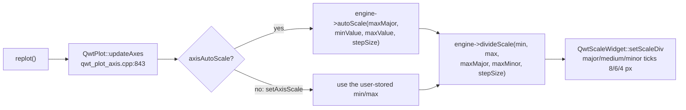
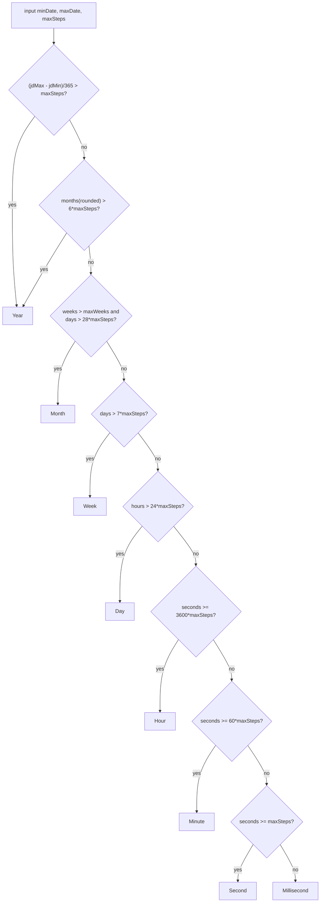

# The Scale Engines' "Nice Numbers" Algorithm: Step Generation and Level Fallbacks in QwtScaleEngine

> **Abstract** — Axis scales are the most inconspicuous component of a plotting library, yet the one that most affects readability: given a data interval $[x_1, x_2]$ and a tick budget $M$, the engine must choose a "human-friendly" step size $s$ (1–2 significant digits), align the interval bounds to integer multiples of $s$, and lay out ticks at three levels (major/medium/minor). Taking the three engine implementations of QWT7 as its subject — `QwtLinearScaleEngine`, `QwtLogScaleEngine` (`src/core/qwt_scale_engine.cpp`) and `QwtDateScaleEngine` (`src/plot/qwt_date_scale_engine.cpp`) — this article reconstructs the step-selection arithmetic line by line (including the $10^{-6}$ tolerance, the integer halving loop and the fuzzy comparison), proves the uniqueness of the $\{1,2,5\}$ base set in the sense of "decimal-dual closure" and quantifies its gap to the minimax optimum (2.5 vs 2.154), dissects the log engine's "major step $\geq 1$ decade" clamp and its sub-decade linear fallback, and walks through the date engine's eight-level classification fallback decision tree from milliseconds to years. All conclusions are supported by a statement-by-statement Python reimplementation (a 10,000-random-interval scan plus systematic boundary intervals) and C++ cross-validation against the real QWT library (linear 2000/2000, log 405/405, date 608/608 all consistent).

> **Abstract — Core conclusions**
>
> - The linear engine's step base set is $\{1,2,5\}\times 10^k$, **not** 1/2/2.5/5: the integer halving loop of `QwtScaleArithmetic::divideInterval` (`src/core/qwt_scale_engine.cpp:157`) produces the chain 10→5→2→1, and `floor(5/2)=2` is exactly why 2.5 is excluded; over 10,000 random intervals the measured frequencies of the three mantissas are 30.29% / 29.41% / 40.30%, within 0.7 percentage points of the log-uniform theoretical values 30.10% / 30.10% / 39.79%.
> - $\{1,2,5\}$ is not the minimax-optimal triple: its measured worst-case step inflation ratio of 2.5 is higher than the 2.25 of the integer optimum $\{2,4,9\}$ and the unconstrained geometric optimum $10^{1/3}\approx 2.154$; its uniqueness lies in being the **only** triple of integers closed under the decimal dual $s \mapsto 10/s$ (the full divisor set of 10 minus 10), which guarantees that a decade step (mantissa 1) halved or divided by five still lands on the ladder; steps with mantissa 2/5 can still trigger the $0.5s$ fallback.
> - `maxNumSteps` is a soft constraint: under the QwtPlot pipeline (first `autoScale` alignment, then `divideScale`), 7.80% of random intervals exceed their major-interval budget (measured maximum 9 vs a budget of 8), while the path calling `divideScale` directly has an overrun rate of 0%.
> - The log engine's major step is clamped to $\geq 1$ decade (`src/core/qwt_scale_engine.cpp:825`), and intervals spanning less than one decade are delegated wholesale to the linear engine: $[1,\sqrt{10}]$ yields the linear ticks 1, 1.5, 2, 2.5, 3; $[3,300]$ under maxMajor=8 keeps only 2 major ticks (10, 100) after alignment and clipping.
> - Measured level-fallback boundaries of the date engine (maxSteps=8): Millisecond→Second at about 7 s, →Minute at about 8 min, →Hour at about 8 h, →Day at about 8 d, →Week at about 56 d, →Month at about 224 d, →Year at about 4 a; the Month level opens only for spans beyond about 7.4 months, a 3-month span falls back to Week (2-week steps; under a Monday-start locale every major tick lands on a Monday), and an 8.5-month span is reclassified as Week in the second classification because of the 30-day/month step hint.

---

## 1. Introduction: formalizing the scale problem

### 1.1 Problem statement

Let the data interval be $[x_1, x_2]$ (width $w = x_2 - x_1 > 0$) and the tick budget be $M$ (in QWT, `maxMajorSteps`; `QwtPlot` defaults to 8, see `src/plot/qwt_plot_axis.cpp:46`). The output of a scale engine is a triple: the aligned bounds $[a_1, a_2] \supseteq [x_1, x_2]$, the step size $s$, and the three tick-level position sets (major ticks MajorTick, medium ticks MediumTick, minor ticks MinorTick; see `src/core/qwt_scale_div.h:50`). The optimization goal can be written informally as three conditions:

1. **Readability**: $s = m \cdot 10^k$, with a mantissa $m$ of only 1–2 significant digits ("nice numbers");
2. **Information**: the major interval count $n = (a_2 - a_1)/s$ satisfies $n \le M$ and comes as close to $M$ as possible — too-sparse ticks waste axis space, too-dense ticks overlap labels;
3. **Alignment**: $a_1, a_2$ are integer multiples of $s$, so the endpoint labels are nice numbers as well.

The three goals conflict: goal 1 confines $s$ to a discrete ladder $\mathcal{L}$, goal 2 wants $s \approx w/M$, and $w/M$ is almost never in $\mathcal{L}$. QWT makes the same trade-off as Heckbert's classic scheme — **round up to the ladder**:

$$
s = \left\lceil \frac{w}{M} \right\rceil_{\mathcal{L}} \;=\; \min\{\, \ell \in \mathcal{L} : \ell \ge w/M \,\}
$$

Rounding up (rather than to nearest) guarantees $n \le M$ before alignment; the cost is that $n$ can fall as low as $M/2.5$ below $M$ (the sawtooth curve of Section 3.4 quantifies this cost). Heckbert's original *Nice Numbers for Graph Labels* also gives a round-to-nearest variant for label spacing; QWT keeps only the round-up variant and hands the freedom of "rounding down" to the alignment step.

### 1.2 Division of labor among the three engines

| Engine | Source file | Domain semantics | Step units |
|---|---|---|---|
| `QwtLinearScaleEngine` | `src/core/qwt_scale_engine.cpp:476` | decimal floating point | data units |
| `QwtLogScaleEngine` | `src/core/qwt_scale_engine.cpp:710` | positive reals, log mapping | decades |
| `QwtDateScaleEngine` | `src/plot/qwt_date_scale_engine.cpp:630` | epoch milliseconds (double) | ms/s/min/h/day/week/month/year |

`QwtDateScaleEngine` inherits from the linear engine: millisecond-scale intervals are delegated straight to the decimal arithmetic (`src/plot/qwt_date_scale_engine.cpp:898`); calendar semantics kick in only from seconds upward. The shared skeleton of all three is the `QwtScaleEngine` base class (attributes `Floating`/`Symmetric`/`IncludeReference`/`Inverted`, margins, and the tolerance arithmetic `QwtScaleArithmetic`).

### 1.3 Call chain: when the engines are invoked

`QwtPlot::updateAxes()` (`src/plot/qwt_plot_axis.cpp:843`) is the single standard entry point, triggered by every `replot()`:



Two default parameters are worth remembering: `maxMajor = 8` and `maxMinor = 5` (`src/plot/qwt_plot_axis.cpp:46-47`); tick lengths are 8/6/4 pixels for major/medium/minor (`src/plot/qwt_abstract_scale_draw.cpp:47-49`). Note that the `stepSize` computed by `autoScale` is passed back to `divideScale` as a **hint** — in the date engine this pass-back triggers a second classification (Section 5.6); it is the most important hidden coupling in this article.

## 2. The linear engine: one round-up and two alignments

### 2.1 Step selection: the integer halving loop of divideInterval

The core function is only 24 lines long (`src/core/qwt_scale_engine.cpp:157`):

$$
v = \frac{w - 10^{-6} w}{M}, \quad l = \log_{b}|v|, \quad p = \lfloor l \rfloor, \quad f = b^{\,l-p} \in [1, b)
$$

$$
n = b;\quad \textbf{while}\; n > 1 \;\wedge\; f \le \lfloor n/2 \rfloor :\; n \leftarrow \lfloor n/2 \rfloor;\quad s = n \cdot b^{\,p}
$$

Three details determine the entire behavior. The first: `divideEps` subtracts $10^{-6} w$ up front — the halving-loop condition includes equality ($f \le \lfloor n/2 \rfloor$), so $f = 1.999998$ and an exact $f = 2.0$ give the same result; what the tolerance truly defends against is log/pow round-trip noise — without it, noise could push $f$ slightly above a ladder value (say $2.0000000000000004 > 2$), the halving loop would stop early and the step would jump to the rung above, $5 \cdot 10^p$. The second: `n / 2` in the halving loop is **unsigned integer division** — for $b=10$ the chain is $10 \to 5 \to 2 \to 1$, and $\lfloor 5/2 \rfloor = 2$ makes 2.5 forever impossible; this is exactly the answer to "is the base set $\{1,2,5\}$ or $\{1,2,2.5,5\}$" (the header comment at `qwt_scale_engine.h:156` also states $\{1,2,5\}\cdot 10^n$). The third: the mapping from $f$ to the ladder is piecewise constant:

| Target mantissa $f$ | Selected $n$ | Step mantissa |
|---|---|---|
| $f = 1$ | 1 | 1 |
| $1 < f \le 2$ | 2 | 2 |
| $2 < f \le 5$ | 5 | 5 |
| $5 < f < 10$ | 10 | 1 (carry into $10^{p+1}$) |

That is, the mantissa space $[1,10)$ is cut into three segments $(1,2] \to 2$, $(2,5] \to 5$, $(5,10) \to 10$ (plus the endpoint $f = 1 \to 1$; Figure 1b). The `base` parameter can be changed: for $b=2$ the chain is $2 \to 1$ (only 1 mantissa); for $b=16$ it is $16 \to 8 \to 4 \to 2 \to 1$ (4 mantissas); see experiment B3.

### 2.2 divideScale: alignment, tick laying, clipping

The signature of `QwtLinearScaleEngine::divideScale` (`src/core/qwt_scale_engine.cpp:533`) is `(x1, x2, maxMajorSteps, maxMinorSteps, stepSize = 0)` — the third parameter is the **major tick budget** (the minor budget is the fourth), not a minimum step size; a non-zero `stepSize` is used directly as the given step (its absolute value is taken). The flow:

1. Normalize the interval; a width beyond the `double` limit reports overflow and returns an empty division, and a width $\le 0$ returns an empty division;
2. For `stepSize == 0`, compute per Section 2.1 (`maxMajorSteps` is first clamped to $\ge 1$);
3. `align()` (`:679`) expands the bounds outward to integer multiples of the step: `floorEps`/`ceilEps` carry a $10^{-6}$ relative tolerance, plus a $10^{-12}$ absolute tolerance protecting endpoints "already on the grid" from being pushed off by floating-point error;
4. `buildMajorTicks` (`:611`) lays $n = \mathrm{round}(w'/s)+1$ major ticks over the **aligned** interval, hard-capped at 10000 (`:614`, preventing memory blowup when the user supplies too small a step);
5. `buildMinorTicks` (`:636`), see Section 2.3;
6. `strip()` uses fuzzy comparison (tolerance $10^{-6} w$, `qwt_math.h:190`) to delete ticks outside the original interval, then pins ticks fuzzily equal to 0 to exactly 0.0;
7. If $x_1 > x_2$, reverse the whole division.

> **Note — The order of alignment and clipping**
>
> Major ticks are generated over the aligned interval $[a_1, a_2]$ and then clipped back to $[x_1, x_2]$, so the bounds of a `QwtScaleDiv` are always the user interval while the ticks are a subset of the grid. Section 6.2 shows how this order makes "major tick count $\le M$" hold identically on the direct-call path yet be violable on the pipeline path.

### 2.3 Minor ticks: qwtStepSize and the 0.5x fallback

The minor step comes from the static function `qwtStepSize` (`:54`, whose source comment self-deprecatingly says "this version often doesn't find the best ticks"): it runs `divideInterval` once more on $(s, \text{maxMinorSteps})$, and if $(\lceil s/s_{min}\rceil) \cdot s_{min}$ fuzzily exceeds $s$ (the minor ticks do not fit), it falls back to $0.5 s$. Each major interval receives $\lceil s/s_{min}\rceil - 1$ minor ticks; when that count is odd, the exact middle one is promoted to a medium tick. The canonical structure (single interval, no clipping; experiment A4):

| Major step mantissa | maxMinor | Minor step | Per interval (minor, medium) | Positions (fraction of the interval) |
|---|---|---|---|---|
| 1 | 2–4 | 0.5 | (0, 1) | 0.5 medium |
| 1 | 5–8 | 0.2 | (4, 0) | 0.2, 0.4, 0.6, 0.8 |
| 2 | 2–3 | 1 | (0, 1) | 0.5 medium |
| 2 | 4–8 | 0.5 | (2, 1) | 0.25 minor, 0.5 medium, 0.75 minor |
| 5 | 2 | 5 | (0, 0) | no minor ticks |
| 5 | 3–4 | **2.5 (fallback)** | (0, 1) | 0.5 medium |
| 5 | 5–8 | 1 | (4, 0) | 0.2, 0.4, 0.6, 0.8 |

Rows three through six directly exhibit the self-consistency of the $\{1,2,5\}$ ladder: for a mantissa-5 step with maxMinor=3 or 4, $5/2 = 2.5$ is off the ladder, the "does not fit" check triggers the $0.5s$ fallback, and the minor ticks degenerate into a single midpoint tick. Over 10,000 random intervals this fallback fires at exactly 40.30% (maxMinor=3 and 4), equal to the occurrence frequency of mantissa 5; under QWT's default maxMinor=5 the firing rate is 0% (experiment A5).

The `#else` branch below this static function in the source still keeps the old implementation (`:74-99`): it enumerates step counts downward from `maxSteps` and matches the $n \cdot b^p$ form with `qFuzzyCompare`. Note that the comment "this version often doesn't find the best ticks: f.e for 15: 5, 10" sits immediately after `#if 1`, directly above the current implementation — "this version" refers to the **current version** (upstream's self-deprecation about the live heuristic), not the old implementation under `#else`. Keeping this dead code is a Qwt upstream tradition: the historical failure cases of the minor-tick heuristic are more honest than documentation.

### 2.4 autoScale: margins, symmetry and degenerate intervals

`autoScale` (`:493`) first subtracts/adds `lowerMargin`/`upperMargin` (data units in the linear engine), then applies `symmetrize(reference())` and `extend(reference())` as needed; for a width of 0, `buildInterval` fabricates the interval $[v - 0.5|v|, v + 0.5|v|]$ ($[-0.5, 0.5]$ when $v=0$); it then computes the step and aligns unless `Floating` is set. A single-point data series therefore gets an axis whose width is 100% of the original value — the date engine inherits this behavior; the consequences appear in the failure list of Section 7.

## 3. Number-theoretic properties of the step base

### 3.1 The right question about optimality

Extend a mantissa set $S = \{s_1 < s_2 < \cdots < s_k\} \subset [1, 10)$ periodically into the ladder $\mathcal{L} = S \cdot 10^{\mathbb{Z}}$. The worst-case inflation ratio of rounding up is the maximum of the ratios between adjacent rungs (including the wrap-around across decades):

$$
r_{\max}(S) = \max\left( \frac{s_2}{s_1}, \frac{s_3}{s_2}, \ldots, \frac{s_k}{s_{k-1}}, \frac{10\, s_1}{s_k} \right)
$$

**Proposition (geometric lower bound)** For any $k$-element set, $r_{\max}(S) \ge 10^{1/k}$, with equality if and only if $S$ is the geometric progression $\{10^{i/k}\}$. *Proof*: the product of the $k$ ratios (including the wrap-around) is exactly $\frac{s_2}{s_1}\cdots\frac{10 s_1}{s_k} = 10$, so the maximum cannot fall below the geometric mean $10^{1/k}$; the geometric progression equalizes all ratios and attains equality. $\square$

Hence the unconstrained optimum is $10^{1/3} = 2.154435$ for $k=3$ and $10^{1/4} = 1.778279$ for $k=4$ (values printed by experiment B1).

### 3.2 Measured: {1,2,5} does not sit on the optimum

Exhaustively computing $r_{\max}$ over all 84 three-element subsets of $\{1,\ldots,9\}$ (experiment B1): the minimum is 2.25, held exclusively by $\{2,4,9\}$; the 2.5 of $\{1,2,5\}$ ties for the second tier with $\{1,2,4\}$, $\{2,4,8\}$, $\{2,5,8\}$ and $\{2,5,9\}$. Among four-element sets (including the half steps 1.5/2.5) the minimum is 2.0, shared by nineteen sets (including $\{1,2,2.5,5\}$, $\{1,2,4,5\}$, $\{1,2,4,8\}$, $\{1.5,3,6,9\}$; the full list is in the experiment B1 output). The conclusion must be stated honestly: **QWT's $\{1,2,5\}$ is neither the minimax-optimal triple nor the "optimal integer triple"** — it pays 16% more worst-case step inflation than the unconstrained optimum (2.5/2.154).

### 3.3 The real uniqueness of {1,2,5}: decimal-dual closure

Define the dual map $d(s) = \mathrm{mantissa}(10/s)$ (pulling the mantissa of $10/s$ back into $[1,10)$). Exhaustive verification (experiment B2): among the three-element subsets of $\{1,\ldots,9\}$, **exactly one** satisfies $d(S) = S$, namely $\{1,2,5\}$ — it is precisely the full divisor set of 10, $\{1,2,5,10\}$, minus 10 (that is, the proper divisors of 10). This closure property has three practical consequences:

1. **Representable minor ticks**: halving a decade step (mantissa 1) or dividing it by five still yields nice numbers ($10^k/2 = 5\cdot10^{k-1}$, $10^k/5 = 2\cdot10^{k-1}$, i.e. $10/2 = 5$, $10/5 = 2$); steps with mantissa 2/5 are not closed under halving or fifth division ($5/2 = 2.5$ and $2/5 = 0.4$ are both off the ladder) and can still trigger the $0.5s$ fallback of Section 2.3. For $\{2,4,9\}$, neither $10/9 = 1.\overline{1}$ nor $10/4 = 2.5$ is on the ladder, so minor ticks can only be forced through the $0.5s$ fallback.
2. **Fixed points of the halving loop**: the chain generated by the loop $n \leftarrow \lfloor n/2 \rfloor$ of Section 2.1 starting from $b$ is exactly the divisor chain of $b$ ($b=10$: 10,5,2,1; $b=16$: 16,8,4,2,1; $b=12$: 12,6,3,1; experiment B3), and dual closure guarantees every step along the chain remains a decimal nice number.
3. **Closed label arithmetic**: adding, subtracting, halving and taking a fifth of tick values are exactly representable in decimal floating point, keeping labels free of tails like 0.30000000000000004.

In other words, $\{1,2,5\}$ is the unique solution under the "readability + subdivisibility" constraint; minimax optimality was never part of its objective function. Figure 1 places the two metrics side by side: the left panel shows $r_{\max}$ for each candidate set, the right panel the three-segment mantissa partition.


### 3.4 The tick-density sawtooth: visible consequences of the 2.5x inflation

Fix $x_1 = 0$ and $M = 8$ and sweep the width $w$ over $[1, 10^4]$: the major interval count $n(w) = w / s(w)$ traces a sawtooth — inside each ladder cell $n$ climbs linearly from $8/r$ back to 8 ($r$ being that cell's inflation ratio), dropping at every cell crossing. Measured $n \in [3.2065, 7.9989]$, matching the theoretical bound $[8/2.5, 8] = [3.2, 8]$ (experiment B5). This means **the tick count of one and the same axis oscillates between 3.2 and 8 while zooming** — the "ticks alternately sparse and dense while zooming" that users perceive is this sawtooth, not a bug; switching to the four-element set $\{1,2,2.5,5\}$ compresses the amplitude to $[4, 8]$, at the cost of half-integer labels such as 2.5.


The distribution of the inflation ratio $s/(w/M)$ (Figure 2b, 10,000 random intervals) measures min 1.000029, max 2.499898, mean 1.522731: the upper bound stays strictly below 2.5 (the $\varepsilon$ deduction makes the boundary unattainable), and the mean of 1.52 says "on average only 66% of the budget is used". The measured mantissa frequencies 30.29% / 29.41% / 40.30% agree with the log-uniform theoretical values $\log_{10}2 = 30.10\%$, $\log_{10}2 = 30.10\%$, $\log_{10}2.5 = 39.79\%$ — a Benford-type law: the target mantissa is log-uniform over $[1,10)$, the interval $(2,5]$ carries the largest probability, hence mantissa-5 steps are the most common.

## 4. The log engine: a second arithmetic in units of decades

### 4.1 Domain clamping and two fallbacks

`QwtLogScaleEngine` installs a `QwtLogTransform` at construction; all steps and margins are in units of **decades** (header warning, `qwt_scale_engine.h:190`). `divideScale` (`:798`) first does two things:

1. Clamp the interval to $[10^{-150}, 10^{150}]$ (`QwtLogTransform::LogMin/LogMax`, `src/core/qwt_transform.cpp:31-34`) — a non-positive lower bound is silently raised to $10^{-150}$;
2. If $x_2/x_1 < b$ (less than one decade), **delegate to the linear engine wholesale** (`:811-816`): decade ticks on a narrow interval of a log axis are meaningless, so linear ticks are produced directly.

The major step (in decades) from `divideInterval(log_b w, M)` is clamped immediately: `if (stepSize < 1.0) stepSize = 1.0` (`:825`) — **major ticks are at least one decade apart**. Combined with the ladder of Section 2.1, this clamp has a clean corollary: major ticks on a log axis always land on integer powers of $b$ (alignment happens in log space, and a step $\ge 1$ guarantees integer log bounds).

### 4.2 Two mechanisms for major and minor ticks

Major ticks are equidistant in log space (`:878`): $\text{tick}_i = \exp(\ln a_1 + i \cdot \Delta)$, $\Delta = (\ln a_2 - \ln a_1)/(n-1)$. Minor ticks split into two mechanisms (`:911`):

- **Single-decade mechanism** (`step < 1.1`, i.e. step is exactly 1): the minor step $= \mathrm{divideInterval}(1, \text{maxMinor}+1)$ (in decades), $numSteps = \mathrm{round}(1/s_{min})$; if $s = b/numSteps \ge 1$, minor ticks take the geometric positions $v \cdot j s$. QWT's default maxMinor=5 gives $s_{min}=0.2$, $numSteps=5$, $s=2$, i.e. four minor ticks 2, 4, 6, 8 within each decade; the classic full 2–9 graduation appears only for $9 \le$ maxMinor $\le 18$; for maxMinor $\ge 19$, $s < 1$ and the ticks degenerate into **value-equidistant** minor ticks (visually uneven on a log axis; experiment C2 prints the 18 equidistant positions and the medium tick at 5.5).
- **Multi-decade mechanism** (`step \ge 1.1`): the minor step is clamped to $\ge 1$ decade and the minor factor is $\max(b^{s_{min}}, b)$, so minor ticks are at least one decade apart; with step=2 and maxMinor=5 there is exactly 1 minor tick between every two major ticks (1 decade apart) and no medium tick (experiment C3).

The full scan of the single-decade mechanism (experiment C2; major step 1 decade, interval $[1,1000]$):

| maxMinor | Minor step (decades) | numSteps | $s = 10/numSteps$ | Mechanism | Minor ticks per decade | Medium tick |
|---|---|---|---|---|---|---|
| 0 | — | — | — | no minor ticks | — | — |
| 1–3 | 0.5 | 2 | 5 | geometric | 5 | — |
| 5, 7 | 0.2 | 5 | 2 | geometric | 2, 4, 6, 8 | — |
| 9–18 | 0.1 | 10 | 1 | geometric | 2, 3, …, 9 | — |
| 19–30 | 0.05 | 20 | 0.5 | **equidistant** | 1.45, 1.9, …, 9.55 (18 of them) | 5.5 |

The last row is the hidden trap: `numSteps > 10` makes $s < 1$, and the code switches to the "value-equidistant" branch $v + j v (b-1)/numSteps$ — minor ticks are evenly spaced **in value**, squeezed toward the high end of the decade on the log axis, with the medium tick at the 5.5 multiple. To get the textbook 2–9 graduation on a log axis, maxMinor must fall in $9 \le \text{maxMinor} \le 18$; $\ge 19$ switches to the equidistant branch.

### 4.3 Boundary behavior: three counterintuitive cases

| Interval | maxMajor/maxMinor | Result | Cause |
|---|---|---|---|
| $[1, 1000]$ | 8/5 | 4 major ticks 1, 10, 100, 1000; 4 minor ticks per decade | `divideInterval(3,8)=0.5` clamped to 1 decade |
| $[1, \sqrt{10}]$ | 8/5 | linear fallback: major ticks 1, 1.5, 2, 2.5, 3 | ratio 3.16 < 10 |
| $[3, 300]$ | 8/5 | **only 2 major ticks left** 10, 100; 8 minor ticks | log-aligned to $[10^0, 10^3]$, then stripped back to $[3,300]$ |
| $[10^{-6}, 10^{6}]$ | 8/5 | 7 major ticks (2-decade spacing), 6 minor ticks | 12 decades / 8 → the ladder picks 2 |
| $[0, 1000]$ | 8/5 | 9 major ticks, from $10^{-160}$ to $1$ | lower bound clamped to $10^{-150}$, then aligned and expanded by one more rung |

Row three deserves the most caution: with 2 decades of log width and a budget of 8, 0.5-decade major ticks would have been possible, but the clamp raises the step to 1 decade, alignment expands the interval to 3 decades, and strip cuts both ends — the user sees "a budget of 8 drawing only 2 labels". Row five shows the clamp does not recurse: the aligned lower bound $10^{-160}$ lies below `LogMin`, yet strip's fuzzy tolerance ($10^{-6} \times$ interval width $\approx 10^{-3}$) judges every tiny tick as "inside the interval", so a physically meaningless label like $10^{-160}$ appears on the axis.


## 5. The date engine: eight-level classification and level fallbacks

### 5.1 Data model and approximate constants

The value of a date axis is a double counting "milliseconds since the epoch" (`src/core/qwt_date.h:41`). `QwtDate::IntervalType` has eight levels: Millisecond, Second, Minute, Hour, Day, Week, Month, Year. Among the nominal millisecond counts of each level (`qwt_date_scale_engine.cpp:38`), Month = 30 days and Year = 365 days are **approximate constants**, used only to convert "a step in type units" back into a millisecond hint; the real tick positions are all generated by `QDateTime` calendar arithmetic (`addSecs`/`addMonths`/`addYears`), so month/year ticks are inherently uneven.

### 5.2 The classification cascade: the intervalType decision tree

`intervalType(minDate, maxDate, maxSteps)` (`:753`) probes top-down and returns at the first hit:



Here the conjunction of `weeks > maxWeeks` (default `maxWeeks = 4`, `:610`) and `days > 28·maxSteps` is the sole entrance to the Month level: **when the span does not exceed maxWeeks weeks, or does not exceed 28·maxSteps days, Month is simply unreachable**. Measured classification boundaries (maxSteps=8, experiment D5):

| Fallback edge | Span location (within scan resolution) | Nominal threshold |
|---|---|---|
| Millisecond → Second | 6785–7174 ms | 8 s |
| Second → Minute | 4.727e5–4.998e5 ms | 8 min |
| Minute → Hour | 2.785e7–2.945e7 ms | 8 h |
| Hour → Day | 6.716e8–7.101e8 ms | 8 d |
| Day → Week | 54.87–58.02 d | 56 d |
| Week → Month | 221.6–234.3 d | 224 d |
| Month → Year | 1399–1479 d | 48 months |

The "rounded" width means the endpoints are first floored/ceiled to that level before the width is measured (`qwtRoundedIntervalWidth`), so measured boundaries sit slightly earlier or later than the nominal thresholds by one rounding unit.

### 5.3 The step ladder of each level

`qwtDivideScale` (`:168`) looks up an integer ladder table by type (after rounding up to $\lceil w/M \rceil$, it takes the first table value not smaller than it):

| Type | Ladder |
|---|---|
| Second / Minute | 1, 2, 5, 10, 15, 20, 30, 60 |
| Hour | 1, 2, 3, 4, 6, 12, 24 |
| Day | for $v \le 5$ take $\lceil v \rceil$, otherwise $\lceil v/7 \rceil \cdot 7$ (jump to a multiple of weeks) |
| Week | 1, 2, 4, 8, 12, 26, 52 |
| Month | 1, 2, 3, 4, 6, 12 |
| Year / Millisecond | reuse the decimal ladder `divideInterval(w, M, 10)` |

The function also opens with a prefix rule: for non-Day types with $M < w \le 2M$, return 2 directly. Exhausting all 6 types × widths 1–400 × budgets 1–12, a total of 28,800 combinations (experiment B4), the difference between this rule and the table-lookup results is **0** — because every table contains 2, the prefix rule is a purely defensive early exit that changes no output.

### 5.4 Alignment: every level has its own "zero point"

`alignDate` (`:966`) deliberately uses different alignment references: second/minute/hour align to the start of a whole minute/hour/day respectively; **Day aligns to multiples of the "day of year"** (with the start of the year as zero; the comment explains this keeps major ticks from jumping while panning); Week aligns to `dateOfWeek0(year, week0Type)` — ISO 8601 FirstThursday or the American FirstDay; Month aligns to January; Year aligns to January 1 and skips the nonexistent year 0 AD. `dateOfWeek0` (`src/core/qwt_date.cpp:556`) additionally depends on `QLocale().firstDayOfWeek()` for the starting day of the week. Measured (experiment D6, FirstThursday + Monday start): week0(2021) = 2021-01-04, week0(2023) = 2023-01-02, week0(2024) = 2024-01-01, week0(2025) = **2024-12-30** — week 1 of 2025 starts on December 30 of the previous year, so the zero point of Week-type ticks can fall outside the year of the interval.

### 5.5 Tick generation: three loops

Once the classification and step are fixed, `buildScaleDiv` (`:917`) floors/ceils the endpoints to type boundaries and dispatches:

- `qwtDivideToSeconds` (`:381`, types ≤ Week): iterates major ticks with `addSecs(step·s)`; minor ticks are laid with `addMSecs`, and for an even graduation the exact middle one is promoted to a medium tick (the source carries an additional `i != 1` exclusion: when numMinorSteps = 2 the middle position is i = 1, which is excluded, so there is no medium tick). DST correction is enabled only when the timeSpec is the system time zone and the type is above Hour (or Hour with a step > 1): major tick values get the UTC offset difference added, and for "the skipped hour" `qwtDstTicks` (`:354`) inserts an extra set of minor ticks, keeping the tick sequence from going out of step like 0, 2, 3, 5. It never triggers in UTC or offset-from-UTC modes.
- `qwtDivideToMonths` (`:474`): iterates with `addMonths`; for a 1-month step, minor ticks are laid by day (maxMinor ≥ 30 → every day, ≥ 6 → every 5 days, ≥ 3 → every 10 days, otherwise every 15 days), and the "promote the 15th to a medium tick" rule holds only for minStepDays ∈ {1, 5} (i.e. maxMinor ≥ 6) — a 10-day step sequence never passes the 15th, and the 15-day step is explicitly excluded by the source (`days == 15 && minStepDays != 15`); for steps > 1 month, minor ticks are laid by month (the Month branch of `qwtDivideMajorStep` rejects fractional months; there is no $0.5s$ fallback).
- `qwtDivideToYears` (`:541`): iterates with `addYears`, including the correction that skips year 0 for BC dates; minor ticks convert to year/month offsets with `qRound(i·minStep)` — this `qRound` is the source of one failure mode in Section 7.

### 5.6 The hint pass-back triggers a second classification

When `divideScale` (`:869`) receives a non-zero `stepSize` hint, it **re-estimates the budget**: `maxMajorSteps = ceil((max-min)/stepSize)`. Because Month/Year hints use the 30/365-day approximations, the re-estimated budget can exceed the user's budget and thereby change the classification. Measured case (the fifth example of experiment D1): span 2024-01-15 → 2024-09-15 (8.5 months); `autoScale` classifies it as Month with a 1-month step, expands the bounds to [01-01, 10-01], and the hint = 30 days = 2.592e9 ms; `divideScale` re-estimates maxMajor = ceil(274/30) = 10 from the hint, the Month threshold becomes $28 \times 10 = 280 > 274$ days, which fails, the classification is **re-judged as Week**, and the final rendering shows 10 major ticks spaced 28 days apart (01-01, 01-29, 02-26, …, 09-09) instead of month ticks. Had the hint been computed with the true mean month length of 30.44 days, the re-estimated budget would be 9, the threshold 252 < 274, and the Month classification would survive — the 30-day approximation flips the output type outright.

### 5.7 The week start is a function of the runtime locale

`QwtDate::floor/ceil/dateOfWeek0` all read `QLocale().firstDayOfWeek()`. The major ticks of the same 3-month span (2024-01-15 → 04-15, Week type, 2-week step) under two locales (experiments D2/D2b):

| locale | firstDayOfWeek | Major ticks |
|---|---|---|
| en-GB (ISO convention) | Monday | 01-15, 01-29, 02-12, 02-26, 03-11, 03-25, 04-08, 04-22 |
| zh-CN (CLDR) | Sunday | 01-14, 01-28, 02-11, 02-25, 03-10, 03-24, 04-07, 04-21 |

The whole tick set shifts by one day. In cross-platform/cross-language deployments this is the first suspect when a date axis "looks misaligned".


## 6. Experiments

### 6.1 Design

The experiment script `docs/assets/algorithms/scaleengine_experiment.py` (Python 3.11 + numpy + matplotlib, Agg backend, seed `0x5CA1E`) is a **statement-by-statement port** of the three engines: the same $10^{-6}$ tolerance, the same integer halving and truncation semantics (`static_cast<int>` simulated with truncation toward zero), the same floating-point accumulation order (minor ticks recurse with `val += minStep` instead of multiplication); the date part reproduces the calendar arithmetic of `QDateTime` with `datetime` (including the pure date-difference semantics of `daysTo` and the day clamping of `addMonths`). All raw numbers are printed to stdout; the four figures are generated by the same script.

The cross-validation harness `docs/assets/algorithms/scaleengine_check.cpp` links against the prebuilt Release libraries (qwtcore.lib + qwtplot.lib from `build-release/lib`, Qt 5.15.16 msvc2019_64), reads case files, and prints the `autoScale` result together with the major/minor/medium tick counts and the first and last major tick values of `divideScale`; the Python side compares case by case in `--cpp-check` mode (correctness comparison only, no timing of any kind). The harness forces `QLocale(en-GB)` to pin the week start.

Porting fidelity is the lifeline of this experiment suite; the semantics that are easy to get wrong are declared here: `QDateTime::daysTo` is a pure calendar date difference (time differences below one day truncate to 0); `addMonths`/`addYears` clamp the day for February 29/30; `qwtAlignValue` and `static_cast<int>` uniformly truncate toward zero (negative week numbers occur at the start of a year); minor ticks accumulate recursively with `val += minStep` rather than the multiplication `min + k·minStep`, to reproduce the same floating-point error trajectory; the tolerance scale of `strip`/`contains` is the interval width, not the step. Any "taken-for-granted" shortcut would be exposed by the comparison in Section 6.6. The coverage exclusions must be declared as well: DST correction, BC/year-0 alignment and the double-overflow protection of `buildInterval` are outside the scope of the port and the cross-validation (the harness runs the date engine entirely in UTC); the relevant passages (the DST branch of Section 5.5 and item 11 of Section 7) are source-level analysis.

### 6.2 Linear engine scan (N = 10,000, maxMajor = 8, maxMinor = 5)

Interval generation: $x_1 \sim U(-10^3, 10^3)$, $w = 10^{U(-3,6)}$, covering zero-crossing and multi-order-of-magnitude cases.

| Metric | Measured |
|---|---|
| Step mantissa frequency 1 / 2 / 5 | 3029 (30.29%) / 2941 (29.41%) / 4030 (40.30%), others 0 |
| Log-uniform theoretical frequency | 30.10% / 30.10% / 39.79% |
| Inflation ratio min / max / mean | 1.000029 / 2.499898 / 1.522731 |
| Direct divideScale major intervals | mean 4.547, max 7, overruns 0 (0.00%) |
| Pipeline (autoScale+divideScale) major intervals | mean 6.547, max 9, overruns 780 (7.80%) |
| Minor tick fallback rate (maxMinor=2/3/4/5/8) | 0% / 40.30% / 40.30% / 0% / 0% |

Every overrun on the pipeline path is exactly +1 (9 vs 8): `autoScale` alignment can widen the interval by up to $2s$, and `divideScale` no longer shrinks it once handed aligned bounds. The direct path's max of 7 rather than 8 also has an explanation: random endpoints almost never land on grid points simultaneously, and strip eats boundary ticks. The boundary interval family $[1, 10^k]$, $[0, 10^k]$ (experiment A6) yields another detail: for $k \ge 7$ the first major tick of $[1, 10^k]$ is **0** — strip's fuzzy tolerance $10^{-6} w \ge 10$ judges the out-of-interval 0 as "inside the interval".

### 6.3 Number theory and the sawtooth

The exhaustive-search and sawtooth numbers are in Sections 3.2–3.4: integer-triple minimax = 2.25 ({2,4,9}), {1,2,5} = 2.5, four-element optimum 2.0, geometric bounds 2.154435 / 1.778279; the unique dual-closed integer triple is {1,2,5}; sawtooth $n \in [3.2065, 7.9989]$; prefix-rule redundancy 0 differences over 28,800 combinations.

### 6.4 Log engine cases

The numbers are in the Section 4.3 table; the supplementary minor-tick mechanism scan (experiment C2, major step 1 decade): maxMinor 1–3 → 1 minor tick per decade (at the 5 multiple); 5–7 → 2, 4, 6, 8; 9–18 → full 2–9 graduation; 19–30 → 18 value-equidistant minor ticks + a medium tick at the 5.5 multiple (visually uneven on a log axis).

### 6.5 Date engine scenarios (UTC, maxMajor = 8, maxMinor = 5, full pipeline)

| Scenario | autoScale type | Aligned bounds | divideScale type/step | Major ticks | Minor/medium |
|---|---|---|---|---|---|
| 100 ms | Millisecond | unchanged | Millisecond / 20 ms | 6 (every 20 ms) | 10 / 5 |
| 1 day | Hour | unchanged | Hour / 3 h | 9 (00,03,…,24) | 16 / 0 |
| 3 months | Week | 01-15 → 04-22 | Week / 2 weeks | 8 (all Mondays under a Monday-start locale) | 7 / 0 |
| 10 years | Year | 2014-01-01 → 2026-01-01 | Year / 2 years | 7 (even years 2014…2026) | 12 / 6 |
| 8.5 months | Month | 01-01 → 10-01 | **Week / 4 weeks** | 10 (28 days apart) | 20 / 10 |

The minor tick structure of the 10-year scenario deserves to be called out separately (experiments D3/D7): `qwtDivideMajorStep(2, 5, Year)` takes the "fractional year" branch and gets minStep = 0.5 years, while `qwtDivideToYears` converts to month offsets with `qRound(i·0.5)`, yielding [12, 12, 24] — i=1 and i=2 both round to 1 year, i=3 rounds to 2 years (exactly the next major tick). Measured: all 6 medium ticks sit at the same position as some minor tick, and all 12 minor ticks sit at the same position as a major/medium tick — **the entire minor tick layer provides no new positions**. With maxMinor=8 it is worse: the month offsets are [0, 12, 12, 12, 12, 24, 24], and the first minor tick lands directly on a major tick.

### 6.6 Cross-validation

| Engine | Cases | Consistent | Inconsistent |
|---|---|---|---|
| linear (autoScale + direct + pipeline) | 2000 | 2000 | 0 |
| log (direct, incl. 5 degenerate cases) | 405 | 405 | 0 |
| date (direct + pipeline, incl. 8 hand-built scenarios) | 608 | 608 | 0 |

The comparison covers the aligned bounds and step hint of autoScale, and the three-level tick counts plus the first and last major tick values of both divideScale paths (dates with a 0.5 ms tolerance). During the port, this comparison caught two real porting errors: a lost week0 year (C++'s `setDate` sets the full date) and a week-start locale difference — after both were fixed, full consistency was reached, proving the comparison's effectiveness in reverse.

## 7. Discussion: an honest failure-mode list

1. **maxNumSteps is a soft constraint (pipeline path)**: 7.80% of random intervals measure 9 major intervals after `autoScale → divideScale` (budget 8). The root cause is that alignment expands by up to $2s$ while the step is never recomputed. When a hard guarantee is needed, call `divideScale` yourself and check `scaleDiv.ticks(MajorTick).size()`, or take full control with `setAxisScaleDiv`.
2. **Narrow log intervals silently turn linear**: an interval with ratio $< b$ gets equidistant ticks on a log axis ($[1,\sqrt{10}]$ → 1, 1.5, 2, 2.5, 3); when the label format still renders for a log axis, "log labels" that are not powers of 10 appear.
3. **The log major-step clamp eats the budget**: $[3,300]$ under maxMajor=8 has only 2 major ticks (Section 4.3). Intervals 2–4 decades wide in log with unaligned endpoints are the worst-hit zone.
4. **The $10^{-150}$ clamp for non-positive lower bounds**: $[0, 1000]$ produces 9 major ticks starting from $10^{-160}$; strip's fuzzy tolerance scales with the interval width and cannot weed out these tiny values. Data containing zero or negative values should not be handed to the log engine directly.
5. **The date Month level is nearly closed + hint-driven reclassification**: with the default maxWeeks=4, Month opens only for spans > 224 days (maxSteps=8); a 3-month span gets week ticks. An 8.5-month span is reclassified as Week in the second classification because of the 30-day approximation (Section 5.6). To obtain month ticks, the conditions are maxWeeks **less than** the span in weeks (the default 4 usually satisfies this) and days > 28·maxSteps — enlarging the week ceiling with `setMaxWeeks` only makes `weeks > maxWeeks` harder to satisfy; the effect is to suppress Month and keep long spans in the Week classification. In the 8.5-month reclassification case, the failing gate is days > 28·10 = 280, and adjusting maxWeeks in either direction cannot save it; the correct fixes are to bypass the hint pass-back (call `divideScale` directly with `stepSize = 0`), raise the `maxMajor` budget, or derive `intervalType` yourself.
6. **Year-type minor tick collapse (deduplicated at the data and draw level since v7.5.1)**: `qRound(i·minStep)` makes fractional-year offsets repeat or land on major ticks ([12, 12, 24], [0, 12, …]); the minor tick layer carries zero information (Section 6.5). Since v7.5.1 the duplicate values are removed in `setTicks()` and minor ticks coinciding with a longer type are skipped in `draw()` (no visual overprinting; `tests/scale_draw_test`), but the engine still produces those positions - for the Year type, maxMinor ≤ 3 is recommended (offsets [12], normal behavior).
7. **Week alignment depends on the runtime locale**: under zh-CN, Monday becomes Sunday (Section 5.7). Cross-region deployments need `QLocale::setDefault` or deriving `alignDate` yourself.
8. **Degenerate intervals expand by 100%**: a single-point date series (width 0) triggers `buildInterval`; the single point 2024-03-10 is expanded to 1990-01-01 → 2060-01-01 (a 70-year span, Year type). A linear axis likewise gets $[0.5v, 1.5v]$.
9. **The 10000 major-tick cap truncates silently**: when the user supplies an extremely narrow step via `setAxisScale`, `buildMajorTicks` truncates to 10000 ticks without warning (`:614`), leaving the second half of the axis unticked.
10. **strip's tolerance scales with the interval width**: the first major tick of $[1, 10^7]$ is 0 (1 unit outside the interval, tolerance 10). Under wide-interval + small-step combinations, endpoint labels may fall outside the data range.
11. **Leap seconds are not in the model**: Qt's time model is POSIX milliseconds and `qwtDstTicks` handles DST jumps only; leap seconds are neither represented nor produce duplicate ticks — for long series at sub-second precision, axis time and true UTC elapsed time accumulate a deviation (this is already the case at the Qt level, not introduced by QWT).

> **Bug — Minor ticks coinciding with major ticks**
>
> Item 6 (the Year-type qRound collapse) and the $0.5s$ fallback of Section 2.3 both produce divisions where "minor ticks sit on top of major/medium ticks". The drawing layer does not deduplicate (`QwtAbstractScaleDraw::draw` paints the list entry by entry); coinciding positions render as a thick line over a thin one — visually harmless, but the `scaleDiv` data is unclean. Code that relies on the tick list for interaction (such as snapping) must deduplicate on its own.

## 8. Code practice

### 8.1 Switching engines and the date axis

Two direct references in the repository: `examples/2D/bode` (log axis; `Plot.cpp:70-72` also demonstrates tightening the budget with `setAxisMaxMajor(XBottom, 6)`) and `examples/2D/stockchart` (date axis; `Plot.cpp:110-115`). The standard date-axis configuration replaces the engine and the scaleDraw as a pair:

```cpp
#include <qwt_plot.h>
#include <qwt_date_scale_engine.h>
#include <qwt_date_scale_draw.h>

QwtPlot* plot = new QwtPlot;

// data is stored as epoch milliseconds; UTC semantics avoid local time zone / DST interference
QwtDateScaleEngine* engine = new QwtDateScaleEngine(Qt::UTC);
engine->setMaxWeeks(8);                      // raise the week ceiling = spans of ≤8 weeks stay in the Week classification (upstream business-chart usage; default 4); does not open up the Month level
plot->setAxisScaleEngine(QwtAxis::XBottom, engine);

QwtDateScaleDraw* draw = new QwtDateScaleDraw(Qt::UTC);
draw->setDateFormat(QwtDate::Day, "yyyy-MM-dd");   // override the default label format
plot->setAxisScaleDraw(QwtAxis::XBottom, draw);

plot->setAxisMaxMajor(QwtAxis::XBottom, 6);  // tighter budget: classification thresholds tighten accordingly
plot->setAxisMaxMinor(QwtAxis::XBottom, 3);  // Year type: avoid the qRound collapse (<=3)
```

> **Warning — The engine and the scaleDraw must use the same time spec**
>
> Pairing `QwtDateScaleEngine(Qt::UTC)` with `QwtDateScaleDraw(Qt::LocalTime)` leaves the tick positions and the labels one time-zone offset apart. Both take the timeSpec from their constructor argument; there is no cross-check.

### 8.2 Custom engines: a fixed-step subclass

Subclassing `QwtScaleEngine` requires implementing only two pure virtual functions. Below is an engine with "the step fixed at 0.25 and non-floating bounds", usable for a price axis:

```cpp
#include <qwt_scale_engine.h>
#include <qwt_scale_div.h>

class FixedStepEngine : public QwtScaleEngine
{
public:
    void autoScale(int maxNumSteps, double& x1, double& x2, double& stepSize) const override
    {
        Q_UNUSED(maxNumSteps);
        stepSize = 0.25;
        // the alignment arithmetic is done manually via the public QwtScaleArithmetic
        x1 = QwtScaleArithmetic::floorEps(x1, stepSize);
        x2 = QwtScaleArithmetic::ceilEps(x2, stepSize);
    }

    QwtScaleDiv divideScale(double x1, double x2, int maxMajorSteps,
                            int maxMinorSteps, double stepSize) const override
    {
        // compose a linear engine to reuse its tick-laying logic (the step is passed in as a given value)
        QwtLinearScaleEngine linear(base());
        linear.setAttributes(attributes());
        return linear.divideScale(x1, x2, maxMajorSteps, maxMinorSteps,
                                  stepSize == 0.0 ? 0.25 : stepSize);
    }
};
```

`align` is a protected member of `QwtLinearScaleEngine` and cannot be borrowed across classes; the example above hand-writes two lines of alignment in `autoScale` with the public `QwtScaleArithmetic::floorEps/ceilEps`, and in `divideScale` composes a linear engine to reuse its tick-laying and minor-tick logic — the least-effort structure for a custom engine.

### 8.3 Tuning quick reference

| Need | Means | Basis |
|---|---|---|
| Denser/sparser ticks | `setAxisMaxMajor` (default 8) | both classification and step take it as input |
| Remove minor ticks | `setAxisMaxMinor(axis, 0)` | the `maxMinorSteps > 0` gate of `buildTicks` |
| No endpoint rounding | `engine->setAttribute(QwtScaleEngine::Floating)` | skips `align` |
| Axis through zero | `setAttribute(IncludeReference)` + `setReference(0.0)` | the extend of `autoScale` |
| 2–9 graduation on a log axis | `setAxisMaxMinor(axis, 9)` (anything in 9–18) | C2 table: full graduation only for 9–18; ≥ 19 degenerates to equidistant |
| Month ticks on a date axis | keep maxWeeks < span in weeks (the default 4 is usually enough) and span > 28·maxMajor days; when the hint reclassifies, call `divideScale` directly with `stepSize = 0` | Month thresholds of Sections 5.2/5.6 |
| ISO Monday-start week ticks | `QLocale::setDefault` to a Monday locale before running | Section 5.7 |

### 8.4 Example path erratum

The topic roadmap once listed `examples/2D/scaleengine`; that directory **does not exist** in the current repository. The real scale/time-axis examples are `examples/2D/bode` (log), `examples/2D/stockchart` (date + a custom `QwtDateScaleDraw` subclass) and `examples/2D/cpuplot` (real-time scrolling time axis). All example references in this article follow these three.

## 9. Summary

QWT's scale engines solve the "nice numbers" problem as one round-up plus two alignments. The core step and alignment arithmetic (`divideInterval` + `align`) is only about fifty lines, yet almost every behavioral boundary hides in the tolerances and integer semantics: the $10^{-6}$ `divideEps` decides that exact boundaries do not jump a rung, `floor(5/2)=2` decides that the ladder is 1-2-5 rather than 1-2-2.5-5, strip's $10^{-6} w$ tolerance decides that wide intervals tolerate out-of-interval ticks, and the half-up rounding of `qRound` decides the Year-type minor tick collapse. The choice of $\{1,2,5\}$ is not a product of minimax optimality but of decimal subdivisibility: it is the only triple of integers closed under the decimal dual $s \mapsto 10/s$, guaranteeing that a decade step halved or divided by five is still a nice number — a property worth more than the 0.35 gap in worst-case inflation ratio. The log and date engines each stack new hard constraints and failure surfaces onto this arithmetic (major step $\geq 1$ decade, the 224-day threshold of the Month level, narrow log intervals turning linear, the 30-day approximation flipping the month/week classification). The practical rule of thumb compresses into one sentence: the budget parameters control the "expected", alignment and clamping control the "actual", and the difference between them (measured mean 2 intervals, +1 in the tail) must be checked or taken over by the caller itself.

## 10. References

1. Heckbert, P. *Nice Numbers for Graph Labels.* in *Graphics Gems*, Academic Press, 1990. (the original source of round-up nice numbers)
2. QWT7 sources: `src/core/qwt_scale_engine.h/.cpp` (`QwtScaleArithmetic`, linear/log engines), `src/core/qwt_scale_div.h`, `src/core/qwt_date.h/.cpp`, `src/core/qwt_math.h` (`qwtFuzzyCompare`), `src/core/qwt_transform.cpp` (`LogMin/LogMax`).
3. QWT7 sources: `src/plot/qwt_date_scale_engine.h/.cpp` (date engine), `src/plot/qwt_date_scale_draw.cpp` (default label formats), `src/plot/qwt_plot_axis.cpp` (`updateAxes` pipeline and default budgets), `src/plot/qwt_abstract_scale_draw.cpp` (tick lengths).
4. QWT7 examples: `examples/2D/bode` (log axis + `setAxisMaxMajor`), `examples/2D/stockchart` (date axis + custom scaleDraw), `examples/2D/cpuplot` (scrolling time axis).
5. Experiment scripts: `docs/assets/algorithms/scaleengine_experiment.py` (port, scans, figures), `docs/assets/algorithms/scaleengine_check.cpp` (C++ cross-validation harness).
6. Qt documentation: `QLocale::firstDayOfWeek()`; the day-clamping semantics of `QDateTime::addMonths/addYears` (CLDR week-start data).

*Companion article:* [Real-time streaming data rendering strategies](realtime-streaming.md) — every replot runs `updateAxes` again; how the call frequency of the scale engines coexists with the frame budget in streaming scenarios.
