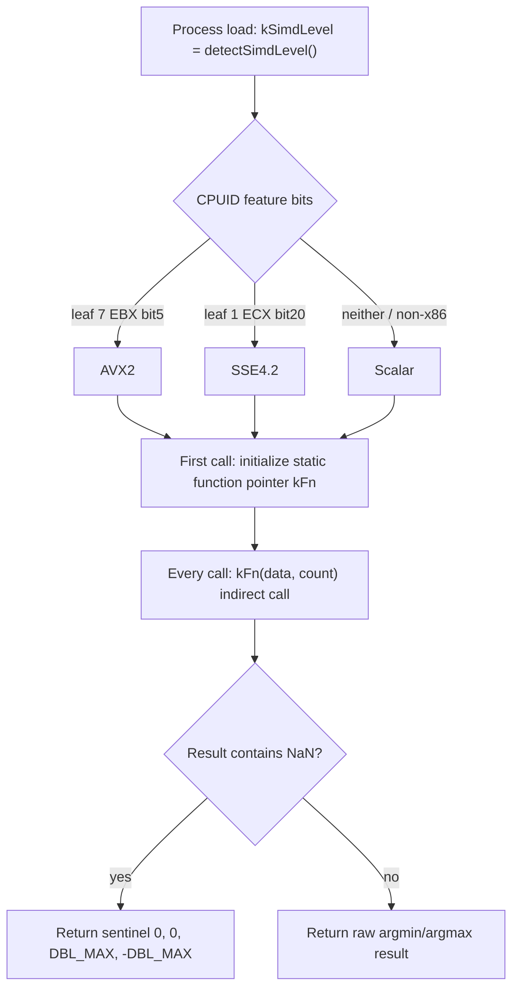
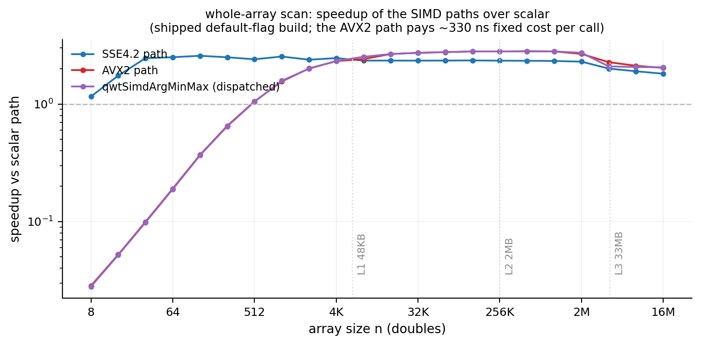
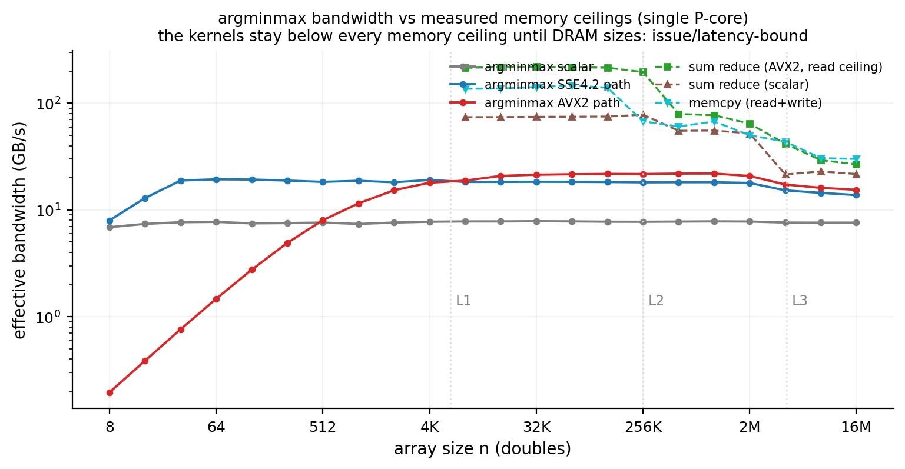
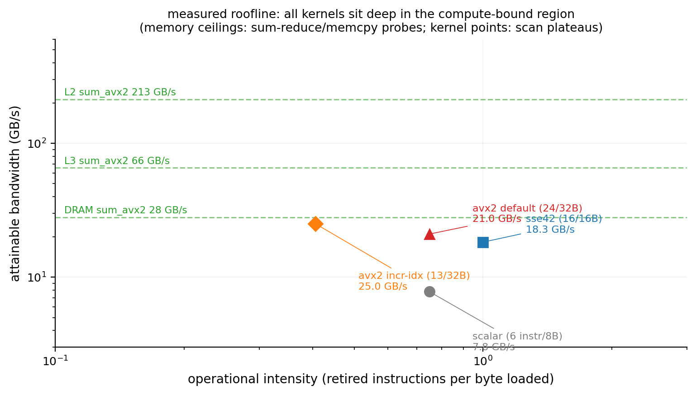
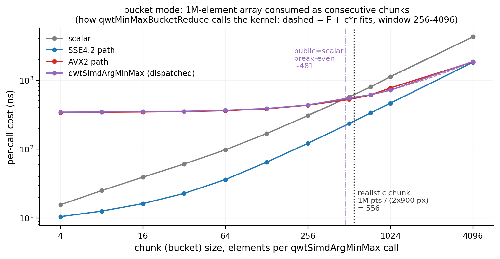
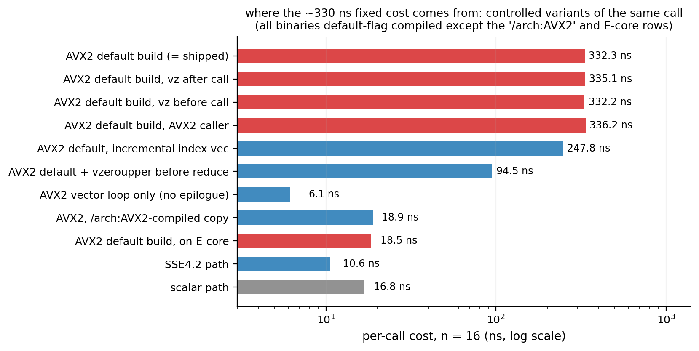

# SIMD argmin/argmax Vectorization Benchmark: The Three-Way Runtime Dispatch of qwtSimdArgMinMax

> **Abstract** — QWT7's MinMax bucket downsampling performs one argmin/argmax per bucket, and `qwtSimdArgMinMax` (dispatcher in `src/core/qwt_simd_argminmax.cpp`; since v7.5.1 the AVX2 kernel lives in `src/core/qwt_simd_argminmax_avx2.cpp`) carries this kernel with a three-way runtime dispatch across AVX2 / SSE4.2 / scalar. Based on microbenchmarks under the i7-14700 + MSVC release-build configuration (`docs/assets/algorithms/simd_bench.cpp`, raw data `simd_bench_results.csv`, min-of-7 protocol, 0 remeasured points), the measurements cover how the speed of the three paths varies with array length (8 to 16M elements), their cache hierarchy and roofline positions, and the per-bucket cost under the real call pattern of MinMax buckets (contiguous small chunks), giving a quantitative criterion for "how small a bucket can be before SIMD pays off". A set of controlled probes (vzeroupper variants, a /arch:AVX2-recompiled TU, rdtsc five-segment timing, an E-core comparison) pins the roughly 325 ns per-call fixed overhead of the AVX2 path in the release build to the combination of the horizontal-reduction epilogue in the default-compiled TU with the P-core. The measured NaN semantics matrix shows that the claim "NaN is naturally ignored" does not hold in scenarios where a NaN pollutes a lane, which explains why the NaN pre-scan of `qwtMinMaxBucketReduce` is a correctness defense rather than an optional optimization.

> **Abstract — Core conclusions**
>
> - The AVX2 path peaks at a 2.82× speedup over scalar (512K elements), holds 2.73–2.81× in the L2-resident region (32K–256K), and falls back to 2.03× at DRAM (16M); SSE4.2 gives 2.34–2.35× and 1.81× respectively, all below the "theoretical 3–4×" estimate
> - The default-compiled AVX2 path pays a fixed per-call overhead of about 325 ns (fit F = 325.17 ns, roughly 1695 cycles); rdtsc segmentation pins it to the horizontal-reduction epilogue (median 252 ns for the reduce segment; the same code in a /arch:AVX2 TU spends only 5.2 ns there); the overhead vanishes entirely on the E-core (18.5 ns vs. the P-core's 332.3 ns at n=16)
> - Bucket-mode criterion: the dispatch path (public entry to AVX2) overtakes scalar only beyond a bucket size of about 481 elements (model 449, measured interpolation 481), while the SSE4.2 path is fastest at every measured bucket size from 4 to 4096 elements. Under the typical scenario (1M visible points, 900 px canvas, 556 elements per bucket) it takes 254 ns per bucket against 551 ns for the AVX2 dispatch path (after the v7.5.1 fix the criterion drops to 4-8 elements, see the v7.5.1 bullet below)
> - All three kernels are compute/instruction-issue-bound at every size: plateau bandwidths of 7.8 / 18.3 / 21.0 GB/s, below the DRAM ceiling of 28.0 GB/s and an order of magnitude below the L2 ceiling of 213 GB/s
> - Fixed in v7.5.1: after moving the AVX2 kernel into its own translation unit compiled with `/arch:AVX2` (GCC/Clang: `-mavx2`), the 325 ns fixed overhead and the pollution of the caller's scalar code are both gone. Same-machine A/B (i7-1260P / Qt 6.7.3 / MSVC 2019, `simd_bench_results_v75{0,1}_*.csv`): `qwtSimdArgMinMax` drops from 446 ns to 13.5 ns at n=16 and from 549 ns to 125 ns at n=256; the streaming "append + SIMD reduce" loop drops from 2.12 ms to 0.13 ms (equal to append-only, 0.13-0.14 ms). The bucket criterion therefore collapses from about 481 elements to about 4-8 (at chunk=4 scalar takes 20.2 ns against 21.9 ns for AVX2, from chunk=8 up AVX2 wins). Only adding an inlined `_mm256_zeroupper()` measured ineffective (412 ns in the same build): the disassembly shows the compiler scheduling the VZEROUPPER between the 256-bit spill stores and their narrow reloads, so the function still returned with a dirty state; the recommendation in Section 5.4 is therefore the separate TU (option 1).
> - The measured NaN semantics matrix has 12 of 33 cells disagreeing with the NaN-free reference, including combined outputs where "the value is correct but the index points at a NaN element". Any input containing NaN must go through the pre-scan plus the scalar branch

---

## 1. Introduction: Eighteen Hundred Calls per Frame

MinMax bucket downsampling (`FilterPointsLTTB`, see Section 4 of the [downsampling article](curve-downsampling.md)) splits the visible samples by index into $N_b = \max(2, 2W)$ buckets, takes the argmin and argmax of $y$ in each bucket, and emits the two extreme points. When both the x and y axes use linear maps (`linearPath`, `src/plot/qwt_point_mapper.cpp:650,658`), the data source can supply a contiguous `double*`, and all y values in the visible range are finite, `qwtMinMaxBucketReduce` calls `qwtSimdArgMinMax(raw.y + start, count)` once per bucket (`qwt_point_mapper.cpp:743`). This means the kernel's per-call cost is multiplied by $2W$ calls per frame: a 900 px-wide canvas issues 1800 calls per frame, a 1920 px-wide canvas 3840. The bucket size $s = n/N_b$ is determined jointly by the visible point count and the canvas width: 1M visible points on a 900 px canvas gives $s \approx 556$. At this size the parallel gain of vectorization and the fixed per-call overhead are comparable, which is the question the benchmarks answer quantitatively.

Section 5.4 of the downsampling article devotes only one summary paragraph to this kernel, plus a single estimate that "AVX2 is theoretically 3–4× per bucket against scalar". The benchmarks here expand that paragraph: they measure the three implementations under a compile configuration identical to the release library and answer four questions: how the speedup varies with array length, how small the bucket can get before SIMD stops paying off, where the kernel sits on the roofline chart, and what the real semantics of each of the three paths are under NaN input. The benchmark program `simd_bench.cpp` (1087 lines) compiles the same `#include "qwt_simd_argminmax.cpp"` into two translation units (the main TU and an `/arch:AVX2` wrapper TU) and links the library's own AVX2 translation unit (`src/core/qwt_simd_argminmax_avx2.cpp`); the main translation unit uses the same default MSVC x64 flags as qwtcore.dll (SSE2 baseline, no `/arch` switch), so what is measured is the behavior of "the binary the user gets", not of an idealized build. Section 4.5 shows why this point is critical.

The experiment matrix has five groups: the full-array scan (n = 8 to 16M; four paths: scalar/SSE4.2/AVX2/public), the bucket-mode scan (a 1M array consumed in contiguous chunks of 4–4096 elements, replicating the mapper's call pattern), the memory-bandwidth reference (three ceiling kernels: scalar sum, AVX2 sum, memcpy), the fixed-overhead localization probes (dual translation-unit comparison, vzeroupper variants, rdtsc five-segment timing, generic transition-penalty chain probes), and the NaN semantics matrix (12 NaN distribution patterns × 4 paths, untimed); an additional E-core comparison section reruns the key variants on lp16. All data was collected in one pass into `simd_bench_results.csv`, with no new timings.

> **Note — Module naming clarification**
>
> The repository AGENTS.md describes this core module as "SIMD-accelerated argmin/argmax (SSE2/AVX2/NEON)". The source tells a different story: the three-way dispatch is Scalar / SSE4.2 / AVX2 (`qwt_simd_argminmax.cpp:15-48`), the SSE path depends on `_mm_blendv_pd` (an SSE4.1 instruction) and is gated by the SSE4.2 feature bit, and there is no NEON branch at all; non-x86 platforms (including Apple Silicon) fall to the pure scalar path. This report follows the source; the ARM side is unmeasured, see the failure list in Section 5.2.

## 2. Anatomy of the Three Implementations

### 2.1 CPUID dispatch and compile-time guards

Dispatch has two layers. The first is compile-time: the SSE4.2 implementation body is compiled only when `defined(__SSE4_2__) || (_MSC_VER >= 1700)`, otherwise `#define argMinMaxSSE42 argMinMaxScalar` (`qwt_simd_argminmax.cpp:78,135-137`); AVX2 is now split into a "declaration + separate implementation file" pair: the dispatcher's guard is `defined(__AVX2__) || (defined(_MSC_VER) && (defined(_M_X64) || defined(_M_IX86)))`, and when it holds the file declares `qwtArgMinMaxAVX2` and points `argMinMaxAVX2` at it, otherwise that macro collapses to `argMinMaxSSE42` (`qwt_simd_argminmax.cpp:143,149-150`); the body itself is compiled only in `qwt_simd_argminmax_avx2.cpp` (the equivalent form of the same guard, `qwt_simd_argminmax_avx2.cpp:14`). MSVC permits writing x86 intrinsics directly in a translation unit compiled without the `/arch` switch (emitting VEX encodings instruction by instruction), and its x64 branch is not gated on `__AVX2__`, so Windows release builds carry all three paths (the AVX2 kernel gets `/arch:AVX2` from CMake for that one file, see Section 4.5b); GCC/Clang under the default x86-64 baseline (without `-msse4.2`/`-mavx2`) collapse both macros, leaving the whole library with only the scalar path: the kernel, even when compiled as AVX2, is referenced by nobody. The same three-way source therefore behaves differently under different toolchains.

The second layer is at run time. Under MSVC, `detectSimdLevel()` checks CPUID leaf 7 EBX bit 5 (AVX2), then leaf 1 ECX bit 20 (SSE4.2); under GCC/Clang it uses `__builtin_cpu_supports("avx2"/"sse4.2")`, guarded by `__x86_64__ || __i386__`, and returns Scalar directly on non-x86. The result goes into the namespace-level `static const SimdLevel kSimdLevel` (dynamic initialization, executed once per process); the public entry `qwtSimdArgMinMax` then uses a function-level static function pointer `kFn` for the indirect call and applies sentinel replacement to the result: when `isnan(minVal) || isnan(maxVal)` it returns $\{0, 0, \text{DBL\_MAX}, -\text{DBL\_MAX}\}$ (`qwt_simd_argminmax.cpp:154-171`).



The cost of dispatch itself is negligible: the fitted fixed cost of public is 2.95 ns above the avx2 direct call (F = 328.12 vs. 325.17 ns), the point-by-point deltas at n=8/16 are 4.9/3.0 ns, and at n ≥ 4096 the two trade wins and drown in batch-to-batch variance. One textbook gap: the MSVC path checks only the CPUID feature bits, without confirming via OSXSAVE/XGETBV that the operating system has enabled YMM state saving: on an OS that does not save AVX state this means an instant illegal instruction. Modern Windows/Linux have no such problem, but strictly speaking the detection sequence is incomplete.

### 2.2 Vector structure: dual-track state, horizontal reduction, and the tail

The two SIMD implementations share the same structure and differ only in vector width (AVX2 takes 4 doubles per round, SSE4.2 takes 2). Each lane independently maintains two tracks: the value track `minVec`/`maxVec` (initialized to ±DBL_MAX) and the index track `minIdxVec`/`maxIdxVec` (indices stored as double, initialized to the lane number). Each round of the main loop:

$$
\begin{aligned}
\mathbf{p}_{\min} &\leftarrow \operatorname{blendv}\big(\mathbf{p}_{\min},\ \mathbf{i},\ \mathbf{v} <_{OQ} \mathbf{m}_{\min}\big), \qquad \mathbf{m}_{\min} \leftarrow \operatorname{minpd}\big(\mathbf{m}_{\min},\ \mathbf{v}\big) \\
\mathbf{p}_{\max} &\leftarrow \operatorname{blendv}\big(\mathbf{p}_{\max},\ \mathbf{i},\ \mathbf{v} >_{OQ} \mathbf{m}_{\max}\big), \qquad \mathbf{m}_{\max} \leftarrow \operatorname{maxpd}\big(\mathbf{m}_{\max},\ \mathbf{v}\big)
\end{aligned}
$$

where $\mathbf{v}$ is the 4 (or 2) elements loaded this round, $\mathbf{i}$ is their index vector, and the comparisons use the ordered predicates `_CMP_LT_OQ`/`_CMP_GT_OQ`. The blend uses $\mathbf{m}$ from before the update, and the value track runs through the `minpd`/`maxpd` hardware instructions while the index track runs through compare-plus-blend: the update rules of the two tracks are not equivalent, which causes the NaN problems in Section 2.3.

```text
lane:      3         2         1         0        (lane number = element index mod 4)
vals:    v[i+3]    v[i+2]    v[i+1]    v[i]       ← _mm256_loadu_pd (unaligned load)
curIdx:  i+3.0     i+2.0     i+1.0     i+0.0      ← _mm256_set_pd, rebuilt every round
minVec:  per-lane historical minimum (init +DBL_MAX)
minIdx:  per-lane historical argmin (stored as double)
```

`curIdx` is rebuilt every round with `_mm256_set_pd(i+3.0, ...)`, corresponding to 4 int→double conversions plus insert/shuffle; the incremental scheme (one `vaddpd` per round adding the constant 4.0) is measured in the benchmark as the control kernel `qb_kernel_incr`, dropping the marginal rate from 0.3644 to 0.2600 ns/element (Section 4.5). Instruction counts as inventoried by `simd_experiment.py` from the MSVC /O2 disassembly: scalar 6 per element, SSE4.2 8 per element (16 per 2 elements), AVX2 default 6 per element (24 per 4 elements), incremental-index variant 3.25 per element (13 per 4 elements).

The epilogue after the loop has three steps: the four accumulator vectors spill to a stack array via `_mm256_storeu_pd`; the horizontal reduction starts from lane 0 and improves lane by lane with strict inequalities (the lower lane wins ties); the tail of fewer than one vector width is finished with a scalar loop. The SSE4.2 version's reduction is manually unrolled over 2 lanes (`qwt_simd_argminmax.cpp:101-119`, tail `:121-130`), and the AVX2 version loops over 4 lanes (`qwt_simd_argminmax_avx2.cpp:92-101`, tail `:103-112`). The return value is the 24-byte `QwtArgMinMaxResult` struct (two ints plus two doubles, alignment 8, no padding; returned through a hidden pointer via sret under the x64 calling convention). Indices stored as double are exact within $2^{53}$, and `count` is an int, so there is no capacity issue.

### 2.3 NaN semantics: mechanism derivation and measured matrix

The header claims "NaN values are naturally ignored via IEEE 754 comparison semantics" (`qwt_simd_argminmax.h:26`). This claim holds for the index track: under ordered predicates both `NaN < x` and `x < NaN` are false, so NaN can never win a comparison. It does not hold for the value track: the Intel manual specifies that `MINPD`/`MAXPD` return the second operand (src2) when either operand is NaN, and the code is written as `minpd(acc, vals)`, where `vals` is precisely src2. So when a NaN enters a lane, two things happen: the comparison is false and the index track does not move, yet `minpd` overwrites the accumulator with the NaN. If a real value $v'$ then arrives on that lane: `v' < NaN` is false (the index still does not update), while `minpd(NaN, v') = v'` (the value recovers), and from then on the value track and the index track are decoupled. Three measured consequences (matrix in the table below; data from the CSV `nan` segment):

- Value correct, index wrong: the NaN occupies the lane first, the real extreme arrives later. `nan,avx2,8,p1` gives `max=1:1e+09`: the maximum value 1e9 itself is correct, but index 1 is the position of that NaN element. A caller that uses the index to read `x[1]` reads a NaN coordinate.
- Extreme lost: the real extreme is in the lane first, the NaN arrives later and overwrites the accumulator, and the NaN is then discarded by the unordered comparison during the horizontal reduction. `nan,sse42,16,last` gives `max=12:654854`, with the true maximum `9:1e+09` gone entirely.
- Mismatched index/value pair: `nan,sse42,16,pair_mid` gives `min=3:-598535`. The actual value at index 3 is -846858, and the reported -598535 is residue from another round's src2 overwrite; the two combine into a sample that does not exist.

The scalar path has a different problem: it initializes from `data[0]`, so if the first element is NaN, every comparison stays false and the whole result freezes at `0:NaN` (`nan,scalar,16,first`). The public entry's sentinel check replaces any result containing NaN with $\{0,0,\text{DBL\_MAX},-\text{DBL\_MAX}\}$ (`nan,public,16,all` and `even_idx`), but the header's contract covers only the "all-NaN" case; what the raw paths return under partial NaN belongs to the undefined-behavior zone.

Measured matrix (n=16; `makeData` plants -1e9/+1e9 at n/2 and n/2+1, so the reference solution is usually `min=8 / max=9`; "same as ref" means field-by-field identical to the NaN-free reference):

| Pattern | Reference (NaN-free semantics) | scalar | SSE4.2 | AVX2 (=public) |
|---|---|---|---|---|
| none | min=8:-1e+09 max=9:1e+09 | same as ref | same as ref | same as ref |
| first | min=8:-1e+09 max=9:1e+09 | min=0:NaN max=0:NaN | same as ref | same as ref |
| last | min=8:-1e+09 max=9:1e+09 | same as ref | min=8:-1e+09 max=12:654854 | same as ref |
| mid | min=3:-846858 max=9:1e+09 | same as ref | same as ref | same as ref |
| first+last | min=8:-1e+09 max=9:1e+09 | min=0:NaN max=0:NaN | min=8:-1e+09 max=12:654854 | same as ref |
| all | min=-1:DBL_MAX max=-1:-DBL_MAX | min=0:NaN max=0:NaN | min=0:NaN max=0:NaN | raw min=0:NaN max=0:NaN / pub min=0:DBL_MAX max=0:-DBL_MAX |
| pair_mid | min=3:-846858 max=1:872635 | same as ref | min=3:-598535 max=12:654854 | min=3:-846858 max=7:856568 |
| even_idx | min=3:-846858 max=9:1e+09 | min=0:NaN max=0:NaN | min=0:NaN max=0:NaN | raw min=0:NaN max=0:NaN / pub min=0:DBL_MAX max=0:-DBL_MAX |
| odd_idx | min=8:-1e+09 max=12:654854 | same as ref | same as ref | same as ref |
| p1 | min=8:-1e+09 max=9:1e+09 | same as ref | same as ref | same as ref |
| p2 | min=8:-1e+09 max=9:1e+09 | same as ref | same as ref | same as ref |
| p3 | min=8:-1e+09 max=9:1e+09 | same as ref | same as ref | same as ref |

11 NaN-containing patterns × 3 raw paths give 33 cells in total, of which 12 disagree with the reference (scalar 4, SSE4.2 5, AVX2 3). The n=8 matrix (CSV rows 254–313) additionally exposes index scrambling such as `avx2,p1 → max=1:1e+09`, `sse42,p2 → min=0:-1e+09`, `sse42,p3 → max=1:1e+09`. The pattern matches the mechanism derivation exactly: which lane the NaN lands in, and whether it comes before or after that lane's extreme, determines the error shape. `mid` is correct on all three paths at n=16 only because the planted extremes happen to avoid the polluted-lane combination.

This is the usage boundary of `qwtMinMaxBucketReduce`: the precondition of the SIMD fast path is that all y values in the visible range are finite, guarded by a single O(n) `std::isfinite` pre-scan (`qwt_point_mapper.cpp:725-731`); once a non-finite value is found, the entire reduction switches to the scalar bucket path that `continue`s past non-finite x/y element-wise (`:671-716`); if a SIMD bucket extremum lands on a sample with a non-finite x, a per-bucket post-check reruns that bucket through the same scalar routine (`:747-753`). The pre-scan is a correctness defense, not an optimization; its price is one extra sequential pass per frame (this benchmark does not time the pre-scan separately). For the downstream semantics of NaN at the curve-rendering level (line-break handling and the like), see the [NaN rendering article](nan-rendering.md).

### 2.4 Tie-index semantics (analytical, not measured)

All three implementations use strict inequalities, so the scalar path returns the first extreme index. The SIMD paths' horizontal reduction starts from lane 0 and improves only strictly, with the lower lane winning ties; lane $j$ holds the elements with index $\equiv j \pmod 4$, so "first" becomes "the one with the smallest lane number". Hand-derived example $v = [9,9,9,1,1,9,9,9]$: the global minimum 1 first appears at index 3 (lane 3), and index 4 (lane 0) equals it; scalar returns 3, while the AVX2 reduction keeps lane 0 and returns 4. The benchmark's correctness test uses uniformly random doubles (tie probability zero; `meta,correctness` PASS covering n=1..100000) and never touches this difference. Impact on bucket downsampling: tied extremes share the same $y$ but differ in $x$, so the output remains a valid envelope point, but on quantized data or plateau segments the pixel output of the SIMD path and of the scalar path can differ subtly. This is a conclusion derived from the source code, not measured in this CSV.

## 3. Theoretical Model

### 3.1 Per-call cost model

For a fixed implementation, the single-call time is approximately linear:

$$
t(n) = F + n \cdot r
$$

$F$ is the per-call fixed cost (function call and sret, vector constant loads, spill stores, horizontal reduction, tail, dispatch indirect jump, plus the mixed-state epilogue penalty that Section 4.5 will localize), and $r$ is the marginal rate (ns/element). The break-even point of two paths $a$, $b$:

$$
n^* = \frac{F_a - F_b}{r_b - r_a}
$$

In bucket mode the total cost is $N_b \cdot t(s)$ with $s = n/N_b$; $F$ gets multiplied by the number of buckets, which is the penalty that "$2W$ calls per frame" imposes on small buckets. Sections 4.2 and 4.4 fit this model to the full-array scan and to bucket mode respectively.

### 3.2 Roofline: arithmetic intensity and measured ceilings

argmin/argmax only reads and never writes, loading 8 bytes per element. Defining the arithmetic intensity $\mathrm{AI}$ as "retired instructions / bytes loaded", the lower bound of the execution time is

$$
t \ge \max\left( \frac{\text{bytes}}{\mathrm{BW}_{\text{mem}}},\ \frac{\text{instr}}{\mathrm{Rate}_{\text{issue}}} \right)
$$

By the instruction inventory of Section 2.2: the scalar and AVX2 default kernels have $\mathrm{AI} = 0.75$ instr/byte, SSE4.2 has 1.0, and incremental-index AVX2 has 0.41. The memory-side ceilings are measured in the field rather than taken from manuals: three reference kernels, `sum_scalar` (8-accumulator sum), `sum_avx2` (4×256-bit sum) and `memcpy`, give the achievable bandwidth at each cache level (Section 4.3). Plotting the measured plateau bandwidths of the argminmax kernels together with their AI on the same chart shows which limit each one reaches.

### 3.3 AVX-SSE transition penalty and the vzeroupper background

After a 256-bit VEX instruction sets the upper 128 bits of a YMM register to non-zero, the processor enters a "dirty upper state" marking; executing legacy-encoded SSE instructions afterwards forces the hardware to handle the state mixture of the two encodings. Both the Intel Optimization Manual (Section 3.6.4 "AVX-SSE Transition Penalties") and Agner Fog's microarchitecture manuals document this penalty, whose magnitude varies by generation, and the mitigation is to insert `vzeroupper` after the VEX section to zero the upper halves. MSVC automatically inserts `vzeroupper` at function boundaries only in TUs compiled with `/arch:AVX` (or `/arch:AVX2`); a default-flag TU gets no insertion even when the source contains 256-bit intrinsics (the build notes at `simd_bench.cpp:7-8` are designed around exactly this). `qwt_simd_argminmax.cpp` contains no explicit `_mm256_zeroupper` anywhere; in the 7.5.0 shipped form the AVX2 kernel was compiled into qwtcore.dll in exactly that default-flag TU (since v7.5.1 it lives in a separate `/arch:AVX2` translation unit, see Section 4.5b), and Section 4.5 gives the measured cost of this combination. On frequency: this experiment did not measure downclocking under AVX load (the 5.212 GHz clock probe was measured outside the AVX sections); the literature position is that 256-bit AVX2 shows no significant license-based downclocking on client Raptor Lake, so this point is treated as a literature value and no measurement claim is made.

## 4. Experiments

### 4.1 Measurement protocol and environment

All data comes from `simd_bench_results.csv` (a single run on 2026-10-12), recomputed by `simd_experiment.py`; every fitted value here matches that script's stdout. The environment is summarized from the CSV header `#` comments and the `env` rows:

| Item | Value (CSV env rows) |
|---|---|
| CPU | Intel Core i7-14700 (Raptor Lake-S: 8 P-core + 12 E-core, 28 logical processors) |
| Cache | P-core: L1d 48 KB (12-way) + L1i 32 KB, L2 2 MB (16-way, shared by 2 threads); E-core cluster: L2 4 MB (shared by 4 threads); L3 33 MB (11-way, 28 threads) |
| Measured clocks | P-core 5.212 GHz (xorshift64 dependency-chain estimate, assuming 6 cycles/iteration); E-core 4.099 GHz (lp16); invariant TSC 2.1120 GHz |
| Compiler | MSVC 1926 (VS2019 toolset) `/O2 /std:c++17 /MD`; main TU default x64 flags (SSE2 baseline, same as release qwtcore), comparison TU `/arch:AVX2` |
| Operating system | Windows x64 |
| Affinity | Benchmark thread pinned to lp0 (P-core); E-core comparison section pinned to lp16 |
| Dispatch result | `env,simd_level = 2` (AVX2 detected) |
| Timing protocol | Each point auto-calibrated to ~50 ms/round, 3 warmup rounds + 7 timed rounds taking the minimum; the whole batch is remeasured when med/min > 1.30 (up to 3 batches). This dataset has **0 remeasured points**; the worst med/min across all scan points is 1.267 |
| Correctness | The three static implementations are bit-identical on clean data n = 1..100000 (`meta,correctness` PASS) |

Data generation uses an mt19937_64 uniform distribution over ±1e6, with the two extremes -1e9/+1e9 planted at `n/2` and `n/2+1` to avoid index-proximity artifacts from extremes near the array head or tail (`simd_bench.cpp:176-188`).

### 4.2 Size scan: speedup vs. array length

The full-array scan covers n = 8 to 16M (powers of two), with four paths per point: the three static implementations plus the public dispatch entry. min-of-7 per-call time (ns) and speedup relative to scalar:

| n | scalar | SSE4.2 | AVX2 | public | SSE4.2× | AVX2× |
|---:|---:|---:|---:|---:|---:|---:|
| 8 | 9.29 | 8.02 | 327.25 | 332.17 | 1.16 | 0.03 |
| 16 | 17.30 | 9.90 | 331.00 | 333.95 | 1.75 | 0.05 |
| 32 | 33.36 | 13.57 | 335.99 | 339.72 | 2.46 | 0.10 |
| 64 | 66.26 | 26.45 | 348.06 | 351.88 | 2.51 | 0.19 |
| 128 | 136.90 | 53.15 | 371.25 | 374.33 | 2.58 | 0.37 |
| 256 | 271.94 | 108.72 | 416.93 | 421.04 | 2.50 | 0.65 |
| 512 | 537.81 | 223.67 | 510.97 | 514.26 | 2.40 | 1.05 |
| 1024 | 1108.62 | 436.67 | 712.26 | 702.48 | 2.54 | 1.56 |
| 2048 | 2151.44 | 901.95 | 1071.49 | 1075.73 | 2.39 | 2.01 |
| 4096 | 4225.79 | 1716.99 | 1821.62 | 1818.83 | 2.46 | 2.32 |
| 8192 | 8401.80 | 3583.38 | 3480.97 | 3327.13 | 2.34 | 2.41 |
| 16384 | 16793.43 | 7162.47 | 6292.29 | 6296.59 | 2.34 | 2.67 |
| 32768 | 33450.54 | 14281.29 | 12266.60 | 12240.09 | 2.34 | 2.73 |
| 65536 | 67117.80 | 28614.96 | 24279.98 | 24232.13 | 2.35 | 2.76 |
| 131072 | 135169.75 | 57454.81 | 48188.20 | 48158.10 | 2.35 | 2.81 |
| 262144 | 270770.27 | 115726.95 | 96585.20 | 96601.17 | 2.34 | 2.80 |
| 524288 | 539208.79 | 230833.18 | 191529.23 | 191386.97 | 2.34 | **2.82** |
| 1048576 | 1073884.78 | 461527.10 | 382503.94 | 382732.82 | 2.33 | 2.81 |
| 2097152 | 2154482.61 | 938294.34 | 806604.76 | 788584.75 | 2.30 | 2.67 |
| 4194304 | 4406980 | 2199550 | 1939396.15 | 2105976 | 2.00 | 2.27 |
| 8388608 | 8833360 | 4645490 | 4170818.18 | 4274650 | 1.90 | 2.12 |
| 16777216 | 17657700 | 9741360 | 8693120 | 8586540 | 1.81 | 2.03 |



Partitioned by cache level (boundaries: L1d 48 KB = 6144 doubles, P-core L2 2 MB = 262144 doubles, L3 33 MB ≈ 4.3M doubles): in the L1 region (n ≤ 4K) SSE4.2 is 1.16–2.58×, AVX2 is 0.03–2.32×; in the L2 region (32K–256K) SSE4.2 is 2.34–2.35×, AVX2 2.73–2.81×; in the L3 region (512K–4M) SSE4.2 is 2.00–2.34×, AVX2 2.27–2.82×; in the DRAM region (8M–16M) SSE4.2 is 1.81–1.90×, AVX2 2.03–2.12×.

Several points in the table are easy to miss. First, on small arrays AVX2 is one to two orders of magnitude slower than scalar (327.25 vs. 9.29 ns at n=8, 0.03×). The vector loads and the reduction are cheap (Section 4.5 shows the loop body alone takes only 6.1 ns); the cost is the roughly 325 ns fixed per-call overhead of the release build. Second, over n ≤ 4096 SSE4.2 is uniformly faster than AVX2 (1717 vs. 1822 ns at 4096), and the crossing point of the two marginal-rate curves (0.4403 vs. 0.3644 ns/element) is at n ≈ 4243, consistent with the measured crossover (between 4096 and 8192); AVX2's 4-element width does not buy 2× throughput because each round pays about 11 extra instructions for index rebuilding (Section 2.2 instruction inventory: 6 vs. 8 per element, only 25% apart). Third, the public-vs-avx2-direct delta is stable point by point at 3–5 ns in the small-array region (n ≤ 512), with a fitted fixed-cost difference of 2.95 ns; in the large-array region the two trade wins (delta -18.0 µs at n=2M, deviations up to about 8% above n=4M), so the function-pointer dispatch itself is not the bottleneck.

Least-squares fit of t(n) = F + n·r (r taken over the L2-resident window 32K–1M; F back-computed from t(16) − 16r):

| Path | F (ns) | r (ns/element) | Marginal bandwidth (GB/s) | r in cycles/element (5.212 GHz, converted) |
|---|---:|---:|---:|---:|
| scalar | 0.91 | 1.0242 | 7.81 | 5.34 |
| SSE4.2 | 2.86 | 0.4403 | 18.17 | 2.30 |
| AVX2 | 325.17 | 0.3644 | 21.96 | 1.90 |
| public | 328.12 | 0.3646 | 21.94 | 1.90 |

Break-even points: AVX2 vs. scalar at n = 491 (first overtakes at the measured n = 512, 1.05×); AVX2 vs. SSE4.2 at n = 4243; SSE4.2 vs. scalar at n = 3; the SSE4.2 path effectively has no small-array threshold. For reference, the incremental-index variant fits to F ≈ 244 ns, r = 0.2600 ns/element (30.8 GB/s): replacing the 4 int→double conversions per round with a single `vaddpd` improves the marginal rate by 28.6%, but F still carries the epilogue penalty (it is still compiled in a default-flag TU).

### 4.3 Cache hierarchy and bandwidth: where the kernels stop

The three reference kernels give the measured memory-side ceilings, listed alongside the effective bandwidth of the argminmax kernels themselves (8n bytes / per-call time):

| n | sum_scalar | sum_avx2 | copy(read+write) | argminmax scalar | argminmax SSE4.2 | argminmax AVX2 |
|---:|---:|---:|---:|---:|---:|---:|
| 8192 | 73.9 | 214.2 | 136.5 | 7.8 | 18.3 | 18.8 |
| 32768 | 74.5 | 219.6 | 141.7 | 7.8 | 18.4 | 21.4 |
| 131072 | 75.0 | 214.9 | 139.5 | 7.8 | 18.2 | 21.8 |
| 262144 | 78.0 | 195.6 | 67.6 | 7.7 | 18.1 | 21.7 |
| 524288 | 55.2 | 79.3 | 60.4 | 7.8 | 18.2 | 21.9 |
| 1048576 | 55.4 | 77.1 | 67.4 | 7.8 | 18.2 | 21.9 |
| 2097152 | 52.1 | 64.3 | 50.1 | 7.8 | 17.9 | 20.8 |
| 4194304 | 21.5 | 41.7 | 43.6 | 7.6 | 15.3 | 17.3 |
| 8388608 | 22.9 | 29.2 | 30.6 | 7.6 | 14.4 | 16.1 |
| 16777216 | 21.7 | 26.8 | 30.0 | 7.6 | 13.8 | 15.4 |

(Units GB/s, min-of-7; the full 12 sizes are in the CSV `bandwidth` segment and stdout Section 4.)



The reference kernels' own cache-level knees are clearly readable: sum_avx2 holds 213–214 GB/s within L1/L2 (region aggregate mean; point-by-point raw values 195.6–219.6 GB/s), drops to 66 GB/s past 2 MB (L2), and to 28 GB/s past 33 MB (L3); in the DRAM region (n ≥ 8M) the three ceilings are sum_scalar 22.3, sum_avx2 28.0, copy 30.3 GB/s. Against these, the argminmax kernels' plateaus (L1/L2-resident means) are only 7.8 / 18.3 / 21.0 GB/s, below the same-size memory ceiling at every size, including the DRAM region (AVX2 kernel 15.4 vs. ceiling 28.0 GB/s). These three kernels are therefore compute/instruction-issue-bound all the way from L1 to DRAM and never actually hit the bandwidth wall; the gap from the ceiling at 16M comes from the kernels having only 4-element-per-round unrolling, not enough to saturate the DRAM stream (the sum references use 16 elements per round).



Plotting the operating points into the roofline (x-axis: AI = retired instructions / bytes loaded; y-axis: achievable bandwidth):

| Kernel | Instructions/element | AI (instr/byte) | Plateau bandwidth (GB/s) | Effective issue rate (Ginstr/s) |
|---|---:|---:|---:|---:|
| scalar | 6 | 0.75 | 7.8 | 5.8 |
| SSE4.2 | 8 | 1.00 | 18.3 | 18.3 |
| AVX2 default | 6 | 0.75 | 21.0 | 15.8 |
| AVX2 incremental index | 3.25 | 0.41 | 25.0 (n=4096 point) | 10.2 |

The scalar kernel's issue rate is only 5.8 Ginstr/s (~1.1 instructions/cycle): at the same AI of 0.75, the AVX2 default kernel issues at 15.8 Ginstr/s. The scalar path's bottleneck is not the instruction count but the branchy comparison dependency chain (for contrast: the pure-sum sum_scalar reaches 74 GB/s on the same machine, 9.5× the scalar argminmax plateau of 7.8 GB/s). SSE4.2's issue rate of 18.3 Ginstr/s (~3.5 instructions/cycle) is in fact higher than the AVX2 default's 15.8 (~3.0 instructions/cycle), consistent with the port-throughput limits of 256-bit `vblendvpd`/`vminpd`/`vmaxpd` on Golden Cove; after cutting the instruction count to 3.25 per element, the incremental-index variant reaches 25.0 GB/s at n=4096, still issue-bound and still 8.5× short of the L2 ceiling of 213 GB/s. The practical implication of this roofline: widening the vector further buys little; reducing the per-element instruction count (the index track) is the correct optimization axis for this kernel.

### 4.4 Bucket mode: how small a bucket before SIMD pays off

Bucket mode replicates the call pattern of `qwtMinMaxBucketReduce`: a 1M-element array is cut into contiguous chunks, and the kernel is called per chunk (1M doubles = 8 MB, L3-resident). The chunks sweep from 4 to 4096, including 735 as a realistic non-power-of-two bucket width (chunk starts are mostly not 32-byte aligned, exercising the `loadu` path). Per-call time (ns):

| chunk | scalar | SSE4.2 | AVX2 | public | SSE4.2× | public× |
|---:|---:|---:|---:|---:|---:|---:|
| 4 | 15.6 | 10.5 | 337.8 | 342.7 | 1.49 | 0.05 |
| 8 | 25.0 | 12.6 | 342.5 | 344.5 | 1.98 | 0.07 |
| 16 | 39.1 | 16.2 | 345.3 | 351.0 | 2.42 | 0.11 |
| 32 | 60.7 | 22.8 | 349.6 | 351.9 | 2.67 | 0.17 |
| 64 | 97.5 | 36.1 | 360.4 | 365.1 | 2.70 | 0.27 |
| 128 | 167.8 | 64.6 | 383.9 | 387.5 | 2.60 | 0.43 |
| 256 | 305.1 | 121.2 | 433.1 | 435.2 | 2.52 | 0.70 |
| 512 | 570.0 | 233.8 | 523.0 | 550.4 | 2.44 | 1.04 |
| 735 | 797.4 | 334.6 | 609.2 | 612.6 | 2.38 | 1.30 |
| 1024 | 1124.4 | 462.7 | 770.6 | 715.0 | 2.43 | 1.57 |
| 4096 | 4240.5 | 1814.1 | 1833.4 | 1856.0 | 2.34 | 2.28 |



Fits over the large-chunk window [256, 4096]: scalar F = 51.67, r = 1.0236; SSE4.2 F = 9.59, r = 0.4407; AVX2 F = 352.90, r = 0.3631; public F = 345.82, r = 0.3684 (ns, ns/element). The r values nearly coincide with the full-array-scan fits (about 1% apart), showing that contiguous chunking introduces no extra cache behavior; the F values are slightly higher than the full-array fits (AVX2 352.9 vs. 325.2), the difference being the overhead of the inter-bucket loop and call-site organization. Break-even bucket width of public vs. scalar: model 449, log-interpolated 481 elements from the two speedup points at 256/512 (0.70/1.04). SSE4.2 is the fastest path at every measured chunk: `simd_experiment.py` verifies per chunk "sse42 faster for EVERY measured chunk: True", with a 1.49–2.70× speedup over scalar.

Non-aligned bucket widths carry no extra bill: the measured per-call cost at chunk = 735 is 609.2 ns, within 1.7% of the large-window fit line (352.90 + 735 × 0.3631 = 619.8 ns). 735 × 8 = 5880 bytes shifts each chunk's start by 24 B relative to the 32-byte boundary, and `_mm256_loadu_pd`'s unaligned load shows no measurable cache-line-crossing penalty on L2/L3-resident data.

Converting the criterion back to real rendering scenarios (model values: extrapolated from the bucket-mode fit F + s·r, not directly measured):

| Scenario | Bucket width s | scalar (ns/bucket) | public→AVX2 (ns/bucket) | SSE4.2 (ns/bucket) | Total kernel time per frame (1800 or 3840 buckets) |
|---|---:|---:|---:|---:|---|
| 1M visible points, W=900 | 556 | 620 | 551 | 254 | 1.12 / 0.99 / 0.46 ms |
| 10M visible points, W=900 | 5556 | 5738 | 2393 | 2458 | 10.3 / 4.3 / 4.4 ms |
| 1M visible points, W=1920 | 260 | 318 | 442 | 124 | 1.22 / 1.70 / 0.48 ms (3840 buckets) |

What the three rows mean: an ordinary desktop canvas plus million-point data sits exactly on the AVX2 dispatch path's break-even line (s = 556 barely above 481, saving only 0.13 ms per frame); with a wider canvas or fewer visible points (s = 260) the dispatch path is instead 39% slower than scalar; only when the data volume stretches the buckets (s = 5556, 10M points) does AVX2 recover its typical 2.4× gain, and at that point SSE4.2 ties it (2458 vs. 2393 ns). The s = 5556 row is an extrapolation under an L3-resident assumption: 10M doubles total 80 MB, exceeding the 33 MB L3, so real scenarios will slide toward the lower rates of the DRAM region. Separately, the mapper's own fallback (abandoning bucketing when n ≤ 2N_b: quad merge when roundPoints is set, plain mapping otherwise, `qwt_point_mapper.cpp:642-647`) guarantees that buckets with s ≤ 2 never reach the kernel, but over the entire range of s between 3 and about 480, the 7.5.0-form choice of dispatching to AVX2 does negative work (after the v7.5.1 fix the criterion drops to 4-8 elements, see Section 4.5b).

### 4.5 Fixed-overhead localization: anatomy of a 325 ns

(This section and its data are a point-in-time snapshot of the 7.5.0 shipped form; the v7.5.1 fix and the same-machine re-measurement are in Section 4.5b.)

Over n=8..256 the AVX2 path's time curve is nearly flat (327→417 ns), dominated entirely by F ≈ 325 ns; SSE4.2 shows no such step (F = 2.86 ns). To localize it, the benchmark constructs a series of controlled variants of the same kernel in two translation units (the `qb_*` function family in `simd_bench.cpp`); per-call cost at n=16:

| Variant | min (ns) | med (ns) | Description |
|---|---:|---:|---|
| call_loop_only | 6.12 | 6.20 | Vector loop only, accumulators dumped to a volatile sink, no epilogue |
| call_sse_direct | 10.56 | 10.71 | SSE4.2 path (default TU) |
| call_sse_wrapped | 11.44 | 11.98 | SSE4.2 wrapped through a /arch:AVX2 TU (wrapper-overhead control) |
| call_scalar | 16.77 | 16.82 | Scalar path |
| call_vz_only | 17.84 | 18.21 | External vzeroupper call + scalar (vz call-overhead control, ~1 ns) |
| call_avx2_wrapped | 18.86 | 19.13 | **Same AVX2 code, compiled in a /arch:AVX2 TU** |
| call_vz_before_reduce | 94.50 | 94.61 | Default-TU kernel, explicit vzeroupper after the vector loop and before the epilogue |
| call_kernel_incr | 247.82 | 254.32 | Default TU, index vector made incremental (loop faster, epilogue unchanged) |
| call_avx2_pre_vz | 332.19 | 333.66 | vzeroupper before the call (clean state on entry) |
| call_avx2_direct | 332.33 | 333.08 | Release form: the default-TU AVX2 implementation |
| call_public | 335.24 | 348.65 | Public entry (function-pointer dispatch) |
| call_avx2_vz | 335.13 | 336.07 | vzeroupper after the call |
| call_avx2_via_avx2tu_ptr | 336.17 | 336.95 | Caller in a /arch:AVX2 TU calls the default-TU callee through a function pointer |
| call_avx2_direct_2x | 661.35 | 687.21 | Two direct calls per round (661.3 vs. 2×332.3=664.7: the overhead stacks per call) |



The elimination chain is clean: the loop body is innocent (loop_only 6.1 ns); the caller context is innocent (still 336.2 ns when called through an AVX2 TU); state cleanup around the call site is ineffective (pre_vz 332.2, post-vz 335.1); the overhead stacks linearly with the call count (2x = 661.3 ns). Recompiled in a /arch:AVX2 TU, the same source drops from 332.3 ns to 18.9 ns; inserting a single vzeroupper before the epilogue in the default TU drops it to 94.5 ns. The same holds at n=4096: direct 1832.0, wrapped 1548.7 (delta 283 ns ≈ F), vz_before_reduce 1614.9.

The rdtsc five-segment timing (a verbatim copy of the same kernel with 6 checkpoints inserted; median values; the segment values are perturbed by the probes and are used for localization only, not for reporting absolute times) pins the overhead to specific statement segments:

| Segment | Default TU n=16 | /arch:AVX2 n=16 | Default TU n=4096 | /arch:AVX2 n=4096 |
|---|---:|---:|---:|---:|
| setup (constant loads) | 47.3 | 9.5 | 45.9 | 9.5 |
| loop (vector loop) | 9.5 | 8.0 | 1550.2 | 1574.8 |
| spill_store (4× spill stores) | 5.7 | 5.7 | 4.7 | 5.2 |
| reduce (horizontal reduction + scalar comparisons) | **252.4** | 5.2 | **246.7** | 5.2 |
| tail (scalar tail) | 5.2 | 5.2 | 4.7 | 5.7 |

(ns; even the minimum of the reduce segment in the default TU is 239–249 ns, so it is not sporadic.) The loop segment is identical across the two TUs; the anomaly concentrates in reduce (~247–252 ns, equivalent to about 1300 cycles at 5.212 GHz) and setup (a 36–38 ns delta), precisely the two segments where the default TU executes the scalar comparison chain in legacy SSE encoding while the registers' upper state has just been dirtied by the 256-bit loop; in the /arch:AVX2 TU the compiler emits the epilogue in VEX encoding as well and automatically inserts vzeroupper before the function return, and both segments return to normal.

One point on the mechanism side cannot be closed. By the classic narrative of "dirty upper state + legacy SSE = transition penalty", any legacy instruction chain should be penalized; but the generic probe (64 dependent legacy `ADDPD`, preconditioned state under control) measures a dirty-vs-clean difference of only +0.33 ns:

| Chain probe (64 dependent legacy ADDPD + preconditioned state) | min (ns) | med (ns) |
|---|---:|---:|
| chain_after_clean (preconditioned with vzeroupper) | 13.87 | 14.15 |
| chain_after_dirty (preconditioned with one 256-bit add, no cleanup) | 14.20 | 14.93 |
| chain_after_avx2_call (preconditioned with an argMinMaxAVX2 call) | 353.24 | 353.95 |
| chain_after_sse_call (preconditioned with an argMinMaxSSE42 call) | 20.54 | 23.35 |
| chain_after_avx2_vz (AVX2 call + vzeroupper) | 357.83 | 358.85 |
| chain_pre_vz_avx2_call (vzeroupper + AVX2 call) | 355.17 | 357.63 |

`chain_after_avx2_call ≈ call cost + chain cost` (353 ≈ 332 + 14 + organization overhead), showing that the dirty state left behind after the callee returns does not tax the caller's subsequent legacy code: the missing vzeroupper has no externality on this machine. The penalty occurs only inside the default-compiled kernel's own epilogue, and the generic chain probe cannot reproduce it; the candidate difference is the epilogue-specific "256-bit spill store immediately followed by an 8-byte scalar load" (a store-to-load forwarding failure) superposed on the dirty upper state. vz_before_reduce clears the state before the spill stores and removes about 238 ns, supporting this candidate, but its residual ~76 ns (94.5 vs. 18.9) and the /arch:AVX2 TU's code generation, which bypasses the spill round-trip entirely, still lack disassembly-level evidence. The localization conclusion (epilogue, default compile flags, P-core; none of the three can be dropped) is solid; the instruction-level trigger mechanism is not fully closed, and is recorded as such.

### 4.5b v7.5.1 fix and re-measurement (i7-1260P)

The fix moves the AVX2 kernel into `src/core/qwt_simd_argminmax_avx2.cpp`, compiled on its own with `/arch:AVX2` (MSVC) / `-mavx2` (GCC/Clang); the dispatcher (default x86-64 baseline) calls it only after its CPUID check and the function is marked `noinline` so link-time code generation cannot inline AVX2 instructions back into the baseline TU. Same-machine A/B (before = the 7.5.0 shipped form, after = this fix):

| Probe / scenario | 7.5.0 | v7.5.1 | Note |
|---|---:|---:|---|
| `call_avx2_direct` n=16 | 446.2 ns | **13.5 ns** | single call in the shipped form |
| `scan` (AVX2 direct call) n=256 | 549.2 ns | **124.6 ns** | once the fixed cost is gone AVX2 pulls ahead of SSE4.2 |
| `call_public` n=16 | 478.0 ns | **15.9 ns** | public entry (function-pointer dispatch) |
| `scan` bucket criterion | ~481 elements | **~4–8 elements** | chunk=4: scalar 20.2 vs AVX2 21.9; AVX2 leads from chunk=8 up |
| streaming append (after 1800 calls) | 2.12 ms | **0.13 ms** | level with append-only (0.13–0.14 ms) |

Mechanism check (consistent with Section 4.5 and closing its open point): putting an inlined `_mm256_zeroupper()` into the kernel (option 2 of Section 5.4) measured ineffective here: 412 ns at n=16 in the same build, only 8% below 446 ns. The disassembly (`dumpbin /disasm`, Release) shows the compiler scheduling the VZEROUPPER between the four 32-byte spill stores and the narrow reloads that follow, and still issuing 256-bit reloads after it: the function returned with a dirty upper state. An rdtsc segment probe localizes the residual cost in the "spill stores + narrow reloads" segment (about 800 cycles on this machine, with the usual probe perturbation). The separate AVX2 TU makes the whole epilogue VEX-encoded and lets the compiler insert the VZEROUPPER at the return, removing both anomalies. Raw data: `simd_bench_results_v750_prefix.csv` / `simd_bench_results_v751_avx2tu.csv` and `streaming_micro_results_v750_prefix.txt` / `streaming_micro_results_v751_avx2tu.txt` ship with the repository.

### 4.6 E-core comparison: the overhead is Golden Cove-specific

The i7-14700 is a hybrid architecture. Pinning the thread to lp16 (E-core, Gracemont, measured 4.099 GHz) and rerunning the key variants:

| Path | P-core n=16 | E-core n=16 | P-core n=4096 | E-core n=4096 |
|---|---:|---:|---:|---:|
| AVX2 (default TU) | 332.33 | **18.46** | 1831.95 | 3502.21 |
| AVX2 + vz | 335.13 | 18.58 | 1880.91 | 3561.62 |
| SSE4.2 | 10.56 | 13.41 | 1801.24 | **2787.50** |
| scalar | 16.77 | 18.99 | 4227.83 | 4256.72 |

(ns, min-of-7.) Two conclusions. First, the same binary shows no fixed overhead at all on the E-core (18.46 vs. 332.33 ns): the anomaly of Section 4.5 is a product of the "Golden Cove × default compile flags" combination, and Gracemont is insensitive to executing a legacy epilogue under a dirty upper state (or does not enter the same state-machine path). Second, on the E-core SSE4.2 overtakes AVX2 (n=4096: 2787.5 vs. 3502.2 ns, 20% lower time; n=16: 13.41 vs. 18.46 ns), consistent with the literature description that 256-bit operations on Gracemont execute double-pumped over a 128-bit data path (this point is a literature mechanism; the experiment only supplies the data). AVX2's speedup over scalar shrinks to 1.22× on the E-core (4256.7/3502.2) against 2.31× on the P-core (4227.8/1832.0); at n=16 the E-core's AVX2 (18.46 ns) merely ties scalar (18.99 ns).

The practical implication for the library: `detectSimdLevel` is a once-per-process static decision and cannot sense which kind of core the thread is currently running on. The Windows scheduler may well place the rendering thread on an E-core, at which point the dispatch premise "AVX2 is always fastest" fails and the optimal path is SSE4.2. This is the blind spot of the three-way dispatch architecture (ISA detection ≠ microarchitecture detection) in the hybrid-architecture era; the data is in the CSV.

## 5. Discussion

### 5.1 Where the gap between "theoretical 3–4×" and measurement lies

The 3–4× given in the downsampling article is an analytical estimate based on vector-width intuition. The gap to the measured ceiling of 2.82× decomposes completely: AVX2 pays extra for index rebuilding every round (6 vs. a theoretical optimum of 3.25 instructions per element; the incremental variant's measured r improves by 28.6%); the issue rate of the 256-bit blend/min/max (15.8 Ginstr/s) is actually lower than SSE4.2's (18.3), so the 4-element width's paper parallelism never cashes out proportionally; in the DRAM region the 4-element-per-round unrolling cannot saturate the stream (15.4 vs. 28.0 GB/s), and the speedup falls back to 2.03×. Under bucket usage the factor that actually kills the gain is F ≈ 325 ns: at s = 556 it accounts for 59% of the dispatch path's per-bucket time (325/551). With the same parameters but a normal epilogue (wrapped F ≈ 19 ns) and incremental indices (r ≈ 0.26), t(556) ≈ 19 + 145 = 164 ns, which is 3.8× against scalar's 620 ns (model extrapolation; each of the two parameters has a measured anchor: 18.86 ns and 0.2600 ns/element). The "theoretical 3–4×" is in fact reachable; the current release build simply does not get there.

### 5.2 Failure modes

- Small-bucket fixed overhead (fixed in v7.5.1): in the shipped build, below a bucket width of about 481 elements the dispatch path was slower than pure scalar (model 449 / interpolated 481), and under a 1920 px canvas + 1M visible points (s = 260) each bucket was 39% slower (442 vs. 318 ns, model values). The AVX2 dispatch did negative work over the whole s ∈ (2, 480) range, which is a common operating condition for million-point data on 1080p-and-up canvases. The separate AVX2 translation unit of v7.5.1 lowers the epilogue penalty from about 325 ns to about 2 ns, collapsing the criterion to 4-8 elements (same-machine A/B in Section 4.5b), so the negative-work range is gone.
- NaN requires a pre-scan: the raw three paths err in 12/33 cells under partial-NaN input, including outputs whose index points at a NaN element; library-level usage is backstopped by the mapper's O(n) `isfinite` pre-scan plus a scalar branch that skips non-finite values element-wise, and the pre-scan's own cost is not timed separately in this CSV; third-party callers using `qwtSimdArgMinMax` directly must guarantee NaN-free input themselves. The header's "naturally ignored" wording is stronger than the measured behavior.
- NEON/ARM not measured: the source has no NEON branch; non-x86 platforms uniformly take the scalar path; AGENTS.md's "SSE2/AVX2/NEON" description does not match the source (actually SSE4.2/AVX2/no NEON). The E-core data (Section 4.6) already shows that "AVX2 is not necessarily ahead off the P-core"; behavior on ARM can only remain an open question pending measurement. Likewise, GCC/Clang default-baseline builds are left with only the scalar path (Section 2.1 compile-time guards), so the actual performance of Linux distribution packages depends on the packager's `-march` choice, which this report does not test.
- Measurement limitations: a single machine (i7-14700), a single compiler (MSVC 1926), Windows; the data is uniform random numbers plus two planted extremes, and under real signals (smooth waves, quantized values) the scalar path's branch-prediction hit rate would differ, so the speedup is signal-dependent and this CSV performs no signal-shape sweep; the timing loop reuses the same array repeatedly, leaving the predictor and cache "hot", so cold-start costs are not covered; the 5.212/4.099 GHz clocks are dependency-chain estimates rather than MSR measurements; the rdtsc segment probes carry inherent scheduling perturbation (the CSV note column self-labels `rdtsc_segments_perturbed`); the E-core section has only two sizes, n=16/4096.
- Tie-index inconsistency across paths (Section 2.4, analytical): under tied extremes SIMD returns the one with the smallest lane number, scalar returns the first occurrence; random test data does not cover ties.
- CPUID detection does not check OS support (Section 2.1): the MSVC branch is missing the OSXSAVE/XGETBV step, with no practical impact on modern OSes, but the sequence is incomplete.

### 5.3 Points not fully localized

Besides Section 4.5's explicitly stated "transition-penalty trigger mechanism not fully closed", the v7.5.1 work gained its key piece: the disassembly shows the inlined VZEROUPPER being scheduled between the 256-bit spill stores and their narrow reloads, with 256-bit reloads still following it, so the function returned with a dirty upper state. That explains why the inline spelling was ineffective while the separate TU works (Section 4.5b). The exact instruction-level cost (why that small spill round-trip is worth about 800 cycles on Golden Cove) still rests on disassembly-level correlation only. Two more points remain unresolved: `call_sse_wrapped` in Section 4.5 measured 24% slower than `call_sse_direct` at n=4096 (2226.1 vs. 1801.2 ns) and the 7% bucket-mode inversion at chunk=1024 (public 715.0 ns faster than the avx2 direct call 770.6 ns) still lack a decomposed explanation; both are reported as measured.

### 5.4 Improvement directions the data supports

After the benchmark quantified the improvement space, v7.5.1 implemented the first item: the AVX2 kernel moved into a separate translation unit compiled with `/arch:AVX2`, which removes the epilogue and setup anomaly (same-machine A/B in Section 4.5b: 446 → 13.5 ns at n=16; streaming append 2.12 → 0.13 ms). Merely adding an inlined `_mm256_zeroupper()` does not solve it (412 ns in the same build, disassembly evidence in Section 4.5b), so the original recommendation 2 does not hold with MSVC. The remaining directions are still unimplemented: putting the index vector on an incremental update saves another 0.10 ns/element (0.3644 → 0.2600); the two are orthogonal and together lower the bucket criterion from about 481 to about 24 elements (model: the solution of 19 + 0.26s = 0.91 + 1.0242s). With the v7.5.1 epilogue penalty down to about 2 ns the measured criterion is already 4-8 elements, so the incremental index remains the next lever. More aggressive options (int64 index lanes eliminating the double conversion, 4-way unrolling with multiple accumulators to improve the DRAM stream (15.4 vs. 28.0 GB/s at 16M), per-core-type (P/E) secondary dispatch) each addresses one measured shortfall of this report and is left for follow-up.

## 6. Code Practice

### 6.1 The qwtSimdArgMinMax public API

The kernel is an exported API of the core module (`QWTCORE_EXPORT`) and can be reused in your own algorithms. Contract and measured semantics:

```cpp
#include <qwt_simd_argminmax.h>   // src/core/, link against qwtcore
#include <vector>
#include <cmath>

// Precondition: data != nullptr && count >= 1; the caller guarantees no NaN in [data, data+count)
// (NaN semantics: see Section 2.3 of this article — behavior under partial-NaN input is undefined,
//  do not rely on "naturally ignored")
const QwtArgMinMaxResult r = qwtSimdArgMinMax(v.data(), int(v.size()));

// r.minIdx / r.maxIdx: 0-based indices relative to the passed pointer (add start to recover the global index)
// r.minVal / r.maxVal: the corresponding values; all-NaN input returns the sentinel {0, 0, DBL_MAX, -DBL_MAX}
if (r.minVal == DBL_MAX && r.maxVal == -DBL_MAX) {
    // Sentinel: the array is all NaN (or, on the scalar path, the first element was NaN and got replaced by the sentinel)
}
```

The safe usage pattern mimicking `qwtMinMaxBucketReduce`: pre-scan first, then decide between SIMD and the non-finite-skipping scalar path:

```cpp
bool hasNonFinite = false;
for (int i = from; i <= to; ++i)
    if (!std::isfinite(y[i])) { hasNonFinite = true; break; }

if (!hasNonFinite) {
    for (int b = 0; b < numBuckets; ++b) {
        const int start = from + int(b * bucketSize);
        const int count = qMin(from + int((b + 1) * bucketSize) - 1, to) - start + 1;
        if (count <= 0) continue;
        const QwtArgMinMaxResult r = qwtSimdArgMinMax(y + start, count);
        const int minI = start + r.minIdx;   // local index -> global index
        const int maxI = start + r.maxIdx;
        // ... consume (minI, r.minVal) / (maxI, r.maxVal)
    }
} else {
    // Non-finite-aware scalar bucket loop: skip element-wise with !std::isfinite; cf. qwt_point_mapper.cpp:671-716
}
```

> **Tip — Preconditions and empty buckets**
>
> `data != nullptr && count >= 1` is the contract hard-written in the header (`qwt_simd_argminmax.h:31`); the kernel performs no defensive checks, and empty-bucket protection is the caller's responsibility: the mapper's bucket loop `continue`s directly on `count <= 0` (`qwt_point_mapper.cpp:740-741`), and a hand-rolled loop should keep the same check, otherwise at `count = 0` the scalar path reads `data[0]` out of bounds (`qwt_simd_argminmax.cpp:59-60` initializes from the first element unconditionally); the main and tail loops of both SIMD paths do not execute and do not read memory, but they return the initial values `{0, 0, DBL_MAX, -DBL_MAX}`, indistinguishable from the all-NaN sentinel and equally meaningless.

### 6.2 Notes on using runtime-dispatched SIMD in your own hot loops

The table collects the actionable conclusions and the number in this report that supports each one:

| Item | Basis (measured here) |
|---|---|
| Do not use the 7.5.0-form AVX2 path for small calls: below n of about 480 scalar is faster (after the v7.5.1 fix the criterion drops to 4-8, see Section 4.5b); the SSE4.2 path dominates from n ≥ 3 | Sections 4.2/4.4 break-evens 491/449–481; SSE4.2 vs. scalar n*=3 |
| For runtime-dispatched code containing 256-bit intrinsics, compile the translation unit with `/arch:AVX2` (or a GCC target attribute); otherwise MSVC inserts no vzeroupper in a default-flag TU, and the mixed-state epilogue can cost a hundred times the algorithm body | Section 4.5: 332.3 vs. 18.9 ns (n=16); reduce segment 252 vs. 5 ns |
| If you cannot control the compile flags, clear the upper state once between the vector loop and the scalar epilogue; this recovers most of the overhead (in the benchmark it is done through an external call in the /arch:AVX2 TU). The v7.5.1 re-check shows that an inlined `_mm256_zeroupper()` gets scheduled between the spill stores and the narrow reloads and does not work | vz_before_reduce 94.5 vs. direct 332.3 ns; the inline spelling 412 ns (Section 4.5b) |
| Keep the index vector incremental (one vector add per round) instead of rebuilding it from ints every round | kernel_incr r = 0.2600 vs. 0.3644 ns/element |
| Do not assume NaN is "naturally ignored": the value track (the src2 rule of minpd/maxpd) and the index track (ordered comparisons) decouple under NaN | Section 2.3 matrix, 12/33 inconsistent |
| Tie semantics: the SIMD reduction prefers the lower lane, unlike the scalar "first occurrence wins"; tolerate index differences when comparing outputs across paths | Section 2.4, analytical |
| On hybrid-architecture machines AVX2 is not necessarily fastest everywhere: SSE4.2 overtakes on the E-core, and dispatch is a process-level static decision | Section 4.6: 2787.5 vs. 3502.2 ns (n=4096) |
| Self-test protocol: core pinning + auto-calibration to ~50 ms/round + 3 warmup + min-of-7 + remeasure when med/min > 1.30 | Section 4.1; this CSV: 0 remeasured points, worst med/min 1.267 |

> **Warning — The hidden multiplication of bucket-style calls**
>
> The per-call fixed overhead F is amplified by the call count: bucket downsampling issues $2W$ calls per frame, and in the 7.5.0 form F = 325 ns on a 1920 px canvas means 3840 × 325 ns ≈ 1.25 ms of pure tax per frame (after the v7.5.1 fix the epilogue penalty is ≈ 2 ns, see Section 4.5b). Before putting the kernel into any "high-frequency small-call" loop, first compute the break-even point with $t(n) = F + n \cdot r$.

## 7. Summary

The runtime dispatch itself costs about 3 ns, but two measured cases break the premise that AVX2 is always the right choice. In the 7.5.0 shipped form the default-flag translation unit charges roughly 325 ns per call on a P-core (18.9 ns in an /arch:AVX2 TU, 18.5 ns on the E-core), and on the E-core SSE4.2 beats AVX2 in any case (2787.5 vs. 3502.2 ns at n=4096). Under MinMax bucket usage the dispatch path therefore only beats scalar above a bucket width of about 481 elements; v7.5.1 moves the kernel to a separate AVX2 TU, lowering the fixed cost from 446 ns to 13.5 ns at n=16 and the criterion to 4-8 elements (Section 4.5b).

The kernel is instruction-issue-bound at every size (plateaus 7.8/18.3/21.0 GB/s against an L2 ceiling of 213 GB/s), so the useful optimization axis is the per-element instruction count: the incremental-index variant reaches 3.25 instructions/element and r = 0.26 ns. The NaN matrix (12 of 33 cells inconsistent) shows that ordered comparisons protect only the index track; the `minpd` src2 rule decouples the value track. Requiring an O(n) pre-scan is the right trade at present, at the price of no SIMD acceleration for data containing NaN.

These results apply to i7-14700, MSVC 1926 default flags, Windows and uniform random data. GCC/Clang builds (scalar path only by default), ARM/NEON (no such path in the source) and branch behavior under real signal shapes remain unmeasured.

## 8. References

1. QWT7 sources: `src/core/qwt_simd_argminmax.h` / `.cpp` (dispatch plus the Scalar/SSE4.2 implementations), `src/core/qwt_simd_argminmax_avx2.cpp` (the AVX2 kernel, compiled separately with `/arch:AVX2`), `src/plot/qwt_point_mapper.cpp` (`qwtTryGetRawPointData`:545, non-finite pre-scan:725, SIMD bucket loop:735-743, non-finite-skipping scalar buckets:671, quad fallback:642).
2. Benchmark and analysis assets: `docs/assets/algorithms/simd_bench.cpp` (the same source compiled into a main TU plus an `/arch:AVX2` wrapper TU, linked with the library's AVX2 translation unit; 9 `qb_*` probe functions; 28 measured points in the CSV `probe` segment), `simd_bench_results.csv` (all measured data in this report), `simd_bench_results_v75{0,1}_*.csv` and `streaming_micro_results_v75{0,1}_*.txt` (the same-machine A/B of Section 4.5b), `simd_experiment.py` (fits, criteria and the 5 figures; its run stdout is the authoritative source of the numbers).
3. Intel. *Intel 64 and IA-32 Architectures Optimization Reference Manual*: Section 3.6.4 AVX-SSE Transition Penalties (the vzeroupper recommendation); *Intel Intrinsics Guide*: the NaN behavior of MINPD/MAXPD (returns src2 when either operand is NaN).
4. Agner Fog. *Optimizing software in C++* and the microarchitecture manuals (VEX/legacy mixing, dirty upper state, the literature mechanism of Gracemont's double-pumped 256-bit execution).
5. Williams, S., Waterman, A., Patterson, D. *Roofline: An Insightful Visual Performance Model for Multicore Architectures.* CACM 52(4), 2009.
6. This series: [Downsampling Curves for the Screen: LTTB Theory and the QWT7 MinMax Bucket](curve-downsampling.md) (its §5.4 is the overview of this report; its "theoretical 3–4×" estimate is calibrated by Section 5.1 of this report); [the NaN rendering article](nan-rendering.md) (the semantics of NaN samples at the curve-rendering level).

*Companion article:* [Downsampling Curves for the Screen: LTTB Theory and the QWT7 MinMax Bucket](curve-downsampling.md), the report whose §5.4 SIMD overview this expands.
