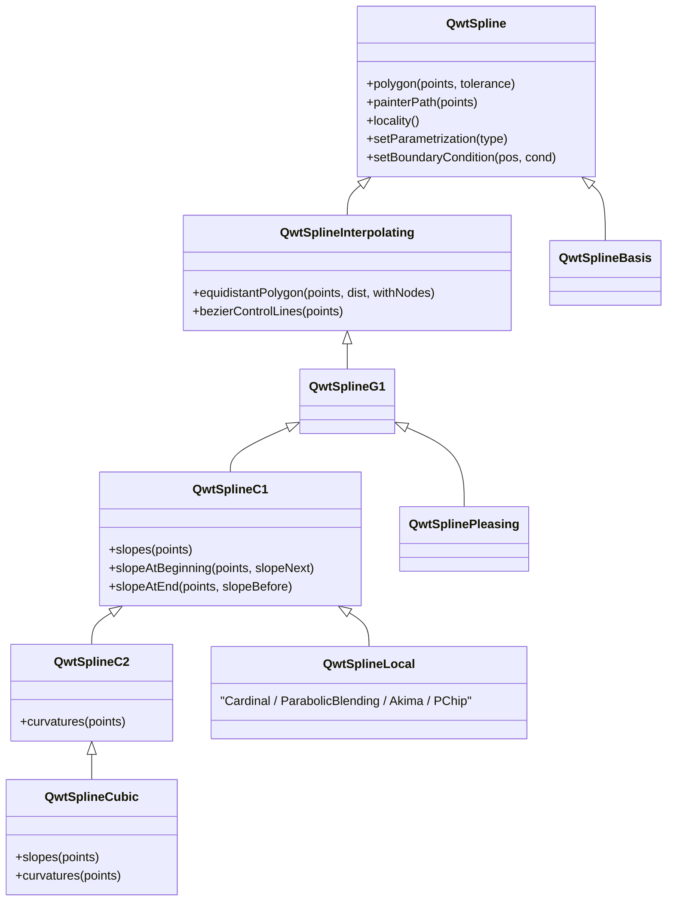
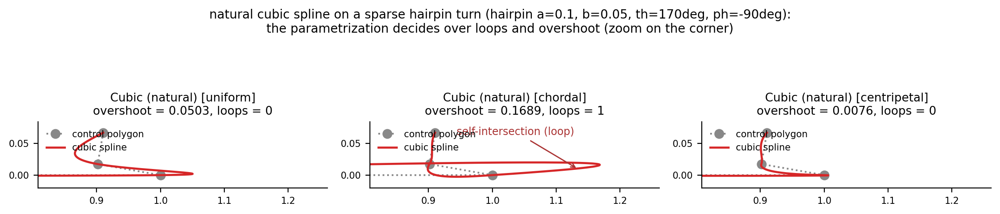
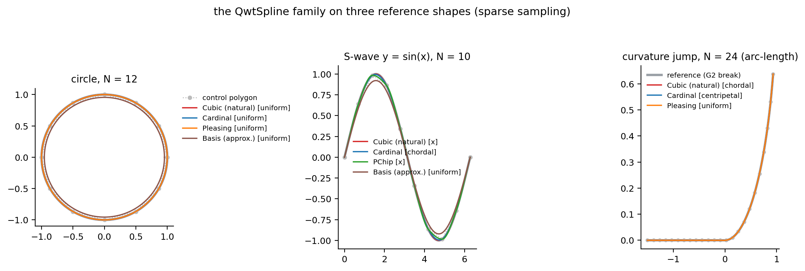
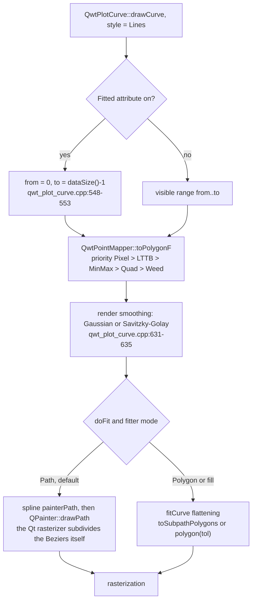
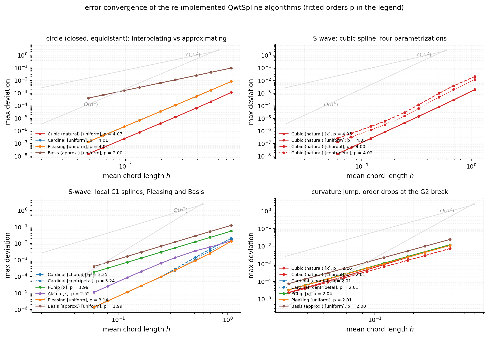
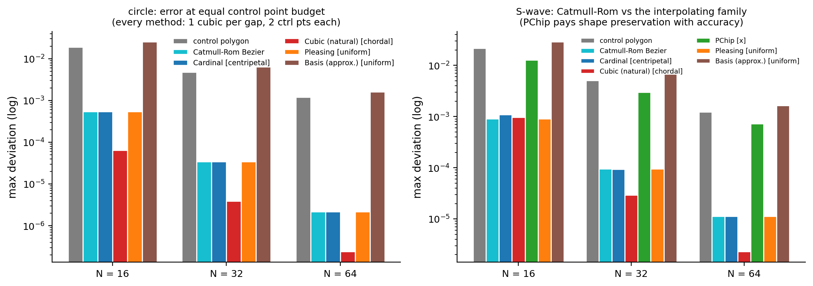
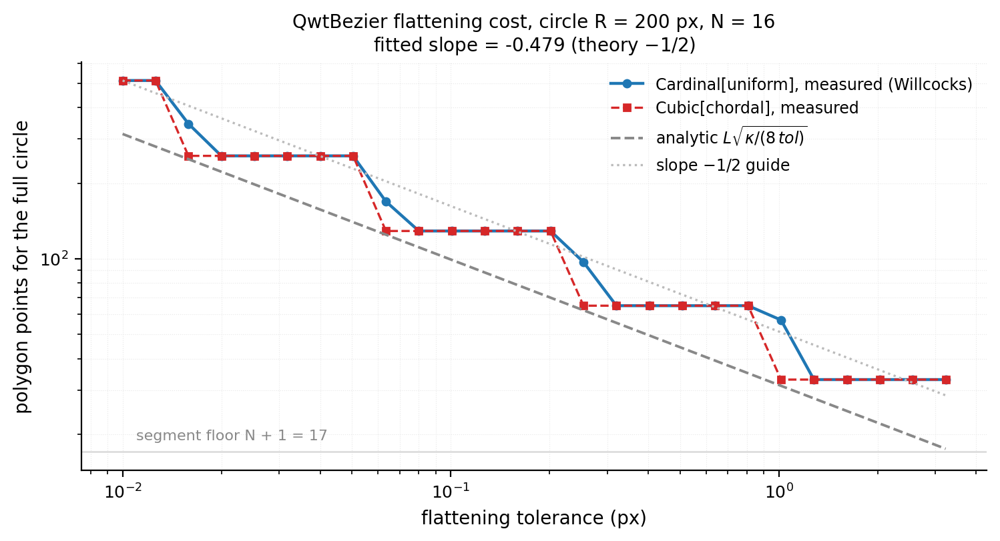

# The QwtSpline Family: Parameterization, Accuracy Convergence and Rendering Cost

> **Abstract** — A "smooth curve" on screen is never the data itself: QWT hands the control polygon to the `QwtSpline` family, which decides what the curve looks like, how large its error is, and how many vertices the rasterizer ultimately has to digest. The eight source files `src/plot/qwt_spline*.cpp` supply the parameterizations (uniform/chordal/centripetal) and six classes of spline algorithms (the natural cubic spline by the method of moments, the Cardinal/PChip/Akima local splines, Pleasing, and the Basis approximating spline). The derivation covers the tridiagonal moment equations, the proof sketch of the $O(h^4)$ interpolation-error theorem, and how that theorem fails under natural boundary conditions. A Python reimplementation of every algorithm measures the maximum geometric deviation on three analytic reference curves (a circle, an S-bend, and a curvature-jump line) across nine sampling densities and fits the order of convergence. An analytic model covers the rendering cost along the Fitted rendering path in `qwt_plot_curve.cpp` and the Willcocks flattening in `qwt_bezier.cpp`. All numbers come from the real run output of `docs/assets/algorithms/spline_experiment.py`; every performance conclusion is a complexity/operation-count analysis, with no wall-clock timing performed.

> **Abstract — Key results**
>
> - Measured orders of convergence: the natural cubic spline reaches 4.00–4.07 on the circle and the S-bend ($O(h^4)$), Cardinal/Pleasing reach 3.14–4.01 (depending on data symmetry), PChip only 1.99, and the approximating Basis 2.00; a single G2 curvature breakpoint pushes every method down to 2.00–2.16.
> - The natural boundary is the library default (the `QwtSplineCubic` constructor sets `Clamped2 = 0`), but when $f''(\text{endpoint}) \ne 0$ it is only second order: the measured function-error order on $f=e^x$ is 2.02, and the second derivative carries an $O(1)$ boundary layer near the endpoints that does not vanish with $N$: measured amplitude 0.2679, matching the theoretical value $(2-\sqrt{3})|f''(a)|$ digit for digit.
> - At the same control-point budget, the C2 global solve is about one order of magnitude more accurate than Catmull-Rom-type C1 curves: on the circle at $N=64$, Cubic gives 2.425e-07 against Catmull-Rom's 2.176e-06 (a factor of 8.97); under uniform parameterization, Catmull-Rom, Cardinal and Pleasing produce bit-identical control points (difference 0 / 5.551e-17).
> - Parameterization decides geometric safety: in the sparsely sampled hairpin case, chordal parameterization produces a self-intersecting loop (overshoot 0.1689), while centripetal parameterization stays loop-free with overshoot 0.0076 (a factor of 22.5); the mechanism is that the end tangent of the long edge is amplified to 1.544 (centripetal: only 0.209) while the next edge is only 0.1 long and points the other way.
> - Analytic rendering cost: control-point computation is $O(N)$ throughout (Cubic about 33N flops for two tridiagonal solves, Cardinal about 22N), Bezier flattening point counts $\propto \sqrt{\kappa/\varepsilon}$ with measured slope −0.479 (theory −0.5); at screen scale ($R=200$ px, tol 0.5 px) the Fitted attribute's polygon amplification drops from 4.06× ($N=16$) to 1.02× ($N=64$), but `Fitted` forces `from=0, to=N-1`, giving up visible-range clipping.

---

## 1. Introduction: the two consumers of a curve

### 1.1 Problem statement and formalization

Given a control polygon $P = \{p_i\}_{i=0}^{n-1}$ (in screen or data coordinates), a spline algorithm outputs a piecewise cubic curve $\Gamma$. In QWT, $\Gamma$ exists in two forms: a `QPainterPath` ($n-1$ cubic Bezier segments, left to the Qt rasterizer to subdivide on its own), or an explicit polygon `QPolygonF` (`QwtSpline::polygon(points, tolerance)`, which polyline-approximates the Beziers at the given tolerance). The metric is the maximum geometric deviation

$$
d_{\max}(\Gamma, C) = \max_{u} \; \mathrm{dist}\big(\Gamma(u),\, C\big)
$$

where $C$ is the analytic reference curve (the experiments use a circle, $y=\sin x$, and a curvature-jump line spliced G1 from a straight segment and a circular arc), and $\Gamma$ is densely sampled at 24–96 points per segment before taking the worst point. The order of convergence is defined by $d_{\max} = O(h^p)$, where $h$ is the mean chord length of the control polygon; a least-squares fit over the log-log sequence yields the measured $p$.

Unlike the downsampling problem (see the LTTB downsampling article), the spline faces the opposite regime: when there are fewer control points than pixels, the curve shape is decided entirely by the algorithm's priors (order of continuity, parameterization, boundary conditions). For the same $N=12$ circle, the measured deviations of the four algorithms span from $2.1\times10^{-4}$ (Cubic) all the way to $4.5\times10^{-2}$ (Basis), a factor of 214, while the Cardinal and Pleasing results are indistinguishable to the naked eye; the whole difference lives in the three degrees of freedom below: order of continuity (G1/C1/C2), parameterization, and boundary conditions.

### 1.2 The two consumption paths in QWT

The first is the `Fitted` attribute of `QwtPlotCurve`: under the `Lines` style, `drawCurve()` detects `Fitted` and forcibly expands the paint interval to the full data set (`src/plot/qwt_plot_curve.cpp:548-553`, original comment "we always need the complete curve for fitting"), then hands it through `drawLines()` to a `QwtCurveFitter`. The default fitter is `QwtSplineCurveFitter`, which internally holds a `QwtSplineLocal` with Cardinal + uniform parameterization in `Path` mode (`src/plot/qwt_spline_curve_fitter.cpp:39-43`). The second is the direct API: `painterPath()`, `bezierControlLines()`, `polygon(points, tolerance)`, `equidistantPolygon(points, distance, withNodes)`; `SplineFitter::fitCurve()` in the example `examples/2D/splineeditor` takes exactly this route with `m_spline->polygon(points, 0.5)` (`examples/2D/splineeditor/Plot.cpp:162`).

### 1.3 Family overview

The spline source files under `src/plot/` come in eight pairs: `qwt_spline` (base class and the C1/C2 intermediate layers), `qwt_spline_parametrization`, `qwt_spline_polynomial`, `qwt_spline_cubic`, `qwt_spline_local`, `qwt_spline_pleasing`, `qwt_spline_basis`, and `qwt_spline_curve_fitter`. There is no class named `QwtSplineHermite` in the repository: the Hermite structure lives in `QwtSplinePolynomial::fromSlopes()`.

| Class | Continuity | locality | Default parameterization | Default boundary | Passes through control points |
|---|---|---|---|---|---|
| `QwtSplineCubic` | C2 | 0 (global) | ParameterX (inherited from the `QwtSplineC1` constructor) | natural (`Clamped2 = 0` at both ends) | yes |
| `QwtSplineLocal::Cardinal` | C1 | 1 | ParameterX | `LinearRunout = 0` | yes |
| `QwtSplineLocal::ParabolicBlending` | C1 | 1 | ParameterX | `LinearRunout = 0` | yes |
| `QwtSplineLocal::PChip` | C1 | 1 | ParameterX | `LinearRunout = 0` | yes |
| `QwtSplineLocal::Akima` | C1 | 2 | ParameterX | `LinearRunout = 0` | yes |
| `QwtSplinePleasing` | G1 | 2 | ParameterUniform (own constructor) | none (tension rules) | yes |
| `QwtSplineBasis` | C2 (approximating) | 2 | ParameterChordal (the `QwtSpline` base-class default) | conditional boundary / closed | no |



What the inheritance chain conveys is a computational contract: `QwtSplineC1` requires subclasses to supply the first derivative at the knots (`slopes()`), `QwtSplineC2` requires the second derivative (`curvatures()`), and the Bezier control points are generated uniformly by the Hermite relations $c_1 = p_i + m_i \Delta t_i/3$, $c_2 = p_{i+1} - m_{i+1} \Delta t_i/3$ (`qwtSplineC1PathParamX/Parametric` in `qwt_spline.cpp`). `QwtSplinePleasing` stops at `QwtSplineG1` because it only guarantees tangent collinearity, not equal tangent vectors; `QwtSplineBasis` hangs directly off `QwtSpline` because it does not interpolate at all.

## 2. Parameterization: the underestimated degree of freedom

### 2.1 Six increments

`QwtSplineParametrization` abstracts parameterization as an increment function between adjacent control points (`src/plot/qwt_spline_parametrization.h:154-228`); accumulating the parameter values gives the knot sequence $t_0 = 0,\ t_i = t_{i-1} + \Delta t_i$:

| Type | Increment $\Delta t_i$ | Source function | Notes |
|---|---|---|---|
| `ParameterX` | $x_{i+1}-x_i$ | `valueIncrementX` | non-parametric; requires monotone $x$ |
| `ParameterY` | $y_{i+1}-y_i$ | `valueIncrementY` | non-parametric with the coordinates swapped |
| `ParameterUniform` | $1$ | `valueIncrementUniform` | fastest; assumes constant-speed sampling |
| `ParameterChordal` | $\sqrt{\Delta x^2+\Delta y^2}$ | `valueIncrementChordal` | first-order approximation of arc length |
| `ParameterCentripetal` | $\left(\Delta x^2+\Delta y^2\right)^{1/4}$ | `valueIncrementCentripetal` | square root of the chord length, $\alpha=0.5$ |
| `ParameterManhattan` | $\lvert\Delta x\rvert+\lvert\Delta y\rvert$ | `valueIncrementManhattan` | faster than chordal, usually worse |

Chordal, centripetal and uniform form the power family $\Delta t = \lvert\Delta p\rvert^{\alpha}$ ($\alpha = 1, 0.5$; uniform can be viewed as $\alpha = 0$). The base class `QwtSpline` defaults to chordal (`qwt_spline.cpp:427`), but the `QwtSplineC1` constructor rewrites it to `ParameterX` (`qwt_spline.cpp:948-951`), so Cubic and Local ship with the non-parametric default; the `QwtSplinePleasing` constructor rewrites it again to `ParameterUniform` (`qwt_spline_pleasing.cpp:263-266`).

### 2.2 Affine equivalence: the three coincide under equidistant sampling

The power-family parameterizations differ only by a per-segment weight. When the control points are equidistant (a circle sampled at equal angles), the increment sequences of chordal, centripetal and uniform are all constant, differing from one another by a global affine transformation $t \mapsto at+b$, and the spline equations are geometrically invariant under affine reparameterization. Measurements confirm this: on the equidistant circle with $N=16$, the maximum difference between the Bezier control points of `cubic[uniform]` and of `cubic[chordal]` / `cubic[centripetal]` is 2.220e-16; on a sine curve sampled at uniform $x$, `cubic[x]` and `cubic[uniform]` differ by 4.441e-16. The differences between parameterizations appear only when the spacing is uneven, which is both where their value lies and where their trap lies.

The code entry point for parameterization is `qwtSplineC1PathParametric()` (`qwt_spline.cpp:261-380`): first accumulate the increments to obtain $t_i$, split the data into two scalar sequences $(t_i, x_i)$ and $(t_i, y_i)$, call `slopes()` once on each, then assemble the Bezier control points through the Hermite relations. A parametric spline is therefore two scalar spline solves; the parameterization enters the tridiagonal matrix or the slope rules only through the $t$ spacing. `ParameterX`/`ParameterY` take the specialized single-solve path (`qwtSplineC1PathParamX/ParamY`), with `ParameterY` implemented by flipping the coordinates.

### 2.3 Why chordal parameterization loops: the tangent amplification mechanism

The tangent vector at knot $i$ (using a Cardinal-type rule as the example; the moment equations of the cubic spline have the same structure) is

$$
m_i = \frac{p_{i+1}-p_{i-1}}{t_{i+1}-t_{i-1}}, \qquad
\text{Bezier arm} \; a = m_i \cdot \frac{\Delta t_i}{3}
$$

Consider a sparsely sampled hairpin: one long edge $L$ followed by two short edges $S_1 = 0.1 L$ and $S_2 = 0.05 L$, with the direction reversed by about 170°. The magnitude of $p_{i+1}-p_{i-1}$ is then dominated by the long edge ($\approx L$), while how the $\Delta t$ in the numerator and denominator is apportioned is decided entirely by the parameterization: chordal gives all the weight to geometric length, driving the ratio of adjacent $h$ in the tridiagonal equations to $1 : 0.1 : 0.05$, so the moments (and hence the tangents) are violently amplified at the spacing cliff; centripetal parameterization compresses the spacing ratio to $1 : \sqrt{0.1} : \sqrt{0.05}$, and the amplification weakens accordingly; uniform parameterization flattens the spacing but ignores geometry entirely, and gets it wrong in turn on another class of data (where the spacing reflects true speed).

Measured (Section `[4]` of the script, dense sampling at 96 points/segment, self-intersections detected by pairwise segment intersection): on the four hairpin points $(0,0), (1,0), (0.901519, 0.017365), (0.910202, 0.066605)$ above, the tangent magnitude at the end of the long edge $\lvert S'(p_1)\rvert$ is 1.544 for chordal, 0.400 for uniform and 0.209 for centripetal, while the next edge is only 0.1 long and points almost the other way. A tangent of 1.544 means the Bezier overshoots by roughly 0.17 along the old direction before doubling back at the corner; the chordal curve therefore self-intersects (loops = 1, overshoot 0.1689); the centripetal curve overshoots by 0.0076 with no loop, a factor of 22.5. In a deterministic grid search over 1260 hairpin configurations, 33 satisfy "chordal loops while centripetal stays clean". This agrees with the warnings of Piegl & Tiller and of Farin about chordal parameterization producing loops/cusps at sharp turns, and with Lee's conclusion that centripetal parameterization avoids such defects (see references 2–4).

Writing the tangent amplification as the ratio of Bezier arm length to edge length is more intuitive. On the edge $e_i$ leaving knot $i$, the first control arm satisfies the identity

$$
\frac{a_i}{\lvert e_i\rvert} = \frac{\lvert m_i\rvert\, \Delta t_i}{3\, \lvert e_i\rvert}
$$

In the hairpin case, the measured ratio for the arm at the end of the long edge is 0.51 for chordal, 0.13 for uniform and 0.07 for centripetal, corresponding to end-tangent magnitudes $\lvert S'(p_1)\rvert = 1.544 / 0.400 / 0.209$, while the next edge is only 0.100 long and points almost the opposite way. A cubic Bezier whose starting tangent far exceeds the edge length and points against it must shoot out of the control polygon before folding back; self-intersection is the extreme form of that process. Centripetal parameterization compresses the spacing ratio $\rho$ to $\sqrt{\rho}$, dropping the tangent magnitude at the same knot to 1/7.39 of the chordal value.

Uniform parameterization is no safe option either: among 20 "long-arm + short-arm corner" configurations, `cubic[uniform]` loops on 9 (e.g. at a 120° turn with arm ratio 0.05: overshoot 0.0437 and loops = 1), while on the same configuration chordal overshoots 0.2703 without a loop and centripetal 0.0509 without a loop; the failure regions of the three parameterizations do not overlap, which is exactly why the family leaves the choice to the user.



## 3. Mathematical derivations

### 3.1 The method of moments for cubic splines: full derivation of the tridiagonal system

Let the knots be $x_0 < x_1 < \cdots < x_{n-1}$ (the non-parametric case; the parametric case replaces $x$ with $t$), $h_i = x_{i+1}-x_i$, $s_i = (y_{i+1}-y_i)/h_i$, $M_i = S''(x_i)$. $S''$ is linear on each segment:

$$
S''(x) = M_i \frac{x_{i+1}-x}{h_i} + M_{i+1} \frac{x-x_i}{h_i}, \quad x \in [x_i, x_{i+1}]
$$

Integrating twice and fixing the constants of integration with $S(x_i)=y_i$ and $S(x_{i+1})=y_{i+1}$ gives the piecewise expression in moment form; differentiating it yields the one-sided first derivatives at the two ends of a segment:

$$
S'(x_i^+) = s_i - \frac{h_i}{6}\left(2M_i + M_{i+1}\right), \qquad
S'(x_{i+1}^-) = s_i + \frac{h_i}{6}\left(M_i + 2M_{i+1}\right)
$$

C2 continuity requires the left and right first derivatives to agree at interior knots, i.e. $S'(x_i^-) = S'(x_i^+)$; substituting the expressions of the two adjacent segments and rearranging:

$$
h_{i-1} M_{i-1} + 2\left(h_{i-1}+h_i\right) M_i + h_i M_{i+1} = 6\left(s_i - s_{i-1}\right), \quad i = 1,\dots,n-2
$$

This is a tridiagonal system in $M$: the main diagonal $2(h_{i-1}+h_i)$ is strictly greater than the sum of the off-diagonals $h_{i-1}+h_i$, so the matrix is strictly diagonally dominant, the solution exists and is unique, and Thomas elimination runs in $O(n)$. The natural boundary is $M_0 = M_{n-1} = 0$, i.e. "zero second derivative at the endpoints"; the `QwtSplineCubic` constructor sets exactly this (`qwt_spline_cubic.cpp:924-933`, `Clamped2` with value 0).

The source writes the same system with $b_i = M_i/2$ as the unknown: the coefficients of `Equation3` are $p=h_1,\ q=2(h_1+h_2),\ u=h_2,\ r=3(s_2-s_1)$ (`qwt_spline_cubic.cpp:278-290`), the equation above divided by 2. The slope-storage formulas of `SlopeStore`, $m = s - h(2b_1+b_2)/3$ and $m = s + h(b_1+2b_2)/3$ (`qwt_spline_cubic.cpp:141-174`), are bit-for-bit equivalent to the two first-derivative formulas above under $b=M/2$. The boundary-condition family is translated uniformly by `qwtSetupEndEquations()` into the $(p,q,u,r)$ of the first and last rows (`qwt_spline_cubic.cpp:756-908`): `Clamped1` prescribes the first derivative, `Clamped2` the second, `Clamped3` the third (parabolic runout), `LinearRunout` relaxes the endpoint slope toward the neighboring segment slope, and `CubicRunout` and `NotAKnot` extend with virtual points.

### 3.2 Interpolation error order: the theorem, the proof sketch, and where the natural boundary fails

**Theorem (classical; Ahlberg–Nilson–Walsh; de Boor)** Let $f \in C^4[a,b]$ and let $S$ be the cubic spline interpolating $f$ on a uniform grid of spacing $h$, with boundary conditions that are complete (prescribed $f'$), periodic, or not-a-knot. Then

$$
\lVert f - S \rVert_\infty \le \frac{5}{384} \lVert f^{(4)} \rVert_\infty h^4, \qquad
\lVert f'' - S'' \rVert_\infty \le \frac{3}{8} \lVert f^{(4)} \rVert_\infty h^2
$$

The first-derivative error is $O(h^3)$.

*Proof sketch*: substitute $M = f'' + e$ into the moment equations. By Taylor expansion, the difference between the right-hand side $6(s_i-s_{i-1})/h$ and the left-hand side evaluated at the true values is $\frac{h^2}{12} f^{(4)}(x_i) + O(h^4)$, so $e$ satisfies $(e_{i-1}+4e_i+e_{i+1})/6 = -\frac{h^2}{12} f^{(4)}(x_i) + O(h^4)$ plus boundary defect terms. The off-diagonal entries of $A = \mathrm{tridiag}(1,4,1)/6$ are positive, so $A$ is not an M-matrix and a positivity argument cannot be applied directly; perform the sign flip $\hat e_i = (-1)^i e_i$, and $\hat e$ satisfies $\hat A \hat e = -\frac{h^2}{12} D f^{(4)} + O(h^4)$ plus boundary defect terms, where $\hat A = \mathrm{tridiag}(-1,4,-1)/6$ and $D$ is the diagonal matrix of $(-1)^i$. $\hat A$ is strictly diagonally dominant ($4/6 > 1/6+1/6$) with non-positive off-diagonal entries, hence an M-matrix with $\hat A^{-1} \ge 0$; the row-sum vector $v = \hat A^{-1}\mathbf{1}$ solves $\hat A v = \mathbf{1}$, while $\hat A(3\mathbf{1}) \ge \mathbf{1}$ (interior row sums are $3 \times \frac{1}{3} = 1$; boundary rows are larger), so the comparison principle gives $\lVert \hat A^{-1}\rVert_\infty = \lVert v\rVert_\infty \le 3$ (interior row sums tend to 3 as the grid refines, and equal exactly 3 under periodic boundaries), hence $\lVert e\rVert_\infty = \lVert \hat e\rVert_\infty \le \frac{h^2}{4}\lVert f^{(4)}\rVert_\infty + $ boundary terms; the defects of the complete/periodic boundaries are themselves $O(h^2)$, giving the second-derivative estimate. Integrating twice more on each segment with $e(x_i)=e(x_{i+1})=0$ and $\lvert (f-S)''\rvert \le \lVert e\rVert_\infty$: $\lvert f-S\rvert \le \frac{h^2}{8}\lVert (f-S)''\rVert_\infty = O(h^4)$. The constant this argument yields, $\frac{1}{4} \times \frac{1}{8} = \frac{1}{32}$, is not optimal; the optimal constants $5/384$ and $3/8$ require a piecewise fine estimate of the Green's function, omitted here.

The natural boundary violates the theorem's conditions: $M_0 = 0$ while $f''(x_0) \ne 0$, so at the endpoint $e_0 = -f''(x_0) = O(1)$. The Green's function of $A$ decays geometrically with ratio $r = -2+\sqrt{3}$, so $e_1 \approx r \cdot e_0$ is a constant boundary layer independent of $h$; $\lVert S''-f''\rVert_\infty = O(1)$ does not converge, and the function error degrades to $O(h^2)$ after two integrations. The measurements in Section `[2]` of the script match digit for digit: on $f=e^x$ the function-error order is 2.02 (1.388e-04 at $N=32$, 1.172e-07 at $N=1024$), and $\lvert S''-f''\rvert$ at the first interior knot is 0.2679 for both $N=64$ and $N=512$, exactly the theoretical layer amplitude $(2-\sqrt{3})\lvert f''(a)\rvert = 0.2679$; on $f = x^2+\sin 3x$ the corresponding values are 0.5358/0.5359 against the theoretical 0.5359.

> **Warning — The library default is the natural boundary**
>
> `QwtSplineCubic` ships with `Clamped2 = 0`. For data with nonzero endpoint curvature (most engineering curves), the function error is only second order and the second derivative does not converge near the endpoints. When fourth-order accuracy is needed, explicitly call `setBoundaryConditions(QwtSplineC2::NotAKnot)` or supply endpoint slopes with `Clamped1`. The order 4.05 measured in Section 5.2 comes from two "lucky" cases: the sine test happens to have $f''=0$ at both ends of $[0, 2\pi]$, and the circle uses periodic boundaries. It must not be extrapolated.

### 3.3 Local C1 splines: slope rules and locality

All four algorithms in `QwtSplineLocal` are single-pass "glance at the neighbors, fix the slope" rules (`qwt_spline_local.cpp`); they differ only in the weighting:

| Algorithm | Interior-knot slope $m_i$ | Source | locality |
|---|---|---|---|
| Cardinal | $(\Delta y_{i-1}+\Delta y_i)/(\Delta t_{i-1}+\Delta t_i)$ | `qwtSlopeCardinal:48` | 1 |
| ParabolicBlending | $(\Delta t_i s_{i-1} + \Delta t_{i-1} s_i)/(\Delta t_{i-1}+\Delta t_i)$ | `qwtSlopeParabolicBlending:56` | 1 |
| PChip | $3 s_{i-1} s_i/(s_{i-1}+s_i+s_{12})$ when monotone, $0$ otherwise | `qwtSlopePChip:64` | 1 |
| Akima | $(s_2 \lvert s_4-s_3\rvert + s_3 \lvert s_2-s_1\rvert)/(\lvert s_2-s_1\rvert+\lvert s_4-s_3\rvert)$ | `qwtSlopeAkima:200` | 2 |

($s$ is the segment slope; Akima uses four adjacent segment slopes; both ends are extended with virtual segments of slope $0.5 s$, see `qwtSplineAkima:352-354`.) The default boundary `LinearRunout = 0` degenerates, through `slopeBoundary()` (`qwt_spline.cpp:154-191`), to "endpoint slope = first/last segment slope". The semantics of locality: modifying one control point affects only 1 (or 2) polynomial segments on each side, so local splines naturally support incremental recomputation; `QwtSplineCubic` has locality 0, and any change requires re-solving the global system (`qwt_spline_cubic.cpp:950-953`).

The order of convergence is set by the slope truncation error: Hermite interpolation with exact tangents is $O(h^4)$, and a slope error $\varepsilon$ contributes $O(\varepsilon h)$. Cardinal's central-difference tangent error is $O(h^2)$, hence $O(h^3)$ on general data: measured 3.35 (chordal) / 3.24 (centripetal) on the sine curve; on the equidistant circle, however, it measures 4.01, because the circle's symmetry leaves the tangent error only in the tangential component while its contribution to the radial deviation cancels (superconvergence, not to be taken as a general conclusion). PChip forces $m=0$ near extrema, where the true slope is $O(h)$; the $O(h)$ truncation error pushes the order down to the measured 1.99. Akima's weights contain $\lvert \Delta s\rvert \propto \lvert f''\rvert h$, introducing an $O(h^2)$ bias; the measured 2.52, below the third order the $O(\varepsilon h)$ rule would predict, arises because $\lvert f''\rvert \to 0$ near the sine's inflection point degenerates the weights (mechanism: Section 6.2, item 5). None of these are implementation defects; they are the asymptotic price of shape preservation (PChip) and noise-tolerant weighting (Akima).

### 3.4 Pleasing: a G1 spline with tension rules

`QwtSplinePleasing` is "the curve algorithm of a certain office suite" (header comment). Structurally it is still a Cardinal-type tangent $v_i = \Delta t_2 (p_{i+1}-p_{i-1})/(\Delta t_1+\Delta t_2)$, but each segment's Bezier arms are multiplied by tension factors $(t_1, t_2)$ assigned by `qwtTensionPleasing()` (`qwt_spline_pleasing.cpp:141-166`) from comparisons of three chord lengths: in the normal case $t_1=t_2=1/3$ (arms $= v/3$, exactly Catmull-Rom); when neither $d_{13}/3 < d_{23}$ nor $d_{24}/3 < d_{23}$ holds (narrow angles), the tension is shrunk to $d_{23}/d_{13}$ and $d_{23}/d_{24}$, tightening the control arms in proportion to "this segment's chord length relative to the neighboring chords", suppressing the fling-out at sharp turns. The rule switches at narrow angles, the tangent vectors are no longer continuous, and continuity is only G1, an explicit trade of "good looks" for "smoothness". Measured on smooth equidistant data, the control points of Pleasing and Catmull-Rom differ by 5.551e-17 (circle) / 1.110e-16 (sine): the normal branch is structurally identical to Catmull-Rom bit for bit.

### 3.5 Basis: an approximating spline that misses the control points

`QwtSplineBasis` "strings the control points together smoothly" with the uniform cubic B-spline basis: under uniform parameterization, the Bezier control points of segment $i$ are $(p_{i-1}+2p_i)/3$ and $(2p_i+p_{i+1})/3$, with the segment junction at their midpoint (`qwt_spline_basis.cpp:86-130`); the non-uniform version weights by the increments (`qwt_spline_basis.cpp:132-225`). The curve passes only through the first and last points (conditional boundary); interior points are averaged away: taking the control points as samples of $f$, this construction is equivalent to a low-pass quasi-interpolation operator with leading error term $O(h^2)$. Measured orders of convergence: 2.00 on the circle, 1.99 on the sine; at $N=24$ on the sine the curve deviates from the control points by at most 1.231e-02 and from the true curve by at most 1.237e-02. Its value is C2 smoothness and insensitivity to noise, not accuracy: Section 5.4 shows that on the circle it is even worse than connecting the control polygon directly.



## 4. Implementation anatomy

### 4.1 QwtSplineCubic: one backward elimination + one forward substitution

`EquationSystem::resolve()` (`qwt_spline_cubic.cpp:414-508`) never stores the matrix explicitly: `substituteSpline()` (lines 511-538) runs a backward elimination from the second-to-last row down to row 2, reducing each three-unknown equation to a chain of `Equation2`s containing only $(b_{i-1}, b_i)$ (a variant of Thomas elimination; the ratio $v = p/q$ satisfies $|v|<1$ by diagonal dominance, hence numerically stable), and `resolveSpline()` (lines 540-554) then walks forward, producing the solution point by point and writing out the slopes through `SlopeStore` on the way: a single pass completes "solve for moments + emit slopes", avoiding the two-pass overhead of `QwtSplineC2::slopes()` ("solve for the moments, then back-substitute"), a motivation stated explicitly in the header comment (`qwt_spline_cubic.cpp:956-967`). Periodic/closed boundaries go through `EquationSystem2` (lines 562-753): using $b_0 = b_{n-1}$, the cyclic tridiagonal system is reduced to two two-unknown equations, still $O(n)$. The two compile switches `KAHAN` and `SLOPES_INCREMENTAL` are off by default (lines 33-34), i.e. no compensated summation by default.

In parametric mode all of this happens twice ($x(t)$ and $y(t)$), plus $n$ increment computations (chordal/centripetal each contain one `sqrt`). That is where the ≈33N flops for parametric Cubic in the Section 4.5 table come from.

### 4.2 Local splines, Pleasing, Basis: single pass, no solver

`qwtSplineL1()` (`qwt_spline_local.cpp:242-282`) is a sliding-window loop: it maintains the four rolling quantities $(\Delta t, \Delta y, s, m)$, one rule evaluation and one `addCubic` per knot. Akima maintains one additional segment slope (lines 337-375). Pleasing computes three chord lengths (`qwtChordalLength`) plus the tension branch per segment; the 3 square roots per segment in the Section 4.5 table are estimated on that basis; in the steady-state loop only 2 chord lengths are actually computed fresh per segment, the 3rd reuses the previous segment's result (`qwt_spline_pleasing.cpp:212-213`). The uniform Basis path costs about six point additions/scalar multiplications per segment, with no division and no square root. All four share locality ≤ 2: in theory only the affected window needs recomputation, but the current API still takes the whole polygon as input (incremental recomputation is left to the caller's cache).

### 4.3 The rendering path: the true cost chain of the Fitted attribute



First, `doAlign = !doFit && roundingAlignment` (line 596): with Fitted on, pixel-aligned rounding is disabled and the fitting happens in floating-point pixel coordinates, good news for export and antialiasing. Second, the full-range expansion does not always mean a full transform: the default paint attributes include `FilterPointsLTTB` (`PrivateData` initialization, `qwt_plot_curve.cpp:78-91`), which since v7.5.0 is the true LTTB reduction `qwtLttbReduce` (`qwt_point_mapper.cpp:877-885`); it also does the visible-range binary clipping first (calling `qwtFindVisibleRange`), so what the fitter actually receives is "about $4W$ bucket-representative points within the visible window" ($4\times$ pixel columns, one point per bucket); only on the path without downsampling attributes (`qwtToPointsF(qwtInvalidRect, ...)`) does Fitted truly transform and fit all $N$ points. Third, with the MinMax buckets instead (`FilterPointsMinMaxLTTB`, the `FilterPointsLTTB` default up to v7.4.2), the fitter's input becomes the bucket-extreme polyline: the zigzag extreme pairs are faithfully interpolated by the spline as if they were control points, and a C2 spline in particular amplifies the inter-bucket zigzag into visible ripples, a structural risk when Fitted is combined with downsampling, not quantified at pixel level here and listed as a failure-mode item pending review.

### 4.4 QwtBezier: Willcocks flattening and point-count amplification

`QwtSpline::polygon(points, tolerance)` and `QwtSplineInterpolating::polygon()` polyline-approximate the Bezier chain; the termination criterion is Willcocks's flatness measure (`src/core/qwt_bezier.cpp:57-73`):

$$
F = \max(u_x^2, v_x^2) + \max(u_y^2, v_y^2), \quad
u = 3c_1 - 2p_1 - p_2, \quad v = 3c_2 - 2p_2 - p_1
$$

The threshold is precomputed as $16\,\varepsilon^2$ (`minFlatness`, lines 48-55), and the recursive de Casteljau bisection is replaced by an explicit stack iteration (lines 183-215). For a segment with curvature $\kappa$ and arc length $\ell$, $F \propto (\kappa \ell^2)^2$, and each bisection drops $F$ to $1/16$; requiring chord deviation $\le \varepsilon$ is equivalent to a segment length $\le \sqrt{8\varepsilon/\kappa}$, so the polyline point count of the whole curve is

$$
n_{\text{poly}} \approx \sum_i \ell_i \sqrt{\frac{\kappa_i}{8\,\varepsilon}} \;=\; L\sqrt{\frac{\bar\kappa}{8\,\varepsilon}}
$$

The exponent is $-1/2$ in the tolerance and $+1/2$ in the curvature. Converting to a single Bezier segment: with segment curvature $\kappa$ and arc length $\ell$, the flatness $F \propto (\kappa \ell^2)^2$ drops by $1/16$ per bisection, and the stopping condition $F/16^k < 16\varepsilon^2$ gives a leaf count $2^k = \left(F/(16\varepsilon^2)\right)^{1/4} \propto \ell\sqrt{\kappa/\varepsilon}$, consistent with the global formula. The measured slope of −0.479 in Section 5.5 verifies this analytic form.

### 4.5 Complexity summary (analytic estimates, not measurements)

| Algorithm | Operations per point (flop estimate) | Square roots per segment | Tridiagonal solves | locality |
|---|---|---|---|---|
| Cubic [x] | ~15N (solve 8N + assembly 7N) | 0 | 1 scalar | 0 |
| Cubic [chordal/centripetal] | ~33N (2 solves + N sqrt) | 1 | 2 scalar | 0 |
| Cardinal | ~22N | 0 | 0 | 1 |
| PChip | ~34N | 0 | 0 | 1 |
| Akima | ~38N | 0 | 0 | 2 |
| Pleasing | ~33N | 3 | 0 | 2 |
| Basis [uniform] | ~24N | 0 | 0 | 2 |

By this estimate, at $N=10^6$ Cubic[chordal] costs about 33 Mflop, Cardinal about 22 Mflop and Basis about 24 Mflop, the same order of magnitude; the difference is in the constants. The real order-of-magnitude difference comes from locality: changing one point in Cubic repays the full 33N, while a local spline in theory pays only the window cost. Adding flattening, the total vertex count of the Fitted chain is about $\max(n',\, L\sqrt{\bar\kappa/(8\varepsilon)})$, where $n'$ is the point count of the fitter input polyline.

> **Note — This section and Section 5.5 are both analytic conclusions**
>
> Other tasks were running in parallel in this round of experiments, so wall-clock timing is untrustworthy and no C++ timing is done anywhere here. The table above is an operation-count estimate tallied from the instruction structure of the source; the repository's own `tests/splineprof/main.cpp` uses `QElapsedTimer` to sweep six parameterizations × five splines over $10^7$ points (the official timing tool), but it is not wired into CMake (like `tests/splinetest`, it is a development-time tool; `splinetest` checks the consistency of slopes/polynomials under the various boundary conditions). Run splineprof on an isolated machine when measured numbers are needed.

## 5. Experiments

### 5.1 Design

`docs/assets/algorithms/spline_experiment.py` (Python 3.11 + numpy + matplotlib, Agg backend, no randomness, fixed seed constants) faithfully reimplements: the natural/periodic method-of-moments cubic spline (Thomas elimination + cyclic tridiagonal), the Cardinal/PChip/Akima slope rules (including the `LinearRunout=0` boundary and Akima's virtual segments), the Pleasing tension rules (both open/closed branches), the uniform and parametric Basis paths, the Catmull-Rom-to-Bezier baseline, and the stack-based Willcocks flattening subdivision. Three reference curves: the unit circle (closed, equal-angle sampling), $y=\sin x$ (open, equal-$x$ sampling), and a curvature-jump line spliced G1 from a straight segment and a unit circular arc (open, equal-arc-length sampling, G2 breakpoint at arc length 1.5). The deviation metric uses analytic distances: $\lvert \lVert p\rVert - 1\rvert$ for the circle, the normal distance $\lvert y-\sin x\rvert/\sqrt{1+\cos^2 x}$ for the sine, and the pointwise minimum of the distance to the straight segment and to the arc for the jump line. Sampling densities $N \in \{8,12,16,24,32,48,64,96,128\}$.

Interpolation self-check: the control-point deviation of every interpolating algorithm is 0 (machine zero), except Basis (see 3.5). Equivalence self-check: the control points of Catmull-Rom differ from Cardinal[uniform] by 0.000e+00 and from Pleasing[uniform] by 5.551e-17 (circle) / 1.110e-16 (sine), confirming that the reimplementation is isomorphic to the source's rules.

Two measurement identities need separate explanation, or they will be misread as bugs. On the S-bend, the errors of `cubic[x]` and `cubic[uniform]` are identical at every density (1.955e-03 down to 1.561e-08), because uniform $x$ sampling makes $t=i$ and $t=x$ differ only by an affine transformation; on the curvature-jump line, the maximum deviations of Cardinal[chordal], Cardinal[centripetal] and Pleasing[uniform] agree to four significant digits (the 1.120e-02 row), with the argmax at (0.916204, 0.601847), inside the equidistant sampling region at the end of the arc, where the three parameterizations are locally affine equivalent; the maximum difference between the curves is only 4.892e-06 (2.446e-06 between chordal and centripetal), three orders of magnitude below the maximum deviation of 1.022354e-03. When the dominant error term sits in a region where the parameterization does not act, the parameterization comparison loses its resolving power, a property of the metric itself.

### 5.2 Convergence results

| Curve | Method [parameterization] | Measured order p | err(N=8) | err(N=128) |
|---|---|---:|---:|---:|
| circle (closed) | Cubic [uniform] | 4.07 | 1.152e-03 | 1.513e-08 |
| circle (closed) | Cardinal / Pleasing / Catmull-Rom [uniform] | 4.01 | 8.471e-03 | 1.361e-07 |
| circle (closed) | Basis [uniform] | 2.00 | 9.867e-02 | 4.015e-04 |
| S-bend | Cubic [x] ≡ Cubic [uniform] | 4.05 | 1.955e-03 | 1.561e-08 |
| S-bend | Cubic [chordal] | 4.00 | 2.116e-02 | 2.697e-07 |
| S-bend | Cubic [centripetal] | 4.02 | 1.210e-02 | 1.378e-07 |
| S-bend | Cardinal [chordal] | 3.35 | 2.103e-02 | 1.373e-06 |
| S-bend | Cardinal [centripetal] | 3.24 | 1.739e-02 | 1.373e-06 |
| S-bend | Pleasing [uniform] | 3.14 | 1.379e-02 | 1.375e-06 |
| S-bend | Akima [x] | 2.52 | 1.455e-02 | 1.086e-05 |
| S-bend | PChip [x] | 1.99 | 5.645e-02 | 1.793e-04 |
| S-bend | Basis [uniform] | 1.99 | 1.265e-01 | 4.079e-04 |
| curvature jump | Cubic [x] | 2.16 | 1.209e-02 | 2.388e-05 |
| curvature jump | Cubic / Cardinal / Pleasing [all parameterizations] | 2.01 | 7.474e-03–1.120e-02 | 2.219e-05–3.348e-05 |
| curvature jump | Basis [uniform] | 2.00 | 2.455e-02 | 7.533e-05 |



First, the gap between C2 and C1 is a constant factor, not a difference in order (Cardinal also reaches order 3–4 on smooth data): on the circle at $N=64$, Cubic gives 2.425e-07 against Cardinal's 2.176e-06, a factor of 8.97; on the S-bend at $N=64$, 2.315128e-06 against 1.124768e-05 (Cardinal centripetal), a factor of 4.86. Second, parameterization does not change the asymptotic order but changes the constant: all three parameterizations of Cubic on the S-bend are order 4.00–4.05, yet at $N=128$ the errors span from 1.561e-08 (x/uniform) to 2.697e-07 (chordal), a factor of 17.28; the parameterization error enters the constant as a lower-order term. Third, on the curvature-jump line all methods collapse to order 2.0 and their mutual gap shrinks to within a factor of 1.5: the local truncation error at the G2 breakpoint becomes the dominant term of the global error, and the global advantage of the higher-order methods is swamped by the local singularity; here the maximum deviations of Cardinal[chordal], Cardinal[centripetal] and Pleasing[uniform] are bit-identical (1.120e-02 etc.), because the argmax falls in the equidistant sampling region at the end of the arc where the three parameterizations are locally affine equivalent (the maximum difference between curves is only 4.892e-06, three orders of magnitude below the maximum deviation).

### 5.3 Parameterization safety: looping and overshoot

Section 2.3 gave the mechanism and the quantitative numbers for the hairpin case (chordal overshoot 0.1689 with 1 self-intersection; centripetal 0.0076 with 0; uniform 0.0503 with 0). The corner-family sweep (20 configurations × 3 parameterizations) shows chordal overshoot systematically higher than centripetal: 0.2601 vs 0.0490 at a 90° turn with arm ratio 0.05, 0.2703 vs 0.0509 at 120° with arm ratio 0.05; on the five-point sparse circle, chordal overshoots 0.3312–0.3730 against centripetal 0.2230–0.2346. Uniform parameterization self-intersects on 9 of the 20 corner configurations. The conclusion matches the literature: there is no universally safe parameterization, but centripetal is the most robust on the most common pathological combination, "uneven spacing + sharp turns" (consistent with Lee's conclusion in reference 4); QWT sets the base-class default to chordal and leaves the choice to `setParametrization()`, and users should be aware that this default loops on sparse corner data.

### 5.4 Comparison with Catmull-Rom: accuracy and cost at the same budget

Catmull-Rom converted to cubic Beziers ($c_1 = p_i + (p_{i+1}-p_{i-1})/6$) shares the same control-point budget with every member of the family: 1 cubic Bezier and 2 control points per segment, $n-1$ (open) or $n$ (closed) segments. The differences come only from the tangent rule and the parameterization:

| Method | circle N=16 | circle N=64 | S-bend N=16 | S-bend N=64 | control points (circle, N=64) |
|---|---:|---:|---:|---:|---:|
| control polygon (0 control points) | 1.921472e-02 | 1.204544e-03 | 2.161493e-02 | 1.242306e-03 | 0 |
| Catmull-Rom | 5.502611e-04 | 2.175515e-06 | 9.106713e-04 | 1.129831e-05 | 128 |
| Cardinal [centripetal] | 5.502611e-04 | 2.175515e-06 | 1.086951e-03 | 1.124768e-05 | 128 |
| Cubic [chordal] | 6.434937e-05 | 2.425015e-07 | 9.738000e-04 | 2.315128e-06 | 128 |
| PChip [x] | — | — | 1.270445e-02 | 7.283185e-04 | 128 |
| Pleasing [uniform] | 5.502611e-04 | 2.175515e-06 | 9.106713e-04 | 1.129831e-05 | 128 |
| Basis [uniform] | 2.543621e-02 | 1.605333e-03 | 2.886462e-02 | 1.656556e-03 | 128 |

On the circle, Catmull-Rom, Cardinal[centripetal] and Pleasing are bit-identical (parameterizations affine-equivalent under equidistant sampling + the tension rule never fires), and Cubic achieves 8.97× the accuracy at the same budget; on the S-bend, Cardinal[centripetal] and Catmull-Rom start to separate (1.124768e-05 vs 1.129831e-05, a small gap) while Cubic leads by 4.88×. PChip buys its monotonicity guarantee (zero overshoot at extrema) with 64.46× the error; Basis is worse than the control polygon across the whole circle range ($N=64$: 1.605333e-03 vs 1.204544e-03): the selling point of an approximating spline is smoothness, not approximation accuracy, and it should not be selected as a "smoother interpolant".



### 5.5 Fitted and flattening: measured and analytic rendering cost

At screen scale (a circle of $R=200$ px), Willcocks subdivision reproduces `polygon(points, 0.5)`: at $N=16$ it outputs 65 points (4.06× amplification), at $N=32$ 65 points (2.03×), at $N=64$ 65 points (1.02×); the comparison control polygon never goes through Beziers and is drawn directly with $N+1$ points. So the Fitted vertex amplification is significant for sparse control points (each Bezier segment still needs further subdivision) and almost zero on a screen-scale circle with $N \ge 64$: by then every Bezier segment is already flatter than 0.5 px. The tolerance sweep ($N=16$, tol from 0.01 to 3.2 px, 26 levels) gives a log-log slope of point count vs tolerance of −0.479 (theory −0.5); the ratio to the analytic expression $L\sqrt{\kappa/(8\varepsilon)}$ oscillates between 1.157 and 1.886; the oscillation comes from the integer quantization of bisection (the leaf count per segment snaps to power-of-2 steps), and the envelope is parallel to the analytic curve. The flattening cost barely differs among family members: at $N=32$ and tol 0.05/0.2/0.5, Cardinal, Cubic, Pleasing and Basis produce exactly the same point counts (257/129/65), because flattening looks only at the final geometric curvature, not at how the control points were computed.



Stringing Sections 4.3–4.5 together, the analytic cost of one Fitted frame is: visibility binary search $O(\log N)$ (downsampling path only) + mapping and bucketing $O(n_{vis})$ + spline control points $O(n')$ (constants per the Section 4.5 table) + flattening $\max(n', L\sqrt{\bar\kappa/8\varepsilon})$ + rasterization. Only the first term can be broken by Fitted's full-range expansion (degenerating to $O(N)$ mapping + $O(N)$ fitting when no downsampling attribute is set); the remaining terms scale linearly or sublinearly with the control-point count.

## 6. Discussion

### 6.1 Selection advice

| Scenario | Recommendation | Reason |
|---|---|---|
| Smooth measured curves where accuracy matters | `QwtSplineCubic` + `NotAKnot` + centripetal | fourth order, no natural-boundary layer, safe on sharp turns |
| Interactive dragging / incremental updates | `QwtSplineLocal::Cardinal` or `Akima` | locality 1–2, single pass $O(N)$ |
| Process data with plateaus/extrema | `QwtSplineLocal::PChip` | monotonicity guarantee, zero overshoot |
| Office-document look, closed contours | `QwtSplinePleasing` + `ClosedPolygon` | G1, but no fling-out at narrow angles |
| Smooth representation of noisy data | `QwtSplineBasis` | non-interpolating, C2, noise-tolerant |
| Sparse samples with sharp turns | any interpolating spline + centripetal parameterization | the loop analysis of Section 2.3 |

### 6.2 Failure modes

1. **Natural boundary drops to second order**: the library default is `Clamped2=0`; with nonzero endpoint curvature the function error is $O(h^2)$ and the second-derivative boundary layer is $O(1)$ (the warning box in Section 5.2 and the measurements in Section `[2]` of the script).
2. **Chordal looping**: 118 of the 1260 sparsely sampled hairpin configurations self-intersect; the displayed configuration overshoots by 0.1689 (shooting 0.17 past a control edge of length 0.1), and among the 33 "chordal loops while centripetal stays clean" configurations the maximum overshoot is 0.173.
3. **Uniform looping**: 9 of the 20 corner-family configurations self-intersect; uniform parameterization assumes constant-speed sampling and fails as soon as that is violated.
4. **PChip order collapse**: measured order 1.99 on data with extrema; tangent truncation error $O(h)$ near extrema; slopes forced to zero on plateaus produce a visible "flat head".
5. **Akima bias**: order 2.52; the weights contain a $\lvert f''\rvert h$ term, with the largest bias where the curvature changes sign.
6. **Basis does not interpolate**: deviation from the control points of 1.231e-02 on the $N=24$ sine; on the circle it is less accurate than the control polygon itself.
7. **Pleasing's G1 crease**: the tension rule switches at narrow angles, making the tangent discontinuous and amplifying visible ridges; this is design intent rather than a defect, but it should not feed downstream stages that need C1 (such as computing curvature after equidistant resampling).
8. **Fitted's full-range expansion**: without downsampling attributes, every frame transforms and fits all $N$ points; with `FilterPointsLTTB`, the visible range is restored by the LTTB reduction, but the fitter input becomes an ~4W-point downsampled polyline (with `FilterPointsMinMaxLTTB` it is the extreme zigzag polyline, faithfully interpolated by a C2 spline), structural risk, not quantified at pixel level, pending review.
9. **ClosedPolygon parameterization restriction**: the closing increment must be positive, so `ParameterX`/`ParameterY` are unavailable (stated in the `qwt_spline.h` header comment); closed contours with non-monotone $x$ can only use the power-family parameterizations.
10. **Parameterization inconsistent with the scalar path**: on the same data, `Cubic[x]` and `Cubic[chordal]` are two different curves (a factor of 17 in the error constant on the $N=128$ sine); switching the parameterization silently changes the geometry, with no warning.

### 6.3 Scope and limits

The convergence numbers in this report are for noise-free analytic curves; on noisy data the constant-factor advantage of the higher-order methods is canceled by noise amplification (the C2 global solve has a worse condition number with respect to noise than the local rules), and one should smooth first (see the curve rendering smoothing article) or switch to Basis/PChip. The experimental deviation metric is the normal distance from the curve to the reference; it does not distinguish phase error from amplitude error, so peak-position fidelity for time series needs a separate metric. The flattening analysis assumes slowly varying curvature; local point counts near the curvature-jump line will deviate from the $\sqrt{\kappa}$ scaling.

The experiment script itself is part of the deliverable: `spline_experiment.py` prints every number in the article's tables to stdout, and the figures are generated by the same script; rerunning it (`python spline_experiment.py`, depending only on numpy and matplotlib, no randomness) reproduces this report digit for digit. The reimplementation shares formulas with the source but not code paths; the consistency of the two is cross-validated by the equivalence self-checks in Section 5.1. The simplifications in the reimplementation (the cyclic tridiagonal is solved densely rather than by Thomas, the `KAHAN` compensated-summation switch is not reproduced, and PChip/Akima implement only the open-curve branch) do not affect the conclusions above, but they must be taken into account for bit-level comparisons.

## 7. Code practice

The APIs used in the following snippets are as in the current source (both `QwtSplineCurveFitter::setSpline` and `QwtPlotCurve::setCurveFitter` take ownership).

### 7.1 Replacing the default fitter with a C2 spline

```cpp
#include <qwt_plot.h>
#include <qwt_plot_curve.h>
#include <qwt_spline_curve_fitter.h>
#include <qwt_spline_cubic.h>
#include <qwt_spline_parametrization.h>

QwtPlotCurve* curve = new QwtPlotCurve("trace");
curve->setSamples(x, y, n);
curve->setCurveAttribute(QwtPlotCurve::Fitted, true);   // enable spline rendering

// replace the default Cardinal/uniform fitter with a C2 cubic spline
QwtSplineCurveFitter* fitter = new QwtSplineCurveFitter;
QwtSplineCubic* spline = new QwtSplineCubic;
spline->setBoundaryConditions(QwtSplineC2::NotAKnot);   // 4th order, no boundary layer
spline->setParametrization(QwtSplineParametrization::ParameterCentripetal);
fitter->setSpline(spline);      // fitter takes ownership of the spline
curve->setCurveFitter(fitter);  // curve takes ownership of the fitter
curve->attach(plot);
```

### 7.2 Using splines directly: control points, flattening and equidistant resampling

```cpp
#include <qwt_spline_local.h>
#include <qwt_spline_pleasing.h>

// monotone process data: PChip guarantees no overshoot at extrema
QwtSplineLocal pchip(QwtSplineLocal::PChip);
const QVector<QLineF> ctrl = pchip.bezierControlLines(points);  // n-1 cubics

// office look with narrow-angle tension rules; flatten at half a pixel,
// the same tolerance examples/2D/splineeditor uses
QwtSplinePleasing pleasing;
const QPolygonF flat = pleasing.polygon(points, 0.5);

// resample the spline at a fixed parameter distance (e.g. for arc-length plots)
QwtSplineLocal cardinal(QwtSplineLocal::Cardinal);
const QPolygonF resampled = cardinal.equidistantPolygon(points, 4.0, false);
```

### 7.3 Closed contours and approximating smoothing

```cpp
#include <qwt_spline_cubic.h>
#include <qwt_spline_basis.h>

// closed contour: do NOT repeat the first point at the end;
// ClosedPolygon excludes ParameterX/ParameterY (closing increment must be > 0)
QwtSplineCubic ring;
ring.setBoundaryType(QwtSpline::ClosedPolygon);
ring.setParametrization(QwtSplineParametrization::ParameterChordal);
const QPainterPath path = ring.painterPath(contour);

// approximating smoothing: the curve deliberately misses the (noisy) points
// and needs at least 4 control points (painterPath returns empty otherwise)
QwtSplineBasis smoother;
smoother.setParametrization(QwtSplineParametrization::ParameterUniform);
const QPainterPath smooth = smoother.painterPath(noisy);
```

> **Tip — Diagnosing parameterization problems**
>
> When a curve flings out or loops at corners, first print the ratio of arm length to edge length from `bezierControlLines()`: a segment with $(|c_1-p_1| + |p_2-c_2|)/|p_2-p_1|$ clearly greater than 1 signals an over-amplified tangent, and switching to `ParameterCentripetal` usually resolves it immediately (in the hairpin case of Section 2.3 this ratio drops from the looping regime into the safe zone).

## 8. Summary

The QwtSpline family keeps every path $O(N)$: the price of C2 is one tridiagonal solve (two in parametric mode) and the global coupling of locality 0; the price of C1 is giving up 1–2 orders of asymptotic convergence and admitting shape priors. On smooth, noise-free data with controllable endpoint curvature, Cubic + not-a-knot + centripetal is the accuracy ceiling (order 4; at the same budget, 8.89–8.97× better than Catmull-Rom on the circle and 4.88× on the S-bend). On data with extrema or plateaus, PChip's second order is the price of monotonicity. On sparse sharp-turn data, the choice of parameterization is more decisive than the choice of algorithm (a factor of 22.5 in overshoot). The library defaults (natural boundary + chordal or uniform parameterization) target generally good-looking curves, not maximum accuracy or robustness, and both defaults carry the failure modes quantified above. On the rendering side, Bezier flattening amplification is already negligible at screen scale with $N \ge 64$ (1.02×), and the real cost of Fitted lies in the control-point computation and, without downsampling attributes, the full transform, not in the polygon point count.

## 9. References

1. QWT7 sources: `src/plot/qwt_spline.cpp` (`qwtSplineC1PathParametric`, `slopeBoundary`, `polygon`, `equidistantPolygon`), `qwt_spline_cubic.cpp` (`EquationSystem`, `EquationSystem2`, `qwtSetupEndEquations`), `qwt_spline_local.cpp` (`qwtSlopeCardinal/PChip/Akima`), `qwt_spline_pleasing.cpp` (`qwtTensionPleasing`), `qwt_spline_basis.cpp`, `qwt_spline_parametrization.h`, `qwt_spline_curve_fitter.cpp`, `src/core/qwt_bezier.cpp`, `src/plot/qwt_plot_curve.cpp`, `src/plot/qwt_point_mapper.cpp`.
2. L. Piegl, W. Tiller. *The NURBS Book*, 2nd ed. Springer, 1997: the choice between chordal and centripetal parameterization, and the discussion of loop and cusp defects.
3. G. Farin. *Curves and Surfaces for CAGD: A Practical Guide*, 5th ed. Morgan Kaufmann, 2002: the effect of parameterization on interpolation geometry.
4. E. T. Y. Lee. "Choosing Nodes in Parametric Curve Interpolation." *Computer-Aided Design* 21(6), 1989: the conclusion that centripetal parameterization avoids self-intersections.
5. R. Willcocks. "Piecewise Linear Approximation of Bezier Curves." Note: the header comments of `qwt_spline.cpp` and `qwt_bezier.cpp` cite this paper directly as the source of the flattening criterion.
6. C. de Boor. *A Practical Guide to Splines*. Springer, 2001: spline error theorems and constants.
7. J. H. Ahlberg, E. N. Nilson, J. L. Walsh. *The Theory of Splines and Their Applications*. Academic Press, 1967: the source of the constants $5/384$ and $3/8$.
8. F. N. Fritsch, R. E. Carlson. "Monotone Piecewise Cubic Interpolation." *SIAM J. Numer. Anal.* 17(2), 1980: the PChip slope rule.
9. H. Akima. "A New Method of Interpolation and Smooth Curve Fitting Based on Local Procedures." *J. ACM* 17(4), 1970.
10. QWT7 development tools: `examples/2D/splineeditor` (interactive comparison of seven splines), `tests/splineprof` ($10^7$-point timing sweeps, not wired into CMake), `tests/splinetest` (boundary-condition consistency checks, not wired into CMake).

*Companion reading:* [Downsampling Curves for the Screen: LTTB Theory and the QWT7 MinMax Bucket](curve-downsampling.md): where the Fitted input polyline comes from; [Curve Rendering, Denoised: Gaussian Convolution, Savitzky-Golay Regression and Feature Preservation](curve-smoothing.md): pixel-noise removal before fitting; [Polygon clipping](polygon-clipping.md): `ClipPolygons` and the fitting order; [Realtime streaming rendering](realtime-streaming.md): the cost of full refitting in streaming scenarios.
