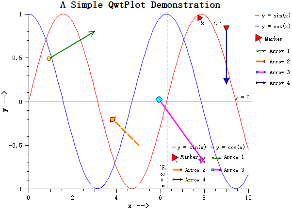

# Arrow Marker - QwtPlotArrowMarker

`QwtPlotArrowMarker` is a plot item for drawing arrow annotations on plots. It supports configurable start and end points, head and tail endpoint styles, and line styles. It is commonly used for annotating data regions, indicating directions, or adding explanatory notes.

## Key Features

- Two positioning modes: explicit start/end coordinates, or start point + pixel length + angle
- Seven endpoint styles: NoEndpoint, ArrowHead, Circle, Square, Diamond, Triangle, CustomPath
- Independent head/tail configuration: each end can have its own style, size, pen, and brush
- Custom paths: create arbitrary endpoint shapes via `QPainterPath`
- Pixel-level control: in `StartLengthAngle` mode, arrow size is preserved during zoom

## Basic Concepts

### Positioning Modes

| Mode | Enum Value | Description |
|------|------------|-------------|
| Explicit coordinates | `ExplicitPoints` | Specify start/end in plot coordinates; arrow scales with zoom |
| Start + length + angle | `StartLengthAngle` | Specify start point, pixel length, and angle; size is fixed |

### Endpoint Style Types

| Style | Enum Value | Description |
|-------|------------|-------------|
| None | `NoEndpoint` | No endpoint drawn |
| Arrow head | `ArrowHead` | V-shaped arrowhead |
| Circle | `Circle` | Circular endpoint |
| Square | `Square` | Square endpoint |
| Diamond | `Diamond` | Diamond-shaped endpoint |
| Triangle | `Triangle` | Filled triangle endpoint |
| Custom | `CustomPath` | Arbitrary shape via `QPainterPath` |

### Arrow Structure

The diagram below shows the anatomy of a `QwtPlotArrowMarker`: it spans from the start point (the tail) to the end point (the head), and each end can carry its own endpoint style.

```text
  tail                                    head
   ↓                                       ↓
   ●━━━━━━━━━━━━━━━━━━━━━━━━━━━━━━━━━━━━▶
   │                                       │
 start point                          end point
```

## Usage

### 1. Basic Arrow (ExplicitPoints Mode)

Create an arrow with explicit start and end coordinates (the most common approach):

```cpp
#include <QwtPlotArrowMarker>

QwtPlotArrowMarker* arrow = new QwtPlotArrowMarker("Arrow Annotation");

// Set start and end points (plot coordinates)
arrow->setPoints(QPointF(1.0, 0.5), QPointF(3.0, 0.8));

// Set line style
arrow->setLinePen(Qt::darkGreen, 2.0);

// Configure head (arrowhead)
arrow->setHeadStyle(QwtPlotArrowMarker::ArrowHead);
arrow->setHeadSize(12.0);
arrow->setHeadBrush(Qt::green);

// Configure tail
arrow->setTailStyle(QwtPlotArrowMarker::Circle);
arrow->setTailSize(8.0);
arrow->setTailBrush(Qt::yellow);

arrow->attach(plot);
```

### 2. Fixed-Length Arrow (StartLengthAngle Mode)

In this mode the arrow length is in pixels and does not change when zooming:

```cpp
QwtPlotArrowMarker* arrow = new QwtPlotArrowMarker("Fixed Arrow");

// Set start point
arrow->setStartPoint(QPointF(5.0, -0.5));

// Switch to length + angle mode
arrow->setPositionMode(QwtPlotArrowMarker::StartLengthAngle);
arrow->setLength(80.0);    // 80 pixels
arrow->setAngle(135.0);    // 135 degrees

// Dashed line style
arrow->setLinePen(QColor(255, 128, 0), 3.0, Qt::DashLine);

// Diamond head
arrow->setHeadStyle(QwtPlotArrowMarker::Diamond);
arrow->setHeadSize(QSizeF(10.0, 15.0));
arrow->setHeadBrush(QColor(255, 200, 0));
arrow->setHeadPen(QPen(Qt::darkRed, 1.5));

arrow->attach(plot);
```

### 3. Custom Endpoint Path

Create arbitrary endpoint shapes using `QPainterPath`, for example a star:

```cpp
QwtPlotArrowMarker* arrow = new QwtPlotArrowMarker("Custom Arrow");
arrow->setPoints(QPointF(6.0, 0.0), QPointF(8.0, -0.7));
arrow->setLinePen(Qt::magenta, 2.5);

// Create a star path
QPainterPath starPath;
starPath.moveTo(0, -5);
for (int i = 1; i < 5; ++i) {
    double angle = i * 4 * M_PI / 5;
    starPath.lineTo(5 * sin(angle), -5 * cos(angle));
}
starPath.closeSubpath();

// Custom head
arrow->setHeadStyle(QwtPlotArrowMarker::CustomPath);
arrow->setHeadCustomPath(starPath);
arrow->setHeadSize(15.0);
arrow->setHeadBrush(QColor(255, 105, 180));
arrow->setHeadPen(QPen(Qt::darkMagenta, 1.0));

// Square tail
arrow->setTailStyle(QwtPlotArrowMarker::Square);
arrow->setTailSize(10.0);
arrow->setTailBrush(Qt::cyan);

arrow->attach(plot);
```

### 4. Dual Triangle Endpoints

Both ends use triangle endpoints, useful for indicating direction:

```cpp
QwtPlotArrowMarker* arrow = new QwtPlotArrowMarker("Dual Arrow");
arrow->setPoints(QPointF(9.0, 0.8), QPointF(9.0, 0.2));
arrow->setLinePen(Qt::darkBlue, 2.0);

// Head: blue triangle
arrow->setHeadStyle(QwtPlotArrowMarker::Triangle);
arrow->setHeadSize(12.0);
arrow->setHeadBrush(Qt::blue);

// Tail: red triangle
arrow->setTailStyle(QwtPlotArrowMarker::Triangle);
arrow->setTailSize(12.0);
arrow->setTailBrush(Qt::red);

arrow->attach(plot);
```

## Legend Configuration

Arrow markers can appear in the plot legend. When enabled, the icon draws a horizontal sample line with head and tail endpoints:

```cpp
arrow->setItemAttribute(QwtPlotItem::Legend, true);
```

The default legend icon size is 24×12 pixels. Adjust it with `setLegendIconSize()`:

```cpp
arrow->setLegendIconSize(QSize(32, 16));
```

## API Reference

| Method | Description |
|--------|-------------|
| `setPoints(start, end)` | Set start and end points |
| `setStartPoint(point)` | Set start point |
| `setEndPoint(point)` | Set end point |
| `setPositionMode(mode)` | Set positioning mode |
| `setLength(length)` | Set pixel length (`StartLengthAngle` mode) |
| `setAngle(angle)` | Set angle in degrees (`StartLengthAngle` mode) |
| `setLinePen(pen)` | Set arrow line pen |
| `setHeadStyle(style)` | Set head endpoint style |
| `setHeadSize(size)` | Set head size in pixels |
| `setHeadBrush(brush)` | Set head fill brush |
| `setHeadPen(pen)` | Set head outline pen |
| `setHeadCustomPath(path)` | Set head custom QPainterPath |
| `setTailStyle(style)` | Set tail endpoint style |
| `setTailSize(size)` | Set tail size in pixels |
| `setTailBrush(brush)` | Set tail fill brush |
| `setTailPen(pen)` | Set tail outline pen |
| `setTailCustomPath(path)` | Set tail custom QPainterPath |

> **Tip — Usage Notes**
>
> - Enable anti-aliasing with `setRenderHint(QwtPlotItem::RenderAntialiased, true)` for smoother lines.
> - In `StartLengthAngle` mode, length is in pixels: the arrow does not resize when zooming.
> - In `ExplicitPoints` mode, start/end use plot coordinates: the arrow scales with axis changes.

> **Example — Related Examples**
>
> - Arrow annotation demo: `examples/2D/sinusplot`

Screenshot of the arrow annotation:


