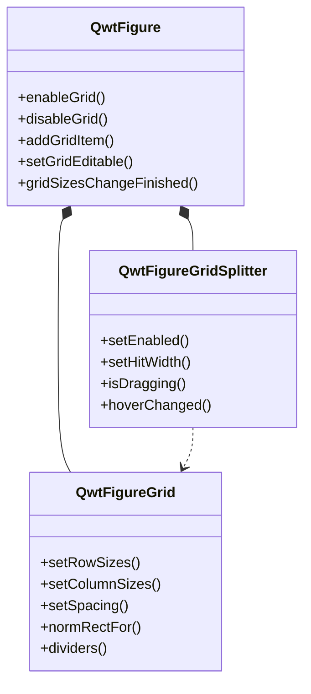
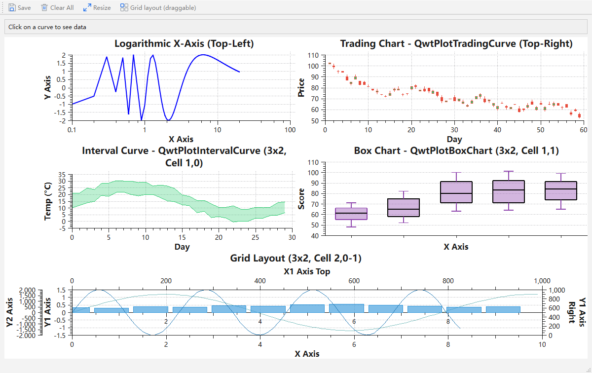
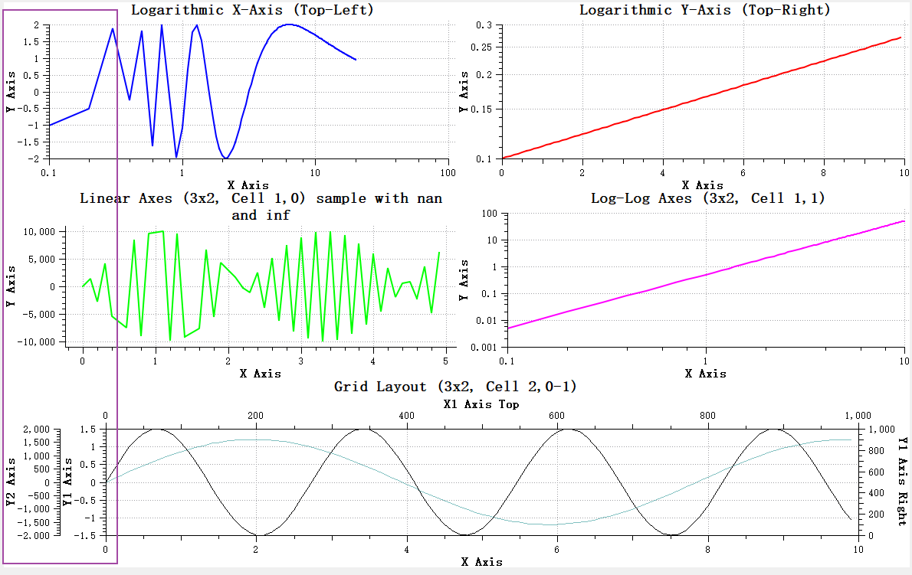
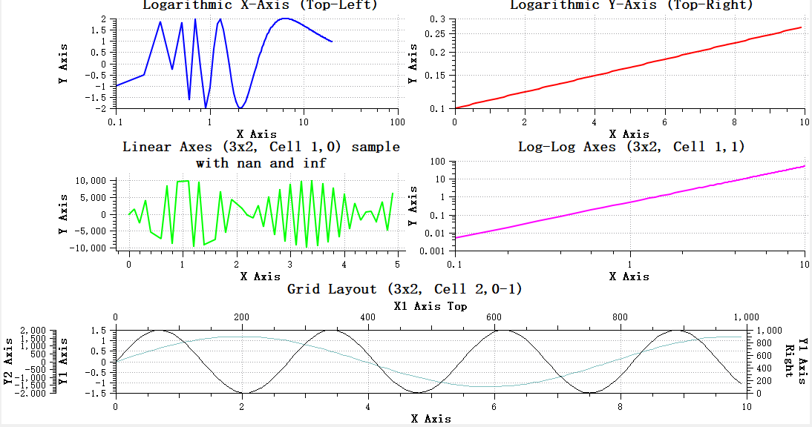
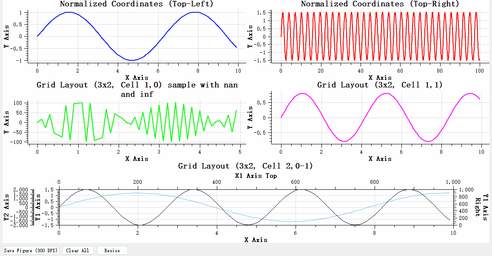

# QwtFigure Plot Container Window

`QwtFigure` is a container similar to `matplotlib`'s `Figure` class, used to organize and manage multiple `QwtPlot` plotting components. It provides layout options including normalized coordinate positioning, grid layout and retained grid layout, and supports creating parasite plots (with any number of X and Y axes).

## Key Features

### 1. Multiple Layout Methods

- Normalized coordinate layout: a coordinate system in the `[0,1]` range for relative position control
- Grid layout: row-column grid arrangement for multi-plot compositions
- Retained grid layout: the row/column ratios are kept as track data that can be set, adjusted by dragging a divider, persisted and undone, and that survives a resize

### 2. Parasite Plot Support

- Can create parasite plots for a host plot that share the plot area but have independent axes
- Suitable for displaying data of different magnitudes within the same plot area

### 3. Graphics Export

- Supports exporting the entire figure to an image file or QPixmap
- DPI can be specified for high-resolution output

### 4. Appearance Customization

- Custom background color, border color, and line width
- Complex backgrounds (gradients, textures, etc.)

## Usage

`QwtFigure` is a window container that can layout multiple sub-plots (`QwtPlot`).

### Adding Plot Components

#### Adding with Normalized Coordinates

Normalized coordinates represent the percentage of the `QwtFigure` window.

```cpp
QwtPlot* plot = new QwtPlot;
// Add a plot occupying the top-left quarter of the figure
figure->addAxes(plot, QRectF(0.0, 0.0, 0.5, 0.5));

// Or use the separate parameter form
figure->addAxes(plot, 0.0, 0.0, 0.5, 0.5);
```

> **Warning — Normalized Coordinate Notes**
>
> - Uses the standard Qt top-left coordinate system
> - Normalized coordinate range is [0,1]

#### Adding with Grid Layout

The grid layout follows the `subplot` layout approach from `matplotlib`.

```cpp
// Create a 2x2 grid and add plots
QwtPlot* topPlot = new QwtPlot;
// Add a plot spanning the entire top row (row 0, columns 0-1)
figure->addAxes(topPlot, 2, 2, 0, 0, 1, 2);

// Add a plot to the bottom-left cell (row 1, column 0)
QwtPlot* bottomLeftPlot = new QwtPlot;
figure->addAxes(bottomLeftPlot, 2, 2, 1, 0);
```

> **Note — The Grid Coordinates Are Converted Once**
>
> This overload converts a cell to a fixed normalized rectangle when the plot is added, so the window scaling only scales those rectangles and the row/column ratios cannot be changed later. Use the retained grid layout below when the ratios have to be adjustable.

### Retained Grid Layout

The retained grid keeps the row/column track ratios and the member registrations as the single source of truth of the layout. Every geometry change of the figure recomputes the rectangle of each member from the track ratios instead of converting the cell once. The ratios therefore become data that can be changed, dragged, saved and undone at runtime, and they survive a resize of the figure.

The feature is meant for multi plot dashboards whose layout is adjusted interactively. A signal analysis page puts the time domain, the spectrum and a waterfall into one grid and the user enlarges a plot by dragging a divider; an application can store the adjusted ratios in its settings and restore them on the next start. The ratios, the member registrations and the interaction are split across three classes:

| Class | Responsibility |
|-------|----------------|
| `QwtFigure` | Public entry point: enable and leave the grid, register members, switch the divider interaction, forward the model signals |
| `QwtFigureGrid` | Track model: row/column ratios, gaps, minimum track pixels, the `(row, column, rowSpan, columnSpan)` registration of the members, normalized cell rectangles, divider positions |
| `QwtFigureGridSplitter` | Interaction: consumes the mouse events inside a narrow band around a divider and changes the ratio of the two adjacent tracks |
| `QwtFigureLayout` | Consumer: asks the model for the normalized rectangle of a member during a layout pass and converts it into a pixel rectangle |



The model depends on Qt only and never references `QwtFigure` or `QwtFigureLayout`, so the track math and `normRectFor()` are testable without a window. `tests/figure_grid_test`, `tests/figure_grid_layout_test` and `tests/figure_grid_splitter_test` cover the model, the layout integration and the interaction.

#### Basic Usage

The grid must be enabled before a member is added: `addAxes()` and `addGridItem()` both require an existing retained grid model.

```cpp
QwtFigure* figure = new QwtFigure;
figure->enableGrid(2, 3);                       // 2 rows, 3 columns, equal tracks

QwtFigureGrid* grid = figure->grid();           // valid after enableGrid()
grid->setRowSizes(QVector<qreal>() << 0.6 << 0.4);       // normalized to sum 1
grid->setColumnSizes(QVector<qreal>() << 0.4 << 0.3 << 0.3);
grid->setSpacing(0.01, 0.01);                   // optional gap between the cells

figure->addAxes(wavePlot, 0, 0, 1, 2);          // row 0, columns 0-1
figure->addAxes(spectrumPlot, 1, 0);
figure->addAxes(heatmapPlot, 1, 1);

// Any QWidget can be a member, for example a 3D plot widget or a statistics panel
figure->addGridItem(statsPanel, 0, 2, 2, 1);    // column 2, spans two rows

figure->setGridEditable(true);                  // make the dividers draggable
```

`addAxes()` emits `axesAdded()` followed by `currentAxesChanged()`, `addGridItem()` emits no axes signal. Calling `enableGrid()` again rebuilds the tracks with the new counts, resets the ratios to equal tracks and drops the member registrations, so the members have to be added again.

The complete demo is `examples/2D/figureGrid`: six members on a 3 x 3 grid, a spectrum spanning three columns, three single cell plots, a trend plot spanning two columns and a plain widget registered with `addGridItem()`. The panel on the right collects the ratio presets, the gaps, the minimum track pixels, the hit width, undo/redo and adding/removing members:


The plot titles in the screenshot name the cell of each member. The `wspace`/`hspace` fields on the right and the status bar at the bottom show the normalized values of the model; they follow a divider drag.

#### Track Ratios, Gaps and Minimum Tracks

The tracks are one independent ratio array for the rows and one for the columns. Every input is normalized so that the ratios sum up to 1, the array passed by the caller is not modified.

| Method | Description |
|--------|-------------|
| `setup(int rowCount, int columnCount)` | Create the tracks and reset the ratios to `1/rowCount` and `1/columnCount` |
| `rowCount()` / `columnCount()` | Number of tracks, 0 while the grid is disabled |
| `rowSizes()` / `columnSizes()` | Current normalized ratios, always summing up to 1 |
| `setRowSizes(sizes)` / `setColumnSizes(sizes)` | Set the ratios. The vector must hold one finite, positive value per track, otherwise a warning is printed and the previous values are kept |
| `setSpacing(wspace, hspace)` | Gap between the tracks, normalized. A request with `(trackCount - 1) * gap >= 1` is rejected so the last track cannot be squeezed to zero |
| `wspace()` / `hspace()` | Read the current gaps, meant for persistence |
| `setMinimumTrackPixels(px)` | Minimum extent of a track in pixels while dragging, 40 by default |
| `normRectFor(row, col, rowSpan, colSpan)` | Normalized rectangle of a cell |
| `dividers()` | Draggable dividers: orientation, track index and normalized position |

`normRectFor()` computes the rectangle from accumulated sums: left is the sum of column 0 to col-1 plus col gaps, width is the sum of column col to col+colSpan-1 plus colSpan-1 gaps; the row direction works the same way. The result is clamped to `[0,1]`, so a large gap narrows the last track. That is the necessary consequence of keeping the rectangle inside the figure.

Read the model to persist a layout and restore the gaps before the ratios; the input is normalized again:

```cpp
// Read: ratios and gaps are normalized values
QVector<qreal> rows = grid->rowSizes();
QVector<qreal> columns = grid->columnSizes();
saveGridSettings(rows, columns, grid->wspace(), grid->hspace());   // application code

// Restore: gaps first, then the ratios, then register the members again
grid->setSpacing(loadWSpace(), loadHSpace());
grid->setRowSizes(loadRows());
grid->setColumnSizes(loadColumns());
```

#### Dragging the Dividers

`setGridEditable(true)` creates a `QwtFigureGridSplitter` (a child of the figure, destroyed by it) and installs event filters on the figure and on the widgets that cover the cells. Only the events inside a narrow band around a divider are consumed; everything else is passed through unchanged, so zooming, panning, picking and hovering keep working:

- a divider is hit within `setHitWidth()` pixels (4 by default). The line between two columns is horizontal and shows `Qt::SplitHCursor`, the line between two rows is vertical and shows `Qt::SplitVCursor`. The cursor is applied to the widget the mouse is really over (typically the canvas), so it stays visible even when the canvas has a cursor of its own; the original cursor of that widget is restored when the band is left
- a drag changes the ratio of the two adjacent tracks only. The pair sum is preserved and both tracks are clamped by `minimumTrackPixels()`, so no track collapses and the tracks never overlap
- while a divider is dragged the member widgets stop repainting. On release they repaint again and the figure is replotted, and each mouse move runs a single synchronous layout pass instead of a second full layout
- pressing `Esc` during a drag restores the original ratios and emits no finished signal. A lost mouse grab (`QEvent::UngrabMouse`, for example a popup opened) or a deactivated window ends the drag the same way, and the members start repainting immediately
- the figure grabs the mouse and the keyboard when a drag starts, so the release always returns to the splitter even when a filter installed on a canvas afterwards consumes the move/release events
- Qt invokes event filters in reverse installation order (the filter installed last runs first). Install the filters of the host (canvas pickers, drag handlers, ...) before `setGridEditable(true)`; when a filter was installed on a canvas afterwards, call `setGridEditable(true)` once more: enabling an already enabled splitter re-scans and re-installs its filters
- `QOpenGLWidget` members (3D plots) are never intercepted: the boundary of a 3D cell is served by the adjacent 2D plot. Parasite axes are transparent for mouse events, so their boundary is served by the host plot

The screenshot below shows `examples/2D/figureGrid` after the column divider and the row divider were dragged. The first column and the first row grew, and the status bar reports the new ratios and two undo steps:


`setGridEditable(true)` requires an enabled grid; otherwise it logs a warning and `isGridEditable()` stays false. `QwtFigure` does not expose the splitter pointer; use `figure->findChild<QwtFigureGridSplitter*>()` after the first `setGridEditable(true)` when the hit width has to be changed or `hoverChanged()` has to be connected.

#### Undo and Live Previews

`sizesChanged()` is emitted continuously during a drag, which is what a live preview needs. `sizesChangeFinished()` is emitted exactly once when an interaction ends, and only when the ratios really changed. Connected to a `QUndoStack` it turns a whole drag into one undo command:

```cpp
// One command stores the ratios before and after the drag
class GridRatiosCommand : public QUndoCommand
{
public:
    GridRatiosCommand(QwtFigureGrid* grid, const QVector<qreal>& rows, const QVector<qreal>& columns,
                      const QVector<qreal>& oldRows, const QVector<qreal>& oldColumns)
        : m_grid(grid), m_rows(rows), m_columns(columns), m_oldRows(oldRows), m_oldColumns(oldColumns)
    {
    }

    void redo() override { m_grid->setRowSizes(m_rows); m_grid->setColumnSizes(m_columns); }
    void undo() override { m_grid->setRowSizes(m_oldRows); m_grid->setColumnSizes(m_oldColumns); }

private:
    QwtFigureGrid* m_grid;
    QVector<qreal> m_rows, m_columns, m_oldRows, m_oldColumns;
};

// One command per drag
QObject::connect(grid, &QwtFigureGrid::sizesChangeFinished, figure,
                 [grid, undoStack, committedRows, committedColumns]() mutable {
                     const QVector<qreal> rows = grid->rowSizes();
                     const QVector<qreal> columns = grid->columnSizes();
                     if (rows == committedRows && columns == committedColumns) {
                         return;                  // nothing changed, no undo step
                     }
                     undoStack->push(new GridRatiosCommand(grid, rows, columns, committedRows, committedColumns));
                     committedRows = rows;
                     committedColumns = columns;
                 });
```

`QwtFigure` forwards both signals as `gridSizesChanged()` and `gridSizesChangeFinished()`, so a host can connect to the figure and does not need to keep the `QwtFigureGrid` pointer around.

#### Leaving the Grid and Keeping the Geometry

`disableGrid()` converts the grid members to independent normalized rectangles derived from the geometry they have on screen, then drops the tracks and the member registrations. The sub plots stay where they are, with the same size. Hidden members are converted from their grid cell instead of their stale pixel geometry:

```cpp
// Leave the grid: the members freeze at their current geometry
if (figure->disableGrid()) {
    // they are ordinary normalized-coordinate members now
}

// Enable it again: the tracks start equal and the members must be registered again
figure->enableGrid(3, 3);
figure->grid()->setRowSizes(savedRows);          // the ratios are not restored automatically
figure->addAxes(wavePlot, 0, 0, 1, 3);
figure->setGridEditable(true);                   // the divider interaction is off as well
```

Leaving the grid is not reversible: the track ratios, the gaps and the member registrations are discarded, `isGridEnabled()` returns false, and the divider interaction is switched off. Enabling the grid again requires `setGridEditable(true)` and registering the members once more. The "Leave grid (keep geometry)" button of `examples/2D/figureGrid` demonstrates the whole cycle.

#### The Example

`examples/2D/figureGrid` is the complete example of the retained grid. The essential part builds the 3 x 3 layout:

```cpp
figure->enableGrid(3, 3);
figure->grid()->setSpacing(0.006, 0.006);

figure->addAxes(spectrumPlot, 0, 0, 1, 3);       // row 0, three columns
figure->addAxes(wavePlot, 1, 0);
figure->addAxes(scatterPlot, 1, 1);
figure->addAxes(barPlot, 1, 2);
figure->addAxes(trendPlot, 2, 0, 1, 2);          // row 2, two columns
figure->addGridItem(notesPanel, 2, 2);           // a plain widget member

figure->setGridEditable(true);
```

The toolbar has the Equal, Focus top and Golden ratio presets plus undo and redo. The panel on the right changes the gaps, the minimum track pixels and the hit width of the dividers, removes and adds a member back, and leaves or re-enters the grid. The screenshot below uses wider gaps, so the figure background shows between the cells:


The example implements the screenshot protocol: `--variant drag` drags two dividers with synthetic mouse events and `--variant spacing` switches to the wide gaps, which matches the three entries in `examples/screenshots-manifest.json`. See `examples/SCREENSHOTS.md` for regenerating the images.

> **Warning — Dividers and the Edit Overlay Are Exclusive**
>
> `QwtFigureGridSplitter` relies on the mouse events reaching the sub plots, while `QwtFigureWidgetOverlay` covers the whole figure and swallows the events of its children, so the dividers never see the mouse. Disable the `FunResizePlot` mode of the overlay (or make the overlay transparent for mouse events) while the grid is editable.

> **Warning — The Caller Owns the Members**
>
> Neither `removeWidget()` nor `disableGrid()` deletes a member. A removed widget is hidden and re-parented to `nullptr`; the caller keeps it alive and hands it back to the figure when it is added again.

### Activating the Current Axes

A mouse press on a sub plot makes it the current axes of the figure: `currentAxes()` returns it and `currentAxesChanged()` is emitted. Real presses are delivered to the canvas of the plot, so the activation works for clicks on the canvas (and on the plot frame) alike. The press event is never consumed, so zooming, panning and picking keep working unchanged; pressing the already active plot does not emit again. A press on a parasite plot activates its host plot.

> **Note — Canvas Replacement**
>
> The activation filter is installed on the canvas present when the plot is added. Replacing the canvas afterwards (`QwtPlot::setCanvas()`) leaves the activation to presses on the plot frame only; re-add the plot to restore the canvas activation.

### Setting Figure Appearance

The overall look of a figure is controlled by four `QwtFigure` methods: `setFaceColor()` fills the background with a solid color, `setFaceBrush()` accepts any `QBrush` (for example a `QLinearGradient` for a gradient background), and `setEdgeColor()` together with `setEdgeLineWidth()` draws the border:

```cpp
// Set background color
figure->setFaceColor(Qt::lightGray);

// Set gradient background
QLinearGradient gradient(0, 0, 0, 1);
gradient.setColorAt(0, Qt::white);
gradient.setColorAt(1, Qt::lightGray);
figure->setFaceBrush(QBrush(gradient));

// Set border
figure->setEdgeColor(Qt::black);
figure->setEdgeLineWidth(2);
```

### Using Parasite Plots

Parasite plots (named after `matplotlib`'s parasite axes) allow creating multiple plots with independent axes, suitable for displaying data of different magnitudes or units within the same plot area. Common use cases include dual Y-axis and multi-Y-axis plots.

Example code for creating parasite plots:

```cpp
// Create host plot
QwtPlot* hostPlot = new QwtPlot(figure);
figure->addAxes(hostPlot, 0.1, 0.1, 0.8, 0.8);

// Create parasite plot, displayed on the YRight axis by default
QwtPlot* parasiteYRight = figure->createParasiteAxes(hostPlot, QwtAxis::YRight);

// Set axis titles respectively
hostPlot->setAxisTitle(QwtAxis::YLeft, "Primary Y");
parasiteYRight->setAxisTitle(QwtAxis::YRight, "Secondary Y");
```

> **Warning — Parasite Plot Notes**
>
> - Parasite plots cannot be the currently active axis
> - Parasite plots are automatically hidden when the host axis is removed
> - If the host plot is destroyed, the parasite plot is destroyed along with it

For detailed usage of parasite plots, refer to: [Parasite Plots](parasite-axes.md)

Below is a more complete demonstration using QwtFigure:

```cpp
// Create QwtFigure
QwtFigure* figure = new QwtFigure();
figure->setSizeInches(8, 6);      // Set figure size to 8x6 inches
figure->setFaceColor(Qt::white);  // Set background color

// Example 1: Add plots using normalized coordinates
QwtPlot* plot1       = new QwtPlot();
...
figure->addAxes(plot1, 0.0, 0.0, 0.5, 0.3333333);  // Top-left

QwtPlot* plot2       = new QwtPlot();
...
figure->addAxes(plot2, 0.5, 0.0, 0.5, 0.33333333);  // Top-right

// Example 2: Add plots using grid layout
QwtPlot* plot3       = new QwtPlot();
...
figure->addGridAxes(plot3, 3, 2, 1, 0);  // 3x2 grid, row 1 column 0 (0-based)

QwtPlot* plot4       = new QwtPlot();
...
figure->addGridAxes(plot4, 3, 2, 1, 1);  // 3x2 grid, row 1 column 1 (0-based)

// Example 3: Multiple coordinate axes
//! Create host plot
QwtPlot* hostPlot = new QwtPlot();
hostPlot->setCanvasBackground(Qt::white);
...
//! Add host plot to figure
figure->addGridAxes(hostPlot, 3, 2, 2, 0, 1, 2);  // 3x2 grid, row 2 column 0, spanning 2 columns

//! Add parasite coordinate system
QwtPlot* parasitePlot = hostPlot->createParasiteAxes(QwtAxis::YLeft);
//! Other settings for the parasite axes
```

The result of the above example is shown below:



### Figure Export

`QwtFigure` renders itself to an image through `saveFig()`: one overload writes an image file directly at the requested DPI (300 for print-quality output), while the other returns a `QPixmap` you can post-process or embed elsewhere:

```cpp
// Save as image file
figure->saveFig("figure.png", 300); // 300 DPI

// Get QPixmap
QPixmap pixmap = figure->saveFig(300);
```

### Axis Alignment

The figure window provides axis alignment functionality. If the tick values of sub-plots differ significantly, the ticks will not be aligned, as shown below:



In this case, you can specify axis alignment using the `QwtFigure::addAxisAlignment` function.

For the example above, axis alignment can be achieved with:

```cpp
figure->addAxisAlignment({ plot1, plot3, hostPlot }, QwtAxis::YLeft);
figure->addAxisAlignment({ plot2, plot4 }, QwtAxis::YLeft);
```

The code above means the left Y-axes of `plot1`, `plot3`, and `hostPlot` are aligned with each other. The left Y-axes of `plot2` and `plot4` are aligned with each other.

The result is shown below:



> **Warning — Axis Alignment Notes**
>
> Only visible axes can be aligned. If an axis is not visible, it cannot be aligned. For example, in the above case, the right Y-axes of `plot2`, `plot4`, and `hostPlot` cannot be aligned because the axis widgets of `plot2` and `plot4` are not visible.

## Figure Overlay

`QwtFigureWidgetOverlay` is an overlay class specifically designed for `QwtFigure`, inheriting from `QwtWidgetOverlay`. This class provides interactive operations on sub-plot components within a `QwtFigure` at runtime, including resizing plot components and selecting the currently active plot.

### Key Features

1. Users can resize and reposition sub-plot components within `QwtFigure` by dragging with the mouse.
2. The active plot component can be selected with a mouse click or a keyboard shortcut.
3. Operations show borders, control points, and dimension information as visual feedback.

The overlay's different functions can be controlled via the `BuiltInFunctionsFlag` enum:

```cpp
enum BuiltInFunctionsFlag
{
    FunSelectCurrentPlot = 1,  // Select current plot function
    FunResizePlot        = 2   // Resize plot function
};
```

Use the `setBuiltInFunctionsEnable()` method to dynamically enable or disable these functions.

The overlay provides the following methods to customize its appearance:

- `setBorderPen()` - Set the border pen
- `setControlPointBrush()` - Set the control point fill
- `setControlPointSize()` - Set the control point size
- `showPercentText()` - Control whether dimension percentage text is displayed

### Usage

To use `QwtFigureWidgetOverlay`, simply create an instance and attach it to the target `QwtFigure`:

```cpp
QwtFigure* figure = new QwtFigure();
// ... Add some plot components to the figure ...

// Create and show the overlay
QwtFigureWidgetOverlay* overlay = new QwtFigureWidgetOverlay(figure);
overlay->show();
```

The effect is shown below:



Specific functions can be enabled or disabled as needed:

```cpp
// Disable resize function, keep only selection function
overlay->setBuiltInFunctionsEnable(QwtFigureWidgetOverlay::FunResizePlot, false);

// Or disable selection function, keep only resize function
overlay->setBuiltInFunctionsEnable(QwtFigureWidgetOverlay::FunSelectCurrentPlot, false);
```

The overlay appearance can be customized to match the application's overall style:

```cpp
// Set border color and style
overlay->setBorderPen(QPen(Qt::red, 2, Qt::DashLine));

// Set control point color and style
overlay->setControlPointBrush(QBrush(Qt::green));

// Set control point size
overlay->setControlPointSize(QSize(10, 10));

// Hide percentage text display
overlay->showPercentText(false);
```

`QwtFigureWidgetOverlay` provides several useful signals to respond to user operations:

- `widgetNormGeometryChanged()` - Emitted when the normalized geometry of a plot component changes
- `activeWidgetChanged()` - Emitted when the currently active component changes

The overlay is the interactive editing layer for `QwtFigure`.

> **Example — Parasite Plot Example**
>
> Complete example code can be found in `examples/2D/figure`