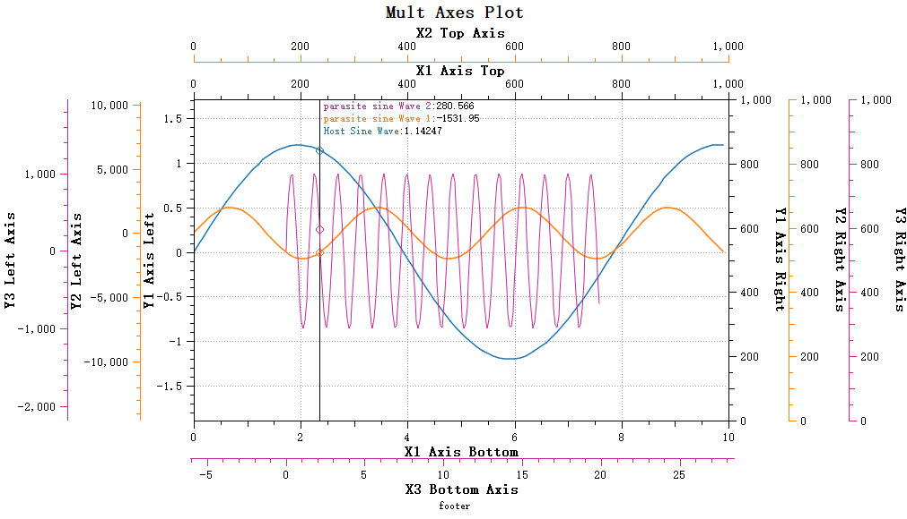

# Data Picking

Data picking is a common requirement for plot controls: the user moves the mouse, and the current value under the cursor is displayed.

`Qwt7` adds the `QwtPlotSeriesDataPicker` class, which shows data-point information while the mouse moves over the plot area. It supports two picking modes, Y-value and nearest-point, for both host plots and parasite plots:

- Dual-mode picking: Y-value or nearest-point mode
- Linear interpolation for values between data points
- Binary search and windowed search for nearest-point picking on large data sets
- Picking across multiple curves
- Custom text style, feature-point drawing and background
- Data retrieval from host plots and parasite plots

Header inclusion:

```cpp
#include "qwt_plot_series_data_picker.h"
```

Effect:



## Basic Usage

`QwtPlotSeriesDataPicker` inherits from `QwtPlotPicker`. To create a picker, pass the plot's canvas area:

```cpp
// Create plot object
QwtPlot* plot = new QwtPlot(this);

// Create data picker
QwtPlotSeriesDataPicker* picker = new QwtPlotSeriesDataPicker(plot->canvas());

// Set picking mode
picker->setPickMode(QwtPlotSeriesDataPicker::PickYValue);

// Enable interpolation
picker->setInterpolationMode(QwtPlotSeriesDataPicker::LinearInterpolation);

// Set text display position
picker->setTextArea(QwtPlotSeriesDataPicker::TextPlaceAuto);
```

## Picking Mode Settings

`QwtPlotSeriesDataPicker` provides two picking modes, which can be set via the `setPickMode` function. The picking mode enum is as follows:

```cpp
enum PickSeriesMode
{
    PickYValue,  ///< Pick Y value (default)
    PickNearestPoint  ///< Pick the point closest to the mouse cursor position
};
```

### Y-Value Picking Mode

Y-value picking mode (`QwtPlotSeriesDataPicker::PickYValue`) displays the Y values of all curves at the current X position.

```cpp
// Y-value picking mode - displays Y values of all curves at the current X position
picker->setPickMode(QwtPlotSeriesDataPicker::PickYValue);
```

Y-value picking mode effect:


In Y-value picking mode, you can set whether to perform interpolation calculation via the `setInterpolationMode` method. Interpolation calculation can improve data accuracy. If points are sparse, the Y value corresponding to the current X position is calculated using linear interpolation.

> **Note**
>
> Interpolation is enabled by default.

```cpp
// No interpolation, use the nearest data point
picker->setInterpolationMode(QwtPlotSeriesDataPicker::NoInterpolation);
```

### Nearest-Point Picking Mode

Nearest-point picking mode (`QwtPlotSeriesDataPicker::PickNearestPoint`) calculates and picks the point closest to the mouse. This mode is especially suitable for picking peak data in plots such as spectrum plots.

```cpp
// Nearest-point picking mode - displays the data point closest to the mouse
picker->setPickMode(QwtPlotSeriesDataPicker::PickNearestPoint);
```

Nearest-point picking mode effect:


Nearest-point picking requires calculating the distance from curve points to the mouse position. Traversing the entire curve is expensive, so `Qwt7` provides a window search algorithm that quickly finds the data point closest to the mouse.

Set the search window size via the `setNearestSearchWindowSize` method:

```cpp
// Nearest-point search window size. The window size determines the search range
// for nearest points, avoiding full curve traversal.
void setNearestSearchWindowSize(int windowSize);
int nearestSearchWindowSize() const;
```

The search window can be set in the following ways:

- 0: No window, search the entire curve
- Positive number: Fixed window size (number of data points)
- Negative number: Adaptive window, using a percentage of the total curve data points (absolute value, e.g., -5 means 5%)

The default search window size is -5, meaning 5% of the curve points.

> **Warning — Search window threshold**
>
> The default threshold for enabling the window search algorithm in Qwt7 is 1000 data points, meaning the window setting only takes effect when the curve has more than 1000 points.

> **Note — Sorted data**
>
> The window optimization algorithm requires curve data to be sorted in ascending order by X coordinate. If using a custom data source, ensure the data is properly sorted.


## Other Property Settings

### Text Display Settings

`QwtPlotSeriesDataPicker` allows setting the text display position. The text display position is defined by the enum `QwtPlotSeriesDataPicker::TextPlacement`. You can use the `setTextArea` function to set where the text is placed. The default is automatic placement, chosen from the picking mode.

You can set the text alignment style and background color via the following methods:

```cpp
// Customize text background
picker->setTextBackgroundBrush(QBrush(QColor(255, 255, 255, 180)));
// Set text alignment
picker->setTextAlignment(Qt::AlignLeft | Qt::AlignTop);
```

> **Bug — Drawing order with parasite plots**
>
> The drawing area of `QwtPlotSeriesDataPicker` is the layer of the host plot. Parasite plots are child windows of the host plot, so graphics drawn by parasite plots overlay the host plot. This means curves displayed by parasite plots appear above the drawing area of `QwtPlotSeriesDataPicker`. The current parasite plot architecture cannot make `QwtPlotSeriesDataPicker` content appear above parasite plots.

### Feature Point Drawing

Points picked by `QwtPlotSeriesDataPicker` are called feature points. Feature points are marked on the curve. You can set the feature point drawing style via the following methods:

```cpp
// Enable/disable feature point marking
picker->setEnableDrawFeaturePoint(true);

// Set feature point size (pixels)
picker->setDrawFeaturePointSize(6);
```

## Customization

### Custom Display Text

The displayed text content can be customized by inheriting `QwtPlotSeriesDataPicker` and overriding the `valueString` method to customize the display format of data points:

Here is an example:

```cpp
class CustomDataPicker : public QwtPlotSeriesDataPicker {
public:
    explicit CustomDataPicker(QWidget* canvas) : QwtPlotSeriesDataPicker(canvas) {}

protected:
    QString valueString(const QPointF& value, QwtPlotItem* item,
                       size_t seriesIndex, int order) const override {
        Q_UNUSED(seriesIndex);

        if (pickMode() == PickYValue) {
            QString text;
            if (order != 0) {
                text += "\n";
            }
            text += QString("%1: %2 (X=%3)")
                .arg(item->title().text())
                .arg(value.y(), 0, 'f', 3)
                .arg(value.x(), 0, 'f', 3);
            return text;
        }
        return QString("Coordinates: (%1, %2)").arg(value.x()).arg(value.y());
    }
};
```

The `order` parameter of the `valueString` method represents the nth feature point being displayed. If you have multiple curves, this parameter increments. You can use this parameter to determine whether to insert a line break (when it is 0).

## Click Signals

`QwtPlotSeriesDataPicker` emits click signals for mouse clicks.

### Signal Description

`QwtPlotSeriesDataPicker` emits two signals, `clicked()` and `doubleClicked()`, both carrying the sending picker and the screen position of the click as arguments. Their signatures are as follows:

```cpp
// Single click signal
void clicked(QwtPlotSeriesDataPicker* picker, const QPoint& pos);

// Double click signal
void doubleClicked(QwtPlotSeriesDataPicker* picker, const QPoint& pos);
```

**Signal Parameters:**

| Parameter | Type | Description |
|------------------|-------------|-------------------|
| picker | QwtPlotSeriesDataPicker* | Pointer to the clicked picker |
| pos | QPoint | Screen position of the click event |

### Left Button Only

> **Note — Left button only**
>
> Click signals **only respond to the left mouse button** (Qt::LeftButton). Right-click and middle-click do not trigger these signals.

### Double-Fire Behavior

> **Warning — Double-click sequence**
>
> When the user double-clicks, the `clicked()` signal is fired first, followed by the `doubleClicked()` signal. This is standard Qt behavior, not a bug.
>
> If you need to distinguish between single-click and double-click, it is recommended to connect only one of the signals, not both.

## Getting Picked Data

You can get the currently picked data point information via the `featurePoints()` method.

### FeaturePoint Structure

Each picked point is described by the nested struct `QwtPlotSeriesDataPicker::FeaturePoint`, which bundles the owning plot item (`item`), the picked coordinates (`feature`) and the index of the point within the series data (`index`). Its definition is:

```cpp
struct FeaturePoint
{
    QwtPlotItem* item { nullptr };  ///< Corresponding curve item
    QPointF feature { 0, 0 };       ///< Feature point coordinates
    size_t index { 0 };             ///< Index in the curve data
};
```

**Field Description:**

| Field | Type | Description |
|--------------|-------------|-------------------|
| item | QwtPlotItem* | Curve pointer, can get curve name via `item->title().text()` |
| feature | QPointF | Data point coordinate values (x, y) |
| index | size_t | Index position of the data point in curve samples |

### featurePoints() Method

`featurePoints()` is a const accessor that returns a `QList<FeaturePoint>`. Its signature is:

```cpp
// Get the list of currently picked feature points
QList<FeaturePoint> featurePoints() const;
```

`featurePoints()` returns all feature points picked at the current tracker position. This method is typically called in `clicked` or `doubleClicked` signal handlers to get data at the click position.

> **Tip — Multiple entries**
>
> The returned list may contain multiple `FeaturePoint` entries, as the mouse position may correspond to data points from multiple curves simultaneously (especially in Y-value picking mode).

## Group Signal Forwarding

`QwtPlotSeriesDataPickerGroup` provides click signal forwarding within the group.

### Group Signal Description

`QwtPlotSeriesDataPickerGroup` re-emits the `clicked()` and `doubleClicked()` signals of every picker it contains, so a single connection to the group covers all members while the `picker` argument still tells which member was clicked. The forwarded signal signatures are:

```cpp
// Emitted when a picker in the group is clicked
void clicked(QwtPlotSeriesDataPicker* picker, const QPoint& pos);

// Emitted when a picker in the group is double-clicked
void doubleClicked(QwtPlotSeriesDataPicker* picker, const QPoint& pos);
```

### Sync-Before-Signal

> **Note — Sync before signal**
>
> Before emitting click signals, the Group synchronizes the positions of all other pickers in the group. This means when the `clicked` signal fires, `featurePoints()` of all pickers in the group have already been updated to the synchronized position.

This matters for linked subplots: when the user clicks one subplot, the pickers in the other subplots are already synchronized to the same proportional X position, so data from all subplots can be read at that position.

## Code Example

The following example connects Group click signals and retrieves picked data:

```cpp
#include "qwt_plot_series_data_picker.h"
#include "qwt_plot_series_data_picker_group.h"

// Create Group and add multiple pickers
QwtPlotSeriesDataPickerGroup* pickerGroup = new QwtPlotSeriesDataPickerGroup(this);
pickerGroup->addPicker(picker1);
pickerGroup->addPicker(picker2);
pickerGroup->addPicker(picker3);

// Connect Group click signal
connect(pickerGroup, &QwtPlotSeriesDataPickerGroup::clicked,
        this, &MyClass::onPickerGroupClicked);

// Click event handler
void MyClass::onPickerGroupClicked(QwtPlotSeriesDataPicker* picker, const QPoint& pos)
{
    Q_UNUSED(pos);

    // Get the list of currently picked feature points
    QList<QwtPlotSeriesDataPicker::FeaturePoint> fps = picker->featurePoints();

    // Iterate over all picked data points
    for (const auto& fp : fps) {
        if (fp.item) {
            qDebug() << "Curve:" << fp.item->title().text()
                     << "X:" << fp.feature.x()
                     << "Y:" << fp.feature.y()
                     << "Index:" << fp.index;
        }
    }
}
```

### Multi-Subplot Linked Example

With the Group's synchronization mechanism, a multi-subplot layout supports cross-plot data inspection:

```cpp
// Assuming multiple subplots, each with its own picker
QwtPlotSeriesDataPickerGroup* group = new QwtPlotSeriesDataPickerGroup(this);
group->addPicker(plot1Picker);
group->addPicker(plot2Picker);
group->addPicker(plot3Picker);

connect(group, &QwtPlotSeriesDataPickerGroup::clicked,
        this, [this](QwtPlotSeriesDataPicker* picker, const QPoint& pos) {
    Q_UNUSED(pos);

    // Get data from the clicked picker
    auto fps = picker->featurePoints();
    if (!fps.isEmpty()) {
        const auto& fp = fps.first();
        double xValue = fp.feature.x();

        // Due to Group's synchronization mechanism, all pickers are now synchronized
        // Can get data from other pickers at the same proportional X position
        for (auto* p : { plot1Picker, plot2Picker, plot3Picker }) {
            auto otherFps = p->featurePoints();
            if (!otherFps.isEmpty()) {
                qDebug() << p->canvas()->parent()->objectName()
                         << "Y value at x=" << xValue
                         << ":" << otherFps.first().feature.y();
            }
        }
    }
});
```
