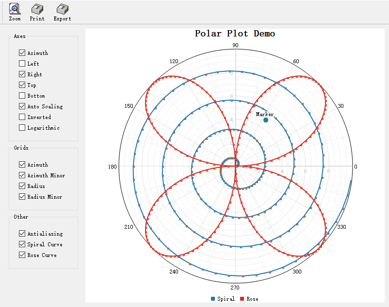
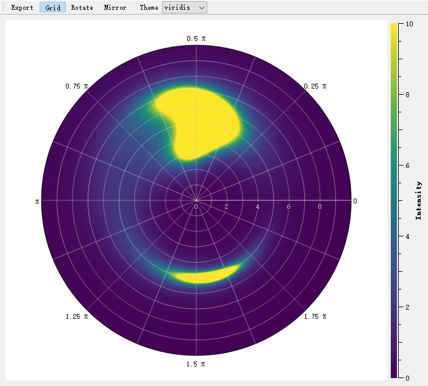

# Polar Plot - QwtPolarPlot

`QwtPolarPlot` is a widget for drawing polar coordinate graphics. Unlike the traditional Cartesian coordinate system `QwtPlot`, it uses angle and radius as its two axes, making it suitable for displaying circular data such as radar charts, directional distributions, and astronomical data.

## Main Features

**Features**

- ✅ **Polar coordinate system**: Uses angle (0-360°) and radius as axes
- ✅ **Curve drawing**: Supports drawing curves in polar coordinate system
- ✅ **Grid system**: Provides concentric circle and angular ray grids
- ✅ **Interaction support**: Supports zooming and panning in polar coordinate system

## Basic Concepts

### Polar Coordinate Structure

```text
          90°
           │
    135°   │   45°
      \    │    /
       \   │   /
        \  │  /
  180°───●─+─●───0°
        /  │  \
       /   │   \
      /    │    \
    225°   │   315°
           │
          270°

● = Data points
Concentric circles = Radius scales
Rays = Angle scales
```

### Polar Item Types

| Class Name | Description |
|------|------|
| `QwtPolarPlot` | Main polar plot widget |
| `QwtPolarCurve` | Polar curve |
| `QwtPolarGrid` | Polar grid |
| `QwtPolarMarker` | Polar marker |

## Usage

The polar plot example is located at: `examples/2D/polardemo`. Screenshot:



### 1. Creating a Polar Plot

```cpp
#include <QwtPolarPlot>
#include <QwtPolarGrid>
#include <QwtPolarCurve>

// Create polar plot
QwtPolarPlot* polarPlot = new QwtPolarPlot();
polarPlot->setTitle("Polar Plot Example");

// Set angle range (default 0-360 degrees)
polarPlot->setScale(QwtPolar::Azimuth, 0.0, 360.0);

// Set radius range
polarPlot->setScale(QwtPolar::Radius, 0.0, 100.0);

// Create polar grid
QwtPolarGrid* grid = new QwtPolarGrid();
grid->setPen(QPen(Qt::gray, 0.5));
grid->attach(polarPlot);

// Create polar curve
QwtPolarCurve* curve = new QwtPolarCurve("Curve Data");

// Prepare data (angle, radius)
QVector<QwtPointPolar> samples;
for (int angle = 0; angle < 360; angle += 10) {
    double radius = 50 + 30 * std::sin(angle * 3.0 * M_PI / 180.0);
    samples << QwtPointPolar(angle, radius);
}
curve->setSamples(samples);
curve->setPen(QPen(Qt::blue, 2));

curve->attach(polarPlot);
polarPlot->replot();
```

### 2. Polar Grid Configuration

```cpp
QwtPolarGrid* grid = new QwtPolarGrid();

// Show angle grid lines (rays)
grid->showGrid(QwtPolarGrid::Azimuth, true);

// Show radius grid lines (concentric circles)
grid->showGrid(QwtPolarGrid::Radius, true);

// Set grid style
grid->setPen(QPen(Qt::lightGray, 0.5));

// Show tick labels
grid->showAxis(QwtPolarGrid::AxisAzimuth, true);  // Angle labels
grid->showAxis(QwtPolarGrid::AxisLeft, true);     // Left radius labels
grid->showAxis(QwtPolarGrid::AxisRight, true);    // Right radius labels
grid->showAxis(QwtPolarGrid::AxisTop, true);      // Top radius labels
grid->showAxis(QwtPolarGrid::AxisBottom, true);   // Bottom radius labels
```

### 3. Polar Curve Style

```cpp
QwtPolarCurve* curve = new QwtPolarCurve();

// Set curve style
curve->setStyle(QwtPolarCurve::Lines);  // Line style
// Other styles: NoCurve (no lines), Dots (scatter)

// Set line style
curve->setPen(QPen(Qt::red, 2));

// Set symbol
QwtSymbol* symbol = new QwtSymbol(QwtSymbol::Ellipse,
    QBrush(Qt::red), QPen(Qt::darkRed), QSize(5, 5));
curve->setSymbol(symbol);
```

### 4. Angle Range Settings

```cpp
// Set angle range (e.g., show only 0-180 degrees)
polarPlot->setScale(QwtPolar::Azimuth, 0.0, 180.0);

// Set angle step
polarPlot->setScaleMaxMajor(QwtPolar::Azimuth, 8);  // 8 major ticks (every 45 degrees)

// Reverse angle direction
polarPlot->setScale(QwtPolar::Azimuth, 360.0, 0.0);  // Decreasing from 360 to 0
```

### 5. Radius Range Settings

```cpp
// Set radius range
polarPlot->setScale(QwtPolar::Radius, 0.0, 200.0);

// Set radius ticks
polarPlot->setScaleMaxMajor(QwtPolar::Radius, 5);   // 5 major ticks
polarPlot->setScaleMaxMinor(QwtPolar::Radius, 4);   // 4 minor ticks per interval

// Logarithmic radius scale
#include <QwtPolarScaleEngine>
polarPlot->setScaleEngine(QwtPolar::Radius, new QwtPolarLogScaleEngine());
```

### 6. Polar Markers

```cpp
#include <QwtPolarMarker>

QwtPolarMarker* marker = new QwtPolarMarker();

// Set marker position
marker->setPosition(QwtPointPolar(90.0, 80.0));  // Angle 90°, radius 80

// Set marker symbol
QwtSymbol* symbol = new QwtSymbol(QwtSymbol::Cross,
    Qt::NoBrush, QPen(Qt::red, 2), QSize(10, 10));
marker->setSymbol(symbol);

// Set label
QwtText label("Key Point");
label.setColor(Qt::red);
marker->setLabel(label);
marker->setLabelAlignment(Qt::AlignCenter);

marker->attach(polarPlot);
```

## Polar Axis Identifiers

| Identifier | Enum Value | Description |
|------|--------|------|
| Angle axis | `QwtPolar::Azimuth` | Angle coordinate (0-360°) |
| Radius axis | `QwtPolar::Radius` | Radius coordinate |

## Data Point Structure

```cpp
// Polar coordinate point
struct QwtPointPolar {
    double azimuth;  // Angle (in degrees)
    double radius;   // Radius

    // Can convert from Cartesian coordinates
    QwtPointPolar(const QPointF& point);  // Automatically calculates angle and radius
};
```

## Core Method Summary

### QwtPolarPlot

| Method | Description |
|------|------|
| `setScale()` | Set axis range |
| `setScaleMaxMajor()` | Set number of major ticks |
| `setScaleMaxMinor()` | Set number of minor ticks |
| `setScaleEngine()` | Set scale engine |
| `replot()` | Refresh plot |

### QwtPolarCurve

| Method | Description |
|------|------|
| `setSamples()` | Set data |
| `setStyle()` | Set curve style |
| `setPen()` | Set line style |
| `setSymbol()` | Set data point symbol |

> **Tip — Polar Plot Application Scenarios**
>
> - Radar displays
> - Astronomical data (star charts)
> - Directional distribution statistics
> - Antenna radiation patterns

> **Example — Related Examples**
>
> - Polar demo: `examples/2D/polardemo`
> - Polar spectrogram: `examples/2D/polarspectrogram`

Screenshot of the polar spectrogram:


