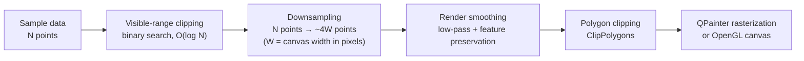
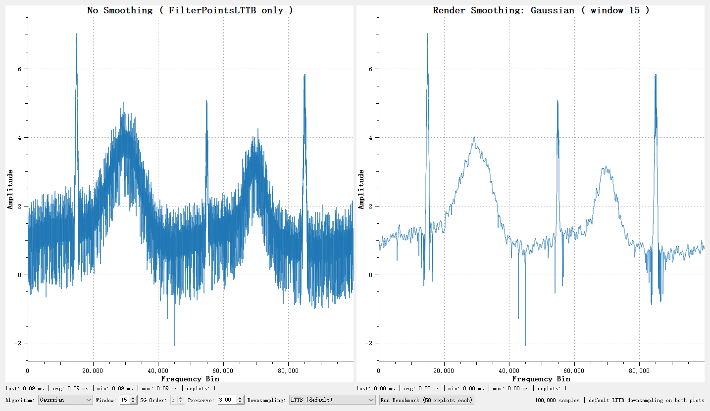
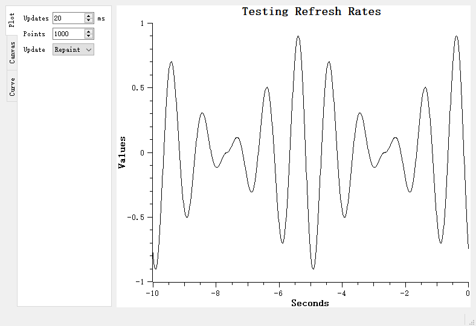
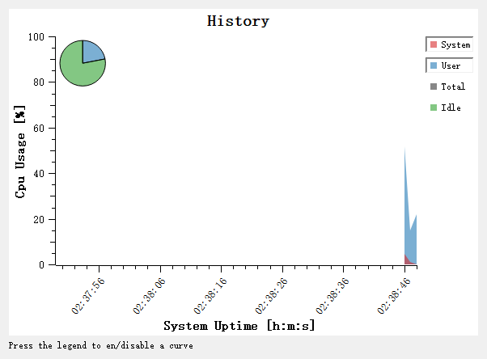

# Rendering Performance & Curve Smoothing

A curve with a few thousand points is fast no matter how you draw it. Once the data grows to hundreds of thousands or millions of points, or scrolls by at dozens of frames per second, stutter, visual noise and ghosting show up one by one. This tutorial walks the QWT rendering-performance route: **start from the rendering pipeline, then pick up four weapons in order — downsampling, render-time smoothing, hardware acceleration and incremental painting** — and finish with a tuning checklist you can work through line by line.

The good news: QWT 7's defaults already apply the most important optimization (downsampling is on out of the box), so most applications need no configuration at all. What follows explains **what the defaults do, when to go further, and how**.

**What this tutorial covers**

- ✅ **The rendering pipeline**: the stages a `QwtPlotCurve` passes through from data to pixels, and where each switch lives
- ✅ **Downsampling**: drawing a million-point curve within one frame, and choosing between the four filter attributes
- ✅ **Render-time smoothing**: removing the pixel-level noise that survives downsampling, without shrinking peaks
- ✅ **Hardware acceleration**: when the OpenGL canvas pays off
- ✅ **Real-time updates**: incremental painting and interaction-tool choices for oscilloscope-style applications
- ✅ **Data-side tuning**: which data containers unlock the fastest rendering paths

> Every step links to the matching [tech report](../../tech-report/index.md) for the algorithms and measurements behind it.

## Cheat Sheet (conclusions first)

In a hurry? Match your symptom to the fix:

| Symptom | Remedy | Section |
|---------|--------|---------|
| Large curves redraw slowly, dragging stutters | Make sure `FilterPointsLTTB` is on (it is by default); switch to `FilterPointsPixel` if needed | [Section 2](#2-downsampling-taming-million-point-curves) |
| The curve renders as a "band of noise" | Enable render smoothing via `setSmoothAlgorithm()` | [Section 3](#3-render-smoothing-removing-pixel-level-noise) |
| Worried smoothing flattens peaks | Keep the default feature-preservation threshold `setSmoothPreserveThreshold(3.0)` | [Section 3](#3-render-smoothing-removing-pixel-level-noise) |
| Many curves, rasterization still the bottleneck | Switch to the OpenGL canvas `QwtPlotOpenGLCanvas` | [Section 4](#4-hardware-acceleration-the-opengl-canvas) |
| High-rate appending data (oscilloscope-style) | Incremental painting with `QwtPlotDirectPainter`, avoid full replots | [Section 5](#5-real-time-updates-and-interaction) |
| Ghosting/lag while panning heavy scenes | Toggle between live panning `QwtPlotPanner` and cached panning `QwtPlotCachePanner` | [Section 5](#5-real-time-updates-and-interaction) |
| Squeezing out the last drop of performance | Feed raw-pointer data (`setRawSamples`) to unlock the SIMD fast path; keep x sorted | [Section 6](#6-data-side-tuning) |

## 1. Understand the Rendering Pipeline

Optimization starts with knowing where the time goes. A `QwtPlotCurve` passes through these stages on its way from data to pixels:



Each stage has a clear job and a clear switch:

- **Visible-range clipping**: points outside the canvas never reach the painter. The prerequisite is x-monotonic data — sorted data needs two binary searches; unordered data degrades to a full scan;
- **Downsampling**: compresses the visible N points to roughly 4W (W = canvas width in pixel columns). This is the **biggest win** for large data, controlled by paint attributes (Section 2);
- **Render smoothing**: a low-pass filter over the downsampled polyline that removes pixel-level fuzz, controlled by `setSmoothAlgorithm()` (Section 3);
- **Clipping & rasterization**: software rasterization via QPainter by default; the whole canvas can be switched to OpenGL (Section 4).

The key insight: **the screen has only so many pixels**. A 900-pixel-wide canvas shows at most 900 pixel columns, so the vast majority of a million points share a column with a neighbor — handing all of them to the rasterizer is pure waste. Downsampling means "draw exactly the points that can show up, at the precision that can show up".

## 2. Downsampling: Taming Million-Point Curves

### Default behavior: nothing to do

QWT 7's `QwtPlotCurve` enables `ClipPolygons | FilterPointsLTTB` **by default**. `FilterPointsLTTB` runs the "MinMax bucket" algorithm: the visible data is split into ~2W index buckets and each bucket contributes its minimum and maximum point. A million-point curve ends up drawing only ~3600 points (on a 900-pixel canvas), and **no spike can get lost** — each bucket's extremes are guaranteed to survive.

The bundled benchmark `examples/bench/renderbench` measured each option on one million points (680×490 canvas, 100 frames):

| Method | Per frame | FPS |
|--------|----------:|----:|
| No downsampling | 262.1 ms | 3.8 |
| `FilterPoints` (drop duplicates only) | 444.7 ms | 2.2 |
| `FilterPointsAggressive` (quad merge) | 175.4 ms | 5.7 |
| `FilterPointsPixel` (pixel-column merge) | 232.2 ms | 4.3 |
| **`FilterPointsLTTB` (default, MinMax buckets)** | **133.5 ms** | **7.5** |

Note that `FilterPoints` is *slower* than doing nothing: it only drops exactly-coincident points, a million real samples contain almost none, so the filtering check becomes pure overhead.

### Hands-on: controlling the filter attributes

The snippet below controls downsampling explicitly via `QwtPlotCurve::setPaintAttribute()`: `ClipPolygons` and `FilterPointsLTTB` are already on by default, while pure-noise signals can switch to the pixel-column filter `FilterPointsPixel`.

```cpp
#include <qwt_plot_curve.h>

QwtPlotCurve* curve = new QwtPlotCurve("sensor-a");
curve->setSamples(xData, yData, 1000000);   // one million points
curve->attach(plot);

// On by default; written out here for clarity
curve->setPaintAttribute(QwtPlotCurve::ClipPolygons, true);
curve->setPaintAttribute(QwtPlotCurve::FilterPointsLTTB, true);

// For the most stable pixel-level envelope (e.g. pure noise), switch to pixel buckets
// curve->setPaintAttribute(QwtPlotCurve::FilterPointsPixel, true);
// curve->setPaintAttribute(QwtPlotCurve::FilterPointsLTTB, false);
```

When several filter attributes are on at once, the internals resolve them by priority `FilterPointsPixel > FilterPointsLTTB > FilterPointsAggressive` — **enable one at a time**.

### Choosing between the two workhorses

| | `FilterPointsLTTB` (default) | `FilterPointsPixel` |
|---|---|---|
| Bucketing | Equal sample counts (index domain) | Screen pixel columns (spatial) |
| Keeps | Per-bucket min/max at their true x positions | Per-column first/min/max/last at fixed sub-pixel slots |
| Strength | Shape fidelity; geometrically exact PDF/SVG export | Most stable pixel envelope (noisy signals) |
| Best for | Most waveforms, spectra, trend lines | Near-white-noise signals, integer-pixel alignment |

### Verify it yourself with renderbench

`examples/bench/renderbench` is the dedicated comparison tool: adjustable point count (1,000 – 10,000,000), frame count and waveform; `Run All (Compare)` benchmarks all five methods and pops up a Markdown report. Toggling `Method` on the same data lets you **see with your own eyes** how narrow peaks survive differently.


> Deep dive: algorithm derivation, SIMD acceleration and pixel-level fidelity experiments in the tech report [Downsampling Curves for the Screen: LTTB Theory and the QWT7 MinMax Bucket](../../tech-report/curve-downsampling.md).

> **Tip — Still stepped after downsampling?**
>
> If a dense antialiased curve shows a one-pixel staircase on its shallow flanks while a coarser version of the same data looks smooth, the cause is vertex pixel snapping rather than the reduction algorithm. See [Pixel Alignment & Dense Curves](downsampling-pixel-align.md) for the one-line global switch and the per-algorithm guidance.

## 3. Render Smoothing: Removing Pixel-Level Noise

### Why downsampling still leaves fuzz

"Keep every bucket's extremes" has a side effect: **the extremes of random noise survive too**. A 100,000-point noisy spectrum, once downsampled, still shows a noise band ~65 pixel rows thick — the curve looks like a fuzzy ribbon instead of a line.

Render smoothing fixes exactly that: a low-pass filter applied to the downsampled polyline inside the paint pipeline. **It changes pixels, not data** — the samples in `data()` are untouched, so analysis and export still see the original values.

### Hands-on: enabling smoothing

The snippet below enables render smoothing on a 100,000-point noisy spectrum: `setSmoothAlgorithm()` selects the Gaussian low-pass, `setSmoothWindow()` sets the window size, and `setSmoothPreserveThreshold()` controls feature preservation.

```cpp
QwtPlotCurve* curve = new QwtPlotCurve("spectrum");
curve->setSamples(samples);                                     // 100,000-point noisy spectrum
curve->setPaintAttribute(QwtPlotCurve::FilterPointsLTTB, true); // downsample first

curve->setSmoothAlgorithm(QwtPlotCurve::GaussianSmoothing);     // Gaussian low-pass
curve->setSmoothWindow(15);             // window of 15 polyline points (default 9)
curve->setSmoothPreserveThreshold(3.0); // feature-preservation threshold (default 3.0; 0 = off)
curve->attach(plot);
```

Measured on a 100,000-point spectrum (900×500 canvas): the noise band collapses from **65.4 to 6.1 pixel rows**, while narrow peaks and deep dips stay on **exactly the same pixel rows** as the unsmoothed render — that is feature preservation at work: structures rising ~2× above the noise scale are restored to their original position and height.

### Gaussian or Savitzky-Golay

| | `GaussianSmoothing` | `SavitzkyGolaySmoothing` |
|---|---|---|
| Noise suppression | Strongest (~29% of input noise remains) | Weaker (~39% at the same window) |
| Peak retention | Narrow peaks are shortened (closed-form attenuation) | Much better (polynomial preservation) |
| Best for | General denoising: spectra, acquired signals | Peak-dense spectra, chromatograms |
| Extra parameter | — | `setSmoothPolynomialOrder(3)`; orders 2 and 3 are identical |

Rule of thumb: **noise-limited → Gaussian, peak-limited → SG**; if SG leaves too much noise, widen the window (21–31) to compensate.

### Tune interactively with the curvesmoothing example

`examples/2D/curvesmoothing` exposes both algorithms, window, order and preservation threshold as live controls, shows "default render vs smoothed render" side by side, and has a `Run Benchmark` button (50 replots each). Dragging `Preserve` to 0 visibly shortens the narrow peaks — which is exactly why the feature preservation exists.



> Deep dive: full derivations of both kernels (moment conditions, noise-gain identity, peak-attenuation theorem) and the feature-preservation algorithm in the tech report [Curve Rendering: Gaussian, Savitzky-Golay and Feature Preservation](../../tech-report/curve-smoothing.md).

## 4. Hardware Acceleration: The OpenGL Canvas

Downsampling solves "too many points"; the OpenGL canvas solves "painting too slowly" by moving rasterization from the CPU (QPainter) to the GPU. Swap the canvas and nothing else changes:

```cpp
#include <qwt_plot_opengl_canvas.h>

auto* canvas = new QwtPlotOpenGLCanvas(plot);
plot->setCanvas(canvas);   // curves, axes, everything else stays as-is
```

When it pays off:

- **Worth it**: many large curves repainted at high rate (live monitoring), or software rasterization visibly saturating a CPU core (the `refreshtest` example compares both canvases directly);
- **Skip it**: static plots, image/PDF export (export goes through `QwtPlotRenderer`, independent of the canvas), or deployments with GPU compatibility concerns.

CMake dependencies, surface-format customization and the full story: [OpenGL Canvas](opengl.md).



## 5. Real-Time Updates and Interaction

### Incremental painting: QwtPlotDirectPainter

Oscilloscope-style applications append thousands of points per second. Replotting the whole widget for every append is wasteful — `QwtPlotDirectPainter` paints **only the new segment** straight onto the canvas:

```cpp
#include <qwt_plot_directpainter.h>

auto* directPainter = new QwtPlotDirectPainter(plot);
directPainter->setClipping(true);

// After appending data, draw only the new index range instead of the whole curve
directPainter->draw(curve, fromIndex, toIndex);
```

`examples/2D/oscilloscope` and `examples/2D/realtime` show the complete pattern: rolling window + incremental painting + periodic full replot for correction.


### Performance profiles of the interaction tools

| Tool | Behavior | Performance profile |
|------|----------|---------------------|
| `QwtPlotPanner` | **Live redraw** while dragging | Best feel; may drop frames on heavy scenes |
| `QwtPlotCachePanner` | Drags a **pixel cache**, redraws on release | Never stutters; shows the cached bitmap while dragging |
| `QwtPlotAxisZoomer` | Rubber-band zoom (2 axes) | Zoom always triggers a full redraw — fine once downsampling is on |

Prescription for stuttery panning of heavy scenes: switch to `QwtPlotCachePanner`; if the cached ghosting feels wrong, switch back to `QwtPlotPanner`. Full usage in [Panner](panner.md) and [Zoomer](zoomer.md).


### Throttle your replots

When the data source pushes at high rate, do not `replot()` per sample — coalesce repaints to a fixed frame budget (30–60 FPS) with a timer. `examples/2D/cpuplot` demonstrates the standard "cache on arrival, repaint on timer" pattern:



## 6. Data-Side Tuning

How fast the pipeline runs also depends on the shape of the data you feed it. Three points:

1. **Keep x monotonic**: visible-range clipping relies on binary search — O(log N) for sorted data, a full scan otherwise; on a million points the difference is orders of magnitude.
2. **Prefer raw-pointer data sources**: `setRawSamples(xArray, yArray, n)` or `QwtPointArrayData<double>` / `QwtCPointerData<double>` let the downsampler grab contiguous `double*` arrays and take the SIMD (AVX2/SSE4.2) per-bucket argmin/argmax fast path; `QVector<QPointF>` goes through the generic per-point virtual-call path. With `setRawSamples` you own the array lifetime (see the [curve tutorial](curve.md)).
3. **NaN is not free**: NaN splits the polyline into segments and pushes the downsampler onto the scalar path. Behavior and performance impact: [NaN Handling](../general/nan-handling.md); measure it yourself with `examples/2D/nanperf` (NaN ratio sweep across the five filter attributes).

The full menu of data ingestion options (`setSamples` overloads, custom `QwtSeriesData`) lives in [Series Data](../general/series-data.md).

## 7. Tuning Checklist

Work through it in order, measuring after each step (`renderbench` and the `Run Benchmark` buttons both give numbers):

1. More than 10× as many points as canvas columns? → Confirm downsampling is on (default; make sure legacy calls like `setPaintAttribute(QwtPlotCurve::FilterPoints, ...)` did not override it);
2. Is x monotonic? Is the data source a raw-pointer container? → Fix the data side first (Section 6);
3. Noise hurting your eyes? → Enable render smoothing; start with Gaussian w=15, τ=3; switch to SG if peaks shrink (Section 3);
4. Still slow? → Switch to the OpenGL canvas (Section 4);
5. Appending at high rate? → `QwtPlotDirectPainter` incremental painting + timer-throttled replots (Section 5);
6. Interaction lagging? → Cached panning for heavy scenes; confirm downsampling for zooming (Section 5).

## Related Examples

| Example | What it shows |
|---------|---------------|
| `examples/bench/renderbench` | Timing benchmark and visual comparison of the five downsampling methods |
| `examples/2D/curvesmoothing` | Interactive tuning and benchmarking of all smoothing parameters |
| `examples/2D/nanperf` | NaN ratio × filter attribute performance sweep |
| `examples/2D/oscilloscope` | `QwtPlotDirectPainter` incremental oscilloscope |
| `examples/2D/realtime` | 60 FPS live data stream |
| `examples/2D/cpuplot` | Timer-throttled monitoring curves |
| `examples/2D/refreshtest` | Canvas refresh-rate comparison (raster vs OpenGL) |

## Deep Dives

- Tech report: [Downsampling Curves for the Screen: LTTB Theory and the QWT7 MinMax Bucket](../../tech-report/curve-downsampling.md)
- Tech report: [Curve Rendering: Gaussian, Savitzky-Golay and Feature Preservation](../../tech-report/curve-smoothing.md)
- Tutorials: [Curve](curve.md), [OpenGL Canvas](opengl.md), [Panner](panner.md), [Zoomer](zoomer.md)
