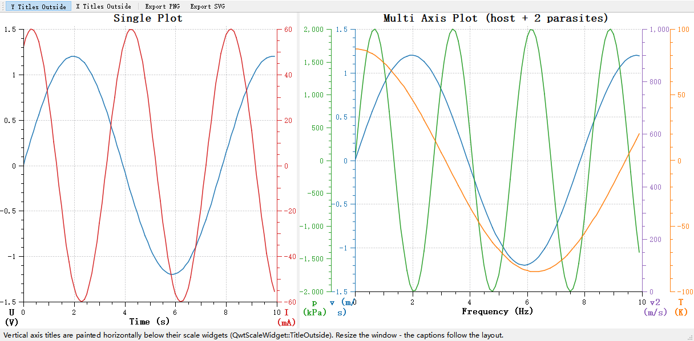

# Axis Widget - QwtScaleWidget

`QwtScaleWidget` is the display widget for axes, responsible for drawing tick marks, tick labels, and axis titles. It is a fundamental component of the QwtPlot axis system and also supports standalone use.

## Main Features

- Major ticks, minor ticks and tick labels
- Axis title text
- Axis titles painted horizontally below or above the scale widget (`TitleOutside`)
- Mouse drag panning and scroll wheel zooming (new in Qwt7)
- Color bars for spectrograms
- Customizable tick length, label font and other style details

## Basic Concepts

### Axis Position

Qwt uses the `QwtAxis::Position` enum to identify axis positions:

| Position | Enum Value | Description |
|------|--------|------|
| Bottom X-axis | `QwtAxis::XBottom` | Bottom horizontal axis |
| Top X-axis | `QwtAxis::XTop` | Top horizontal axis |
| Left Y-axis | `QwtAxis::YLeft` | Left vertical axis |
| Right Y-axis | `QwtAxis::YRight` | Right vertical axis |

### Axis Structure

An axis is composed of the backbone with its tick marks, the tick labels beside them, and the axis title; ticks come in two lengths - long major ticks and short minor ticks. The sketch below shows the structure of a horizontal axis:

```text
          Title
         Time(s)
            ↓
    ────────┼────┼────┼────┼────→ Tick marks
           0    2    4    6    8   Tick labels

Ticks are divided into: major ticks (long), minor ticks (short)
```

## Usage

### 1. Setting Axes via QwtPlot

Most axis settings go through `QwtPlot` directly: `setAxisTitle()` assigns the title, `setAxisScale()` fixes the value range, and `setAxisVisible()` shows or hides an axis, each addressed by a `QwtAxis::Position`. The example below configures the bottom X and left Y axes:

```cpp
#include <QwtPlot>

QwtPlot* plot = new QwtPlot();

// Set axis titles
plot->setAxisTitle(QwtAxis::XBottom, "Time (s)");
plot->setAxisTitle(QwtAxis::YLeft, "Voltage (V)");

// Set axis ranges
plot->setAxisScale(QwtAxis::XBottom, 0, 100);  // X-axis 0-100
plot->setAxisScale(QwtAxis::YLeft, -10, 10);   // Y-axis -10 to 10

// Set axis visibility
plot->setAxisVisible(QwtAxis::XTop, false);    // Hide top X-axis
plot->setAxisVisible(QwtAxis::YRight, true);   // Show right Y-axis

plot->replot();
```

### 2. Getting Axis Widget

For finer control, fetch the underlying widget of an axis with `QwtPlot::axisWidget()`; it is a `QwtScaleWidget`, so `setFont()` styles the tick labels, `setTitle()` accepts a styled `QwtText`, and `setScaleColor()`/`setTextColor()` set the colors of the backbone/ticks and of the tick labels. The example below customizes the bottom axis widget:

```cpp
// Get axis widget at a specific position
QwtScaleWidget* scaleWidget = plot->axisWidget(QwtAxis::XBottom);

// Set tick label font
scaleWidget->setFont(QFont("Arial", 8));

// Set axis title style
QwtText title("Time (s)");
title.setFont(QFont("Arial", 10, QFont::Bold));
title.setColor(Qt::darkBlue);
scaleWidget->setTitle(title);

// Set tick/backbone and tick label colors
scaleWidget->setScaleColor(Qt::black);   // Backbone and ticks
scaleWidget->setTextColor(Qt::darkGray); // Tick labels
```

### 3. Built-in Interaction Features (New in Qwt7)

Qwt 7.0 adds built-in axis interaction: after an axis is activated by clicking it, dragging pans and the mouse wheel zooms the corresponding axis scale. The features are enabled as flags with `setBuildinActions()` (`ActionNone`, `ActionClickPan`, `ActionWheelZoom`, `ActionAll`):

```cpp
// Get axis widget
QwtScaleWidget* scaleWidget = plot->axisWidget(QwtAxis::XBottom);

// Enable built-in click-drag panning and wheel zooming
scaleWidget->setBuildinActions(QwtScaleWidget::ActionClickPan | QwtScaleWidget::ActionWheelZoom);

// Or enable all built-in actions at once
// scaleWidget->setBuildinActions(QwtScaleWidget::ActionAll);

// Zoom factor per wheel step (default 1.2)
scaleWidget->setZoomFactor(1.2);

// Highlight color of the axis while it is selected
scaleWidget->setSelectionColor(Qt::blue);
```

Panning effect:


Zooming effect:


For detailed axis interaction documentation, refer to: [Axis Interaction Actions](scale-builtin-action.md)

### 4. Color Bar Display

Used for scenarios requiring color mapping such as spectrograms. There is no separate color bar position setter - the side where the bar is drawn follows the alignment of the scale draw:

```cpp
// Enable color bar
scaleWidget->setColorBarEnabled(true);

// Set color bar width
scaleWidget->setColorBarWidth(20);

// Set color map for a value interval (the widget takes ownership)
QwtLinearColorMap* colorMap = new QwtLinearColorMap(Qt::blue, Qt::red);
scaleWidget->setColorMap(QwtInterval(0, 100), colorMap);
```

### 5. Tick Drawing Style

The tick mark appearance is not configured on `QwtScaleWidget` itself: the direction (outside/inside the canvas) is a `QwtPlot` setting per axis, while tick lengths and the tick-to-label spacing belong to the `QwtScaleDraw` object returned by `scaleWidget->scaleDraw()`. The snippet below shows these settings:

```cpp
// Tick direction: a QwtPlot per-axis setting
// (see also the "Inward-Facing Ticks" guide)
plot->setAxisTickDirection(QwtAxis::XBottom, QwtPlot::TickOutside);
// Other option: QwtPlot::TickInside (ticks drawn into the canvas)

// Tick lengths: set on the scale draw, per tick type
scaleWidget->scaleDraw()->setTickLength(QwtScaleDiv::MajorTick, 10.0);  // Major ticks (pixels)
scaleWidget->scaleDraw()->setTickLength(QwtScaleDiv::MediumTick, 7.0);  // Medium ticks
scaleWidget->scaleDraw()->setTickLength(QwtScaleDiv::MinorTick, 5.0);   // Minor ticks

// Distance between ticks and tick labels (default 4 pixels)
scaleWidget->scaleDraw()->setSpacing(2.0);
```

### 6. Tick Label Formatting

Customize tick label format by setting `QwtScaleDraw`:

```cpp
#include <QwtScaleDraw>

// Custom tick drawing
class MyScaleDraw : public QwtScaleDraw
{
public:
    virtual QwtText label(double value) const override
    {
        // Custom label format
        return QwtText(QString::number(value, 'f', 1));  // Keep 1 decimal place
    }
};

// Apply custom tick drawing
scaleWidget->setScaleDraw(new MyScaleDraw());
```

### 7. Setting Tick Division

Tick divisions can either be computed automatically by the scale engine via `QwtPlot::setAxisAutoScale()`, or built by hand: fill a `QwtScaleDiv` with an interval and an explicit list of `QwtScaleDiv::MajorTick` positions, then hand it to the axis with `QwtPlot::setAxisScaleDiv()`. The example below shows both modes:

```cpp
#include <QwtScaleDiv>
#include <QwtScaleEngine>

// Use automatic scale engine
plot->setAxisAutoScale(QwtAxis::XBottom);  // Automatically calculate ticks

// Manually set tick division
QwtScaleDiv scaleDiv;
scaleDiv.setInterval(0, 100);
QList<double> majorTicks;
majorTicks << 0 << 25 << 50 << 75 << 100;
scaleDiv.setTicks(QwtScaleDiv::MajorTick, majorTicks);

plot->setAxisScaleDiv(QwtAxis::XBottom, scaleDiv);
```

### 8. Outside Axis Titles (TitleOutside)

By default the axis title is painted inside the scale widget (rotated for vertical axes). With `QwtScaleWidget::TitleOutside` the title is painted as horizontal text into a caption strip outside the scale widget instead: directly below it for `YLeft`/`YRight`/`XBottom` and above it for `XTop`. The plot layout reserves the strip automatically and keeps it attached to the scale widget through every relayout (window resize, axis visibility or scale changes, ...).

```cpp
#include <QwtPlot>
#include <QwtScaleWidget>

QwtPlot* plot = new QwtPlot();
plot->setAxisTitle(QwtAxis::YLeft, "Voltage (V)");
plot->setAxisTitle(QwtAxis::YRight, "Current (mA)");

// Paint the Y titles horizontally below their scale widgets
plot->setAxisTitlePlacement(QwtAxis::YLeft, QwtScaleWidget::TitleOutside);
plot->setAxisTitlePlacement(QwtAxis::YRight, QwtScaleWidget::TitleOutside);

// Equivalent via the scale widget (here: X title below the bottom scale)
plot->axisWidget(QwtAxis::XBottom)->setTitlePlacement(QwtScaleWidget::TitleOutside);

// Switch back to the legacy in-widget title at any time
plot->setAxisTitlePlacement(QwtAxis::YLeft, QwtScaleWidget::TitleInside);
```

Effect (from the example `examples/2D/outsideTitle`; left: single plot, right: multi axis plot with parasite layers, every layer title below its own axis column):



Behavior notes

- In `TitleOutside` mode the title no longer contributes to the axis dimension; the layout reserves a caption strip in the adjacent band instead. `QwtPlotLayout::scaleCaptionRect()` exposes the geometry of that strip.
- Multi axis plots (see [Parasite Axes](parasite-axes.md)): all layers share the bottom band. The host layout aggregates the caption demands of every layer and splits the band between the captions at the mid points of the neighboring axis columns, so captions stay below their own column and never overlap.
- The horizontal alignment of the caption text follows `setTitleAlignment()`; `setTitlePosition()` (position along the backbone) only applies to `TitleInside`.
- Caption text wraps when it is wider than its region, so prefer short titles for narrow multi axis columns.
- `QwtPlotRenderer` includes the captions in PNG/SVG/PDF exports (`renderScaleCaption()`).

## Core Method Summary

### QwtPlot Axis Methods

| Method | Description |
|------|------|
| `setAxisTitle()` | Set axis title |
| `setAxisTitlePlacement()` | Set title placement (inside the widget or outside as caption) |
| `setAxisScale()` | Set axis range |
| `setAxisAutoScale()` | Enable auto scaling |
| `setAxisVisible()` | Set axis visibility |
| `setAxisTickDirection()` | Set tick direction (`TickOutside`/`TickInside`) |
| `axisWidget()` | Get axis widget |
| `setAxisMaxMajor()` | Set maximum number of major ticks |
| `setAxisMaxMinor()` | Set maximum number of minor ticks |

### QwtScaleWidget Methods

| Method | Description |
|------|------|
| `setTitle()` | Set axis title |
| `setTitlePlacement()` | Set title placement (`TitleInside`/`TitleOutside`) |
| `setFont()` | Set label font |
| `setScaleColor()` / `setTextColor()` | Set backbone/tick and label colors |
| `setBuildinActions()` | Enable built-in interaction (`ActionClickPan`/`ActionWheelZoom`/`ActionAll`) |
| `setColorBarEnabled()` | Enable color bar |
| `setColorMap()` | Set color map |
| `scaleDraw()` | Access the scale draw (tick lengths via `setTickLength()`) |
| `setScaleDraw()` | Set scale draw object |

> **Tip — Axis Configuration Recommendations**
>
> - For numeric axes, automatic scaling meets most needs
> - For time axes, use `QwtDateScaleEngine`
> - For logarithmic axes, use `QwtLogScaleEngine`

> **Example — Related Examples**
>
> - Axis interaction: Multiple examples in `examples/2D`
> - Outside axis titles: `examples/2D/outsideTitle`
> - Color bar: `examples/2D/spectrogram`
> - Tick demo: `playground/scaleengine`