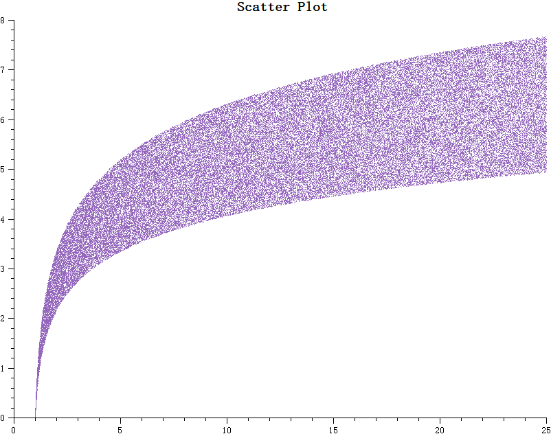

# Scatter Plot - QwtPlotCurve Scatter Mode

Scatter plots are used to display data distribution, with each data point marked by an independent symbol. In Qwt, scatter plots are implemented using `QwtPlotCurve` combined with `QwtSymbol`.

## Key Features

**Features**

- Multiple symbol shapes: Supports ellipse, rectangle, diamond, triangle, cross, and other shapes
- Symbol style customization: Configurable size, fill color, border color, and border width
- High-performance scatter mode: Use `Dots` style to efficiently render millions of data points
- Symbol jitter: Prevents visual occlusion of overlapping points

## Basic Concepts

### Scatter Plot Implementation Methods

Qwt provides three ways to draw scatter plots:

| Method | Curve Style | Description |
|--------|------------|-------------|
| NoCurve + Symbol | `NoCurve` | Show symbols only, no connecting lines |
| Dots | `Dots` | Draw pixel points only, highest performance |
| Lines + Symbol | `Lines` | Display both connecting lines and symbols |

### Performance Comparison

| Data Size | NoCurve+Symbol | Dots |
|-----------|----------------|------|
| <1000 points | Fast | Fastest |
| 1000-10000 points | Fairly fast | Fast |
| >10000 points | Slow | Fast |
| >100000 points | Very slow | Fastest (recommended) |

## Usage

The scatter plot example is located at: `examples/2D/scatterplot`. Screenshot below:



### 1. Basic Scatter Plot

Use `NoCurve` style with symbols to draw a scatter plot:

```cpp
#include <QwtPlot>
#include <QwtPlotCurve>
#include <QwtSymbol>

QwtPlot* plot = new QwtPlot();
plot->setTitle("Scatter Plot Example");
plot->setCanvasBackground(Qt::white);

// Create scatter curve
QwtPlotCurve* scatter = new QwtPlotCurve("Data Points");

// Set to no-line mode
scatter->setStyle(QwtPlotCurve::NoCurve);

// Create symbol
QwtSymbol* symbol = new QwtSymbol(
    QwtSymbol::Ellipse,           // Ellipse shape
    QBrush(Qt::blue),             // Blue fill
    QPen(Qt::darkBlue, 1),        // Dark blue border
    QSize(8, 8)                   // Size
);
scatter->setSymbol(symbol);

// Set data
QPolygonF points;
for (int i = 0; i < 100; i++) {
    double x = rand() % 100;
    double y = rand() % 100;
    points << QPointF(x, y);
}
scatter->setSamples(points);

scatter->attach(plot);
plot->replot();
```

### 2. High-Performance Scatter Mode

For large numbers of data points, use `Dots` style for optimal performance:

```cpp
QwtPlotCurve* scatter = new QwtPlotCurve("Large-Scale Scatter");

// Use Dots style - draws pixel points only, highest performance
scatter->setStyle(QwtPlotCurve::Dots);

// Optional: Enable image buffer optimization
scatter->setPaintAttribute(QwtPlotCurve::ImageBuffer, true);

// Set color (Dots style does not require Symbol)
scatter->setPen(Qt::blue);  // Point color

// Generate 1 million points
QVector<double> xData(1000000), yData(1000000);
for (int i = 0; i < 1000000; i++) {
    xData[i] = rand() % 1000;
    yData[i] = rand() % 1000;
}
scatter->setSamples(xData, yData);

scatter->attach(plot);
```

> **Tip — Dots vs Symbol Performance**
>
> - `Dots` style draws pixel points directly, suitable for millions of data points
> - `NoCurve + Symbol` treats each point as a full symbol drawing object, suitable for small datasets
> - For real-time scatter plots, `Dots` is recommended

### 3. Multiple Symbol Styles

```cpp
// Circle symbol
QwtSymbol* circle = new QwtSymbol(QwtSymbol::Ellipse,
    QBrush(Qt::red), QPen(Qt::darkRed, 2), QSize(10, 10));

// Rectangle symbol
QwtSymbol* rect = new QwtSymbol(QwtSymbol::Rect,
    QBrush(Qt::green), QPen(Qt::darkGreen, 1), QSize(8, 8));

// Diamond symbol
QwtSymbol* diamond = new QwtSymbol(QwtSymbol::Diamond,
    QBrush(Qt::blue), QPen(Qt::darkBlue, 1), QSize(12, 12));

// Cross symbol (no fill)
QwtSymbol* cross = new QwtSymbol(QwtSymbol::Cross,
    Qt::NoBrush, QPen(Qt::black, 2), QSize(8, 8));

// X-cross symbol
QwtSymbol* xcross = new QwtSymbol(QwtSymbol::XCross,
    Qt::NoBrush, QPen(Qt::magenta, 2), QSize(10, 10));

// Triangle symbol
QwtSymbol* triangle = new QwtSymbol(QwtSymbol::Triangle,
    QBrush(Qt::yellow), QPen(Qt::orange, 1), QSize(10, 10));

// Star symbol
QwtSymbol* star = new QwtSymbol(QwtSymbol::Star1,
    QBrush(Qt::cyan), QPen(Qt::darkCyan, 1), QSize(12, 12));

// Hexagon symbol
QwtSymbol* hexagon = new QwtSymbol(QwtSymbol::Hexagon,
    QBrush(Qt::lightGray), QPen(Qt::gray, 1), QSize(10, 10));
```

### 4. Symbol Jitter

When multiple data points are close together, jitter can be used to avoid overlap:

```cpp
// Set symbol jitter range
// Parameter is the jitter width relative to the coordinate range
scatter->setSymbolJitter(0.05);  // 5% jitter range

// Note: setSymbolJitter is a method of QwtPlotCurve
```

> **Info — Jitter Principle**
>
> Jitter adds a random offset to each point's X coordinate during rendering, dispersing overlapping points to make the data density distribution easier to observe.

### 5. Multiple Scatter Data Groups

```cpp
// Create multiple groups with different styles
QwtPlotCurve* group1 = new QwtPlotCurve("Group A");
group1->setStyle(QwtPlotCurve::NoCurve);
group1->setSymbol(new QwtSymbol(QwtSymbol::Ellipse,
    QBrush(Qt::red), QPen(Qt::darkRed), QSize(8, 8)));
group1->setSamples(pointsA);
group1->attach(plot);

QwtPlotCurve* group2 = new QwtPlotCurve("Group B");
group2->setStyle(QwtPlotCurve::NoCurve);
group2->setSymbol(new QwtSymbol(QwtSymbol::Rect,
    QBrush(Qt::blue), QPen(Qt::darkBlue), QSize(8, 8)));
group2->setSamples(pointsB);
group2->attach(plot);

QwtPlotCurve* group3 = new QwtPlotCurve("Group C");
group3->setStyle(QwtPlotCurve::NoCurve);
group3->setSymbol(new QwtSymbol(QwtSymbol::Diamond,
    QBrush(Qt::green), QPen(Qt::darkGreen), QSize(8, 8)));
group3->setSamples(pointsC);
group3->attach(plot);
```

### 6. Lines and Symbols Combined

```cpp
// Display both connecting lines and data point symbols
QwtPlotCurve* curve = new QwtPlotCurve("Curve with Symbols");

// Set line style
curve->setStyle(QwtPlotCurve::Lines);
curve->setPen(QPen(Qt::blue, 2));

// Set symbol
curve->setSymbol(new QwtSymbol(QwtSymbol::Ellipse,
    QBrush(Qt::white), QPen(Qt::blue), QSize(6, 6)));

curve->setSamples(points);
curve->attach(plot);
```

## Symbol Shape List

| Shape | Enum Value | Description |
|-------|-----------|-------------|
| `NoSymbol` | No symbol | No symbol displayed |
| `Ellipse` | Ellipse | Circle or ellipse (depending on size) |
| `Rect` | Rectangle | Square or rectangle |
| `Diamond` | Diamond | Diamond shape |
| `Triangle` | Triangle | Upward triangle |
| `DTriangle` | Down triangle | Downward triangle |
| `UTriangle` | Up triangle | Same as Triangle |
| `LTriangle` | Left triangle | Left-pointing triangle |
| `RTriangle` | Right triangle | Right-pointing triangle |
| `Cross` | Cross | + shaped cross |
| `XCross` | X-cross | X shaped cross |
| `Star1` | Star | Six-pointed star |
| `Star2` | Star 2 | Five-pointed star |
| `Hexagon` | Hexagon | Regular hexagon |
| `Path` | Path | Custom QPainterPath |

## Custom Symbol Path

```cpp
#include <QPainterPath>

// Create custom shape
QPainterPath path;
path.moveTo(0, -10);    // Top
path.lineTo(8, 5);      // Right shoulder
path.lineTo(5, 5);      // Right waist
path.lineTo(0, 0);      // Center
path.lineTo(-5, 5);     // Left waist
path.lineTo(-8, 5);     // Left shoulder
path.closeSubpath();

// Create custom symbol
QwtSymbol* customSymbol = new QwtSymbol();
customSymbol->setStyle(QwtSymbol::Path);
customSymbol->setPath(path);
customSymbol->setBrush(QBrush(Qt::red));
customSymbol->setPen(QPen(Qt::darkRed, 1));
customSymbol->setSize(20, 20);

scatter->setSymbol(customSymbol);
```

## Symbol Core Methods

| Method | Description |
|--------|-------------|
| `setStyle()` | Set symbol shape |
| `setSize()` | Set symbol dimensions |
| `setBrush()` | Set fill brush |
| `setPen()` | Set border pen |
| `setPath()` | Set custom path |
| `setPinPoint()` | Set symbol anchor position |
| `drawSymbol()` | Draw symbol |

> **Example — Related Examples**
>
> - Scatter plot: `examples/2D/scatterplot`
> - Symbol demo: `playground/symbols`
> - Curve styles: `examples/2D/curvedemo`