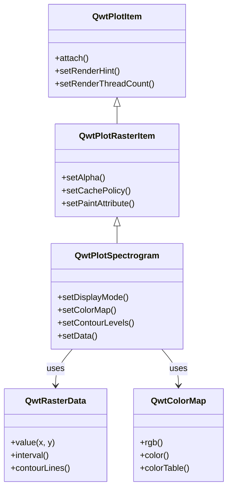
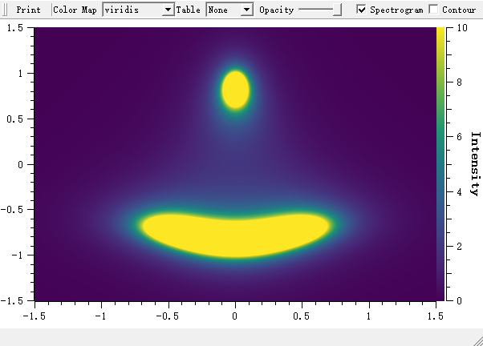
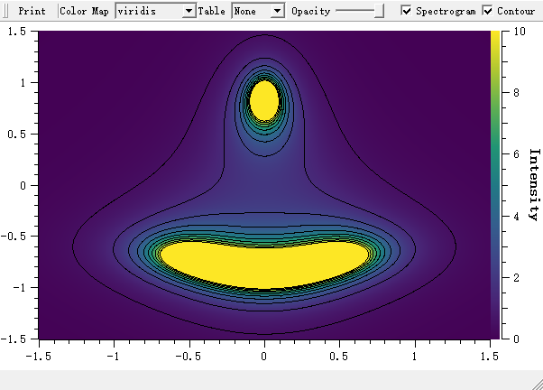

# Spectrogram / Heatmap - QwtPlotSpectrogram

`QwtPlotSpectrogram` is used to draw spectrograms or heatmaps, displaying three-dimensional data on a 2D plane where the third dimension (intensity value) is represented by color. Widely used in scientific data analysis, image processing, acoustic analysis, and other fields.

## Key Features

**Features**

- Image display mode: Maps numeric values to colors to display 2D data fields
- Contour display mode: Draws contour lines at specified values
- Multiple color maps: Supports linear, gradient, discrete, and other color mapping methods
- Multi-threaded rendering: Supports multi-core parallel rendering for improved large data processing efficiency
- Data interpolation: Supports multiple interpolation algorithms for smooth display

## Basic Concepts

### Spectrogram Principle

A spectrogram maps three-dimensional data `(x, y, value)` onto a 2D plane:

```text
        Y-axis
        │
        │   ┌─────────────────┐
        │   │ Color-coded     │
        │   │ intensity values│
        │   │ █░▒▓█░▒▓█░▒▓█ │  ← Each pixel color corresponds to a value
        │   │ ▒▓█░▒▓█░▒▓█░▒ │
        │   │ ▓█░▒▓█░▒▓█░▒▓ │
        │   └─────────────────┘
        └──────────────────────→ X-axis
```

### Display Modes

| Mode | Enum Value | Description |
|------|-----------|-------------|
| Image mode | `ImageMode` | Maps values to colors for display |
| Contour mode | `ContourMode` | Draws contour lines |

### Class Inheritance Structure

The class diagram below shows the key players and how they relate: `QwtPlotSpectrogram` extends the raster base class `QwtPlotRasterItem`, obtains its values from a `QwtRasterData` subclass, and converts those values into colors through a `QwtColorMap`:



## Usage

The spectrogram example is located at: `examples/2D/spectrogram`. Screenshot below:





### 1. Basic Spectrogram

The basic setup creates a `QwtPlotSpectrogram`, enables `ImageMode` with `setDisplayMode()`, assigns a color map — here a `QwtLinearColorMap` with several intermediate stops — and passes the raster data via `setData()` before attaching the item to the plot:

```cpp
#include <QwtPlot>
#include <QwtPlotSpectrogram>
#include <QwtRasterData>
#include <QwtColorMap>

QwtPlot* plot = new QwtPlot();
plot->setTitle("Spectrogram Example");
plot->setCanvasBackground(Qt::black);

// Create spectrogram
QwtPlotSpectrogram* spectrogram = new QwtPlotSpectrogram();

// Enable image display mode
spectrogram->setDisplayMode(QwtPlotSpectrogram::ImageMode, true);

// Set color map
QwtLinearColorMap* colorMap = new QwtLinearColorMap(Qt::darkBlue, Qt::yellow);
colorMap->addColorStop(0.2, Qt::blue);
colorMap->addColorStop(0.4, Qt::cyan);
colorMap->addColorStop(0.6, Qt::green);
colorMap->addColorStop(0.8, Qt::orange);
spectrogram->setColorMap(colorMap);

// Create data
// Using a custom QwtRasterData derived class here
spectrogram->setData(new MyRasterData());

spectrogram->attach(plot);
plot->replot();
```

### 2. Custom Raster Data

Create a `QwtRasterData` derived class to provide data: implement the pure virtual `interval()` and `value()` methods — contour line computation is optional, the base class already provides a CONREC implementation:

```cpp
#include <QwtRasterData>
#include <QwtInterval>

#include <cmath>

// Custom raster data class
class MyRasterData : public QwtRasterData
{
public:
    MyRasterData()
    {
        // Optional performance hint: no NaN gaps inside the bounding rectangle
        setAttribute(QwtRasterData::WithoutGaps, true);

        // Set data range
        m_intervals[Qt::XAxis] = QwtInterval(0, 100);
        m_intervals[Qt::YAxis] = QwtInterval(0, 100);
        m_intervals[Qt::ZAxis] = QwtInterval(0, 1);  // Value range
    }

    // Return the bounding interval for an axis (pure virtual)
    virtual QwtInterval interval(Qt::Axis axis) const override
    {
        if (axis >= 0 && axis <= 2)
            return m_intervals[axis];

        return QwtInterval();
    }

    // Return value at specified position (core method, pure virtual)
    virtual double value(double x, double y) const override
    {
        // Example: compute value at position
        const double dx = x - 50;
        const double dy = y - 50;
        const double dist = std::sqrt(dx * dx + dy * dy);
        return std::exp(-dist / 20.0);  // Gaussian distribution
    }

    // Optional: override the contour line computation (ContourLines is
    // QMap<double, QPolygonF>); the base class runs the CONREC algorithm:
    // virtual ContourLines contourLines(const QRectF& rect, const QSize& raster,
    //     const QList<double>& levels, ConrecFlags flags) const override;

private:
    QwtInterval m_intervals[3];
};
```

### 3. Color Map Configuration

#### Linear Color Map

`QwtLinearColorMap` interpolates between color stops added by `addColorStop()` at normalized positions from 0.0 to 1.0; `setFormat()` chooses between `QwtColorMap::RGB` (smooth transitions) and `QwtColorMap::Indexed` (color-table images):

```cpp
// Create a linear color map from blue to red
QwtLinearColorMap* colorMap = new QwtLinearColorMap(Qt::blue, Qt::red);

// Set format (RGB or Indexed)
colorMap->setFormat(QwtColorMap::RGB);  // RGB mode, smooth color transitions

// Add color stops
colorMap->addColorStop(0.0, Qt::black);   // Minimum: black
colorMap->addColorStop(0.3, Qt::blue);    // 30%: blue
colorMap->addColorStop(0.5, Qt::green);   // 50%: green
colorMap->addColorStop(0.7, Qt::yellow);  // 70%: yellow
colorMap->addColorStop(1.0, Qt::white);   // Maximum: white

spectrogram->setColorMap(colorMap);
```

#### Predefined Color Maps

Besides defining your own stops, Qwt ships ready-made maps such as `QwtHueColorMap`, which cycles the hue of the HSV model for a rainbow effect, `QwtAlphaColorMap`, which varies the transparency of a fixed color, and `QwtSaturationValueColorMap`, which varies saturation and/or value for a fixed hue; any of them is assigned through the same `setColorMap()` call:

```cpp
// Use Qwt's built-in Hue color map (rainbow)
QwtHueColorMap* hueMap = new QwtHueColorMap();
hueMap->setHueInterval(0, 359);  // Full hue circle (HSV hue: 0-359)
hueMap->setSaturation(255);
hueMap->setValue(255);
spectrogram->setColorMap(hueMap);

// Use Alpha color map (transparency variation of one color)
QwtAlphaColorMap* alphaMap = new QwtAlphaColorMap(Qt::darkBlue);
alphaMap->setAlphaInterval(0, 255);  // From fully transparent to opaque
spectrogram->setColorMap(alphaMap);

// Use Saturation/Value color map (fixed hue, varying saturation and value)
QwtSaturationValueColorMap* svMap = new QwtSaturationValueColorMap();
svMap->setHue(220);
svMap->setSaturationInterval(100, 255);
svMap->setValueInterval(70, 255);
spectrogram->setColorMap(svMap);
```

### 4. Contour Display

In `ContourMode`, the spectrogram draws isolines instead of — or, with both display modes enabled, on top of — the color image: `setContourLevels()` fixes the values that get a line, and `setDefaultContourPen()` sets the pen used for all levels without a specific one:

```cpp
// Enable contour mode
spectrogram->setDisplayMode(QwtPlotSpectrogram::ContourMode, true);

// Set contour levels
QList<double> contourLevels;
contourLevels << 0.1 << 0.2 << 0.3 << 0.4 << 0.5 << 0.6 << 0.7 << 0.8;
spectrogram->setContourLevels(contourLevels);

// Set contour line style
spectrogram->setDefaultContourPen(QPen(Qt::white, 1));

// Display both image and contour lines
spectrogram->setDisplayMode(QwtPlotSpectrogram::ImageMode, true);
spectrogram->setDisplayMode(QwtPlotSpectrogram::ContourMode, true);
```

### 5. Data Resolution Settings

Raster rendering offers a quality-versus-speed trade-off. There is no explicit "pixel size" setter — the image is normally rendered in the resolution of the paint device. What you can control: `QwtRasterData::pixelHint()` lets the data suggest a pixel grid aligned to the data raster (implemented automatically by `QwtMatrixRasterData`), the `PaintInDeviceResolution` paint attribute expands such an image to device resolution before it is passed to QPainter, `RenderAntialiased` (inherited from `QwtPlotItem`) toggles antialiasing, and `setCachePolicy()` keeps a rendered image between repaints:

```cpp
// Expand a data-aligned image (per pixelHint()) to paint device resolution
spectrogram->setPaintAttribute(QwtPlotRasterItem::PaintInDeviceResolution, true);

// Antialiasing render hint (inherited from QwtPlotItem)
spectrogram->setRenderHint(QwtPlotItem::RenderAntialiased, true);

// Cache the rendered image instead of recomputing it on every repaint
spectrogram->setCachePolicy(QwtPlotRasterItem::PaintCache);
```

### 6. Multi-Threaded Rendering

Large rasters can be rendered in parallel: `setRenderThreadCount()`, inherited from `QwtPlotItem`, distributes the image generation across the given number of threads. The default is 1 (single-threaded), while 0 asks the system to pick a suitable count:

```cpp
// Set rendering thread count (improves large data rendering performance)
spectrogram->setRenderThreadCount(4);  // Use 4 threads for parallel rendering

// The default is 1 (single-threaded); 0 selects the system specific ideal thread count
spectrogram->setRenderThreadCount(0);
```

> **Tip — Multi-Threaded Rendering Recommendations**
>
> - When data exceeds 1 million pixels, multi-threading is recommended
> - Set thread count to the number of CPU cores, not exceeding 8
> - Multi-threaded rendering is most effective in image mode

### 7. Using Matrix Data

For plain matrices there is no need to derive from `QwtRasterData` yourself: `QwtMatrixRasterData` wraps a flat `QVector<double>` via `setValueMatrix()`, takes the x/y/z extents through `setInterval()`, and interpolates between cells according to its `setResampleMode()` setting (e.g. `BilinearInterpolation`):

```cpp
#include <QwtMatrixRasterData>

// Use matrix data class
QwtMatrixRasterData* matrixData = new QwtMatrixRasterData();

// Set data matrix
QVector<double> values;
for (int i = 0; i < 100 * 100; i++) {
    values << (rand() % 100);
}
matrixData->setValueMatrix(values, 100);  // 100x100 matrix

// Set data range
matrixData->setInterval(Qt::XAxis, QwtInterval(0, 100));
matrixData->setInterval(Qt::YAxis, QwtInterval(0, 100));
matrixData->setInterval(Qt::ZAxis, QwtInterval(0, 100));

// Set interpolation method
matrixData->setResampleMode(QwtMatrixRasterData::BilinearInterpolation);

spectrogram->setData(matrixData);
```

### 8. Color Bar

Add a color bar to show the correspondence between colors and values (the scale widget takes ownership of the color map, so pass a new instance rather than reusing the spectrogram's one):

```cpp
#include <QwtScaleWidget>

// Add color bar on the right side
QwtScaleWidget* rightAxis = plot->axisWidget(QwtAxis::YRight);
rightAxis->setColorBarEnabled(true);
rightAxis->setColorBarWidth(20);

// Set color bar range and color map
rightAxis->setColorMap(QwtInterval(0, 100), new QwtLinearColorMap(Qt::darkBlue, Qt::yellow));

// Show right axis
plot->setAxisVisible(QwtAxis::YRight, true);
```

## Core Methods Summary

| Method | Description |
|--------|-------------|
| `setData()` | Set raster data |
| `setColorMap()` | Set color map |
| `setDisplayMode()` | Set display mode |
| `setContourLevels()` | Set contour levels |
| `setDefaultContourPen()` | Set contour line pen |
| `setColorTableSize()` | Set the number of color table entries (for `Indexed` color maps) |
| `setRenderThreadCount()` | Set rendering thread count (inherited from `QwtPlotItem`) |
| `data()` | Get raster data |
| `colorMap()` | Get color map |

## Color Map Classes Summary

| Class | Description |
|-------|-------------|
| `QwtLinearColorMap` | Linear color map built from color stops, with smooth color transitions |
| `QwtHueColorMap` | Varies the hue of the HSV color model for a rainbow effect |
| `QwtAlphaColorMap` | Varies the alpha value (transparency) of a fixed color |
| `QwtSaturationValueColorMap` | Varies saturation and/or value for a fixed hue in the HSV color model |

> **Tip — Application Scenarios**
>
> - Scientific data analysis: Temperature fields, pressure fields, etc.
> - Image processing: Heatmaps, density maps
> - Acoustic analysis: Spectrograms, sonar images
> - Geographic data: Topographic maps, ocean depth maps

> **Example — Related Examples**
>
> - Spectrogram demo: `examples/2D/spectrogram`