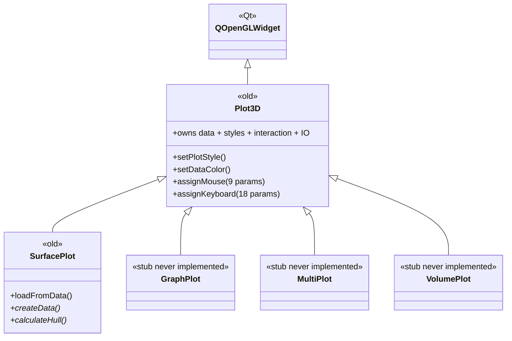
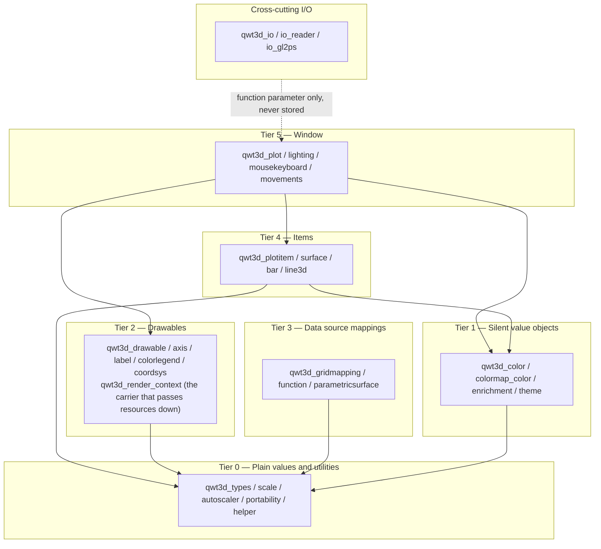
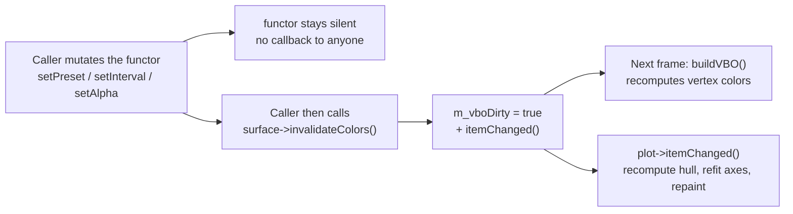
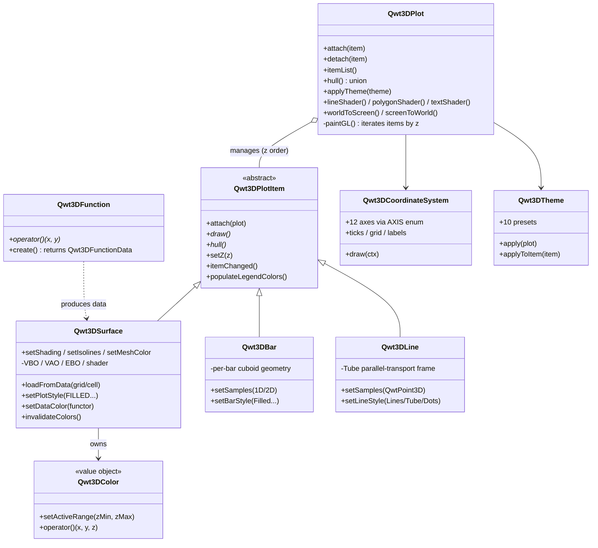
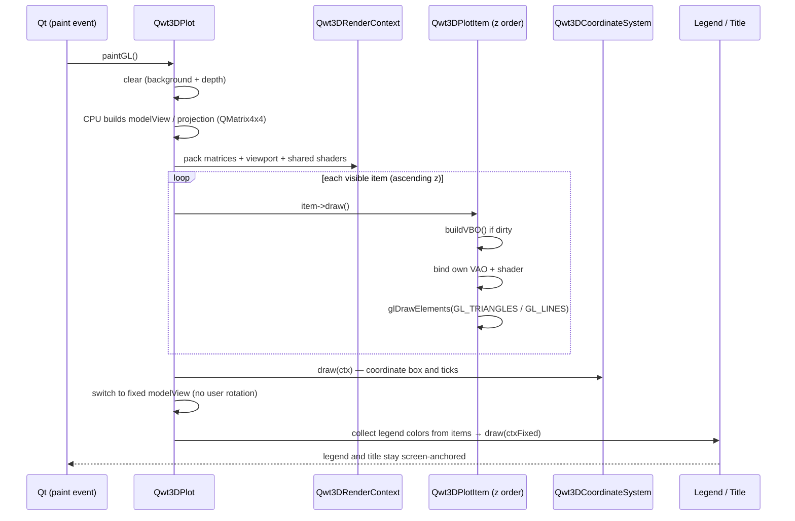
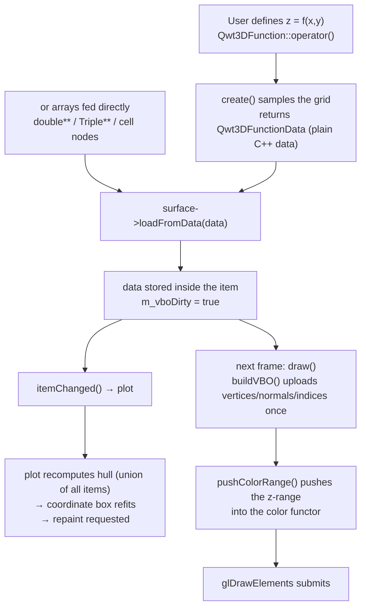
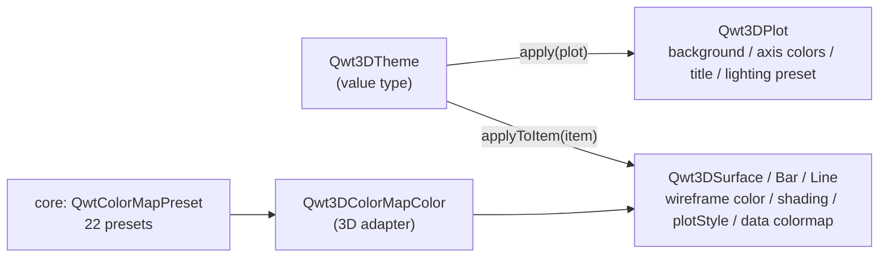

# 3D Plot Architecture: From QwtPlot3D to Plot + Item

This is the **architecture overview** of the QWT 3D module. It answers three questions: what was wrong with the old `QwtPlot3D`, what this refactor changed, and why the module is better structured now. Unlike the [3D Plot Introduction](3d-plot.md) (how to use the API), this article explains **why it is shaped this way**. Unlike the [3D Module Refactor Notes](../../dev-guide/plot3d-refactor.md) (commit sequence and developer conventions), this one is written for readers who want a coherent mental model with as little jargon as possible.

> **Info — Reading advice**
>
> If you just want to plot, start with the [3D Plot Introduction](3d-plot.md). If you ever wondered whether adding a new 3D graph type requires touching the window class, section 5.2 gives a firm answer: **it does not**.

## 1. Two generations of the 3D module

The 3D capability in Qwt has had two lives. The first was the standalone `QwtPlot3D` library (a Qt 3/4 era heritage), merged into Qwt 7.1. The second is the structural refactor started in the Qwt 7.3 series — **keeping its math and interaction, replacing its architecture and rendering**.

The core of the refactor was not "translate old code into new syntax" — it was swapping a set of **structural decisions**: the old module welded "a plot window" and "a plot object" into a single class; the new module splits them into two classes and prescribes exactly one legal dependency direction between them. The rest of this article first shows why the old structure could not work.

## 2. Defects of the legacy architecture

### 2.1 Every graph type was a window

The legacy module was a **widget-centered** class hierarchy: `Qwt3D::Plot3D` inherited `QOpenGLWidget` directly, and `Qwt3D::SurfacePlot` inherited `Plot3D`. A surface was not "something drawn inside a window" — the surface **was** the window.

The model had one fatal limitation: **one window held exactly one dataset**. Drawing a "surface + bars" scene, or overlaying two curves on the same coordinate box, was impossible — unless the data was forced into `SurfacePlot`'s single storage. The `GraphPlot` / `MultiPlot` / `VolumePlot` classes were nominally the "extension points for multiple graph types"; in practice they were empty shells (a constructor plus one pure virtual) and were deleted as dead code during the refactor.

### 2.2 A "god widget"

`Plot3D` exposed 70+ public members mixing four unrelated responsibilities: view transformation (rotate/shift/scale), data and styles (`setPlotStyle` / `setDataColor` / `setMeshColor` / `setIsolines` / `setPolygonOffset` / `setShading` / `addEnrichment`), lighting and materials (`setMaterialComponent` / `setLightComponent`), plus interaction and export (`assignMouse` / `assignKeyboard` / `savePixmap` / `saveVector`).

Worse, its private data stored **the plot data itself** (`Data* m_actualData`) and the **GPU cache** (`std::vector<GLuint> m_displayLists`). Window and data were coupled at the storage level, so "adding a graph type = modifying the central widget". The 2D module had long since separated `QwtPlot` (the canvas) from `QwtPlotItem` (the drawable object).

What the refactor did: the data/style members living on the window were **moved out wholesale**. The difference between the two interfaces is verifiable — these methods no longer exist on the window class and now live on their items:

| Removed from the window (old `Plot3D`) | Now owned by |
|------|------|
| `setPlotStyle` / `setShading` / `setIsolines` / `setMeshColor` / `setMeshLineWidth` / `setSmoothMesh` / `setPolygonOffset` | `Qwt3DSurface` (per-item render style) |
| `setDataColor` / `dataColor` | each item's color functor |
| `addEnrichment` / `degrade` / `userStyle` | `Qwt3DSurface` |
| `updateData` / `hasData` / `hull` | `Qwt3DPlotItem::itemChanged()` and `Qwt3DPlot::hull()` (union over all items) |
| `setCoordinateStyle` | direct `Qwt3DCoordinateSystem` API |

The window keeps only **what a window should own**: the GL context, view transformation, lighting, coordinate system, theme, export, plus the newly added item management (`attach` / `detach` / `itemList`) and shared-resource accessors (`lineShader()` / `polygonShader()` / `textShader()` / `modelViewMatrix()` / `worldToScreen()`).

### 2.3 Fixed-function OpenGL: a deprecated rendering path

The old render path was an "OpenGL 1.x textbook":

- **Immediate mode**: per-vertex `glBegin/glEnd` submission (`qwt3d_axis.cpp`, `qwt3d_coordsys.cpp`, `qwt3d_colorlegend.cpp`, …);
- **Display lists**: `glGenLists` / `glNewList` / `glCallList` to cache geometry in the driver (`m_displayLists` in `qwt3d_plot.cpp`);
- **Matrix stack**: `glRotatef` / `glTranslatef` / `glPushMatrix` bouncing transforms between CPU and GPU;
- **Fixed-function lighting**: `glLightfv` / `glMaterialfv` / `GL_COLOR_MATERIAL` (`qwt3d_lighting.cpp`);
- **GLU quadrics**: `gluQuadric*` for cylinders/disks (`qwt3d_enrichment_std.cpp`), `gluProject` for projection (`qwt3d_drawable.cpp`);
- **Raster text**: `glRasterPos3d` + `glDrawPixels` pasting pixels onto the screen (`qwt3d_label.cpp`).

In modern OpenGL these APIs are **either removed or deprecated**: Core Profile (3.3+) has no `glBegin`, no display lists, no GLU, no fixed lighting. The consequence is concrete — the module could not run under Core Profile, which meant it could not port to ANGLE / OpenGL ES (mobile, WebAssembly, and the stable ANGLE backend on Windows), while Qt 6's `QOpenGLWidget` keeps trending toward Core Profile. Immediate mode also submits vertices one at a time, a classic CPU→GPU bottleneck.

The replacement:

| Old | New | Where |
|-----|-----|-------|
| per-vertex `glBegin/glEnd` | VBO + VAO + one `glDrawElements` | per item (`Qwt3DSurface::buildVBO()`) |
| display lists | persistent VBO, rebuilt only when `m_vboDirty`, reused across frames | `qwt3d_surface.cpp` |
| GL matrix stack | `QMatrix4x4` computed on the CPU, passed as uniforms | `Qwt3DPlot::paintGL()` |
| `glLightfv` / `glMaterialfv` | Blinn-Phong in the shader | `src/plot3d/shaders/*.vert/.frag` |
| `gluQuadric*` | CPU-generated geometry (e.g. the Tube swept cross-section) | `qwt3d_line3d.cpp` |
| `gluProject` | plain matrix math in `Qwt3DRenderContext::worldToScreen()` | `qwt3d_render_context.cpp` |
| `glRasterPos3d` + `glDrawPixels` | `QOpenGLTexture` text textures | `qwt3d_label.cpp` |

`src/plot3d/shaders/` holds 10 GLSL 3.30 Core shaders (`surface` / `polygon` / `line` / `point` / `text`, one vertex + fragment pair each), covering every primitive type in the pipeline.

### 2.4 Inverted dependencies: low-level classes holding high-level pointers

This is the most insidious problem in the old design. By convention, color computation is a low-level utility and the window is high-level — **the high level knowing the low level is normal; the low level grabbing the high level's pointer is a hazard**. The old code contained three such reverse pointers:

1. **Color functors held the window**: `Qwt3D::ColorMapColor(Plot3D* plot, ...)` stored `m_plot`, and the constructor demanded a widget;
2. **Data mappings held the plot widget**: `Qwt3D::GridMapping::setPlotWidget(SurfacePlot*)`;
3. **The drawable base held the widget** for matrices and viewport.

The cost of reverse pointers is not hypothetical: the repository still carries the commit `fix(qwtplot3d): recreate color functor to prevent dangling pointer` — that is a crash, not a style issue. Reverse pointers also blocked unit testing: exercising a color functor required constructing a `QOpenGLWidget` first.

The refactor **corrected the direction and gave a general mechanism** (sections 3.2 and 3.3): whatever the lower layer needs is *pushed down as a parameter* by the layer above, instead of being reached for through a back-pointer.

### 2.5 Naming inconsistency

All legacy types lived in `namespace Qwt3D`, with foundational types such as `Triple`, `RGBA` and `ParallelEpiped` inside it, while the rest of the library follows **global scope with a `Qwt` prefix** (`QwtPlot`, `QwtPlotCurve`). Two naming schemes in one library, and a stray `using namespace Qwt3D;` pollutes application code.

The refactor removed the namespace entirely and prefixed everything with `Qwt3D` (`Qwt3DPlot`, `Qwt3DSurface`, `Qwt3DColorMapColor`). This is a breaking change; the mapping table is in the [3D Module Refactor Notes](../../dev-guide/plot3d-refactor.md).

### 2.6 Out of sync with the 2D architecture

The 2D mental model has been refined for more than a decade: `QwtPlot` is the canvas, `QwtPlotItem` is a drawable attached to it, `attach()` / `detach()` manage lifetime, `itemChanged()` requests a repaint, and style objects (`QwtColorMap`, `QwtSymbol`) are **silent value objects** whose owner triggers notification. The 3D module had none of this vocabulary, which meant:

- users had to switch between two unrelated API styles;
- pitfalls already solved in 2D (dirty flags, ownership, notification timing) had to be rediscovered in 3D;
- shared infrastructure of the `core` module (colormap presets, `QwtPoint3D`, `QwtSeriesData`) could not be reused.

### 2.7 Summary of defects

| Defect | Direct consequence | Root cause |
|--------|-------------------|------------|
| Graph type welded to window | one dataset per scene | widget-centered hierarchy |
| data + styles + interaction + IO in one class | adding a type requires editing the central class | responsibilities not separated by rate of change |
| fixed pipeline + display lists + GLU | unusable under Core Profile, slow, no ES/ANGLE | rendering bound to 1998 OpenGL |
| low-level → high-level pointers | dangling-pointer crashes, no unit tests | inverted dependencies |
| `namespace Qwt3D` | conflicts with library-wide naming | local legacy baggage |
| detached from `QwtPlot` + `QwtPlotItem` | doubled learning cost, non-transferable patterns | two generations of authors |

## 3. Refactoring principles

The refactor was not a one-shot rewrite; it progressed incrementally on the `new3d` branch under five fixed principles. The principles matter more than the code — they decide every trade-off that follows.

### 3.1 Principle 1: split by responsibility — a window only manages windows

**The window class owns "how you look at it"; the item owns "what is drawn".** `Qwt3DPlot` handles the GL context, view transformation, lighting, coordinate system, theme and item list — *scene-level* state. `Qwt3DPlotItem` handles data, geometry, styles and GPU caches — *object-level* state.

The test is simple: if a property varies per dataset (mesh resolution, wireframe color, shading mode), it belongs to the item; if it applies to the whole picture (background color, light direction, camera angle, coordinate box range), it belongs to the window. This boundary makes "one window, many items" a natural outcome rather than a special case.

### 3.2 Principle 2: dependencies point downward only

The module is organized into six conceptual layers; **a dependency may only target a lower (or same) layer**, and any low → high pointer counts as a defect:

The single allowed "upward" pointer is `Qwt3DPlotItem::plot()`: an item genuinely needs the GL context and shaders its window provides, so this channel is deliberately preserved and written down in `src/plot3d/AGENTS.md`. Any other reverse reference is a bug.

**Why be strict about this?** Because dependency direction decides **what can be tested in isolation**. Tier 0 types hold no pointer to any 3D class and can be numerically tested; Tier 1 value objects have no callbacks and can be constructed, copied and compared freely; Tier 2 drawables depend only on the context parameter they receive and can be verified without a window.

### 3.3 Principle 3: silent value objects, notifications owned by the layer above

If the lower layer must not call the upper layer, how does a state change reach the renderer? Answer: **it does not** — setters on value objects (color functors, enrichments, themes) stay silent, and "I changed" is the owning item's job:

This mirrors the 2D contract **word for word**: after changing a `QwtSymbol` you call `itemChanged()`; after changing a `QwtColorMap` the `QwtPlotSpectrogram` decides how to refresh. Both halves of the library obey the same discipline, so users learn it once.

Complementing it is **push instead of query**: the z-range needed for color normalization is not fetched by the functor via `plot()->hull()` (that would need a reverse pointer); `Qwt3DSurface::pushColorRange()` pushes the union hull's range into the functor through `setActiveRange()` before building the VBO.

> **Note — Why `invalidateColors()` instead of automatic notification**
>
> Automatic notification would force the value object to store a pointer to its owner — which is exactly the reverse-pointer problem all over again. An explicit call puts "who marks the dirty state" on the surface of the code; a reader can see the source of the invalidation immediately.

### 3.4 Principle 4: render on the Core Profile

The migration was not simply "`glBegin` → VBO"; it **redivided responsibility for GPU interaction**:

- **Window** owns phase-level shared state: `paintGL()` computes the modelView / projection matrices once, packages them into a `Qwt3DRenderContext`, and exposes shared shader programs (all items of one window reuse `lineShader` / `polygonShader` / `textShader`, instead of each compiling and linking its own);
- **Item** owns its private geometry: VBO / VAO / EBO are created and destroyed inside the item, rebuilt when dirty, reused otherwise;
- **Shaders** are grouped by primitive type (polygon / line / point / text), live in `src/plot3d/shaders/`, and are compiled into the binary via the Qt resource system.

GLSL 3.30 Core was chosen as a **portability bet**: Core Profile is the greatest common divisor of desktop OpenGL, OpenGL ES 3.0 and ANGLE, so one shader path covers Windows / macOS / Linux and a future ES backend.

### 3.5 Principle 5: incremental refactor, every step buildable

A dozen commits in late July 2026, each solving exactly one structural problem while staying buildable:

Every step corresponds to a traceable commit — which is why the claims in this article can be checked. Nothing was thrown away; the refactor is **a sequence of small correct decisions applied to the old code**.

### 3.6 Trade-off: fix the architecture first, features later

The refactor deliberately accepted a "features yield" : floor projection, normal display and enrichments (cross hairs / cones / arrows) **keep their data interfaces**, while their **rendering is marked TODO** — the old implementation depended entirely on `glBegin/glEnd`, which cannot run under Core Profile at all, and these are decorative primitives that should not block the migration of the main architecture. The entry points are in `src/plot3d/qwt3d_surface.cpp`: the doc comment of `addEnrichment()` and the end of `draw()` both carry an explicit TODO ("Enrichment rendering with VBO will be implemented in a future plan"). The functions keep accepting data and maintaining lists; they just do not produce pixels yet.

The reasoning: an architectural mistake makes **every** subsequent change more expensive (the legacy module's actual state for years), whereas a missing feature is local and can be filled in incrementally. History proved the judgment right — once the architecture was straightened out, the bar and line items joined within a week without friction.

## 4. The refactored architecture

### 4.1 The full picture

Responsibilities at a glance:

| Class | Role | Key responsibilities |
|------|------|---------|
| `Qwt3DPlot` | rendering window (`QOpenGLWidget`) | GL context, view/projection matrices, lighting, coordinate system, theme, item list, export |
| `Qwt3DPlotItem` | abstract item base | `attach`/`draw`/`hull`/`z`/`itemChanged`/legend colors |
| `Qwt3DSurface` | surface item | grid/cell data, five render styles, color functor, dirty-flag-driven VBO |
| `Qwt3DBar` / `Qwt3DLine` | bar / line items | self-contained geometry and styles |
| `Qwt3DFunction` / `Qwt3DParametricSurface` | data source mapping | sample `z=f(x,y)` or `r(u,v)` into data structs |
| `Qwt3DCoordinateSystem` | coordinate box | 12 axes (`X1`–`Z4`), ticks, grid, labels |
| `Qwt3DColor` (incl. `Qwt3DColorMapColor`) | color functor | silent value object, bridges core colormap presets |
| `Qwt3DTheme` | theme | unified description of widget-level and item-level properties |

### 4.2 How one frame is drawn

`paintGL()` is the best cross-section for understanding the new architecture — it shows precisely what the window prepares and what items prepare:

Two design details deserve a closer look:

- **`Qwt3DRenderContext` is a value, not a pointer.** It is constructed at each call site (matrices, viewport, shared shader pointers) and passed by const reference down the draw chain. This eliminated the `Qwt3DPlot*` reverse pointer baked into the old `Drawable` — everything a drawable needs arrives as a parameter; it does not know the window exists.
- **Legend and title use a fixed matrix.** They are screen-anchored; if they rotated with the scene they would be wrong, so the window swaps in a baseline modelView that does not follow user interaction for the last drawing phase, keeping UI elements stable.

### 4.3 How data reaches the GPU

No step in this chain requires a lower layer to call back into a higher one: the data source **returns** data, the item **requests** a refresh, and the window **aggregates** hulls to decide the coordinate box — responsibility flows along a single-direction chain. Note the hull handling in particular: `Qwt3DPlot::hull()` is the **union of all item bounding boxes**, and the coordinate system refits accordingly, so multi-item scenes need no manual range synchronization.

> **Warning — Attach first, load data second**
>
> The hull is recomputed only inside `itemChanged()` — `Qwt3DPlot::attach()` itself does not recompute it. If you call `loadFromData()` *before* `attach()` and then never mutate another property, the item's notification has already fired while it was unattached (`itemChanged()` only notifies the plot when `plot()` is non-null), so the window's hull stays degenerate, the coordinate box never forms, and the plot renders **completely blank with no warning**. The correct order is `item->attach(plot)` first, then `loadFromData()` and the various setters.

### 4.4 Colors and themes: plugging into the core ecosystem

The 3D module does not reinvent the color system; it **adapts** the `core` module:

- `Qwt3DColorMapColor` bridges `QwtColorMap` and core's 22 scientific colormap presets (`viridis`, `plasma`, `jet`, `coolwarm`, …), so 2D spectrograms and 3D surfaces share **one preset table**;
- `Qwt3DTheme`'s 10 presets package background, axes, title, grid and lighting presets (`NoLighting`/`FlatLight`/`Studio`/`Outdoor`/`Soft`) into a value type applied with a single `plot->applyTheme(...)`;
- Applying a theme splits in two: widget-level properties (background, axis colors, lighting) go to `Qwt3DPlot`, item-level properties (wireframe color, shading mode, plot style, data colormap) go to each attached item through `applyToItem()` — **a natural by-product of the Plot/Item split**: a theme no longer needs to know what it looks like; it only describes properties, and the two receivers apply them.

### 4.5 Relation to 2D and to core

The module dependency is a single edge: `plot3d` → `core`, with **no dependency** on `plot` (2D). The 3D module stands alone as a library yet shares infrastructure with 2D through core — `Qwt3DLine::setSamples()` accepts `QVector<QwtPoint3D>` / `QwtSeriesData<QwtPoint3D>` (core types, and the data language of the 2D `QwtPlotCurve`). The two modules speak the same data contract.

At the presentation level they can share a frame: `examples/3D/figureSurface3D` places a 3D surface window and 2D cross-section/time-series curves in one `QwtFigure` grid; moving the 3D scene resamples the 2D curves. Under the old architecture this required crossing two completely different event models; now each just `attach()`es to its own canvas.

## 5. Benefits and state of the art

### 5.1 Point-by-point comparison

| Legacy defect | After the refactor | Who benefits |
|--------|--------|-----------|
| one dataset per window | arbitrary items per window, z-order controls overlay | users comparing multiple layers |
| adding a type edits the central class | new items are self-contained, `Qwt3DPlot` untouched | module maintainers |
| Core Profile unusable | VBO/VAO + GLSL 3.30, portable to ES/ANGLE | mobile / ANGLE / Wayland users |
| per-frame immediate submission | upload once, rebuild on dirty, reuse across frames | large meshes and animated scenes |
| reverse pointers → dangling pointers | layered dependencies + `RenderContext` passed down | everyone (one fewer crash class) |
| value objects untestable | Tiers 0/1 testable without a window | teams with regression tests |
| split naming conventions | unified `Qwt3D` prefix | newcomers |
| two mental models | symmetric with `QwtPlot` + `QwtPlotItem` | users migrating from 2D |

### 5.2 The extension point is validated, not drawn on a slide

"Plot + Item is good architecture" cannot be asserted — it must be measured by how much churn the second and third implementations caused. The repository answers this: `Qwt3DBar` (bars, per-bar cuboids with 6-face flat normals, 1D series or 2D grid) and `Qwt3DLine` (lines with `Lines`/`Tube`/`Dots`) were **new files + new item subclasses**, with `Qwt3DPlot` unchanged.

These items also demonstrate that the architectural constraints are actually honored:

- own VBO/VAO with lazy rebuild (`qwt3d_bar.cpp`, `qwt3d_line3d.cpp`), never touching window GPU resources;
- implement `hull()` to participate in the coordinate box union;
- implement `populateLegendColors()` to plug into the unified legend;
- follow the `invalidateColors()` / `itemChanged()` notification contract.

One caveat, for accuracy: "zero changes" refers to the window class only. `Qwt3DTheme::applyToItem()` (`qwt3d_theme.cpp`) currently dispatches item-level properties by `dynamic_cast` per concrete item type, so a new item needs a branch there to receive the theme's wireframe color and data colormap. That is a small extension cost of type-based theme dispatch — nothing like modifying the window class.

The Tube style of `Qwt3DLine` sweeps a circular cross-section along the polyline with **parallel-transport framing** — details that previously had to invade the window class are now the item's private business. Full usage of both items is covered in [3D Bar Chart](3d-bar-chart.md) and [3D Line Plot](3d-line-plot.md).

### 5.3 Rendering state of the art

- **Core Profile compatible**: every primitive goes through a shader; not a single deprecated GL call remains;
- **Shared shaders**: reused at window level, so item creation/destruction triggers no compilation;
- **dirty flags + persistent VBO**: no copying while data is unchanged; animated scenes rebuild vertex buffers only on frames where data changed;
- **CPU matrices**: view transformation is plain `QMatrix4x4` math — printable, serializable, unit-testable (`worldToScreen()` even computes without a GL context);
- **vector export retained**: `gl2ps` compiled unconditionally, `saveVector()` supports EPS / PS / PDF / SVG / PGF as a fallback channel outside the Core Profile pipeline;
- **serialization groundwork**: `qwt3d_serialize.h` provides `QDataStream` operators for value types such as `Triple`, `RGBA`, `ParallelEpiped`, `Qwt3DFunctionData`, so `Qwt3DIO::save()`/`load()` can grow to whole-plot persistence.

**What one frame actually costs (measured baseline)**: timing `paintGL()` with `glFinish`, on MSVC2019 + Qt 6.7.3, Release build, 1000×700 viewport, gives the following baseline (absolute values on a single machine — an order-of-magnitude guide, not a cross-platform benchmark):

| Scenario | Time per frame |
|------|---------|
| 30 × 512 grid surface | 3.3 ms |
| 300 × 512 grid surface | 6.0 ms |
| 1000 × 512 (≈510k vertices) | 7.6 ms |
| Tube style, 300 × 1024 | 12.3 ms |

For a typical workload of a few hundred traces × a few hundred samples at 30 fps, the "upload once, copy nothing per frame" VBO model leaves ample headroom; updating a single trace triggers a local vertex-buffer rebuild measured at close to 0 ms, so animation cost concentrates in the frames where data actually changes.

### 5.4 The compounding value of one ecosystem

2D and 3D now share one **color language** (core colormap presets), one **data language** (`QwtPoint3D` / `QwtSeriesData`), one **notification language** (`itemChanged()` plus silent value objects), and one **build language** (CMake targets `qwt::core` / `qwt::plot` / `qwt::plot3d`). These alignments are invisible benefits: bugs fixed in 2D do not reappear in 3D, a colormap added in 2D is immediately usable in 3D, and the API instincts users form in one half still hold in the other.

## 6. Known limitations and future work

An architecture article that lists only strengths is worthless. An honest inventory of the current state:

| Item | Status | Location |
|------|------|------|
| enrichment rendering (cross hairs / cones / arrows) | data interface present, rendering pending | `addEnrichment()` and the TODO at the end of `draw()` in `qwt3d_surface.cpp` |
| floor projection (`setFloorStyle`) | same — rendering pending | floor TODO in `qwt3d_surface.cpp` |
| normal display (`showNormals`) | same | same file |
| gl2ps vector export | relies on Compatibility Profile state; under Core Profile the transformation may be wrong (declared a known limitation in the source comment) | class comment in `qwt3d_io_gl2ps.h` |
| item bounding hull | axis-aligned box (`ParallelEpiped`), no post-rotation AABB | `Qwt3DPlotItem::hull()` contract |
| automated tests for the 3D render path | none yet (`tests/` currently covers only the 2D picker) | `tests/` |

> **Bug — If you depend on the items above**
>
> Check this table before upgrading. The legacy module could draw floor projections and enrichments (see archived screenshots in the repository); the new module has the data interfaces ready but the pixels have not caught up — this is a **deliberate concession** (see section 3.6), not an oversight.

## 7. Code and example index

### 7.1 Where to start reading

| To understand | Read |
|---------|--------|
| what the window does | `paintGL()` in `src/plot3d/qwt3d_plot.cpp` (about a hundred lines covering the whole frame) |
| the item contract | `src/plot3d/qwt3d_plotitem.h` (class comment includes a custom-item example) |
| a full real item implementation | `buildVBO()` and `draw()` in `src/plot3d/qwt3d_surface.cpp` |
| how context is passed down | `src/plot3d/qwt3d_render_context.h` |
| the dependency layering rules | `src/plot3d/AGENTS.md` (Tiers 0–5 plus the DO/DON'T list) |
| before/after of the refactor | `docs/dev-guide/plot3d-refactor.md` |
| shaders | `src/plot3d/shaders/` (surface/polygon/line/point/text, one pair each) |

### 7.2 Examples

| Example | What to look at |
|------|--------|
| `examples/3D/qwtplot3d` | comprehensive demo: theme switching, color legend, 5 data sources, animated surface, pixmap export |
| `examples/3D/bar3D` | `Qwt3DBar`: 1D series / 2D grid bars with a style dock |
| `examples/3D/line3D` | `Qwt3DLine`: `Lines`/`Tube`/`Dots`, point shapes, per-vertex coloring |
| `examples/3D/waterfall3D` | `Qwt3DWaterfall`: live 2D spectrum + 3D sliding-window waterfall, all styles/color modes, `--screenshot`/`--selftest`/`--fps` automation |
| `examples/3D/figureSurface3D` | a 3D surface window together with 2D cross-section/time-series curves in one `QwtFigure` |

Rendering effects of the surface, color legend and coordinate box (screenshots archived in `docs/assets/screenshots-3D/`; run the examples above to check the current build):

Axes, ticks and labels of the coordinate system (the 12-axis system is still rendered by `Qwt3DCoordinateSystem`):

A 3D surface window and 2D curves arranged in the same figure layout:

### 7.3 Further reading

- [3D Plot Introduction](3d-plot.md) — API and usage
- [3D Bar Chart](3d-bar-chart.md) / [3D Line Plot](3d-line-plot.md) — the two newer item types
- [3D Module Refactor Notes](../../dev-guide/plot3d-refactor.md) — commit sequence, migration table, developer conventions
- `src/plot3d/AGENTS.md` — module-level layering rules (with DO/DON'T counterexamples)
- repository root `AGENTS.md` — repository-wide build and coding conventions
