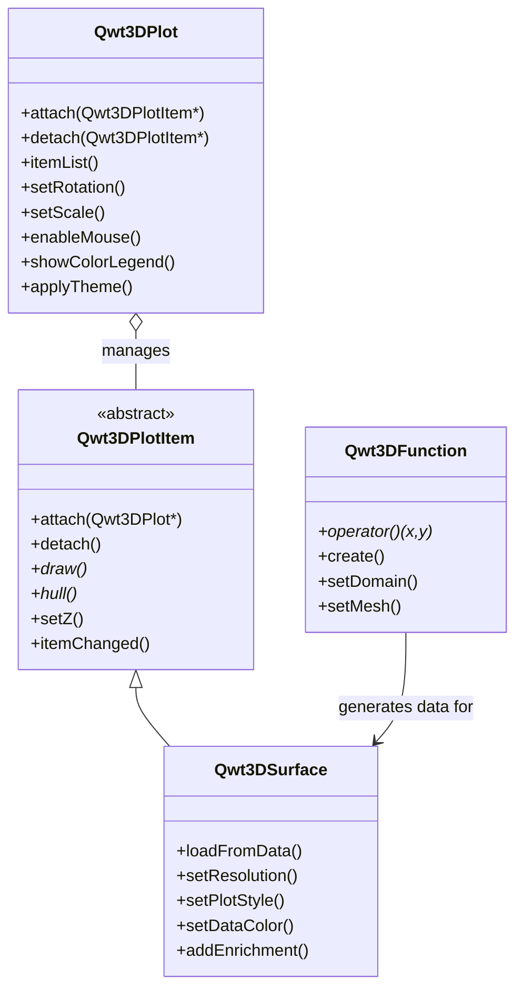
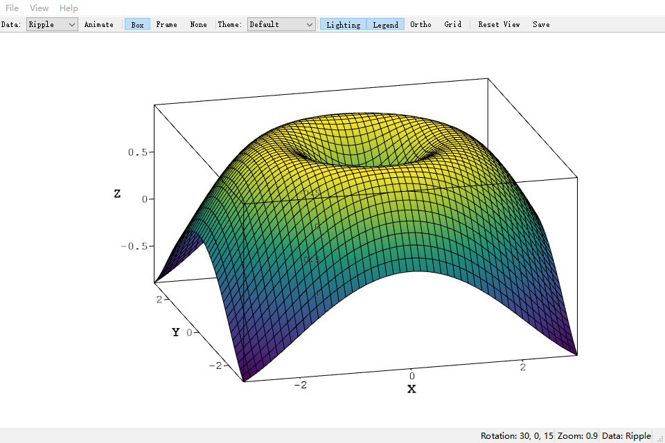
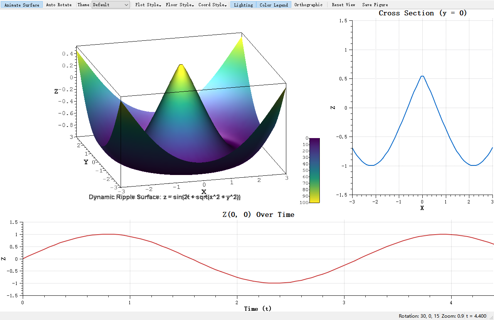

# 3D Plot Introduction


Qwt 7.1 integrates the original `QwtPlot3D` library, providing 3D data visualization capabilities. Starting from v7.3.3, the 3D module has been fully refactored to a **Plot + Item** architecture that mirrors the 2D module (`QwtPlot` + `QwtPlotItem`), with modern OpenGL rendering (VBO/VAO + GLSL 3.3 Core shaders).


> **Info — Why Plot + Item**

>

> For the defects of the legacy `QwtPlot3D`, the refactoring rationale and its benefits, see [3D Plot Architecture](3d-architecture.md) (the architecture overview).


## Main Features


**Features**


- ✅ **Plot + Item architecture**: `Qwt3DPlot` (rendering window) + `Qwt3DPlotItem` (drawable items), symmetric with 2D's `QwtPlot` + `QwtPlotItem`

- ✅ **Multiple plot types**: Surface plots, grid plots, parametric surfaces, function plots, waterfall plots (sliding-window trace stacks), etc.

- ✅ **Modern OpenGL rendering**: VBO/VAO + GLSL 3.3 Core shaders (no legacy fixed-function pipeline)

- ✅ **Interactive operations**: Supports mouse rotation, zooming, and panning

- ✅ **Lighting and material parameters**: the lighting switch, the light rotation, the light/material components and the shininess all reach the shaders (since v7.5.1; `illuminate()`/`blowout()` switch the single light and the defaults equal the previously hardcoded values — see the [technical report](../../tech-report/3d-surface-pipeline.md))

- ✅ **Theme system**: One-click visual style switching with 10 preset themes and 22 scientific colormaps

- ✅ **Multi-item composition**: Attach multiple items to a single `Qwt3DPlot` for combined rendering


## Architecture Overview


The 3D module follows a **Plot + Item** pattern, symmetric with the 2D module:


- **`Qwt3DPlot`** is a rendering window (`QOpenGLWidget` subclass) that manages the GL context, view transforms, lighting, coordinate system, and mouse/keyboard interaction. It holds **no plotting data** itself.

- **`Qwt3DPlotItem`** is the abstract base class for all 3D drawable items. Items manage their own data, geometry, and styles. They attach to a `Qwt3DPlot` via `attach()` / `detach()`.

- A single `Qwt3DPlot` can hold **any number of items**, rendered together in one GL context.





> **Note — No Namespace**

>

> All 3D classes use the `Qwt3D` prefix directly in the global scope (e.g., `Qwt3DPlot`, `Qwt3DSurface`). There is no `namespace Qwt3D` — this is a breaking change from v7.3.2 and earlier.


## Core Classes


| Class | Description |
|-------|-------------|
| `Qwt3DPlot` | 3D rendering window (QOpenGLWidget), manages GL context, view, lighting, coordinate system, and item list |
| `Qwt3DPlotItem` | Abstract base class for all 3D plot items (attach/detach/draw/hull) |
| `Qwt3DSurface` | 3D surface plot item, displays continuous surfaces (handles both grid and cell data) |
| `Qwt3DBar` | 3D bar chart item (1D series or 2D grid histogram); per-bar cuboids with flat normals |
| `Qwt3DLine` | 3D line/curve item; Tube (swept cylinder, lit) / Lines / Dots styles |
| `Qwt3DWaterfall` | 3D waterfall item with a built-in sliding window; stacked traces (spectra) along the depth axis |
| `Qwt3DFunction` | Data generator that creates surfaces from z = f(x, y) mathematical functions |
| `Qwt3DParametricSurface` | Data generator for parametric surfaces r(u, v) |
| `Qwt3DCoordinateSystem` | 3D coordinate system with 12 axes, box/frame styles |
| `Qwt3DColorLegend` | 3D color bar / legend |
| `Qwt3DTheme` | 3D theme system, encapsulates background, mesh, colormap, axes, lighting, and all visual attributes |


## Usage


The 3D plot example is located at: `examples/3D/simpleplot3D`. Screenshot:





### Basic Usage Example


```cpp

#include <qwt3d_plot.h>

#include <qwt3d_surface.h>

#include <qwt3d_function.h>


// Create rendering window

Qwt3DPlot* plot = new Qwt3DPlot();


// Create surface item

Qwt3DSurface* surface = new Qwt3DSurface();

surface->attach(plot);


// Define mathematical function

class MyFunction : public Qwt3DFunction

{

public:

    double operator()(double x, double y) override

    {

        return std::sin(x) * std::cos(y);

    }

};


// Create function and assign to surface

MyFunction* func = new MyFunction(*surface);

func->setDomain(-5, 5, -5, 5);  // x and y range

func->setMesh(50, 50);           // 50x50 grid

func->create();


// Set rotation angles

plot->setRotation(30, 0, 45);  // X, Y, Z axis rotation angles


// Display

plot->show();

```


### Data Loading


```cpp

#include <qwt3d_plot.h>

#include <qwt3d_surface.h>


// Create plot + surface item

Qwt3DPlot* plot = new Qwt3DPlot();

Qwt3DSurface* surface = new Qwt3DSurface();

surface->attach(plot);


// Allocate a 100x100 Z value array

double* zData[100];

for (int i = 0; i < 100; ++i)

    zData[i] = new double[100];

// ... fill data ...


// Load Z value data with explicit X/Y range

surface->loadFromData(zData, 100, 100, 0.0, 100.0, 0.0, 100.0);


// Set resolution (1 = use all data; higher values downsample)

surface->setResolution(1);

```


### Interactive Operations


```cpp

// Enable mouse interaction

plot->enableMouse(true);


// Mouse operations (default bindings):

// - Left button drag: Rotate view (horizontal = around Z, vertical = around X)

// - Middle button drag: Roll around Y (the third rotation a plain left drag cannot reach)

// - Shift + left button: Roll around Y as well

// - Ctrl + left: Pan; Alt + left: scale X/Y; Alt+Shift + left: scale Z; Alt+Ctrl + left: zoom

// - Scroll wheel: Zoom; Shift + wheel: scale Z

// The default rotation sensitivity is half a turn per widget dimension

double rot, scale, shift;

plot->mouseSpeed(rot, scale, shift);   // (0.5, 5, 2) by default

plot->setMouseSpeed(0.5, 5, 2);        // turns per widget / scaling gain / shifting units

plot->setRollMouse(Qwt3DMouseState(Qt::MiddleButton));  // re-bind the roll gesture


// Set scale ratio

plot->setScale(1.0, 1.0, 1.0);  // X, Y, Z scale ratio


// Set rotation angles

plot->setRotation(45, 30, 60);  // X, Y, Z axis rotation angles (degrees)

```


### Color Mapping


```cpp

#include <qwt3d_colormap_color.h>


// Enable color legend

plot->showColorLegend(true);


// Set color mapping based on Z values using a core colormap preset

surface->setDataColor(new Qwt3DColorMapColor(plot, "viridis"));

```


### Multi-Item Composition


One of the key advantages of the Plot + Item architecture is the ability to render multiple items in the same 3D space:


```cpp

Qwt3DPlot* plot = new Qwt3DPlot();


// Surface item

Qwt3DSurface* surface = new Qwt3DSurface();

surface->loadFromData(gridData, cols, rows, 0, 10, 0, 10);

surface->attach(plot);


// Second surface with different z-order

Qwt3DSurface* overlay = new Qwt3DSurface();

overlay->loadFromData(overlayData, cols2, rows2, 0, 10, 0, 10);

overlay->setZ(1.0);  // render on top

overlay->attach(plot);

```


### Other 3D Item Types (v7.3.5+)


Beyond surfaces, the 3D module ships more `Qwt3DPlotItem` types — see their dedicated usage pages:


- [3D Bar Chart](3d-bar-chart.md) (`Qwt3DBar`) — 1D series or 2D grid (3D histogram), per-bar cuboids with flat normals, `Filled`/`FilledMesh`/`Wireframe`.

- [3D Line Plot](3d-line-plot.md) (`Qwt3DLine`) — `Tube` (lit swept cylinder) / `Lines` / `Dots`, per-vertex colormap.

- [3D Waterfall](3d-waterfall.md) (`Qwt3DWaterfall`) — sliding-window waterfall of 1D traces (spectra), `Ribbon`/`RibbonMesh`/`Wireframe`/`Tube` styles, depth/amplitude/solid coloring.


### Live Waterfall (Stacked Traces)


A waterfall draws a stream of one-dimensional traces (spectra, chromatograms, ...) as stacked curves along the depth axis. One `Qwt3DWaterfall` item owns the whole live machinery - sliding window, depth numbering, ribbon geometry and coloring - so a waterfall is a push-per-tick affair:


```cpp

#include <qwt3d_waterfall.h>


auto* waterfall = new Qwt3DWaterfall();

waterfall->attach(plot);                      // attach before pushing data

waterfall->setTraceCapacity(64);              // sliding window size

waterfall->setPlotStyle(Qwt3DWaterfall::RibbonMesh);

waterfall->setColorMode(Qwt3DWaterfall::ByAmplitude);

waterfall->setColorRange(0.0, 1.0);           // stable live colors


// per timer tick:

waterfall->pushTrace(frame);                  // QVector<double>, one spectrum

```


Where to look:


- [3D Waterfall](3d-waterfall.md) - styles, color modes, sliding-window semantics, depth-axis text labels, pitfalls and performance notes

- `examples/3D/waterfall3D` - the complete live demo: 2D spectrum + peak hold on top, 3D sliding-window waterfall below, toolbar for window size / style / colormap / color mode / opacity, plus `--screenshot`, `--selftest` and `--fps` automation arguments


### Theme System (v7.3.1+)


The `Qwt3DTheme` class provides one-click switching of 3D plot visual styles, encapsulating all visual attributes including background color, mesh color, data colormap, axis colors, title styling, lighting presets, and shading modes.


#### Built-in Preset Themes


| Preset Name | Description |
|-------------|-------------|
| `Default` | White background + jet colormap + no lighting |
| `Dark` | Dark gray background + viridis + soft lighting |
| `Scientific` | White background + jet + studio lighting |
| `Warm` | Warm-toned background + hot colormap |
| `Cool` | Cool-toned background + cool colormap |
| `Matplotlib` | matplotlib style (viridis + soft lighting) |
| `EarthTones` | Earth tones + autumn colormap |
| `Ocean` | Ocean tones + winter colormap |
| `HighContrast` | Black background with white lines for high contrast |
| `Presentation` | Large fonts + thick lines, suitable for presentations |


#### Usage Examples


```cpp

#include <qwt3d_theme.h>


// Method 1: Use preset theme (recommended)

plot->applyTheme(Qwt3DTheme::Dark);


// Method 2: Apply theme by name

plot->applyTheme("Scientific");


// Method 3: Custom theme

Qwt3DTheme theme(Qwt3DTheme::Scientific);

theme.setDataColorPreset("plasma");  // Use one of 22 scientific colormap presets

theme.setShininess(20.0);

theme.setLightingPreset(Qwt3DTheme::Studio);

theme.apply(plot);

```


#### Colormap Presets


`Qwt3DTheme` provides 22 scientific visualization colormaps via the `core` module's `QwtColorMapPreset`:


- Perceptually uniform: `viridis`, `plasma`, `inferno`, `magma`, `cividis`

- Classic: `jet`, `hot`, `cool`, `spring`, `summer`, `autumn`, `winter`

- Grayscale: `gray`, `bone`, `copper`

- Rainbow: `rainbow`, `hsv`, `turbo`

- Diverging: `coolwarm`, `rdylbu`, `rdylgn`, `spectral`


```cpp

// Switch colormap

theme.setDataColorPreset("viridis");


// View all available presets

QStringList presets = QwtColorMapPreset::availablePresets();

```


#### Lighting Presets


| Preset | Description |
|--------|-------------|
| `NoLighting` | No lighting, solid color rendering |
| `FlatLight` | Uniform ambient light |
| `Studio` | Classic three-point lighting |
| `Outdoor` | Strong directional light + ambient |
| `Soft` | Soft diffuse lighting |


## Build Configuration


To use 3D features, enable the `QWT_CONFIG_QWTPLOT_3D` CMake option:


```cmake

find_package(qwt REQUIRED)


# Link 2D plot library

target_link_libraries(${PROJECT_NAME} PRIVATE qwt::plot)


# Link 3D plot library

target_link_libraries(${PROJECT_NAME} PRIVATE qwt::plot3d)

```


> **Warning — OpenGL Dependency**

>

> The 3D plot module requires **OpenGL 3.3+ Core Profile** and uses GLSL 3.30 shaders. Ensure that your graphics driver supports OpenGL 3.3 or higher. The module also bundles `gl2ps` for vector export (EPS/PDF) as a Compatibility Profile fallback.


## Core Method Summary


### Qwt3DPlot Methods


| Method | Description |
|--------|-------------|
| `attach(item)` / `detach(item)` | Attach/detach a plot item |
| `itemList()` | Get list of attached items |
| `setRotation(x, y, z)` | Set rotation angles (degrees) |
| `setScale(x, y, z)` | Set scale ratio |
| `setZoom(z)` | Set zoom level |
| `enableMouse(bool)` | Enable/disable mouse interaction |
| `setMouseSpeed(rot, scale, shift)` | Set the mouse drag speeds (rotation turns per widget dimension / scaling gain / shifting units) |
| `mouseSpeed(rot, scale, shift)` | Read the mouse drag speeds |
| `setRollMouse(state)` | Set an extra roll gesture around the Y axis (middle button by default) |
| `rollMouse()` | Returns the roll gesture |
| `showColorLegend(bool)` | Show/hide color legend |
| `applyTheme(preset)` / `applyTheme(name)` | Apply a theme |
| `setBackgroundColor(RGBA)` | Set background color |


### Qwt3DSurface Methods


| Method | Description |
|--------|-------------|
| `loadFromData(...)` | Load data array into the surface (3 overloads: grid double**, grid Triple**, cell) |
| `setResolution(int)` | Set data resolution (1 = all data, higher = downsample) |
| `setPlotStyle(PLOTSTYLE)` | Set rendering style (WIREFRAME, HIDDENLINE, FILLED, FILLEDMESH, POINTS) |
| `setDataColor(Qwt3DColor*)` | Set data color functor (takes ownership) |
| `setMeshColor(RGBA)` / `setMeshLineWidth(double)` | Configure mesh appearance |
| `setFloorStyle(FLOORSTYLE)` | Set floor projection style |
| `setShading(SHADINGSTYLE)` | Set shading mode (FLAT, GOURAUD) |
| `addEnrichment(Qwt3DEnrichment&)` | Add vertex/edge/face enrichment |
| `setNormalLength(double)` / `showNormals(bool)` | Configure surface normals |


### Qwt3DFunction Methods


| Method | Description |
|--------|-------------|
| `operator()(x, y)` | Pure virtual — user implements z = f(x, y) |
| `assign(Qwt3DSurface&)` | Assign target surface item |
| `setDomain(minX, maxX, minY, maxY)` | Set X/Y data range |
| `setMesh(columns, rows)` | Set grid resolution |
| `create()` / `create(surface&)` | Generate and load surface data |


> **Tip — 3D Plot Recommendations**

>

> - Data size should not be too large (recommended under 100x100 grid)

> - For complex surfaces, reduce resolution to improve performance

> - Use lighting effects to enhance visual appearance

> - Use `setZ()` to control draw order when multiple items overlap


> **Example — Related Examples**

>

> - Basic 3D plot: `examples/3D/simpleplot3D`

> - 3D axis configuration: `examples/3D/axes`

> - 3D enrichments: `examples/3D/enrichments`

> - 3D auto switch: `examples/3D/autoswitch`

> - Dynamic 3D surface (QwtFigure integration): `examples/3D/figureSurface3D`

> - 3D bar chart: `examples/3D/bar3D`

> - 3D line plot: `examples/3D/line3D`

> - 3D waterfall (live sliding window): `examples/3D/waterfall3D`


Screenshots of 3D axis configuration, 3D enrichments, 3D auto switch, and dynamic 3D surface:




