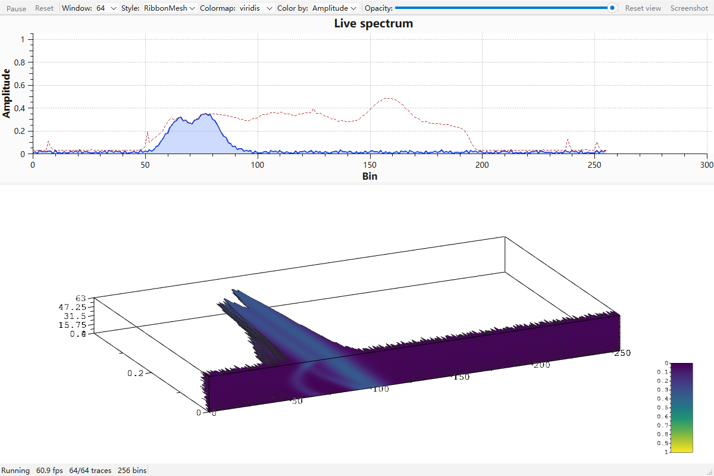
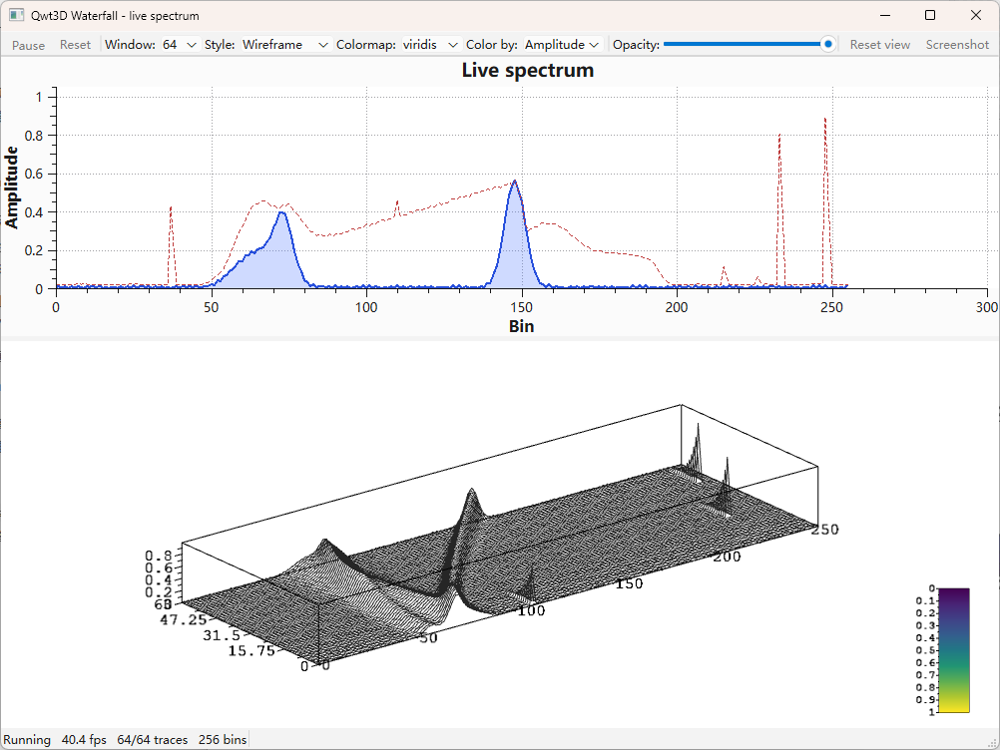

# 3D Waterfall - Qwt3DWaterfall

`Qwt3DWaterfall` is a 3D plot item that renders a sequence of one-dimensional traces (spectra, chromatograms, ...) as stacked curves along the depth axis. It owns the complete live-data machinery: push one trace per sample interval with `pushTrace()` and the item maintains the sliding window, the depth numbering, the ribbon geometry and the color mapping.

For an overview of the 3D module see [3D Plot Introduction](3d-plot.md). `Qwt3DWaterfall` is a `Qwt3DPlotItem` and follows the same attach/draw/hull contract as `Qwt3DSurface` and `Qwt3DLine`.

The axes follow the module convention that the value axis is z (as in `Qwt3DSurface`): **x = bin value, y = trace position in the window (depth), z = amplitude** (up). Label them accordingly (`X1` "Bin", `Y1` "Frames ago", `Z1` "Amplitude"); the depth axis is the one to put a `Qwt3DTextScale` on.



The same live scene in the outline-only `Wireframe` style - the cheapest way to render a dense window, and a good way to inspect the trace stack without the fill:



## Key Features

- **Built-in sliding window** — `pushTrace()` appends the newest trace and drops the oldest; no user-side window or depth bookkeeping
- **Stable depth axis** — the depth coordinate of a trace is its slot index, so the hull y-range grows monotonically to `[0, traceCapacity()-1]` and then stays pinned: no per-frame depth autoscale jitter
- **Four geometry styles** — `Ribbon` (filled curtain), `RibbonMesh` (curtain + outline), `Wireframe` (outline only), `Tube` (lit solid strokes)
- **Three color modes** — by depth position, by amplitude (sample value), or solid
- **Text scale for the depth axis** — label the depth axis with "frames ago" / timestamps via `Qwt3DTextScale`
- **One item = one legend** — a waterfall contributes a single colormap gradient to the color legend, instead of N per-curve entries
- **Theme integration** — picked up by `Qwt3DTheme::applyToItem()`

## Basic Concepts

### Geometry Styles

| Style | Description |
|-------|-------------|
| `Qwt3DWaterfall::Ribbon` | Filled curtain from the baseline up to the trace (default). The classic waterfall look. |
| `Qwt3DWaterfall::RibbonMesh` | Ribbon plus a line outline drawn on top. The outline is always drawn after the fill, regardless of the item's z value. |
| `Qwt3DWaterfall::Wireframe` | Line outline only, no fill. Cheapest style. |
| `Qwt3DWaterfall::Tube` | Each trace is swept into a lit solid tube with a view-circular cross section (same construction as `Qwt3DLine::Tube`). Dense traces are decimated to <=129 ring stations; the most expensive style. |

### Color Modes

| Mode | Description |
|------|-------------|
| `Qwt3DWaterfall::ByDepth` | Colormap over the trace position in the window (default). Each curtain gets a flat color from the colormap. |
| `Qwt3DWaterfall::ByAmplitude` | Colormap over the sample value — the usual "spectrum intensity" look. Retargets a `Qwt3DColorMapColor` functor to the z coordinate (`setSourceAxis(ColorFromZ)`) automatically. |
| `Qwt3DWaterfall::Solid` | Single color from `setColor()`. |

### Sliding Window Semantics

The window is a fixed set of `traceCapacity()` slots ordered oldest to newest:

- `pushTrace()` writes the new trace into the newest slot; when the window is full the oldest slot is dropped first (cheap slot moves, no deep copies).
- The first `pushTrace()` fixes `samplesPerTrace()`. Later frames are fitted into that bin count (longer ones truncated, shorter ones zero-padded), so the window width — and the hull x-range — never jitters.
- Because the depth y of a trace is its slot index, the hull y-range only ever grows from `[0,0]` to `[0, traceCapacity()-1]` and then stays stable. This is what makes a live waterfall "just work" without axis-autoscale flicker.
- `setDepthOrder(NewestBehind)` mirrors the direction (newest trace at `z == 0`) without changing the hull extent.
- `setTraceCapacity()` shrink keeps the newest traces; grow keeps everything and lets the window fill up again.
- `clear()` empties the window but keeps capacity, style and colors.

## Usage

The live 3D waterfall example is located at: `examples/3D/waterfall3D` (a 2D live spectrum on top of a 3D sliding-window waterfall, both fed the same frame).

### 1. Static Waterfall (zero custom code)

A one-shot waterfall needs no custom class at all: create a `Qwt3DWaterfall`, attach it to a `Qwt3DPlot` *before* feeding data, size the window with `setTraceCapacity()`, pick the geometry via `setPlotStyle()` (`Ribbon` / `RibbonMesh` / `Wireframe` / `Tube`) and the coloring via `setColorMode()`, then fill the window with one `pushTrace()` per trace, as the example below shows:

```cpp
#include <qwt3d_plot.h>
#include <qwt3d_waterfall.h>

Qwt3DPlot* plot = new Qwt3DPlot(parent);

auto* waterfall = new Qwt3DWaterfall();
waterfall->attach(plot);                       // attach first (see pitfall #1)
waterfall->setTraceCapacity(64);
waterfall->setPlotStyle(Qwt3DWaterfall::RibbonMesh);
waterfall->setColorMode(Qwt3DWaterfall::ByAmplitude);
waterfall->setColorRange(0.0, 1.0);            // fix the range, no autoscale jitter

for (int i = 0; i < 64; ++i)
    waterfall->pushTrace(frame(i));            // QVector<double>, 256 bins

plot->setAspectRatioMode(AUTOFILL);

// Axis titles (x = bin, y = depth, z = amplitude); setting a title
// enables its drawing and the titles survive coordinate re-creations
plot->coordinates()->axes[X1].setLabelString("Bin");
plot->coordinates()->axes[Y1].setLabelString("Frames ago");
plot->coordinates()->axes[Z1].setLabelString("Amplitude");
```

> **Note — Anisotropic data and view scaling**
>
> A typical spectrum waterfall spans bins `0..M-1`, amplitude `0..1` and depth `0..capacity-1` — strongly anisotropic. Use `AUTOFILL`, which normalizes every axis to the largest data range *before* the projection is derived, and then shape the normalized cube with `plot->setScale()` (the example uses `(1.0, 0.35, 0.6)`: full bin width, compressed depth, 60% amplitude height). Under `DATARATIO` the raw proportions leave the curtains a 1-unit sliver inside a 255-unit scene, and per-axis `setScale()` cannot rescue it because the projection radius is derived from the unscaled hull.

### 2. Live Waterfall (30 Hz)

Live mode reuses the same object: configure capacity, color mode and a fixed `setColorRange()` once at startup, and afterwards each timer tick only needs a single `pushTrace()` call, which slides the window and triggers `itemChanged()` → `update()` automatically:

```cpp
// once:
waterfall->setTraceCapacity(64);
waterfall->setColorMode(Qwt3DWaterfall::ByAmplitude);
waterfall->setColorRange(0.0, 1.0);   // stable amplitude colors

// per timer tick:
const QVector<double>& frame = generator.nextFrame();
waterfall->pushTrace(frame);          // triggers itemChanged() -> update()
```

`setColorRange()` is essential for a live waterfall: the automatic `ByAmplitude` range follows the current data minimum/maximum and would make the colors crawl frame by frame. A fixed range keeps e.g. "yellow = 0 dB, purple = noise floor" stable.

The example additionally shapes the normalized view (`AUTOFILL` plus `setScale(1.0, 0.35, 0.6)`, compressing the depth axis) and pre-fills the window before showing, so the waterfall starts full instead of crawling up from a single trace.

### 3. Depth Axis Text ("frames ago")

`Qwt3DTextScale` is a linear scale whose major tic labels come from a user supplied string list:

```cpp
#include <qwt3d_scale.h>

const int capacity = waterfall->traceCapacity();
const int majors = 4;

QVector<QString> labels;
for (int k = 0; k <= majors; ++k) {
    const int framesAgo = qRound(capacity - 1 - k * double(capacity - 1) / majors);
    labels << QString::number(-framesAgo);   // "-63", "-48", "-32", "-16", "0"
}

auto& axis = plot->coordinates()->axes[Y1];   // depth runs along y
axis.setAutoScale(false);
axis.setMajors(majors);
auto* scale = new Qwt3DTextScale();
scale->setLabels(labels);
axis.setScale(scale);
```

> **Warning — Pitfall: every axis needs its own scale object**
>
> `Qwt3DAxis::setScale()` stores the scale in a clone pointer that **clones and consumes** the passed object. Sharing one `Qwt3DTextScale*` between several axes leaves a dangling pointer and crashes. Create one instance per axis.

### 4. Coloring and the Color Functor

The three `ColorMode` values map to different color sources: `ByAmplitude` runs a `Qwt3DColorMapColor` functor — installed with `setDataColor()` and selectable by preset name such as `"plasma"` — over the sample z values, `ByDepth` colors each trace by its slot position in the window (the default), and `Solid` uses the single `RGBA` given to `setColor()`:

```cpp
// Amplitude coloring with a specific preset:
waterfall->setColorMode(Qwt3DWaterfall::ByAmplitude);
waterfall->setDataColor(new Qwt3DColorMapColor("plasma"));

// Depth coloring (default):
waterfall->setColorMode(Qwt3DWaterfall::ByDepth);

// Solid:
waterfall->setColorMode(Qwt3DWaterfall::Solid);
waterfall->setColor(RGBA(0.4, 0.6, 0.9, 1.0));
```

`setColorMode(ByAmplitude)` retargets a `Qwt3DColorMapColor` functor to the z coordinate (the amplitude axis) via `setSourceAxis(ColorFromZ)`; `ByDepth` retargets it to y (the depth axis). The functor default is `ColorFromZ`, so existing surface/bar/line rendering is unchanged. With a functor of a different type the owner decides how to interpret the `(x, y, z)` argument.

Colors are baked into the VBO at build time; after mutating the functor in place, call `invalidateColors()` (or any setter) to rebuild.

### 5. Baseline, Opacity, Outline

Three further setters fine-tune the curtain look: `setBaseline()` pins the value the ribbons start from (by default the amplitude minimum), `setOpacity()` blends the curtains, and `setOutlineColor()` / `setOutlineWidth()` style the outline drawn by the `RibbonMesh` and `Wireframe` styles:

```cpp
waterfall->setBaseline(0.0);        // curtain starts at y == 0 (default: amplitude min)
waterfall->setOpacity(0.6);         // blended curtains
waterfall->setOutlineColor(RGBA(0.1, 0.1, 0.1, 1.0));
waterfall->setOutlineWidth(1.0);    // RibbonMesh / Wireframe
```

Semi-transparent ribbons are drawn oldest-slot-first. Interpenetration artifacts can appear when the view is nearly parallel to the curtains; prefer a viewing angle that looks at the window from the front or above (the example's default `setRotation(55, 0, 25)`).

## Two Pitfalls Verified by Real Rendering

1. **Attach before feeding data.** Before v7.5.0, `Qwt3DPlot::attach()` did not recalculate the scene. An item whose data was loaded *before* `attach()` — with no setter (and therefore no `itemChanged()`) in between — left the plot hull at `(0,0,0)-(0,0,0)` and the widget rendered **blank without any warning**. `attach()`/`detach()` now recalculate the hull union and the coordinate system, and detaching shrinks the hull again.

2. **Derived scales must override `clone()`.** `Qwt3DAxis::setScale()` hands the scale to a clone pointer whose assignment calls `clone()`. A user-derived scale that does not override `clone()` is **sliced to its base class inside `setScale()`**, and the custom `ticLabel()` silently stops working (verified pixel-identical rendering before the fix). `Qwt3DTextScale` overrides `clone()`; if you write your own scale class, you must too.

## Performance Notes

| Workload | Typical frame cost (MSVC 2019, Release, 1000x700) |
|----------|--------------------------------------------------|
| 64 traces x 256 bins, RibbonMesh (the example default) | ~4 ms paintGL |
| 128 traces x 512 bins, Ribbon | well within a 16 ms frame budget |

- Every `pushTrace()` rebuilds the whole-window VBO (all slots shift). The upload budget is `capacity x bins x 28 bytes` per frame; at the target workload (<= 128 x 512) this is ~14 MB/s at 30 fps.
- For very large windows (`capacity > 128` and `bins > 1024`) an optimization channel is documented in the source: one draw call per slot with the row z provided by a private shader uniform, so only the newest row is re-uploaded. Measure before you need it.
- Use `Wireframe` when you only need the shape; use `Tube` only when you need thick, lit strokes — it is by far the most expensive style (one swept surface per trace). The tube radius is capped below half a slot so neighboring traces never fuse; at very large windows prefer `Ribbon`/`RibbonMesh`.

## See Also

- [3D Plot Introduction](3d-plot.md) — module architecture, `Qwt3DPlot` + item contract
- [3D Line Plot](3d-line-plot.md) — the single-curve sibling (`Qwt3DLine`), including the shared tube construction
- `examples/3D/waterfall3D` — live spectrum demo with all styles, color modes and window sizes
