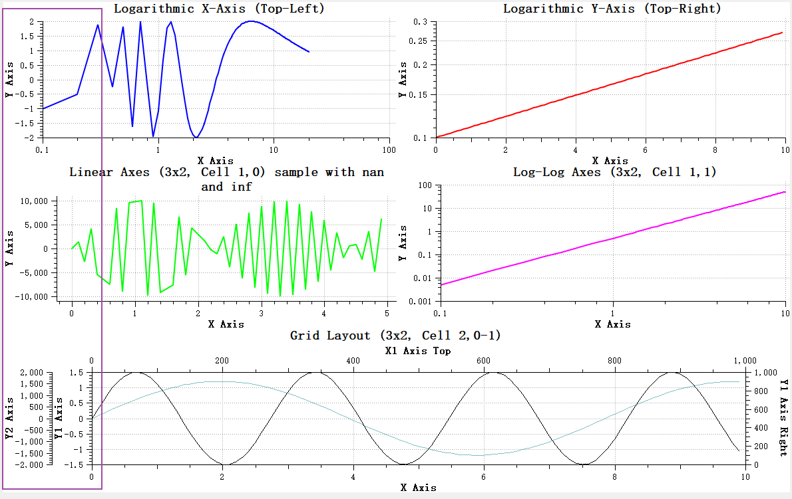
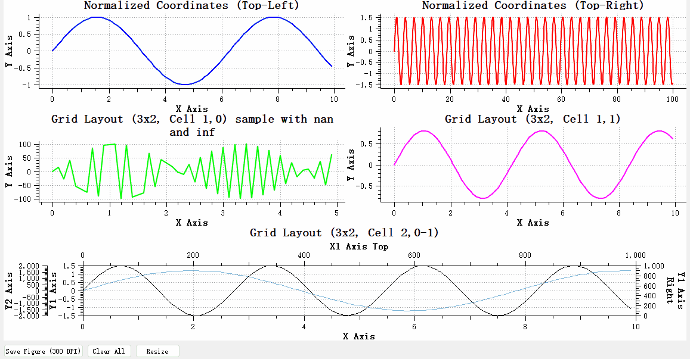

# QwtFigure Plot Container Window

`QwtFigure` is a container similar to `matplotlib`'s `Figure` class, used to organize and manage multiple `QwtPlot` plotting components. It provides flexible layout options including **normalized coordinate positioning** and **grid layout**, and supports creating **parasite plots (with any number of X and Y axes)**.

## Key Features

### 1. Multiple Layout Methods

- **Normalized coordinate layout**: Uses a coordinate system in the `[0,1]` range for relative position control
- **Grid layout**: Supports row-column grid arrangement for creating well-organized multi-plot compositions

### 2. Parasite Plot Support

- Can create parasite plots for a host plot that share the plot area but have independent axes
- Suitable for displaying data of different magnitudes within the same plot area

### 3. Graphics Export

- Supports exporting the entire figure to an image file or QPixmap
- DPI can be specified for high-resolution output

### 4. Flexible Appearance Customization

- Supports custom background color, border color, and line width
- Supports complex backgrounds (gradients, textures, etc.)

## Usage

`QwtFigure` is a window container that can layout multiple sub-plots (`QwtPlot`).

### Adding Plot Components

#### Adding with Normalized Coordinates

Normalized coordinates represent the percentage of the `QwtFigure` window.

```cpp
QwtPlot* plot = new QwtPlot;
// Add a plot occupying the top-left quarter of the figure
figure->addAxes(plot, QRectF(0.0, 0.0, 0.5, 0.5));

// Or use the separate parameter form
figure->addAxes(plot, 0.0, 0.0, 0.5, 0.5);
```

> **Warning — Normalized Coordinate Notes**
>
> - Uses the standard Qt top-left coordinate system
> - Normalized coordinate range is [0,1]

#### Adding with Grid Layout

The grid layout follows the `subplot` layout approach from `matplotlib`.

```cpp
// Create a 2x2 grid and add plots
QwtPlot* topPlot = new QwtPlot;
// Add a plot spanning the entire top row (row 0, columns 0-1)
figure->addAxes(topPlot, 2, 2, 0, 0, 1, 2);

// Add a plot to the bottom-left cell (row 1, column 0)
QwtPlot* bottomLeftPlot = new QwtPlot;
figure->addAxes(bottomLeftPlot, 2, 2, 1, 0);
```

### Setting Figure Appearance

```cpp
// Set background color
figure->setFaceColor(Qt::lightGray);

// Set gradient background
QLinearGradient gradient(0, 0, 0, 1);
gradient.setColorAt(0, Qt::white);
gradient.setColorAt(1, Qt::lightGray);
figure->setFaceBrush(QBrush(gradient));

// Set border
figure->setEdgeColor(Qt::black);
figure->setEdgeLineWidth(2);
```

### Using Parasite Plots

Parasite plots (named after `matplotlib`'s parasite axes) allow creating multiple plots with independent axes, suitable for displaying data of different magnitudes or units within the same plot area. Common use cases include dual Y-axis and multi-Y-axis plots.

Example code for creating parasite plots:

```cpp
// Create host plot
QwtPlot* hostPlot = new QwtPlot(figure);
figure->addAxes(hostPlot, 0.1, 0.1, 0.8, 0.8);

// Create parasite plot, displayed on the YRight axis by default
QwtPlot* parasiteYRight = figure->createParasiteAxes(hostPlot, QwtAxis::YRight);

// Set axis titles respectively
hostPlot->setAxisTitle(QwtAxis::YLeft, "Primary Y");
parasiteYRight->setAxisTitle(QwtAxis::YRight, "Secondary Y");
```

> **Warning — Parasite Plot Notes**
>
> - Parasite plots cannot be the currently active axis
> - Parasite plots are automatically hidden when the host axis is removed
> - If the host plot is destroyed, the parasite plot is destroyed along with it

For detailed usage of parasite plots, refer to: [Parasite Plots](parasite-axes.md)

Below is a more complete demonstration using QwtFigure:

```cpp
// Create QwtFigure
QwtFigure* figure = new QwtFigure();
figure->setSizeInches(8, 6);      // Set figure size to 8x6 inches
figure->setFaceColor(Qt::white);  // Set background color

// Example 1: Add plots using normalized coordinates
QwtPlot* plot1       = new QwtPlot();
...
figure->addAxes(plot1, 0.0, 0.0, 0.5, 0.3333333);  // Top-left

QwtPlot* plot2       = new QwtPlot();
...
figure->addAxes(plot2, 0.5, 0.0, 0.5, 0.33333333);  // Top-right

// Example 2: Add plots using grid layout
QwtPlot* plot3       = new QwtPlot();
...
figure->addGridAxes(plot3, 3, 2, 1, 0);  // 3x2 grid, row 1 column 0 (0-based)

QwtPlot* plot4       = new QwtPlot();
...
figure->addGridAxes(plot4, 3, 2, 1, 1);  // 3x2 grid, row 1 column 1 (0-based)

// Example 3: Multiple coordinate axes
//! Create host plot
QwtPlot* hostPlot = new QwtPlot();
hostPlot->setCanvasBackground(Qt::white);
...
//! Add host plot to figure
figure->addGridAxes(hostPlot, 3, 2, 2, 0, 1, 2);  // 3x2 grid, row 2 column 0, spanning 2 columns

//! Add parasite coordinate system
QwtPlot* parasitePlot = hostPlot->createParasiteAxes(QwtAxis::YLeft);
//! Other settings for the parasite axes
```

The result of the above example is shown below:


### Figure Export

```cpp
// Save as image file
figure->saveFig("figure.png", 300); // 300 DPI

// Get QPixmap
QPixmap pixmap = figure->saveFig(300);
```

### Axis Alignment

The figure window provides axis alignment functionality. If the tick values of sub-plots differ significantly, the ticks will not be aligned, as shown below:



In this case, you can specify axis alignment using the `QwtFigure::addAxisAlignment` function.

For the example above, axis alignment can be achieved with:

```cpp
figure->addAxisAlignment({ plot1, plot3, hostPlot }, QwtAxis::YLeft);
figure->addAxisAlignment({ plot2, plot4 }, QwtAxis::YLeft);
```

The code above means the left Y-axes of `plot1`, `plot3`, and `hostPlot` are aligned with each other. The left Y-axes of `plot2` and `plot4` are aligned with each other.

The result is shown below:


> **Warning — Axis Alignment Notes**
>
> Only visible axes can be aligned. If an axis is not visible, it cannot be aligned. For example, in the above case, the right Y-axes of `plot2`, `plot4`, and `hostPlot` cannot be aligned because the axis widgets of `plot2` and `plot4` are not visible.

## Figure Overlay

`QwtFigureWidgetOverlay` is an overlay class specifically designed for `QwtFigure`, inheriting from `QwtWidgetOverlay`. This class provides interactive operations on sub-plot components within a `QwtFigure` at runtime, including resizing plot components and selecting the currently active plot.

### Key Features

1. **Plot Component Resizing**: Users can resize and reposition sub-plot components within `QwtFigure` by dragging with the mouse
2. **Current Plot Selection**: Supports selecting the currently active plot component via mouse click or keyboard shortcuts
3. **Visual Feedback**: Provides clear visual feedback during operations, including borders, control points, and dimension information

The overlay's different functions can be controlled via the `BuiltInFunctionsFlag` enum:

```cpp
enum BuiltInFunctionsFlag
{
    FunSelectCurrentPlot = 1,  // Select current plot function
    FunResizePlot        = 2   // Resize plot function
};
```

Use the `setBuiltInFunctionsEnable()` method to dynamically enable or disable these functions.

The overlay provides the following methods to customize its appearance:

- `setBorderPen()` - Set the border pen
- `setControlPointBrush()` - Set the control point fill
- `setControlPointSize()` - Set the control point size
- `showPercentText()` - Control whether dimension percentage text is displayed

### Usage

To use `QwtFigureWidgetOverlay`, simply create an instance and attach it to the target `QwtFigure`:

```cpp
QwtFigure* figure = new QwtFigure();
// ... Add some plot components to the figure ...

// Create and show the overlay
QwtFigureWidgetOverlay* overlay = new QwtFigureWidgetOverlay(figure);
overlay->show();
```

The effect is shown below:



Specific functions can be enabled or disabled as needed:

```cpp
// Disable resize function, keep only selection function
overlay->setBuiltInFunctionsEnable(QwtFigureWidgetOverlay::FunResizePlot, false);

// Or disable selection function, keep only resize function
overlay->setBuiltInFunctionsEnable(QwtFigureWidgetOverlay::FunSelectCurrentPlot, false);
```

The overlay appearance can be customized to match the application's overall style:

```cpp
// Set border color and style
overlay->setBorderPen(QPen(Qt::red, 2, Qt::DashLine));

// Set control point color and style
overlay->setControlPointBrush(QBrush(Qt::green));

// Set control point size
overlay->setControlPointSize(QSize(10, 10));

// Hide percentage text display
overlay->showPercentText(false);
```

`QwtFigureWidgetOverlay` provides several useful signals to respond to user operations:

- `widgetNormGeometryChanged()` - Emitted when the normalized geometry of a plot component changes
- `activeWidgetChanged()` - Emitted when the currently active component changes

This overlay provides users with an intuitive, interactive way to manage and adjust multiple plot components within `QwtFigure`, improving user experience and operational efficiency.

> **Example — Parasite Plot Example**
>
> Complete example code can be found in `examples/figure`