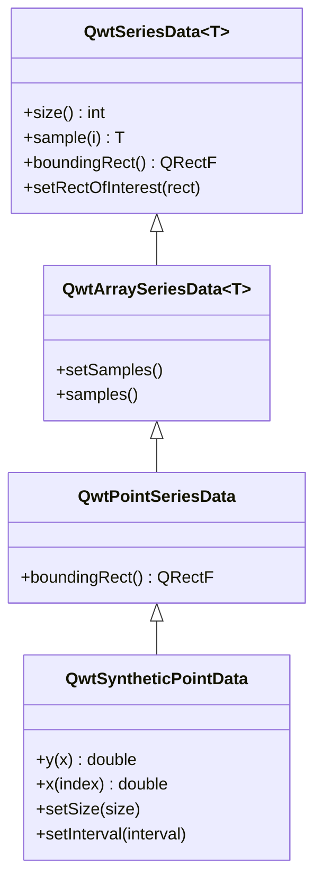

# Data Series - QwtSeriesData

`QwtSeriesData` is the abstract interface for plot item data. A custom `QwtSeriesData` subclass can supply samples from memory, a file, a database or any other source.

## Main Features

- Data abstraction interface: defines a unified data access interface
- Multiple built-in implementations: memory storage and external array references
- Dynamic data support: real-time updates and large data sets
- Bounding calculation: computes the data bounding rectangle automatically

## Basic Concepts

### Data Interface Structure

The class diagram below outlines the `QwtSeriesData<T>` interface (`size()`, `sample(i)`, `boundingRect()` and the optional `setRectOfInterest()`) together with the built-in derivations: the generic `QwtArraySeriesData<T>` stores samples in a `QVector` and adds `setSamples()` / `samples()`, `QwtPointSeriesData` is its specialization for `QPointF` samples, and `QwtSyntheticPointData` derives from `QwtPointSeriesData` to compute samples on the fly from a pure virtual `y(double x)` function without storing them:



### Built-in Data Classes

| Class Name | Description |
|------|------|
| `QwtArraySeriesData<T>` | Stores arrays of arbitrary sample types in a `QVector`, provides `setSamples()` / `samples()` |
| `QwtPointSeriesData` | Stores `QPointF` data points (`QwtArraySeriesData<QPointF>`) |
| `QwtSyntheticPointData` | Generates function data on the fly from `y(double x)` (not stored) |

Further specializations of `QwtArraySeriesData<T>` exist for other sample types, e.g. `QwtPoint3DSeriesData`, `QwtIntervalSeriesData`, `QwtSetSeriesData`, `QwtTradingChartData` and `QwtBoxChartData`.

## Usage

### 1. Using Built-in Data Classes

For most tasks no custom class is needed: the `setSamples()` overloads of `QwtPlotCurve` already cover the common cases, and when you prefer an explicit data object you can wrap the points in a `QwtPointSeriesData` and hand it over with `setData()`, as the two variants below show:

```cpp
#include <QwtPlotCurve>
#include <QwtPointSeriesData>

QwtPlotCurve* curve = new QwtPlotCurve();

// Method 1: Use QwtPlotCurve convenience methods directly
QVector<double> xData, yData;
curve->setSamples(xData, yData);

// Method 2: Use QwtPointSeriesData
QwtPointSeriesData* seriesData = new QwtPointSeriesData();
QVector<QPointF> points;
points << QPointF(0, 0) << QPointF(1, 1) << QPointF(2, 4);
seriesData->setSamples(points);
curve->setData(seriesData);
```

### 2. Referencing External Data

When the samples already live in your own buffers, `setRawSamples()` lets the curve reference the raw `double` arrays instead of copying them, which is the fastest path for large data sets, at the cost of keeping those arrays alive yourself:

```cpp
#include <QwtPlotCurve>

QwtPlotCurve* curve = new QwtPlotCurve();

// Use setRawSamples to reference external arrays (no copy)
double x[1000], y[1000];
curve->setRawSamples(x, y, 1000);

// Note: Arrays must remain valid for the lifetime of the curve
// No need to re-set when data changes, just call replot
```

> **Warning — setRawSamples Notes**
>
> - External arrays must remain valid until the curve is destroyed
> - Do not modify array size, only modify contents
> - Call replot to refresh display after data updates

### 3. Custom Data Class

Implementing a custom data source:

```cpp
#include <QwtPointSeriesData>  // Provides the QwtSeriesData<T> template and the built-in point data classes

// Custom database data source
class DatabaseSeriesData : public QwtSeriesData<QPointF>
{
public:
    DatabaseSeriesData(const QString& tableName)
        : m_tableName(tableName)
    {
        // Initialize database connection
        m_count = queryCount();
    }

    // Return number of data points
    virtual size_t size() const override
    {
        return m_count;
    }

    // Return data point at specified index
    virtual QPointF sample(size_t i) const override
    {
        // Query the i-th record from database
        return queryPoint(i);
    }

    // Calculate data bounds
    virtual QRectF boundingRect() const override
    {
        if (m_boundingRect.isNull()) {
            // Calculate bounding rectangle
            m_boundingRect = calculateBounds();
        }
        return m_boundingRect;
    }

private:
    QString m_tableName;
    size_t m_count;
    QRectF m_boundingRect;

    size_t queryCount() const;
    QPointF queryPoint(size_t i) const;
    QRectF calculateBounds() const;
};

// Use custom data class
curve->setData(new DatabaseSeriesData("measurements"));
```

### 4. Function-Generated Data

`QwtSyntheticPointData` generates function curves without storing any samples: subclass it, implement the pure virtual `y(double x)`, and pass the number of equidistant samples plus the x interval to the base constructor; when the interval is left invalid, the points are computed for the visible plot area instead:

```cpp
#include <cmath>
#include <QwtInterval>
#include <QwtSyntheticPointData>

// Function data generator
class FunctionSeriesData : public QwtSyntheticPointData
{
public:
    FunctionSeriesData(double (*func)(double), double xMin, double xMax)
        : QwtSyntheticPointData(200, QwtInterval(xMin, xMax))  // 200 equidistant samples
        , m_function(func)
    {
    }

    // Return y value at specified x position (the only pure virtual to implement)
    virtual double y(double x) const override
    {
        return m_function(x);
    }

private:
    double (*m_function)(double);
};

// Use function to generate data
double myFunction(double x) {
    return std::sin(x) * std::cos(2 * x);
}

curve->setData(new FunctionSeriesData(myFunction, 0.0, 10.0));
```

### 5. Real-time Data Updates

For streaming scenarios a small custom `QwtSeriesData<QPointF>` subclass is often the cleanest solution: the `RealtimeSeriesData` below maintains a rolling window of at most 1000 points, invalidates the inherited `cachedBoundingRect` cache whenever a point is appended so that `boundingRect()` recomputes it with the `qwtBoundingRect()` helper, and leaves the refresh to a plain `plot->replot()` call after each `appendPoint()`:

```cpp
// Real-time data scenario
class RealtimeSeriesData : public QwtSeriesData<QPointF>
{
public:
    RealtimeSeriesData(int maxPoints = 1000)
        : m_maxPoints(maxPoints)
    {
    }

    void appendPoint(const QPointF& point)
    {
        m_points.append(point);
        if (m_points.size() > m_maxPoints) {
            m_points.removeFirst();
        }
        // Invalidate the cached bounding rect to trigger recalculation
        cachedBoundingRect = QRectF(0.0, 0.0, -1.0, -1.0);
    }

    virtual size_t size() const override { return m_points.size(); }
    virtual QPointF sample(size_t i) const override { return m_points[static_cast<int>(i)]; }
    virtual QRectF boundingRect() const override
    {
        if (!cachedBoundingRect.isValid()) {
            cachedBoundingRect = qwtBoundingRect(*this);
        }
        return cachedBoundingRect;
    }

private:
    QVector<QPointF> m_points;
    int m_maxPoints;
};

// Usage
RealtimeSeriesData* data = new RealtimeSeriesData(1000);
curve->setData(data);

// Add data in real-time
data->appendPoint(QPointF(time, value));
plot->replot();
```

## Core Method Summary

### QwtSeriesData Interface

| Method | Description |
|------|------|
| `size()` | Return number of data points |
| `sample(i)` | Return the i-th data point |
| `boundingRect()` | Return data bounding rectangle |
| `setRectOfInterest()` | Set region of interest (optimize rendering) |

### QwtPlotCurve Data Methods

| Method | Description |
|------|------|
| `setData()` | Set data object |
| `setSamples()` | Set data arrays |
| `setRawSamples()` | Reference external arrays |
| `data()` | Get data object |

> **Tip — Data Management Recommendations**
>
> - Static data: Use `setSamples()` to copy data
> - Large data: Use `setRawSamples()` to avoid copying
> - Dynamic data: Implement custom `QwtSeriesData`
> - Function data: Use `QwtSyntheticPointData`

> **Example — Related Examples**
>
> - Function-generated data: `examples/2D/sinusplot`
> - Real-time data: `examples/2D/realtime`
> - CPU monitor: `examples/2D/cpuplot`

Screenshots of real-time data and CPU monitor:


