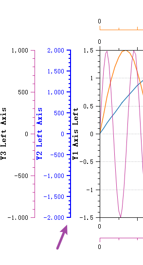

# Qwt 7.0 New Features


Qwt 7.0 is a modernized version based on the original Qwt 6.2.0, following the Qwt open-source license (LGPL), maintained and continuously updated by the community. Qwt 7.0 adds C++11/17 standard support and a CMake build system, along with the features described below.

## Integrated 2D/3D Plotting

> **Note — Qwt Supports Both 2D and 3D**
>
> Qwt 7.0 integrates the original `QwtPlot3D` library, so one library now covers both 2D and 3D data visualization.

### 3D Plotting Module Overview

Qwt 7.0 includes 3D plotting capabilities that support:

- Plot + Item architecture: `Qwt3DPlot` (rendering window) + `Qwt3DPlotItem` (drawable items), symmetric with 2D's `QwtPlot` + `QwtPlotItem`
- Multiple plot types: surface plots, mesh plots, parametric surfaces, function plots
- Modern OpenGL rendering: VBO/VAO + GLSL 3.3 Core shaders (no legacy fixed-function pipeline)
- Interactive operations: mouse rotation, zooming and panning
- Lighting and materials: configurable lights and materials
- Color mapping: automatic color mapping based on Z values, with color bar support

### 3D Plotting Effects


### Core Classes

| Class | Description |
|------|------|
| `Qwt3DPlot` | 3D rendering window (QOpenGLWidget), manages GL context, view, lighting, coordinate system, and item list |
| `Qwt3DPlotItem` | Abstract base class for all 3D plot items (attach/detach/draw/hull) |
| `Qwt3DSurface` | 3D surface plot item, displaying continuous surfaces (handles both grid and cell data) |
| `Qwt3DFunction` | Data generator that creates surfaces from z = f(x, y) mathematical functions |

> **Note — No Namespace**
>
> All 3D classes use the `Qwt3D` prefix directly in the global scope (e.g., `Qwt3DPlot`, `Qwt3DSurface`). There is no `namespace Qwt3D`.

### Usage Example

A minimal 3D program needs only three pieces: a `Qwt3DPlot` render window, a `Qwt3DSurface` item attached to it, and a `Qwt3DFunction` subclass defining z = f(x, y). `setDomain()` limits the x/y ranges, `setMesh()` picks the grid resolution, and `create()` samples the function into the surface, as the example below shows:

```cpp
#include <qwt3d_plot.h>
#include <qwt3d_surface.h>
#include <qwt3d_function.h>

// Create a rendering window
Qwt3DPlot* plot = new Qwt3DPlot();

// Create a surface item and attach to the plot
Qwt3DSurface* surface = new Qwt3DSurface();
surface->attach(plot);

// Define a mathematical function
class MyFunction : public Qwt3DFunction
{
public:
    double operator()(double x, double y) override
    {
        return std::sin(x) * std::cos(y);
    }
};

MyFunction* func = new MyFunction(*surface);
func->setDomain(-5, 5, -5, 5);  // x and y range
func->setMesh(50, 50);           // 50x50 grid
func->create();

plot->setRotation(30, 0, 45);   // Set viewing angle
plot->show();
```

### CMake Configuration

The 3D module ships as its own CMake target: `qwt::plot` provides the 2D plotting library and `qwt::plot3d` the 3D module, so projects that never draw in 3D can simply skip the second link line:

```cmake
find_package(qwt REQUIRED)

# Link the 2D plotting library
target_link_libraries(${PROJECT_NAME} PRIVATE qwt::plot)

# Link the 3D plotting library (optional)
target_link_libraries(${PROJECT_NAME} PRIVATE qwt::plot3d)
```

> **Tip — Advantages of Integrated 2D/3D**
>
> - Unified import: no need to import two separate libraries, which simplifies project dependencies
> - Consistent style: the 2D and 3D APIs follow the same style, reducing the learning curve
> - Flexible selection: link the 2D or 3D module independently as needed

> **Example — Complete Example**
>
> For detailed usage, refer to [Introduction to 3D Plotting](3d/3d-plot.md). Example code is located in `examples/3D/simpleplot3D`.

## Architecture and Build Upgrades

### C++11/17 Standard Support

Qwt 7.0 uses the C++ standard required by the Qt version:

- Qt5.12+: Uses C++11 standard
- Qt6: Uses C++17 standard

Code can therefore use `auto`, `nullptr`, `override`, `final`, lambda expressions and smart pointers.

### CMake Build System

Qwt 7.0 replaces qmake with a CMake build system:

```cmake
find_package(qwt REQUIRED)
# 2D plotting
target_link_libraries(${PROJECT_NAME} PRIVATE qwt::plot)
# 3D plotting
target_link_libraries(${PROJECT_NAME} PRIVATE qwt::plot3d)
```

### Single-File Import Method

Qwt 7.0 can also merge the entire library into two files:

- `src-amalgamate/QwtPlot.h`: merged single header file
- `src-amalgamate/QwtPlot.cpp`: merged single source file

Add these two files to your project; no build configuration is needed. This suits small projects and prototypes.

> **Warning — Generated Files**
>
> The single files are automatically generated by a tool. Do not directly edit the `QwtPlot.h` and `QwtPlot.cpp` files.

## QwtFigure — Multi-Plot Layout Container

> **Note — Core New Feature**
>
> `QwtFigure` is new in Qwt 7.0 and provides multi-plot layout capabilities similar to matplotlib's Figure.

### Feature Overview

`QwtFigure` is a container window that organizes multiple `QwtPlot` components. It provides:

- Normalized coordinate layout: a `[0,1]` coordinate system for relative position control
- Grid layout: row-column grid arrangement, following matplotlib's subplot approach
- Parasite axes support: multiple independent axes within the same plot area
- Graphics export: high-resolution image output

### Usage Example

`QwtFigure` accepts sub-plots in two coordinate flavors: `addAxes()` places a `QwtPlot` with a normalized `[0,1]` rectangle, while `addGridAxes()` drops it into a matplotlib-style row/column grid cell; `setSizeInches()` sets the physical figure size, as in the snippet below:

```cpp
// Create a QwtFigure
QwtFigure* figure = new QwtFigure();
figure->setSizeInches(8, 6);      // Set figure size to 8x6 inches

// Add a plot using normalized coordinates
QwtPlot* plot1 = new QwtPlot();
figure->addAxes(plot1, 0.0, 0.0, 0.5, 0.5);  // Upper-left quadrant

// Add a plot using grid layout (similar to matplotlib subplot)
QwtPlot* plot2 = new QwtPlot();
figure->addGridAxes(plot2, 2, 2, 0, 1);  // 2x2 grid, row 0, column 1
```

### Axis Alignment Feature

When multiple sub-plots have different scale ranges, tick marks may not align, affecting visual appearance. QwtFigure provides axis alignment functionality:


The `addAxisAlignment` function can be used to specify which sub-plot axes should be aligned:

```cpp
figure->addAxisAlignment({ plot1, plot3, hostPlot }, QwtAxis::YLeft);
```

Result after alignment:


### Interactive Operation Overlay

`QwtFigureWidgetOverlay` adds interactive operations to `QwtFigure`:


- Supports mouse dragging to adjust the position and size of sub-plots
- Supports selecting the currently active plot component
- Provides clear visual feedback (borders, control points, size information)

> **Example — Complete Example**
>
> For detailed usage, refer to [QwtFigure Plot Container Window](2d/figure-widget.md). Example code is located in `examples/2D/figure`.

## Parasite Axes — Multi-Axis System

> **Note — Core New Feature**
>
> Parasite Axes allow creating any number of independent axes within the same plot area, which covers multi-Y-axis and multi-X-axis layouts.

### How It Works

Parasite plots share the plot area with the host plot (transparent background) but have independent coordinate systems. When the host plot is destroyed, parasite plots are destroyed as well, and their lifecycle is managed automatically.


### Creating a Parasite Plot

A parasite plot is created from its host with `QwtPlot::createParasitePlot()`, whose `QwtAxis::Position` argument picks the axis the parasite lives on; afterwards `enableAxis()` switches the parasite's own axes on or off and `setParasiteShareAxis()` lets it share an axis such as the bottom X axis with the host, as shown below:

```cpp
// Create the host plot
QwtPlot* hostPlot = new QwtPlot();

// Create a parasite plot displayed on the YLeft axis
QwtPlot* parasitePlot = hostPlot->createParasitePlot(QwtAxis::YLeft);

// Configure the parasite plot's axes
parasitePlot->enableAxis(QwtAxis::YRight, true);
parasitePlot->setParasiteShareAxis(QwtAxis::XBottom);  // Share X axis with host

// Add a curve to the parasite plot
QwtPlotCurve* curve = new QwtPlotCurve("Parasite Curve");
curve->setSamples(...);
curve->attach(parasitePlot);
```

### Multiple Parasite Plot Overlay

Multiple parasite plots can be created to overlay any number of axes:


> **Example — Complete Example**
>
> For detailed usage, refer to the [Parasite Axes Guide](2d/parasite-axes.md). Example code is located in `examples/2D/parasitePlot`.

## Interaction Feature Overhaul

> **Note — Major Improvement**
>
> Qwt 7.0 rebuilds the interaction classes; the main changes follow.

### Real-Time Panning — QwtPlotPanner

The original Qwt `QwtPanner` used bitmap caching for panning, which meant data changes were not visible during the pan operation. Qwt 7.0 has rebuilt `QwtPlotPanner` based on the `QwtPicker` state machine to implement real-time panning:


Features:

- Full support for linear axes, logarithmic axes and date-time axes
- Real-time synchronized movement of multiple axes
- Plot refreshes in real time during panning

### Canvas-Wide Zooming — QwtPlotCanvasZoomer

The original `QwtPlotZoomer` could only bind to two axes and could not handle four-axis simultaneous zooming scenarios. Qwt 7.0 introduces `QwtPlotCanvasZoomer`, which requires no axis specification and automatically handles zooming for the entire canvas:

```cpp
// Create a canvas-wide zoomer
QwtPlotCanvasZoomer* canvasZoomer = new QwtPlotCanvasZoomer(plot->canvas());
```

### Class Name Changes

To maintain naming clarity, some class names have been adjusted:

| Original Name | New Name | Description |
|--------|--------|------|
| `QwtPlotZoomer` | `QwtPlotAxisZoomer` | Can only bind 2 axes, renamed to axis zoomer |
| - | `QwtPlotCanvasZoomer` | New: canvas-wide zoomer |
| `QwtPanner` | `QwtCachePanner` | Cache-based panner |
| `QwtPlotPanner` | `QwtPlotCachePanner` | Cache-based plot panner |
| - | `QwtPlotPanner` | New: real-time panner |

> **Tip — Migration Tip**
>
> Existing code requires minimal changes, as the new interfaces maintain backward compatibility. To use the original cache-based panning, use the `CachePanner` related classes.

> **Example — Complete Example**
>
> For detailed usage, refer to the [Panner Tool](2d/panner.md) and [Zoomer Tool](2d/zoomer.md).

## Built-in Axis Interactive Actions

> **Note — New Feature v7.0.5+**
>
> Axis interactive actions allow users to directly manipulate axes with the mouse, providing an experience similar to QCustomPlot.

### Feature Demonstration

Axis drag operation:


- Left-click to select an axis
- Drag to move the axis range
- Right-click to deselect

Axis scroll wheel zoom:


- Left-click to select an axis
- Scroll wheel to zoom, with zoom center at the mouse position
- Right-click to deselect

### Usage

Qwt 7 enables axis interaction by default:

```cpp
// Enable/disable globally
plot->setEnableScaleBuildinActions(true);

// Configure individual axis behavior
plot->axisWidget(QwtAxis::XBottom)->setBuildinActions(QwtScaleWidget::ActionClickPan);
```

### Selection Effect Customization

When an axis is selected, visual effects can be customized:



```cpp
// Set selection color
plot->axisWidget(QwtAxis::YLeft)->setSelectionColor(Qt::blue);

// Increase pen width when selected
plot->axisWidget(QwtAxis::YLeft)->setSelectedPenWidthOffset(1.5);
```

> **Example — Complete Example**
>
> For detailed usage, refer to [Axis Interactive Actions](2d/scale-builtin-action.md).

## Data Picking Feature

> **Note — New Feature v7.0.6+**
>
> `QwtPlotSeriesDataPicker` shows data point information as the mouse moves.

### Feature Demonstration


### Two Picking Modes

Y-value picking mode:


Displays the Y values for all curves at the current X position, with support for linear interpolation.

Nearest point picking mode:


Calculates and picks the closest point to the mouse cursor, suitable for peak data picking scenarios.

### Usage Example

`QwtPlotSeriesDataPicker` is constructed on the plot canvas, and two enums drive its behavior: `setPickMode()` selects `PickYValue` (the Y values of all curves at the current X position; this is the default) or `PickNearestPoint` (the sample closest to the cursor), while `setInterpolationMode()` toggles between `NoInterpolation` and `LinearInterpolation`; the snippet below also restyles the tooltip background with `setTextBackgroundBrush()`:

```cpp
// Create a data picker
QwtPlotSeriesDataPicker* picker = new QwtPlotSeriesDataPicker(plot->canvas());

// Set picking mode
picker->setPickMode(QwtPlotSeriesDataPicker::PickYValue);

// Enable linear interpolation
picker->setInterpolationMode(QwtPlotSeriesDataPicker::LinearInterpolation);

// Customize display text
picker->setTextBackgroundBrush(QBrush(QColor(255, 255, 255, 180)));
```

### Performance Optimization

For large datasets, Qwt 7 provides a window search algorithm:

- Default activation threshold: 1,000 data points
- Search window defaults to 5% of the curve point count
- Avoids traversing the full curve, which speeds up picking

> **Example — Complete Example**
>
> For detailed usage, refer to [Data Picking](2d/pick-value.md).

## New Chart Types

### Box Chart — QwtPlotBoxChart

> **Note — New Feature v7.2.0+**
>
> `QwtPlotBoxChart` draws box-and-whisker plots for showing the distribution of a data set.


### Features

- Supports both pre-computed data and automatic calculation from raw data
- Multiple whisker calculation methods: Tukey (1.5×IQR), percentile, min/max, standard deviation, standard error
- Three box styles: rectangle, diamond, notch
- Vertical and horizontal orientation switching
- Automatic outlier detection, custom symbols and jitter display

### Box Chart Structure


### Usage Example

`QwtPlotBoxChart` accepts either pre-computed statistics or raw samples; in the pre-computed case each `QwtBoxSample` carries position, lower/upper whisker, Q1, median and Q3 and is fed through `setSamples()`, while `setBoxStyle()` picks the box appearance (`Rectangle`, `Diamond` or `Notch`), as the example below demonstrates:

```cpp
// Create a box chart
QwtPlotBoxChart* boxChart = new QwtPlotBoxChart("Data Group A");
boxChart->attach(plot);

// Set pre-computed statistical data
QVector<QwtBoxSample> samples;
samples << QwtBoxSample(1.0, 10.0, 20.0, 35.0, 50.0, 60.0);
boxChart->setSamples(samples);

// Set style
boxChart->setBrush(QColor(100, 150, 200, 150));
boxChart->setBoxStyle(QwtPlotBoxChart::Notch);
```

> **Example — Complete Example**
>
> For detailed usage, refer to the [Box Chart Guide](2d/boxchart.md). Example code is located in `examples/2D/boxchart`.

## Other Useful Features

### Inward-Facing Ticks

> **Note — New Feature v7.2.1+**
>
> Supports displaying axis tick marks inside the plot area, suitable for compact layout scenarios.


```cpp
// Set ticks to face inward
plot->setAxisTickDirection(QwtAxis::YLeft, QwtPlot::TickInside);
plot->setAxisTickDirection(QwtAxis::XBottom, QwtPlot::TickInside);
```

> **Example — Complete Example**
>
> For detailed usage, refer to the [Inward-Facing Ticks Guide](2d/ticks-inside.md). Example code is located in `examples/2D/ticks_inside`.

### NaN/Inf Anomaly Value Handling

Qwt 7.0 improves handling of anomalous values (NaN, Inf) in data:

- `QwtPointMapper` adds anomaly handling so that data anomalies do not cause coordinate mapping errors
- Data range calculation includes anomaly value filtering
- Plotting no longer crashes on anomalous data

### QwtGridRasterData Grid Interpolation

The new `QwtGridRasterData` class differs from `QwtMatrixRasterData` in these ways:

- Supports 2D data table input
- Supports X/Y axis grid interpolation
- More options for spectrogram data processing

### Bar Chart Interface Enhancements

`QwtPlotBarChart` interface enhancements include:

- Pen style settings
- Brush (fill) style settings
- More bar chart appearance options

## Migration Guide

### Class Name Change Reference

| Original Name | New Name | Migration Advice |
|--------|--------|----------|
| `QwtPlotZoomer` | `QwtPlotAxisZoomer` | Simply replace the class name in code |
| `QwtPanner` | `QwtCachePanner` | Replace if cache-based panning is needed |
| `QwtPlotPanner` | `QwtPlotCachePanner` | Replace if cache-based panning is needed |
| - | `QwtPlotPanner` | New feature: real-time panning |
| - | `QwtPlotCanvasZoomer` | New feature: canvas-wide zooming |

### API Changes

- `QwtLinearColorMap::colorStop()` → `stopPos()`
- `QwtLinearColorMap` adds `stopColors()` method

### Compatibility

- Qt5.12+ fully compatible
- Qt6 fully supported
- Most Qwt 6.x code can be used directly, requiring only minor class name replacements

## Summary

Qwt 7.0 changes the library in these areas:

| Category | New Features |
|------|--------|
| **Architecture Upgrade** | C++11/17, CMake build, single-file import |
| **Integrated 2D/3D** | QwtPlot3D integration, unified library supporting 2D and 3D plotting |
| **Layout Features** | QwtFigure multi-plot container, parasite axes for multi-axis support |
| **Interaction Improvements** | Real-time panning, canvas-wide zooming, built-in axis interaction |
| **Data Picking** | Y-value picking, nearest-point picking, smart interpolation |
| **Chart Types** | Box chart, inward-facing ticks, 3D surface/mesh plots |
| **Stability** | NaN/Inf handling, anomaly value filtering |

---

> **Info — Get More Information**
>
> - Project Repository: [GitHub](https://github.com/czyt1988/QWT) / [Gitee](https://gitee.com/czyt1988/QWT)
> - Build Instructions: [Build Guide](../build-guide/build-instructions.md)
> - Import Method: [Importing Qwt](import-qwt.md)
> - Changelog: [CHANGES.md](../../CHANGES.md)