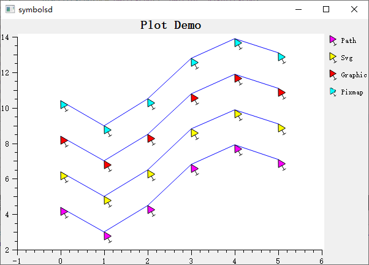

# Symbol Styles - QwtSymbol

`QwtSymbol` is used to define the display symbol style for data points, supporting multiple predefined shapes and custom paths. Symbols can have properties such as size, fill, and border configured, providing rich visual representation for curves and scatter plots.

## Main Features

**Features**

- ✅ **Multiple predefined shapes**: Ellipse, rectangle, diamond, triangle, cross, etc.
- ✅ **Custom paths**: Supports using QPainterPath to define arbitrary shapes
- ✅ **Size and color control**: Configurable symbol dimensions, fill color, border color
- ✅ **Pin point settings**: Configurable anchor position of the symbol relative to the data point

## Basic Concepts

### Symbol Shape List

| Shape | Enum Value | Description |
|------|--------|------|
| No symbol | `NoSymbol` | Do not display symbol |
| Ellipse | `Ellipse` | Circle or ellipse |
| Rectangle | `Rect` | Square or rectangle |
| Diamond | `Diamond` | Diamond |
| Triangle | `Triangle` | Upward-pointing triangle |
| Down Triangle | `DTriangle` | Downward-pointing triangle |
| Left Triangle | `LTriangle` | Left-pointing triangle |
| Right Triangle | `RTriangle` | Right-pointing triangle |
| Cross | `Cross` | Plus-shaped cross |
| X Cross | `XCross` | X-shaped cross |
| Star | `Star1` | Six-pointed star |
| Star2 | `Star2` | Five-pointed star |
| Hexagon | `Hexagon` | Regular hexagon |
| Path | `Path` | Custom QPainterPath |
| Graphic | `Graphic` | QwtGraphic object |
| SVG | `Svg` | SVG graphic |

## Usage

The symbol demo is located at: `playground/symbols`. Screenshot:



### 1. Creating Basic Symbols

```cpp
#include <QwtSymbol>

// Method 1: Convenience constructor
QwtSymbol* symbol = new QwtSymbol(
    QwtSymbol::Ellipse,     // Shape
    QBrush(Qt::red),        // Fill
    QPen(Qt::darkRed, 1),   // Border
    QSize(10, 10)           // Size
);

// Method 2: Step-by-step configuration
QwtSymbol* symbol2 = new QwtSymbol();
symbol2->setStyle(QwtSymbol::Diamond);
symbol2->setBrush(QBrush(Qt::blue));
symbol2->setPen(QPen(Qt::black, 2));
symbol2->setSize(8, 8);
```

### 2. Applying Symbols to Curves

```cpp
#include <QwtPlotCurve>

QwtPlotCurve* curve = new QwtPlotCurve();

// Set symbol
curve->setSymbol(new QwtSymbol(
    QwtSymbol::Circle,
    QBrush(Qt::yellow),
    QPen(Qt::blue, 1),
    QSize(6, 6)
));

// Symbol will be displayed at each data point position
```

### 3. Common Symbol Shape Examples

```cpp
// Circle symbol
QwtSymbol* circle = new QwtSymbol(QwtSymbol::Ellipse,
    QBrush(Qt::white), QPen(Qt::blue, 2), QSize(10, 10));

// Rectangle symbol
QwtSymbol* rect = new QwtSymbol(QwtSymbol::Rect,
    QBrush(Qt::green), QPen(Qt::darkGreen), QSize(8, 8));

// Diamond symbol
QwtSymbol* diamond = new QwtSymbol(QwtSymbol::Diamond,
    QBrush(Qt::cyan), QPen(Qt::darkCyan), QSize(12, 12));

// Cross symbol (lines only, no fill)
QwtSymbol* cross = new QwtSymbol(QwtSymbol::Cross,
    Qt::NoBrush, QPen(Qt::red, 2), QSize(10, 10));

// X cross symbol
QwtSymbol* xcross = new QwtSymbol(QwtSymbol::XCross,
    Qt::NoBrush, QPen(Qt::magenta, 2), QSize(12, 12));

// Star symbol
QwtSymbol* star = new QwtSymbol(QwtSymbol::Star1,
    QBrush(Qt::yellow), QPen(Qt::orange), QSize(15, 15));
```

### 4. Custom Shapes

Creating custom shapes using QPainterPath:

```cpp
QwtSymbol* customSymbol = new QwtSymbol();

// Create custom path (e.g., arrow shape)
QPainterPath path;
path.moveTo(0, -10);     // Top tip
path.lineTo(6, 5);       // Right shoulder
path.lineTo(0, 2);       // Center indent
path.lineTo(-6, 5);      // Left shoulder
path.closeSubpath();

customSymbol->setStyle(QwtSymbol::Path);
customSymbol->setPath(path);
customSymbol->setBrush(QBrush(Qt::red));
customSymbol->setPen(QPen(Qt::darkRed, 1));
customSymbol->setSize(20, 20);
```

### 5. Symbol Size Settings

```cpp
// Set fixed size
symbol->setSize(QSize(10, 10));  // 10x10 pixels

// Set different width and height (elliptical)
symbol->setSize(15, 8);  // Width 15, height 8

// Dynamic size (based on data value)
// Needs to be implemented in custom drawing
```

### 6. Symbol Pin Point

Setting the anchor position of the symbol relative to the data point:

```cpp
// Default pin point is at symbol center
symbol->setPinPoint(QPointF(0.5, 0.5));  // Relative position (0.5 is center)

// Set pin point at symbol bottom center
symbol->setPinPoint(QPointF(0.5, 1.0));

// Set pin point at symbol top-left corner
symbol->setPinPoint(QPointF(0.0, 0.0));

// Pin point uses normalized coordinates [0,1]
```

### 7. Symbol Fill Styles

```cpp
// Simple fill
symbol->setBrush(QBrush(Qt::red));

// Gradient fill
QLinearGradient gradient(0, 0, 0, 1);
gradient.setColorAt(0, Qt::red);
gradient.setColorAt(1, Qt::darkRed);
symbol->setBrush(QBrush(gradient));

// No fill (border only)
symbol->setBrush(Qt::NoBrush);

// Pattern fill
symbol->setBrush(QBrush(Qt::blue, Qt::DiagCrossPattern));
```

### 8. Border Styles

```cpp
// Solid border
symbol->setPen(QPen(Qt::black, 1, Qt::SolidLine));

// Dashed border
symbol->setPen(QPen(Qt::blue, 2, Qt::DashLine));

// No border
symbol->setPen(Qt::NoPen);

// Rounded border (only valid for rectangles)
// Needs to be implemented via custom Path
```

## Core Method Summary

| Method | Description |
|------|------|
| `setStyle()` | Set symbol shape |
| `setSize()` | Set symbol size |
| `setBrush()` | Set fill brush |
| `setPen()` | Set border pen |
| `setPath()` | Set custom path |
| `setPinPoint()` | Set pin point position |
| `drawSymbol()` | Draw symbol |

> **Tip — Symbol Usage Recommendations**
>
> - Use small symbols or no symbols when data points are dense
> - Use large symbols to emphasize key data points
> - Use different shapes for different data series for easy distinction
> - Unfilled symbols (Cross, XCross) have better performance

> **Example — Related Examples**
>
> - Symbol demo: `playground/symbols`