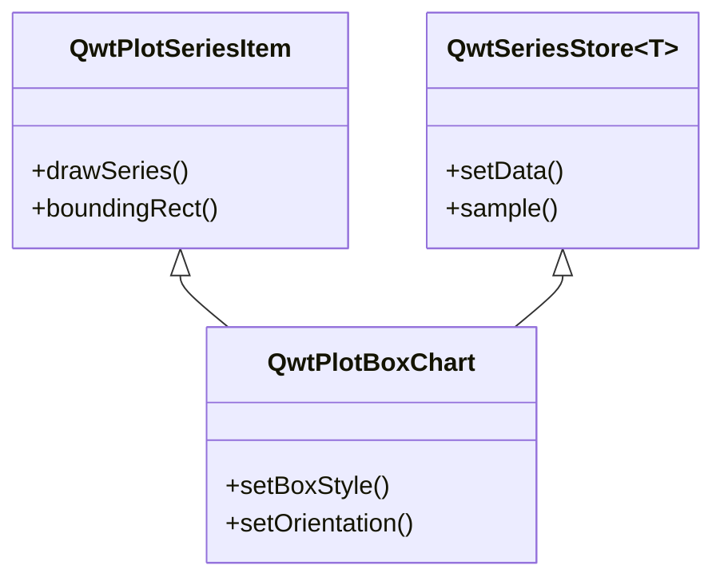
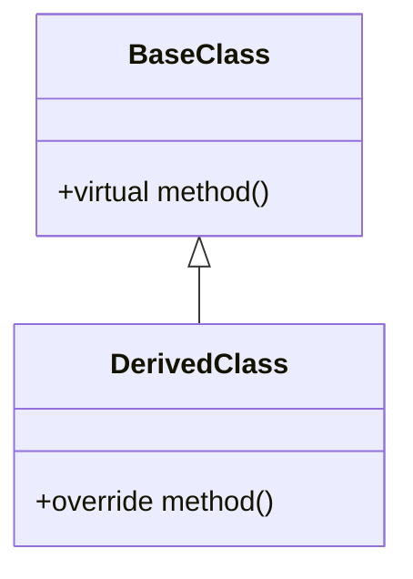
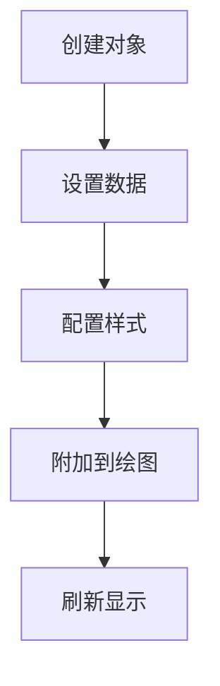

# Qwt 中文文档撰写规范

本规范说明 Qwt 文档写什么、用哪一套 Markdown 语法，以及应当避免哪些写法。

本项目文档使用mkdocs组织，采用[mkdocs-material](https://squidfunk.github.io/mkdocs-material/getting-started/)主题。但 Markdown 源文件必须保持**平台通用性**：同一份文件在 MkDocs 站点上、以及在 GitHub/GitLab 等其他平台上都要能正确渲染。只使用普通 Markdown 与 GitHub-Flavored Markdown 都支持的语法，避免依赖特定渲染器的扩展语法。

禁止使用：Material 提示框（`!!!`、`???`）、选项卡内容（`=== "标签"`）、属性列表（`{: .class }`）、emoji 短代码（`:material-...:`）、pymdownx 按键标记（`++ctrl++`）与高亮标记（`==高亮==`）。这些语法一旦脱离 MkDocs 构建就会以纯文本形式显示。

项目文档绘图优先考虑`mermaid`

本站启用了 `nl2br` Markdown 扩展：**段落内的每一个换行符都会被渲染成硬换行（`<br>`）**。因此正文段落禁止手工折行——每个段落写成连续的一行，段落之间用空行分隔。源码里手工折行的段落正是渲染页面出现"换行异常"的直接原因。

## 文档体系：目录与面向对象

文档目录按读者对象组织。新增页面先回答"这篇写给谁"，再决定放进哪个目录：

| 目录 | 面向对象 | 回答的问题 | 文风 |
|------|---------|-----------|------|
| `build-guide/` | 需要把 QWT 集成进自己工程的用户 | "怎么编译/链接 QWT？" | 命令精确、按平台与构建系统分节、经过验证 |
| `use-guide/` | 库的最终使用者 | "这个图怎么画？这个功能怎么用？" | Cookbook 教程：通俗易懂、循序渐进、图文并茂 |
| `tech-report/` | 想深入理解原理与性能的开发者 | "为什么这样设计？实测表现如何？" | 论文标准：完整推导 + 可复现实验 |
| `dev-guide/` | QWT 本身的贡献者 | "代码库遵循什么约定？" | 规范性文档：编码/注释规范、架构记录 |

### use-guide/ —— QWT Cookbook

`use-guide/` 按主题分层，整个目录合起来读就是一本书（"QWT Cookbook"）：

- `use-guide/*.md`（根目录）：不专属 2D 或 3D 的通用入门文档——库的引入、第一个绘图、版本新特性总览；
- `use-guide/2d/`：2D 绘图的全部内容——核心绘图项、容器与布局、坐标轴与刻度、交互操作、渲染与导出、高层接口；
- `use-guide/3d/`：`Qwt3DPlot` + `Qwt3DPlotItem` 的 3D 世界；
- `use-guide/general/`：2D/3D 共享或与之无关的横切主题——数据系列、NaN 语义、colormap、仪表控件。

教程写作原则：

1. **通俗且渐进**：假定读者懂 Qt 但不懂 QWT；先任务、再概念、后 API 细节（"是什么 → 为什么 → 怎么做"）；
2. **图文并茂**：每篇教程都要展示效果——引用 `docs/assets/screenshots/`（3D 用 `screenshots-3D/`）中配套示例的截图，并用文字说明截图内容；
3. **例子全覆盖**：`examples/` 下的每个示例程序至少被一篇教程提及，最好配截图；新增示例时，同一次变更内必须新增或更新引用它的教程页；
4. **书籍风格**：各章独立成篇但自由互链（相关主题、深入阅读），术语在全书保持一致；
5. **代码可运行**：示例带齐头文件、可直接编译运行。

### tech-report/ —— 论文标准的技术文章

`tech-report/` 收录算法与架构的深度剖析，完整写作标准与选题路线图见 `tech-report/index.md`。一段话概括：论文结构（摘要、推导、实验、讨论、参考文献），数据图用 matplotlib 生成、复现脚本放 `docs/assets/algorithms/`，流程与架构图用 mermaid，基准测试注明环境，并诚实地列出失效模式。教程与报告互相引用：教程回答"怎么做"，报告回答"为什么、有多好"。

### 双语同步

英文页面在 `docs/` 根下，中文页面在 `docs/zh/` 下，相对路径一一对应（`docs/use-guide/2d/curve.md` ↔ `docs/zh/use-guide/2d/curve.md`）。任何页面的新增、移动或重组都必须在**同一变更内**同步两棵目录树，包括 `mkdocs.yml` 中的两份 `nav`。

## 文档结构

### 1. 标题层级

下面的骨架给出要求的标题顺序；只有确需细分时才增加更深层级：

```markdown
# 类名/功能名称
## 主要功能特性
## 使用方法
### 子功能模块
#### 具体功能点
## 注意事项
## 参考资料
```

### 2. 必备章节

每个功能文档使用以下章节：

| 章节 | 必备程度 | 说明 |
|------|----------|------|
| 功能概述 | 必备 | 用一两段说明类的用途和适用场景 |
| 主要功能特性 | 可选 | 平铺列表即可；条目少时直接写成句子，不用 emoji，不给每条加粗 |
| 使用方法 | 必备 | 详细的使用步骤和代码示例 |
| 注意事项 | 推荐 | 使用引用块标注重要信息 |
| 参考资料 | 可选 | 相关文档、示例路径链接 |

## 内容撰写原则

### 1. 文字说明要求

- **每个代码块前后必须有文字说明**：解释代码的作用、关键步骤、输出效果
- **避免纯代码堆砌**：代码不应占据文档主体，文字说明应占 60% 以上
- **逐步引导**：按照"是什么 → 为什么 → 怎么用"的逻辑顺序组织
- **标题下不裸奔代码**：标题与首个代码围栏之间必须至少一段文字，说明本节涉及哪个类/接口、代码演示什么；mermaid 图与伪代码块同样需要一句导读

### 2. 功能介绍格式

用平实的句子介绍功能。条目并列、便于扫读时可以用列表，但保持朴素：不用 emoji，不给每条加粗，也不要套用「**功能名**：说明」这种逐条模板。

```markdown
QwtPlotCurve 支持折线、阶梯、柱状和散点样式，可以在每个采样点绘制符号，
也可以填充曲线与基线之间的区域。

- 折线、阶梯、柱状、散点四种绘制模式
- 在数据点绘制符号
- 填充曲线与基线之间的区域
```

只有两三条时，直接写成一句话，不必列清单。

### 3. 代码示例规范

代码示例必须包含：

1. **注释说明**：关键行必须有注释
2. **完整可运行**：示例代码应可直接运行（必要头文件包含）
3. **效果说明**：代码后说明运行效果，配合截图或示意图

```cpp
// 创建箱线图对象
QwtPlotBoxChart* boxChart = new QwtPlotBoxChart("标题");
boxChart->attach(plot);  // 必须附加到绘图才能显示

// 设置数据
QVector<QwtBoxSample> samples;
samples << QwtBoxSample(1.0, 10, 20, 35, 50, 60);
boxChart->setSamples(samples);  // 数据设置后自动刷新

// 效果：显示一个包含箱体、须须、中位线的箱线图
```

### 4. 概念解释要求

对于复杂概念，使用以下方式辅助说明：

- **mermaid UML图**：展示类关系、继承结构
- **mermaid 流程图**：展示工作流程
- **ASCII艺术图**：展示结构示意图
- **配图**：实际效果截图

示例（类关系图）：



### 5. 注意事项格式

重要信息使用引用块标注：加粗标签，可选地跟一个用破折号分隔的标题，空引用行分隔，内容逐行加 `> ` 前缀。这是普通 Markdown 语法，在 MkDocs 站点和 GitHub/GitLab 上都能正常渲染。

```markdown
> **警告 — 勿在 attach 之前装载数据**
>
> 可能导致严重问题的注意事项

> **说明 — 默认设置**
>
> 补充说明信息

> **提示**
>
> 使用技巧和建议，标题可省略
```

标签词表（与英文文档一一对应）：

| 标签 | 用途 |
|------|------|
| `说明` | 补充信息、默认行为 |
| `信息` | 背景、范围与上下文 |
| `提示` | 使用技巧、推荐做法、迁移提示 |
| `警告` | 会导致绘图错误或空白的注意事项 |
| `示例` | 示例代码位置或演示片段 |
| `已知问题` | 已知缺陷与规避方法 |
| `摘要` | 长篇文章的内容总结 |

中文文档使用同一套标签：说明 / 信息 / 提示 / 警告 / 示例 / 已知问题 / 摘要。引文本身已经说清楚时不必加标签，普通引用块即可。

### 6. 属性/方法说明格式

表格形式展示核心属性和方法：

```markdown
### 核心方法

| 方法 | 参数 | 说明 |
|------|------|------|
| `setBoxStyle(Style)` | BoxStyle枚举 | 设置箱体显示样式 |
| `setOrientation(Orient)` | Qt::Orientation | 设置显示方向 |
```

## 图表使用规范

### 1. mermaid 类图

用于展示类的继承关系、组合关系：



### 2. mermaid 流程图

用于展示使用流程、工作流程：



### 3. 结构示意图

使用文本或 ASCII 艺术绘制结构示意：

```text
    │         ┌──┬──┐
    │         │  │  │ ← Q3
    │         │  ┼  │ ← 中位数
    │         │  │  │ ← Q1
    │    ─────┴──┴──┴─────
```

### 4. 效果截图

实际运行效果图片放在 `docs/assets/` 目录：

```markdown

```

对于效果截图的部分，应在前面文字描述见某个example中，例如：

```markdown
箱形图的例子位于:`examples/2D/boxchart`，例子截图如下：


```

## 文档风格统一

### 1. 语言风格

- 使用**中文为主**，技术术语可保留英文
- 使用平实的技术书面语，避免口语填充和俚语
- 减少被动语态，多用主动语态："你可以设置..."而不是"可以设置..."

### 2. 行文语气

文档应像工程师向同事解释代码那样写。句子的主语尽量是类、函数或具体行为，而不是「本文」。

- 不要用「本文介绍……」「本文将从……」「本文旨在……」开场，直接说主题。
- 不要用「不是……而是……」「不仅……而且……」这类对仗句式来制造气势。
- 少用营销词：强大、优雅、完美、无缝、极致、一站式、开箱即用。把功能说清楚，效果交给数据和例子。
- 不要给每个术语加粗。加粗只留给提示框标签和真正的警告，普通强调靠句子位置表达。
- 不要在结尾写一段重复开头的总结；没有新的、需要读者行动的结论就自然结束。
- 不使用 emoji，包括 ✅、🚀、💡、⚠️。
- 少用破折号「——」。能用冒号、逗号或句号说清楚的地方，不要用破折号。

### 3. 术语规范

| 英文术语 | 中文翻译 | 说明 |
|----------|----------|------|
| Box-and-Whisker Plot | 箱线图 | 统计图表 |
| Quartile | 四分位数 | Q1, Q2, Q3 |
| Outlier | 异常值 | 超出正常范围的数据点 |
| Whisker | 须须 | 箱线图的延伸线 |

### 4. 代码风格

- 类名使用完整路径：`QwtPlotBoxChart`
- 方法名使用代码格式：`setBoxStyle()`
- 属性名使用代码格式：`boxStyle`
- 枚举值使用完整路径：`QwtPlotBoxChart::Rect`

## 撰写流程建议

1. **收集信息**：阅读类头文件、示例代码、相关文档
2. **确定结构**：按照必备章节规划文档框架
3. **编写内容**：
   - 先写功能概述，再用平实的句子或简短列表介绍功能
   - 再写使用方法，每个代码块配合文字说明
   - 补充注意事项和参考资料
4. **添加图表**：绘制类图、流程图、结构示意图
5. **审阅修订**：检查代码可运行性、文字通顺度、格式一致性

## 文档模板

下面的模板把本页规则组装成一个可直接套用的页面骨架，方括号为占位符：

```markdown
# 功能名称使用指南

用一两句话说明类的用途和适用场景。

## 主要功能特性

- 功能1
- 功能2

## 基本概念

### 核心概念解释

[文字说明]

```mermaid
classDiagram
    [类关系图]
```

## 使用方法

[如果有对应的示例，可以加入此内容]xxx的例子位于:`examples/xxx`，例子截图如下：

```markdown

```

### 1. 基本使用

[文字说明用途和场景]

```cpp
[代码示例]
```

[效果说明]

### 2. 进阶配置

[文字说明配置选项的作用]

| 方法 | 说明 |
|------|------|
| 方法1 | 说明 |
| 方法2 | 说明 |

```cpp
[配置代码]
```

> **警告 — setRawSamples 保存的是引用**
>
> 重要提示信息


---

本规范适用于 Qwt 所有中文使用指南文档的撰写。
