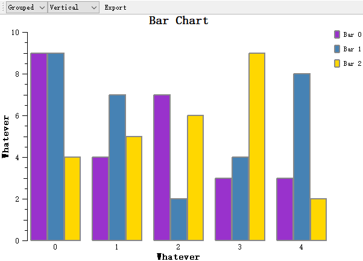
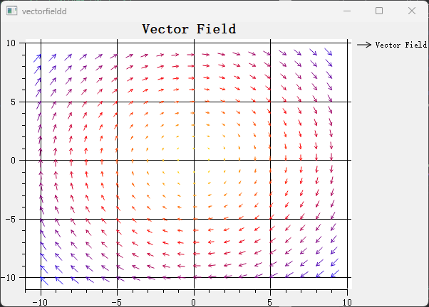
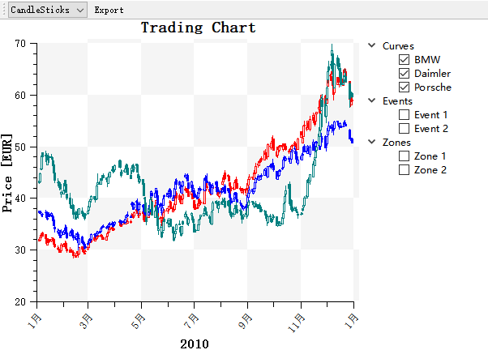
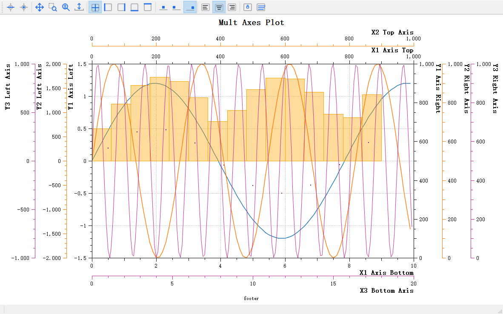
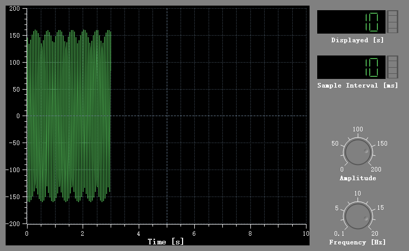
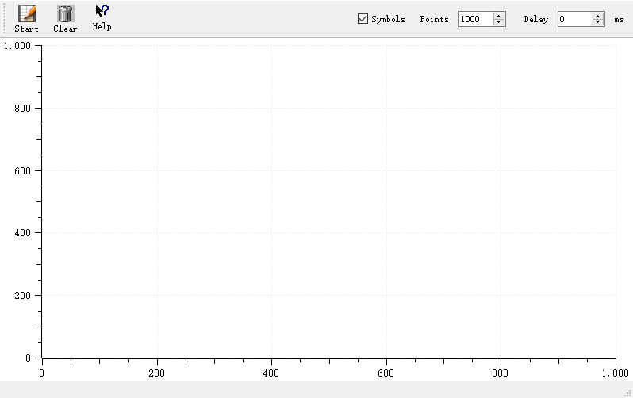
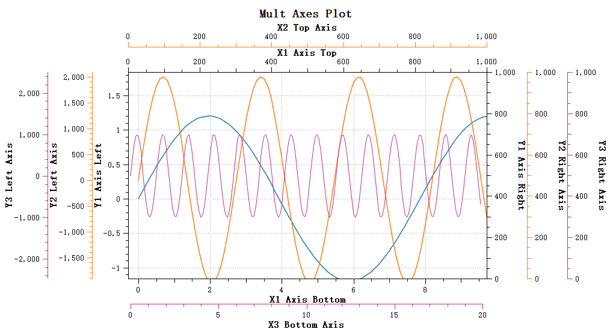

<div class="qwt-hero">
<div class="qwt-hero-bg"></div>
<div class="qwt-hero-inner">

<p class="qwt-hero-badge">开源 &middot; LGPL 协议</p>

<h1 class="qwt-hero-title">Qt 绘图库</h1>

<p class="qwt-hero-desc">
基于 Qt 的 2D/3D 绘图库，用于科学计算和工程数据可视化。
</p>

<div class="qwt-hero-pills">
<span>C++11/17</span>
<span>CMake</span>
<span>Qt 5.12+ / Qt 6</span>
</div>

<div class="qwt-hero-actions">
<a href="use-guide/qwt7-new-features/" class="qwt-btn qwt-btn-primary">开始使用</a>
<a href="https://github.com/czyt1988/QWT" class="qwt-btn qwt-btn-ghost">GitHub</a>
<a href="https://gitee.com/czyt1988/QWT" class="qwt-btn qwt-btn-ghost">Gitee</a>
</div>

</div>
</div>

<div class="qwt-stats-bar">
<div class="qwt-stat">
<strong>20+</strong>
<span>图表类型</span>
</div>
<div class="qwt-stat-divider"></div>
<div class="qwt-stat">
<strong>2D &amp; 3D</strong>
<span>可视化</span>
</div>
<div class="qwt-stat-divider"></div>
<div class="qwt-stat">
<strong>Qt 5 &amp; 6</strong>
<span>兼容</span>
</div>
<div class="qwt-stat-divider"></div>
<div class="qwt-stat">
<strong>LGPL</strong>
<span>商业使用</span>
</div>
</div>

<div class="qwt-container">

<div class="qwt-section-head">
<h2>核心特性</h2>
<p>面向 Qt 应用的 2D 与 3D 绘图，从曲线到科学可视化。</p>
</div>

<div class="qwt-card-grid">

<div class="qwt-card">
<div class="qwt-card-icon">
<svg viewBox="0 0 24 24" fill="none" stroke="currentColor" stroke-width="2" stroke-linecap="round" stroke-linejoin="round"><polygon points="13 2 3 14 12 14 11 22 21 10 12 10 13 2"></polygon></svg>
</div>
<h3>性能</h3>
<p>针对大规模数据集优化的 QPainter 渲染管线，通过重绘策略保持实时绘图的响应速度。</p>
</div>

<div class="qwt-card">
<div class="qwt-card-icon">
<svg viewBox="0 0 24 24" fill="none" stroke="currentColor" stroke-width="2" stroke-linecap="round" stroke-linejoin="round"><polyline points="22 12 18 12 15 21 9 3 6 12 2 12"></polyline></svg>
</div>
<h3>图表类型</h3>
<p>20+ 内置图表类型：曲线、散点、柱状图、箱线图、直方图、光谱图、K 线图、向量场、极坐标绘图以及 3D 曲面。</p>
</div>

<div class="qwt-card">
<div class="qwt-card-icon">
<svg viewBox="0 0 24 24" fill="none" stroke="currentColor" stroke-width="2" stroke-linecap="round" stroke-linejoin="round"><circle cx="12" cy="12" r="3"></circle><path d="M19.4 15a1.65 1.65 0 0 0 .33 1.82l.06.06a2 2 0 0 1-2.83 2.83l-.06-.06a1.65 1.65 0 0 0-1.82-.33 1.65 1.65 0 0 0-1 1.51V21a2 2 0 0 1-4 0v-.09A1.65 1.65 0 0 0 9 19.4a1.65 1.65 0 0 0-1.82.33l-.06.06a2 2 0 0 1-2.83-2.83l.06-.06A1.65 1.65 0 0 0 4.68 15a1.65 1.65 0 0 0-1.51-1H3a2 2 0 0 1 0-4h.09A1.65 1.65 0 0 0 4.6 9a1.65 1.65 0 0 0-.33-1.82l-.06-.06a2 2 0 0 1 2.83-2.83l.06.06A1.65 1.65 0 0 0 9 4.68a1.65 1.65 0 0 0 1-1.51V3a2 2 0 0 1 4 0v.09a1.65 1.65 0 0 0 1 1.51 1.65 1.65 0 0 0 1.82-.33l.06-.06a2 2 0 0 1 2.83 2.83l-.06.06A1.65 1.65 0 0 0 19.4 9a1.65 1.65 0 0 0 1.51 1H21a2 2 0 0 1 0 4h-.09a1.65 1.65 0 0 0-1.51 1z"></path></svg>
</div>
<h3>CMake &amp; Qt6</h3>
<p>提供 CMake 支持，可通过 <code>find_package(qwt)</code> 引入。另有单文件合并版本，兼容 Qt 5.12+ 和 Qt 6。</p>
</div>

<div class="qwt-card">
<div class="qwt-card-icon">
<svg viewBox="0 0 24 24" fill="none" stroke="currentColor" stroke-width="2" stroke-linecap="round" stroke-linejoin="round"><line x1="18" y1="20" x2="18" y2="10"></line><line x1="12" y1="20" x2="12" y2="4"></line><line x1="6" y1="20" x2="6" y2="14"></line></svg>
</div>
<h3>多坐标轴系统</h3>
<p>通过寄生绘图架构创建任意数量的独立坐标轴，类似 matplotlib 的双轴系统，并支持交互操作。</p>
</div>

<div class="qwt-card">
<div class="qwt-card-icon">
<svg viewBox="0 0 24 24" fill="none" stroke="currentColor" stroke-width="2" stroke-linecap="round" stroke-linejoin="round"><circle cx="13.5" cy="6.5" r="2.5"></circle><circle cx="19" cy="13" r="2"></circle><circle cx="6" cy="12" r="3"></circle><circle cx="10" cy="20" r="2"></circle></svg>
</div>
<h3>扁平化风格</h3>
<p>简洁的扁平化视觉风格，取代老旧的浮雕效果。符合现代应用的设计习惯。</p>
</div>

<div class="qwt-card">
<div class="qwt-card-icon">
<svg viewBox="0 0 24 24" fill="none" stroke="currentColor" stroke-width="2" stroke-linecap="round" stroke-linejoin="round"><rect x="2" y="3" width="20" height="14" rx="2" ry="2"></rect><line x1="8" y1="21" x2="16" y2="21"></line><line x1="12" y1="17" x2="12" y2="21"></line></svg>
</div>
<h3>Figure 布局</h3>
<p>类似 matplotlib 的 <code>QwtFigure</code> 多绘图网格布局。支持交互式的拖动、缩放，以及通过覆盖控件管理子绘图。</p>
</div>

</div>
</div>

<div class="qwt-showcase">

<div class="qwt-section-head">
<h2>可视化展示</h2>
<p>基础图表与科学可视化。</p>
</div>

<div class="qwt-gallery">

<a class="qwt-gallery-item" href="use-guide/2d/figure-widget/">

<span>Figure 布局</span>
</a>

<a class="qwt-gallery-item" href="use-guide/2d/curve/">

<span>曲线图</span>
</a>

<a class="qwt-gallery-item" href="use-guide/2d/scatter/">

<span>散点图</span>
</a>

<a class="qwt-gallery-item" href="use-guide/2d/barchart/">

<span>柱状图</span>
</a>

<a class="qwt-gallery-item" href="use-guide/2d/spectrogram/">

<span>光谱图</span>
</a>

<a class="qwt-gallery-item" href="use-guide/2d/vectorfield/">

<span>向量场</span>
</a>

<a class="qwt-gallery-item" href="use-guide/2d/boxchart/">

<span>箱线图</span>
</a>

<a class="qwt-gallery-item" href="use-guide/2d/tradingcurve/">

<span>K 线图</span>
</a>

<a class="qwt-gallery-item" href="use-guide/2d/polar-plot/">

<span>极坐标绘图</span>
</a>

<a class="qwt-gallery-item" href="use-guide/3d/3d-plot/">

<span>3D 曲面</span>
</a>

<a class="qwt-gallery-item" href="use-guide/3d/3d-plot/">

<span>3D 增强</span>
</a>

<a class="qwt-gallery-item" href="use-guide/2d/parasite-axes/">

<span>多坐标轴</span>
</a>

<a class="qwt-gallery-item" href="use-guide/2d/curve/">

<span>示波器</span>
</a>

<a class="qwt-gallery-item" href="use-guide/2d/curve/">

<span>实时绘图</span>
</a>

<a class="qwt-gallery-item" href="use-guide/2d/scale-builtin-action/">

<span>坐标轴交互</span>
</a>

<a class="qwt-gallery-item" href="use-guide/general/widgets-controls/">

<span>仪表罗盘</span>
</a>

</div>

</div>

<div class="qwt-quickstart" markdown>

<div class="qwt-quickstart-inner" markdown>

<div class="qwt-section-head">
<h2>快速开始</h2>
<p>将 QWT 集成到你的项目中。</p>
</div>

**CMake（推荐）**


```cmake
# 查找并链接 QWT
find_package(qwt REQUIRED)
target_link_libraries(${PROJECT_NAME} PRIVATE qwt::plot)

# 3D 绘图
target_link_libraries(${PROJECT_NAME} PRIVATE qwt::plot3d)
```

**单文件引入**


```cpp
// 将以下两个文件加入项目：
//   src-amalgamate/QwtPlot.h
//   src-amalgamate/QwtPlot.cpp

#include "QwtPlot.h"

auto* plot = new QwtPlot();
auto* curve = new QwtPlotCurve("My Data");
```

**第一个绘图**


```cpp
#include <qwt_plot.h>
#include <qwt_plot_curve.h>

auto* plot = new QwtPlot("My First Plot");
auto* curve = new QwtPlotCurve("Sine Wave");

QVector<QPointF> data;
for (double x = 0; x < 10.0; x += 0.1)
    data.append(QPointF(x, std::sin(x)));
curve->setSamples(data);

curve->attach(plot);
plot->resize(600, 400);
plot->show();
```

</div>
</div>

<div class="qwt-footer">
<div class="qwt-footer-inner">

<h2>开始构建</h2>
<p>浏览文档或查看源代码。</p>

<div class="qwt-footer-links">
<a href="use-guide/qwt7-new-features/" class="qwt-btn qwt-btn-primary">阅读文档</a>
<a href="../use-guide/qwt7-new-features/" class="qwt-btn qwt-btn-ghost">English Docs</a>
<a href="https://github.com/czyt1988/QWT" class="qwt-btn qwt-btn-ghost">GitHub</a>
<a href="https://gitee.com/czyt1988/QWT" class="qwt-btn qwt-btn-ghost">Gitee</a>
</div>

</div>
</div>
