# QWT — Qt 绘图库

QWT（Qt Widgets for Technical Applications）是一个基于 Qt 的 2D/3D 绘图库，用于科学计算和工程应用中的数据可视化。

## 与其它 Qt 绘图库的比较

Qt 生态里能画图的库不多，主流的有 `QCustomPlot`、`Qwt`、`Qt Charts` 和 `KDChart`。Qt 6.8 之后把原来的 `Qt Charts`（2D）与 `Qt DataVisualization`（3D）合并为统一的 Qt Graphs 模块，底层全部基于 Qt Quick Scene Graph + Qt Quick 3D，放弃了老旧的 Graphics-View/QPainter 管线。不过 Qt Graphs 必须通过 QQuickWidget 或 QQuickWindow 嵌入，必须带 QML runtime，C++ 支持不足，且不支持 Win7 等老系统，对嵌入式也不友好。

| 库 | 协议 | 优势 | 劣势 |
|---|---|---|---|
| **QCustomPlot** | GPL | 接口简单，使用广泛 | GPL 要求开源，商业项目不便使用 |
| **Qwt** | LGPL | 渲染速度快，架构清晰 | 原作者停止维护，部署较麻烦 |
| **Qt Charts** | GPL | Qt 官方模块 | 渲染性能较低，GPL 协议 |
| **KDChart** | MIT (3.0+) | 商业友好 | 渲染效果一般 |

本项目基于 Qwt 6.2.0 维护，保留原有架构，并加入 CMake 支持、Qt 6 兼容、单文件引入、3D 绘图和大数据量渲染等改进与修复。

## Qwt 7.0 新特性

- 支持 CMake：一行 `find_package(qwt)` 即可引入
- 支持 Qt 6，兼容 Qt 5.12+ 和 Qt 6.x
- 单文件引入：把 `QwtPlot.h` 和 `QwtPlot.cpp` 加入工程即可
- 扁平化视觉风格，去掉旧版浮雕效果
- Figure 容器，支持类似 matplotlib 的多绘图布局
- 寄生轴架构，坐标轴数量不受限制
- 坐标轴支持鼠标拖动和滚轮缩放
- 内置 3D 绘图模块
- 全面使用 C++11：`override`、`nullptr`、智能指针、范围 for 循环
- 4 种曲线降采样算法与 SIMD 加速
- 颜色循环系统，自动为系列分配颜色
- `QwtPlotBoxChart` 箱线图，用于展示统计分布
- 滑块、旋钮、刻度盘等控件支持扁平化样式

## 快速集成

使用 CMake（推荐）：


```cmake
find_package(qwt REQUIRED)
target_link_libraries(${PROJECT_NAME} PRIVATE qwt::plot)
# 3D 绘图
target_link_libraries(${PROJECT_NAME} PRIVATE qwt::plot3d)
```

使用单文件合并版本：


```cpp
// 将 src-amalgamate/QwtPlot.h 和 QwtPlot.cpp 加入项目
#include "QwtPlot.h"

auto* plot = new QwtPlot("My Plot");
auto* curve = new QwtPlotCurve("Data");
```

## 项目地址

- **GitHub**: [https://github.com/czyt1988/QWT](https://github.com/czyt1988/QWT)
- **Gitee**: [https://gitee.com/czyt1988/QWT](https://gitee.com/czyt1988/QWT)
- **在线文档**: [https://czyt1988.github.io/QWT/zh/](https://czyt1988.github.io/QWT/zh/)

## 效果展示

### 基本图表

<div class="grid cards" markdown>

- 
  `examples/2D/figure`

- 
  `examples/2D/simpleplot`

- 
  `examples/2D/barchart`

- 
  `examples/2D/scatterplot`

- 
  `examples/2D/curvedemo`

- 
  `examples/2D/boxchart`

</div>

### 实时可视化

<div class="grid cards" markdown>

- 
  `examples/2D/cpuplot`

- 
  `examples/2D/realtime`

- 
  `examples/2D/oscilloscope`

- 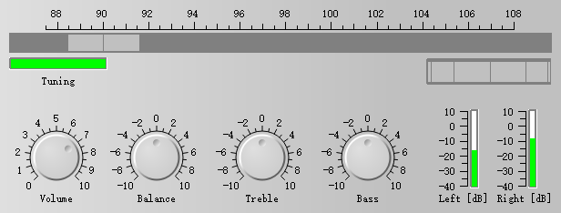
  `examples/2D/radio`

- 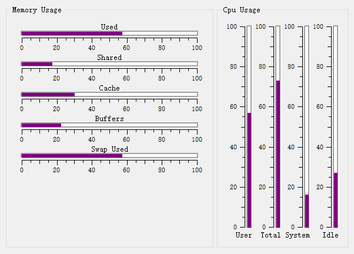
  `examples/2D/sysinfo`

- 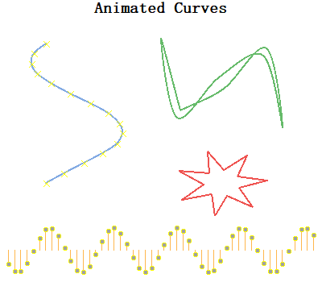
  `examples/2D/animation`

</div>

### 高级图表

<div class="grid cards" markdown>

- 
  `examples/2D/spectrogram`

- 
  `playground/vectorfield`

- 
  `examples/2D/stockchart`

- 
  `examples/2D/polardemo`

- 
  `examples/2D/parasitePlot`

- 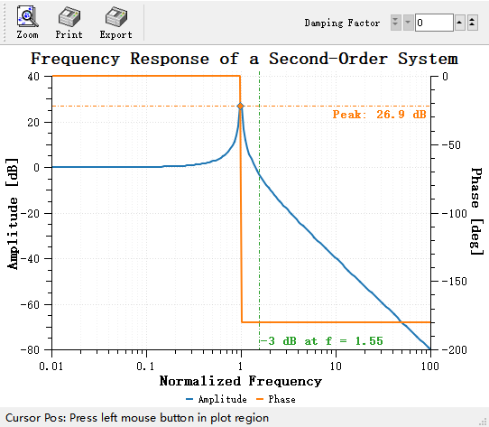
  `examples/2D/bode`

- 
  `playground/shapes`

- 
  `playground/scaleengine`

- 
  `examples/2D/pyplot`

</div>

### 其他示例

<div class="grid cards" markdown>

- 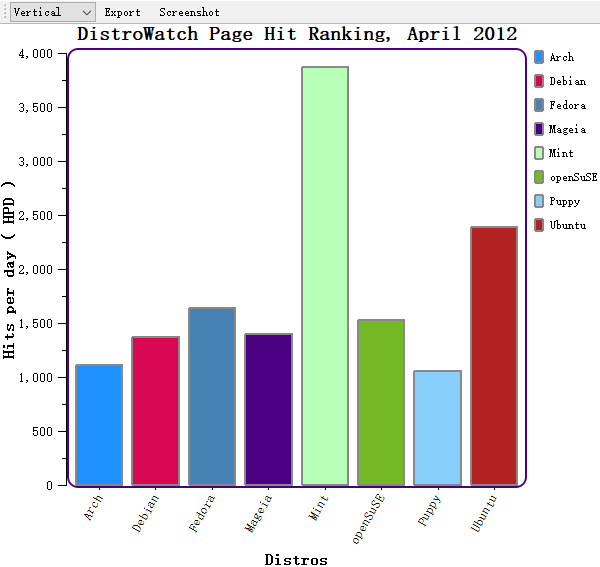
  `examples/2D/distrowatch`

- 
  `examples/2D/friedberg`

- 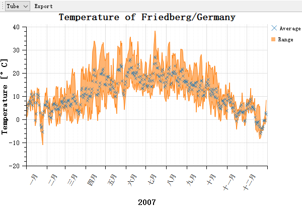
  `examples/2D/friedberg`

- 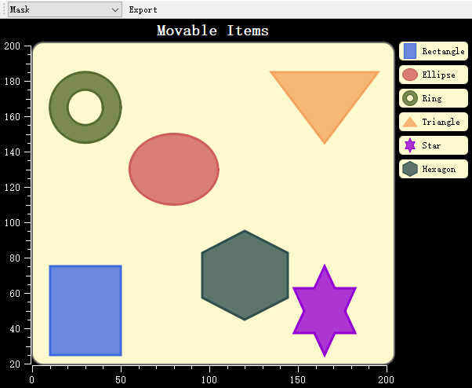
  `examples/2D/itemeditor`

- 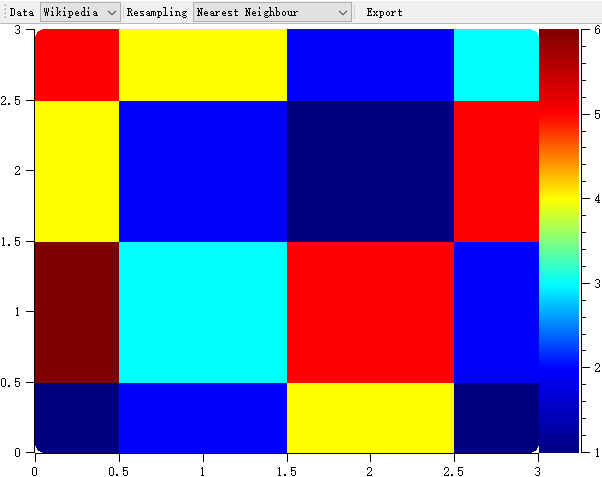
  `examples/2D/rasterview`

- 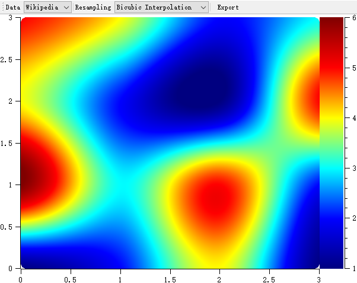
  `examples/2D/rasterview`

- 
  `examples/2D/refreshtest`

- 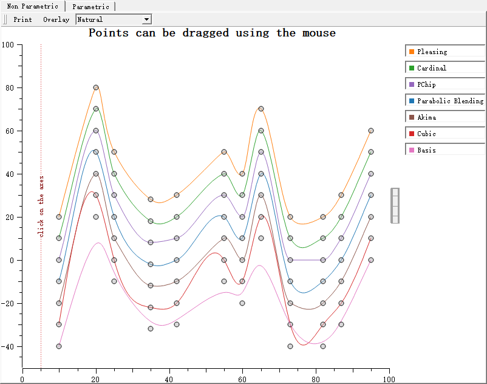
  `examples/2D/splineeditor`

- 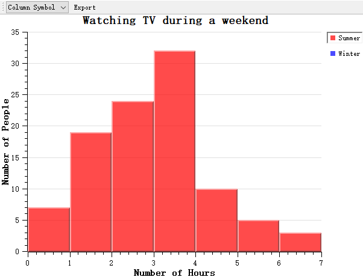
  `examples/2D/tvplot`

- 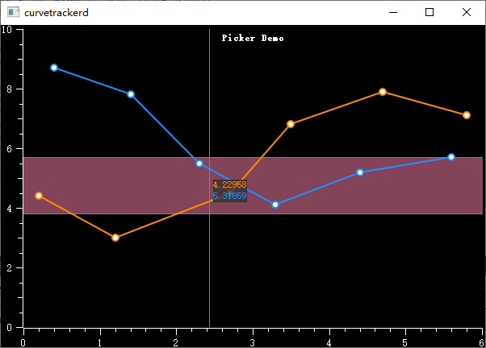
  `playground/curvetracker`

- 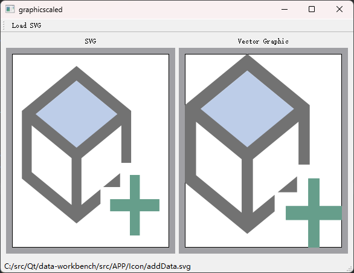
  `playground/graphicscale`

- 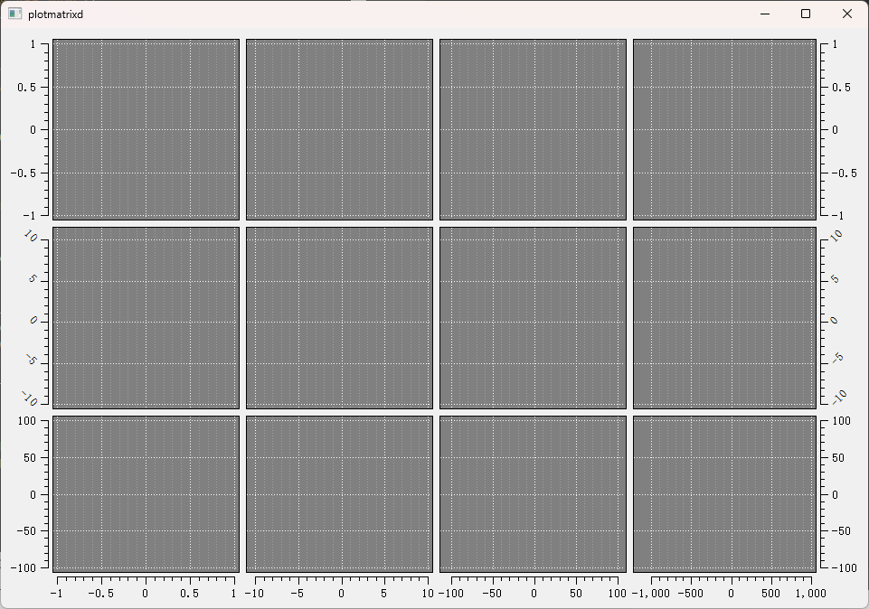
  `playground/plotmatrix`

- 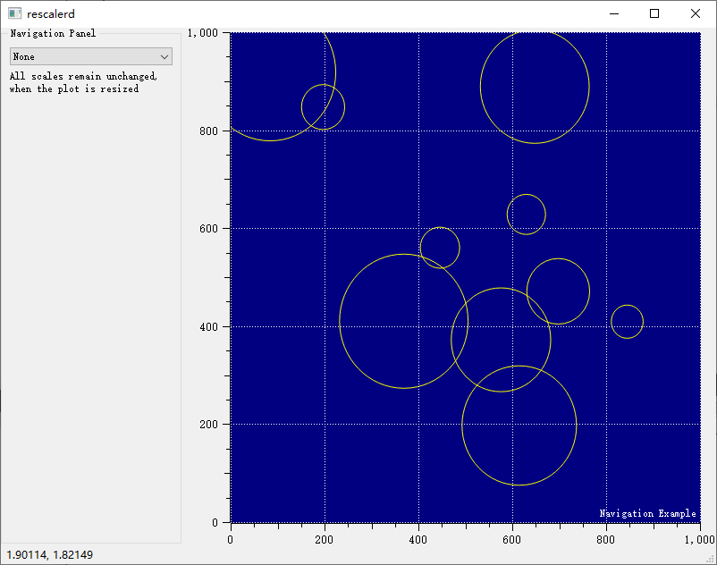
  `playground/rescaler`

- 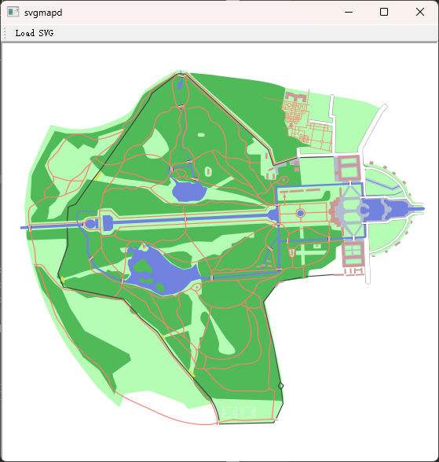
  `playground/svgmap`

- 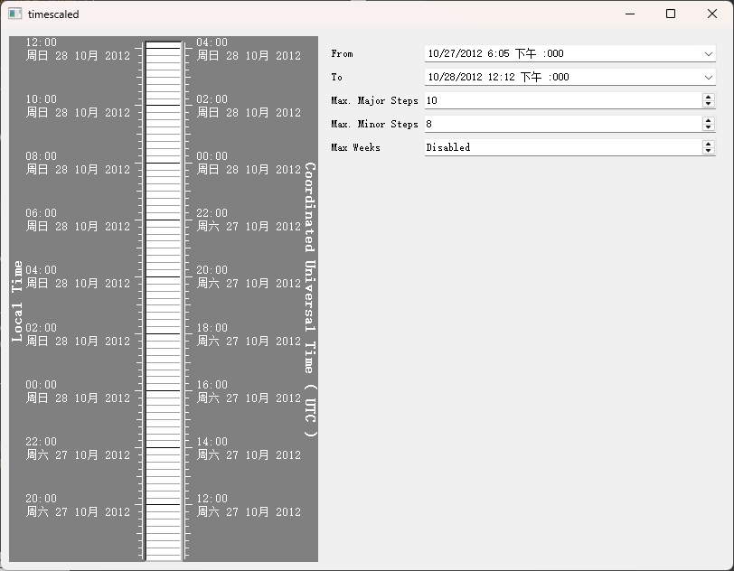
  `playground/timescale`

</div>

### 交互演示

<div class="grid cards" markdown>

- 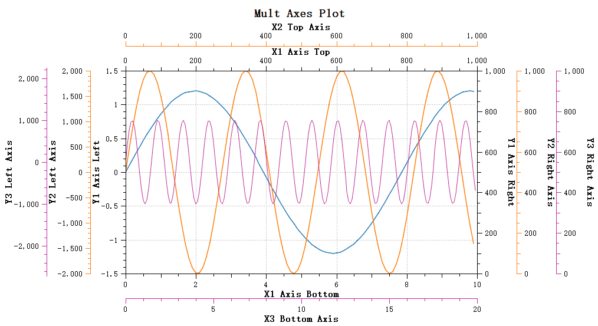
  坐标轴拖动

- 
  坐标轴缩放

- 
  Figure 交互蒙版

- 
  数据拾取器

</div>

## 版权信息

Qwt 基于 Qwt License 1.0 发布，完整版权声明如下：

```
Qwt Widget Library
Copyright (C) 1997   Josef Wilgen
Copyright (C) 2002   Uwe Rathmann

Qwt is published under the Qwt License, Version 1.0.
```
