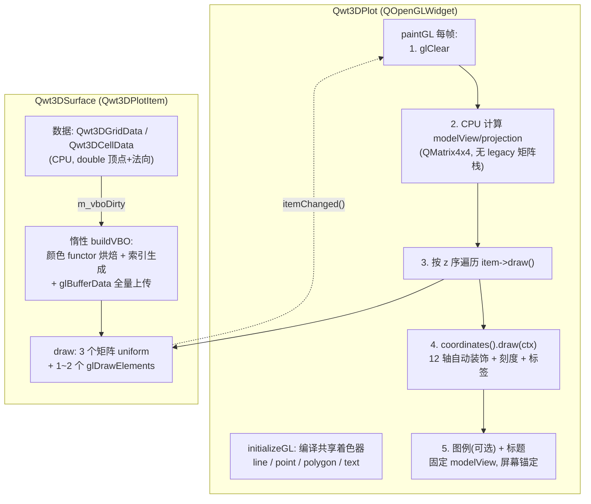
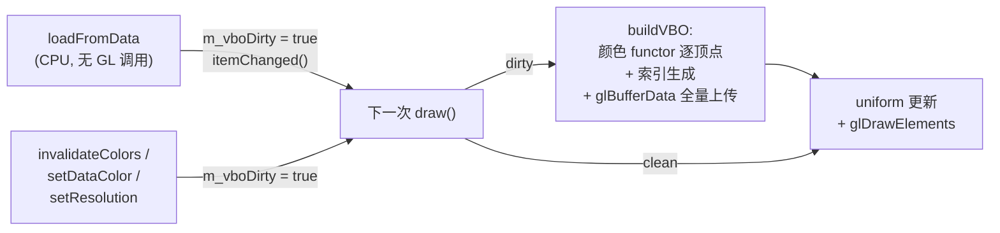
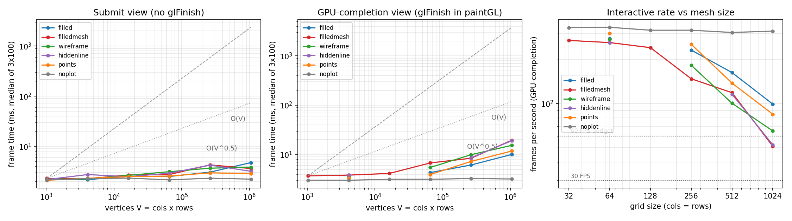
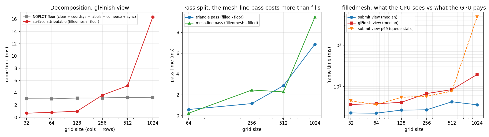
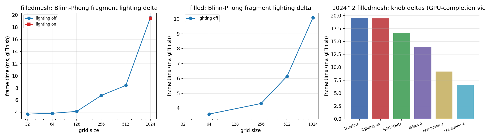
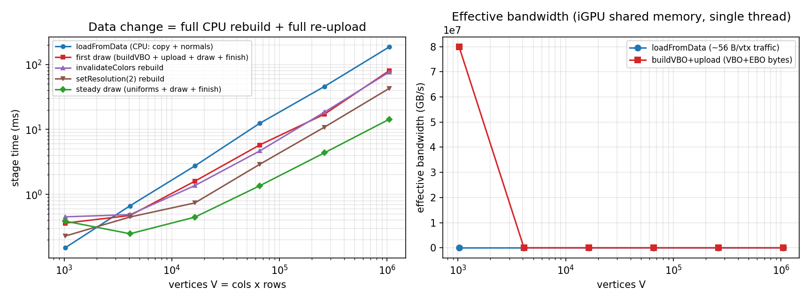
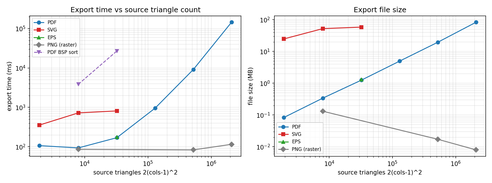

# 3D 表面渲染的 VBO/VAO 管线：数据上传、着色器阶段与网格规模标度

> **摘要** —— QWT 7.3.3+ 的 3D 模块（`qwt::plot3d`）抛弃了旧 `QwtPlot3D` 的固定管线遗产，`Qwt3DSurface` 用 VBO/VAO + GLSL 3.3 Core 着色器在 GPU 上完成表面几何的全部处理：CPU 侧只负责数据装载（`loadFromData` 拷贝 z 矩阵并算 4 邻域法向）、惰性一次性构建（`buildVBO` 烘焙顶点色、生成三角形/网格线索引、`glBufferData` 全量上传）与每帧 3 个矩阵 uniform。一帧可拆成四段：固定地板（坐标系 + 标签 + 合成）、三角形 pass、网格线 pass、片元着色。在 Intel UHD 770 核显上用 113 组实测单元（网格 32²–1024² × 6 种 plot style × 光照/MSAA/坐标系/分辨率开关 × 两套计时口径）量化每一段随顶点数 $V = cols \times rows$ 的标度，并给出数据更新率与导出路径的定量边界。帧时间在 GPU 完成口径下近似 $t_0 + k \cdot V$（最小二乘拟合 $t_0 \approx 4.3$ ms、$k \approx 14.7$ ms/百万顶点；NOPLOT 实测地板 3.0–3.3 ms，截距高于地板的原因见 5.3 节），1024²（1M 顶点、2.1M 三角形）的 FILLEDMESH 仍能跑 51 FPS。数据没有增量更新路径：任何改动都触发全量 CPU 重建 + 重上传，1024² 的一次完整数据刷新要 252 ms（上限 4 Hz）。gl2ps 矢量导出经 feedback buffer 捕获几何位置，修复前顶点色/透明度取自 feedback 缓冲中从未被着色器写入的固定功能顶点色，导出的 PDF/SVG 中曲面 alpha 全为 0（不可见）；v7.5.1 起曲面、坐标系网格/轴线与颜色图例改经即时模式显式提交逐顶点颜色（见核心结论）。耗时仍随三角形数近线性增长（1024² PDF 需 145 s / 82.6 MB），当前最省事的导出路径仍是 `grabFramebuffer` 光栅 PNG（约 0.1 s，与网格规模无关）。

> **摘要 — 核心结论**
>
> - 帧时间随顶点数近线性，固定地板占小网格的 80%：GPU 完成（glFinish）口径下 FILLEDMESH 帧时间从 32² 的 3.71 ms 涨到 1024² 的 19.56 ms，仿射拟合 $t = 4.32\,\mathrm{ms} + 14.67\,\mathrm{ms/Mvertex} \cdot V$（$R^2 = 0.983$）；NOPLOT 地板（clear + 坐标系 + 刻度标签 + 合成 + 同步）在 3.01–3.27 ms 之间与 $V$ 无关，32² 时占整帧 82%。
> - 网格线 pass 比填充 pass 更贵：1024² 时三角形 pass（FILLED − 地板）6.88 ms，网格线 pass（FILLEDMESH − FILLED）9.48 ms，2.09M 条 1 px 线段的光栅化代价超过 2.09M 个三角形；WIREFRAME（15.37 ms）比 FILLED（10.08 ms）慢 52%，默认的 FILLEDMESH（19.56 ms）是最贵的常用样式。
> - 片元光照近乎免费，几何与带宽才是瓶颈：Blinn-Phong 光照开关在 1024² 的 GPU 完成口径下差 −0.09 ms（噪声内）；曲面投影面积被 AUTOFILL 归一化钉死，片元数不随 $V$ 增长，而顶点数据每帧要重读 40 MB VBO + 42 MB EBO，三角形 pass 的实测有效带宽约 9.7 GB/s（核显共享内存，5.4 节）。
> - 数据更新是全量重建，无增量路径：`loadFromData`（CPU 拷贝 + 法向）严格线性 $b = 1.026$（$R^2 = 0.9996$，约 177 ns/顶点），`buildVBO` + 上传约 63 ns/顶点；`invalidateColors()` 与换 colormap 同样触发整条重建（1024² 时 76.3 ms ≈ 首建的 80.2 ms）；1024² 完整刷新周期 252 ms，流式数据的刷新率上限 4 Hz。
> - gl2ps 矢量导出已可用于曲面输出（v7.5.1 修复）：feedback 捕获的填充原先全部 alpha=0（PDF 的 59 个 ExtGState 均为 `/ca 0`），因为着色器路径从不写固定功能顶点色；v7.5.1 起 `Qwt3DSurface`、坐标系网格/轴线和颜色图例在反馈回放时改用即时模式显式提交逐顶点颜色，导出多边形携带数据颜色（定向检查：常量色 functor 下 on-page 多边形着色率从 0.0% 升到 53.2%，其余面积是网格线与标签位图；回归测试 `tests/plot3d_vector_export_test` 在 7.5.0 库上失败、修复后通过）。SVG 图元数膨胀 15–104 倍且随规模饱和、BSP 排序比 SIMPLE 慢 41–159 倍这两条时间/体积结论不变；光栅 PNG 导出（约 0.1 s 恒定）仍是最省事的路径。

---

## 1. 引言：网格规模与帧预算

一张 $cols \times rows$ 的规则网格曲面包含 $V = cols \cdot rows$ 个顶点、约 $2V$ 个三角形与 $2V$ 条网格线段。交互渲染的帧预算是 16.7 ms（60 FPS）或 33 ms（30 FPS），于是问题形式化为：给定 $V$、绘制样式与开关组合，一帧的时间花在哪里、各段如何随 $V$ 标度、数据改动一次的代价是多少？

这个问题在 QWT 的 2D 与 3D 侧有完全不同的答案。2D 侧的 `QwtPlotOpenGLCanvas` 并不是原生 GL 管线：所有 item 仍经 `QPainter` 在 `QOpenGLPaintDevice` 上由 Qt 的 OpenGL2 paint engine 绘制，CPU 侧做折线细分，GPU 只做填充（见[《Raster 与 OpenGL 渲染管线》](raster-vs-opengl.md)）；变换与降采样段（`QwtPointMapper`）完全在 CPU，帧时间随采样数线性增长且后端只影响光栅化段。3D 侧的 `Qwt3DSurface` 则是真正的 GPU 几何管线：顶点位置、法向、颜色一次性烘焙进 VBO，每帧只更新 3 个矩阵 uniform 并发 1–2 个 `glDrawElements`，几何变换与光照全部在着色器里完成。两者的标度行为因此本质不同：2D 的瓶颈在 CPU 变换与光栅化调用，3D 的瓶颈在 GPU 顶点吞吐、图元光栅化与核显共享内存带宽，CPU 侧的每帧成本几乎与 $V$ 无关。这既是优势（大网格交互流畅），也是测量陷阱（CPU 提交口径会完全掩盖 GPU 的真实耗时，第 5.2 节展开）。

结论建立在 113 组实测单元上，覆盖网格 32²–1024²（顶点 1k–1M）、6 种 plot style、光照/MSAA/坐标系/分辨率四类开关、上传路径逐段计时与 gl2ps 导出。全部原始数据、基准源码与分析脚本随仓库提供，每个数字可复算。

## 2. Plot + Item 架构与职责边界

`qwt::plot3d` 的类结构在 v7.3.3+ 重构为与 2D 对称的 Plot + Item：`Qwt3DPlot` 是纯渲染窗口（`QOpenGLWidget` 子类），管理 GL 上下文、每帧的视图/投影矩阵、光照开关、坐标系统、图例与标题、按 z 序排列的 item 列表；它不持有任何绘图数据。数据与绘制逻辑全部在 `Qwt3DPlotItem` 子类（`Qwt3DSurface` / `Qwt3DLine` / `Qwt3DBar` / `Qwt3DWaterfall`）里，item 通过 `attach()` / `detach()` 挂载，自带 VBO/VAO 与颜色 functor。架构动机与旧结构的对比见 [3D 绘图架构教程](../use-guide/3d/3d-architecture.md)，此处只列与性能相关的职责边界。



通知路径与 2D 对齐：item 的任何 setter 调 `Qwt3DPlotItem::itemChanged()`（`src/plot3d/qwt3d_plotitem.cpp:174-179`），后者进入 `Qwt3DPlot::itemChanged()` → `recalculateScene()`（`src/plot3d/qwt3d_plot.cpp:879-884, 794-821`）：按 z 序重排 item 列表、求所有 item hull 的并集、必要时重建坐标系统，最后 `update()`。这条路径本身是纯 CPU 轻量操作（实测 `setMeshColor` 一次 0.4–6 µs），真正的重活在下一次 `draw()` 里由 `m_vboDirty` 标志触发。

视图变换完全在 CPU 侧：`paintGL()`（`qwt3d_plot.cpp:411-520`）用 `QMatrix4x4` 从旋转/缩放/平移状态组装 modelView，从 hull 半径组装 ortho/frustum 投影，item 每帧把这两个矩阵与法向矩阵作为 uniform 传给自己的着色器。没有任何 `glRotatef`/矩阵栈残留，这是模块的硬性规范（禁止 legacy GL）。`AUTOFILL` 宽高比模式（默认）把三个轴归一化到等长立方体，副作用是曲面的屏幕投影面积与网格规模无关，第 4 节的片元项因此是常数。

主题系统 `Qwt3DTheme`（10 种预设）把背景/网格/colormap/光照打包，`applyTheme()` 一次性写入 plot 与所有已挂载 item（`qwt3d_theme.cpp:442-509`）；对 surface 的写入中，颜色类（`setDataColor` / `invalidateColors`）会触发 VBO 重建，而 `setPlotStyle` / `setMeshColor` 仅触发 `itemChanged()`（µs 级，不重建），用法见 [3D 绘图教程](../use-guide/3d/3d-plot.md)。需要提醒的是主题的"光照预设"在 v7.5.1 之前只是开关（现已真正接入灯光/材质参数，见 3.3 节）。

## 3. VBO/VAO 管线剖析

### 3.1 顶点布局与索引结构

上传单元是 40 字节的交错结构体 `SurfaceVertex`（`src/plot3d/qwt3d_surface_p.h:23-28`）：位置 `QVector3D`（12 B）+ 法向 `QVector3D`（12 B）+ 颜色 `QVector4D`（16 B），对应着色器 attribute location 0/1/2（`qwt3d_surface.cpp:1036-1043`）。颜色在构建时由颜色 functor 逐顶点求值烘焙进缓冲：默认 `Qwt3DStandardColor` 从 viridis 预设采样 100 个色标再按 z 线性查表（`qwt3d_color.cpp:104-115, 124-145`），换成 `Qwt3DColorMapColor` 可接入 core 模块的 22 种科学 colormap。

索引结构在 `buildGeometry()`/`buildVBO()`（`qwt3d_surface.cpp:848-995, 1002-1063`）里按固定模式生成：网格数据顶点序为 $idx = i \cdot rows + j$（列主序）；每个 quad 出 2 个三角形（6 个索引）与 2 条网格线（4 个索引），加上右/上边界补线；三角形索引与线索引合并在同一个 EBO（三角形在前、线在后，`qwt3d_surface.cpp:1050-1059`），绘制时用偏移量分段。由此得到解析量（与 bench 的 stderr 诊断逐项核对一致）：

| cols=rows | 顶点数 $V$ | 三角形数 | 三角形索引 | 线索引 | VBO 字节 | EBO 字节 |
|---:|---:|---:|---:|---:|---:|---:|
| 32 | 1 024 | 1 922 | 5 766 | 3 968 | 0.04 MB | 0.04 MB |
| 64 | 4 096 | 7 938 | 23 814 | 16 128 | 0.16 MB | 0.16 MB |
| 128 | 16 384 | 32 258 | 96 774 | 65 024 | 0.66 MB | 0.65 MB |
| 256 | 65 536 | 130 050 | 390 150 | 261 120 | 2.62 MB | 2.61 MB |
| 512 | 262 144 | 522 242 | 1 566 726 | 1 046 528 | 10.49 MB | 10.45 MB |
| 1024 | 1 048 576 | 2 093 058 | 6 279 174 | 4 190 208 | 41.94 MB | 41.88 MB |

三个量级判断由此得出。其一，EBO 与 VBO 几乎等大（每顶点 10 个 uint32 索引 = 40 B，恰等于顶点 stride），一次全量重建要上传约 $80 \cdot V$ 字节，1024² 时 83.8 MB。其二，每帧绘制同样要把这些字节从共享内存过一遍（索引 + 被索引的顶点），这是大网格帧时间的主项（第 5.4 节带宽核算）。其三，CPU 侧还常驻一份 double 精度的 `Qwt3DGridData`（顶点 + 法向两个 `DataMatrix`，每顶点 48 B，1024² 时约 50 MB）加构建期的临时 `QVector<SurfaceVertex>`（40 MB），1024² 曲面的总内存足迹约 170 MB；核显共享内存架构下这些同时挤占系统带宽。

`resolution` 参数只对索引生成生效（步长跳过 quad），顶点数组始终全量构建（`qwt3d_surface.cpp:871, 874-895, 898-944`）。

### 3.2 上传策略：惰性、全量、无增量

数据路径分两段，触发点不同：



第一段 `loadFromData`（`qwt3d_surface.cpp:293-306`）是纯 CPU：把 `double**` z 矩阵拷进 `Qwt3DGridData`（同时生成 x/y 坐标与 hull），再跑 `calcNormalsGrid`：每顶点 4 个邻接 quad 的归一化叉积累加（`qwt3d_surface.cpp:94-151`）。第二段 `buildVBO` 被惰性推迟到下一次 `draw()`（`qwt3d_surface.cpp:1177-1180`），做三件事：逐顶点调颜色 functor 并打包 `SurfaceVertex`、按 3.1 的模式生成两套索引、`QOpenGLBuffer::allocate` 全量上传（内部即 `glBufferData`，重新分配存储）。

没有增量或局部更新 API。数据改动、颜色改动（`invalidateColors` / `setDataColor`）、甚至 `setResolution` 都置 `m_vboDirty` 走同一条全量重建路径。`setResolution` 实现置 `d->m_vboDirty = true`（`qwt3d_surface.cpp:398-407`），顶点数组照旧全量重建，只有索引变稀疏；docstring 现已如实写明"索引步进 + 全量重建/重上传"（`qwt3d_surface.cpp:386-397`，v7.5.1 前曾声称 "reducing rendered detail without rebuilding the VBO"）；实测 res=2 的重建（含 draw + glFinish 的单次计时）42.8 ms，约为同口径首建总耗时（首帧 draw 80.2 ms）的 53%。若按净构建口径（首帧 − 稳态 = 65.9 ms）对比则口径不齐，此处统一用毛耗时；结果与"顶点循环不变、索引量降为 1/4"的结构吻合，而不是曾经 docstring 暗示的零重建。唯一免重建的改动是矩阵/样式 uniform 类属性（`setMeshColor`、`setPlotStyle` 等只触发 `itemChanged`，实测 µs 级）。`setPlotStyle` 从 FILLED 切到 FILLEDMESH 也不需要重建（两套索引一直都在），这是合并 EBO 设计的一个隐性收益。

这套"全量重建"策略的代价在第 5.7 节定量给出：1024² 的一次完整数据刷新（load + rebuild + upload）252 ms。

### 3.3 GLSL 3.3 Core 着色器阶段

表面着色器内嵌于资源文件（`src/plot3d/shaders/surface.vert` / `surface.frag`，经 `shaders.qrc` 编入库），首次 `draw()` 时惰性编译链接（`qwt3d_surface.cpp:1186-1195`，实测一次性约 6 ms）；line/point/polygon/text 四个共享着色器在 `initializeGL()` 编译（`qwt3d_plot.cpp:352-382`），供坐标系、标签与其余 item 使用。

顶点着色器做全部几何变换，逐指令数出来约 80 FLOP（与下方代码块注释的 28 + 24 + 28 一致）：

```glsl
void main()
{
    vec4 viewPos = uModelView * vec4(aPosition, 1.0);   // mat4 x vec4: 16 mul + 12 add
    vFragPos = viewPos.xyz;
    vNormal = normalize(uNormalMatrix * aNormal);       // mat3 x vec3: 9 mul + 6 add; normalize ~9
    vColor = aColor;                                    // 顶点色直通(已在 VBO 烘焙)
    gl_Position = uProjection * viewPos;                // 16 mul + 12 add
}
```

法向在 CPU 侧算好（3.2 节），顶点着色器只用法向矩阵旋转并归一化，把逐片元的法向插值（`vNormal` varying）交给光栅化器。这是 Gouraud/Phong 混合式：光照在片元级算，法向在顶点级供。

片元着色器有三条路径，前两条是 early-out 分支：

```glsl
void main()
{
    if (uUseOverrideColor) { fragColor = uOverrideColor; return; }  // 网格线/hiddenline pass
    if (!uUseLighting)     { fragColor = vColor; return; }          // 默认: 顶点色直通
    // Blinn-Phong: ambient 0.3*c + diffuse max(dot(N,L),0)*c
    //            + specular pow(max(dot(N,H),0), uShininess)*0.5
}
```

光照路径约 85–90 FLOP/片元：四次 `normalize`（norm/lightDir/viewDir/halfwayDir，各含一个 rsqrt）、两次 `dot`、一次 `pow(x, 32)`（驱动通常展开为 log2/exp2 两个 SFU 操作或 5 次乘法）。关键在片元数量：AUTOFILL 归一化把曲面投影面积钉在视口的固定比例，900×600 视口下覆盖约 15–27 万像素，与 $V$ 无关。即使 1024² 网格，光照总 ALU 也只有约 $2 \times 10^5 \times 90 \approx 18$ MFLOP/帧，对 UHD 770（约 1 TFLOPS）不足 0.02 ms。这解释了 5.6 节的实测：光照开关的帧时间差在噪声内。

首发版本的实现现状（v7.5.1 已接线，见段末）：光照 uniform 是硬编码的。`Qwt3DSurface::draw()` 每帧写死 `uLightPos = (0, 0, 10)`（视空间）、`uLightColor = 白`、`uShininess = 32`（该实现已被 v7.5.1 的接线取代，现行 uniform 上传见 `qwt3d_surface.cpp:1212-1253`）；而 `Qwt3DPlot` 层的 `setLightComponent` / `setShininess` / `setLightRotation` / `setMaterialComponent` 当时只是 CPU 侧存值 stub、不参与渲染（现行实现见 `qwt3d_lighting.cpp:115-134, 103-108, 224-232, 70-87`）。因此当时 `Qwt3DTheme` 的 5 种光照预设（NoLighting/FlatLight/Studio/Outdoor/Soft）在渲染结果上只有"开/关"两态，`illuminate()`/`blowout()`/`setLightRotation()` 也改不动任何着色器 uniform。主题预设间的视觉差异实际来自背景色与 colormap，不来自光照。（v7.5.1 更新：这些 setter 与 `setShininess()` 现在真正存值并上传。`uLightPos` 由 `setLightRotation` 推导，`uLightAmbient`/`uLightDiffuse`/`uLightSpecular` 与 `uMaterialAmbient`/`uMaterialDiffuse`/`uMaterialSpecular` 分别取自灯光与材质分量，`uShininess` 取自 `setShininess`；默认值与原先的硬编码逐像素一致（同一源码基线关/开接线的渲染差异为 0 像素），`illuminate()`/`blowout()` 切换唯一那盏灯，5 种主题光照预设因此产生不同效果。新增 getter：`lightComponent()`/`materialComponent()`/`shininess()`/`isLightIlluminated()`；回归测试 `tests/plot3d_lighting_test`。）

六种 plot style 到 draw call 的映射（`qwt3d_surface.cpp:1263-1342`）：

| PLOTSTYLE | draw call | 说明 |
|---|---|---|
| `FILLED` | 1 × `glDrawElements(GL_TRIANGLES)` | 顶点色填充，无网格线 |
| `FILLEDMESH`（默认） | 三角形 + `GL_LINES` 两 pass | 三角形开 `GL_POLYGON_OFFSET_FILL` 防 z-fighting，线用 `uOverrideColor` |
| `WIREFRAME` | 1 × `GL_LINES` | 只画网格线 |
| `HIDDENLINE` | 背景色三角形 + 线两 pass | 用背景色填充做隐面消除 |
| `QWT3D_POINTS` | 1 × `glDrawArrays(GL_POINTS)` | 每顶点一个点 |
| `NOPLOT` | 无 | draw() 提前返回 |

### 3.4 坐标系与标签：每帧即时重建的固定开销

`paintGL` 在 item 之后绘制坐标系统（`qwt3d_coordsys.cpp:209-232`），这条路径没有表面那样的 VBO 缓存，每帧即时重建：`chooseAxes` 把 12 条轴的端点投影到屏幕并跑一次 2D 凸包来决定哪些轴可见；每条可见轴在 `drawTics` 里重新执行自动刻度（`prepTicCalculation` → `Qwt3DAutoScaler`，`qwt3d_axis.cpp:625-653`）、收集刻度线顶点、`QOpenGLBuffer` create/allocate/destroy 走一整套（`qwt3d_coordsys.cpp:158-203` 的 `drawGridLines` 与 `qwt3d_axis.cpp` 的 `drawLines` 同构）；每个刻度数字是一个 `Qwt3DLabel`。文本位图有缓存（`update()` 仅在内容变化时重画 QImage），但 `draw()` 每次都从缓存图像新建 `QOpenGLTexture` 上传 GPU 再画纹理四边形（`qwt3d_label.cpp:318-428`），默认场景（自动装饰选出的 3–4 条轴、每轴若干主刻度数字）每帧就是十几到几十次纹理创建 + 上传 + 销毁。

这就是实测中 3.0–3.3 ms（GPU 完成口径）的"固定地板"（NOPLOT 行）的主要成分，也是把 `coordinates()->setStyle(NOCOORD)` 后帧时间骤降的原因（5.6 节）。它与 $V$ 无关，却在小网格场景占整帧的绝对多数。3D 曲面的"空场景开销"问题与 2D GL 画布的合成开销问题（[raster-vs-opengl.md](raster-vs-opengl.md) 第 4.3 节）同构，但成因不同：2D 贵在 FBO resolve/blit/合成，3D 贵在坐标系与标签的每帧 CPU/GL 杂务。

## 4. 帧时间模型

把一帧写成四段之和：

$$
T_{\text{frame}}(V) = \underbrace{T_{\text{floor}}}_{\text{clear+坐标系+标签+合成}} + \underbrace{T_{\text{tri}}(V)}_{\text{三角形 pass}} + \underbrace{T_{\text{line}}(V)}_{\text{网格线 pass}} + \underbrace{T_{\text{frag}}(A)}_{\text{片元着色}}
$$

$T_{\text{floor}}$ 与 $V$ 无关（3.4 节），实测 3.0–3.3 ms（GPU 完成口径）。$T_{\text{tri}}$ 的成分是顶点读取（$40\,\mathrm{B} \times V$ 带宽）+ 顶点着色（80 FLOP × V，核显上远低于带宽时间）+ 三角形装配/光栅化（约 $2V$ 个三角形）；$T_{\text{line}}$ 是 $2V$ 条 1 px 线段的光栅化：线段没有 early-Z 与 quad 覆盖率优势，每图元成本高于三角形。$T_{\text{frag}}$ 正比于屏幕覆盖面积 $A$，AUTOFILL 下 $A$ 是常数，因此光照/colormap 的片元成本与 $V$ 无关。

各段的理论标度：$T_{\text{tri}}, T_{\text{line}} = O(V)$（带宽与图元吞吐都线性），加上常数地板后整帧应为 $t_0 + k \cdot V$ 的仿射形态；小 $V$ 区间被地板压平，双对数图上表现为从 $V^0$ 向 $V^1$ 过渡的 S 形。实测（5.3 节）在大网格段给出局部指数 0.61（512²→1024²），低于 1：顶点缓存复用（网格顶点被 6 个索引共享）与驱动侧优化吸收了部分带宽，但在核显上仍高于同代独显的预期（6.1 节估计独显可把曲面段压缩数倍）。

还有一个口径项：不设 `glFinish` 时应用线程测到的是 CPU 提交时间，GPU 工作藏在命令队列里；持续渲染时队列饱和，提交被节流，帧时间向 GPU 完成时间收敛并伴随周期性长尾（实测 p99 达 480 ms）。第 5 节两套口径并报，选型以 GPU 完成口径为准。

## 5. 实验

### 5.1 方法学与环境

环境声明（适用于本节全部数字）：Intel UHD 770 (iGPU), driver 31.0.101.4887, GL 4.6, Qt 5.15.16, QWT 7.4.2 (commit 1b352c1) Release (MSVC2019 /O2), Windows 10；核显共享内存带宽，独显结论不可直接外推（见第 6 节）。CPU i7-14700 / 16 GB，真实桌面会话，窗口 900×600，DWM 合成，请求 swapInterval=0（上下文报告 1，但帧时间无 16.7 ms 量化，与 2D 篇的观察一致）。上下文报告 samples=0：MSAA 发生在 `QOpenGLWidget` 的内部 FBO 上，`QSurfaceFormat::setSamples(4)`（与示例一致）实际生效，5.6 节的 MSAA 0/4 对比可证。

基准程序 `docs/assets/algorithms/surface3d_bench.cpp`（顶部注释含完整编译命令），场景为单张 `Qwt3DSurface`，$z = \sin(2r) e^{-r^2/8}$，域 $[-3,3]^2$，viridis 顶点色，BOX 坐标系（自动装饰），无图例无标题。帧协议：5 帧预热后 3 轮 × 100 帧，每帧 z 轴旋转 0.7°（模拟交互），`update()` + `processEvents()` 驱动，逐帧 CPU 计时并统计 paintGL 计数（每配置恒为 305/610，验证无漏画/多画）；轮间 median 抖动 >1.5× 触发整体重测（最多 2 次），主矩阵 13 行 + 补充矩阵 1 行触发过重测。主矩阵运行时段本机有其他并行基准 agent，p99 长尾部分归因于此，median 经重测协议保护。上传协议：3 次重复取 median，每段计时内含 `glFinish`。导出协议：单次 `saveVector`/`savePixmap` 调用计时 + 输出文件字节数 + SVG 图元计数。取数规则：CSV 中个别配置存在同配置重复行（补充测量所致，如 512² noplot finish 行 med 分别为 3.2705 与 3.0738 ms），分析脚本对匹配到的首行取值，正文 512² 地板 3.271 ms 及其 tri/line 分解沿用该选择。

一个测量学发现对任何给 GL 帧计时的人都很重要：`QOpenGLWidget` 上直接 `repaint()` 不触发任何绘制（诊断程序 20 次 `repaint()` 的 paintGL 计数为 0，`update()`+`processEvents()` 则每次恰好一帧）。bench 与任何逐帧驱动代码都必须走 `update()` 路径。

### 5.2 两套口径：CPU 提交 vs GPU 完成

同一配置的两种计时（FILLEDMESH，median，ms）：

| cols | 提交口径 | GPU 完成口径 | 倍数 | 提交口径 p99 |
|---:|---:|---:|---:|---:|
| 32 | 2.304 | 3.706 | 1.61 | 4.5 |
| 64 | 2.270 | 3.833 | 1.69 | 3.7 |
| 128 | 2.696 | 4.151 | 1.54 | 5.5 |
| 256 | 2.740 | 6.769 | 2.47 | 5.8 |
| 512 | 4.281 | 8.423 | 1.97 | 7.8 |
| 1024 | 3.618 | 19.556 | 5.40 | 479.7 |

小网格下两口径接近（GPU 在一个帧窗口内就能排空）；1024² 时提交口径只有 3.6 ms，比 GPU 完成口径低 5.4 倍，因为 CPU 把 300 帧的命令在约 1.1 s 内全部塞进驱动队列，而 GPU 实际需要约 5.9 s。差额要么表现为队列饱和时的周期性阻塞（p99 479.7 ms），要么推迟到进程退出时排空。提交口径的 1024² 数据还出现"filled（4.75 ms）比 filledmesh（3.62 ms）慢"这类物理上不合理的倒挂：队列动态与并发负载主导了 median。本文所有结论性数字取 GPU 完成口径；提交口径仅用于说明"应用线程看到的成本"与交互延迟下限。

提交口径的完整样式矩阵一并列出（median，ms），供评估"应用线程被阻塞多久"时参考：它决定事件循环响应鼠标/定时器的延迟，即便不等于呈现帧率：

| cols | filled | filledmesh | wireframe | hiddenline | points | noplot |
|---:|---:|---:|---:|---:|---:|---:|
| 32 | 2.250 | 2.304 | 2.223 | 2.186 | 2.113 | 2.145 |
| 64 | 2.176 | 2.270 | 2.249 | 2.746 | 2.315 | 2.277 |
| 128 | 2.527 | 2.696 | 2.647 | 2.491 | 2.495 | 2.331 |
| 256 | 2.512 | 2.740 | 3.128 | 2.918 | 2.561 | 2.152 |
| 512 | 3.068 | 4.281 | 3.680 | 4.234 | 2.967 | 2.323 |
| 1024 | 4.749 | 3.618 | 3.850 | 3.195 | 2.885 | 2.226 |

≤512² 时提交口径的样式次序与完成口径基本一致（差异都在坐标系统等公共 CPU 成本上，样式相关的 GPU 成本不出现）；1024² 行则如前所述失真。这也说明提交口径测到的主要是 3.4 节的每帧 CPU 杂务（约 2.15–2.33 ms 的 noplot 行），曲面本身的提交成本只有两个 draw call：在 ≤128² 时不足 0.5 ms，但 512² 时 filledmesh − noplot 的提交差已达约 2.0 ms，大网格下命令量在提交口径中同样不可忽略。

### 5.3 帧率-网格规模标度



GPU 完成口径的完整矩阵（median，ms；`-` 为该配置未跑 finish 变体）：

| cols | filled | filledmesh | wireframe | hiddenline | points | noplot（地板） |
|---:|---:|---:|---:|---:|---:|---:|
| 32 | - | 3.706 | - | - | - | 3.027 |
| 64 | 3.601 | 3.833 | 3.631 | 3.856 | 3.320 | 3.014 |
| 128 | - | 4.151 | - | - | - | 3.157 |
| 256 | 4.312 | 6.769 | 5.472 | - | 3.939 | 3.156 |
| 512 | 6.143 | 8.423 | 9.943 | 8.636 | 7.248 | 3.271 |
| 1024 | 10.078 | 19.556 | 15.370 | 19.098 | 11.809 | 3.201 |

换算 FPS（GPU 完成口径）：FILLEDMESH 从 32² 的 270 FPS 单调降到 1024² 的 51 FPS，60 FPS 预算的边界落在 512²（119 FPS）与 1024² 之间；FILLED 在 1024² 仍有 99 FPS；POINTS 85 FPS；WIREFRAME 65 FPS。30 FPS 预算下所有样式在 1024² 内都达标。

对 $t = t_0 + k \cdot V$ 的仿射拟合（FILLEDMESH，六点全量）：$t_0 = 4.32$ ms、$k = 14.67$ ms/百万顶点、$R^2 = 0.983$。$t_0$ 略高于 NOPLOT 地板的 3.1 ms，因为最小二乘把 256² 处的过渡段拉进了截距；以地板为锚的分解见 5.4。幂律拟合给出全局表观指数 $b = 0.230$（地板压平所致），局部指数更有物理意义：128²→512² 为 0.255，512²→1024² 为 0.608。顶点缓存复用在中等规模有效，1M 顶点后向线性靠拢。NOPLOT 的幂律指数 0.011（$R^2$ 意义不大），确认地板与 $V$ 无关。

### 5.4 帧分解：地板、三角形 pass、网格线 pass



以 NOPLOT 为地板、FILLED 拆三角形 pass、FILLEDMESH−FILLED 拆网格线 pass（GPU 完成口径，ms）：

| cols | 地板 | 曲面合计 | 三角形 pass | 网格线 pass |
|---:|---:|---:|---:|---:|
| 32 | 3.027 | 0.679 | - | - |
| 64 | 3.014 | 0.818 | 0.586 | 0.232 |
| 128 | 3.157 | 0.994 | - | - |
| 256 | 3.156 | 3.613 | 1.156 | 2.457 |
| 512 | 3.271 | 5.152 | 2.872 | 2.280 |
| 1024 | 3.201 | 16.355 | 6.878 | 9.478 |

1024² 时曲面段 16.4 ms 占整帧 84%，其中网格线 pass（9.48 ms）比三角形 pass（6.88 ms）还贵 38%，对应 2.09M 条 1 px 线段对 2.09M 个三角形。线段的每图元成本更高是 GPU 光栅化的普遍特性（线段覆盖率低、quad 利用率差、无 early-Z 收益），核显上尤其明显；512² 处线 pass 的 2.28 ms 低于 256² 的 2.46 ms 属测量噪声（轮间 median 差约 ±5%）。带宽核算：三角形 pass 每帧读 VBO 41.9 MB + 三角形索引 25.1 MB ≈ 67 MB，6.88 ms 对应约 9.7 GB/s 的有效带宽，与核显共享内存单上下文可达的量级一致，说明大网格段确实运行在带宽/几何吞吐域而非 ALU 域（对照：80 MFLOP 顶点着色在 1 TFLOPS 下只需 0.08 ms）。

### 5.5 样式矩阵

GPU 完成口径下 1024² 的样式排序：FILLED 10.08 < POINTS 11.81 < WIREFRAME 15.37 < HIDDENLINE 19.10 ≈ FILLEDMESH 19.56 ms。两点工程含义：默认样式 FILLEDMESH 恰好是最贵的（双 pass 全开）；HIDDENLINE 并不比 FILLEDMESH 省（同样两 pass，只是三角形用背景色）。POINTS 用 `glDrawArrays` 画 1M 个 1 px 点，成本介于单三角形 pass 与线 pass 之间。提交口径的同矩阵（B 表）在 ≤512² 与完成口径次序一致，1024² 因队列失真不可用（5.2 节）。

### 5.6 开关矩阵：光照、MSAA、坐标系、分辨率



1024² FILLEDMESH 的开关对比（median，ms；提交 | GPU 完成）：

| 配置 | 提交口径 | GPU 完成口径 | Δ（完成口径） |
|---|---:|---:|---:|
| 基线（BOX，MSAA4，光照关，res=1） | 3.618 | 19.556 | — |
| 光照开（Blinn-Phong 片元） | 3.922 | 19.470 | −0.086 |
| 坐标系 NOCOORD | 0.356 | 16.648 | −2.908 |
| MSAA 0 | 3.400 | 13.931 | −5.625 |
| resolution 2 | 4.447 | 9.197 | −10.359 |
| resolution 4 | 2.446 | 6.547 | −13.009 |

其一，片元光照免费：Δ 在噪声内（下方全规模明细表中 12 个差值符号随机、幅度 ≤0.55 ms，无一超出轮间噪声带），验证第 4 节的片元常数模型。给曲面上光照不需要犹豫，但要知道 3.3 节的光照接线现状：v7.5.1 前是写死在着色器里的固定方向 Blinn-Phong（现可由 `setLightRotation` / `setLightComponent` 等调节）。

其二，MSAA 4× 在 1024² 值 5.6 ms（29%）：填充率 ×4 对核显是实打实的成本，大网格交互场景可考虑关（示例默认开 4）。

其三，坐标系地板 2.9–3.2 ms：NOCOORD 把提交口径帧时间从 3.6 ms 打到 0.36 ms。小网格高帧率场景（如动画循环里的 32²–128² 曲面）关掉坐标系收益比例最大；需要坐标装饰时这 3 ms 无法绕过（当前实现每帧重建，见 3.4）。

其四，分辨率抽取是最强的帧率旋钮：res=4 把 1024² 帧时间压回 6.5 ms（153 FPS），代价是几何保真度（索引步长跳点，顶点数据未动）。它同时触发一次全量重建（5.7 节），适合静态降采样而非逐帧调节。

光照差的全规模明细（median，ms；正号 = 开光照更慢）：

| cols | filled 关→开 | Δ | filledmesh 关→开 | Δ |
|---:|---:|---:|---:|---:|
| 32 | 2.250 → 2.387 | +0.137 | 2.304 → 2.788 | +0.484 |
| 64 | 2.176 → 2.094 | −0.082 | 2.270 → 2.730 | +0.460 |
| 128 | 2.527 → 2.371 | −0.157 | 2.696 → 2.536 | −0.160 |
| 256 | 2.512 → 2.509 | −0.003 | 2.740 → 2.530 | −0.211 |
| 512 | 3.068 → 2.639 | −0.429 | 4.281 → 4.267 | −0.014 |
| 1024 | 4.749 → 4.198 | −0.551 | 3.618 → 3.922 | +0.304 |

（提交口径；1024² 的 GPU 完成口径对照为 19.556 → 19.470 ms。）六个规模 × 两种样式的 12 个差值符号随机、幅度 ≤0.55 ms，与"片元数恒定、光照 ALU 可忽略"的模型一致，没有任何一档表现出系统性的光照成本。

### 5.7 上传路径与数据更新率



逐段计时（3 次重复 median，每段含 `glFinish`，ms）：

| cols | loadFromData（CPU） | 首帧 draw（构建+上传+绘制） | 稳态 draw | invalidateColors 重建 | setResolution(2) 重建 | setter（itemChanged） |
|---:|---:|---:|---:|---:|---:|---:|
| 32 | 0.150 | 0.361 | 0.386 | 0.451 | 0.228 | 0.0004 |
| 64 | 0.667 | 0.473 | 0.248 | 0.487 | 0.448 | 0.0010 |
| 128 | 2.740 | 1.594 | 0.446 | 1.365 | 0.738 | 0.0008 |
| 256 | 12.381 | 5.754 | 1.354 | 4.650 | 2.897 | 0.0037 |
| 512 | 45.807 | 17.134 | 4.363 | 18.452 | 10.826 | 0.0049 |
| 1024 | 185.926 | 80.234 | 14.328 | 76.336 | 42.828 | 0.0060 |

`loadFromData` 是严格线性的（幂律 $b = 1.026$，$R^2 = 0.9996$），约 177 ns/顶点。这是 double 拷贝（8 B 读 + 24 B 写 ×2 数组）加 4 邻域归一化叉积的 CPU 计算成本，折合有效"带宽"仅 0.3 GB/s，属于计算受限而非内存受限；法向计算约占大头。`buildVBO` + 上传（首帧 − 稳态）在 1024² 为 65.9 ms，约 63 ns/顶点，按 VBO+EBO 83.8 MB 折算有效带宽 1.3 GB/s，同样远低于内存上限。瓶颈在 `QVector` 逐元素 append、颜色 functor 调用与双索引循环的 CPU 侧串行工作，`glBufferData` 本身只占小头。

`invalidateColors()` 的重建成本与首建几乎相同（1024²：76.3 vs 80.2 ms）。改 colormap、调 alpha、换预设都要付整条流水线：颜色 functor 重算 1M 顶点 + 索引重生成 + 全量重上传。想要"只换颜色"的轻量路径，当前 API 没有提供（顶点色烘焙进 VBO 的设计使颜色与几何耦合；把颜色改为 uniform 采样 colormap 纹理是可行的重构方向，但不在当前实现里）。

把 load + rebuild 相加得到数据刷新周期（数据改动 → 可绘制）：

| cols | 完整刷新周期 | 刷新率上限 |
|---:|---:|---:|
| 32 | 0.15 ms | 6 600 Hz |
| 64 | 0.89 ms | 1 100 Hz |
| 128 | 3.89 ms | 257 Hz |
| 256 | 16.78 ms | 60 Hz |
| 512 | 58.58 ms | 17 Hz |
| 1024 | 251.83 ms | 4.0 Hz |

60 FPS 的流式曲面（每帧换数据）在 256² 以内可行；512² 上限 17 Hz；1024² 只有 4 Hz。对比渲染侧（数据不变时 1024² 仍有 51 FPS），瓶颈完全在 CPU 侧重建而非 GPU 侧绘制。大网格动画的正确做法是降数据更新率、用 `resolution` 抽取，或在应用层做双 surface 交替加载。

### 5.8 gl2ps 矢量导出：原理、实测与当前局限

导出注册表（`qwt3d_io.cpp:306-337`）：光栅格式走 `Qwt3DPixmapWriter`（`grabFramebuffer` → `QImageWriter`），矢量格式 EPS/PS/PDF/SVG/PGF 走 `Qwt3DVectorWriter`（gl2ps 1.4.3，`src/plot3d/3rdparty/gl2ps/`，CMake 未找到系统 gl2ps 时内置编译，链接 `OpenGL::GLU`）。矢量路径的机制是 gl2ps 的经典 feedback 捕获：`gl2psBeginPage` 把 GL 切到 `GL_FEEDBACK` 渲染模式，重放一帧（`plot->grabFramebuffer()`，`qwt3d_io_gl2ps.cpp:230-250`），驱动把经过顶点处理的图元连位置带"当前颜色"写进 feedback buffer，gl2ps 排序（SIMPLE/BSP）后输出矢量文件，缓冲溢出则以 2 MB 步长扩容重试。

实测（单次导出，ms / 字节 / SVG 图元数）：

| 格式 | 排序 | cols | 时间 | 文件大小 | 捕获图元 |
|---|---|---:|---:|---:|---:|
| PDF | SIMPLE | 32 | 107 | 84 KB | - |
| PDF | SIMPLE | 128 | 170 | 1.25 MB | - |
| PDF | SIMPLE | 512 | 9 172 | 19.5 MB | - |
| PDF | SIMPLE | 1024 | 144 737 | 82.6 MB | - |
| PDF | BSP | 64 | 3 862 | 648 KB | - |
| PDF | BSP | 128 | 27 065 | 1.51 MB | - |
| SVG | SIMPLE | 32 | 356 | 24.7 MB | 200 577 |
| SVG | SIMPLE | 64 | 725 | 52.1 MB | 427 990 |
| SVG | SIMPLE | 128 | 813 | 58.1 MB | 473 379 |
| EPS | SIMPLE | 128 | 177 | 1.31 MB | - |
| PNG（光栅） | - | 64 | 86 | 132 KB | - |
| PNG（光栅） | - | 512 | 84 | 17 KB | - |
| PNG（光栅） | - | 1024 | 115 | 8 KB | - |

注：表中 PDF/SIMPLE 为节选（略去 64² 的 93.7 ms / 340 KB 与 256² 的 960 ms / 4.96 MB 两行），下文的拟合指数 $b$ 用 CSV 全部 6 点计算。



PDF/SIMPLE 的时间与大小都随源三角形数近线性（时间 $b = 1.05$、大小 $b = 0.98$，$R^2 = 0.87/1.00$），但常数巨大：1024²（2.09M 三角形）要 145 s 和 82.6 MB，比同场景 PNG（0.115 s）慢三个数量级。BSP 排序按源码注释预警的方向爆炸（64² 慢 41 倍、128² 慢 159 倍），任何严肃网格都不该用。SVG 的捕获图元数呈现反常的饱和：32² 时是源三角形数的 104 倍、64² 时 54 倍、128² 时只有 14.7 倍，绝对值停在约 47 万，feedback 捕获在大网格下连"完整"都做不到。饱和的具体机制这里没有深挖，只能给出一个未经验证的候选假说：导出 options 含 `GL2PS_OCCLUSION_CULL`（`qwt3d_io_gl2ps.cpp:174`），gl2ps 为做遮挡剔除会按像素细分图元，而饱和值约 47 万与视口 900×600 ≈ 54 万像素同量级，指向视口分辨率相关的上限。

比时间更根本的是正确性。检查输出内容：SVG 的每个多边形形如 `<polygon fill="#6d0000" fill-opacity="0" .../>`，PDF 的 59 个透明度 ExtGState 全部是 `/ca 0`。顶点位置被正确捕获（顶点着色器在 feedback 模式下照常运行），但颜色与 alpha 取自 feedback 缓冲中从未被着色器写入的固定功能顶点色：gl2ps 以 `GL_3D_COLOR` feedback 逐顶点捕获固定功能主色（`gl2ps.c:6208`，`gl2psGetVertex` 直接读 p[3..6] 作 RGBA），而 GLSL 330 着色器不写 `gl_FrontColor`、修复前的模块里没有任何 `glColor*` 调用（仅 `qwt3d_io_gl2ps.cpp:435/476` 为文本颜色保存/恢复），捕获到的因此是未定义值（实测 alpha=0），所有填充完全透明，曲面在矢量输出中不可见。这不是测量误差，源码自己已声明这是已知局限（`qwt3d_io_gl2ps.h:14-17`："gl2ps relies on the Compatibility Profile GL state... vector export may not reflect the correct transformation... full modernization requires generating vector output from VBO vertex data directly"，`.cpp` 的 docstring 同义）。旧 `QwtPlot3D` 时代 gl2ps 能工作，是因为当时用立即模式 + `glColor` 绘制，feedback buffer 捕获的就是真实颜色。 v7.5.1 修复：`Qwt3DSurface`（以及坐标系网格/轴线/图例）在反馈回放时改用即时模式提交，顶点用与着色器相同的矩阵在 CPU 侧变换成裁剪坐标，颜色经 `glColor4f` 逐顶点给出（`qwt3dEmitVerticesForVectorExport()`，`qwt3d_io_gl2ps.cpp`），因此 feedback 缓冲记录到的就是着色器本该画出的颜色；`Qwt3DPlot::isVectorExportActive()` 由 GL 渲染模式（`GL_FEEDBACK`）判定。定向验证（常量红色 functor，`surface_export_check.cpp`）：修复前 on-page 多边形无一携带数据色（着色率 0.0%），修复后 640/2321 多边形、53.2% 面积占比由数据色覆盖，回归测试固化在 `tests/plot3d_vector_export_test`。

因此当前版本的取舍是明确的：3D 导出用光栅路径（`savePixmap`/`save`，约 0.1 s 恒定，与网格规模无关，耗时被 readback + 编码主导）。矢量路径在 v7.5.1 前只对文本/线段类内容（经 `drawDeviceText` 的标签）有意义，曲面矢量化的正解是按源码注释的方向从 VBO 数据直接生成矢量输出。两个使用层面的坑：v7.5.1 前格式注册表大小写敏感，光栅格式键是小写（`"png"`），`savePixmap(file, "PNG")` 会静默返回 false，官方示例 `examples/3D/qwtplot3d` 恰好踩中；PNG 文件大小随网格增大反而变小（64² 132 KB → 1024² 8 KB），因为 64² 的粗网格线是高熵边缘而 1024² 的亚像素网格线被 MSAA 平均成平滑渐变；帧缓冲内容另行做过像素级验证（诊断程序在 (30°, 0°) 视角下 1024² 场景含 15.3 万非背景像素、包围盒覆盖视口中心区域），排除了"大网格渲染为空导致文件小"的可能。（v7.5.1 更新：格式查表、注册与格式判定改为大小写不敏感（`qwt3d_io.cpp:88, 98, 353-363`）并对未注册格式给出 qWarning 警告，示例按文件后缀推导格式（`examples/3D/qwtplot3d/MainWindow.cpp:386-390`）并在失败时提示；"曲面在矢量输出中不可见"也已修复，见上段；时间与体积的取舍仍然成立。）

## 6. 讨论：失效模式

1. 核显带宽瓶颈，独显不可直接外推：全部数字来自 UHD 770 共享内存。三角形 pass 的 9.7 GB/s 有效带宽在独显（数百 GB/s 显存）上会把 1024² 的曲面段压缩数倍，但固定地板（CPU 侧坐标系/标签重建）不变，独显上地板占比反而升高。方向性结论（线 pass 贵于三角形 pass、光照免费、全量重建代价）多数是架构性的，可迁移；绝对数值必须重测。
2. 提交口径在大网格下系统性失真：1024² 提交 median 3.6 ms vs 完成 19.6 ms，p99 480 ms。任何不含同步的 GL 帧计时在"GPU 单帧 > CPU 提交"的区域都不可信；主矩阵运行时本机有并行基准 agent，14 行触发重测协议，median 受保护但 p99 含外部干扰成分。
3. 无增量更新是流式场景的硬上限：数据刷新率 ≤4 Hz（1024²）/ 17 Hz（512²）。颜色改动同样全量重建（顶点色烘焙设计的直接后果）。需要高频数据流的应用应在 256² 以内工作，或自行实现分块 surface/双缓冲交替。
4. 固定地板 3 ms 与每帧杂务：坐标系每帧重建 VBO、每个标签每帧新建纹理。这些成本与 $V$ 无关，却决定了小网格场景的帧率上限（约 300 FPS）与提交延迟。NOCOORD 可绕过，但没有"缓存坐标系几何"的开关。
5. gl2ps 矢量导出曾对曲面不可用（v7.5.1 修复）：feedback 捕获的颜色是未定义的固定功能顶点色，实测在原始测量机上全部 alpha=0（PDF 的 59 个 ExtGState 均为 `/ca 0`，曲面不可见），在本机（Qt 6.7.3 / Iris Xe）则是与数据无关的杂色（常量色 functor 下 on-page 着色率 0.0%）。v7.5.1 起曲面与网格/轴/图例走即时模式显式提交颜色，导出多边形携带数据色（回归测试在 7.5.0 库上失败、修复后通过）。SVG 图元饱和、时间随规模线性爆炸、BSP 更糟这三条仍成立；矢量导出适合中小网格，大网格仍建议光栅路径。
6. 光照与主题光照预设未接线（v7.5.1 已接线）：原先 uniform 硬编码（光源 (0,0,10)、shininess 32），`setLightComponent`/`setShininess`/`setLightRotation`/`setMaterialComponent` 只存值不生效、4 种主题光照预设渲染相同。v7.5.1 起灯光/材质分量与 shininess 上传为 uniform（默认值 = 原硬编码值，渲染逐像素不变），光照位置跟随 `setLightRotation`，`illuminate()`/`blowout()` 控制唯一那盏灯，预设因此可区分；`tests/plot3d_lighting_test` 验证参数确实改变渲染像素。
7. 默认样式最贵：FILLEDMESH 双 pass 在 1024² 比 FILLED 慢 94%（GPU 完成口径，19.56 vs 10.08 ms）。大网格交互优先考虑 FILLED，或接受 resolution 抽取。
8. MSAA 4× 在大网格值 29%：示例默认开 4；核显上 1024² 交互可关。
9. `setResolution` 文档曾与实现不符（v7.5.1 已对齐）：docstring 原先声称免重建，实际置 dirty 全量重建（只有索引变稀疏）。逐帧调 resolution 做 LOD 会付出每次 40–80 ms（1024²）的重建代价，只能用于静态设置。（v7.5.1：docstring 已如实说明"索引步进 + 全量重建/重上传"，LOD 用途仍受限。）
10. 格式注册表曾大小写敏感（v7.5.1 修复）：`savePixmap(file, "PNG")` 原先静默失败（注册键为小写），官方示例 `examples/3D/qwtplot3d` 踩中此坑。v7.5.1 起查表、注册与 `saveVector`/`savePixmap` 的格式判定全部大小写不敏感（`qwt3d_io.cpp:88, 98, 353-363`），未注册格式给出 qWarning 警告，示例改为按文件后缀推导格式并提示失败。
11. `QOpenGLWidget::repaint()` 是 no-op：逐帧驱动必须 `update()` + 事件泵（或定时器），直接 `repaint()` 得到 0 帧。bench 开发中实测确认，自定义渲染循环要注意。
12. Qt 版本边界：测量仅覆盖 Qt 5.15 + Windows/DWM。Qt 6 的 `QOpenGLWidget` 经 RHI，feedback 模式（gl2ps 依赖）在 RHI 下是否可用存疑，矢量导出路径可能整体失效；着色器 `#version 330` 与默认兼容 profile 上下文（实测 4.6 兼容）的组合在 Qt6 需要显式 core profile 格式。

## 7. 代码实践

### 7.1 最小可编译示例

创建 3D 曲面并交互渲染只需五步；编译链接配方与 bench 相同（`qwtplot3d.lib qwtcore.lib` + `Qt5Widgets/Gui/Core/OpenGL` + `opengl32 glu32`）：

```cpp
#include <QApplication>
#include <QSurfaceFormat>

#include <cmath>
#include <vector>

#include <qwt3d_plot.h>
#include <qwt3d_surface.h>

int main(int argc, char* argv[])
{
    QSurfaceFormat fmt = QSurfaceFormat::defaultFormat();
    fmt.setDepthBufferSize(24);
    fmt.setSamples(4);            // MSAA, matches the bundled examples
    QSurfaceFormat::setDefaultFormat(fmt);

    QApplication app(argc, argv);

    Qwt3DPlot plot;
    plot.resize(900, 600);

    // z matrix on [-3,3]^2, 128x128 (60+ FPS data-refresh budget, see 5.7)
    const int N = 128;
    std::vector<std::vector<double>> z(N, std::vector<double>(N));
    std::vector<double*> ptrs(N);
    for (int i = 0; i < N; ++i) {
        const double x = -3.0 + 6.0 * i / (N - 1);
        for (int j = 0; j < N; ++j) {
            const double y = -3.0 + 6.0 * j / (N - 1);
            z[i][j] = std::sin(2.0 * std::sqrt(x * x + y * y)) * std::exp(-(x * x + y * y) / 8.0);
        }
        ptrs[i] = z[i].data();
    }

    Qwt3DSurface* surface = new Qwt3DSurface();          // demo-only: nobody deletes it; plot's dtor detaches items but never owns them
    surface->loadFromData(ptrs.data(), N, N, -3.0, 3.0, -3.0, 3.0);
    surface->attach(&plot);                              // attach after load: hull drives the coordsys

    plot.applyTheme(Qwt3DTheme::Scientific);             // pushes colors/style to attached items too
    surface->setPlotStyle(FILLEDMESH);                   // optional override; FILLED is ~2x faster at 1024^2

    plot.enableLighting();                               // Blinn-Phong, free on the GPU (5.6)
    plot.show();
    return app.exec();
}
```

要点：`loadFromData` 可在 `attach` 之前调用（`attach` 内部的 `recalculateScene` 会用 hull 重建坐标系）；`applyTheme` 会把 item 级属性（colormap、样式）推给当时已挂载的 item，之后再显式 `setPlotStyle` 可覆盖主题选择。数据改动后无需手动刷新，因为 `loadFromData` 内部的 `itemChanged()` 已经触发 `update()`；如果在一帧里连续改多个属性，只需最后一次触发生效（VBO 重建是惰性的，合并到下一帧）。

### 7.2 主题、colormap 与光照

下面的片段需要额外包含 `<qwt3d_theme.h>` 与 `<qwt3d_colormap_color.h>`：

```cpp
plot.applyTheme("Dark");                       // by name; 10 presets available

Qwt3DTheme theme(Qwt3DTheme::Scientific);      // manual customization
theme.setDataColorPreset("plasma");            // any of the 22 core colormap presets
plot.setTheme(theme);

// swap the colormap on an existing surface (costs a full VBO rebuild, 5.7):
auto* cmap = new Qwt3DColorMapColor("inferno");
surface->setDataColor(cmap);                   // item takes ownership

// color functors are silent value objects: in-place mutation needs an
// explicit invalidate, which re-runs the whole build+upload path:
cmap->setAlpha(0.8);
surface->invalidateColors();                   // ~76 ms at 1024^2 (5.7)
```

注意 6 节第 6 条：主题的光照预设在 v7.5.1 起真正接入灯光/材质参数，此前只等效于 `enableLighting()`/`disableLighting()` 开关。

### 7.3 导出

```cpp
plot.save("surface.png", "png");               // raster: ~0.1 s, size-independent
plot.saveVector("surface.pdf", "PDF",          // gl2ps feedback capture:
                Qwt3DVectorWriter::PIXEL,      // data colors included since 7.5.1 (5.8)
                Qwt3DVectorWriter::SIMPLESORT);
QPixmap pm = plot.renderPixmap();              // in-memory raster grab
```

大网格的矢量导出请按 5.8 节的数字评估：512² 的 PDF 已经要 9 s / 19.5 MB；正式图表建议 2D 投影（等高线/热图走 `qwt::plot` 的矢量导出）或高分辨率 PNG。

### 7.4 性能调参速查

| 场景 | 建议 | 依据 |
|---|---|---|
| 交互旋转 ≤512² | 默认配置即可（119+ FPS） | 5.3 |
| 1024² 交互 | `FILLED` 代替 `FILLEDMESH`，或 `setResolution(2..4)` | 5.5/5.6：19.6→10.1 / 9.2 / 6.5 ms（GPU 完成口径） |
| 核显 + 大网格 | `QSurfaceFormat::setSamples(0)` | 5.6：MSAA4 值 5.6 ms |
| 高帧率小曲面（动画） | `coordinates()->setStyle(NOCOORD)` 或接受 3 ms 地板 | 5.6 |
| 流式数据 | 网格 ≤256²（60 Hz 刷新上限）；512² 只有 17 Hz | 5.7 |
| 换 colormap | 预算一次全量重建（1024² 76 ms），勿逐帧换 | 5.7 |
| 导出 | 大网格用 PNG 光栅；矢量路径时间/体积随规模爆炸（曲面着色自 7.5.1 起正确） | 5.8 |
| 逐帧驱动 | `update()` + 事件泵，勿用 `repaint()` | 5.1/6.11 |

## 8. 小结

QWT 3D 表面管线把几何处理全部放在 GPU：CPU 每帧只付 3 个 uniform 与 1–2 个 draw call，帧时间在 GPU 完成口径下呈"3 ms 固定地板 + 约 15 ms/百万顶点"的仿射标度，1024²（1M 顶点）默认样式仍有 51 FPS，交互渲染不是瓶颈，主要限制在两端。数据侧没有增量路径，任何改动（含换色）都是 177 ns/顶点的 CPU 重建加 84 MB 级重上传，把 1024² 的数据刷新率钉死在 4 Hz。输出侧的 gl2ps 矢量导出原先因 feedback 捕获的固定功能顶点色从未被着色器写入而产出全透明曲面；v7.5.1 起曲面与网格/轴/图例改用即时模式显式提交逐顶点颜色，矢量输出携带数据色，大网格的时间/体积取舍不变，光栅导出仍是省事路径。中间的渲染侧还有明确的优化余量：网格线 pass 比三角形 pass 贵（默认样式恰为双 pass 全开）、坐标系与标签每帧重建贡献 3 ms 地板、MSAA 4× 在大网格值 29%、`setResolution` 抽取可把帧时间压到 1/3。这些结论适用于 Intel UHD 770 核显、Qt 5.15、Windows/DWM、单 surface 场景；独显会改写绝对数值但不改写"CPU 重建是流式瓶颈、线比面贵、光照免费"的结构性判断。基准源码、113 行原始数据与分析脚本随仓库提供，所有数字可复算。

## 9. 参考文献

1. QWT 源码：`src/plot3d/qwt3d_surface.h/.cpp`（loadFromData、buildVBO、draw、六种 PLOTSTYLE 分支、硬编码光照 uniform）、`qwt3d_surface_p.h`（SurfaceVertex 40 B 布局）、`qwt3d_plot.h/.cpp`（paintGL 每帧矩阵、initializeGL 共享着色器、recalculateScene/itemChanged）、`qwt3d_plotitem.h/.cpp`（attach/detach/itemChanged 契约）、`qwt3d_coordsys.cpp`（每帧 VBO 重建的网格线/刻度绘制）、`qwt3d_axis.cpp`（每帧 autoscale 与刻度标签）、`qwt3d_label.cpp`（每帧纹理上传）、`qwt3d_lighting.cpp`（光照参数 stub）、`qwt3d_theme.cpp`（apply 与光照预设映射）、`qwt3d_io.cpp`（格式注册表、save/saveVector/savePixmap）、`qwt3d_io_gl2ps.cpp/.h`（feedback 捕获流程与已知局限声明）、`src/plot3d/shaders/surface.vert|frag`（GLSL 3.3 着色器源码）、`src/plot3d/3rdparty/gl2ps/`（gl2ps 1.4.3）。
2. gl2ps 项目：C. Geuzaine, "gl2ps: an OpenGL to PostScript printing library", https://geuz.org/gl2ps/ （feedback buffer 捕获机制与排序模式）。
3. 示例：`examples/3D/qwtplot3d`（表面 + 主题 + 属性面板）、`examples/3D/waterfall3D`（瀑布图）、`examples/3D/bar3D`、`examples/3D/line3D`、`examples/3D/figureSurface3D`。
4. 配套基准：`docs/assets/algorithms/surface3d_bench.cpp`（编译命令见文件头）、`surface3d_results.csv`（113 行原始数据 + 协议头注）、`surface3d_experiment.py`（分析与出图，stdout 全量数字）。
5. 《Raster 与 OpenGL 渲染管线》（[raster-vs-opengl.md](raster-vs-opengl.md)）：2D 侧的帧分解方法学、GL 画布合成开销与机器 GPU 状态依赖——本文的口径设计（提交/完成双轨、重测协议）沿用该篇。
6. 《曲线降采样：LTTB 与 MinMax 桶》（[curve-downsampling.md](curve-downsampling.md)）：2D 侧 CPU 变换段的标度分析，与本文 GPU 几何段形成对照。
7. 3D 教程：[3D 绘图架构](../use-guide/3d/3d-architecture.md)（Plot+Item 重构动机）、[3D 绘图简介](../use-guide/3d/3d-plot.md)（API 用法与主题）。

*配套阅读：* [Raster 与 OpenGL 渲染管线：端到端帧时间分解与选型判据](raster-vs-opengl.md) —— 2D 画布的 GPU 路径为何不是原生管线；[3D 绘图架构：从 QwtPlot3D 到 Plot + Item](../use-guide/3d/3d-architecture.md) —— 本文架构节的教程版。
