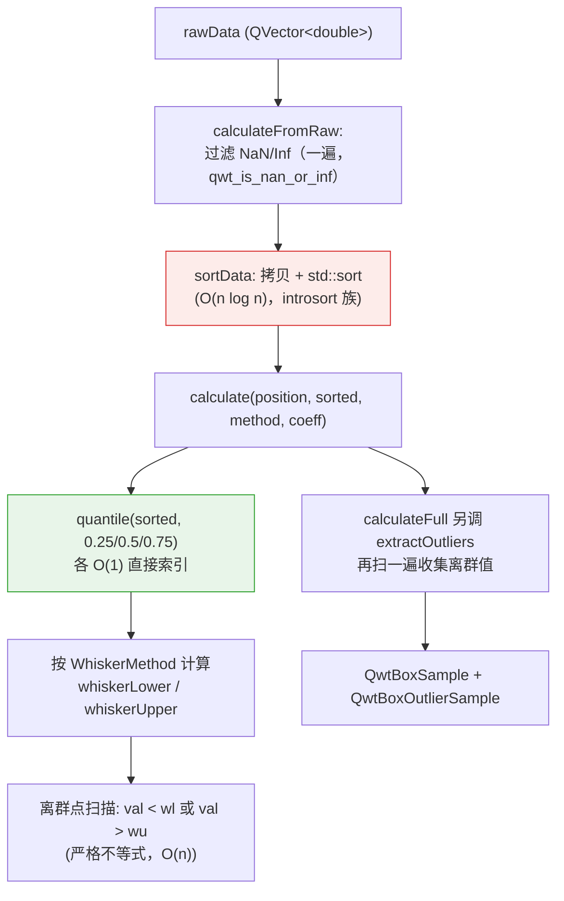

# 箱线图统计量的分位数算法：QwtBoxStatisticsCalculator 的估计器选择与 R 型分位数对比

> **摘要** —— 箱线图把一组数据压缩成五数概括（下须、Q1、中位数、Q3、上须）加一串离群点，但"样本分位数"本身没有唯一定义：同一份排序数据，Hyatt & Sackrow 归纳的九种 R 型定义可以给出九个不同的 Q1/Q3，而 IQR 离群栅栏又直接建立在这两个数上，估计器的选择因此会一路传导到"哪些点被画成离群点"。QWT7 core 模块的 `QwtBoxStatisticsCalculator`（`src/core/qwt_box_statistics.h/.cpp`）被逐行剖析，34,440 个探针分位数与九种 R 型定义逐一数值对照，其 `quantile()` 实现（`index = p·(n−1)` 线性插值）正是 R-7 型，即 R 语言、Excel `PERCENTILE.INC`、NumPy 的默认口径；正态、对数正态、t(3)、双峰四种分布上的实验量化了九种定义间的分位数分歧（n=8 时 Q3 分歧可达 0.51×IQR，随 n 按 ≈n⁻¹ 衰减）、离群点计数的敏感性（对数正态样本上 R-6 比其余八种少数出一个离群点）、1.5×IQR 规则在小样本下的组合边界（R-7 口径 n=4 即可出现离群点、n≤3 恒不可能，并给出证明），以及排序式精确计算相对 P² 流式近似的代价与收益。全部结论均以源码与真实运行输出为准。首发时发现的两个源码级缺陷是 Percentile 须线方法的上下分位数水平互换（当时 C++ 实测 whiskerLower > whiskerUpper、全部 64 点被计为离群点）与 `QwtPlotBoxChart` 的"均值标记"实际画在中位数位置，二者已在 v7.5.1 修复，4.6 节给出修复后的复测数据；同一批修复还移除了 `QwtBoxStatisticsCalculator` 不被任何计算路径消费的实例配置接口。

> **摘要 — 核心结论**
>
> - `QwtBoxStatisticsCalculator::quantile()` 与 R-7 型分位数在 34,440 个探针（n=2…256、含大量 ties、p∈{0.05,…,0.95}）上零失配，最大绝对差 3.55×10⁻¹⁵（浮点舍入级）；其余八种定义的失配数在 19,884–26,322 之间
> - 九种定义间的 Q1/Q3 分歧以样本 IQR 归一后至少按 n⁻¹ 衰减（log-log 拟合指数 1.03–1.43，唯一慢于 n⁻¹ 的是双峰中位数的 0.65）：正态 n=8 时 Q1 平均分歧 0.263×IQR、p95 达 0.783×IQR；n=256 时降到 0.0066×IQR，小样本箱线图的"四分位数"带 0.3 IQR 量级的定义噪声
> - 1.5×IQR 规则能否触发存在精确的组合下界：R-7 口径 n=4 是最小可判样本（反例 [0,0,0,1]，栅栏 0.625），n≤3 恒无离群点（4.4 节给出代数证明）；"n=5 不可能出离群点"的流传说法对 R-7 不成立（[0,1,2,3,100] 判出 100）
> - 离群点计数对估计器不敏感但非免疫：64 点正态+3 注入点（n=67）上九种定义一致判 3；32 点对数正态上 R-6 判 2、其余八种判 3；右偏分布中约 9.4% 的点被 1.5×IQR 规则标为"离群"，这是偏度而非污染
> - C++ 交叉验证 20/20 用例与 Python 复刻逐位一致（最大相对差 0.000e+00）；同批用例复测了 Percentile 须线修复后的行为（`pctl5`：wl=−1.599655 < wu=1.860208、8/64 离群点），并坐实 SE 方法下须线伸进箱体内部（whiskerUpper=99.97 < q3=108.56）

---

## 1. 引言：五数概括与分位数的不唯一性

### 1.1 箱线图消费的五个数

Tukey（1977）提出的箱线图把一组观测 $x_1,\dots,x_n$ 压缩为五数概括加离群点集合：

$$
\left(\; w_{\text{lo}},\; Q_1,\; \tilde{x},\; Q_3,\; w_{\text{hi}} \;\right), \qquad
\mathcal{O} = \left\{ x_i : x_i \notin [\,w_{\text{lo}},\, w_{\text{hi}}\,] \right\}
$$

其中 $Q_1 = \hat{Q}(0.25)$、$\tilde{x} = \hat{Q}(0.5)$、$Q_3 = \hat{Q}(0.75)$ 是样本分位数，Tukey 栅栏规则给出

$$
w_{\text{lo}} = Q_1 - 1.5\,\mathrm{IQR}, \qquad w_{\text{hi}} = Q_3 + 1.5\,\mathrm{IQR}, \qquad \mathrm{IQR} = Q_3 - Q_1
$$

（绘制时须线端点还要与数据极值取夹，见 3.3 节。）这条管线里唯一的"自由度"是 $\hat{Q}(p)$ 的定义。总体分位数 $Q(p) = F^{-1}(p)$ 由分布唯一确定，但它的样本估计 $\hat{Q}(p)$ 不是：$n$ 个排序观测只有 $n$ 个"天然候选位置"，而 $p\in(0,1)$ 是连续的，任何定义都必须在"取哪个秩、要不要插值、插值权重多少"上做出约定。

### 1.2 不唯一性有多大

对排序数据 $x_{(1)} \le \cdots \le x_{(n)}$，最朴素的几种约定已经给出不同答案：$n=8$、数据为 $1,\dots,8$ 时，"Q1 = 下半部分的中位数"给 2.5，"Q1 = 第 $\lceil n/4 \rceil$ 个次序统计量"给 2，"Q1 = 虚拟秩 $(n-1)\cdot 0.25 + 1 = 2.75$ 处线性插值"给 2.75，同一份数据的 Q1 在 2 与 2.75 之间摆动，幅度 0.75，按 R-7 口径的 IQR=3.5 折算即 0.21×IQR。这个差还会被栅栏公式放大：$w_{\text{lo}} = 2.5Q_1 - 1.5Q_3$、$w_{\text{hi}} = 2.5Q_3 - 1.5Q_1$，Q1 的 0.75 偏移把下栅栏推远 1.9，直接决定边缘点是否被画成离群点。

第 2 节把九种标准定义（R-1…R-9）连同各自的统计性质列表给出；第 3 节逐段剖析 QWT 的实现并证明其归属 R-7；第 4 节用可复现实验量化定义选择的实际后果；第 5 节列出失效模式（含两个已在 v7.5.1 修复的源码级缺陷）；第 6 节给出 `QwtPlotBoxChart` 与自定义统计口径的代码实践。

所有实验数字来自 `docs/assets/algorithms/boxstats_experiment.py`（Python 3.11 + numpy + matplotlib，固定种子，不含任何墙钟计时）与 `docs/assets/algorithms/boxstats_check.cpp`（链接真实 `qwtcore.lib` 的 C++ harness）的运行输出；两者互相印证，见 4.6 节。

## 2. 分位数的九种定义（R-1 … R-9）

Hyatt & Sackrow（2003）把 R 语言 `quantile()` 的九种 `type` 参数整理成一张定义表，以下分类沿用该表。约定 $x_{(1)}\le\cdots\le x_{(n)}$ 为次序统计量，$p\in(0,1)$。

### 2.1 离散型：R-1、R-2、R-3

前三种定义只返回观测值本身（R-2 允许相邻两点的平均），不做插值：

$$
\text{R-1:}\quad \hat{Q}(p) = x_{(\lceil np \rceil)}
$$

$$
\text{R-2:}\quad \hat{Q}(p) = \begin{cases} \tfrac{1}{2}\left(x_{(np)} + x_{(np+1)}\right), & np \in \mathbb{Z} \\[2pt] x_{(\lceil np \rceil)}, & \text{otherwise} \end{cases}
$$

$$
\text{R-3:}\quad \hat{Q}(p) = x_{(k)}, \quad k = \operatorname{round\text{-}to\text{-}even}(np)
$$

R-1 是经验分布函数的逆（inverse empirical CDF），满足 $\hat{Q}(p) = \inf\{x : F_n(x) \ge p\}$；R-2 在其间断点处取左右极限的平均；R-3 是 SAS 的默认口径，取最接近 $np$ 的秩、平局取偶数秩。三者都是分布无关的：不假设 $F$ 连续，返回值必是观测值（R-2 除外）。代价是 $\hat{Q}(p)$ 作为 $p$ 的函数是阶梯形：p 微小变化可导致秩跳变，这正是 4.2 节中 ties 数据上九种定义分歧最大的来源。

### 2.2 连续型：R-4 … R-9

后六种定义统一写成"虚拟秩 $h$ + 线性插值"：

$$
\hat{Q}(p) = (1-\gamma)\, x_{(\lfloor h \rfloor)} + \gamma\, x_{(\lfloor h \rfloor + 1)}, \qquad \gamma = h - \lfloor h \rfloor
$$

（$h<1$ 或 $h>n$ 时夹到端点。）区别仅在 $h(p)$：

| 类型 | $h(p)$ | 等价形式（Hyatt–Sackrow 的 $m$） | 常见使用者 |
|------|--------|----------------------------------|------------|
| R-4 | $np$ | $m = 0$ | — |
| R-5 | $np + \tfrac12$ | $m = \tfrac12$ | — |
| R-6 | $(n+1)p$ | $m = p$ | Minitab、SPSS |
| **R-7** | $(n-1)p + 1$ | $m = 1-p$ | **R/NumPy/Excel/Julia 默认** |
| R-8 | $(n+\tfrac13)p + \tfrac13$ | $m = \tfrac{p+1}{3}$ | 推荐（近似中位无偏） |
| R-9 | $(n+\tfrac14)p + \tfrac38$ | $m = \tfrac38 + \tfrac p4$ | 正态分位数近似无偏 |

### 2.3 统计性质对比

无偏性。Hyatt & Sackrow 的模拟研究显示：对正态样本，R-1…R-7 在尾部概率（p 接近 0 或 1）处系统性低估 $|Q(p)|$（负偏），R-8 对任意分布都近似中位无偏，R-9 使 $\mathbb{E}[\hat{Q}(p)] \approx Q(p)$ 对正态分布成立。箱线图只消费 p∈{0.25, 0.5, 0.75}，远离尾部，各定义的偏差差异远小于 4.3 节量化的"分歧带"宽度。

连续性与取值域。R-4…R-9 是 $p$ 的连续函数、可取任意插值值（不必是观测值）；R-1/R-3 只取观测值；R-2 可取相邻观测的平均。对偶数 $n$ 的中位数：R-1/R-3/R-4 取单个中间点（$n=8$ 时均为 $x_{(4)}$），其余六种均取两中间点的平均 4.5（见 4.2 节实测表）："偶数样本中位数取平均"并非普适，取决于定义。

分布无关性。九种定义都不假设 $F$ 的形态（都只依赖次序统计量），但 R-6…R-9 的 $h(p)$ 隐含"次序统计量期望位置"的模型：R-6 对应 $\mathbb{E}[F(x_{(k)})] = k/(n+1)$，R-7 对应 $(k-1)/(n-1)$，R-8/R-9 分别对应使估计近似无偏的修正。选择哪种定义就是选择"经验 CDF 的哪个插值模型"。

## 3. QwtBoxStatisticsCalculator 实现剖析

类在 `src/core/qwt_box_statistics.h/.cpp`（core 模块，`QWTCORE_EXPORT` 导出；`src/plot/qwt_box_statistics.h` 是转发头文件）。它的计算接口全部为静态方法，输入原始数据、输出 `QwtBoxSample`（五数概括 + 离群点计数）与 `QwtBoxOutlierSample`（离群点值列表）；消费方是 `QwtPlotBoxChart`（`src/plot/qwt_plot_boxchart.h/.cpp`）。类中曾另有构造函数与 `setWhiskerMethod()`/`whiskerMethod()`/`setWhiskerCoefficient()`/`whiskerCoefficient()` 四个实例方法，但成员 `m_method`/`m_coefficient` 不被任何静态计算路径消费，属遗留死状态（源码异味）；v7.5.1 起这些实例接口已移除，`WhiskerMethod`/系数一律作为静态方法的显式实参给出。

### 3.1 数据流与排序策略



排序策略是全量 `std::sort`（`qwt_box_statistics.cpp:17-22`），不是 `std::nth_element`。`calculateFromRaw` 共触碰数据四遍：过滤一遍（`filtered.append`）、`sortData` 里再拷贝一遍、排序 $O(n\log n)$、离群点扫描一遍；`calculateFull` 追加 `extractOutliers` 的第五遍。峰值时三份 double 缓冲（raw + filtered + sorted）同时存活，共 $24n$ 字节，其中 $16n$ 字节是本函数新增的。分位数查询本身是 $O(1)$：排序后直接按索引取值，每个 p 至多两次索引（插值邻居），三个 p 合计不超过 6 次。

`calculate()` 的公开签名接受已排序数据（`static QwtBoxSample calculate(double position, const QVector<double>& sortedData, ...)`），这解释了为什么排序与统计分成两个入口：调用方可以对同一份排序数据用不同 `WhiskerMethod`/系数多次调用 `calculate`，只付一次排序代价。代价与替代方案的完整分析见 4.5 节。

### 3.2 quantile()：R-7 的 0-based 写法

核心片段（`qwt_box_statistics.cpp:24-40`，其中 `// 0-based virtual index` 注释为笔者所加）：

```cpp
double QwtBoxStatisticsCalculator::quantile(const QVector< double >& sorted, double p)
{
    if (sorted.isEmpty())
        return 0.0;

    const int n        = sorted.size();
    const double index = p * (n - 1);                 // 0-based virtual index
    const int lower    = static_cast< int >(std::floor(index));
    const int upper    = static_cast< int >(std::ceil(index));

    if (lower == upper)
        return sorted[ lower ];

    // Linear interpolation
    const double frac = index - lower;
    return sorted[ lower ] + frac * (sorted[ upper ] - sorted[ lower ]);
}
```

代数上，0-based 虚拟索引 $\text{index} = p(n-1)$ 与 1-based 虚拟秩 $h = \text{index} + 1 = (n-1)p + 1$ 只差平移；插值权重 $\gamma = \text{index} - \lfloor\text{index}\rfloor = h - \lfloor h \rfloor$；端点 $p=0 \Rightarrow$ index=0 $\Rightarrow x_{(1)}$、$p=1 \Rightarrow$ index=n−1 $\Rightarrow x_{(n)}$ 与 R-7 的夹取一致。该实现逐项等于 R-7 型定义，`median()` 即 `quantile(0.5)`、`iqr()` 即 `quantile(0.75) − quantile(0.25)`，故偶数样本中位数取两中间点平均、四分位数可取非观测值。4.2 节用 34,440 个探针对九种定义做数值对照：R-7 零失配，其余全部大量失配；4.6 节的 C++ harness 又把这个 Python 结论在真实编译产物上得到确认。

一个边界行为要注意：空输入返回 `0.0` 而非 NaN，`calculate()` 对空数据返回全零的 `QwtBoxSample(position)`：空箱子会被画在值 0 处并参与自动缩放（见第 5 节失效清单）。

### 3.3 五种须线方法与离群点规则

`WhiskerMethod` 枚举（`qwt_box_statistics.h:32-48`）决定 $[w_{\text{lo}}, w_{\text{hi}}]$ 的来源，默认 `Tukey`、系数 1.5：

| 方法 | whiskerLower | whiskerUpper | 语义 |
|------|--------------|--------------|------|
| `Tukey` | $\max(x_{(1)},\; Q_1 - c\cdot\mathrm{IQR})$ | $\min(x_{(n)},\; Q_3 + c\cdot\mathrm{IQR})$ | 栅栏与数据极值取夹 |
| `Percentile` | `quantile(c/100)` | `quantile(1 − c/100)` | c 为尾部百分比（如 5 → 第 5/95 百分位）；v7.5.1 起水平顺序正确 |
| `MinMax` | $x_{(1)}$ | $x_{(n)}$ | 无离群点概念 |
| `StandardDeviation` | $\max(x_{(1)}, \bar{x} - c\,s)$ | $\min(x_{(n)}, \bar{x} + c\,s)$ | 均值 ± c×标准差（s 为 ddof=1） |
| `StandardError` | $\max(x_{(1)}, \bar{x} - c\,s/\sqrt{n})$ | $\min(x_{(n)}, \bar{x} + c\,s/\sqrt{n})$ | 均值 ± c×标准误 |

> **修复说明（v7.5.1）— Percentile 方法的上下分位数水平**
>
> 首发版本的源码曾把 `whiskerLower` 赋为 `quantile(1.0 - coefficient/100.0)`（高分位）、`whiskerUpper` 赋为 `quantile(coefficient/100.0)`（低分位）；修正后的分支现位于 `qwt_box_statistics.cpp:131-135`。c=5 时 whiskerLower=q(0.95) > whiskerUpper=q(0.05)，`QwtBoxSample::isValid()` 必为 false；且离群点判据 `val < whiskerLower || val > whiskerUpper` 对每个数据点成立；当时 C++ 实测（4.6 节 `pctl5` 用例，64 点标准正态）：whiskerLower=1.860208、whiskerUpper=−1.599655、outlierCount=64/64。v7.5.1 起两行水平对调（`whiskerLower = quantile(c/100)`、`whiskerUpper = quantile(1−c/100)`），同一用例复测为 whiskerLower=−1.599655 < whiskerUpper=1.860208、outlierCount=8/64；`tests/box_statistics_test` 固化该回归。

Tukey 分支与教科书惯例有一处差异：QWT 的须线端点是栅栏值本身（再被数据极值夹取），而 R/经典 Tukey 惯例把须线画到"栅栏以内最极端的实际数据点"。两者在数据越过栅栏时不相等：4.4 节实测数据集 A 上，QWT whiskerUpper=2.879038 而 R 惯例端点=2.288083，差 0.591；下侧差 1.265。QWT 的离群点计数（严格不等式 `val < wl || val > wu`，`qwt_box_statistics.cpp:171`）与自己的栅栏口径自洽，但箱子的视觉长度系统性长于 R 风格画法，跨库对图时会发现须线对不齐。

`StandardDeviation`/`StandardError` 采用"均值 ± 区间"的误差棒语义，不是经典箱线图口径，只是复用了离群点扫描：落在 mean±c·s 之外的点全部计入 outlierCount。c=1、正态数据时约 32% 的点会被计为"离群点"（C++ 实测 `sd1` 用例：21/64）；SE 方法区间更窄，实测 55/64，且出现 whiskerUpper=99.97 < q3=108.56：须线端点伸进箱体内部，`drawWhiskers` 会把上须画成向下穿过箱体的线段。这两个方法适合做误差棒叠加，不适合当离群点探测器用。

### 3.4 NaN 语义与样本结构

`calculateFromRaw`/`calculateFull` 在排序前过滤 NaN 与 ±Inf（`qwt_is_nan_or_inf`，`qwt_math.h`），离群点扫描也跳过它们，因此统计量对 NaN 输入是干净的。但 `calculate()` 本身不过滤：它假定入参已排序且无 NaN；直接传入含 NaN 的数据会得到 NaN 污染的四分位数（NaN 参与比较与算术的结果），传入未排序数据则语义完全错误（索引即秩的前提被破坏）。

`QwtBoxSample`（`src/core/qwt_samples.h:363-433`）继承 `QwtStatisticalSample`（position/lower/upper/center），自有字段与图形元素的对应关系见下图与表：


| 字段 | 图形元素（`qwt_plot_boxchart.cpp`） | 备注 |
|------|--------------------------------------|------|
| `position` | 箱体中心的分类轴坐标 | 垂直方向时映射到 x |
| `q1` / `q3` | 箱体下/上边缘（`boxInterval()`） | `Rect` 风格为矩形对边 |
| `median` | 箱内横线（`medianPen`，默认宽 2） | 同时写入继承的 `center` 字段 |
| `mean` | 均值标记（`setMeanVisible(true)` + `setMeanSymbol`）；v7.5.1 起画在 `mean` 上 | 默认 NaN，`QwtBoxStatisticsCalculator` 为算出的样本填入；`hasMean()` 判定可用性 |
| `whiskerLower` / `whiskerUpper` | 须线端点 + 横帽 | 帽宽 = 0.3 × 箱宽（`drawWhiskers`） |
| `outlierCount` | 无图形，仅统计 | 绘制用的是 `QwtBoxOutlierSample.values` |
| `QwtBoxOutlierSample.values` | 离群点符号 | 默认 XCross 8×8，可 `setOutlierSymbol` |

箱体宽度由 `boxExtent`（默认 0.6 个分类刻度单位）经 `scaledBoxWidth` 换算成像素并受 `minBoxWidth`(2px)/`maxBoxWidth` 夹取。`Notch` 风格的凹口偏移是 `(q3Pixel − q1Pixel) × 0.1` 的纯视觉量（`qwt_plot_boxchart.cpp:781`），不是 McGill et al.（1978）的统计缺口 $\tilde{x} \pm 1.57\,\mathrm{IQR}/\sqrt{n}$（中位数 95% 置信区间）；两种"notch"同名不同物。`setOutlierJitter` 的水平抖动使用 `QRandomGenerator::global()`，每次重绘位置不同（非确定性渲染）。

## 4. 实验

### 4.1 设计与复现

脚本 `docs/assets/algorithms/boxstats_experiment.py`（固定种子 20251012/424242/777/9999/31337，Agg 后端，全部原始数字打印到 stdout，两次运行逐行一致）。Python 端对 `qwt_box_statistics.cpp` 做了逐表达式复刻（含 `frac * (upper − lower)` 的运算顺序；Percentile 分支按 v7.5.1 修复后的水平顺序），并在 4.6 节用真实 C++ 编译产物验证复刻的正确性。按任务约束，全部实验不含墙钟计时；计算代价一节只做解析计数。

### 4.2 (a) 定义归属的数值证据

对 n=2…39 与 n∈{64,128,256} 各生成 120 组数据（连续、整数舍入产生大量 ties、均匀三种模式），在 p∈{0.25, 0.5, 0.75, 0.05, 0.95, 0.1, 0.9} 共 34,440 个探针上比较 QWT 复刻与 R-1…R-9：

| 定义 | 最大绝对差 | 失配探针数（>10⁻¹²） |
|------|-----------|----------------------|
| R-1 | 4.76956 | 21,717 |
| R-2 | 4.44386 | 19,884 |
| R-3 | 4.76956 | 23,925 |
| R-4 | 4.76956 | 26,322 |
| R-5 | 2.82295 | 22,686 |
| R-6 | 4.44386 | 23,411 |
| **R-7** | **3.55×10⁻¹⁵** | **0** |
| R-8 | 3.07987 | 23,080 |
| R-9 | 2.99941 | 23,007 |

R-7 的残差是双精度舍入级（3.55×10⁻¹⁵ 出现在大量级数据上），其余八种有成千上万个探针失配。配合 3.2 节的代数推导，QWT = R-7 的结论得到双重确认。手算可比对的小样本表（stdout 原样）：

$n=8$，数据 $1,\dots,8$：

| 定义 | Q1 | 中位数 | Q3 |
|------|-----|--------|-----|
| R-1 | 2.0000 | 4.0000 | 6.0000 |
| R-2 | 2.5000 | 4.5000 | 6.5000 |
| R-3 | 2.0000 | 4.0000 | 6.0000 |
| R-4 | 2.0000 | 4.0000 | 6.0000 |
| R-5 | 2.5000 | 4.5000 | 6.5000 |
| R-6 | 2.2500 | 4.5000 | 6.7500 |
| **R-7** | **2.7500** | **4.5000** | **6.2500** |
| R-8 | 2.4167 | 4.5000 | 6.5833 |
| R-9 | 2.4375 | 4.5000 | 6.5625 |
| QWT | 2.7500 | 4.5000 | 6.2500 |

验证 R-7 一列：$h(0.25) = (8-1)\times0.25 + 1 = 2.75$，即 $x_{(2)} + 0.75(x_{(3)}-x_{(2)}) = 2 + 0.75 = 2.75$；QWT 的 0-based 索引 $0.25\times7 = 1.75$，`sorted[1] + 0.75×(sorted[2]−sorted[1])` 同值。中位数一列同时展示了 2.3 节的论断：R-1/R-3/R-4 对偶数 n 取单点 4，其余取平均 4.5。

含 ties 的数据 $[1,1,2,3,5,8,13]$（n=7）上分歧更大：Q1 从 1.0000（R-1/2/3/4/6）到 1.5000（R-7=QWT），Q3 从 5.0000（R-3）到 8.0000（R-1/2/6）；离散型定义在 ties 处的秩跳跃贡献了主要分歧。

### 4.3 (b) 九种定义间的分歧带及其衰减

四种分布（标准正态、lognormal(0,1) 右偏、t(3) 重尾、双峰 $\tfrac12 N(-2,0.5^2)+\tfrac12 N(2,0.5^2)$），n∈{8,16,32,64,256}，每格 1000 次 Monte Carlo；度量 = 九种定义给出的同一统计量的 max−min，除以该样本的 R-7 IQR（自适应数据尺度）。均值/p95（stdout 摘录，完整表见脚本输出）：

| 分布 | n | Q1 分歧 | 中位数分歧 | Q3 分歧 |
|------|---|---------|------------|---------|
| normal | 8 | 0.2629 / 0.7833 | 0.1333 / 0.3204 | 0.2789 / 0.8393 |
| normal | 256 | 0.0066 / 0.0212 | 0.0036 / 0.0109 | 0.0073 / 0.0218 |
| lognormal | 8 | 0.1589 / 0.5236 | 0.1242 / 0.3271 | **0.5138 / 1.5684** |
| t3 | 8 | 0.3185 / 0.9174 | 0.1209 / 0.2980 | 0.3014 / 0.8893 |
| bimodal | 8 | 0.2318 / 1.4687 | 0.1457 / 0.4335 | 0.2918 / 1.7027 |
| bimodal | 256 | 0.0018 / 0.0057 | **0.0146 / 0.0513** | 0.0018 / 0.0056 |


对 log-log 拟合的衰减指数（spread ~ n^−α）：正态 α = 1.063/1.046/1.060（Q1/中位数/Q3），对数正态 1.101/1.050/1.059，t(3) 1.071/1.029/1.077，普遍按 1/n 衰减，与解析预期一致：连续型定义间的虚拟秩差 $|\Delta h|$ 有界（如 R-6 与 R-7 差 $|2p-1|\le 1$，R-8 与 R-7 差 $\le\tfrac13$），而相邻次序统计量的平均间距 $\approx 1/(n f(Q(p)))$，故分歧 $\approx |\Delta h|/(n f)$。正态 n=8 处的量级核对（解析估算）：秩跨度约 0.75、$f(Q_1)=\varphi(0.6745)=0.318$，分歧 ≈ 0.75/(9×0.318) ≈ 0.26σ ≈ 0.2 IQR，与实测均值 0.263 IQR 同量级（离散型的秩跳跃把尾部拉高，故 p95=0.78 远大于均值）。

有两个例外：对数正态的 Q3 分歧是同 n 正态的约 2 倍（n=8：0.514 vs 0.279），因为右偏分布的上四分位处密度更低、次序统计量间距更大；双峰分布的中位数衰减只有 n^−0.652，且 n=256 时中位数分歧（0.0146）仍是 Q1/Q3（0.0018）的 8 倍。中位数落在两峰之间的低密度反模态区，$f(\tilde{x})\approx 0$ 使间距公式的分母失效。因此在双峰数据上比较不同软件画出的箱线图时，中位数的定义差异最持久。

### 4.4 (c) 离群点判定的敏感性

固定数据集上的计数差异。数据集 A：64 点标准正态 + 注入 {6.5, 7.0, −6.0}（n=67）；数据集 B：32 点 lognormal(0,1)。1.5×IQR 栅栏、各定义用自己的 Q1/Q3：

| 定义 | A 计数 | A 栅栏 | B 计数 | B 栅栏上界 |
|------|--------|--------|--------|------------|
| R-1 | 3 | [−3.4602, +2.9186] | 3 | +3.4958 |
| R-2 | 3 | [−3.4602, +2.9186] | 3 | +3.9624 |
| R-3 | 3 | [−3.4462, +2.8952] | 3 | +3.4958 |
| R-4 | 3 | [−3.4756, +2.9166] | 3 | +3.4958 |
| R-5 | 3 | [−3.4335, +2.8988] | 3 | +3.9624 |
| R-6 | 3 | [−3.4602, +2.9186] | **2** | +4.2054 |
| **R-7=QWT** | **3** | [−3.4068, +2.8790] | **3** | +3.7194 |
| R-8 | 3 | [−3.4424, +2.9054] | 3 | +4.0434 |
| R-9 | 3 | [−3.4402, +2.9038] | 3 | +4.0232 |

A 上九种定义全部判出 3 个（注入点距栅栏足够远，定义差异撼不动）；B 上 R-6 判 2、其余判 3，边缘点的归属确实随定义翻转：R-6 的 Q3 更高（+1.8879 vs R-7 的 +1.6974），栅栏更宽。QWT 在 B 上的 whiskerLower=+0.0928 是数据最小值（`max(minVal, fence)` 的夹取生效，未夹取栅栏为 −1.6726）：全正数据下 QWT 的下须不可能产生离群点计数偏差，但须线端点被夹到 minVal 而非栅栏。

数据集 B 本身也说明重尾/偏斜的代价：3/32 = 9.4% 的点被标为离群，而 1.5×IQR 规则的设计基准是正态分布（栅栏位于 ±2.698σ，理论误标率 $2\Phi(-2.698)\approx 0.70\%$，解析值）。对数正态的"离群点"多数是右尾的自然样本。

小样本的组合边界。问："多小的 n 上 1.5×IQR 规则不可能判出任何离群点？"这是组合计数问题，可以精确回答。栅栏上界是次序统计量的固定线性组合 $\text{fence}(x) = 2.5\,q_3(x) - 1.5\,q_1(x)$（系数只依赖 n 与定义），判据 $x_{(n)} > \text{fence}$ 即 $c\cdot x > 0$ 且 $\sum_i c_i = 0$（平移不变）。以非负间隙 $g_j = x_{(j+1)} - x_{(j)}$ 参数化（$x_{(1)}=0$），得 $c\cdot x = \sum_j d_j g_j$，$d_j = \sum_{i>j} c_i$：存在离群点构型当且仅当某个 $d_j > 0$，且见证构型就是"只在第 j 个间隙放 1"。对九种定义解这个 23×9 的小问题（脚本解析计算 + 每格 400–2000 次随机搜索复核，n−1 处不可行性同样双重确认）：

| 定义 | 最小可判 n | 见证数据（排序后） | 见证栅栏上界 |
|------|-----------|--------------------|--------------|
| R-1 | 4 | [0, 0, 0, 1] | 0.0000 |
| R-2 | 5 | [0, 0, 0, 0, 1] | 0.0000 |
| R-3 | 3 | [0, 0, 1] | 0.0000 |
| R-4 | 3 | [0, 0, 1] | 0.6250 |
| R-5 | 5 | [0, 0, 0, 0, 1] | 0.6250 |
| R-6 | 6 | [0, 0, 0, 0, 0, 1] | 0.6250 |
| **R-7（QWT）** | **4** | [0, 0, 0, 1] | 0.6250 |
| R-8 | 5 | [0, 0, 0, 0, 1] | 0.8333 |
| R-9 | 5 | [0, 0, 0, 0, 1] | 0.7812 |


对 QWT 的 R-7 口径，n=3 的不可能性有初等证明：设 $x_1\le x_2\le x_3$，R-7 给 $q_1 = \tfrac{x_1+x_2}{2}$、$q_3 = \tfrac{x_2+x_3}{2}$，于是

$$
\text{fence} - x_3 \;=\; \frac{x_2 + 0.5\,x_3 - 1.5\,x_1}{2} \;\ge\; \frac{x_1 + 0.5\,x_3 - 1.5\,x_1}{2} \;=\; \frac{x_3 - x_1}{4} \;\ge\; 0
$$

（第一步用 $x_2 \ge x_1$。）下侧由九种定义共有的对称性 $Q_{1-p}(-X) = -Q_p(X)$ 同理。而 n=4 立即可判：$[0,1,2,100]$ 在真实 C++ 上给出 Q1=0.75、Q3=26.5、IQR=25.75、栅栏 [0, 65.125]、离群点 {100}（4.6 节 `witness_n4` 用例，Python 复刻逐位一致）。

由此可以澄清一个流传说法："n=5 的箱线图不可能出现离群点"。对 R-7（QWT）这是错的：$[0,1,2,3,100]$ 的 R-7 四分位数恰为整数秩（index=1 与 3），IQR=2、上栅栏 6，100 被干净判出（C++ `witness_n5` 用例实测 outliers=1）。该说法成立的语境是取平均铰链（hinges）的口径（如 R-2 在 n=4、或深度法铰链在 n=4：极端点自身被平均进铰链，把 IQR 撑大，上面的间隙论证给出 R-2 最小可判 n=5）。n=4 的 R-7 反例里，100 以 0.25 的插值权重把自己拉进 Q3（Q3=26.5），栅栏随之暴涨到 65：极值参与四分位数插值是 R-4/R-7 最小可判 n 偏小的机制，也是 R-6…R-9 里虚拟秩越靠外（R-6 的 h=(n+1)p 最大，极端观测以更大的插值权重进入 Q3、抬高栅栏）最小可判 n 越大（R-6 要到 6）的原因。

ties 与 IQR=0。QWT 语义下的实测（stdout C3 节）：$[5,5,5,5,5,5,12]$ 给 Q1=Q3=5、IQR=0、须线塌缩为 [5,5]、离群点 {12}；超过半数相同的值使 IQR 归零，任何不等的值都成为离群点。$[3,3,3,3,3,3,3]$ 则 IQR=0 且无离群点（全等于栅栏，严格不等式不触发）。离散型数据（计数、等级、整数传感器读数）上这是常态而非例外。

### 4.5 (d) 计算代价：排序式精确计算 vs 流式近似

QWT 策略的解析计数（依据 3.1 节源码，无计时）：`calculateFromRaw` = 过滤 $n$ 次判断 + 一次 QVector 拷贝 + `std::sort`（introsort 族，平均 $\approx n\log_2 n$ 次比较，MSVC 实现对小区间切换插入排序）+ 至多 6 次 O(1) 索引 + 栅栏 O(1) + 离群扫描 $n$ 次比较；`calculateFull` 再加一遍 $n$ 的离群值收集。合计 $O(n\log n)$ 时间、峰值新增 $16n$ 字节内存（filtered 与 sorted 两份拷贝与输入同时存活）。

渐近上可以更好：五数概括只依赖 ≤6 个确定秩的次序统计量，用 3–6 次 `std::nth_element`（introselect，平均 O(n)）可把统计部分降到 $O(n)$，离群值收集本来就不需要有序。QWT 不这么做是合理的工程取舍：箱线图每个箱子对应一个分组，n 通常在 5–10⁴ 量级，`std::sort` 的常数极小；排序版数据同时服务 `calculate(sorted)` 的多方法复用入口；且若用户要绘制离群点（`extractOutliers`/`setOutliers`），原始值必须保留，O(n) 内存省不掉。真正需要渐近改进的场景是"每帧对 10⁶ 点重算统计"；那时正确做法是增量维护或流式近似，而不是换 `nth_element`。

流式近似的误差代价：P² 算法（Jain & Chlamtac 1985）用 5 个标记单遍跟踪一个 p 分位数，O(1) 内存。脚本实现了完整 P²（含抛物线/线性双回退），与精确排序值（R-7）对比，5 次独立运行的平均误差（按样本 IQR 归一 / 绝对值）：

| 流 | n | p25 | p50 | p75 |
|----|---|-----|-----|-----|
| normal | 1,000 | 0.00731 / 0.00988 | 0.00643 / 0.00858 | 0.00696 / 0.00937 |
| normal | 10,000 | 0.00115 / 0.00155 | 0.00079 / 0.00105 | 0.00177 / 0.00237 |
| normal | 100,000 | 0.00039 / 0.00052 | 0.00021 / 0.00029 | 0.00035 / 0.00047 |
| lognormal | 1,000 | 0.00315 / 0.00475 | 0.00961 / 0.01423 | **0.01968 / 0.02926** |
| lognormal | 10,000 | 0.00076 / 0.00110 | 0.00173 / 0.00247 | 0.00651 / 0.00938 |
| lognormal | 100,000 | 0.00017 / 0.00025 | 0.00055 / 0.00080 | 0.00156 / 0.00227 |


误差随 n 衰减，10×n 带来数倍精度提升（逐格实测衰减因子 2.9–8.1×，并非恒定 10×），偏斜流上 p75 误差约为正态的 3 倍且随 n 扩大（实测 n=1000/10⁴/10⁵ 分别为 2.8/3.7/4.5×，标记密度跟不上右尾）。n=1000 时 0.003–0.02×IQR 的误差对箱体位置几乎无害（对比 4.3 节：九种精确定义之间的分歧就有 0.16–0.51×IQR，比 P² 的近似误差大一个数量级）。P² 真正丢失的是离群点：它不存观测值，`extractOutliers` 无从谈起，栅栏内计数只能靠另建流式计数器近似。流长 <5 时 P² 无标记可用（脚本回退到精确中位数，实测与 numpy 一致：0.484581）。箱线图场景选"排序 + 精确分位数"是对的：分组 n 小、一次性计算、离群点需要原始值；P² 适合的是无法存储的连续流上的粗粒度监控（参见[实时流式渲染篇](realtime-streaming.md)的窗口化数据讨论）。

### 4.6 (f) C++ 交叉验证

`docs/assets/algorithms/boxstats_check.cpp` 链接真实 Release 构建（`build-release/lib/qwtcore.lib` + Qt 5.15.16），从 stdin 读取 Python 端生成的 20 个用例（`boxstats_cases.txt`：正态 n=5/8/64/256、对数正态、三个小样本见证、ties、常数、单点、双点、空、含 NaN/Inf、Percentile/SD/SE/MinMax 方法），对每个用例调用 `QwtBoxStatisticsCalculator::calculateFull` 并按 %.17g 打印。Python 端用同一复刻重算并比对：20/20 用例通过，最大相对差 0.000e+00（逐位一致），离群点值列表逐项一致。这一步把 4.2 节"Python 复刻 ≡ R-7"的结论传递为"真实 C++ ≡ R-7"，同时下列源码行为全部在真实二进制上复现：

- `witness_n3`：[0,1,2] → 栅栏 [0,2]、outlierCount=0（n≤3 不可判的证明实例）；
- `witness_n4` / `witness_n5`：outlierCount=1（R-7 最小可判 n=4）；
- `with_nan`：[1,2,nan,3,inf,4,5] → 过滤后等价 [1..5]，wl=1/q1=2/med=3/q3=4/wu=5（NaN 过滤正确）；
- `pctl5`：whiskerLower=−1.599655 < whiskerUpper=1.860208、outlierCount=8/64（Percentile 修复后；修复前为 1.860208 > −1.599655、64/64）;
- `se1`：whiskerUpper=99.9653 < q3=108.5597、outlierCount=55/64（SE 须线伸进箱体）;
- `empty`：全零 QwtBoxSample（空数据画在值 0 处）。

编译配方式（MSVC 2019 x64，无计时逻辑）：`cl /O2 /EHsc /std:c++17 /MD`，包含目录 `src`、`src/core` 与 Qt include，链接 `qwtcore.lib Qt5Core.lib Qt5Gui.lib`，运行前 PATH 加入 `build-release/bin` 与 Qt bin。一个移植细节：MSVC 的 `istream >> double` 不认 "nan"/"inf" 字面量，harness 改为读 token 后 `std::strtod` 解析。

## 5. 讨论：失效模式

以下每条都有源码行号或 4.6 节的 C++ 实测背书，按影响排序：

1. **Percentile 须线方法上下界互换（v7.5.1 已修复）**（修复后的分支：`qwt_box_statistics.cpp:131-135`）：首发版本 whiskerLower 取 1−c/100 高分位、whiskerUpper 取 c/100 低分位，在系数 <50 且数据非常数时 `isValid()` 必为 false、outlierCount 等于样本量（当时实测 c=5：64/64；常数数据 wl=wu、计 0；c≥50 时两水平不互换，c=95 行为反而正确）。v7.5.1 起水平对调，`pctl5` 复测 8/64；注意 c 是尾部百分比，所以 >25 时须线进入箱体（c=49 时 wl=q(0.49) > q1 属定义使然，不是缺陷）。
2. **"均值标记"画在中位数位置（v7.5.1 已修复）**（修复后的分支：`qwt_plot_boxchart.cpp:712-719`）：首发版本 `meanVisible && meanSymbol` 分支用 `valueMap.transform(sample.median)` 定位符号，而 `QwtBoxSample` 根本没有 mean 字段：开启"均值标记"得到的是 medians 的重复绘制。v7.5.1 起 `QwtBoxSample` 携带 `mean`（默认 NaN）与 `hasMean()`，统计器为每个算出的样本填入均值，标记画在 `sample.mean` 上、样本无均值时不画；手工组装的样本需自行赋值。
3. **须线端点是栅栏值而非数据点**：与 R/matplotlib/seaborn 的画法系统性不一致（实测上侧差 0.591、下侧差 1.265），跨工具对图必然对不齐；QWT 内部（计数与须线）自洽。
4. **小样本组合边界**：R-7 口径 n=4 起即可判离群点、n≤3 恒不可判；n=4 的反例机制是极值以 0.25 权重参与 Q3 插值（[0,1,2,100] → Q3=26.5）。n<8 的箱线图统计意义薄弱，n≤3 的箱子永远不会显示离群点，用户不应把"无离群点"解读为"数据干净"。
5. **ties / IQR=0**：过半相同值使 IQR=0，须线塌缩，所有不等值全部成为离群点（实测 [5×6,12] 判出 {12}）。离散数据上应改用 Percentile 语义的自定义栅栏（手工计算，见第 6 节）或干脆关闭离群点。
6. **重尾与偏斜**：1.5×IQR 的正态设计误标率 0.70%，对数正态实测 9.4%（3/32）：把偏度当离群。右偏（对数正态）分布上 Q3 的定义分歧又约是正态的 2 倍（4.3 节），双重放大不确定性。
7. **Notch 风格是装饰性的**：凹口 = 箱高的 10%（`qwt_plot_boxchart.cpp:781`），与 McGill et al.（1978）的 $\pm1.57\,\mathrm{IQR}/\sqrt n$ 置信缺口无关，不能用于"两箱缺口不重叠 → 中位数差异显著"的判读。
8. **`calculate()` 不防御脏输入**：含 NaN 或未排序的入参会静默产出错误结果（NaN 传播 / 秩错乱）；只有 `calculateFromRaw`/`calculateFull` 过滤并排序。空输入返回全零样本而非无效标记，空箱会画在值 0 处并影响 `boundingRect` 自动缩放。
9. **离群点抖动的非确定性**：`setOutlierJitter > 0` 时每次重绘用 `QRandomGenerator::global()` 重新抖动，导出图与屏幕图、两次截屏的离群点位置都不一致；需要可复现输出时保持 jitter=0。
10. **SD/SE 方法的语义陷阱**：它们不是箱线图栅栏，c=1 的正态数据上 SD 方法计 21/64、SE 方法计 55/64 个"离群点"，SE 方法还出现 wu < q3（须线穿入箱体）。用作误差棒可以，用作离群探测必错。

## 6. 代码实践

### 6.1 基本用法：从原始数据到箱线图

示例程序 `examples/2D/boxchart`（工具栏可切换 Rect/Diamond/Notch 与横竖方向，Export 导出 PDF）演示了标准流程：


```cpp
#include <qwt_plot.h>
#include <qwt_plot_boxchart.h>
#include <qwt_box_statistics.h>
#include <qwt_symbol.h>

QwtPlot* plot = new QwtPlot;

QwtPlotBoxChart* boxes = new QwtPlotBoxChart("sensor-a");
boxes->attach(plot);                    // attach 时自动从颜色循环取 pen/brush

QVector< double > rawData = /* ... 原始观测 ... */;

// 一次调用得到五数概括 + 离群点值（默认 Tukey 1.5×IQR，R-7 分位数）
QwtBoxSample sample;
QwtBoxOutlierSample outliers;
QwtBoxStatisticsCalculator::calculateFull(1.0, rawData, sample, outliers);

boxes->setSamples(QVector< QwtBoxSample >() << sample);
boxes->setOutliers(QVector< QwtBoxOutlierSample >() << outliers);

// 离群点符号与抖动（jitter>0 时每帧随机，导出前建议设 0，见失效清单第 9 条）
QwtSymbol* sym = new QwtSymbol(QwtSymbol::Ellipse);
sym->setSize(6, 6);
sym->setBrush(Qt::NoBrush);
sym->setPen(QPen(QColor("#d62728"), 1.0));
boxes->setOutlierSymbol(sym);           // item 接管所有权
boxes->setOutlierJitter(0.0);
```

`calculateFull` 的 position 参数是分类轴坐标；多组数据就是多个 `QwtBoxSample`，`setBoxExtent(0.35)` 控制箱宽占分类间距的比例。`extractOutliers(sample, sorted)` 单独暴露，可对同一份排序数据换系数重扫而不重算四分位数。

### 6.2 自定义统计口径：R-8 分位数 + 手工填充

`QwtBoxSample` 是纯数据结构，`QwtPlotBoxChart` 从不重算统计量，这给了用户完全的口径自由。绕开内置 R-7 口径（或需要内置方法未提供的统计量）的做法是自己算好五个数再填充：

```cpp
// R-8 quantile (Hyatt & Sackrow): h = (n + 1/3)*p + 1/3
static double quantileR8(const QVector< double >& sorted, double p)
{
    const int n = sorted.size();
    if (n == 0)
        return 0.0;
    const double h = (n + 1.0 / 3.0) * p + 1.0 / 3.0;   // 1-based virtual rank
    if (h <= 1.0)
        return sorted.first();
    if (h >= n)
        return sorted.last();
    const int j = static_cast< int >(std::floor(h));
    const double g = h - j;
    return (1.0 - g) * sorted[ j - 1 ] + g * sorted[ j ];
}

QVector< double > sorted = rawData;
std::sort(sorted.begin(), sorted.end());                // 自行过滤 NaN/Inf

const double q1 = quantileR8(sorted, 0.25);
const double q3 = quantileR8(sorted, 0.75);
const double iqr = q3 - q1;

// 经典 Tukey 端点约定：须线落在栅栏内的最极端数据点上（与 R 一致）
const double fLo = q1 - 1.5 * iqr, fHi = q3 + 1.5 * iqr;
double wLo = sorted.first(), wHi = sorted.last();
for (double v : sorted) { if (v >= fLo) { wLo = v; break; } }
for (int i = sorted.size() - 1; i >= 0; --i)
    if (sorted[ i ] <= fHi) { wHi = sorted[ i ]; break; }

QwtBoxSample sample(1.0, wLo, q1, quantileR8(sorted, 0.5), q3, wHi);

QVector< double > outlierValues;
for (double v : sorted)
    if (v < fLo || v > fHi)
        outlierValues.append(v);
QwtBoxOutlierSample outlierSample(1.0, std::move(outlierValues));
```

同一模式适用于：自定义水平的分位数栅栏、真均值标记（v7.5.1 起可直接给 `sample.mean` 赋值，此处仍可叠加 `QwtPlotMarker` 自绘）、McGill 统计缺口（自行按 $\tilde{x}\pm1.57\,\mathrm{IQR}/\sqrt n$ 判断显著性，`Notch` 风格只做视觉呈现）。

### 6.3 选型速查

| 场景 | 建议 |
|------|------|
| 一般分组对比（默认） | `calculateFull` + Tukey 1.5，接受 R-7 口径与栅栏端点约定 |
| 与其他统计软件对图 | 手工填充 R 端点约定（6.2），并注明分位数类型 |
| 离散/大量 ties 数据 | 预期 IQR=0 塌缩；改百分位栅栏或关闭离群点 |
| n<8 的小组 | 统计意义弱；n≤3 无离群点是数学必然，不是数据结论 |
| 右偏/重尾数据 | 1.5×IQR 会把偏度当离群；考虑对数轴或改用 SD/SE 误差棒语义 |
| 百万点流式监控 | P² 粗监控可以（误差 ≈0.007×IQR @1000 点），精确箱体仍需排序 |
| Percentile 须线 | 直接用内置方法（v7.5.1 起正确）；c 为尾部百分比，>25 时须线进入箱体 |

## 7. 小结

QWT 的箱线图统计口径是 R-7 分位数、Tukey 1.5×IQR 栅栏、栅栏值端点与严格不等式离群判据，并在入口处过滤 NaN。对 5–10⁴ 量级的分组，"排序 + 精确计算"是正确的取舍；P² 流式近似在 n=1000 时误差为 0.003–0.02×IQR，代价是丢弃离群点身份（4.5 节）。

估计器选择的影响随样本量变化：n≥64 时九种定义的均值分歧落到 0.008–0.055×IQR（正态 0.027、对数正态 Q3 最大 0.055），n=256 时全部 ≤0.015×IQR，口径之争基本无关紧要；n≤16 时定义噪声（n=8 的 Q3 分歧均值 0.28–0.51×IQR、p95 至 1.70×IQR）与抽样噪声同量级，跨软件对图的差异多数是定义而非 bug。离群点计数在注入点远离栅栏时稳健，但边缘点归属会翻转（数据集 B 上 R-6 与其余八种相差一个点），小样本还有硬组合边界（R-7 最小可判 n=4）。分组 n≥8、数据连续且分布近似对称时，默认配置的结论可信；否则应显式声明口径，或按第 6 节手工接管统计量。

两个源码级缺陷（Percentile 互换、mean 标记画在 median）已在 v7.5.1 修复，并由 `tests/box_statistics_test` 与 4.6 节的复测数据验证；其余语义陷阱（栅栏端点约定、SD/SE 语义、Notch 装饰性）在第 5 节列明并给出规避方案。

## 8. 参考文献

1. Hyatt, N., Sackrow, L. *An R Tutorial on Quantiles.* R News, 3(2), 2003.（R-1…R-9 定义表）
2. Tukey, J. W. *Exploratory Data Analysis.* Addison-Wesley, 1977.（箱线图与 1.5×IQR 栅栏）
3. McGill, R., Tukey, J. W., Larsen, W. A. *Variations of Box Plots.* The American Statistician, 32(1), 1978.（notch 置信缺口；QWT 的 Notch 风格与之不同，见失效清单第 7 条）
4. Jain, R., Chlamtac, I. *The P² Algorithm for Dynamic Calculation of Quantiles and Histograms Without Storing Observations.* Communications of the ACM, 28(10), 1985.
5. Frigge, M., Hoaglin, D. C., Iglewicz, B. *Some Implementations of the Boxplot.* The American Statistician, 43(1), 1989.（须线端点约定差异）
6. QWT7 源码：`src/core/qwt_box_statistics.h/.cpp`（统计管线与五种须线方法）、`src/core/qwt_samples.h`（`QwtBoxSample`/`QwtBoxOutlierSample`）、`src/plot/qwt_plot_boxchart.h/.cpp`（绘制、Notch/抖动实现）。
7. QWT7 示例：`examples/2D/boxchart`（手工五数概括 + `calculateFull` 双 item 对比）。
8. 实验脚本：`docs/assets/algorithms/boxstats_experiment.py`、`boxstats_check.cpp`、用例 `boxstats_cases.txt`（确定性种子，可重复运行）。

*配套阅读：* [实时流式渲染：窗口化数据与增量更新](realtime-streaming.md) —— 当箱线图的输入本身是流时，窗口化排序与 P² 近似的取舍；[SIMD argmin/argmax](simd-argminmax.md) —— 同为次序统计量问题，极值可 SIMD 化而中间分位数不行。
