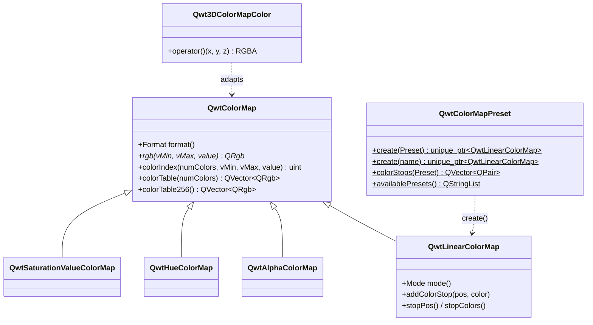
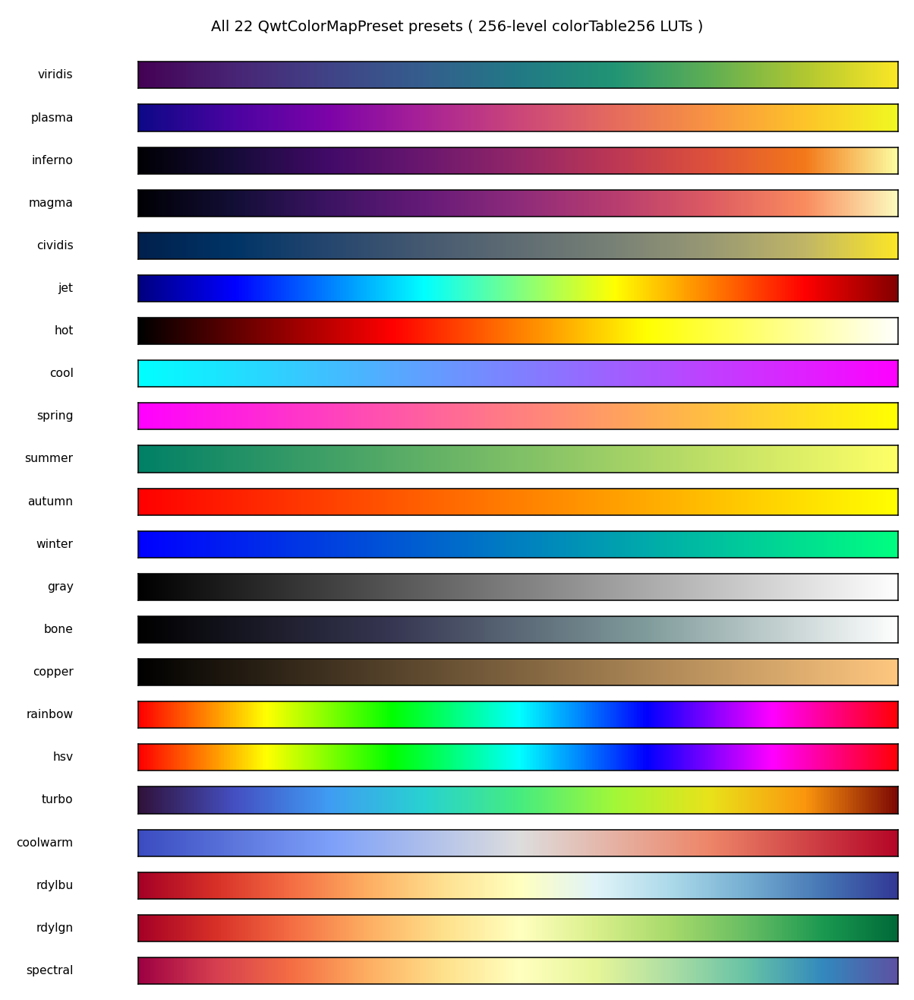
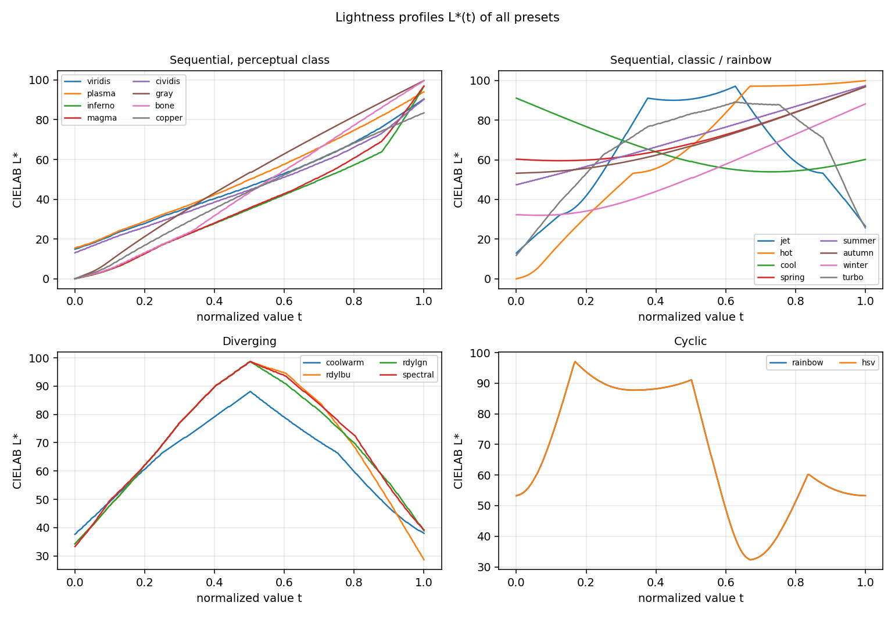
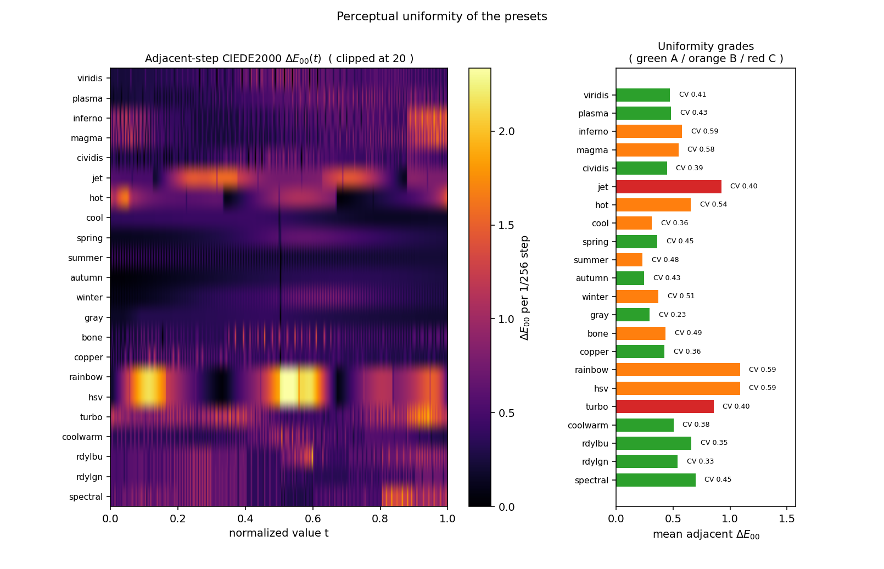
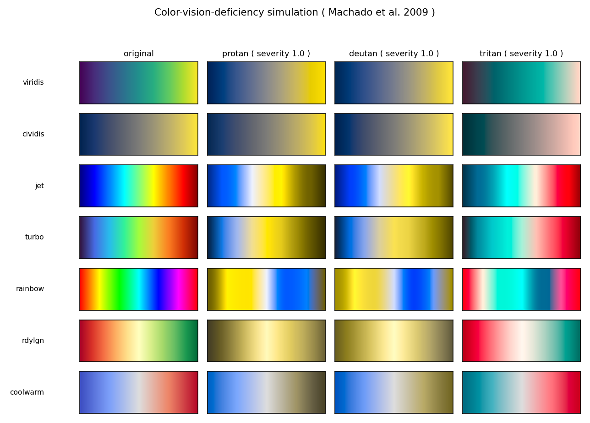
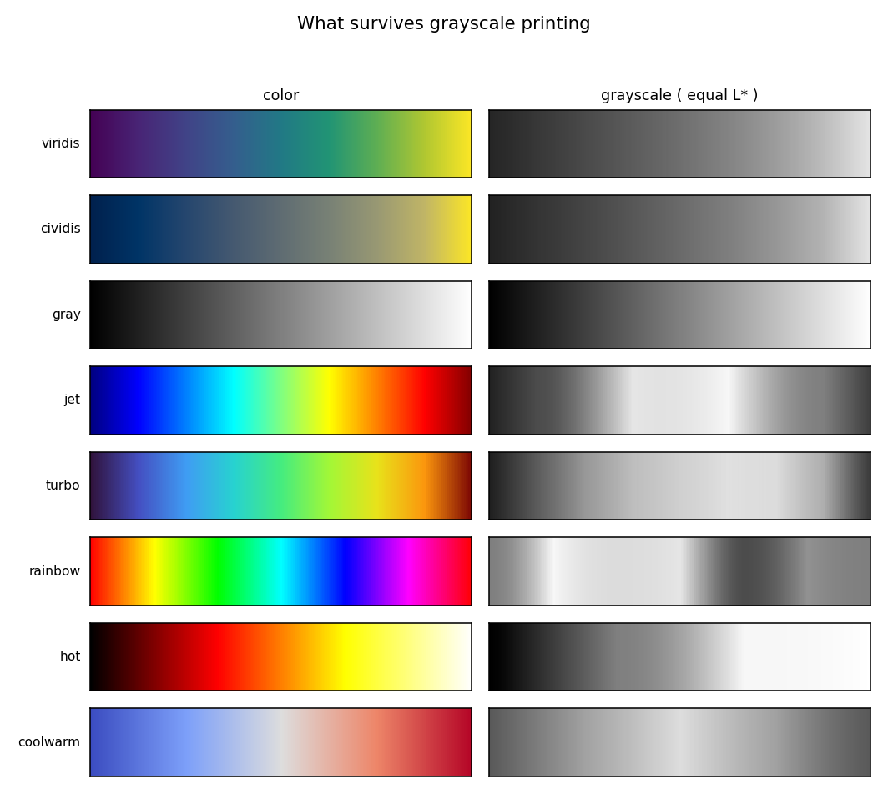
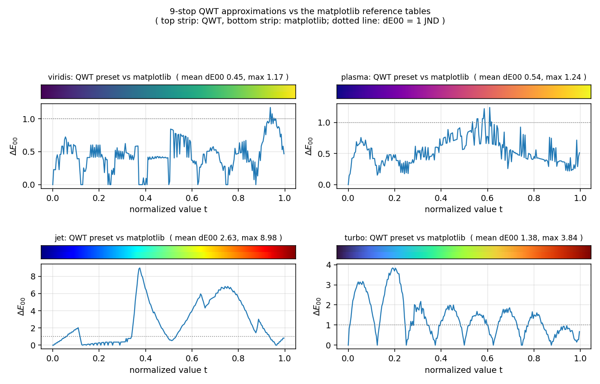

# 科学 Colormap 的色彩科学评估：QwtColorMapPreset 22 种预设的感知均匀性与场景化选择

> **摘要** —— colormap 是从数据值到颜色的映射，它的质量决定读者会不会"看见数据里不存在的结构"：亮度非单调的色带会在平滑场上画出假等值线，步长不均匀的色带会夸大某些数值区间，而红绿色盲观察者眼里整条色带可能塌缩成两三种颜色。本文以 QWT7 的 `QwtColorMapPreset`（`src/core/qwt_colormap_preset.h/.cpp`，22 种预设）为对象，按 `src/core/qwt_colormap.cpp` 的实现逐位复现 `colorTable256()` 构建 256 级 LUT，自行实现 sRGB→线性 RGB→XYZ(D65)→CIELAB 全链条、完整 CIEDE2000 公式（用 Sharma et al. 2005 发表数据自测，22 组最大误差 4.17e-5）与 Machado et al. 2009 色觉缺陷模拟矩阵，从亮度单调性、相邻级步长均匀性、色觉缺陷下的可区分性、灰度打印安全性四个维度给出定量评测；在此基础上给出数据类型 × 观察者 × 输出介质的场景化选择指南，并报告预设数据本身的若干工程事实（首发版本中 `inferno` 的色标取自参考曲线 t∈[0,0.7] 段、`turbo` 近似取自同段，却被摆在位置 [0,0.875] 上，`viridis`/`magma`/`cividis` 的中间色标与 matplotlib 同位置颜色最大偏差 ΔE00 11.4–17.2；v7.5.1 起这五个预设已按 matplotlib 官方表重采样）。

> **摘要 — 核心结论**
>
> - 22 种预设按客观判据分为 16 顺序、4 发散、2 循环；`rainbow` 与 `hsv` 的色标数据在源码中完全相同（`qwt_colormap_preset.cpp:116-128`）
> - 亮度单调性：22 种预设中 18 种在主导方向上违例步为零（其中 10 种累计回退恰为 0）；`jet` 有 77 个违例步、累计回退 71.76 L*、最大回退幅度 70.67 L*（L* 在 t≈0.625 升到 97.14 后跌回 26.47，(26.47, 97.14) 内每个亮度值在升支与降支各出现一次，误差至多一个量化步），`turbo` 为 65.52/65.52，二者评为非均匀
> - 步长均匀性（相邻级 ΔE00 的变异系数 CV）：`gray` 0.228 最优，`rdylgn` 0.326、`rdylbu` 0.354 次之；`inferno`/`magma` 为 0.364/0.361（v7.5.1 修复前 0.587/0.582，修复方式是把色标改按 matplotlib 官方表在全 [0,1] 域重采样），已回落到 matplotlib 自身表的 0.332/0.348 量级，残余差距来自 9 色标线性插值
> - 色觉缺陷（Machado 严重度 1.0，相距 32 级的最小 ΔE00 作为可区分性下界）：`coolwarm` 9.96–10.30、`rdylbu` 8.87–13.24 在三种色觉下全部稳健；`rainbow`/`hsv` 在 deutan 下仅 0.130（t=0.620 与 t=0.745 同色），`rdylgn` 在 deutan 下 0.182，中心两侧对红绿色盲完全不可辨
> - 灰度打印：`coolwarm` 两端 ΔL* 仅 0.36，转灰度后符号信息全部丢失；`rdylbu`/`rdylgn`/`spectral` 两端 ΔL* 为 4.62–5.93 仍可辨；`jet`/`turbo`/`cool` 的 L* 非单调，灰度化必然产生伪等值线

---

## 1. 引言：colormap 为什么需要色彩科学

### 1.1 三种失效模式的形式化

把 colormap 看作函数 $c: [0,1] \to [0,255]^3$（经 256 级 LUT 离散化后为 $c_i,\ i=0..255$），再经显示器的电光转换进入人眼。读者对数据的判断几乎全部依赖三个感知量：明暗（CIELAB $L^*$）、色差（$\Delta E_{00}$）与色相方向。对应的失效模式可以写成三个可测命题：

1. **亮度伪边界**：$\exists\, t_1 < t_2$ 使 $L^*(t_1) > L^*(t_2) + \tau$。人眼对亮度阶跃极其敏感（边缘增强机制），一条 $L^*$ 先升后降的色带会在平滑数据场上画出一条并不存在的亮带——MATLAB `jet` 的青-黄过渡是教科书案例，本文实测其累计回退达 71.76 L*。
2. **步长不均匀**：相邻级色差 $\Delta E_{00}(c_i, c_{i+1})$ 的波动使某些数值区间被视觉夸大、某些被压缩。变异系数 $\mathrm{CV} = \sigma/\mu$ 度量这种不均匀；$\mathrm{CV}$ 越大，"颜色差一格"所代表的数据差越不可信。
3. **不可注入性**：在色觉缺陷模拟或灰度化之后，$\exists\, |t_1 - t_2| \ge \delta$ 使 $\Delta E_{00}(c'(t_1), c'(t_2)) \approx 0$，即两个相距很远的数据值看起来同色。红-绿色盲（protan/deutan，合计约占男性 8%）下红绿对立轴塌缩，是这类失效的主要来源。

这三个命题各对应第 2 节的一个度量：$L^*(t)$ 剖面的单调性统计、相邻级 $\Delta E_{00}$ 的分布、以及模拟视觉下的最小远距色差。

### 1.2 在 LUT 层面评测的理由

QWT 的渲染路径有两条：连续路径逐像素调用 `QwtColorMap::rgb(vMin, vMax, value)`，索引路径调用 `colorIndex()` 查 `colorTable256()` 生成的 256 级表（`QImage::Format_Indexed8`，见第 3.3 节）。本文统一在 256 级 LUT 上评测，理由有二：它是 Indexed 格式渲染（需显式 `setFormat(QwtColorMap::Indexed)`，预设工厂默认 RGB 格式）与颜色条刻度实际使用的离散化，也是 8-bit 索引输出能表达的极限；连续路径的结论可由 LUT 结论内插得到，反之不成立（连续路径可能比 LUT 更平滑，但不会更差）。LUT 的采样网格完全复现 `colorTable256()`：$\text{pos}_i = i/256$，注意它永远取不到 1.0，因此 `viridis` 的 `LUT[255] = (251,231,37)` 而非末色标 `(253,231,37)`——这个 off-by-one 是设计使然（`qwt_colormap.cpp:282-284`），也提醒我们评测网格的选择本身会影响末位数字。

### 1.3 与使用指南的分工

`docs/zh/use-guide/general/colormap.md` 讲 22 种预设的用法、示例界面与避坑清单；本文讲这些结论背后的度量与证据：每一个"推荐"或"不推荐"都对应一张表里的数字。两篇互补阅读。

## 2. 色彩空间与度量

### 2.1 sRGB → 线性 RGB → XYZ → CIELAB

8-bit sRGB 分量先归一化到 $[0,1]$，经 IEC 61966-2-1 的电光传递函数去 gamma：

$$
c_{\text{lin}} = \begin{cases} c / 12.92, & c \le 0.04045 \\ \left( \dfrac{c + 0.055}{1.055} \right)^{2.4}, & c > 0.04045 \end{cases}
$$

线性 RGB 经 sRGB 标准矩阵转到 CIE XYZ（D65 白点）：

$$
\begin{pmatrix} X \\ Y \\ Z \end{pmatrix} =
\begin{pmatrix} 0.4124564 & 0.3575761 & 0.1804375 \\ 0.2126729 & 0.7151522 & 0.0721750 \\ 0.0193339 & 0.1191920 & 0.9503041 \end{pmatrix}
\begin{pmatrix} R_{\text{lin}} \\ G_{\text{lin}} \\ B_{\text{lin}} \end{pmatrix}
$$

再按 CIE 15:2004 定义转到 CIELAB，白点取 D65 的 $(X_n, Y_n, Z_n) = (0.95047,\ 1.00000,\ 1.08883)$：

$$
f(t) = \begin{cases} t^{1/3}, & t > \varepsilon \\ \dfrac{\kappa t + 16}{116}, & t \le \varepsilon \end{cases}, \qquad \varepsilon = \frac{216}{24389},\quad \kappa = \frac{24389}{27}
$$

$$
L^* = 116\, f(Y/Y_n) - 16, \qquad a^* = 500\left( f(X/X_n) - f(Y/Y_n) \right), \qquad b^* = 200\left( f(Y/Y_n) - f(Z/Z_n) \right)
$$

$L^*$ 即感知亮度：灰度打印时纸张上的灰阶就由它决定，因此第 4.6 节直接把 $L^*(t)$ 当作灰度剖面。实现自测（脚本第 1 节输出）：$(255,0,0) \to (53.2408, 80.0925, 67.2032)$，与文献值误差 9.4e-5；中灰 $(128,128,128) \to L^* = 53.585$（解析值：$128/255 \to 0.2159 \to \sqrt[3]{\cdot} = 0.6000 \to 116 \times 0.6 - 16$）；灰阶往返量化偏差为 0。

### 2.2 CIEDE2000

CIE76 的欧氏距离在蓝区与中性区严重失真，本文全部色差使用 CIEDE2000（Sharma, Wu & Dalal 2005 的完整公式，含旋转项 $R_T$）。记两色为 $(L_1, a_1, b_1)$、$(L_2, a_2, b_2)$，$C = \sqrt{a^2+b^2}$，$\bar{C} = (C_1+C_2)/2$：

$$
G = \frac{1}{2}\left( 1 - \sqrt{ \frac{\bar{C}^7}{\bar{C}^7 + 25^7} } \right), \quad a' = a(1+G), \quad C' = \sqrt{a'^2 + b^2}, \quad h' = \operatorname{atan2}(b, a') \bmod 360^\circ
$$

$$
\Delta L' = L_2 - L_1, \qquad \Delta C' = C'_2 - C'_1, \qquad \Delta h' = \begin{cases} 0, & C'_1 C'_2 = 0 \\ h'_2 - h'_1, & |h'_2 - h'_1| \le 180^\circ \\ h'_2 - h'_1 \mp 360^\circ, & \text{否则（取符号使结果落入} \pm 180^\circ) \end{cases}
$$

$$
\Delta H' = 2 \sqrt{C'_1 C'_2}\, \sin\!\left( \frac{\Delta h'}{2} \right)
$$

权重与旋转项（$\bar{L}' = (L_1+L_2)/2$，$\bar{C}' = (C'_1+C'_2)/2$，$\bar{h}'$ 为 $h'_1, h'_2$ 的圆周均值）：

$$
S_L = 1 + \frac{0.015 (\bar{L}' - 50)^2}{\sqrt{20 + (\bar{L}'-50)^2}}, \quad S_C = 1 + 0.045\, \bar{C}', \quad S_H = 1 + 0.015\, \bar{C}'\, T
$$

$$
T = 1 - 0.17 \cos(\bar{h}' - 30^\circ) + 0.24 \cos 2\bar{h}' + 0.32 \cos(3\bar{h}' + 6^\circ) - 0.20 \cos(4\bar{h}' - 63^\circ)
$$

$$
\Delta\theta = 30^\circ \exp\!\left( -\left( \frac{\bar{h}' - 275^\circ}{25^\circ} \right)^2 \right), \quad R_C = 2 \sqrt{ \frac{\bar{C}'^7}{\bar{C}'^7 + 25^7} }, \quad R_T = -\sin(2\,\Delta\theta)\, R_C
$$

$$
\Delta E_{00} = \sqrt{ \left( \frac{\Delta L'}{S_L} \right)^2 + \left( \frac{\Delta C'}{S_C} \right)^2 + \left( \frac{\Delta H'}{S_H} \right)^2 + R_T\, \frac{\Delta C'}{S_C}\, \frac{\Delta H'}{S_H} }
$$

实现用 Sharma et al. 2005 发表数据中的 20 组 Lab 对与 2 组补充对（一组近黑期望值由解析重推导、一组同色平凡对；脚本第 2 节逐组打印）自测：最大绝对误差 4.17e-5，且全部满足 $\Delta E_{00}(a,b) = \Delta E_{00}(b,a)$（对称性精确到 0）。经验尺度：$\Delta E_{00} \approx 1$ 为恰可察觉差（JND），$\Delta E_{00} < 0.5$ 在屏幕上基本不可辨。

### 2.3 色觉缺陷模拟

采用 Machado, Oliveira & Fernandes（2009）的生理模型在严重度 1.0（二色觉，即完全型色盲）下的 3×3 矩阵，作用于线性 RGB 后裁剪回 $[0,1]$ 并重新量化为 8-bit（与真实显示器呈现一致）：

$$
\begin{pmatrix} R' \\ G' \\ B' \end{pmatrix}_{\text{lin}} = M_{\text{CVD}} \begin{pmatrix} R \\ G \\ B \end{pmatrix}_{\text{lin}}, \qquad
M_{\text{protan}} = \begin{pmatrix} 0.152286 & 1.052583 & -0.204868 \\ 0.114503 & 0.786281 & 0.099216 \\ -0.003882 & -0.048116 & 1.051998 \end{pmatrix}
$$

$$
M_{\text{deutan}} = \begin{pmatrix} 0.367322 & 0.860646 & -0.227968 \\ 0.280085 & 0.672501 & 0.047413 \\ -0.011820 & 0.042940 & 0.968881 \end{pmatrix}, \qquad
M_{\text{tritan}} = \begin{pmatrix} 1.255528 & -0.076749 & -0.178779 \\ -0.078411 & 0.930809 & 0.147602 \\ 0.004733 & 0.691367 & 0.303900 \end{pmatrix}
$$

选严重度 1.0 是取最坏情形：异常三色觉（severity < 1）的辨别力介于正常与二色觉之间，1.0 下可辨的颜色在更轻的缺陷下必然可辨，反之不成立。

### 2.4 度量定义与分级规则

对 256 级 LUT 定义以下量（全部在脚本中实现并打印）：

- **亮度剖面统计**：主导方向取 $\operatorname{sign}(L^*_{255} - L^*_0)$；违例数 viol = 逆主导方向且幅度 > 0.5 L* 的相邻步数（0.5 远低于 1 JND，用于吸收 8-bit 量化抖动）；累计回退 reg = 所有逆向步幅度之和（对缓坡漂移也敏感）；最大回退幅度 maxreg = $L^*$ 偏离其单调包络的最大值（递增剖面用运行最大值、递减剖面用运行最小值）。发散型按两臂分别统计（两臂都应单调爬向亮中心），循环型不做单调性要求。
- **步长均匀性**：相邻级 $\Delta E_{00}$ 的均值、最大值、最小值与变异系数 $\mathrm{CV} = \sigma/\mu$；色带总长 path = 相邻级 $\Delta E_{00}$ 之和。
- **可区分性下界** farMin(gap=32)：所有相距 32 级（全量程的 1/8，即第 i 级与第 i+32 级）的色对中最小的 $\Delta E_{00}$。它回答"两个明显不同的数据值在最坏情况下看起来有多像"，比相邻步指标更能暴露色带塌缩。
- **分级**（三档约定，阈值在脚本中显式给出）：A 感知均匀 = reg ≤ 2.0 且 CV ≤ 0.45；B 近似均匀 = reg ≤ 8.0 且 CV ≤ 0.75；C 非均匀 = 其余。循环型只按 CV 分档。阈值是粗粒度约定，CV 在 0.45 边界 ±0.02 内的预设（`spring`、`spectral`，均 0.449）应视为与邻档并列。

## 3. QwtColorMap 的工程实现

### 3.1 类结构



`rgb(double vMin, double vMax, double value)` 是 v7.3.1+ 的统一签名（旧的 `rgb(const QwtInterval&, double)` 已移除），四个子类各自重写它；`QwtColorMapPreset` 只是 `QwtLinearColorMap` 的工厂与查询注册表，不引入新的插值语义。

### 3.2 ColorStops：二分查找与取整技巧

`QwtLinearColorMap` 的插值发生在 **8-bit sRGB 空间**，核心是 `ColorStops::rgb()`（`src/core/qwt_colormap.cpp:190-220`）：

```cpp
// src/core/qwt_colormap.cpp —— ColorStop 构造时预计算（:88-91）
r0 = r + 0.5;  g0 = g + 0.5;  b0 = b + 0.5;   // 把 +0.5 的舍入提前

// 查色时（:201-207），ratio = (pos - s1.pos) / s1.posStep
const int r = int(s1.r0 + ratio * s1.rStep);  // 截断 == 四舍五入
```

三个工程细节藏在这些行里：`int(x + 0.5)` 的截断等价于 round-half-up，把舍入常数折进色标构造使热路径只剩一次乘加；`findUpper()`（`:169-188`）是手写二分，返回第一个位置严格大于 `pos` 的色标，`ScaledColors` 模式在相邻色标间线性插值、`FixedColors` 模式直接返回下界色标（阶梯色带）；`insert()`（`:121-151`）则会把位置差 < 0.001 的色标合并，用户自定义色标过密时会被静默去重。本文脚本的 LUT 构建逐位复现了这套算术（含二分语义与取整），`viridis` 的 `LUT[0]` 精确等于首色标 `(68,1,84)`，可作为复现正确性的锚点。

### 3.3 三套采样网格与 NaN 语义

同一张 colormap 有三种离散化入口，网格互不相同：`colorTable256()` 调 `rgb(0.0, 256.0, i)`，即 $\text{pos} = i/256$（`:278-286`）；`colorTable(n)` 用 $\text{pos} = i/(n-1)$，端点精确命中首末色标（`:295-304`）；连续路径 `rgb(vMin, vMax, value)` 按 $\text{ratio} = (v-v_{\min})/(v_{\max}-v_{\min})$ 取色。索引路径还有配套的 `colorIndex()`：NaN/Inf 映射到索引 0，`value >= vMax` 映射到 `numColors-1`，`FixedColors` 模式下截断不加 0.5（`:473-491`）。连续路径对 NaN/Inf 返回 `0u`（透明黑，`:452-453`）——光谱图上缺失数据因此显示为透明而非某个数据色，这条语义与曲线渲染的 NaN 处理同源（见《NaN 渲染》篇）。本文全部指标基于 `colorTable256()` 网格；换用 `colorTable(256)` 只会让端点色移动约 0.47 ΔE00（实测 `viridis` 末级 `(251,231,37)` 与末色标 `(253,231,37)` 相距 0.468），不改变任何结论的符号。

### 3.4 插值空间：sRGB 还是线性光

在 sRGB 编码空间插值会让中间色偏暗（相对物理线性光而言），这是 gamma 的非线性所致。脚本第 8 节把同一组色标分别在 sRGB 空间与线性光空间插值、量化后逐级比较，量化了这个选择的代价：

| 色标密度 | 代表预设 | sRGB vs 线性光：ΔE00 均值 / 最大 |
|---|---|---|
| 2 个色标 | cool、spring、summer、autumn、winter、gray、copper | 8.1–15.7 / 12.6–28.6 |
| 4–5 个色标 | hot、bone、coolwarm | 2.6–10.4 / 7.4–21.8 |
| 7–9 个色标 | viridis、plasma、inferno、magma、cividis、jet、turbo（均 9 个）、rainbow、hsv（均 7 个） | 0.40–9.39 / 1.10–25.10 |
| 11 个色标 | rdylbu、rdylgn、spectral | 0.64–0.77 / 1.8–2.5 |

从这张表能读出伪差的边界。**色标密度与色相跨度共同界定插值空间的伪差**：11 色标发散族与 9 色标感知均匀族（viridis/plasma/cividis）两种插值的差异 ≤ 2.6 ΔE00，而只有 7 个色标的 rainbow/hsv 达到 25.10——高饱和色相角点之间的插值把空间差异放大了近一个数量级；2 色标映射则一律落在 12.6–28.6，用户自定义双色渐变时插值空间的选择直接决定亮度剖面形状。至于灰阶，QWT 的选择在感知上反而更优：sRGB 空间插值的 `gray` LUT 步长 CV 为 0.228（22 种预设中最低，因为 sRGB 编码本身就是按感知均匀设计的），线性光插值则给出物理均匀但感知前密的亮度 ramp。QWT 与 matplotlib、CSS 渐变一致地选择编码空间插值，在预设色标足够密且色相跨度不大的前提下这一选择几乎不可见。

### 3.5 预设工厂、同名陷阱与 3D 桥接

`QwtColorMapPreset::create()` 用首末色标调 `setColorInterval()`、其余色标逐个 `addColorStop()`（`qwt_colormap_preset.cpp:231-243`）；`presetFromName()` 大小写不敏感，**查不到名字时静默回退到 `Viridis`**（`:374`）——拼错预设名不会报错，只会得到一张 viridis（`qwt_colormap_preset.h:131` 的注释声称"returns -1 if not found"、与实现不符，v7.5.1 已改为如实描述"未知名回退 Viridis"）。源码注释声称色标"sourced from matplotlib colormaps"，但 `rainbowStops()` 与 `hsvStops()` 返回完全相同的 7 个色标（`:116-128`），且 4.7 节的溯源探针显示多个预设的色标并不落在 matplotlib 曲线上。3D 侧通过 `Qwt3DColorMapColor(presetName, size=256)`（`src/plot3d/qwt3d_colormap_color.h`）把 core 的 colormap 适配为 `Qwt3DColor`，2D 与 3D 因此共用同一套预设与同一份评测结论；颜色条由 `QwtScaleWidget` 持有 colormap 实例绘制（`src/plot/qwt_scale_widget.cpp:604-605`）。

## 4. 实验

### 4.1 方法

全部数值来自 `docs/assets/algorithms/colormap_experiment.py` 的一次确定性运行（Python 3.11 + numpy + matplotlib，无随机数；色彩变换全部自实现，matplotlib 仅用于采样其内置色表作对照），原始 stdout 存为 `colormap_results.txt`。脚本**直接从 `src/core/qwt_colormap_preset.cpp` 解析色标**（v7.5.1 起，不再手工转写，镜像不会漂移），先跑两组自测（2.1 节的 Lab 锚点、2.2 节的 CIEDE2000 数据集），再对 22 个预设依次计算分类、亮度剖面、步长统计、三种色觉模拟、灰度剖面与 matplotlib 对照，所有原始数字打印到 stdout，六张插图由同一脚本以 Agg 后端生成。色标本身由 `colormap_stops_gen.py` 从 matplotlib 官方表生成，可用它核对源码中的每一行。下文每个数字都可在该次运行的 stdout 中逐字找到。

### 4.2 客观分类

分类不依赖命名或来源，只依赖色标与 LUT 数据：首末色标 $\Delta E_{00} < 1$ 判为循环；$L^*$ 最大值位于 $t \in [0.45, 0.55]$、中心亮度高出两端 15 L* 以上且两端亮度相近（$|L^*_0 - L^*_{255}|$ 不超过中心超出量的 15%）判为发散（亮中性中心是发散色带的定义特征，两端相近则两臂近似镜像）；其余为顺序。`jet` 的 $L^*$ 峰值在 t≈0.627（黄色段；此为 LUT argmax 口径，黄色色标的名义位置是 0.625，摘要沿用后者，两口径相差不足一级）而非中心，被归入顺序；`turbo` 的 $L^*$ 峰值落在中心附近（t≈0.502），但其两端亮度 11.80/25.19 相差 13.39 L*、超过中心超出量 65.52 的 15%，未通过"两端相近"判据；两者都归入顺序——它们的亮度剖面是"爬升-崩塌"型，与发散型的"对称双臂"型在数据上可区分。



#### 表 1：客观分类结果（色标数据 + LUT）

| 预设 | 类别 | 首末 ΔE00 | t(L*max) | max C* | 色相扫过(°) | 标志 |
|---|---|---:|---:|---:|---:|---|
| viridis | 顺序 | 100.32 | 1.000 | 85.82 | 224.1 | 色相扫过 |
| plasma | 顺序 | 109.30 | 1.000 | 91.20 | 159.2 | - |
| inferno | 顺序 | 100.82 | 1.000 | 80.91 | 170.4 | - |
| magma | 顺序 | 99.82 | 1.000 | 65.48 | 170.8 | - |
| cividis | 顺序 | 93.16 | 1.000 | 80.95 | 239.3 | 色相扫过 |
| jet | 顺序 | 41.51 | 0.627 | 133.81 | 267.7 | 色相扫过 |
| hot | 顺序 | 100.00 | 1.000 | 104.46 | 89.6 | - |
| cool | 顺序 | 57.98 | 0.000 | 115.49 | 131.7 | - |
| spring | 顺序 | 92.81 | 1.000 | 115.54 | 134.4 | - |
| summer | 顺序 | 47.38 | 1.000 | 73.26 | 66.2 | - |
| autumn | 顺序 | 64.30 | 1.000 | 104.55 | 62.6 | - |
| winter | 顺序 | 77.87 | 1.000 | 133.81 | 157.4 | - |
| gray | 顺序 | 100.00 | 1.000 | 0.00 | 0.0 | 无彩色 |
| bone | 顺序 | 100.00 | 1.000 | 18.66 | 8.3 | - |
| copper | 顺序 | 79.00 | 1.000 | 44.64 | 86.0 | - |
| rainbow | 循环 | 0.00 | 0.169 | 133.79 | 359.4 | - |
| hsv | 循环 | 0.00 | 0.169 | 133.79 | 359.4 | - |
| turbo | 顺序 | 30.79 | 0.502 | 94.02 | 282.0 | 色相扫过 |
| coolwarm | 发散 | 40.13 | 0.502 | 70.59 | 191.6 | - |
| rdylbu | 发散 | 37.21 | 0.502 | 77.78 | 281.7 | 色相扫过 |
| rdylgn | 发散 | 63.67 | 0.502 | 77.78 | 129.0 | - |
| spectral | 发散 | 28.86 | 0.502 | 68.77 | 293.6 | 色相扫过 |

色相扫过角只在 C* ≥ 15 的色度有效区段累计（近中性色的色相角是数值噪声）；`gray` 全带 C* = 0，`bone` 的 C* 峰值仅 18.66，二者的"色相"信息可以忽略。

### 4.3 亮度剖面与单调性



#### 表 2：亮度单调性与步长均匀性（256 级 LUT，正常色觉）

| 预设 | L*₀ | L*₂₅₅ | viol | reg | maxreg | ΔE 均值 | ΔE 最大 | CV | path | 分级 |
|---|---:|---:|---:|---:|---:|---:|---:|---:|---:|---|
| viridis | 14.90 | 90.69 | 0 | 0.02 | 0.02 | 0.482 | 0.948 | 0.294 | 122.98 | A |
| plasma | 15.53 | 93.95 | 0 | 0.00 | 0.00 | 0.482 | 0.970 | 0.427 | 122.92 | A |
| inferno | 0.08 | 97.44 | 0 | 0.00 | 0.00 | 0.590 | 1.596 | 0.364 | 150.43 | A |
| magma | 0.08 | 97.38 | 0 | 0.00 | 0.00 | 0.551 | 1.363 | 0.361 | 140.59 | A |
| cividis | 13.79 | 90.93 | 0 | 0.00 | 0.00 | 0.457 | 1.234 | 0.401 | 116.47 | A |
| jet | 12.97 | 26.47 | 77 | 71.76 | 70.67 | 0.922 | 1.557 | 0.401 | 235.21 | C |
| hot | 0.00 | 99.93 | 0 | 0.00 | 0.00 | 0.656 | 1.610 | 0.535 | 167.24 | B |
| cool | 91.11 | 60.17 | 0 | 6.31 | 6.24 | 0.312 | 0.431 | 0.362 | 79.49 | B |
| spring | 60.32 | 96.88 | 0 | 0.79 | 0.77 | 0.363 | 0.644 | 0.449 | 92.44 | A |
| summer | 47.49 | 97.45 | 0 | 0.00 | 0.00 | 0.232 | 0.461 | 0.476 | 59.19 | B |
| autumn | 53.24 | 96.88 | 0 | 0.00 | 0.00 | 0.245 | 0.358 | 0.432 | 62.44 | A |
| winter | 32.30 | 88.18 | 0 | 1.10 | 0.35 | 0.371 | 0.823 | 0.506 | 94.69 | B |
| gray | 0.00 | 99.65 | 0 | 0.00 | 0.00 | 0.294 | 0.398 | 0.228 | 74.96 | A |
| bone | 0.00 | 99.65 | 0 | 0.00 | 0.00 | 0.434 | 1.397 | 0.487 | 110.76 | B |
| copper | 0.00 | 83.44 | 0 | 0.00 | 0.00 | 0.423 | 1.047 | 0.362 | 107.82 | A |
| rainbow | 53.24 | 53.26 | 39 | 75.03 | 64.75 | 1.087 | 2.335 | 0.594 | 277.06 | B |
| hsv | 53.24 | 53.26 | 39 | 75.03 | 64.75 | 1.087 | 2.335 | 0.594 | 277.06 | B |
| turbo | 11.80 | 25.19 | 74 | 65.52 | 65.52 | 0.868 | 1.833 | 0.359 | 221.24 | C |
| coolwarm | 37.67 | 38.03 | 0 | 0.40 | 0.40 | 0.503 | 1.536 | 0.380 | 128.17 | A |
| rdylbu | 34.28 | 28.66 | 0 | 0.29 | 0.29 | 0.660 | 1.954 | 0.354 | 168.33 | A |
| rdylgn | 34.28 | 38.90 | 0 | 0.29 | 0.29 | 0.539 | 1.112 | 0.326 | 137.41 | A |
| spectral | 33.32 | 39.25 | 0 | 0.29 | 0.29 | 0.696 | 1.786 | 0.449 | 177.51 | A |

`jet` 的亮度剖面是全部预设中最危险的：L* 从 12.97 爬到 97.14（t≈0.625 的黄段）再跌回 26.47，77 个逆方向步、累计回退 71.76 L*——升支覆盖 [12.97, 97.14]、降支覆盖 [26.47, 97.14]，因此 (26.47, 97.14) 内的每个亮度值在两支上各出现至少一次（误差至多一个量化步），灰度或低对比显示上两个相距半个量程以上的数据值可以同灰；`turbo` 同型但幅度略小（65.52/65.52）。容易被忽略的是 `cool`：整体递减（91.11→60.17）看似单调，实则中段下探到 53.94 后回升 6.24 L*，形成一个 V 形凹陷，per-step 容差看不出来、累计回退指标可以。四个发散预设的两臂单调性则都很好（reg ≤ 0.40），它们的亮度信息集中在"中心亮、两臂暗"的结构里，这与顺序色带的判读方式不同，混用会产生系统误读。

### 4.4 步长均匀性



热力图把每条色带展开成 255 个相邻步的 ΔE00 序列：`rainbow`/`hsv` 在纯色相角点附近出现 ΔE00 > 2 的亮块（sRGB 立方体角点之间的感知距离远大于边中点之间），`jet` 在青-黄段同样偏亮；感知均匀族（viridis/plasma/cividis）与发散族则整体平坦。CV 的排序给出另一个视角：`gray` 0.228 最低，因为 sRGB 编码空间插值天然接近感知均匀；`inferno`/`magma` 的 0.364/0.361 与 matplotlib 自身 256 级表的同口径 CV（`inferno` 0.332、`magma` 0.348、`viridis` 0.278、`plasma` 0.417）只在 +0.032/+0.013 的残余差距内，`viridis` 0.294 对 mpl 0.278 差 +0.016——残余来自 9 色标线性插值本身。修复前这三个预设有 0.136–0.255 的 CV 增幅，根因是色标位置压缩/偏离参考曲线（4.7 节），v7.5.1 已按 matplotlib 官方表重采样色标。相邻步 ΔE00 最小值为 0.000 的预设（viridis、cividis、summer、autumn、gray、bone、copper）存在完全重复的 LUT 条目，重复条目多位于色带中段：gray/summer/autumn/copper 的重复出现在 level 128（L* 44–72），是 256 个条目覆盖 255 个输出级的取整鸽笼伪差；viridis/cividis 的重复出现在 level 133–154 / 72（L* 56–62 / 36，均在色带中段）；只有 bone（level 39，L* 9.3）落在暗端。这属量化冗余而非缺陷，它意味着这些色带改用 256 级量化输出几乎不损失可见细节——口径注：示例界面的 Color Table = 256 走 `colorTable(256)`（采样网格 pos = i/255），与本文所用 `colorTable256()` 的 pos = i/256 不是同一张网格，但结论相同。

### 4.5 色觉缺陷下的可区分性



#### 表 3：相距 32 级的最小 ΔE00（farMin，可区分性下界）

| 预设 | 原始 | protan | deutan | tritan |
|---|---:|---:|---:|---:|
| viridis | 10.698 | 4.408 | 6.768 | 6.656 |
| plasma | 7.373 | 3.641 | 6.828 | 7.728 |
| inferno | 10.640 | 5.672 | 8.743 | 9.889 |
| magma | 10.043 | 6.077 | 8.744 | 9.337 |
| cividis | 7.004 | 6.844 | 6.957 | 5.849 |
| jet | 13.147 | 5.001 | 4.579 | 5.381 |
| hot | 4.215 | 2.787 | 3.914 | 1.207 |
| cool | 4.767 | 0.000 | 0.333 | 4.233 |
| spring | 4.404 | 3.133 | 4.844 | 2.513 |
| summer | 5.666 | 3.892 | 4.555 | 4.683 |
| autumn | 1.601 | 1.591 | 0.783 | 2.530 |
| winter | 2.423 | 1.473 | 1.857 | 1.683 |
| gray | 6.748 | 6.748 | 6.748 | 6.748 |
| bone | 7.648 | 7.566 | 7.373 | 5.012 |
| copper | 6.731 | 6.496 | 6.620 | 5.416 |
| rainbow | 6.529 | 0.297 | 0.130 | 1.198 |
| hsv | 6.529 | 0.297 | 0.130 | 1.198 |
| turbo | 14.979 | 3.931 | 2.268 | 6.136 |
| coolwarm | 10.250 | 10.008 | 9.961 | 10.301 |
| rdylbu | 12.487 | 9.632 | 8.866 | 13.237 |
| rdylgn | 8.292 | 1.332 | 0.182 | 10.617 |
| spectral | 6.636 | 1.767 | 0.368 | 6.231 |

原始视觉下 farMin 最低的是 `autumn`（1.601）：红-黄色带的总色程只有 62.44 ΔE00（表 2 的 path），相距 1/8 量程的两点本就只隔约 1.6 JND，这是色域选择而非缺陷。色觉模拟后的塌缩才是重点，deutan 列的最坏情形（脚本逐条打印）：

| 预设 | deutan farMin | 同色的两个位置 |
|---|---:|---|
| rainbow / hsv | 0.130 | t = 0.620 与 t = 0.745（蓝-青段与蓝-品红段） |
| rdylgn | 0.182 | t = 0.439 与 t = 0.565（中心黄两侧的红臂与绿臂） |
| cool | 0.333 | t = 0.616 与 t = 0.741 |
| spectral | 0.368 | t = 0.451 与 t = 0.576 |
| autumn | 0.783 | t = 0.024 与 t = 0.149 |
| winter | 1.857 | t = 0.004 与 t = 0.129 |
| turbo | 2.268 | t = 0.482 与 t = 0.608 |

`rdylgn` 与 `spectral` 的失效模式最具误导性：它们在正常色觉下是 A 级均匀色带，但红臂与绿臂在 deutan/protan 下塌缩成同一片橄榄色（`rdylgn` 见上图第 6 行；`spectral` 未入图，机理相同），中心两侧的符号信息对红绿色盲完全丢失。`cool` 在 protan 下 farMin = 0.000：相距 32 级的两个色级在模拟并量化到 8-bit 后严格同色，色带在 protan 视角下产生完全碰撞——青→品红的路径本靠红-绿对立轴承载区分度，失去该轴后模拟色带折返，注入性不再成立。相对地，`coolwarm`（蓝-白-红）与 `rdylbu`（红-黄-蓝）在三种色觉下 farMin 均 ≥ 8.87，因为蓝-红对立轴在 protan/deutan 下保持分离；`cividis` 作为专为色觉缺陷优化的预设，三种色觉下 farMin 稳定在 5.85–6.96，没有短板。

### 4.6 灰度打印安全性



#### 表 4：灰度剖面（L* 即灰阶）

| 预设 | min \|ΔL*\| | reg | 两端 ΔL* | 灰度单调 |
|---|---:|---:|---:|---|
| viridis | 0.0000 | 0.02 | 75.78 | 是 |
| plasma | 0.0694 | 0.00 | 78.42 | 是 |
| inferno | 0.0979 | 0.00 | 97.36 | 是 |
| magma | 0.0791 | 0.00 | 97.30 | 是 |
| cividis | 0.0000 | 0.00 | 77.14 | 是 |
| jet | 0.0023 | 71.76 | 13.50 | 否 |
| hot | 0.0027 | 0.00 | 99.93 | 是 |
| cool | 0.0008 | 6.31 | 30.94 | 否 |
| spring | 0.0008 | 0.79 | 36.56 | 是 |
| summer | 0.0000 | 0.00 | 49.96 | 是 |
| autumn | 0.0000 | 0.00 | 43.64 | 是 |
| winter | 0.0024 | 1.10 | 55.88 | 是 |
| gray | 0.0000 | 0.00 | 99.65 | 是 |
| bone | 0.0000 | 0.00 | 99.65 | 是 |
| copper | 0.0000 | 0.00 | 83.44 | 是 |
| rainbow | 0.0011 | 75.03 | 0.01 | n/a |
| hsv | 0.0011 | 75.03 | 0.01 | n/a |
| turbo | 0.0047 | 65.52 | 13.39 | 否 |
| coolwarm | 0.0723 | 0.40 | 0.36 | 是 |
| rdylbu | 0.0025 | 0.29 | 5.61 | 是 |
| rdylgn | 0.0980 | 0.29 | 4.62 | 是 |
| spectral | 0.0869 | 0.29 | 5.93 | 是 |

灰度化保留的信息只有 $L^*(t)$。顺序预设中 16 种里有 13 种灰度单调，可直接用于黑白打印；`jet`、`turbo`、`cool` 三种灰度非单调，打印后黄段亮带与两端暗区会制造伪等值线（`jet`/`turbo` 见上图第 4、5 行；`cool` 未入图）。发散预设的两臂各自单调，但符号信息能否存活取决于两端 ΔL*：`coolwarm` 两端只差 0.36 L*，灰度图上正负臂完全同灰，符号只能靠图例文字补救；`rdylbu`/`rdylgn`/`spectral` 两端差 4.6–5.9 L*，灰度下仍可辨方向。循环预设在灰度下退化为来回振荡的灰阶（两端 ΔL* = 0.01），周期信息全部丢失——循环数据本来就不该用亮度承载。

### 4.7 与 matplotlib 参考表的对照



#### 表 5：QWT LUT vs matplotlib 256 级表（同网格 pos = i/256）

| 预设 | 均值 ΔE00 | 最大 ΔE00 | 色标均值 | 色标最大 |
|---|---:|---:|---:|---:|
| viridis | 0.445 | 1.171 | 0.000 | 0.000 |
| plasma | 0.537 | 1.242 | 0.383 | 0.747 |
| inferno | 1.003 | 3.875 | 0.000 | 0.000 |
| magma | 0.738 | 2.446 | 0.000 | 0.000 |
| cividis | 0.611 | 2.234 | 0.000 | 0.000 |
| jet | 2.634 | 8.978 | 2.613 | 8.978 |
| hot | 5.146 | 16.270 | 6.118 | 15.916 |
| cool | 0.106 | 0.388 | 0.000 | 0.000 |
| spring | 0.228 | 0.644 | 0.000 | 0.000 |
| summer | 0.118 | 0.392 | 0.000 | 0.000 |
| autumn | 0.162 | 0.358 | 0.000 | 0.000 |
| winter | 0.243 | 0.823 | 0.000 | 0.000 |
| gray | 0.133 | 0.378 | 0.000 | 0.000 |
| bone | 4.932 | 8.751 | 3.457 | 7.178 |
| copper | 7.918 | 12.509 | 0.000 | 0.000 |
| rainbow | 48.443 | 90.742 | 45.512 | 89.898 |
| hsv | 1.630 | 4.393 | 1.683 | 3.097 |
| turbo | 1.380 | 3.838 | 0.000 | 0.000 |
| coolwarm | 4.537 | 8.239 | 1.981 | 4.724 |
| rdylbu | 0.403 | 1.471 | 0.169 | 0.460 |
| rdylgn | 0.292 | 0.749 | 0.147 | 0.369 |
| spectral | 0.402 | 1.322 | 0.146 | 0.395 |

"同名"不等于"同色"。溯源探针（脚本 7 节，对每个色标在 matplotlib 曲线上做 4096 点最近匹配）给出三类情形。第一类，色标精确落在参考曲线上：`plasma` 全部 9 个色标 dE = 0.000 且最近位置 ≈ 标称位置，`cool`/`spring`/`summer`/`autumn`/`winter`/`gray` 的首末色标精确、中间无或仅线性段，整带偏差 ≤ 0.83（`copper` 首末色标同样精确，但 mpl 版是非线性 ramp，整带均值偏差达 7.92，归入 5.2 节第 8 条）。第二类（v7.5.1 起已消除），**色标颜色取自参考曲线但位置被压缩**：修复前 `inferno` 的 9 个色标在 mpl 曲线上最近位置为 t = 0, 0.0977, 0.1993, 0.2969, 0.3985, 0.5001, 0.5978, 0.6994, 0.9963（每个 dE = 0.000），即 mpl 曲线 t∈[0,0.7] 的颜色被摆到了位置 [0,0.875] 上，末段再从 t=0.7 直跳 t=1.0——整带因此均值偏差 13.52、最大 28.31；`turbo` 近似同型（色标到曲线的最近距离 0.70–2.27 ΔE00，最近位置 0, 0.086, 0.203, 0.289, 0.391, 0.500, 0.598, 0.711, 0.996）。重采样后这五个预设在 256 级网格上的整带均值偏差为 viridis 0.445 / inferno 1.003 / magma 0.738 / cividis 0.611 / turbo 1.380 ΔE00，色标本身的同位置偏差全部为 0.000。第三类（v7.5.1 起同样消除），色标本身偏离参考曲线（以下 dE 均为到 mpl 曲线的最近距离，同位置差异另见表 5 的"色标最大"列）：`viridis` 前三个色标在曲线上、其后逐渐漂移（t=0.5 的色标最近匹配在 0.422，dE 2.62；t=0.75 的色标 dE 6.52），`cividis` 全带偏离 0.77–5.82，`magma` 偏离 ≤ 2.31 且位置压缩。`rainbow` 则是另一张地图：QWT 的 rainbow 是首尾同红的闭合色相环（OpenCV 式），matplotlib 的 rainbow 是紫起红止的非闭合 ramp，均值偏差 48.44 属于定义差异而非近似误差。

> **修复说明（v7.5.1）— 色标已按 matplotlib 官方表重采样**
>
> 首发版本的部分色标是手工近似的：`inferno`/`magma`/`turbo` 的 9 个色标颜色精确/近似取自 mpl 曲线，但被摆在 0–1 全区间上（位置压缩）；`viridis`/`cividis` 的中间色标与 mpl 同位置偏差最大 11.4–17.2 ΔE00。v7.5.1 起这五个预设的色标直接取自 matplotlib 官方 256 级表在相同位置上的采样（生成脚本 `colormap_stops_gen.py`，可复跑核对），色标同位置偏差全部归零、整带均值偏差降到 0.445–1.380 ΔE00（残余为 9 色标线性插值误差），`inferno`/`magma` 的分级由 B 升到 A。其余预设未动：`jet`/`hot`/`bone`/`copper`/`coolwarm` 仍是少色标近似（5.2 节第 7 条），`rainbow` 是 QWT 自己的闭合色相环、与 mpl 同名表本就不同定义。

## 5. 讨论

### 5.1 场景化选择指南

下表每一行的推荐都直接引用前文的实测数字，而非印象。

#### 表 6：数据类型 × 观察者 × 输出 → 推荐预设

| 场景 | 推荐 | 定量依据 |
|---|---|---|
| 顺序数据，正常色觉，屏幕 | `viridis`（或 `plasma`） | A 级；原始 farMin 10.70；CV 0.294 |
| 顺序数据，红绿色盲读者，屏幕 | `cividis` | deutan farMin 6.96、protan 6.84、tritan 5.85，三种色觉无短板；A 级 |
| 顺序数据，暗色背景 | `inferno` / `magma` | L*₀ = 0.08，低值融入背景；CV 0.36，与 mpl 表相差 ≤ 0.03 |
| 顺序数据，灰度/黑白打印 | `gray`（或 `viridis`/`cividis`） | 灰度单调且两端 ΔL* 75.8–99.7；`jet`/`turbo`/`cool` 灰度非单调，禁用 |
| 发散数据（含符号），正常色觉，屏幕 | `coolwarm` | A 级；两臂单调 reg 0.40；三种色觉 farMin ≥ 9.96 |
| 发散数据，红绿色盲读者 | `coolwarm` 或 `rdylbu` | deutan farMin 9.96 / 8.87；`rdylgn`/`spectral` 在 deutan 下 0.18/0.37，禁用 |
| 发散数据，灰度打印 | `rdylbu`（或 `rdylgn`/`spectral`） | 两端 ΔL* 5.61/4.62/5.93，符号可辨；`coolwarm` 两端 ΔL* 0.36，符号丢失 |
| 周期数据（相位、角度），屏幕 | `rainbow` / `hsv` | 唯一首尾同色的循环预设（首末 ΔE00 = 0）；接受 deutan farMin 0.13 的代价，或改用等值线/箭头编码 |
| 兼容旧 MATLAB 代码 | `jet` | 仅作兼容；新图避免：reg 71.76、灰度非单调、deutan farMin 4.58 |
| 必须彩虹观感（兼容场景） | `turbo` 或 `jet`，均 C 级 | 二者指标互有胜负（CV 0.359 vs 0.401）：turbo 亮度回退略小（65.52 vs 71.76），jet 在色觉缺陷下可区分性更高（deutan 4.58 vs 2.27）；灰度打印均禁用 |

两条横切建议。其一，颜色条与数据图必须共用同一 colormap 实例的语义（示例中为光谱图与 `QwtScaleWidget` 各 `create()` 一次），否则颜色条的评测结论与图面不一致。其二，当读者群体未知时，顺序数据选 `cividis` 的期望损失最小：它在正常色觉下是 A 级（CV 0.401），在三种色觉与灰度下都没有塌缩点，代价只是色相变化比 viridis 含蓄。

### 5.2 失效模式诚实清单

评测方法本身的局限与本次实验的负面结果列在这里，避免把数字读成绝对真理。

1. **ΔE00 对空间频率与面积不敏感**。相邻步 ΔE00 评测的是颜色条上的色块对，而真实图面上的感知还受区域大小、边界对比与同时对比影响；同一色带在细等值线与大面积填充下的可读性不同，本评测不覆盖。
2. **CVD 矩阵是线性近似且只取严重度 1.0**。Machado 模型在二色觉端是 3×3 线性变换，忽略了瞳孔、晶状体黄斑色素密度等个体差异；真实人群中异常三色觉（severity 0.2–0.8）比完全二色觉更常见，其辨别力介于本文"原始"与"severity 1.0"两列之间，本文只给出包络的两端。
3. **256 级网格引入量化伪差**。多个预设的相邻步 ΔE00 最小值为 0.000（重复条目，均位于色带中段，仅 bone 在暗端，见 4.4 节），说明这些区段的 8-bit 网格已粗于色带步长；若改用 `colorTable(1024)` 或连续路径，相应统计会变化。farMin 的 gap=32 也是约定值，换 gap 会换数字（方向不变）。
4. **分级阈值是约定而非物理**。CV 0.45/0.75 与 reg 2/8 的边界使 `spring`、`spectral`（CV 0.449）与 A/B 边界几乎重合；`cool` 的 B 级来自 reg 6.31 与阈值 8 的距离，若把阈值定在 5 则降为 C。表中原始数字比字母更可靠。
5. **灰度打印只由 L* 近似**。真实印刷是减色法（CMYK、纸张白度、网点增益），本文的"灰度"是屏幕 L*，对喷墨/激光打印是上界估计；`min |ΔL*| = 0` 的预设在纸上还会叠加网点量化。
6. **评测与数据分布解耦**。所有指标假设数据在 [vMin, vMax] 上均匀占用色带；真实数据偏斜或含离群值时，实际生效的色带区段可能只是 LUT 的一小截（例如 `jet` 的亮带恰好覆盖 90% 数据时伪边界反而不可见），vMin/vMax 的选取往往比色带选择影响更大。
7. **预设数据与参考实现的偏差（v7.5.1 已修复 mpl 来源的 5 个预设）**。首发版本里 QWT 的 `viridis` 不是 matplotlib 的 `viridis`（整带均值差 6.63 ΔE00），因此文献中"viridis 感知均匀"的结论不能无条件搬到 QWT 出货色标上；v7.5.1 起 viridis/inferno/magma/cividis/turbo 的色标按 mpl 官方表重采样（色标偏差 0.000、整带 0.445–1.380），`jet`/`hot`/`bone`/`copper`/`coolwarm` 仍是少色标近似、`rainbow` 仍是 QWT 自己的闭合色相环——这些偏差仍被如实计入，本文的 A/B/C 分级只描述 QWT 实际数据。
8. **负面结果**：`autumn` 的原始 farMin 仅 1.601（色程太短），`cool` 在 protan 下 farMin = 0.000，`copper`/`bone` 与 mpl 同名表偏差 7.9/4.9（二者在 mpl 中是非线性 ramp，2/4 色标线性近似必然失真；本批未改动）——这些预设的"简单直观"是以信息容量为代价的。

## 6. 代码实践

### 6.1 创建与取色

```cpp
#include <qwt_colormap_preset.h>

// 按名字创建（大小写不敏感；查无此名时静默回退 viridis，务必拼对）
std::unique_ptr< QwtLinearColorMap > cmap = QwtColorMapPreset::create("cividis");

// v7.3.1+ 的统一签名：rgb(vMin, vMax, value)
const QRgb c = cmap->rgb(0.0, 100.0, 42.0);

// 查询与互转
const QStringList names = QwtColorMapPreset::availablePresets();      // 22 个名字
const auto stops = QwtColorMapPreset::colorStops(QwtColorMapPreset::Jet);
QwtColorMapPreset::Preset p = QwtColorMapPreset::presetFromName("TURBO");
```

### 6.2 光谱图 + 颜色条

颜色条与图面各持有一个 colormap 实例（`setColorMap()` 转移所有权），因此要 `create()` 两次，不能共享指针：

```cpp
#include <qwt_plot_spectrogram.h>
#include <qwt_scale_widget.h>

QwtPlotSpectrogram* spec = new QwtPlotSpectrogram();
spec->setColorMap(QwtColorMapPreset::create("coolwarm").release());
spec->attach(plot);

QwtScaleWidget* axis = plot->axisWidget(QwtAxis::YRight);
axis->setColorBarEnabled(true);
axis->setColorMap(interval, QwtColorMapPreset::create("coolwarm").release());
```

> **警告 — 所有权与 NaN**
>
> `setColorMap()` 接管指针所有权，同一个 `QwtColorMap*` 设置给两处会 double free；连续路径对 NaN/Inf 返回透明黑（`rgb()` 返回 0），索引路径映射到索引 0，两条路径的缺失数据语义不同，混用时注意图例解释。

### 6.3 面向色盲与打印的自检

把第 4 节的度量变成两行代码级别的自检习惯：导出灰度版本（或临时把 colormap 换成 `gray`）检查亮度单调性；对红绿对立的发散数据（`rdylgn`/`spectral`）在交付前用 deutan 模拟过一遍——本文表 3 的数字说明，正常色觉下的 A 级色带在 deutan 下可能只有 0.18 的可区分性。3D 侧无需重复这套工作：`Qwt3DTheme::setDataColorPreset("plasma")` 内部走同一个 `QwtColorMapPreset` 工厂，2D 的评测结论直接适用。

## 7. 小结

colormap 评测可以完全定量化：亮度单调性、步长 CV、色觉模拟下的 farMin 三个数足以推翻或支持任何一条"推荐"。QWT 的 22 个预设里，感知均匀族与发散族在正常色觉下表现良好（13 个 A 级），真正的风险集中在三处：`jet`/`turbo` 的亮度崩塌（reg 65–72 L*）使它们不适合任何需要灰度或低对比阅读的场合；红绿对立的发散色带（`rdylgn`/`spectral`）与闭合色相环（`rainbow`/`hsv`）在 deutan 下塌缩到 0.13–0.37 ΔE00，符号与周期信息对约 8% 的男性读者不存在；`coolwarm` 的符号信息只活在色相里，灰度打印即丢失。预设数据的工程债仍在：`jet`/`hot`/`bone`/`copper`/`coolwarm` 仍是少色标近似、`rainbow` 是 QWT 自己的闭合色相环，与 matplotlib 同名仍只意味着相近而非相同。本评测的边界同样清楚：它评的是颜色条上的 256 个色块，不是真实图面上的感知；它给的是严重度 1.0 的包络端点，不是人群分布的期望。在这两个边界之内，表 6 可以直接用作选型依据。

## 8. 参考文献

1. Sharma, G., Wu, W., Dalal, E. N. *The CIEDE2000 color-difference formula: Implementation notes, supplementary test observations, and observations.* Color Research & Application, 30(1):21-30, 2005.（含验证数据集，本文自测 22 组）
2. Machado, G. M., Oliveira, M. M., Fernandes, L. A. *A physiologically-based model for simulation of color vision deficiency.* IEEE Transactions on Visualization and Computer Graphics, 15(6):1291-1298, 2009.（严重度 1.0 矩阵取自作者公开表）
3. Moreland, K. *Diverging color maps for scientific visualization.* Advances in Visual Computing, 5th International Symposium, 2009.（发散色带设计准则：亮中性中心、两臂等感知权重）
4. IEC 61966-2-1:1999. *Multimedia systems and equipment — Colour measurement and management — Part 2-1: Colour management — Default RGB colour space — sRGB.*
5. CIE 15:2004. *Colorimetry, 3rd edition.*（CIELAB 定义与 D65 白点）
6. QWT7 源码：`src/core/qwt_colormap_preset.h/.cpp`（22 种预设色标）、`src/core/qwt_colormap.h/.cpp`（`QwtColorMap` 基类、`ColorStops` 插值、`colorTable256`）、`src/plot/qwt_scale_widget.cpp`（颜色条）、`src/plot3d/qwt3d_colormap_color.h`（3D 桥接）。
7. 实验脚本：`docs/assets/algorithms/colormap_experiment.py`（确定性，全部原始数字打印到 stdout）。
8. QWT7 示例：`examples/2D/colormap`（22 预设交互对比，支持 `--screenshot` 批量导出）。

*配套阅读：* [科学 Colormap 预设使用指南](../use-guide/general/colormap.md) —— 22 种预设的用法与示例界面；[光栅与 OpenGL 渲染路径](raster-vs-opengl.md) —— `colorTable256()` 在渲染管线中的去向；[NaN 渲染](nan-rendering.md) —— `rgb()` 对 NaN 返回透明黑的同源语义；[3D 表面渲染管线](3d-surface-pipeline.md) —— `Qwt3DColorMapColor` 桥接的另一端。
