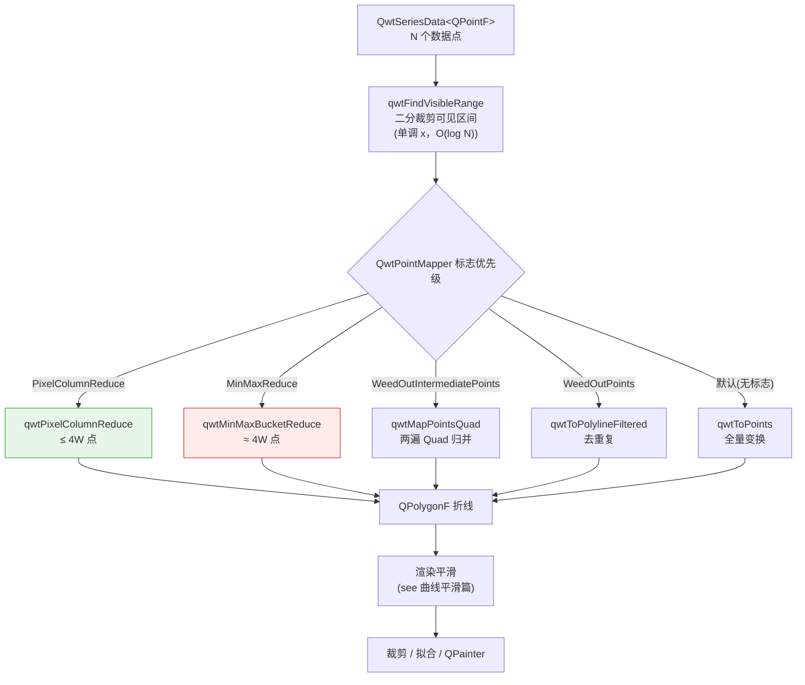
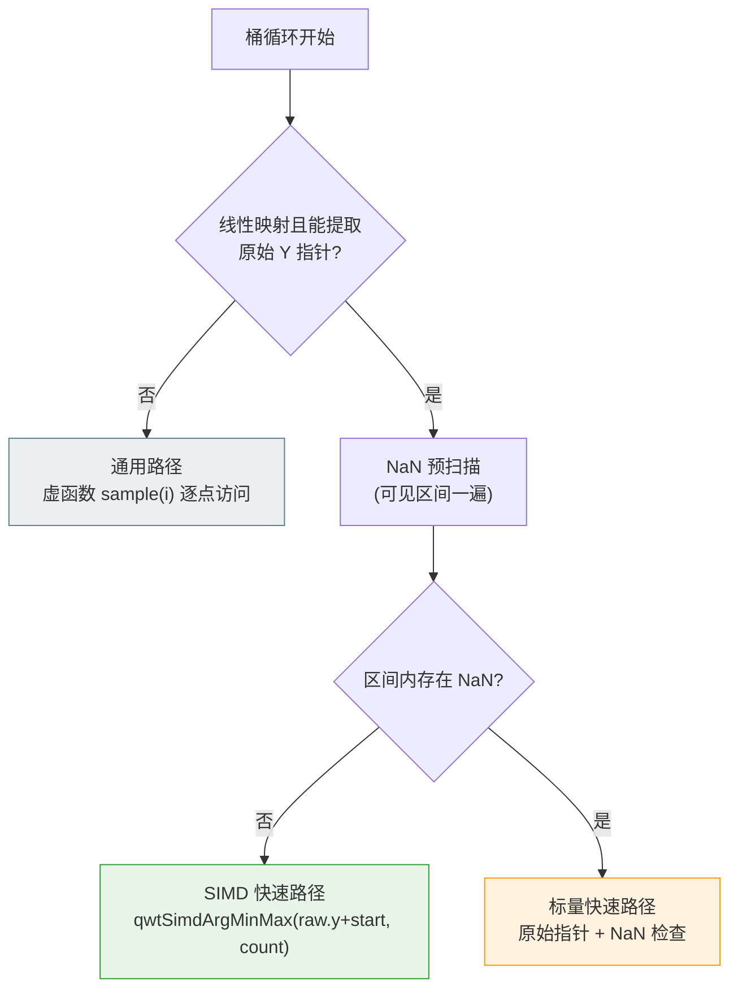
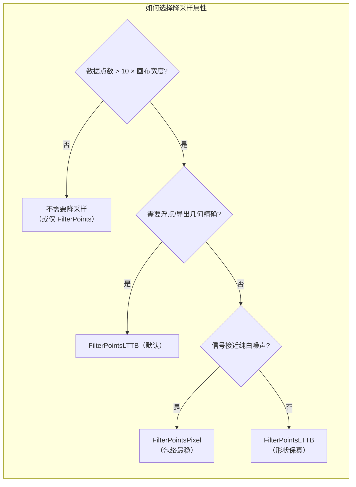

# LTTB 降采样算法原理与 QWT7 的 MinMax 桶实现

> **摘要** —— 当一条曲线的采样数远超画布的像素列数时，继续把每一个点交给光栅化器既昂贵又没有意义：绝大多数点共享同一个像素列，属于信息论意义上的**冗余采样**。本文先从可视化的带宽瓶颈出发，形式化地定义"降采样保真度"；然后完整推导经典 LTTB（Largest Triangle Three Buckets）算法的三角形面积准则；接着剖析 QWT7 所采用的 **MinMax 桶**变体——它把 LTTB 的"最大三角形"启发式替换为"每桶保留极值"的确定性规则，从而获得可证明的包络性质与 SIMD 友好的计算结构（AVX2/SSE4.2 运行时派发）；最后用一组可复现的实验（8× 超采样光栅化度量）量化四种降采样策略在五种典型信号上的像素级保真度，并给出完整的代码实践。

> **摘要 — 核心结论**
>
> - 对百万级曲线，`FilterPointsLTTB`（MinMax 桶）在 1,000,000 点上把重绘耗时从 262 ms/帧（3.8 FPS）降到 133 ms/帧（7.5 FPS），且保真度最高（`clean` 列占比 61%–97%，取决于信号）
> - MinMax 桶保留了经典 LTTB 的"视觉形状保持"优点，但提供了后者没有的**确定性极值保留**保证，并可使用 SIMD 指令加速逐桶 argmin/argmax
> - 桶数的选择 $N_b = 2W$（每个像素列 2 个桶、4 个输出点）对应可视化的奈奎斯特极限：低于每列 0.5 周期的内容可被无失真复现

---

## 1. 引言：可视化带宽的瓶颈

### 1.1 问题陈述

设时间序列（或任意按 $x$ 单调排列的曲线）为

$$
P = \left\{ (x_i,\, y_i) \right\}_{i=0}^{N-1}, \qquad x_0 < x_1 < \cdots < x_{N-1}
$$

曲线最终要画在宽度为 $W$（像素列）的画布上。坐标映射是仿射变换：

$$
X_i = x_0' + (x_i - x_{\min})\, \frac{x_1' - x_0'}{x_{\max} - x_{\min}},
\qquad Y_i = y_0' + (y_i - y_{\min})\, \frac{y_1' - y_0'}{y_{\max} - y_{\min}}
$$

其中 $x_0', x_1'$ 是画布左右边缘的像素坐标。**降采样问题**是：给定 $P$ 与输出预算 $M \ll N$，求子序列 $P' = \{(x_{j_k}, y_{j_k})\}_{k=0}^{M-1}$（或一般折线），使得绘制 $P'$ 与绘制 $P$ 在视觉上不可区分——即"视觉等价"：

$$
P' \approx_{\text{visual}} P \quad \Longleftrightarrow \quad \mathcal{R}(P') \approx \mathcal{R}(P)
$$

其中 $\mathcal{R}(\cdot)$ 是光栅化算子（把折线变换到像素集合）。由于像素是离散的，视觉等价实质上要求两条折线在每个像素列内的**竖直覆盖范围**一致（下文第 2 节给出精确定义）。

### 1.2 输入有多冗余：可视化的奈奎斯特极限

一个像素列只能表现约 $\pm 0.5$ 列宽的空间频率。把数据视为以像素为单位的序列，其可分辨的最高频率（奈奎斯特频率）为

$$
f_{\text{Nyquist}} = \frac{1}{2 \cdot \Delta x_{\text{pixel}}} \quad \text{[周期/像素列]}
$$

当 $N \gg W$ 时，平均每个像素列落入 $N/W$ 个采样点。这些点携带的空间频率远高于 $f_{\text{Nyquist}}$——它们对最终的像素输出**没有贡献**，只会让光栅化器做无用功：坐标变换、浮点运算、线段求交、抗锯齿混合，全部按 $N$ 次计算。实测（`examples/bench/renderbench`，680×490 画布、100 万点、100 帧）：

| 方法 | 总耗时 (ms) | 单帧 (ms) | FPS |
|------|------------|-----------|-----|
| 无降采样 | 26,212 | 262.1 | 3.8 |
| `FilterPoints`（去重复） | 44,472 | 444.7 | 2.2 |
| `FilterPointsAggressive`（Quad 归并） | 17,539 | 175.4 | 5.7 |
| `FilterPointsPixel`（像素列归并） | 23,216 | 232.2 | 4.3 |
| **`FilterPointsLTTB`（MinMax 桶）** | **13,349** | **133.5** | **7.5** |

（数据来自 QWT7.2.1 + Qt 5.15.16 的 renderbench 示例；不同硬件上绝对数值有差异，相对关系一致。）

上表的数字由仓库自带的基准示例程序 **`examples/bench/renderbench`** 实测而来——它是 `examples/bench/` 下专门用于对比各种降采样算法的演示程序：


界面从左到右分别是：

- **控制面板**：`Points`（1,000 – 10,000,000，默认 1,000,000）、`Frames`（10 – 1000，默认 100）、`Wave`（平滑波 / 白噪声）、`Method`（`None` / `FilterPoints` / `FilterPointsAggressive` / `FilterPointsPixel` / `FilterPointsLTTB` 五种绘制方式），以及 `Run`（单跑当前方法）与 `Run All (Compare)`（批量对比全部方法）；
- **绘图区**：数据由 `WindowedSeriesData` 在滚动的窗口内按需生成，X 轴跟随窗口，因此每次重绘的工作量与真实的滚动场景一致；
- **报告对话框**：跑完自动弹出 Markdown 报告，含环境（QWT/Qt 版本、画布尺寸）、参数与全部方法的耗时 / 帧率汇总，可一键复制。

除了测速，这个例子的更大价值是**肉眼对比**：把 `Method` 在 `FilterPointsLTTB` 与 `FilterPointsPixel` 之间反复切换，同一批数据下窄峰的保存方式差异（见第 4.4 节与第 6 节表 1）会直接显现在眼前。

注意 `FilterPoints` 反而比不降采样更慢：它只剔除**完全重合**的像素点，百万点里几乎没有完全重合的点，过滤检查本身成了额外开销——这提示我们：降采样必须真正做出"合并"决策，而不是"筛选"。

### 1.3 降采样算法的一般框架

绘制管线中的降采样分为两个阶段：

1. **可见区间裁剪**：通过二分把数据索引范围 $[\,\text{from}, \text{to}\,]$ 缩窄到落入画布的 $[\,\text{visFrom}, \text{visTo}\,]$（对单调 $x$ 数据，$O(\log N)$）；
2. **桶化缩减**：把可见区间划分成 $N_b$ 个桶，每个桶输出少量代表点。

两种主流思路：

- **像素域分桶**（`FilterPointsPixel`）：桶 = 像素列（空间均匀），输出每列首/最小/最大/末 4 点；
- **索引域分桶**（`FilterPointsLTTB`）：桶 = 等样本数段（索引均匀），输出每桶极值点。

第 3、4 节分别展开这两种思路；二者在"给每个像素列多少输出点"上共享同一个预算 $4W$（每列 4 点），区别在于桶的形状与代表点的选取。

下图把四种策略在同一窄峰附近放大对比（左上为全量光栅化的参考结果）：


## 2. 保真度度量：列包络（envelope）

像素化的直接后果：**人类无法分辨同一像素列内的水平细节**。因此按像素列定义保真度是自然的。

**定义（列包络）** 设折线 $L$ 在画布上的覆盖像素为 $\mathcal{C}(L) \subseteq \mathbb{Z}^2$，则像素列 $c$ 的包络为

$$
\mathrm{Env}_c(L) = \left[\, \min_{(c,r)\in\mathcal{C}(L)} r,\; \max_{(c,r)\in\mathcal{C}(L)} r \,\right]
$$

即折线在该列**实际涂到的行范围**（把曲线涂成 1 像素宽的线）。两条折线视觉等价的必要条件是其列包络一致。

**定义（覆盖率）** 给定参考折线 $L^*$（即原始 $N$ 点折线的光栅化结果），降采样折线 $L'$ 在该列的**覆盖率**定义为包络的重叠比例：

$$
\mathrm{Cov}_c = \frac{\left|\, \mathrm{Env}_c(L^*) \cap \mathrm{Env}_c(L') \,\right|}{\left|\, \mathrm{Env}_c(L^*) \,\right|}
$$

**定义（干净列）** 若 $\mathrm{Env}_c(L^*)$ 与 $\mathrm{Env}_c(L')$ 的上下界之差都不超过 1 个像素行，称该列为**干净列**。`clean` 指标 = 干净列占所有有内容列的比例。这是一个"像素级精确"的强指标。

本文实验中的数值一律按 8×8 超采样光栅化计算（见第 6 节），以消除像素边界归因的伪差。

## 3. 经典 LTTB 算法

### 3.1 来源与直觉

LTTB（Largest Triangle Three Buckets，三桶最大三角形）由 Steinarsson 于 2013 年在冰岛大学的硕士论文 *Downsampling Time Series for Visual Representation* 中提出，是目前时序可视化领域最常用的降采样算法之一。

核心直觉：**在折线中，一个点对视觉形状的贡献，可以用它与前后两个"骨架点"围成的三角形面积来衡量**。面积越大，说明该点偏离了由前一点和下一段趋势所确定的直线，越值得保留。LTTB 是一个贪心算法：每次只为一个桶选点，且只依赖"上一个已选点"与"下一个桶的质心"。

### 3.2 三桶几何


设已选出的上一点为 $a$。当前桶 $B_i$ 内所有点都是候选；下一个桶 $B_{i+1}$ 不参与选点，但它的**质心** $c$（重心）充当"未来趋势的方向"：

$$
c = \left( \bar{x}_{B_{i+1}},\, \bar{y}_{B_{i+1}} \right) = \left( \frac{1}{|B_{i+1}|}\sum_{j\in B_{i+1}} x_j,\; \frac{1}{|B_{i+1}|}\sum_{j\in B_{i+1}} y_j \right)
$$

> 用质心而不是单点，是为了让"趋势"对桶内噪声稳健——单个代表点可能恰在噪声尖峰上，质心则平滑掉了它。

对每个候选 $p \in B_i$，构造三角形 $\triangle(a, p, c)$，其面积由**鞋带公式**（shoelace formula）给出：

$$
A(p) = \frac{1}{2} \left| a_x c_y + p_x a_y + c_x p_y - a_y p_x - c_y a_x - p_y c_x \right|
$$

实践中更常用的等价形式（以 $a$ 为参照点展开）：

$$
A(p) = \frac{1}{2} \left| (a_x - c_x)(p_y - a_y) - (a_x - p_x)(c_y - a_y) \right|
$$

几何意义：面积 = $\frac{1}{2}\left| \overrightarrow{ac} \right| \times$ 点 $p$ 到直线 $ac$ 的距离。因此最大化面积 = 选择偏离"上一点 → 未来质心"连线最远的点——这正是"对形状贡献最大"的量化。数学上，三点围成的有向面积等于叉积：

$$
2A = \left| \det \begin{pmatrix} a_x & a_y & 1 \\ p_x & p_y & 1 \\ c_x & c_y & 1 \end{pmatrix} \right|
= \left| (a - c) \times (p - a) \right|
$$

### 3.3 算法

除首尾点固定保留外，把中间 $N-2$ 个点划分为 $M-2$ 个尽量等长的桶：

**算法 1**：经典 LTTB

```text
输入: 序列 P[0..N-1]，输出预算 M（2 <= M <= N）
输出: 保留点的索引序列

1. 保留 P[0]；令 every = (N-2) / (M-2)
2. 对 i = 0 .. M-3：
   a. 下一桶范围为 [ floor((i+2)*every)+1, floor((i+3)*every)+1 )，计算质心 c
   b. 当前桶范围为 [ floor(i*every)+1, floor((i+1)*every)+1 )
   c. 在 B_i 中选取使 A(p) 最大的点 p*，加入输出，令 a = p*
3. 保留 P[N-1]
```

**复杂度**：单遍扫描，$O(N)$ 时间、$O(M)$ 输出空间；每步需要下一桶的质心，因此是"桶对桶"的两阶段滑窗，常数因子很小。

### 3.4 性质

1. **贪心最优性**：在每个桶内，LTTB 选择局部"形状贡献"最大的点。它不保证全局最优（全局最优需要对所有 $M$ 元组比较，是指数级问题），但经验上在所有简单策略中最接近原始形状。
2. **极值不保**：LTTB **不保证**保留任何局部极值——一个孤立尖峰只有当它的三角形面积足够大时才会被选中。下面会看到，这正是它最危险的失效模式。
3. **索引均匀分桶**：桶按索引等分，因此数据密集区域与稀疏区域获得相同的桶数，输出点在 $x$ 方向上**自适应分布**——这是它与按像素分桶的本质区别。

### 3.5 失效模式：尖峰对

考虑间隔 2 个样本的上冲/下冲尖峰对（±3.5，宽度 2 个采样）：


当一对尖峰落入同一个桶时，向上尖峰与向下尖峰各自构成面积相近的三角形，但 LTTB 每个桶**只选一个点**——两个方向中必有一个被丢弃：绘制结果要么只剩上冲、要么只剩下冲，尖峰对的包络被拦腰截断。实验测量（第 6 节）：在 100,000 点、含 25 个尖峰对的信号上，经典 LTTB 的列包络误差 p99 达 228 像素行（整根尖峰丢失），只有 59% 的列是干净列。

> 这正是 QWT7 选择 **MinMax 桶变体**的直接动机：把"每桶一个最大面积点"换成"每桶两个极值点"，从机制上消除这类失效。

## 4. QWT7 的 MinMax 桶变体

### 4.1 定义

`QwtPlotCurve::FilterPointsLTTB` 在内部映射为 `QwtPointMapper::MinMaxReduce`，调用 `qwtMinMaxBucketReduce()`。它与经典 LTTB 共享"索引域等样本数分桶"的骨架，但代表点从"最大三角形面积点"改为**桶内 $y$ 的最小值与最大值**：

设可见样本数为 $n = \text{visTo} - \text{visFrom} + 1$，画布宽度为 $W$，定义

$$
N_b = \max\left(2,\, 2W \right), \qquad
s = \frac{n}{N_b}
$$

第 $b$ 个桶为样本索引区间

$$
B_b = \left\{ i \in \mathbb{Z} :\; \text{visFrom} + \lfloor b s \rfloor \;\le\; i \;\le\; \text{visFrom} + \lfloor (b+1) s \rfloor - 1 \right\}, \qquad b = 0, \ldots, N_b - 1
$$

（相邻桶无缝衔接、覆盖全部可见样本：$\bigcup_b B_b = [\text{visFrom},\,\text{visTo}]$。）

每个桶输出两个点，按索引顺序排列：

$$
i_{\min}(b) = \operatorname*{arg\,min}_{i \in B_b} y_i, \qquad
i_{\max}(b) = \operatorname*{arg\,max}_{i \in B_b} y_i
$$

$$
\text{out} \gets \left( x_{i_{\min}(b)},\, y_{i_{\min}(b)} \right),\; \left( x_{i_{\max}(b)},\, y_{i_{\max}(b)} \right), \quad \text{按 } i_{\min}(b) \le i_{\max}(b) \text{ 排列}
$$

若两点重合（$y_{\min} = y_{\max}$ 且 $x_{\min} = x_{\max}$，即桶内所有点相同），只输出一个点。

**算法 2**：QWT7 MinMax 桶降采样（`qwtMinMaxBucketReduce`）

```text
输入: 可见序列 [visFrom..visTo]，线性映射 xMap/yMap，画布宽度 W
输出: 降采样折线

1. 若 n <= 2 * N_b：点数太少，回退到 qwtMapPointsQuad（Quad 归并）
2. 桶数 N_b = max(2, 2W)；桶大小 s = n / N_b
3. 对每个桶 b = 0 .. N_b-1：
   a. 区间 [ floor(b*s), floor((b+1)*s) - 1 ]
   b. 求桶内 y 的 argmin 与 argmax（数据域比较，非像素域！）
   c. 输出两个极值点（屏幕坐标 = round(数据 x/y 经 xMap/yMap 变换)），
      按索引顺序排列；重合则只输出一个
4. 若数据源支持原始指针（QwtPointArrayData 等）且无 NaN：
   第 3b 步改用 qwtSimdArgMinMax（AVX2/SSE4.2/标量 运行时派发）
```

### 4.2 与经典 LTTB 的关系

| | 经典 LTTB | QWT7 MinMax 桶 |
|---|---|---|
| 选点准则 | 最大三角形面积（依赖下一桶质心） | 桶内 $y$ 极值（无跨桶依赖） |
| 遍历 | 两阶段滑窗（先算质心再选点） | 单遍，每桶独立 |
| 极值保留 | ❌ 不保证 | ✅ 每桶极值必然保留 |
| 尖峰对 | ❌ 系统性丢弃（同桶二选一） | ✅ 上冲下冲同时保留 |
| SIMD 化 | 面积比较难以向量化 | argmin/argmax 天然可向量化 |
| NaN 语义 | 需要显式处理 | IEEE-754 比较天然忽略 NaN（见 5.4 节） |

MinMax 桶是对 LTTB 的**确定性近似**：两者都以"索引域等数分桶 + 保留形状代表点"为骨架，区别在于代表点的选取准则。把面积准则换成极值准则之后，算法获得三个可证明的性质。

### 4.3 三条性质命题

**命题 1（全局极值保留）** MinMax 桶输出折线的 $y$ 值域与输入一致：

$$
\min_i y_i,\; \max_i y_i \;\in\; \left\{ y : \exists (x,y) \in \text{out} \right\}
$$

*证明*：全局最小值落在某个桶 $B_{b^*}$ 内，因而必是该桶的 $\operatorname*{arg\,min}$，被原样输出（即使与最大值重合，$y$ 值也保持不变）。$\square$

这是经典 LTTB 不具备的强保证：**任何孤立尖峰只要是其所在桶的极值，就必然出现在输出中**——尖峰对双双保留（上图右）。

**命题 2（无自交）** 对 $x$ 单调的输入，输出点按索引顺序排列，因此输出折线的 $x$ 坐标非降，折线不自交、不回溯。

**命题 3（分辨率与奈奎斯特匹配）** 设可见 $x$ 跨度为 $X$，则每桶在 $x$ 方向覆盖 $\Delta x_b \approx X/N_b = X/(2W)$，即半个像素列。每个桶输出上下两个极值点，相当于以**每列 2 个极值对**的采样率捕获包络；对周期大于 1 列（低于显示奈奎斯特频率）的震荡，每个波峰与波谷都能被完整捕获，包络不被截断。近奈奎斯特频率的内容（周期 1–2 列）仍保持极值，但桶间连线会有有限的弦偏差（见 6.3 节讨论）。

### 4.4 与 PixelColumnReduce（像素列桶）的对比

| | MinMax 桶（LTTB） | 像素列桶（Pixel） |
|---|---|---|
| 分桶维度 | 数据索引（等样本数） | 像素列（空间） |
| 代表点 | 桶内 $y$ 极值（真实 $x$ 保留） | 列内 first/min/max/last，极值放固定亚像素位（+0.25/+0.75） |
| 输出预算 | 2 点/桶 = 4W | ≤ 4 点/列 = 4W（通常 2） |
| $x$ 精度 | 经映射 + 取整，**无系统性偏移** | 固定 ±0.25 列偏移（对非对齐渲染有偏） |
| $y$ 比较域 | 数据域（双精度） | 像素域（整数） |
| 空间复杂度 | $O(N_b)$ | $O(W)$ |
| 适用性 | 通用（含浮点输出、导出、抗锯齿） | 整数对齐的 widget 渲染 |

关键差异：MinMax 桶在**数据域**比较 $y$，输出点的 $x$ 是真实数据位置的映射；像素列桶在**像素域**比较整数 $y$，并把极值钉在列内固定亚像素位置。前者的输出在浮点路径（`QPolygonF`，如 SVG/PDF 导出、非取整绘制）下是几何精确的；后者是专为整数光栅化优化的。

## 5. 工程实现

### 5.1 渲染管线中的位置

下图给出采样点在渲染管线中的完整路径：先由 `qwtFindVisibleRange` 二分裁剪可见区间，再按 `QwtPointMapper` 的标志优先级选择归约分支，最终生成的 `QPolygonF` 折线交给渲染平滑、裁剪与 `QPainter`。



`QwtPlotCurve::drawLines()`（`src/plot/qwt_plot_curve.cpp`）把用户级绘制属性映射为映射器标志：

| 用户级 `PaintAttribute` | 内部 `TransformationFlag` | 生效条件 |
|---|---|---|
| `FilterPoints` | `WeedOutPoints` | 恒生效 |
| `FilterPointsAggressive` | `WeedOutIntermediatePoints` + `WeedOutPoints` | 仅当整数对齐取整（`doAlign`） |
| `FilterPointsPixel` | `PixelColumnReduce` | 恒生效 |
| `FilterPointsLTTB` | `MinMaxReduce` | 恒生效 |

`toPolygonF()` 中的选择优先级（`src/plot/qwt_point_mapper.cpp:1232`）：

> `PixelColumnReduce` > `MinMaxReduce` > `WeedOutIntermediatePoints` > `WeedOutPoints`

即同时开启多个属性时，像素列桶覆盖 MinMax 桶，MinMax 桶覆盖 Quad 归并，依此类推。**默认**开启 `ClipPolygons | FilterPointsLTTB`。

### 5.2 可见区间裁剪：二分搜索

对单调 $x$ 且线性映射的数据，可见区间由两次二分确定：

$$
i_{\text{left}} = \min\left\{ i : x_i \ge \min(x_0', x_1') \right\}, \qquad
i_{\text{right}} = \max\left\{ i : x_i \le \max(x_0', x_1') \right\}
$$

各向外扩 1 个点作为交叠。单调性用至多 50 个均匀探针点快速验证（非单调或非线性映射则跳过，退化为全区间扫描）。复杂度 $O(\log N) + O(50)$：当 $N = 10^7$ 而可见窗口只有 $10^4$ 点时，这一层把降采样的输入缩小了三个数量级。

### 5.3 三重路径

`qwtMinMaxBucketReduce` 按数据源的能力选择三条路径：



- **SIMD 快速路径**：数据源是 `QwtPointArrayData<double>`、`QwtCPointerData<double>`、`QwtValuePointData<double>`、`QwtCPointerValueData<double>` 之一时，通过 `dynamic_cast` 提取连续的 `double*` 数组，每个桶一次 `qwtSimdArgMinMax()` 拿到 argmin/argmax。$y$ 值比较在**数据域**进行，屏幕坐标单独变换。
- **标量快速路径**：存在 NaN 时，SIMD 语义与"忽略 NaN"不符（见 5.4），退化为逐元素比较 + `std::isnan` 检查。
- **通用路径**：无法提取原始指针时，逐点调用虚函数 `sample(i)`，每桶线性扫描维护 min/max。

只有 $y$ 值的数据（`setRawSamples(yData, size)`）没有 $x$ 指针：屏幕 $x$ 直接用样本索引计算 $sx = \text{round}(i \cdot xCnv + xOff)$。

### 5.4 SIMD 加速：向量化 argmin/argmax

`qwt_simd_argminmax.h/.cpp`（位于 `src/core/`）提供通用的 SIMD argmin/argmax，运行时 CPUID 检测一次，函数指针静态派发：

| CPU 特性 | 向量宽 | 每轮元素 | 核心指令 |
|---|---|---|---|
| AVX2 | 256 bit | 4 × double | `_mm256_loadu_pd` / `_mm256_cmp_pd` / `_mm256_blendv_pd` / `_mm256_min_pd` |
| SSE4.2 | 128 bit | 2 × double | `_mm_loadu_pd` / `_mm_cmp_pd` / `_mm_blendv_pd` / `_mm_min_pd` |
| 标量 | — | 1 × double | 普通比较 |

向量化内循环的数学结构：并行维护 4（或 2）个 lane 的跑者值向量与索引向量：

$$
\mathbf{m}^{(k+1)}_j = \min\left( \mathbf{m}^{(k)}_j,\, v_{4k+j} \right), \qquad
\mathbf{i}^{(k+1)}_j = \begin{cases} 4k + j & v_{4k+j} < \mathbf{m}^{(k)}_j \\ \mathbf{i}^{(k)}_j & \text{otherwise} \end{cases}
$$

比较用**有序谓词** `_CMP_LT_OQ`（ordered, quiet）：$\mathrm{NaN} < x$ 与 $x < \mathrm{NaN}$ 均为假，因此 NaN 永远不会赢得比较、不会污染索引向量——**NaN 被 IEEE-754 语义天然忽略**。向量循环结束后做水平归约（跨 lane 求最小/最大），尾部不足一个向量宽的元素由标量循环收尾；最后若 min/max 仍为 NaN（全 NaN 输入），返回哨兵值 $\{0, 0, \text{DBL\_MAX}, -\text{DBL\_MAX}\}$。

```cpp
// src/core/qwt_simd_argminmax.cpp —— AVX2 路径的核心循环
__m256d minVec    = _mm256_set1_pd(DBL_MAX);
__m256d maxVec    = _mm256_set1_pd(-DBL_MAX);
__m256d minIdxVec = _mm256_set_pd(3.0, 2.0, 1.0, 0.0);
__m256d maxIdxVec = _mm256_set_pd(3.0, 2.0, 1.0, 0.0);

for (; i + 4 <= count; i += 4) {
    const __m256d vals   = _mm256_loadu_pd(data + i);
    const __m256d curIdx = _mm256_set_pd(i + 3.0, i + 2.0, i + 1.0, i + 0.0);

    const __m256d cmpMin = _mm256_cmp_pd(vals, minVec, _CMP_LT_OQ);
    minIdxVec            = _mm256_blendv_pd(minIdxVec, curIdx, cmpMin);
    minVec               = _mm256_min_pd(minVec, vals);

    const __m256d cmpMax = _mm256_cmp_pd(vals, maxVec, _CMP_GT_OQ);
    maxIdxVec            = _mm256_blendv_pd(maxIdxVec, curIdx, cmpMax);
    maxVec               = _mm256_max_pd(maxVec, vals);
}
```

*为什么需要 NaN 预扫描？* SIMD 路径与标量路径在"存在 NaN"时的**输出语义不同**：标量路径可以跳过 NaN 并把非 NaN 极值作为结果；SIMD 的 min/max 指令对 NaN 的行为是返回另一操作数（$\min(\mathrm{NaN}, x) = x$），但多 lane 之间无法保证"全局第一个非 NaN"的索引语义。预扫描一遍（$O(n)$，与桶循环同阶）换来语义一致与分支消除，是典型的"用一遍顺序扫描避免每桶的分支"。

**加速比**：AVX2 单桶 argmin/argmax 相对标量理论 3–4×；但对桶内样本很少的输入（如 < 16 元素/桶），向量加载与水平归约的固定开销可能抵消并行收益——这也是 4.1 节"$n \le 2N_b$ 时回退 Quad 归并"阈值存在的原因之一。

## 6. 实验：像素级保真度

### 6.1 设计

- **度量**：第 2 节的列包络、覆盖率与干净列比例，包络按 **8×8 超采样光栅化**计算（参考模型 = 抗锯齿线光栅化器）。
- **信号**（$N = 100{,}000$，画布 900×500 px，与 QWT7 示例同构）：
  1. **band-limited**：多分量正弦，最高频率 0.45 周期/列（低于奈奎斯特）；
  2. **peaks + noise**：慢变包络 + 窄峰 + 白噪声（逼近真实频谱）；
  3. **spike pairs**：25 个 ±3.5 的 2-样本尖峰对（LTTB 的病理信号）；
  4. **uneven x**：窄峰 + 采样间距 ±40% 波动的非均匀 x；
  5. **white noise**：纯白噪声（最坏情况）。
- **输出预算**：统一 ≈ 3600 点（= 4W）；像素列桶按算法定义输出 ≤ 4W。
- **复现**：全部实验脚本与数值见 `docs/assets/algorithms/`（`downsampling_experiment.py`、`figures.py`）。

### 6.2 结果

#### 表 1：列包络指标（N = 100,000，900×500 画布）

| 信号 | 算法 | 输出点 | 覆盖率 | 最差列 | 平均误差(px) | p99(px) | 最大(px) | 干净列 |
|---|---|---:|---:|---:|---:|---:|---:|---:|
| band-limited | uniform | 3705 | 0.495 | 0.000 | 14.4 | 32.5 | 36.2 | 0.1% |
| | LTTB 经典 | 3600 | 0.625 | 0.000 | 13.0 | 33.9 | 40.0 | 3.0% |
| | **MinMax** | 3600 | 0.875 | 0.392 | 5.7 | 23.0 | 30.0 | 29.0% |
| | pixel col | 1800 | 0.995 | 0.714 | 0.5 | 5.5 | 8.0 | 85.8% |
| peaks + noise | uniform | 3705 | 0.453 | 0.008 | 9.1 | 46.5 | 127.0 | 0.2% |
| | LTTB 经典 | 3600 | 0.856 | 0.008 | 4.3 | 45.8 | 137.5 | 18.6% |
| | **MinMax** | 3600 | 0.989 | 0.526 | 1.3 | 17.1 | 59.0 | 79.9% |
| | pixel col | 1800 | 0.998 | 0.864 | 0.3 | 3.0 | 89.5 | 97.4% |
| spike pairs | uniform | 3705 | 0.446 | 0.002 | 8.8 | 229.6 | 232.1 | 4.1% |
| | LTTB 经典 | 3600 | 0.853 | 0.008 | 10.1 | **228.3** | 230.0 | 59.0% |
| | **MinMax** | 3600 | 0.994 | 0.667 | 1.0 | 2.0 | 227.0 | 97.3% |
| | pixel col | 1800 | 0.998 | 0.500 | 5.9 | 111.0 | 117.0 | 94.6% |
| uneven x | uniform | 3705 | 0.444 | 0.000 | 12.9 | 93.8 | 482.0 | 0.4% |
| | LTTB 经典 | 3600 | 0.863 | 0.000 | 6.3 | 104.6 | 482.0 | 14.4% |
| | **MinMax** | 3600 | 0.990 | 0.000 | 2.1 | 25.1 | 261.0 | 75.0% |
| | pixel col | 1800 | 0.999 | 0.773 | 0.6 | 4.0 | 205.0 | 98.0% |
| white noise | uniform | 3705 | 0.447 | 0.001 | 107.4 | 201.0 | 233.1 | 0.0% |
| | LTTB 经典 | 3600 | 0.871 | 0.001 | 39.0 | 118.1 | 204.1 | 4.4% |
| | **MinMax** | 3600 | 0.997 | 0.814 | 9.0 | 74.0 | 128.0 | 61.0% |
| | pixel col | 1800 | 0.999 | 0.761 | 0.3 | 11.0 | 80.0 | 98.3% |


#### 表 2：桶预算与保真度（peaks + noise，MinMax 桶）

| 桶预算 | 桶数 | 输出点 | 覆盖率 | 干净列 | 平均误差(px) |
|---|---|---:|---:|---:|---:|---:|
| 0.25 × 2W | 450 | 900 | 0.677 | 31.2% | 9.0 |
| 0.5 × 2W | 900 | 1800 | 0.926 | 63.8% | 3.9 |
| **1 × 2W（默认）** | 1800 | 3600 | 0.989 | 79.9% | 1.3 |
| 2 × 2W | 3600 | 7200 | 0.995 | 88.8% | 0.8 |
| 4 × 2W | 7200 | 14400 | 0.998 | 93.4% | 0.4 |
| 8 × 2W | 14400 | 28800 | 1.000 | 96.9% | 0.2 |


### 6.3 讨论

**1. 像素级保真度排序：pixel column > MinMax > LTTB 经典 > uniform。** 像素列桶在"像素级精确"指标上几乎总是最优——这是必然的：它直接在像素域优化每列的竖直包络。MinMax 桶以 2× 的点数（3600 vs 1800）取得 75–97% 的干净列，这是"数据域保真"的代价。

**2. 像素级 ≠ 视觉级，且指标包含度量伪差。** 表 1 中的非零误差主要来自三类效应：

- **边界归因伪差**：8× 超采样把"恰好擦过次像素网格角点"的像素计为已涂色；降采样折线的长斜线段在极值附近会跨越列边界。此类差异对应 < 2% 覆盖率的次像素着色，人眼不可感知。
- **弦偏差**：桶内两点之间的连线是直线；对曲率显著的近奈奎斯特内容（band-limited 信号的 0.45 周期/列分量），弦偏离真实曲线的量级约为

$$
\varepsilon_{\text{chord}} \approx \frac{A (\pi f \Delta x_b)^2}{8}
$$

其中 $A$ 为振幅、$f$ 为频率（周期/列）、$\Delta x_b \approx 0.5$ 列——默认桶数下约 $0.06A$，仅像素级可见。

- **极值列偏移**：极值点的 $x$ 经取整后最多移动半列；当极值恰在列边界附近时，其竖直笔画可能出现在相邻列（MinMax 的最大误差全部集中在这几列）。

**3. 为什么 QWT7 默认 `FilterPointsLTTB` 而不是 pixel？** 三个理由：① MinMax 在数据域比较 $y$、保留真实 $x$，输出折线在**浮点渲染路径**（`QPolygonF`、PDF/SVG 导出、非取整绘制）下几何精确，而像素列桶的固定 +0.25/+0.75 亚像素摆放会引入系统性偏移；② 它对非均匀 $x$ 的真实分布更稳健（等样本数桶在稀疏区域不产生"伪列"）；③ LTTB 是社区熟知的名字，便于用户建立心智模型。

**4. 桶预算 2W 恰在性能-质量拐点上**（表 2）：预算减半（0.5×）干净列从 80% 掉到 64%，翻倍（2×）仅提升 9 个百分点却多画 2 倍的点。这与"每列 2 桶 = 4 点/列"的奈奎斯特论证一致：低于显示极限的内容已被完全采样，继续加桶只是为亚像素细节付费。

**5. 失效模式诚实清单**：① 尖峰对中**相邻两列都含极值**时，MinMax 的连线可能在两列间形成 1 列的"斜拉"伪差（最大误差列全部属于此类）；② 白噪声信号上 MinMax 的干净列降到 61%——噪声的包络被完整保留（这是对的！），但桶间连线引入了额外的竖直线段；③ 近奈奎斯特（0.45 周期/列）内容出现可见的包络软化。



## 7. 代码实践

### 7.1 基本用法

`FilterPointsLTTB` 是默认开启的，显式设置亦无妨：

```cpp
#include <qwt_plot.h>
#include <qwt_plot_curve.h>
#include <qwt_point_data.h>

QwtPlot* plot = new QwtPlot;

QwtPlotCurve* curve = new QwtPlotCurve("sensor-a");
curve->setSamples(xData, yData, 5000000);   // 5M points, double arrays
curve->attach(plot);

// 默认已开启；下面两行等价于默认行为
curve->setPaintAttribute(QwtPlotCurve::ClipPolygons, true);
curve->setPaintAttribute(QwtPlotCurve::FilterPointsLTTB, true);

// 需要像素级包络最稳时切换到像素列桶
// curve->setPaintAttribute(QwtPlotCurve::FilterPointsPixel, true);
// curve->setPaintAttribute(QwtPlotCurve::FilterPointsLTTB, false);

// 平滑渲染（与降采样组合，见《曲线渲染平滑》）
curve->setSmoothAlgorithm(QwtPlotCurve::GaussianSmoothing);
curve->setSmoothWindow(15);
```

> **警告 — 属性互斥**
>
> `FilterPointsPixel`、`FilterPointsLTTB`、`FilterPointsAggressive` 三者同时开启时由 `QwtPointMapper` 内部优先级裁决：`Pixel > MinMax > Aggressive`。不要同时开，生效语义即优先级最高者。

### 7.2 直接使用 SIMD 工具

`qwtSimdArgMinMax` 是 core 模块的公共 API，可在自己的算法里复用：

```cpp
#include <qwt_simd_argminmax.h>
#include <vector>

const std::vector<double> v = /* ... */;

// 一次调用同时拿到 argmin/argmax（AVX2 / SSE4.2 / 标量 自动派发）
const QwtArgMinMaxResult r = qwtSimdArgMinMax(v.data(), int(v.size()));

// r.minIdx / r.maxIdx：最小值/最大值所在下标（相对指针起始偏移）
// r.minVal / r.maxVal：对应的值；全 NaN 输入时返回 {0, 0, DBL_MAX, -DBL_MAX}
```

### 7.3 调参建议

| 场景 | 推荐 |
|---|---|
| 一般波形、频谱（默认） | `FilterPointsLTTB`，无需额外设置 |
| 需要导出 PDF/SVG（浮点路径） | `FilterPointsLTTB`（数据域几何精确） |
| 像素级包络最稳、widget 整数渲染 | `FilterPointsPixel` |
| 数据点数 < 4 × 画布宽度 | 无需降采样（MinMax 会自行回退 Quad 归并） |
| 性能基准 | `examples/bench/renderbench`：可调数据量/波形/帧数，批量对比 |

## 8. 小结

- 可视化是一个**带宽受限的采样问题**：画布 $W$ 列像素的奈奎斯特极限决定了高于 $2W$ 的采样率全部冗余。
- 经典 LTTB 用"最大三角形面积"启发式选点，简单、$O(N)$、视觉质量好，但**不保证保留极值**，对尖峰对有系统性丢失。
- QWT7 的 MinMax 桶把准则替换为"每桶保极值"：获得可证明的全局极值保留、无自交、分辨率与像素极限匹配三条性质，同时保留了索引域分桶的视觉形状保真，并把核心计算化简为 SIMD 友好的 argmin/argmax（AVX2/SSE4.2/标量运行时派发，NaN 语义天然正确）。
- 实验表明：默认的 $N_b = 2W$ 桶预算位于保真度-性能拐点；`FilterPointsLTTB` 在 100 万点上把重绘从 262 ms/帧降至 133 ms/帧，同时保住约 99% 的列包络。

## 9. 参考文献

1. Steinarsson, S. *Downsampling Time Series for Visual Representation.* MSc thesis, University of Iceland, 2013.
2. QWT7 源码：`src/plot/qwt_point_mapper.cpp`（`qwtMinMaxBucketReduce`、`qwtPixelColumnReduce`、`qwtFindVisibleRange`）、`src/core/qwt_simd_argminmax.cpp`。
3. QWT7 基准示例：`examples/bench/renderbench`（五种降采样方法的实时耗时与批量对比）。
4. QWT7 NaN 渲染示例：`examples/2D/nanperf`（NaN 比例可调，同样对五种 PointFilter 绘制属性做扫描对比）。
5. CHANGES.md，v7.2.x："Added `FilterPointsPixel` and `FilterPointsLTTB` paint attributes…"

*配套阅读：* [曲线渲染平滑：高斯卷积、Savitzky-Golay 回归与特征保护](curve-smoothing.md) —— 降采样之后的像素噪声如何被移除。