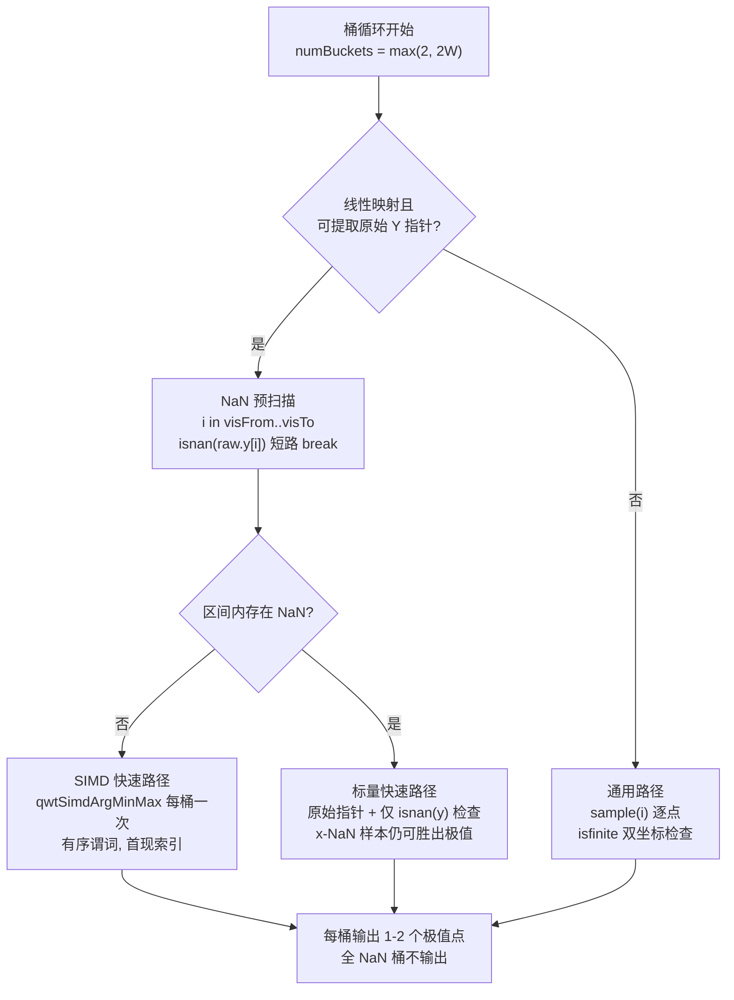
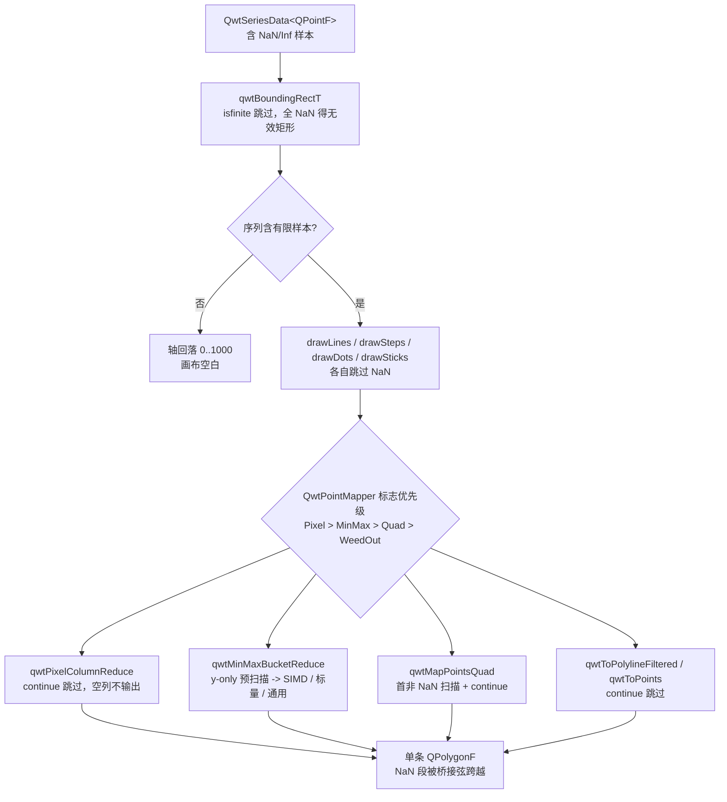

# NaN 数据的渲染语义与性能代价

> **摘要** —— 科学数据里的缺失值几乎总是以 IEEE-754 的 `NaN` 形态进入绘图管线：传感器掉线、除零、插值外推失败、上游管道的显式空洞。渲染器面对 NaN 只有三种可选语义——把折线在缺口处切段（matplotlib 的选择）、跳过该样本并把两侧连起来、或把它当 0 画——三者的视觉含义完全不同。本文逐行阅读 QWT7 的 `qwt_point_mapper.cpp` 与 `qwt_plot_curve.cpp`，给出五种绘制属性（`ClipPolygons` 无过滤 / `FilterPoints` / `FilterPointsAggressive` / `FilterPointsPixel` / `FilterPointsLTTB`）在 NaN 数据上的确切输出语义：QWT7 实现的是**跳过语义**，所有 Lines 类路径都输出一条连续折线，NaN 段被一条弦"桥接"过去，而不是切段；这一结论由 Python 逐行重实现与真实库的 3090 组多边形哈希比对（100% 一致）和 960×560 离屏渲染的逐像素视觉扫描（与理想切段参照相差 0.23%–3.80% 像素）共同证实。性能侧，boundingRect 冷扫描是一次 $O(n)$ 顺序读，100 万点约 12–22 ms；SIMD argmin/argmax 路径在出现任何 NaN 时全局退化为标量，但在帧级测量中这个"**悬崖**"被数据缩减收益与光栅化主导项掩盖（100k 点 delta = −0.29，1M 点 delta = +0.03，与 nanperf 示例的结论一致）。

> **摘要 — 核心结论**
>
> - QWT7 的 NaN 语义是**跳过而非切段**：14 种 NaN 模式 × 5 种绘制属性的语义矩阵中，所有 Lines 类路径对每个内部 NaN 段都产生恰好 1 条桥接弦（`run` 模式 3 个缺口 → 3 条桥接弦，五种模式无一例外）；只有 `Dots` / `Sticks` 这类逐样本风格天然正确。
> - 语义重实现交叉验证：Python 逐行重实现与 `qwtplot.dll` 真实输出在 15 个定向案例 + 250 个随机案例 × 2 种画布 × 6 条路径上共 **3090/3090（100%）** 多边形哈希一致，90 组定向案例逐顶点比特一致。
> - 视觉伪差（与"NaN 处断开、其余不变"的理想渲染逐像素比对，960×560）：内部缺口模式下 `FilterPointsAggressive` 最接近理想（0.23%–1.05% 差异像素），`FilterPointsLTTB` 偏离最大（2.50%–3.80%），其中约 2.7 个百分点来自桶边界重排而非桥接。
> - 性能：1M 点 Middle 案例，帧时间（min-of-7）随 NaN 比例从 0% 到 50% 总体下降（个别 1%/5% 格点在测量噪声内回升）——无过滤 173.7→86.5 ms、`FilterPointsLTTB` 26.3→13.1 ms；boundingRect 冷扫描 21.7→11.5 ms；全 NaN 数据帧时间仅 0.6–1.7 ms，画布空白、坐标轴回落到 0–1000。
> - 失效清单首条之外还有两个实测陷阱：`FilterPointsLTTB` 的原始指针路径预扫描只查 y，x 为 NaN 而 y 有限的样本若恰好是桶极值，会以 `qRound(NaN)==0`（实测，MSVC x64 + Qt 5.15）落到画布第 0 列形成伪尖峰；`+Inf` 能穿过只查 `isnan` 的预扫描进入 SIMD 路径，产出 `INT_MIN` 像素坐标。

---

## 1. 引言：NaN 从哪来，渲染器该做什么

### 1.1 三类来源

工程数据里的 NaN 不是异常，而是常态的编码方式。传感器在采样间隔内掉线，采集端写入 `qQNaN()` 占位；物理量相除时分母过零，IEEE-754 规定结果为 `±Inf` 或 `NaN`；数据清洗管道把离群点替换成显式空洞，下游用 NaN 表示"这里没有测量"。三种来源的共同点是：NaN 携带**位置信息**（第 $i$ 个样本缺失）与**缺失信息**（值未知），任何把 NaN 当数值处理的渲染都会同时丢掉这两者。

### 1.2 渲染语义的形式化

设样本序列 $P=\{(x_i,y_i)\}_{i=0}^{N-1}$，记有限样本的极大连续段（run）为 $S_1,S_2,\dots,S_k$。**理想切段语义**定义为：渲染算子 $\mathcal{R}$ 满足

$$
\mathcal{R}_{\text{ideal}}(P) = \bigcup_{j=1}^{k} \mathcal{R}(S_j)
$$

即每个连续段独立渲染、段间无任何连接图元；缺失段在画布上留下空白。这是 matplotlib 折线的行为，也是人眼对"数据缺失"的直觉解读。**跳过语义**则把 NaN 样本从序列中删除后整体渲染：

$$
\mathcal{R}_{\text{skip}}(P) = \mathcal{R}\left( \bigcup_{j} S_j \text{（按原序拼接）} \right)
$$

拼接会在相邻段之间引入一条**桥接弦**——连接 $S_j$ 末点与 $S_{j+1}$ 首点的线段，它在数据上没有任何依据。**画零语义**（把 NaN 当 0）连位置信息都破坏，不在讨论范围。三种语义的差异在缺口两侧的 $y$ 值相差越大、缺口越宽时越刺眼：桥接弦可能横跨半个画布，把两段无关的信号焊在一起。

QWT7 的选择是跳过语义。这不是文档里的声明，而是 `src/plot/qwt_point_mapper.cpp` 五条映射路径里逐行可见的事实：每条路径的主循环都是 `if (qwt_is_nan_or_inf(sample)) continue;`，删除样本后继续向同一条 `QPolygonF` 追加顶点。第 3 节逐路径给出证据，第 4 节用量化实验回答"桥接弦到底画错了多少像素"。

### 1.3 折线之外：NaN 在其它图元里的语义

同一份 isfinite 检查在管线的其它分支里承担不同语义，对照阅读有助于理解"跳过"在 QWT 里是一般原则而非折线特例。`QwtPlotSpectrogram` 把 NaN 单元渲染为透明像素（`hasGaps && qwt_is_nan_or_inf(value)` 时写 0，`qwt_plot_spectrogram.cpp` 598/620 行；早版本地位级 `qwtIsNaN` 已移除，现谓词连 Inf 一并拦截），并提供 `QwtRasterData::WithoutGaps` 标志让无缺口数据跳过逐单元检查——栅格语义里"缺口即透明"天然成立，因为像素之间没有连接关系。CONREC 等高线算法用累加和检测 NaN（`qwt_is_nan_or_inf(zSum)` 则跳过该单元，`qwt_raster_data.cpp` 373 行，同样兼拦 Inf），利用的是 NaN 的加法吸收律。散点与符号路径（`qwtToPointsFiltered`、`drawSymbols`）跳过 NaN 即正确语义，与 `Dots`/`Sticks` 同理。**只有存在"连接"概念的图元——折线与阶梯——才会暴露跳过与切段的分歧**，这正是本文的范围。

### 1.4 与既有文档的分工

使用指南 [NaN 数据处理](../use-guide/general/nan-handling.md) 回答"怎么设置、怎么生成数据"；[曲线降采样](curve-downsampling.md) 的第 5.3、5.4 节已经给出 MinMax 桶的三重路径与 NaN 预扫描的结构图。本文是原理视角：把 IEEE-754 比较语义在渲染管线每一层的传播写成可验证的命题，并用可复现实验给出语义矩阵、视觉伪差与性能代价三组数字。

## 2. IEEE-754 比较语义与管线传播

### 2.1 有序谓词：NaN 在比较中"隐身"

IEEE-754 规定除 `!=` 外的比较对 NaN 一律返回假：$\mathrm{NaN} < x$、$\mathrm{NaN} > x$、$\mathrm{NaN} \le x$ 均为 `false`。这条规则在渲染管线里逐层传播，效果各不相同：

- **boundingRect 层**（`src/core/qwt_series_data.cpp` 的 `qwtBoundingRectT`，约 217–262 行）：Qwt 6 时代依赖 `qMin/qMax` 扩展边界，NaN 使比较全假、边界停止扩展或污染为无效值；QWT7 改为显式 `isSampleNanOrInf(sample)` 跳过（两个循环各一处 `continue`），包围矩形只由有限样本决定。全 NaN 序列返回无效矩形 `QRectF(1,1,-2,-2)`（实测 `boundingRect_allNan_valid=0`、`x=1`、`width=-2`）。
- **自动缩放层**（两处机理不同）：`QwtPlot::rescaleAxes()`（`src/plot/qwt_plot.cpp` 1908–1911 行）在合并包围矩形前用 `qwt_is_nan_or_inf` 检查四边有限性；replot 时的自动缩放走 `QwtPlot::updateAxes()`（`src/plot/qwt_plot_axis.cpp` 862–869 行），只按 `width()/height() >= 0` 合并区间——全 NaN 序列的无效矩形 `(1,1,-2,-2)` 宽高均为负被整体跳过，轴区间保持无效，回落到 `AxisData` 的默认范围 0–1000（同文件 43–44 行，实测 `autoscale_allNan_x_upper=1000`），画布上什么都不画。
- **SIMD argmin/argmax 层**（`src/core/qwt_simd_argminmax.cpp`，AVX2 主循环 150–164 行）：比较用有序谓词 `_CMP_LT_OQ` / `_CMP_GT_OQ`，NaN 永远赢不了比较、进不了索引向量；水平归约与标量收尾同样用有序比较。因此"NaN 被天然忽略"在**值语义**上成立。

各层使用的 NaN 判定谓词并不统一，这张表是后文失效清单的索引：

| 层 | 谓词 | 检查对象 | Inf 是否拦截 |
|---|---|---|---|
| `qwtBoundingRectT` / 曲线风格 / Quad / Pixel / 通用桶路径 | `qwt_is_nan_or_inf` = `!isfinite` | x 与 y 双坐标 | 是 |
| MinMax 预扫描（597–604 行） | `std::isnan` | 仅 y | 否 |
| MinMax 标量桶循环（652–655 行） | `std::isnan` | 仅 y | 否 |
| `qwtSimdArgMinMax` 兜底（223–224 行） | `std::isnan(result.minVal/maxVal)` | 归约结果 | 部分（结果仍为 NaN 时返回哨兵 `{0,0,DBL_MAX,-DBL_MAX}`） |

谓词强度从左到右递减：双坐标 isfinite 是最强形式，单坐标 isnan 是最弱形式。第 5 节清单第 3、4 条正是最弱两行的直接后果。

### 2.2 索引语义不可靠：为什么还需要预扫描

值语义正确不等于 (值, 索引) 对正确。AVX2 主循环里维护跑者值的指令是 `_mm256_min_pd(minVec, vals)`，而 `MINPD` 在任一操作数为 NaN 时返回**第二操作数**：若某 lane 读到 NaN，该 lane 的跑者值变成 NaN；下一轮 `vals < NaN` 为假，索引向量不更新，但跑者值又被 `_mm256_min_pd(NaN, vals)` 恢复成新值——于是出现"值是新的、索引是旧的"的错配，最终输出的极值点会把一个样本的 $y$ 与另一个样本的 $x$ 焊在一起。这正是 `qwtMinMaxBucketReduce` 在原始指针快速路径前先做 NaN 预扫描（`qwt_point_mapper.cpp` 597–604 行）的原因：预扫描发现任何 NaN 就整段切换到标量桶循环（641–695 行），用一次 $O(n)$ 顺序读换掉每桶的分支与错配风险。预扫描带 `break` 短路：无 NaN 数据付全量 $O(n)$ 代价，NaN 数据只付到第一个 NaN 为止的代价——这个不对称在第 4.4 节的帧时间曲线里看得见。

用一个 8 样本桶把错配过程走一遍（单 lane 视角，min 侧）：

| 轮次 | vals | cmp = vals < minVec（LT_OQ） | minVec（MINPD 后） | minIdx |
|---|---|---|---|---|
| 0 | 5.0 | 真（5 < DBL_MAX） | 5.0 | 0 |
| 1 | NaN | 假 | NaN（MINPD 返回第二操作数） | 0 |
| 2 | 3.0 | 假（3 < NaN 为假！） | 3.0 | 0 ← 应为 2 |
| 3 | 4.0 | 假 | 3.0 | 0 |

第 2 轮的真最小值 3.0 进入了跑者值，却因与 NaN 的有序比较为假而丢掉了自己的索引；桶结束时输出 (值=3.0, 索引=0)，而索引 0 处的样本值是 5.0。在 `qwtMinMaxBucketReduce` 的 SIMD 分支里，这个错配会直接变成 `raw.x[minI]` 与 `r.minVal` 的错配——一个几何上不存在的数据点。预扫描把整条路径从"每桶防御"改为"一次判定、全段换路"，是典型的用一遍顺序扫描消除热循环分支的工程取舍。



### 2.3 取整函数：NaN 与 Inf 的最终落点

映射后的像素坐标要过取整函数，NaN/Inf 在这里获得确定的（但出乎意料的）整数值。Qt 5.15 的 `qRound(double)` 实现为 `d >= 0 ? int(d+0.5) : int(d - double(int(d-1)) + 0.5) + int(d-1)`，在 MSVC x64 上 `int(NaN)` 经 `cvttsd2si` 得到"整数不确定值" `INT_MIN`，两次 `INT_MIN` 相加按 int32 回绕为 0。实测（`nan_mapper_check probes`）：

| 输入 | `qRound` 结果（MSVC x64, Qt 5.15.16） | 渲染后果 |
|---|---|---|
| `NaN` | `0` | 伪顶点落在画布第 0 列 |
| `+Inf` | `-2147483648`（`INT_MIN`） | 飞出画布，被 `ClipPolygons` 裁掉 |
| `-Inf` | `0` | 伪顶点落在画布第 0 列 |

浮点版取整 `qwtRoundValueF`（`floor(v+0.5)` / `ceil(v-0.5)`）则让 NaN 原样穿过：`QPolygonF` 里会留下 `(NaN, NaN)` 顶点。这两张表是第 5 节失效清单里两条陷阱的算术根源。



## 3. 五条路径的 NaN 处理逐一剖析

### 3.0 用户属性到映射器标志

`QwtPlotCurve::drawLines`（`qwt_plot_curve.cpp` 532–628 行）把用户级属性翻译为映射器标志：`FilterPoints` → `WeedOutPoints`；`FilterPointsAggressive` → `WeedOutIntermediatePoints`（仅当整数对齐 `doAlign` 为真，558–561 行）+ `WeedOutPoints`；`FilterPointsPixel` → `PixelColumnReduce`；`FilterPointsLTTB` → `MinMaxReduce`。`toPolygonF` 的优先级为 `PixelColumnReduce > MinMaxReduce > WeedOutIntermediatePoints > WeedOutPoints`（`qwt_point_mapper.cpp` 1232 行）。下文按此顺序剖析，模式名沿用 nanperf 示例的 `FilterModes.h`。

### 3.1 无过滤（ClipPolygons only）：`qwtToPoints`

`qwtToPoints`（869–929 行）是最朴素的路径：遍历 `[from,to]`，`qwt_is_nan_or_inf(sample)` 为真则 `continue`，否则变换并按 `RoundPoints` 取整追加。无效包围矩形分支在追加后统一 `resize(numPoints)`（925 行，其上一行 924 行的注释明确写着"加入 NaN 检查后这里也必须 resize"）。语义：删除 NaN、保留顺序、一条折线——桥接弦等于内部 NaN 段数。全 NaN 输入得到空多边形。

### 3.2 FilterPoints：`qwtToPolylineFiltered`

`qwtToPolylineFiltered`（956–998 行）先做首非 NaN 扫描：

```text
realFrom = from; sample0 = series->sample(from)
while (realFrom < to && qwt_is_nan_or_inf(sample0)): realFrom++, sample0 = series->sample(realFrom)
points[0] = round(transform(sample0))          # 注意：此处不再检查 sample0
for i = realFrom+1 .. to:
    if qwt_is_nan_or_inf(sample(i)): continue  # 跳过，不切段
    p = round(transform(sample(i)))
    if points[pos] != p: points[++pos] = p     # 去连续像素重复
```

与 Quad 路径不同，这里**没有**全 NaN 早退：若整个序列都是 NaN，循环停在 `realFrom == to`，`points[0]` 由最后一个样本构造——x 有限、y 为 NaN 时得到 `(899, NaN)` 这样的单顶点多边形（语义矩阵 `all` 行：`points` 模式 1 顶点、1 个垃圾坐标）。单顶点折线在光栅器下不画图，视觉扫描 `all` 行差异为 0，但这个多边形非空，是第 5 节清单里的一条边角料。

### 3.3 FilterPointsAggressive：`qwtMapPointsQuad`

两遍 Quad 归并（218–345 行）：第一遍在序列上跳过 NaN 并做首非 NaN 扫描，**有**全 NaN 早退（235–236 行 `if (realFrom >= to && qwt_is_nan_or_inf(sample0)) return polyline;`）；第二遍在整数多边形上再归并。NaN 样本在第一遍被 `continue` 删除，因此同一像素列/行内的极值统计只看见有限样本；跨缺口的连接由两遍归并后的折线自然给出——仍是桥接。方向探针 `qwtProbeOrientation`（82–110 行）对 x 含 NaN 的序列会因 `(NaN > prev) != isIncreasing` 判为 Vertical，改变两遍归并的先后顺序：sweep B 里 `xynan`/`xyinter` 案例的 aggressive 帧时间（3.57/3.60 ms）比 `middle`（4.70 ms）低约 24%，来源就是这个路径翻转导致的输出顶点数变化，而非工作量减少。

### 3.4 FilterPointsPixel：`qwtPixelColumnReduce`

像素列分桶（422–535 行）：主循环 `continue` 跳过 NaN 后按列累积 first/min/max/last；输出阶段 `count == 0` 的列整体不输出。于是 NaN 段对应的列是**空列**，折线从缺口左邻列直接连到右邻列——桥接弦在这里表现为一条横跨空列的长弦。列内亚像素摆位（+0.2/+0.25/+0.75/+0.8，508–531 行）与 [曲线降采样](curve-downsampling.md) 第 4.4 节所述一致，NaN 不改变摆位规则，只改变哪些列非空。

```text
# qwtPixelColumnReduce 的 NaN 行为（线性快速路径，451-471 行）
visFrom, visTo = findVisibleRange(xMap, series, from, to)   # x-NaN 可能使其退回全区间
bins[col] = {firstY, minY, maxY, lastY, count} for col in 0..W-1
for i in visFrom .. visTo:
    if qwt_is_nan_or_inf(sample(i)): continue               # 双坐标检查
    col = qRound(x*cnv+xOff) - xMin
    if col out of [0, W): continue
    bins[col] 累积 first/min/max/last                        # NaN 不占列
for col in 0..W-1:
    if bins[col].count == 0: continue                        # 空列 -> 缺口
    输出 (x+0.25, minY), (x+0.75, maxY) [+ 边界 first/last]
# 结果：单条折线，空列两侧的列顶点被一条弦连接
```

空列不输出这一设计在"无 NaN 的稀疏采样"场景下是优点（列间不插伪点），但在 NaN 场景下它把缺口变成了**不可见的**缺口：折线拓扑上仍然连通，只是少了几列顶点。视觉扫描里 pixel 模式在 run 模式的 0.785% 差异像素，主体就是这几条跨空列的弦。

### 3.5 FilterPointsLTTB：`qwtMinMaxBucketReduce` 的三重路径

桶化骨架见 [曲线降采样](curve-downsampling.md) 第 4、5.3 节；此处只补 NaN 视角的三处细节。先看标量桶循环的骨架（641–695 行），三个失效点都藏在它的谓词里：

```text
# qwtMinMaxBucketReduce 标量快速路径（hasNaN == true）
for b in 0 .. numBuckets-1:
    [start, end] = 桶 b 的样本索引区间（int(b*s) 截断）
    first = true
    for i in start .. min(end, visTo):
        y = raw.y[i]
        if isnan(y): continue            # 只查 y：x-NaN 样本照常竞争极值  <-- 清单 #3
        if first: (minIdx, maxIdx, minY, maxY) = (i, i, y, y); first = false
        else:     有序比较更新 min/max（首现索引语义）
    if not first:
        sxMin = qRound(raw.x[minIdx]*xCnv + xOff)   # minIdx 指向 x-NaN 时 = qRound(NaN) = 0
        按 minIdx/maxIdx 顺序输出 1-2 个顶点
# SIMD 路径（hasNaN == false）同构，但预扫描谓词同样是 isnan(y)：Inf 可穿过  <-- 清单 #4
```

在此骨架上：其一，**预扫描只查 y**（597–604 行 `std::isnan(raw.y[i])`）：x 为 NaN 而 y 有限的样本不会触发标量回退。其二，**标量快速路径只查 y**（652–655 行）：x-NaN 样本照常参与桶内极值竞争，一旦胜出，其屏幕 x 由 `qRound(raw.x[minIdx]*xCnv+xOff)` 计算，即 `qRound(NaN)=0`——伪顶点钉在第 0 列。探针实验（y 在 x-NaN 处人为置为全局最大）实测 `xnan_lttb_fakeLeft=1`，多边形证据为顶点 `(0,21)`；同数据的通用路径（`lttbgen`，696–747 行，用 `qwt_is_nan_or_inf` 双坐标检查）为 0。语义矩阵里 `xyinter` 案例的 lttb 顶点数 3567 对 lttbgen 的 3215，多出的 352 个顶点正是这类伪点。其三，全 NaN 桶不输出（`first` 标志保持为真时跳过 emit），但桶号不重排：NaN 样本仍占据桶预算，缺口两侧的有限样本可能被划进同一个桶，极值选择因此与切段渲染不同——这是第 4.3 节 LTTB 视觉差异偏大的第二个来源。`+Inf` 的处理更微妙：预扫描的 `isnan` 放过它，SIMD 路径里 `Inf` 正常赢得 `_CMP_GT_OQ` 比较，屏幕 y 变成 `qRound(±Inf)=0` 或 `INT_MIN`（`inf` 案例 lttb 垃圾坐标数 1）。桶数回退阈值 `numPoints <= 2*numBuckets`（578 行）按含 NaN 的总可见样本数计（`numPoints = visTo - visFrom + 1`，571 行，NaN 样本同样计入），NaN 比例不改变 numPoints，因此不影响桶化/Quad 的路径选择。

### 3.6 曲线风格层：Steps / Dots / Sticks

`drawSteps`（`qwt_plot_curve.cpp` 781–853 行）跳过 NaN 后按"角点 + 样本点"交替构造阶梯多边形。默认竖直 orientation 下角点取 $(x_{j-1}, y_j)$（819–821 行），于是缺口处的阶梯表现为：在**缺口前**最后一个有限样本的 x 上先做竖直跳变，再以**缺口后**的 y 水平铺过整个缺口。像素探针证实：`steps_bridge_tread_upper=1`、`steps_bridge_riser=1`、`steps_gap_at_pre_level=0`——阶梯在缺口上方水平跨越、竖直边提前到缺口左缘，与理想切段（两者都不画）相反。

```text
# drawSteps 的缺口几何（801-836 行，inverted = 默认竖直 orientation）
retained = [i for i in from..to if isfinite(x[i]) and isfinite(y[i])]   # NaN 跳过
pts = []
for k, i in enumerate(retained):
    (xi, yi) = round(transform(x[i], y[i]))
    if k > 0:
        pts += inverted ? (pts[-1].x, yi)      # 竖直跳变发生在"上一个"样本的 x
                          : (xi, pts[-1].y)    # 水平铺垫发生在"当前"样本的 x
    pts += (xi, yi)
# 缺口 [a,b) 的净效果：在 x_{a-1} 处竖直跳到 y_b，再以 y_b 水平铺满 [x_{a-1}, x_b]
```

`drawSticks`（640–686 行）与 `drawDots` 的 `MinimizeMemory` 分支（741–756 行）逐样本独立画图元，跳过 NaN 即正确语义，探针 `sticks_at_nan=0 / sticks_at_valid=1`、`dots_minmem_at_nan=0 / dots_minmem_at_valid=1` 证实。使用指南中"Sticks/Steps/MinimizeMemory 不检查 NaN"的表格写于更早版本；当前源码自提交 `17d0d13`（fix(nan): add NaN skip to 4 missing paths in QwtPlotCurve）起已在这四处补上跳过检查，但跳过语义本身未变。

### 3.7 可见区间二分：x-NaN 的保守行为

`qwtFindVisibleRange`（349–418 行）用至多 50 个探针点验证单调性，任一探针命中 NaN 即放弃收窄、退回全区间。若孤立 x-NaN 躲过探针，二分搜索里的 NaN 比较一律为假，等价于把该样本当作"在可见范围内"：搜索只会**过扫**（多包含画布外样本），不会截断数据。探针实验在 10 万点、x-NaN 位于 12345/50000/77777 三处、全幅与缩放（30000–60000）两种轴范围下测得多边形 x 覆盖 0.25–899.75（pixel）与 0–899（lttb），即画布全宽，无截断。

### 3.8 语义矩阵

定向案例（N=8000，900×500 画布，y 尺度取有限样本极值）的完整矩阵由 `nan_experiment.py` 打印；下表摘出顶点数与桥接数两列。`bridged` 为跨越内部 NaN 段的多边形段数，`intGaps` 为内部 NaN 段数。

| 模式 | baseline | isolated | run | periodic | xynan | xyinter | all |
|---|---|---|---|---|---|---|---|
| none 顶点数 | 8000 | 7992 | 7040 | 7200 | 7200 | 7200 | 0 |
| points 顶点数 | 7296 | 7290 | 6423 | 6582 | 6565 | 6565 | 1（NaN 顶点） |
| aggressive 顶点数 | 2022 | 2021 | 1785 | 1993 | 1820 | 1820 | 0 |
| pixel 顶点数 | 1800 | 1800 | 1594 | 1799 | 1622 | 1622 | 0 |
| lttb 顶点数 | 3572 | 3572 | 3142 | 3366 | 3215 | 3567 | 0 |
| lttbgen 顶点数 | 3572 | 3572 | 3142 | 3366 | 3215 | 3215 | 0 |

| 模式 | isolated (8 缺口) | run (3 缺口) | periodic (159 缺口) | extremum (4 缺口) | leading/trailing (0 内部缺口) |
|---|---|---|---|---|---|
| none / points / aggressive / pixel / lttb / lttbgen | 8/8 | 3/3 | 159/159 | 4/4 | 0/0 |
| steps（风格） | 8/8 | 3/3 | 159/159 | 4/4 | 0/0 |
| dots / sticks（风格） | 0/8 | 0/3 | 0/159 | 0/4 | 0/0 |

表中 `bridged/intGaps` 的分子分母在所有 Lines 类路径与 Steps 上恒等：每个内部缺口恰好被一条弦跨越，没有模式切段，也没有模式漏段（首尾缺口不产生桥接，只裁短折线，故 leading/trailing 为 0）。12 点工作示例（y = 1,2,NaN,0,NaN,NaN,3,NaN,2,1,NaN,0，12×8 画布）把这一点压缩到一行：五种 Lines 模式输出完全相同的 7 顶点折线 `(0,5)(1,2)(3,7)(6,0)(8,2)(9,5)(11,7)`——索引 1 与 3 之间的 NaN 被一条从行 2 到行 7 的弦跨越；Steps 输出 13 顶点，在 x=1 处先竖直跳到行 7 再水平铺过缺口。


## 4. 实验

### 4.1 方法与可复现性

三组实验的脚本与原始数据全部入库：`docs/assets/algorithms/nan_experiment.py`（Python 逐行重实现 + 语义矩阵 + 出图）、`nan_mapper_check.cpp`（真实库语义 harness：定向矩阵、随机战役、离屏视觉扫描、行为探针）、`nan_bench.cpp`（性能扫描，镜像 nanperf 的 `NanDataGenerator` 与 `BenchmarkRunner` 分解）、`nan_results.csv`（原始测量）、`nan_mapper_hashes.csv`（交叉验证哈希）。Python 重实现与 C++ 的对应是**逐行**的：两种取整函数量化方式（`qwtToPoints` 系用 `transform()` 的 $p_1+(v-t_1)c$ 形式，Quad/Pixel/MinMax 线性快速路径用 $vc + (p_1 - t_1 c)$ 形式）、`qwtFindVisibleRange` 的探针与两次二分、Quad 两遍归并的 flush 顺序、MinMax 的桶边界 `int(b*s)` 截断与 (值,索引) 首次出现语义、Qt 5.15 `qRound` 的 int32 回绕，全部按源码复刻；唯一例外是 Quad 的首顶点——C++ 用 `qwtRoundValue(xMap.transform(...))`（`qwt_point_mapper.cpp` 242 行），Python 端统一走线性快速路径的 `fast()` 形式（`nan_experiment.py` 273 行），两者在测试信号上数值等价，由哈希 100% 一致佐证；跨语言数据一律使用只含加减乘除的有理信号（超越函数在不同 libm 间不保证比特一致），随机战役共享 xorshift64\* 流。交叉验证规模：15 个定向案例 × 6 条路径 + 250 个随机案例 × 2 种画布（40×30 与 900×500）× 6 条路径 = **3090 组多边形哈希，一致率 100.00%**；另有 90 组定向案例做逐顶点比特比对（含 `(899,NaN)` 退化顶点）全部一致——该比对为一次性人工核验过程：入库的 `nan_mapper_hashes.csv` 只存顶点数与量化哈希，C++ harness 端 `%.17g` 精度的 `V` 顶点记录未入库，需重编译重跑 harness 才能再生。视觉扫描用 `QwtPlotRenderer` 离屏渲染 960×560 图像：实际渲染为单条含 NaN 曲线，理想参照为按有限段拆分后的多条曲线（同模式属性、同笔宽、同抗锯齿），逐像素比较 ARGB。

语义 harness 提供四个子命令：`nan_mapper_check matrix` 输出定向案例的完整顶点序列与多边形哈希；`random <count> <seed>` 跑随机战役（数据与哈希同流输出，Python 端用同种子再生数据后比对）；`visual <outdir>` 做离屏视觉扫描并把 `run`、`xyinter` 两个模式的渲染 PNG 落盘供人工复核；`probes` 跑行为探针（Steps/Sticks/Dots 像素探针、boundingRect 与自动缩放边界、x-NaN/Inf 伪顶点、可见区间截断）。`QwtPointMapper` 在 `qwt_point_mapper.h` 中以 `QWT_EXPORT` 导出，因此 Lines 类路径的语义验证直接驱动映射器、不经过像素猜测；Steps/Sticks/Dots 位于 `QwtPlotCurve` 私有绘制函数内，改由"渲染后探针像素"做行为级验证（在 1:1 画布抓取图上检查特定数据坐标邻域是否被涂色）。`nan_bench` 分 sweep A（NaN 比例 × 点数 × 模式主扫描）、B（nanperf 八案例 × 模式）、C（全 NaN/空数据退化）与 `single`（单配置加严复测）四个入口。

### 4.2 语义验证结果

语义矩阵（3.8 节两表）给出正确性核心结论：**跳过语义在五条路径上无一例外**，桥接弦数恒等于内部缺口数；`Dots`/`Sticks` 因逐样本独立而天然正确；全 NaN 输入下除 `points` 留下一个 NaN 单顶点外全部输出空多边形。随机战役（NaN 比例 0–60%、x-NaN 比例 0–10%、含 4% 全 NaN 案例）把边界情况（空段、单点段、x/y 交替 NaN、桶回退阈值两侧）都压进了 100% 一致率里。

随机战役的构造刻意覆盖路径分支的边界：样本数 3–502，使 40×30 画布的桶回退阈值 $2N_b=160$ 落在取值区间内部（桶化与 Quad 回退两侧都被压到），而 900×500 画布的阈值 3600 恒高于样本数（MinMax 内部的 Quad 回退分支每例必走）；定向案例的 N=8000 则覆盖真正的桶化路径。y-NaN 比例 0–60% 均匀取样、x-NaN 比例 0–10%、每 25 例插入一个全 NaN 案例。每例在两种画布下各跑 6 条路径（5 种用户模式 + 强制通用路径的 `lttbgen`），哈希对 (顶点数, 量化顶点序列模 $2^{32}-5$) 做双重比较——顶点数单独比较是为了让"空多边形 vs 单 NaN 顶点"这类退化差异无法被哈希巧合掩盖。250 例 × 2 画布 × 6 路径 = 3000 组随机比较加 90 组定向比较，全部一致；定向案例另做逐顶点 `%.17g` 级比对，含 `(899, NaN)` 退化顶点在内 90/90 比特一致（一次性人工比对：入库哈希产物不含原始顶点序列，该项无法直接复核，见 4.1）。

> **说明 — 交叉验证的边界**
>
> 哈希一致证明 Python 重实现与真实库在**映射层输出**上逐比特相同；它不覆盖光栅化（QPainter）、裁剪（QwtClipper）与布局。后三者的 NaN 相关行为由 4.3 节的离屏渲染扫描与 4.2 节的行为探针独立覆盖。

### 4.3 视觉正确性扫描

固定信号（N=20000，含 4 处 +2.4 窄尖峰与一处 −3.1 深谷）× 11 种 NaN 模式 × 5 种模式，与理想切段渲染的差异像素占比（%）：

| 模式 | none | points | aggressive | pixel | lttb |
|---|---|---|---|---|---|
| baseline（无 NaN） | 0.000 | 0.000 | 0.000 | 0.000 | 0.000 |
| isolated | 1.385 | 1.587 | 0.502 | 1.030 | 2.504 |
| run | 2.004 | 1.116 | 0.229 | 0.785 | 3.627 |
| leading | 0.000 | 0.000 | 0.000 | 0.000 | 2.713 |
| trailing | 0.000 | 0.000 | 0.000 | 0.000 | 2.700 |
| all | 0.000 | 0.000 | 0.000 | 0.000 | 0.000 |
| extremum | 2.104 | 1.692 | 0.624 | 1.004 | 3.798 |
| periodic | 2.371 | 2.558 | 1.054 | 2.996 | 3.322 |
| xynan | 0.035 | 1.121 | 0.258 | 0.528 | 2.848 |
| xyinter | 0.035 | 1.121 | 0.258 | 0.528 | 2.975 |
| spikenan | 1.113 | 1.183 | 0.440 | 0.836 | 2.953 |


读表需要三层解读。第一层，baseline 与 all 全零是 sanity：无 NaN 时实际渲染与单段理想渲染逐像素相同，全 NaN 时两边都是空白画布。第二层，含内部缺口的模式里所有模式都非零——桥接弦就是差异主体；aggressive 最低（0.23%–1.05%），因为 Quad 归并把缺口两侧压进同列后弦长最短；none 最高之一（1.1%–2.4%），因为它保留全部有限样本、弦以原始斜率横穿缺口。第三层是 LTTB 的两个额外项：leading/trailing 没有内部缺口、其余四种模式差异为 0，LTTB 却有 2.7%——这不是桥接，而是**桶边界重排**：理想参照对 18000 个有限样本分约 1750–1800 桶，实际曲线对 20000 个样本（含 NaN 占位）分同样多的桶（桶数为画布像素宽的 2 倍；画布宽度当时未单独入库，只能按 960 像素宽的渲染图扣除边距估算），桶边界错位使极值选择不同；isolated/run 等模式的 LTTB 差异里也叠加了同样的重排项（理想参照的短段还会触发 `n <= 2N_b` 的 Quad 回退）。xynan/xyinter 的 none 列 0.035% 也不全来自拆分点处的线帽/线连接：其差异包围盒（列 454–546、行 281–283）呈横向窄带，表明桥接弦本体（实际渲染用一条弦跨过拆分点，理想参照在此处是两个断开的端点）约占一半，其余为线帽/线连接的光栅差异，量级可忽略。

差异像素的空间分布（`nan_results.csv` 的 vis 行带差异包围盒）支持上述归因：run 模式下 none 的差异包围盒为列 269–959、行 247–522，横跨三个缺口及其右侧信号区，最大通道偏差 224/255——桥接弦整条画满；aggressive 的包围盒在 run 模式收窄到列 270–768（第三条弦被列归并吸收进相邻列的竖直笔画），偏差仍为满幅。periodic 模式（视觉扫描的 N=20000，约 400 个宽 5 样本的周期缺口，CSV 中理想参照 idealSegs=400、内部缺口 399 个）下 pixel 升到 3.00%，超过 none 的 2.37%：空列密度高时，+0.25/+0.75 亚像素摆位让每列的竖直笔画与理想参照逐列错开半个子像素，抗锯齿混合后整条曲线的像素都参与差异——这是度量与摆位规则的叠加，不是新的语义错误。

结论按问题"哪个模式在 NaN 数据上画错了"表述：**所有 Lines 模式都画了数据不存在的弦；LTTB 除此之外还因桶重排改变有限区域的形状**。若业务要求"缺口即空白"，唯一正确做法是在数据端切段（第 6 节）；若只要求"缺口不刺眼"，aggressive 的列归并把弦压进竖直笔画、视觉差异最小，但代价是 [曲线降采样](curve-downsampling.md) 第 6.3 节讨论过的列归并保真度损失。两个目标不可兼得，选择权在数据语义一侧而不在渲染器一侧。

### 4.4 性能扫描

协议：900×500 画布、固定轴范围（X 0..N−1、Y −1.5..1.5）、`ImmediatePaint`、离屏平台；boundingRect 为 5 次冷缓存扫描（每次前 `setSamples` 失效缓存）取最小；replot 为 3 帧热身 + 7 帧计时取最小与中位，批内 (中位−最小)/最小 > 30% 时追加批次（至多 4 轮）。环境：i7-14700, Intel UHD 770, Qt 5.15.16, QWT Release (MSVC2019 /O2), Windows 10；绝对数值随硬件变化、相对关系稳定。

帧时间（replot，min-of-7，ms），Middle 案例：

| NaN% | 100k none | points | aggressive | pixel | lttb | 1M none | points | aggressive | pixel | lttb |
|---|---|---|---|---|---|---|---|---|---|---|
| 0 | 18.77 | 17.62 | 5.03 | 9.85 | 6.81 | 173.67 | 159.48 | 25.16 | 81.66 | 26.25 |
| 1 | 19.73 | 18.04 | 6.94 | 9.85 | 5.28 | 159.25 | 145.02 | 22.62 | 75.59 | 24.69 |
| 5 | 18.65 | 17.42 | 5.34 | 9.87 | 5.25 | 162.95 | 145.54 | 22.93 | 75.50 | 23.04 |
| 10 | 17.21 | 14.72 | 4.84 | 8.89 | 4.81 | 147.95 | 129.30 | 20.82 | 69.09 | 22.76 |
| 25 | 15.53 | 13.36 | 4.15 | 8.30 | 4.29 | 124.22 | 113.65 | 20.29 | 59.24 | 18.13 |
| 50 | 9.81 | 9.44 | 3.38 | 6.96 | 3.42 | 86.50 | 83.65 | 15.31 | 42.54 | 13.06 |

boundingRect 冷扫描（min-of-5，ms，五种模式的 min–max 区间）：

| NaN% | 100k | 1M |
|---|---|---|
| 0 | 2.0–2.3 | 19.6–21.7 |
| 10 | 1.8–2.7 | 16.6–19.6 |
| 50 | 1.3–1.4 | 11.5–12.8 |
| 100（全 NaN，sweep C） | 0.51–0.56 | 未测 |
| 空数据（sweep C） | 0.0000 | 未测 |

boundingRect 的测量口径需要单独说明：它测的是**冷缓存**扫描——每次计时前调用 `setSamples` 使 `QwtPlotSeriesItem` 的缓存矩形失效，因此数字代表"数据刚更新时"的一次性代价，而不是每帧代价。表格给出五种模式的最小–最大区间而非单值，是因为该扫描与绘制属性无关（同一段 `qwtBoundingRectT` 代码），模式间的差异纯粹是缓存状态噪声；区间宽度在 1M 点约 2 ms，正是内存系统噪声的量级。nanperf 在 GUI 场景下报告 100k 点约 8.6 ms，与本文离屏的约 2 ms 相差四倍，差异来自面板布局与事件循环的缓存状态；两者对 NaN 比例的响应方向一致（nanperf 99% NaN 时降到 3.2 ms，本文 50% 时降到 1.3–1.4 ms、全 NaN 0.5 ms）。


三个读数。其一，**帧时间随 NaN 比例总体下降**（个别 1%/5% 格点在测量噪声内回升，见上表 1M none 1%→5%），各模式归一化曲线接近但不完全重合（上方成本分解图 `fig_nan_breakdown` 的 panel (c)：50% 处 none/points/pixel/lttb 约降到 0.50，aggressive 略高、约 0.61）：NaN 的净效应是数据缩减——更少的有限样本要变换、光栅化、裁剪。1M 点无过滤模式从 173.7 ms 降到 86.5 ms（0→50%），LTTB 从 26.3 ms 降到 13.1 ms。其二，boundingRect 的 O(n) 扫描同样吃数据缩减：1M 点从约 21 ms 降到约 12 ms，因为被跳过的样本不参与 min/max 扩展；全 NaN 时 100k 点仅 0.5 ms（只做 isfinite 判断），空数据为 0。其三，**SIMD 悬崖在帧级不可见**：按 nanperf 的 `analyze()` 口径，100k 点 LTTB 的 0%→1% 比率为 0.776、其余模式均值比率 1.064，delta = −0.29（LTTB 从数据缩减中获益更多）；1M 点比率 0.941 对 0.915，delta = +0.03（边际）。100k 点甚至出现反直觉的一格：LTTB 在 0%（SIMD 路径）比 1%（标量路径）慢 1.5 ms——桶大小约 55 样本时，每桶一次 `qwtSimdArgMinMax` 调用的向量装载与水平归约固定开销超过并行收益（[曲线降采样](curve-downsampling.md) 5.4 节对这一阈值有同款论证），再叠加 0% 时预扫描无法短路的全量 $O(n)$ 读。帧时间由光栅化主导（1M 无过滤 173.7 ms 中映射只占一小部分），桶归约的 SIMD/标量差被埋在里面；要观察纯归约代价需微基准，本文不越界下结论。

分布案例扫描（sweep B，100k 点、10% NaN，replot min，ms）：

| 案例 | none | points | aggressive | pixel | lttb |
|---|---|---|---|---|---|
| baseline | 18.20 | 17.41 | 5.17 | 9.59 | 5.26 |
| leading | 15.66 | 14.53 | 4.27 | 9.03 | 4.73 |
| leadtrail | 16.25 | 15.55 | 4.72 | 8.95 | 4.42 |
| middle | 16.59 | 15.67 | 4.70 | 9.09 | 4.82 |
| trailing | 16.99 | 15.48 | 4.74 | 9.42 | 4.60 |
| xynan | 16.20 | 14.87 | 3.57 | 8.60 | 4.61 |
| xyinter | 15.70 | 15.87 | 3.60 | 9.11 | 5.13 |
| allnan | 1.58 | 1.79 | 1.44 | 1.31 | 0.69 |


缺口位置（前导/中段/尾部/首尾）对帧时间的影响在 ±10% 内，与 nanperf 的"位置不影响性能"结论一致；x-NaN 两案例的差异来自 3.3 节的方向探针翻转（aggressive）与 3.5 节的伪顶点额外光栅（xyinter 的 lttb 比 middle 慢约 6%）。退化数据（sweep C）：全 NaN 的帧时间 0.63–1.72 ms、空数据 0.54–0.56 ms，即"只画坐标轴"的底噪；结合 3.1 节的无效包围矩形与 0–1000 轴回落，全 NaN 曲线的完整行为是**空白画布 + 默认轴 + 不崩溃**。

换算成帧率（fps = 1000/帧时间最小值）便于与 nanperf 的表格对齐：100k 点 10% NaN 时 lttb 约 208 fps、none 约 58 fps；1M 点 0% NaN 时 lttb 约 38 fps、none 约 5.8 fps；1M 点 50% NaN 时 lttb 约 77 fps。全 NaN 的 100k 曲线 lttb 约 1576 fps——此时帧时间已完全是轴与画布清空的底噪，与数据量无关。nanperf 在 GUI 线程、带网格与面板布局下报告的绝对值（100k 无 NaN lttb 约 12.4 ms）高于本文离屏单曲线数值（5.26 ms），差异来自场景构成而非管线语义；两组的模式间排序与帧时间随 NaN 比例下降的总体趋势一致。

### 4.5 测量完整性说明

计时期间机器上另有并行基准任务。首轮 sweep A 有 2 个配置批内 spread 超 30%（1M pixel 0%、1M none 10%），按协议追加批次重测；随后一次完整复跑（本文采用为主数据）全部 110 行 spread < 25%，且与单配置加严复测（sweep=S 行）相互印证：pixel 1M 0% 共 3 组 min-of 测量 76.3/81.7/85.2 ms（两次复测加主数据，区间 76.3–85.2），none 1M 10% 的复测只有 1 组、连同主数据共 2 组测量 138.9/147.9 ms。唯一未收敛的是 lttb 1M 0%：主会话 min-of 26.3 ms，两次独立复测 min-of 31.8/34.9 ms、对应中位数 35.4/37.3 ms（min 与中位数两种口径一并列出，不与全文 min-of 主口径混用）；批次级原始数据未入库，批内 spread 无法复核，仅能给出两复测行的 (中位数−最小值)/最小值 = 6.8% 与 11.5%，两个会话簇各自内部相对稳定、簇间明显分离，归因于并发负载下的时钟状态；min-of 协议保留安静会话值，`nan_results.csv` 以 sweep=S 行保留复测记录，读者可自行取保守值。相对关系（模式间排序、帧时间随 NaN 比例下降的总体趋势）在所有会话中一致。

## 5. 讨论：失效模式诚实清单

> **更新记录（v7.5.0）**
>
> 本文是 2026-10 的时点快照，正文结论与测量数字保持原样；下列清单中三项已在其后修复、一项已有库级出口：
>
> - **#3（LTTB x-NaN 伪顶点）、#4（Inf 穿透预扫描）已修复**：预扫描谓词改为 `!isfinite(y)`（拦截 Inf）；x 的非有限值由 SIMD 路径的每桶后置校验拦截，命中桶用标量循环重算；标量桶循环对 x、y 双坐标 `!isfinite` 跳过——原始指针路径与通用路径语义对齐，不再产出 `(0, y)` 伪顶点与 `INT_MIN` 垃圾坐标（回归测试 `tests/nan_curve_test`）。注：曾实测"预扫描同时查 x"方案使 1M 干净点 lttb 帧时间回归 +11%（双数组内存流量），故采用桶级后置校验方案。
> - **#5（FilterPoints 全 NaN 单顶点）已修复**：`qwtToPolylineFiltered` 增加全 NaN 早退，全 NaN 输入返回空多边形，"空多边形 = 无数据"约定恢复。
> - **#1/#2（桥接语义）新增库级出口**：`QwtPlotCurve::BreakAtNan` 曲线属性（默认关闭）把 Lines/Steps 切换为切段语义——每个有限段独立渲染/填充/平滑，缺口即空白；数据端切段（第 6.1 节）仍然可用。
> - **#6/#7/#8 维持原状**：#6 为桶化降采样数学固有，#7 无视觉损失，#8 的使用指南滞后内容已随修复同步（中英两版）。

| # | 失效 | 触发条件 | 实测证据 | 影响 |
|---|---|---|---|---|
| 1 | 桥接弦：NaN 段被一条数据不存在的线段跨越 | 任何内部 NaN 段 + 任何 Lines 模式/Steps | 语义矩阵中 bridged 恒等于 intGaps；视觉差异 0.23%–3.80% | 缺口被"焊死"，误读为连续信号 |
| 2 | Steps 的桥接几何更糟：竖直跳变提前到缺口左缘 | Steps + 内部缺口 | 探针 tread=1, riser=1, pre_level=0 | 阶梯在缺口前就换层 |
| 3 | LTTB 原始指针路径的 x-NaN 伪顶点：预扫描与标量桶循环只查 y，x-NaN 样本胜出桶极值时屏幕 x = `qRound(NaN)` = 0 | x 含 NaN 且该样本为桶极值 | `xnan_lttb_fakeLeft=1`，多边形含 (0,21)；xyinter 顶点 3567 vs 通用路径 3215 | 画布左缘出现伪尖峰 |
| 4 | Inf 穿过只查 `isnan` 的预扫描进入 SIMD 路径 | y 含 ±Inf | `inf` 案例 lttb 垃圾坐标 1；`qRound(+Inf)=INT_MIN`、`qRound(-Inf)=0` | 顶/底边缘伪线或飞点 |
| 5 | FilterPoints 全 NaN 输出单顶点 (x, NaN) 多边形 | 全 NaN + FilterPoints | 矩阵 all 行 points：1 顶点、1 垃圾 | 多边形非空，下游若假设"空=无数据"会误判 |
| 6 | LTTB 桶重排：NaN 占桶预算，有限区域形状随缺口位置变化 | 任何 NaN + LTTB | leading/trailing 视觉差异 2.7%（无桥接仍非零） | 与"逐段渲染"不等价，导出/比对场景需注意 |
| 7 | 可见区间二分对躲过探针的孤立 x-NaN 过扫 | 稀疏 x-NaN + 缩放轴 | 探针：覆盖仍为画布全宽，无截断 | 仅多余计算，无视觉损失 |
| 8 | 文档滞后：使用指南称 Sticks/Steps/MinimizeMemory 不查 NaN | — | 当前源码四处均有 `isSampleNanOrInf` 检查（提交 17d0d13） | 仅文档问题，语义仍为跳过 |

清单第 1、2 条是语义选择而非缺陷：跳过语义是 QWT7 相对 Qwt 6 的**改进方向**（6 时代 NaN 会产出野像素坐标），切段语义从未被承诺。真正值得上报维护者的是第 3、4 条：它们让"检查了 NaN"的路径仍然产出几何上不存在的顶点。第 3 条的修复成本很低——预扫描与标量桶循环各加一次 x 的 isfinite 检查（或改用 `qwt_is_nan_or_inf` 对 (x,y) 对判断）即可与通用路径对齐；在修复前，x 含 NaN 的数据应被视为 LTTB 原始指针路径的禁区。第 4 条同理：预扫描谓词从 `isnan` 换成 `!isfinite` 即可挡住 Inf。第 5 条无害但破坏"空多边形 = 无数据"的下游约定，值得在 API 文档里写明。第 6 条是桶化降采样的固有性质（桶边界依赖样本计数），切段渲染与整段渲染在数学上就不等价，只能靠文档告知。第 7 条经探针确认无视觉损失，记录在案即可。第 8 条提醒读者：本文与使用指南之间的滞后结论不止一处——风格覆盖相关内容在指南中出现两处（绘制风格覆盖表及其警告、"最佳实践"的选择绘制风格段），自动缩放代码片段也与当前源码不符，均以当前源码为准（本次修订已同步更正指南）。

与 nanperf 示例的对照：nanperf 的 8 案例矩阵（Baseline/Leading/LeadingTrailing/Middle/Trailing/XyNan/XyInterleavedNan/AllNan）被 sweep B 原样镜像，其 `BenchmarkRunner` 的 boundingRect/replot/fps 三段分解与 SIMD 悬崖 delta 口径被 `nan_bench.cpp` 继承；本文在其上扩展了 isolated/periodic/extremum/xonly/inf/spikenan 六种语义模式、视觉逐像素扫描与 1M 点规模。nanperf 文档记录的 delta（1% 时 −0.19、99% 时 +0.03）与本文（100k 时 −0.29、1M 时 +0.03）同号同量级，"SIMD 悬崖可忽略、数据缩减主导"的结论在两套独立实现上互证。差异点在于本文把"可忽略"的机理说得更细：悬崖被掩盖不是因为标量回退便宜，而是因为帧时间的光栅化主导项与预扫描短路效应同向抵消了它。

跳过语义也有它买到的东西，讨论应当对称。单条 `QPolygonF` 让后续管线保持简单：`ClipPolygons` 的一次裁剪、渲染平滑（高斯/Savitzky-Golay，见[曲线平滑篇](curve-smoothing.md)）的连续邻域窗口、`Fitted` 属性的曲线拟合，都假设输入是一条连通折线；切段语义要求这些环节全部改成"逐段处理 + 段间不滤波"，否则平滑核会跨越缺口把两侧信号互相污染——桥接弦至少让平滑窗口的行为与无 NaN 时一致（代价是缺口两侧各损失半个窗口的保真）。性能上，跳过语义的映射成本与 NaN 位置无关（sweep B 的 ±10%），实现上五条路径只需一个 `continue`，不需要维护段表与段间状态。换言之：QWT7 用"缺口可见性"换了管线统一性，这个交换对监控大屏类场景划算、对科学出版类场景不划算——判断标准是读者会不会把桥接弦读成数据。

> **警告 — 缺口不等于空白**
>
> 在 QWT7 中，含 NaN 的折线**不会**在缺口处留白。任何把 NaN 当"断开"解读的下游（报表、告警截图、论文图）都需要在数据端显式切段，或接受桥接弦并在图注中说明。

## 6. 代码实践

### 6.1 数据端：让缺口成为缺口的唯一办法

要理想切段语义，就在喂给曲线之前按 NaN 把序列切成多段、每段一条曲线——这正是视觉扫描的理想参照的构造方式：

```cpp
#include <qwt_plot.h>
#include <qwt_plot_curve.h>
#include <cmath>

// Split a NaN-marked series into one curve per finite run: the only way
// to obtain gap semantics with the current (skip-based) mapper.
void attachSplit(QwtPlot* plot, const QVector<double>& x, const QVector<double>& y)
{
    int start = -1;
    for (int i = 0; i <= x.size(); ++i) {
        const bool finite = (i < x.size()) && std::isfinite(x[i]) && std::isfinite(y[i]);
        if (finite && start < 0) {
            start = i;
        } else if (!finite && start >= 0) {
            QwtPlotCurve* c = new QwtPlotCurve();
            c->setSamples(x.mid(start, i - start), y.mid(start, i - start));
            c->attach(plot);          // 每段独立降采样、独立裁剪
            start = -1;
        }
    }
}
```

代价是段数增多时 item 管理成本与每段独立的降采样预算（短段会落回 Quad 归并）；段数在百级以内时预期无感知差异（本文未对多段 item 开销做定量测量）。若业务能接受桥接（例如缺口宽度小于一个像素列），单曲线 + 跳过语义更省内存。

### 6.2 模式选择与数据卫生

| 场景 | 建议 |
|---|---|
| 缺口必须显示为空白 | 数据端切段（6.1），模式任选 |
| 接受桥接、追求帧率 | 默认 `FilterPointsLTTB`；NaN 比例高时收益更大（50% 时 1M 点 13.1 ms） |
| 缺口两侧电平接近、弦不刺眼 | `FilterPointsAggressive`（视觉差异最低 0.23%–1.05%） |
| x 坐标可能含 NaN | 先清洗 x：LTTB 原始指针路径对 x-NaN 有伪顶点陷阱（清单 #3）；其余路径安全 |
| 数据可能含 ±Inf | 用 `qwtRemoveNanOrInf` 清洗：预扫描只查 `isnan`，Inf 会进入 SIMD 路径（清单 #4） |
| 全 NaN / 空序列 | 无需特殊处理：包围矩形无效、轴回落 0–1000、画布空白、不崩溃；但自动轴无意义，建议显式 `setAxisScale` |
| Sticks / Dots | 跳过即正确语义，可直接使用；Steps 有桥接（清单 #2） |

使用指南 [NaN 数据处理](../use-guide/general/nan-handling.md) 的"最佳实践"一节给出 `qQNaN()` 标记缺失样本与 `boundingRect` 自动跳过的教程视角；本文第 2、3 节解释这些行为背后的比较语义，第 5 节清单是它的边界补充。两篇的结论在"跳过"这一点上完全一致；指南曾滞后的内容涉及风格覆盖相关的两处（覆盖表及其警告、最佳实践段）与自动缩放代码片段（清单 #8，本次修订已同步更正），均以当前源码为准。

### 6.3 性能侧实践

boundingRect 的冷扫描代价（1M 点约 12–22 ms）只在数据变化时发生一次（`QwtPlotSeriesItem` 缓存），滚动窗口场景无需担心；但若每帧重建 series 对象（流式数据的常见写法），这笔 $O(n)$ 会进每帧预算——此时 NaN 比例越高反而越便宜（预扫描短路 + 跳过扩展）。需要每帧重算且数据无 NaN 时，保持默认即可；数据含 NaN 且使用 LTTB 时，记住标量桶循环与 SIMD 桶循环在帧级几乎同价（4.4 节其三），不必为"保住 SIMD"而清洗 NaN。

### 6.4 进入 LTTB 原始指针路径前的数据卫生

针对清单第 3、4 条，最省事的防御是在 `setSamples` 前把 x 与 y 按 (x,y) 对联合清洗。注意 core 模块的 `qwtRemoveNanOrInfCopy`（`src/core/qwt_math.h`）是对**单个容器**过滤 NaN/Inf 元素的模板：对 x、y 两个容器分别调用时，两边删除的元素个数一旦不同，索引对齐立即被破坏——这是最常见的错误写法。正确做法是双坐标谓词的联合过滤循环：

```cpp
#include <qwt_math.h>
#include <qwt_plot_curve.h>

// Sanitize before feeding the LTTB raw-pointer path: drop every sample whose
// x OR y is NaN/Inf, filtered jointly over (x, y) pairs so the two vectors
// stay index-aligned. This kills the phantom-vertex and Inf hazards (items
// 3, 4 of the failure list). Gaps are still bridged afterwards - split first
// (6.1) if gap semantics are required.
QVector<double> xs, ys;
xs.reserve(xRaw.size());
ys.reserve(yRaw.size());
for (int i = 0; i < xRaw.size(); ++i) {
    if (!qwt_is_nan_or_inf(xRaw[i]) && !qwt_is_nan_or_inf(yRaw[i])) {
        xs.append(xRaw[i]);
        ys.append(yRaw[i]);
    }
}
curve->setSamples(xs, ys);
```

等价地，也可以把数据组织成 `QVector<QPointF>` 后直接调用 `qwtRemoveNanOrInfCopy`——其谓词落到 `qwt_is_nan_or_inf(const QPointF&)` 双坐标重载上，天然按 (x,y) 对过滤，这正是该重载存在的理由。还要清楚这种清洗的语义边界：它删除"x 或 y 任一为 NaN/Inf 的样本"，对 y-only 缺口而言正是切段语义的反面（删除后两侧仍会被桥接），它解决的是伪顶点与 Inf 问题，不是缺口语义问题。若数据源保证 x 单调有限（绝大多数时序采集如此），只需确认 y 无 Inf 即可避开第 4 条，第 3 条自然不触发。

## 7. 小结

QWT7 把 NaN 从"崩溃源"（Qwt 6 的污染包围矩形与野像素）治理成了"被跳过的样本"：五条映射路径、四种曲线风格、包围矩形与自动缩放全链路都有显式的 isfinite 检查，这套治理的代价是语义选择——跳过而非切段。本文的语义矩阵、3090 组交叉验证与逐像素视觉扫描把这一选择的后果量化到像素：每个内部缺口在所有 Lines 模式上恰好产生一条桥接弦，与理想切段渲染的差异在 0.23%–3.80% 像素之间，LTTB 还叠加桶重排项。性能侧的结论则温和得多：NaN 的净效应是数据缩减，帧时间与预扫描成本都随 NaN 比例下降，SIMD 悬崖在帧级被掩盖（delta −0.29 / +0.03）。边界仍然清晰：需要"缺口即空白"的读者必须自己在数据端切段；x 含 NaN 或 Inf 的数据在进入 LTTB 原始指针路径前必须清洗。跳过语义是否是 QWT 的长期答案（例如在映射器层引入切段标志）是设计问题，本文只负责把现状与代价测量清楚。

- **语义判断**：QWT7 的 NaN 处理是"防崩溃治理"而非"缺口语义设计"；把它当 matplotlib 式切段使用会产生系统性误读，桥接弦在宽缺口、大电平差的场景下不可接受。
- **正确性边界**：跳过语义在 `Dots`/`Sticks` 上恰好正确、在 Lines/Steps 上恰好错误、在 LTTB 上还多一层桶重排偏差；同一份数据换风格即换语义，接口层没有统一承诺。
- **性能边界**：NaN 不引入任何超线性代价，预扫描与桶循环都是 $O(n)$ 且常数小；帧时间收益来自数据缩减，1M 点 50% NaN 时各模式加速 1.6–2.0 倍（aggressive 1.64、points 1.91、pixel 1.92、lttb 2.01、none 2.01）。
- **测量边界**：帧级测量无法分离 SIMD 与标量桶归约的纯差值（光栅化主导），本文只报告帧级事实与机理假设；lttb 1M/0% 存在 26 vs 32–37 ms 的会话级双簇（复测 min-of 31.8/34.9、中位数 35.4/37.3），已按 min-of 协议取值并保留复测行。
- **维护边界**：清单第 3、4 条（x-NaN 伪顶点、Inf 穿透预扫描）是低成本可修复的不一致，第 6 条（桶重排）是桶化降采样的数学必然；前者值得 issue，后者值得文档。

## 8. 参考文献

1. IEEE Computer Society. *IEEE Standard for Floating-Point Arithmetic (IEEE 754-2019)*：有序/无序比较谓词与 NaN 传播规则。
2. QWT7 源码：`src/plot/qwt_point_mapper.cpp`（`qwtToPolylineFiltered` 956–998、`qwtMapPointsQuad` 218–345、`qwtFindVisibleRange` 349–418、`qwtPixelColumnReduce` 422–535、`qwtMinMaxBucketReduce` 560–802、`qwtToPoints` 869–929、`toPolygonF` 1223–1254）。
3. QWT7 源码：`src/plot/qwt_plot_curve.cpp`（`drawLines` 532–628、`drawSticks` 640–686、`drawDots` 698–768、`drawSteps` 781–853）、`src/core/qwt_series_data.cpp`（`qwtBoundingRectT`）、`src/core/qwt_simd_argminmax.cpp`（AVX2/SSE4.2/标量三路与 `_CMP_LT_OQ` 有序谓词）。
4. QWT7 示例：`examples/2D/nanperf`（`NanDataGenerator` 八案例矩阵、`FilterModes.h` 五模式、`BenchmarkRunner` 的 boundingRect/replot/fps 分解与 SIMD 悬崖 delta 分析）。
5. 本文配套实验：`docs/assets/algorithms/nan_experiment.py`、`nan_mapper_check.cpp`、`nan_bench.cpp`、`nan_results.csv`、`nan_mapper_hashes.csv`。
6. 提交 `17d0d13` "fix(nan): add NaN skip to 4 missing paths in QwtPlotCurve"：Sticks/Steps/Dots-MinimizeMemory 四处跳过检查的引入点。

*配套阅读：* [LTTB 降采样算法原理与 QWT7 的 MinMax 桶实现](curve-downsampling.md) —— 三重路径与桶预算的来源；[NaN 数据处理（使用指南）](../use-guide/general/nan-handling.md) —— 教程视角的设置与数据准备。
