# Qt 绘图库渲染性能对比：Qwt、QCustomPlot、Qt Charts 与 QIm 的端到端实测

> **摘要** —— "哪个 Qt 绘图库最快"这类问题通常以单次扫描作答：横轴为点数，纵轴为帧时间，两三条曲线，得出一个排名。单次扫描只覆盖一种配置，并把四个相互独立的成本项合并成一个数字。测量覆盖 Qt 开发者实际会在四者之间权衡的库：Qwt 7.5、QCustomPlot 2.1.0、Qt Charts 6.7、QIm 0.0.3（ImPlot），共八个维度：点数、曲线数、画布尺寸、数据交接与重绘的拆分、内置降采样的代价与逐像素保真度、帧时间分布、每采样内存与启动开销，并对同时提供栅格与 OpenGL 后端的两个库做后端对比。全部测量由同一套基准程序（`examples/bench/chartbench`）驱动，每个库独占一个进程，走完全相同的协议。协议本身会影响结果：`QOpenGLWidget` 会把普通 `repaint()` 推迟到 Qt 的合成阶段，若按朴素方式计时，一条 10 万点曲线会被报成 0.004 ms；同步驱动 GL 入口的做法见 3.2 节，无法用该方式测量的库也一并记录。17 张图与 15 张表显示四个库分处三种工况；降采样策略的选择比选择库、后端或画布的收益高两个数量级。

> **摘要 — 核心结论**
>
> - 排序在 1 000 点到 5 000 000 点之间反转两次。1 000 点时 Qt Charts 的一帧为 0.528 ms，Qwt 为 2.025 ms（3.8 倍）；5 000 000 点时 Qwt 需要 515.6 ms，QCustomPlot 需要 985.5 ms（1.9 倍），Qt Charts 需要 779.0 ms（1.5 倍）。四个库在 100 000 点时都仍在 60 Hz 预算之内，到 250 000 点时全部超出预算；每采样的边际成本在库与库之间最多相差 2.8 倍。
> - 降采样是唯一具有两个数量级收益的选项。100 万点时 QIm 的 `Auto`（MinMaxLTTB）一帧仅需 1.277 ms，比其自身不降采样时快 62 倍，比没有降采样可用的 Qt Charts（161.8 ms）快 127 倍。Qwt 的 `FilterPointsMinMaxLTTB` 为 5.200 ms（自身基线的 19.8 倍），QCustomPlot 的自适应采样为 6.163 ms（30.9 倍）。
> - 保真度指标把算法分成两族，且最快的策略并非保真度最低的一类。Qwt 的 MinMaxLTTB 改动 5.56% 的像素，着墨比 0.821；`FilterPointsAggressive` 只保留 0.394 的曲线着墨，QCustomPlot 的自适应采样保留 0.915。Qwt 的经典过滤器 `FilterPoints` 与"完全不降采样"逐像素完全相同（改动 0.00%），代价是帧时间略高于不降采样。
> - 数据 API 的成本高于渲染器。10 万点窗口下，四个库绘制一帧花费 8.1–14.6 ms（相差 1.8 倍），交接数据却花费 230 µs 到 141.7 ms（相差 616 倍）。独立探针给出了 Qt Charts 交接成本的构成：0.73 ms 用于构造其 API 要求的 `QList<QPointF>`，48.65 ms 花在 `QXYSeries::replace()` 内部，25.55 ms 花在两次 `QValueAxis::setRange()`；同一个 `replace()` 在图表不在活动视图中时只需 1.88 ms，便宜 26 倍。
> - OpenGL 并不是折线图的通用性能策略，两个 GL 实现的收益交叉点相差一个数量级。Qwt 的 GL 画布在 1 000 点时快 1.22 倍，到 500 万点时反而慢 1.50 倍；QCustomPlot 的 GL 绘制缓冲在 1 000 点时每帧多付 16.1 ms，在 10 万到 25 万点之间反超自身的栅格路径，500 万点时领先 1.66 倍。
> - 在数据量占主导的规模下，每采样内存在库间相差 20 倍以上：100 万点时 QCustomPlot 为 16.6 B/采样、Qwt 为 20.9 B，Qt Charts 为 337.8 B、QIm 为 427.9 B。100 万点拆成 100 条曲线时，Qt Charts 需要 272.9 MB，QCustomPlot 只需 21.4 MB。
> - 帧时间稳定性是独立于帧时间中位数的一项指标。QIm 的中位数最低（10 万点静态数据 7.77 ms），尾部离散度却最大（p99/p50 = 2.2×，max/p50 = 2.4×）；Qwt 的中位数慢 5%（8.14 ms），离散度最小（最差一帧仅为中位数的 1.27 倍）。
> - 在同步帧协议下，Qt Charts 的 `setUseOpenGL(true)` 序列从未进入帧缓冲，实测曲线着墨覆盖率为 0.0009，而栅格路径为 0.0586；该后端因此被排除，而不是给出一个估计值。

---

## 1. 引言

### 1.1 问题，以及它为何通常被答错

"哪个 Qt 绘图库最快"是 Qt 应用开发中最常被提出的问题之一，而能找到的答案几乎都是单次扫描：横轴为*点数*，纵轴为*帧时间*，两三个库各画一条曲线，比较后得出结论。这种测量只覆盖一种配置（一条曲线、一种画布尺寸、静态数据，以及各库降采样默认值的偶然组合），并把四个相互独立的成本项合并成一个数字。

由此得出的建议往往经不起真实应用的检验。一个每秒向滑动窗口追加 10 000 个采样的遥测面板，与一个一次性打开五百万点文件、由用户缩放的科研图，成本结构完全不同。50 条各 2 000 点的曲线并不等于"把一条 10 万点的曲线按比例缩小"，因为每曲线开销与每采样开销产生在不同的环节。而最关键的一项设计决策，即库在光栅化之前是否削减点集，通常被留在默认值上，于是这类对比测到的往往是各库的默认配置。

测量沿八个相互独立的维度，覆盖 Qt 开发者会在这四个库之间实际权衡的对象：Qwt 7.5、QCustomPlot 2.1.0、Qt Charts 6.7、QIm 0.0.3（ImPlot）。全部测量由同一套基准程序以完全相同的协议驱动。

### 1.2 成本模型

折线图显示一帧的耗时可分解为

$$
T_{\text{frame}} \;=\; T_{\text{handover}} \;+\; T_{\text{transform}}(N,K)
\;+\; T_{\text{raster}}(N,K,W\!\times\!H) \;+\; T_{\text{compose}}(W\!\times\!H)
\;+\; T_{\text{present}}
$$

其中 $N$ 为每条曲线的采样数，$K$ 为曲线条数，$W\!\times\!H$ 为画布尺寸。五项成本各有其归属：

| 项 | 含义 | 承担环节 |
|------|-----------|-------------|
| $T_{\text{handover}}$ | 将新数据拷贝并校验进库自身的容器 | 库的数据 API |
| $T_{\text{transform}}$ | 坐标映射、降采样、裁剪、路径构建 | 库的曲线类 |
| $T_{\text{raster}}$ | 折线转换为像素 | Qt 栅格绘制引擎，或 GPU |
| $T_{\text{compose}}$ | 渲染结果的 blit 与合成上屏 | Qt 控件合成，或 GL 控件路径 |
| $T_{\text{present}}$ | 表面提交给窗口系统 | DWM / 平台合成器 |

四个库对这些工作的分配方式差别很大，且这些差别随不同的变量缩放，不能相互抵消。后文逐项测量其中每一个可以隔离出来的项。

### 1.3 贡献

1. 一套使四个库可比的测量协议（第 3 节）。给一次调用计时并不困难，困难在于为"一帧"给出一个同时适用于 `QPainter` 绘制的 `QWidget` 和 `QOpenGLWidget` 的定义，后者的 `repaint()` 会被 Qt 推迟到合成阶段。3.2 节说明朴素的 `repaint()` 协议如何让某个 GL 库看起来快 250 倍，以及基准程序如何规避这一点。
2. 八个测量维度（第 4 节）：点数、曲线数、画布尺寸、数据交接与重绘、内置降采样、帧时间分布、进程内存、启动开销，外加对同时提供两种后端的两个库做栅格/OpenGL 对比。
3. 降采样的逐像素保真度指标（4.5 节），将每个库与其*自身*的全分辨率渲染对比。跨库比较像素没有意义，与自身对比才能让保真度指标在版式各异的库之间可比。
4. 可复现的基准程序（`examples/bench/chartbench`，8 个测试套件、6 个进程）与完整的分析管线（`docs/assets/bench/`），可据以重新生成每一张图与每一个数字。
5. 阴性结果（第 6 节）：Qt Charts 的 OpenGL 序列路径无法用同步帧协议测量，这里给出像素证据，不给出一个看似合理的数值。

## 2. 四个库，四条渲染管线

测量结果中的差异并非偶然，每个库的数字都可以从它的架构把工作放在哪个环节推导出来。本节从源码归纳四条渲染管线，这些结构事实正是后文测量要证实或推翻的对象。

```mermaid
flowchart TB
    subgraph Qwt["Qwt 7.5"]
        A1["QwtPointMapper::toPolygonF<br/>映射 + 可选降采样"] --> A2["QwtClipper<br/>裁剪"] --> A3["QPainter::drawPolyline<br/>CPU 栅格引擎"] --> A4["backing store 位图<br/>+ blit"]
    end
    subgraph QCP["QCustomPlot 2.1"]
        B1["getOptimizedLineData<br/>像素列 min/max"] --> B2["QCPPainter::drawPolyline"] --> B3["绘制缓冲<br/>QPixmap 或 FBO"] --> B4["控件重绘<br/>blit"]
    end
    subgraph QTC["Qt Charts 6.7"]
        C1["每条序列一个 QList&lt;QPointF&gt;"] --> C2["每条序列一个 QPainterPath"] --> C3["QGraphicsScene 渲染<br/>CPU 栅格引擎"] --> C4["QGraphicsView 视口"]
    end
    subgraph QIM["QIm 0.0.3"]
        D1["ImPlot Getter<br/>+ 可选降采样"] --> D2["ImDrawList<br/>每段 4 个顶点"] --> D3["ImGui::Render<br/>一次 draw call"] --> D4["GPU 光栅化<br/>画进控件 FBO"]
    end
```

四条管线的区别在于三点：*逐采样循环在何处执行*（Qwt 与 QIm 为向量化变换或逐段展开，Qt Charts 为逐 `QPointF` 对象），*由谁完成光栅化*（三个库用 CPU，QIm 用 GPU），以及*帧与帧之间缓存了什么*（在整帧重绘下四者都不缓存）。

### 2.1 Qwt：一个映射器、一条折线、一个 backing store

`QwtPlotCurve::drawLines()`（`src/plot/qwt_plot_curve.cpp`）把整条逐采样管线放在一处：`QwtPointMapper::toPolygonF()` 把数据映射到屏幕坐标并施加所配置的降采样，`QwtClipper::clipPolygonF()` 相对画布裁剪，`QwtPainter::drawPolyline()` 把结果交给 `QPainter`。这里没有逐采样对象，也没有中间的 `QGraphicsItem`：$N$ 个采样的代价就是一次线性扫描，产出一个 `QPolygonF`。

降采样这一步需要精确陈述，因为它决定了 4.5 节的保真度结果。`QwtPlotCurve::PaintAttribute` 提供五种策略，其输出预算均以*像素列*计（$W$ 为画布宽度）：

| 属性 | 规则 | 输出预算 |
|-----------|------|---------------|
| `FilterPoints` | 丢弃重复点与可视区外的点 | $N$（最坏情况） |
| `FilterPointsAggressive` | 把映射到同一整数坐标的连续点压缩为 first/min/max/last | $\le 4W$ |
| `FilterPointsPixel` | 按像素列分桶，输出 first/min/max/last 并做亚像素定位 | $\approx 4W$ |
| `FilterPointsLTTB` | Largest-Triangle-Three-Buckets | $\approx 4W$ |
| `FilterPointsMinMaxLTTB` | 每桶取 min/max | $\approx 2W$ |

默认值并不直观。`QwtPlotCurve` 的构造为

```cpp
paintAttributes(QwtPlotCurve::ClipPolygons | QwtPlotCurve::FilterPointsLTTB)
```

（`src/plot/qwt_plot_curve.cpp:84`），即 Qwt 7.5 默认开启 LTTB 降采样；项目的 `CHANGES.md` 记录该默认值自 v7.3.2 起存在（v7.4.2 之前为 MinMax 桶，v7.5.0 起为保形的真 LTTB）。四个降采样标志各自独立开关（`qwt_plot_curve.cpp:611-619`），可以任选其一或全部关闭而不影响其余。后续讨论均基于一个约定：所有测量都显式配置过滤器，绝不使用库的默认值。因为在 Qwt 上调用 `setSamples()` 后再调 `replot()`，测到的是 LTTB 之后的结果。

画布是带 backing store 的 `QFrame`（`QwtPlotCanvas`）。`replot()` 在重绘前先使该缓存失效，因此整帧重绘始终走"全部重画、再 blit"的路径。`ImmediatePaint` 属性把 `replot()` 变为同步的 `repaint()`，基准程序用这个钩子定义"Qwt 的一帧已完成"。

### 2.2 QCustomPlot：阈值自适应的采样器

QCustomPlot 的 graph 把 `QCPGraphData` 记录（一个 key 加一个 value，在 x64 上为 16 字节，`qcustomplot.h:5427-5444`）存放在有序容器中，`QCPGraph::draw()` 在绘制前调用 `getOptimizedLineData()`（`examples/bench/chartbench/qcustomplot.cpp:21661`）。该采样器是像素列 min/max 聚类器，按密度触发：

```cpp
int dataCount = int(end-begin);
int maxCount = (std::numeric_limits<int>::max)();
if (mAdaptiveSampling)
{
  double keyPixelSpan = qAbs(keyAxis->coordToPixel(begin->key)-keyAxis->coordToPixel((end-1)->key));
  if (2*keyPixelSpan+2 < static_cast<double>((std::numeric_limits<int>::max)()))
    maxCount = int(2*keyPixelSpan+2);
}
if (mAdaptiveSampling && dataCount >= maxCount) // use adaptive sampling only if there are at least
                                                // two points per pixel on average
```

它的阈值取决于密度而非采样数：只有当可见数据平均每个像素列至少有两个点时才开始降采样。这一条件让决策自动跟随画布尺寸与缩放级别，也是 QCustomPlot 的实测交叉点与 Qwt 的属性开关落在不同位置的原因。该功能默认开启；基准程序在原始测量中显式关闭（`setAdaptiveSampling(false)`）。

绘制进入一个*绘制缓冲*，其实现由编译期决定：`QCPPaintBufferPixmap`（一个 `QPixmap` 加一个 `QPainter`），或在定义 `QCUSTOMPLOT_USE_OPENGL` 时用 `QCPPaintBufferGlFbo`（FBO 上的 `QOpenGLPaintDevice`）。`replot(rpImmediateRefresh)` 把所有图层画进该缓冲，然后同步重绘控件，这就是 QCustomPlot 的一整帧。

### 2.3 Qt Charts：场景图，以及"数据即对象"

Qt Charts 是带图表 item 的 `QGraphicsScene`，不是专门的绘图控件。`QLineSeries` 用 `QList<QPointF>` 存储数据，因此交接 $N$ 个采样意味着构造 $N$ 个 `QPointF` 对象，API 没有提供裸数组入口。绘制时在场景渲染内部为每条序列构建一个 `QPainterPath`；`QChartView` 是 `QGraphicsView`，由它的 `paintEvent` 渲染该场景。

这一结构有两个直接后果，都在测量中显现：数据交接相对其他库昂贵（4.4 与 4.8 节）；并且没有任何内置降采样，给多少数据就画多少。Qt Charts 提供的唯一加速手段是 `QAbstractSeries::setUseOpenGL(true)`，它改走 GL 绘制设备；第 6 节说明这条路径为何无法测量。

### 2.4 QIm：ImPlot 之上的保留模式外壳，逐段四边形

QIm 是把 Dear ImGui/ImPlot 包装进 Qt 的库。它的 figure 控件是 `QOpenGLWidget`；`paintGL()` 构建一帧 ImGui（`QtImGui::newFrame` → 节点树 → `ImGui::Render`）并提交。ImPlot 不为一条线描边路径，而是由渲染器遍历数据，在 CPU 上把每一段线展开成一个四边形写入 `ImDrawList`：

```cpp
struct RendererLineStrip : RendererBase {
    RendererLineStrip(const _Getter& getter, ImU32 col, float weight) :
        RendererBase(getter.Count - 1, 6, 4),   // one primitive per segment, 6 indices, 4 vertices
        ...
    IMPLOT_INLINE bool Render(ImDrawList& draw_list, const ImRect& cull_rect, int prim) const {
        ImVec2 P2 = this->Transformer(Getter(prim + 1));
        if (!cull_rect.Overlaps(ImRect(ImMin(P1, P2), ImMax(P1, P2)))) { P1 = P2; return false; }
        PrimLine(draw_list,P1,P2,HalfWeight,Col,UV0,UV1);
        P1 = P2;
        return true;
    }
```

于是 $N$ 个采样在 CPU 上变成 $4(N-1)$ 个顶点与 $6(N-1)$ 个索引，作为一次（或少数几次）draw call 提交，再由 GPU 光栅化。这一架构预示了实测结果：极低的固定开销（一个控件、一次 draw call、没有逐序列的 `QPainterPath`），以及由顶点展开驱动的每采样成本。它也预示了成本*落在哪一侧*：CPU 构建 draw list，或是 GPU 光栅化。4.9 节以 `glFinish` 测量回答了这一问题：对 QIm 而言，大帧的大部分时间是 GPU 时间。

QIm 自带降采样：`QImDownsamplingController` 在序列超过 20 000 个采样阈值时降采样；`Auto` 模式下 10 000 点以上选 LTTB、100 000 点以上选 MinMaxLTTB，目标输出点数为 $5 \cdot W$，钳制在 $[100, 50000]$ 区间。三个库的触发方式互不相同：Qwt 的策略是没有阈值的属性，QCustomPlot 的触发条件为密度，QIm 的触发条件为采样总数。

### 2.5 架构给出的预言

| | Qwt | QCustomPlot | Qt Charts | QIm |
|---|---|---|---|---|
| 每采样存储 | 2×`double`（16 B） | `QCPGraphData`（16 B） | `QPointF`（16 B） | 2×`double`（16 B） |
| 变换 | 向量化映射器 + 可选 SIMD argmin/argmax | 逐点迭代 + 像素聚类 | 逐点 `QPointF` → `QPainterPath` | 逐点顶点展开（每段 4 顶点） |
| 光栅化 | CPU（栅格引擎） | CPU（或 FBO） | CPU 场景渲染（或 GL） | GPU |
| 降采样默认 | **开**（`FilterPointsLTTB`，预算 4W） | 开（≥2 点/像素） | 无可用实现 | 开（≥20 000 采样） |
| 每曲线开销 | 小（一条路径） | 小 | 较大（场景 item + 路径） | 小 |
| 每帧固定开销 | 低 | 低 | 场景遍历 | GL 帧准备 |

据此提出四条待检验的预言：(i) QIm 因固定开销低，在小 $N$ 时应最快；(ii) 三个 `QPainter` 库在中等 $N$ 时彼此接近，但会因变换实现不同而在缩放斜率上分离；(iii) Qt Charts 在数据交接与多曲线场景中代价最高；(iv) 大 $N$ 下降采样应压倒其他全部因素，且四种实现在*保真度*上应存在可测差异。

## 3. 测量方法

### 3.1 基准程序

`examples/bench/chartbench` 是单个可执行程序，在同一接口后放置四个适配器（`QwtAdapter`、`QCustomPlotAdapter`、`QtChartsAdapter`、`QImAdapter`）与八个测试套件。每个套件都建图、交接数据、随后驱动帧；适配器是唯一存放库相关代码的位置。完整协议见该示例的 `README.md`；本节只讨论决定"这些数字是否有意义"的部分。

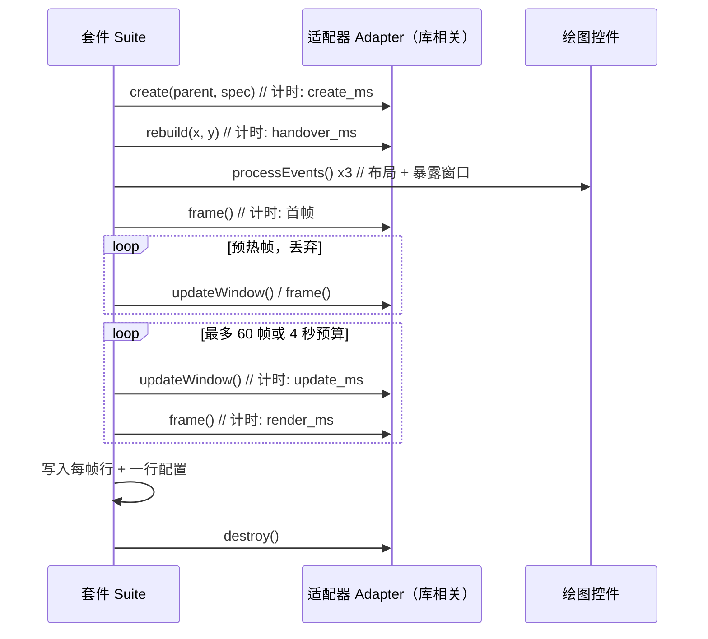

所有库都经过同样的四个调用；库相关的代码只存在于这些调用的内部实现。

### 3.2 在栅格控件与 GL 控件之间定义"一帧"

跨库对比中最关键的方法学问题在于：向一个控件请求一帧最自然的做法，即 `QWidget::repaint()`，对四个库并不做同一件事。

对基于 `QPainter` 的控件，`repaint()` 同步派发绘制事件，调用返回时像素已经生成。对 `QOpenGLWidget`，Qt 把 GL 工作推迟到 backing store 的合成阶段，它发生在之后的事件循环中。若用普通 `repaint()` 计时，QIm 适配器会把一条 100 000 点的曲线报成 0.004 ms；该数值只说明测量未捕获任何工作。Qwt 的 OpenGL 画布表现出同一种假象。

因此基准程序按 Qt 自己在合成时的做法驱动 GL 库：

```cpp
m_benchFigure->beginFrame();    // makeCurrent(): binds the context and the widget's FBO
m_benchFigure->renderFrame();   // paintGL(): the library's own render code
m_benchFigure->finishFrame();   // glFinish() + doneCurrent()
```

`paintGL()` 是 protected 成员，两个 GL 适配器各用一个一行子类将其暴露。这是唯一能对 QIm 一帧计时的协议，测量的也正是库自身的工作：ImGui 帧构建、节点树、顶点展开与 GL 提交，并通过 `glFinish()` 计入绘图命令的 GPU 执行时间。对两个 GL 库，Qt 将结果纹理合成进顶层窗口的步骤被有意排除在测量之外；对栅格库，等价的 backing store 刷新同样被排除。

各库"一整帧"的操作定义如下：

| 库 | 帧操作 |
|---------|-----------------|
| Qwt（栅格） | 设好 `QwtPlotCanvas::ImmediatePaint` 后调 `plot->replot()`（同步重绘画布） |
| Qwt（GL） | `plot->replot()`（布局）+ 画布上的 `makeCurrent`/`paintGL`/`glFinish` |
| QCustomPlot | `replot(QCustomPlot::rpImmediateRefresh)`（绘制所有图层 + 同步重绘） |
| Qt Charts | `QGraphicsView::render()` 渲染进复用的图像，与 `paintEvent` 相同的场景渲染 |
| QIm | `makeCurrent`/`paintGL`/`glFinish` |

Qt Charts 一行是唯一的偏离：对使用普通视口的 `QGraphicsView`，`repaint()` 确实会触发场景渲染，但它无法表达 GL 序列路径，因此基准程序对两种后端都使用场景渲染调用，这也正是 Qt Charts 自身导出路径所用的调用。该偏离在保守方向上是安全的：它省略了视口 blit，而在 1000×700 画布上这是一个亚毫秒常数。

### 3.3 每帧测什么

每个被测帧这样计时：

```
t_update   = 把新数据交给库的耗时   （静态数据时为 0）
t_render   = 上述帧操作的耗时
```

两者都逐帧写入 CSV。正是这一拆分使 4.4 节能够把"渲染慢"与"交接慢"分开；单次 `replot()` 计时无法做出这种区分，而该区分在实践中很重要：一个每秒刷新 60 次的面板，每秒要付出 60 次交接成本。

### 3.4 统计

每个配置先丢弃 5 个预热帧，然后记录最多 60 帧，或直到 4 秒预算用尽（以先到者为准，最少 3 帧）。命中预算的配置被标记为 `aborted` 并给出实际帧数，因此可以看出哪些数字来自被截断的运行。

五个帧不足以预热一个*进程*，而这一差别足以改变结论：不做进程预热时，一次运行的第一个配置会系统性地慢于其后完全相同的配置。QIm 的第一个 1000 点图耗时 1.30 ms，而进程绘制过内容之后同一张图只需 0.81 ms。GL 驱动与着色器初始化、库首次使用时的缺页、定时器分辨率，都集中落在第一个配置中。因此每次运行都在第一个被测配置之前先执行一个被丢弃的 1000 点配置（30 帧），原始 CSV 中不含它的任何行。

分析以被测帧的中位数为主统计量，并在尾部延迟分析中给出 p95 与 p99。第一个被测帧同样被排除在统计之外，因为它还包含一次性开销（绘制缓冲分配、GL 程序构建）。

### 3.5 内存如何归因

进程内存只有在能够归因时才有意义。因此每个库都在自己的进程中运行（驱动脚本启动六个进程，每个库与后端一个），内存基线在输入数据已存在于基准程序中、绘图尚未创建*之后*采样。报告中的 `private_mb - baseline_private_mb` 即为库自身为控件和数据增加的部分，不含基准程序持有的那份输入拷贝。

### 3.6 如何度量降采样的保真度

直接比较两个不同库的*像素*没有意义：它们布置绘图区的方式不同（边距、刻度标签尺寸、字体），同一条曲线落在不同的像素上。因此保真度实验把每个库与它自己在同一份数据、同一套坐标轴、相同样式与画布尺寸下的全分辨率渲染对比。这样每一个不同的像素都只由降采样算法造成，所得指标可以在库之间比较。

对每对图像计算三个指标（`docs/assets/bench/chartbench_fidelity.py`）：

* `changed_frac`：最大通道差超过 16/255 的像素占比，即降采样改变了画面的多少；
* `span_ratio`：差异像素在某列内的最大纵向跨度除以图像高度，针对桶采样器的典型失效模式，即窄尖峰被压成一段短竖线；
* `ink_ratio`：降采样渲染的曲线像素数除以全分辨率渲染的曲线像素数，小于 1 表示着色少于全分辨率渲染，大于 1 表示多出的着色（竖线）。

测试信号采用尖峰序列（平滑基线上叠加窄高斯峰，100 万点时尖峰概率 0.2%），因为平滑信号无法区分这些算法：任何保住包络的降采样在正弦上的结果都相同。

### 3.7 环境

| | |
|---|---|
| CPU | Intel Core i7-1260P（12 核 / 16 线程） |
| GPU | Intel Iris Xe Graphics（核显），驱动 30.0.101.3111 |
| 内存 | 32 GB |
| 操作系统 | Windows 10（10.0.26200），桌面会话，缩放 100% |
| Qt | 6.7.3，msvc2019_64，Release |
| 编译器 | MSVC 2019，C++17 |
| Qwt | 7.5.0（本仓库，`QWT_CONFIG_QWTOPENGL=ON`） |
| 画布 | 1000×700 设备无关像素，设备像素比 1.00 |
| 抗锯齿 | 四个库全开（各自默认），1 px 画笔 |

绝对耗时与机器相关；论证依据是排序关系与曲线形状。每一张图都由 `docs/assets/bench/chartbench_experiment.py` 从 `examples/bench/chartbench/run-bench.sh` 在本机产出的 CSV 重新生成。

## 4. 实测结果

基准程序运行了六个进程（Qwt 栅格、Qwt OpenGL、QCustomPlot 栅格、QCustomPlot OpenGL、Qt Charts 栅格、QIm OpenGL），产出 17 031 个被测帧与 297 个配置记录。下文每个数字都是某个配置被测帧的中位数；每张图都由 `docs/assets/bench/chartbench_experiment.py` 从 `docs/assets/bench/data/` 中的 CSV 重新生成。

有一条说明适用于所有数字：同一套矩阵重跑时绝对帧时间会漂移。本机上单个配置在多次重跑中观察到的最大变化约为 25%，这是一台持续承受负载的桌面机的常见离散度。这一点在本处重要，是因为四个库中有两个偶尔会落在相差几个百分点的范围内。*排序*与曲线形状在各次运行间稳定；下文表格中低于约 10% 的差异应视为并列。

### 4.1 帧时间随采样数变化

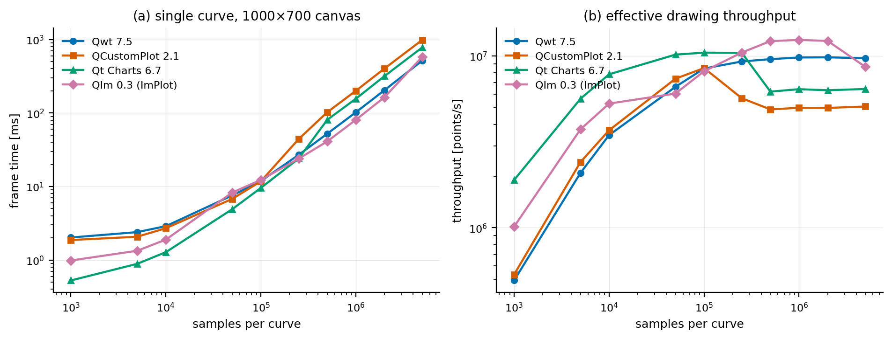

*图 1 —— `fig_scaling_points.png`。单条曲线、1000×700 画布、不降采样。左：帧时间。右：有效绘制吞吐（采样/秒）。*

排序完全取决于 $N$：

| $N$ | Qwt | QCustomPlot | Qt Charts | QIm |
|---|---|---|---|---|
| 1 000 | 2.025 | 1.872 | **0.528** | 0.985 |
| 5 000 | 2.399 | 2.076 | **0.889** | 1.339 |
| 10 000 | 2.891 | 2.710 | **1.280** | 1.895 |
| 50 000 | 7.570 | 6.790 | **4.915** | 8.281 |
| 100 000 | 11.850 | 11.770 | **9.580** | 12.292 |
| 250 000 | 26.947 | 44.119 | 24.011 | **23.904** |
| 500 000 | 52.239 | 102.421 | 80.727 | **41.029** |
| 1 000 000 | 102.181 | 200.432 | 156.248 | **80.770** |
| 2 000 000 | 203.953 | 401.643 | 317.012 | **163.650** |
| 5 000 000 | **515.598** | 985.524 | 778.962 | 579.485 |

*表 1 —— 帧时间中位数（ms），越小越好，粗体标出四者中最快。250 000 点处前两名相差不到 0.5%，即并列。*

1 000 点时 Qt Charts 比 Qwt 快 3.8 倍、比 QCustomPlot 快 3.5 倍；5 000 000 点时 Qwt 比 QCustomPlot 快 1.9 倍、比 Qt Charts 快 1.5 倍、比 QIm 快 1.12 倍。没有哪个库在所有规模上都快，它们各自在不同的区间领先，只依据单一规模的选型必然出错。

原因在于 1.2 节的"固定 + 边际"拆分。在扫描曲线呈线性的两段区间上计算每百万采样的边际成本，可以将每帧固定开销与每采样开销分开：

| 库 | 1 000 点时的 $T$ | ms/百万（100k→1M） | ms/百万（1M→5M） |
|---|---|---|---|
| Qwt | 2.025 | 100.4 | 103.4 |
| QCustomPlot | 1.872 | 209.6 | 196.3 |
| Qt Charts | 0.528 | 163.0 | 155.7 |
| QIm | 0.985 | 76.1 | 124.7 |

*表 2 —— 同一条扫描曲线表达为每采样成本。Qwt 的边际成本在两段区间上持平；QIm 在上一段抬升了 64%。*

Qwt 的边际成本在两段区间上基本相同（100.4 对 103.4 ms/百万采样），说明它的每采样工作是线性且可预测的。QIm 从 76.1 升至 124.7 ms/百万采样：它在一百万点时的优势（80.8 ms 对 Qwt 的 102.2 ms）到五百万点时变为劣势（579.5 ms 对 515.6 ms）。2.4 节描述的 CPU 侧顶点展开在此处受到内存带宽限制，而 Qwt 更紧凑的光栅化循环没有出现同样的限制。

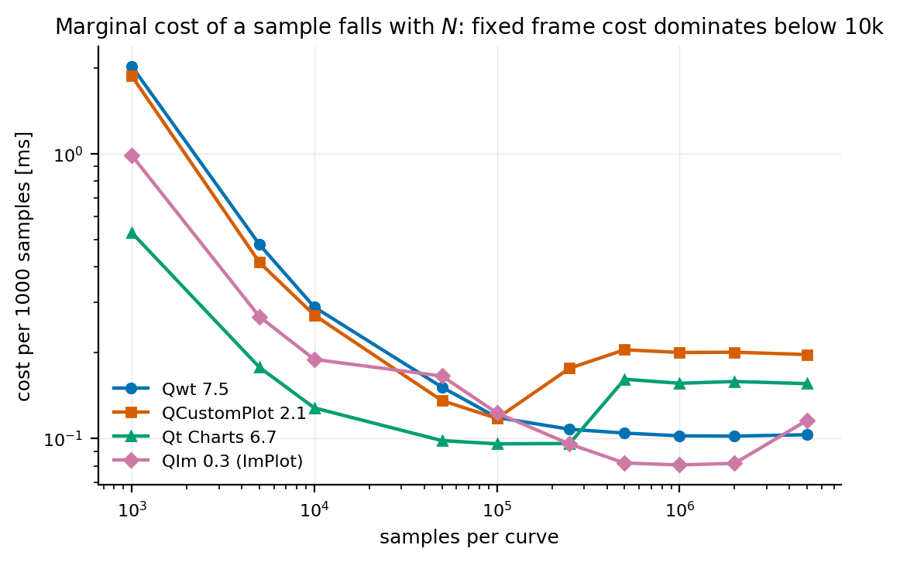

*图 2 —— `fig_scaling_per_point.png`。每 1000 个采样的成本。左侧陡降段是固定开销被摊薄，右侧平坦段才是真正的每采样成本。*

关于这条扫描曲线的一种错误分析方法，需要单独说明，因为它容易产出看似有把握的结论。对同一批数据做幂律拟合 $\log T = a + p\log N$，得到指数 0.85（Qwt）、1.01（QCustomPlot）、1.07（Qt Charts）、0.88（QIm），$R^2$ 均在 0.99 左右。按字面解读，这是 Qwt"次线性缩放"、Qt Charts"超线性缩放"，与"每条扫描曲线都在 0.2% 之内贴合一条直线（$T = a + cN$）"相矛盾。两种说法并不冲突，因为它们度量的不是同一对象：在有限区间上，截距为正的直线，其对数-对数斜率必然小于 1；成本略快于线性增长的库，其斜率必然大于 1。指数是被拟合区间的性质，固定/边际拆分反映的才是实现的性质。

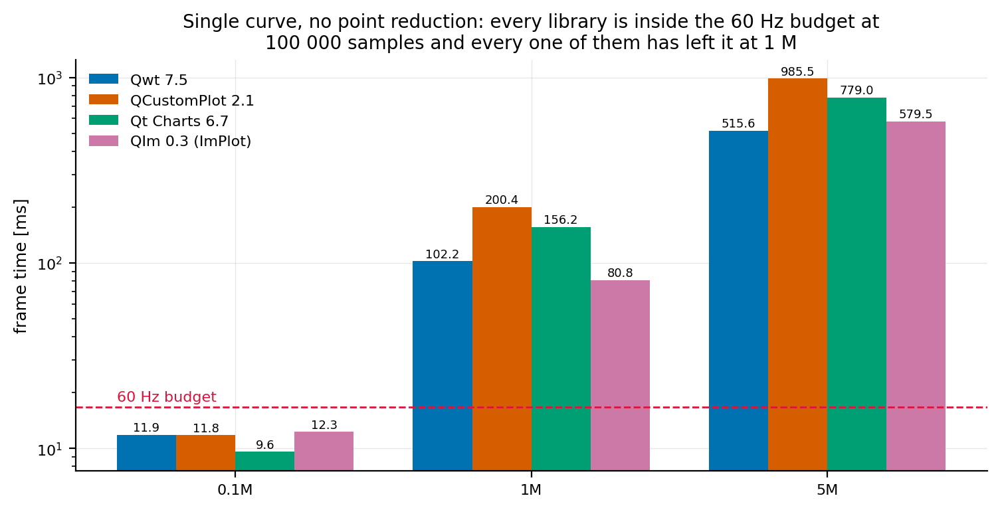

*图 3 —— `fig_summary.png`。三个参考规模，并画出 60 Hz 预算线。*

图 3 给出实际结论：本机上四个库在 100 000 点时都仍在 60 Hz 预算之内，到 250 000 点时全部超出，且没有哪个库能够直接绘制一百万点。10 万点以内，库间差别只占帧预算的一小部分；超过该规模后，选择哪个库不再重要，选择哪种降采样（4.5 节）开始重要。

### 4.2 多一条曲线要付多少

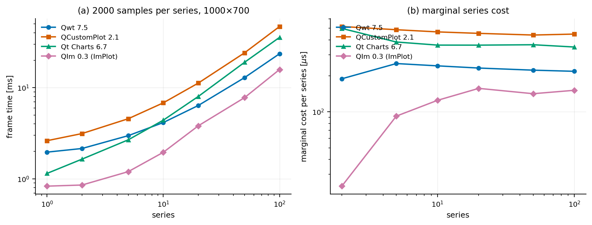

*图 4 —— `fig_curve_count.png`。每条序列 2000 个采样，1000×700 画布。*

| 曲线数 | Qwt | QCustomPlot | Qt Charts | QIm |
|---|---|---|---|---|
| 1 | 1.963 | 2.621 | 1.147 | **0.832** |
| 10 | 4.144 | 6.814 | 4.398 | **1.955** |
| 50 | 12.889 | 24.110 | 18.973 | **7.776** |
| 100 | 23.554 | 46.834 | 35.613 | **15.814** |
| 每条曲线边际成本 | 215.7 $\mu$s | 444.7 $\mu$s | 346.8 $\mu$s | 154.0 $\mu$s |

*表 3 —— 帧时间中位数（ms），每条序列 2000 个采样，以及 10 到 100 条之间测得的单条曲线边际成本。*

同样 20 000 个采样拆成 100 条曲线时，QIm 比 QCustomPlot 快 3.0 倍、比 Qt Charts 快 2.3 倍；而同样这 20 000 个采样放在一条曲线中（表 1 的 10 000 与 50 000 之间），四个库在 10 000 点时彼此相差在 2.3 倍以内、在 50 000 点时相差在 4.4 倍以内。把数据拆成多条序列并非中性决定：它把负载移入各管线中"每曲线开销"所在的环节，Qwt 是每条曲线一个 `QPainterPath`，Qt Charts 是场景 item 加路径，ImPlot 是一段 draw-list 区间。

边际成本一行隔离出这一效应：在 10 到 100 条之间，每增加一条曲线，QCustomPlot 需要 445 $\mu$s、Qt Charts 347 $\mu$s、Qwt 216 $\mu$s，而 QIm 只需 154 $\mu$s。这个量完全不依赖数据，只取决于每帧为每条序列需要记录的开销，在库间相差 2.9 倍。

### 4.3 画布尺寸：填充率与几何密度的相互制约

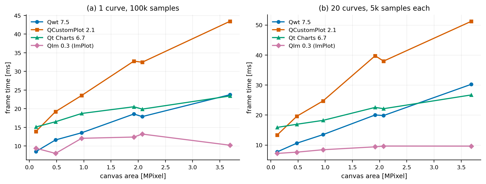

*图 5 —— `fig_canvas_size.png`。左：一条 100 000 采样的曲线。右：20 条各 5 000 采样的曲线。*

右图更适合观察这一效应，因为 20 条曲线使填充率项真正具备工作量：

| 画布 | Qwt | QCustomPlot | Qt Charts | QIm |
|---|---|---|---|---|
| 400×300 | 7.753 | 13.385 | 15.889 | **7.222** |
| 1200×800 | 13.478 | 24.700 | 18.226 | **8.445** |
| 1600×1200 | 20.033 | 39.768 | 22.553 | **9.415** |
| 2560×1440 | 30.254 | 51.246 | 26.707 | **9.640** |
| 面积增长 30 倍后的涨幅 | 3.90× | 3.83× | 1.68× | **1.33×** |

*表 4 —— 20 条各 5 000 采样曲线的帧时间中位数（ms）。*

画布面积增长 30 倍时，Qwt 与 QCustomPlot 的帧时间增长约 4 倍，Qt Charts 增长 1.7 倍，QIm 只增长 1.33 倍。QIm 在 2560×1440 下的帧时间（9.640 ms）仅略高于它在 400×300 下的（7.222 ms），并在每一种画布尺寸下都低于 Qwt，倍率为 2.4 到 5.3 倍。

这种"平坦"有一部分源于协议本身：这里的栅格帧包含"把每个 item 光栅化进与画布同尺寸的 backing store，再 blit 该缓存"，而这里的 GL 帧在库自身的绘制命令执行完毕时结束，Qt 将结果纹理合成进窗口的步骤在测量之外（6.1 节）。因此栅格库为画布支付两次成本，GL 库在被测窗口内一次也不支付。GL 库实际支付的是它提交的几何量，这正是 QIm 的帧时间仍然随 $N$ 增长（表 1）却几乎不随画布增长的原因。

单曲线一栏给出同样的排序，但趋势弱得多，因为一条折线产生的填充工作量不足以让填充率项占据主导：

| 画布 | Qwt | QCustomPlot | Qt Charts | QIm |
|---|---|---|---|---|
| 400×300 | 8.514 | 13.908 | 15.102 | 9.394 |
| 1200×800 | 13.547 | 23.546 | 18.723 | **12.067** |
| 2560×1440 | 23.756 | 43.428 | 23.405 | **10.211** |
| 涨幅 | 2.79× | 3.12× | 1.55× | 1.09× |

*表 5 —— 一条 100 000 采样曲线的帧时间中位数（ms）。*

表 5 中 QIm 的数字在 8.0 ms 到 13.2 ms 之间波动，不呈单调趋势，第 4 节开头所述的运行间离散度在此可见；但它始终不随栅格库一同上升：2560×1440 下为 10.211 ms，而 Qwt 为 23.756 ms、QCustomPlot 为 43.428 ms。

有一个细节会打破"像素更少必然更快"的朴素模型：表 5 中同样 100 000 个采样，Qwt 在 400×300 下需要 8.514 ms，在 800×600 下却需要 11.628 ms；Qt Charts 为 15.102 ms 对 16.506 ms。把 100 000 个采样压进 400 列会使折线陡峭得多，而更陡的折线每段覆盖更多像素。画布面积与几何*密度*作用方向相反，对密集折线图而言，"把画布改小"并不像它看起来那样有效。

### 4.4 交接数据与绘制数据

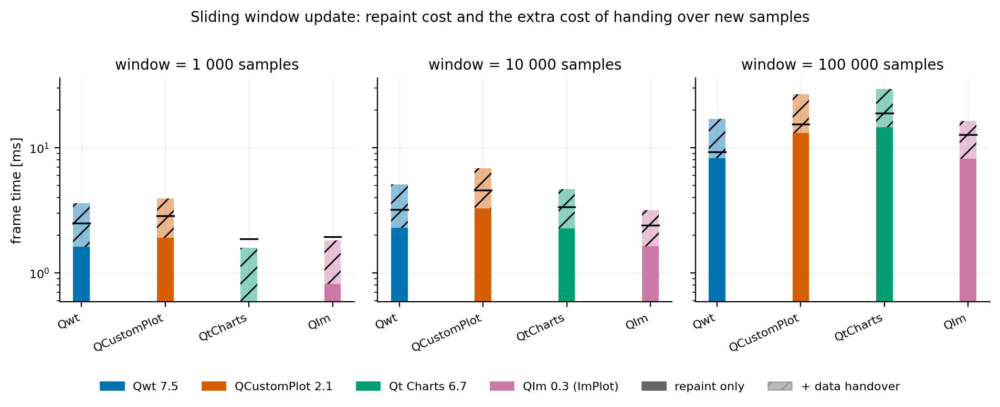

*图 6 —— `fig_update_decomposition.png`。每个可见窗口尺寸：窗口大小序列的重绘成本（实色），加上交接新采样的额外成本（斜纹）。横线标记为 p95。*

| 可见窗口 | | Qwt | QCustomPlot | Qt Charts | QIm |
|---|---|---|---|---|---|
| 1 000 | 重绘 | 1.616 | 1.896 | **0.589** | 0.814 |
| | 交接 | 0.002 | 0.007 | **2.010** | 0.006 |
| 10 000 | 重绘 | 2.278 | 3.270 | 2.260 | **1.625** |
| | 交接 | 0.013 | 0.096 | **15.013** | 0.013 |
| 100 000 | 重绘 | 8.261 | 13.079 | 14.581 | **8.144** |
| | 交接 | 0.559 | 1.137 | **141.664** | 0.230 |

*表 6 —— 中位数（ms）。"重绘"列是窗口大小序列的重绘成本；"交接"列是完全不重绘的纯数据交接变体。*

这是单次扫描式基准无法得到的测量，也是最重要的数据之一。在 100 000 采样的窗口下，各库绘制一帧花费 8.1 ms 到 14.6 ms（相差 1.8 倍），交接数据却花费 230 $\mu$s 到 141.7 ms，相差 616 倍。对 60 Hz 应用而言，交接是每帧预算中的一项固定支出：QIm 占 16.7 ms 一帧的 1.4%、Qwt 占 3.3%、QCustomPlot 占 6.8%，而 Qt Charts 占 848%。

三个交接较快的库都接受一块采样并直接拷贝，Qt Charts 没有这样的入口：`QXYSeries` 只提供 `replace(const QList<QPointF>&)`，调用方必须先构造 100 000 个 `QPointF` 对象。一个独立探针（`examples/bench/chartbench/qtcharts_handover_probe.cpp`）把这一步拆开：

| $n$ | 构造 `QList<QPointF>` | `QXYSeries::replace()` | 两次 `QValueAxis::setRange()` | 合计 |
|---|---|---|---|---|
| 100 000 | 0.73 ms | 48.65 ms | 25.55 ms | 74.93 ms |
| 1 000 000 | 6.62 ms | 420.68 ms | 269.91 ms | 697.21 ms |

*表 7 —— 孤立测得的 Qt Charts 交接，图表处在一个已显示的 `QChartView` 中。*

常被归因的数据拷贝实际上是最便宜的一环，在 74.93 ms 中只占 0.73 ms。开销来自 Qt Charts 围绕数据执行的其他处理，并且取决于图表是否处于活动视图中：同样是 100 000 点，图表不显示时同一个 `replace()` 只需 1.88 ms。表 6 的"交接"列是应用不得不使用的 API 的端到端成本；一个在 60 Hz 下更新 Qt Charts 序列的应用，在 100 000 点时无法做到。

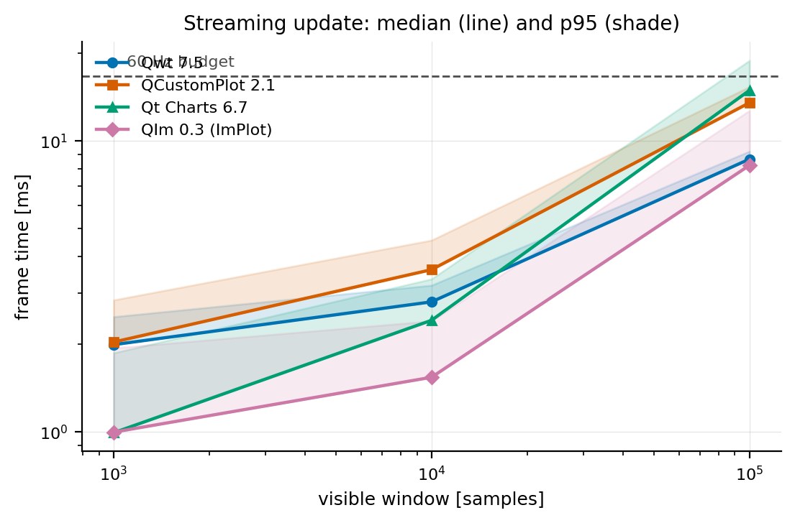

*图 7 —— `fig_streaming.png`。一帧内完成更新加重绘，横轴为可见窗口；阴影为 p95。*

在 1 000 采样窗口下（对四个库中的三个都是可维持 60 Hz 的负载），QIm 占 16.7 ms 预算中的 1.004 ms，Qt Charts 占 3.115 ms，分别为 6.0% 与 18.7%。到 10 000 采样时 Qt Charts 已超出预算（16.818 ms，100.7%），而 QIm 只需 1.572 ms（9.4%）。到 100 000 采样时只剩 QIm（8.613 ms，51.6%）与 Qwt（9.332 ms，55.9%）仍在预算之内。

### 4.5 降采样：成本与保真度

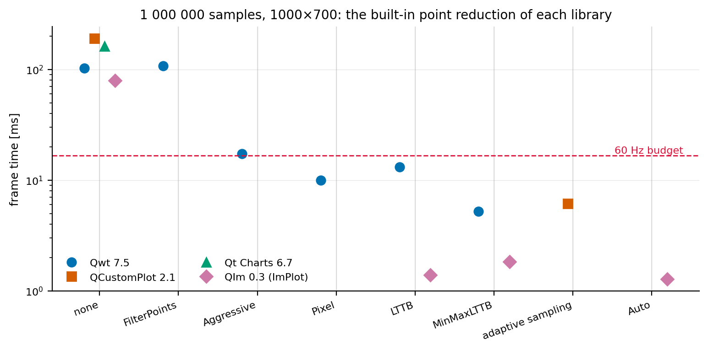

*图 8 —— `fig_downsample_time.png`。每个库提供的全部降采样策略，一百万采样点。*

| 库 | 策略 | 帧时间 | 相对不降采样 |
|---|---|---|---|
| Qwt | 无 | 102.990 ms | 1.00× |
| Qwt | `FilterPoints` | 107.405 ms | 0.96× |
| Qwt | `FilterPointsAggressive` | 17.259 ms | 5.97× |
| Qwt | `FilterPointsLTTB` | 13.108 ms | 7.86× |
| Qwt | `FilterPointsPixel` | 9.973 ms | 10.33× |
| Qwt | `FilterPointsMinMaxLTTB` | **5.200 ms** | **19.8×** |
| QCustomPlot | 无 | 190.294 ms | 1.00× |
| QCustomPlot | 自适应采样 | **6.163 ms** | **30.9×** |
| Qt Charts | 无（没有可用实现） | 161.798 ms | 1.00× |
| QIm | 无 | 79.266 ms | 1.00× |
| QIm | MinMaxLTTB | 1.839 ms | 43.1× |
| QIm | LTTB | 1.387 ms | 57.2× |
| QIm | Auto | **1.277 ms** | **62.1×** |

*表 8 —— 一百万采样点时的帧时间中位数。"相对不降采样"是该库自身的加速比。*

成本最低的降采样并不是保真度损失最大的降采样。Qwt 的 `FilterPoints`（经典的"丢弃重复点与屏外点"过滤器）可测得比全部绘制更慢：107.405 ms 对 102.990 ms。它遍历数据，但在密集且全部位于范围内的序列中没有找到任何可删内容，于是这一帧被原样画完。它是表中唯一没有换来任何收益的策略，其保真度指标也逐像素证实了这一点。

降采样带来的差异比库的选择高出两个数量级。关闭降采样时，四个库相差 2.4 倍（79.3 ms 到 190.3 ms）；各自使用最好的降采样后，差距为 4.8 倍（QIm 的 1.277 ms 到 QCustomPlot 的 6.163 ms）。与没有降采样可用的 Qt Charts（161.8 ms）相比，QIm 的 `Auto` 快 127 倍。其他因素都只是常数因子，只有这一项带有两个数量级的差异。

QIm 的 `Auto` 是该规模下测到的最快配置：一百万采样点每帧 1.277 ms，比其自身不降采样快 62 倍。它同时也是该库的默认行为：QIm 的降采样控制器在超过 100 000 采样时自动切换到 MinMaxLTTB，一个未显式关闭降采样的 QIm 基准测得的是降采样之后的路径。

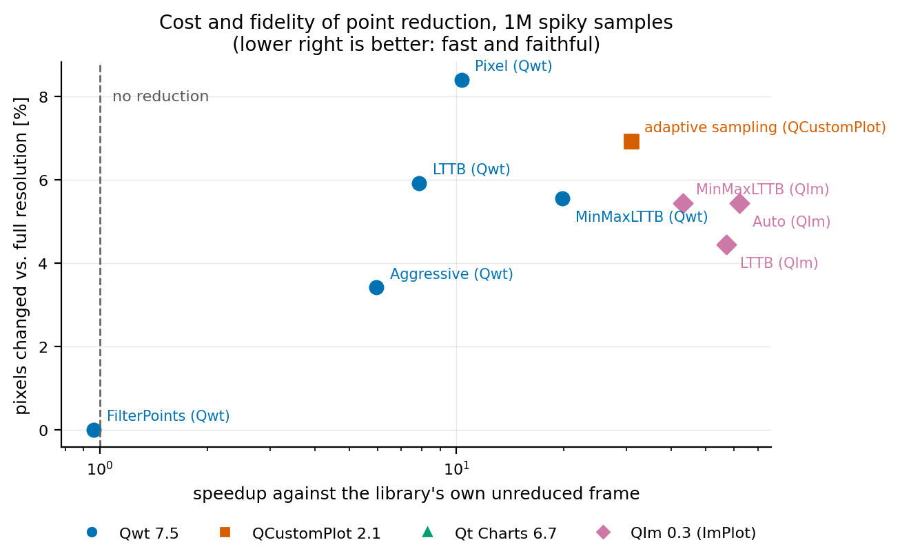

*图 9 —— `fig_fidelity_pareto.png`。每个策略按帧时间（横轴）与相对该库自身全分辨率渲染的像素偏差（纵轴）摆放。右下角是"又快又准"。*

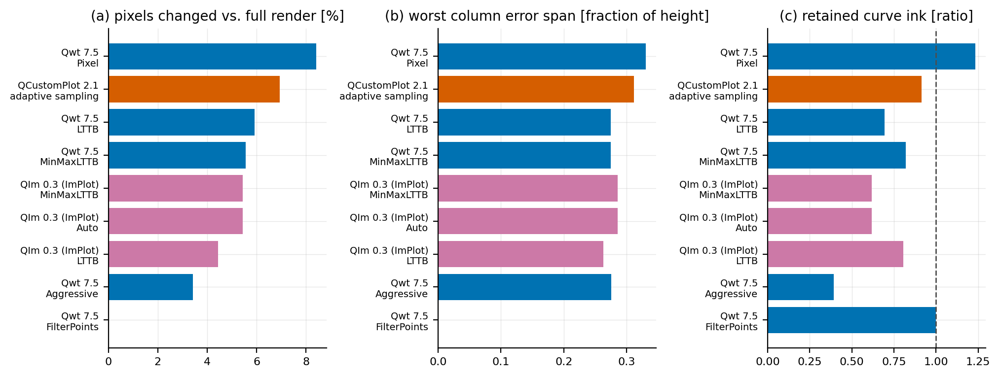

*图 10 —— `fig_fidelity_metrics.png`。3.6 节三个保真度指标，在一百万尖峰采样点上的每个策略。*

| 库 | 策略 | 改动像素 | 最差列跨度 | 保留着墨 |
|---|---|---|---|---|
| Qwt | `FilterPoints` | 0.00 % | 0.000 | 1.000 |
| Qwt | `FilterPointsAggressive` | 3.41 % | 0.276 | 0.394 |
| Qwt | MinMaxLTTB | 5.56 % | 0.274 | 0.821 |
| Qwt | LTTB | 5.91 % | 0.274 | 0.695 |
| Qwt | `FilterPointsPixel` | 8.40 % | 0.330 | 1.233 |
| QCustomPlot | 自适应采样 | 6.92 % | 0.311 | 0.915 |
| QIm | LTTB | 4.45 % | 0.263 | 0.806 |
| QIm | MinMaxLTTB / Auto | 5.44 % | 0.286 | 0.618 |

*表 9 —— 相对各库自身全分辨率渲染的保真度，一百万尖峰采样点。"改动像素"指最大通道差超过 16/255 的像素。*

这些指标把策略恰好分成理论预期的两类，这也是仅凭计时无法得出的部分：

* 保包络类策略比全分辨率渲染画得*更多*墨，因为它们把一簇密集采样替换为一根覆盖同一纵向范围的竖线：`FilterPointsPixel` 保留 1.233 倍的着墨，Qwt 的 MinMaxLTTB 保留 0.821 倍且 `span_ratio` 为 0.274，即某一像素列的像素被移动超过图像高度的四分之一。它们的 `changed_frac` 在各降采样策略中最低（3.4%–8.4%）。
* 丢尖峰类策略画得*更少*：Qwt 的 `FilterPointsAggressive` 只保留 0.394 倍的着墨，QIm 的 MinMaxLTTB 保留 0.618 倍。尖峰作为像素仍然存在，但更细更矮，包络缩小，这正是降采样理论所警告的失效模式。
* `FilterPoints` 与不降采样逐像素相同（改动 0.00%，着墨比 1.000）：没有可删除的内容，渲染结果就与不降采样完全一致，这与它的帧时间不低于不降采样相互印证。

实际推论是："一百万点时最快"与"一百万点时最准"并不对立。Qwt 的 MinMaxLTTB 是表中第二快的策略，同时属于保真度较高的一档；而保留最多着墨的策略（`FilterPointsPixel`）恰是改动像素最多的一个。在图 9 中，帕累托前沿（左下边界）穿过 QIm 的 `Auto`/`LTTB`、Qwt 的 MinMaxLTTB 与 QCustomPlot 的自适应采样；落在前沿之外的策略在两个轴上都被支配。

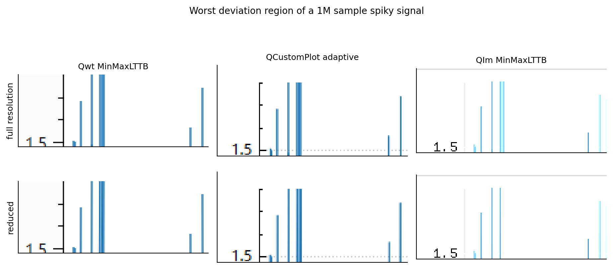

*图 11 —— `fig_downsample_visual.png`。全分辨率渲染与降采样渲染差异最大的区域，裁剪放大，三个库。*

### 4.6 帧时间稳定性

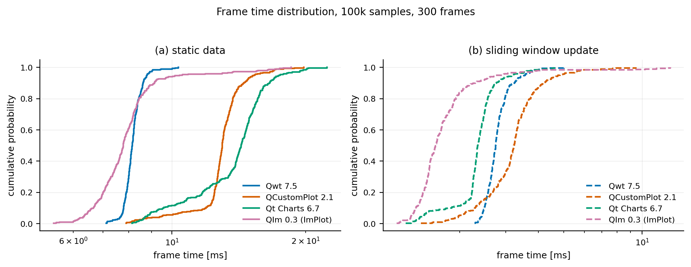

*图 12 —— `fig_jitter_ecdf.png`。300 个连续帧时间的经验分布。*

| 库 | 变体 | p50 | p95 | p99 | 最大 | 标准差 |
|---|---|---|---|---|---|---|
| Qwt | 静态，10 万点 | 8.14 | 8.78 | 9.45 | 10.33 | 0.40 |
| Qwt | 流式，1 万点窗口 | 2.75 | 3.55 | 4.10 | 5.03 | 0.35 |
| QCustomPlot | 静态，10 万点 | 12.98 | 15.30 | 17.14 | 19.79 | 1.58 |
| QCustomPlot | 流式，1 万点窗口 | 3.23 | 4.76 | 6.96 | 9.46 | 0.95 |
| Qt Charts | 静态，10 万点 | 14.31 | 17.45 | 20.10 | 22.34 | 2.58 |
| Qt Charts | 流式，1 万点窗口 | 2.34 | 3.17 | 4.16 | 4.61 | 0.48 |
| QIm | 静态，10 万点 | **7.77** | 10.42 | 17.04 | 18.55 | 1.84 |
| QIm | 流式，1 万点窗口 | **1.62** | **2.78** | 10.29 | 12.80 | 1.30 |

*表 10 —— 300 帧的百分位（ms）。静态变体是 100 000 采样的随机游走；流式变体是在 100 000 采样缓冲上滑动的 10 000 采样窗口。四个静态中位数都高于表 1 中相应的单曲线数字，因为随机游走信号在每一列上都铺满画布高度。*

中位数给出的排序与其余测量一致，但尾部延迟给出不同的信息，而对控制回路而言重要的是尾部：

* QIm 的中位数最低，尾部最差。它的静态 p50 为 7.77 ms，是四者中最低的；流式 p50 为 1.62 ms，p95 为 2.78 ms。但它的静态 p99 为 17.04 ms，而 Qwt 为 9.45 ms；它在 300 帧中最差的一帧耗时 18.55 ms，而 Qwt 为 10.33 ms。一帧 GL 中包含完成时刻不由应用掌控的工作（驱动批处理、合成调度），表现为一条较厚的右尾。
* Qwt 以略差的中位数换取最小的离散度：从 8.14 ms 到最差一帧 10.33 ms 为 1.27 倍，而 QCustomPlot 为 1.52 倍、Qt Charts 为 1.56 倍、QIm 为 2.39 倍。当截止时间比平均值更重要时，Qwt 是更可预测的渲染器。
* 流式更新缩短中位数，同时拉长尾部。四个库都呈现这一现象，QIm 最明显：流式 p50 降至 1.62 ms，p99 仍为 10.29 ms，于是 p99/p50 从 2.2 倍升至 6.4 倍、max/p50 从 2.4 倍升至 7.9 倍。4.4 节的更新路径即便平均成本较低，离散度仍然很大；按流式中位数制定的预算在截止时间上会偏离一个数量级。

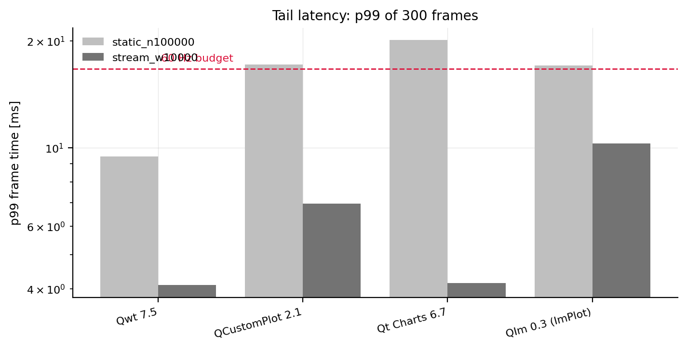

*图 13 —— `fig_jitter_tail.png`。300 帧的 p99 与 60 Hz 预算线。*

图 13 中只有两种配置的 p99 落在 60 Hz 预算之内：Qwt 与 Qt Charts 的 10 000 采样流式窗口（分别为 4.10 ms 与 4.16 ms）。一张 100 000 采样的静态图，四个库（包括最快的那个）的 p99 都超出预算。

### 4.7 每采样内存

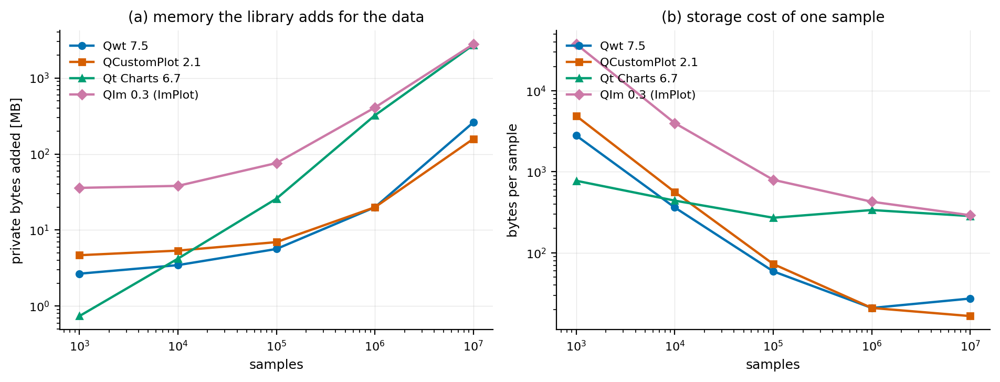

*图 14 —— `fig_memory.png`。库增加的私有字节，基线在输入数据已存在之后采样。左：绝对值。右：每采样。*

| 库 | 1 000 | 100 000 | 1 000 000 | 10 000 000 | 100 条 × 10 000 |
|---|---|---|---|---|---|
| Qwt | 2 800 B | 59.1 B | 20.9 B | 27.3 B | 29.7 B |
| QCustomPlot | 4 897 B | 72.8 B | 20.9 B | 16.6 B | 22.4 B |
| Qt Charts | 776 B | 271.3 B | 337.8 B | 285.0 B | 286.2 B |
| QIm | 37 623 B | 797.0 B | 427.9 B | 291.3 B | 178.7 B |

*表 11 —— 每采样的私有内存字节数。*

理论下限是每采样 16 字节（两个 `double`）。用数组存数据的两个库在数据量超过控件自身占用之后确实逼近了该下限：一百万采样点时 QCustomPlot 为 16.6 字节、Qwt 为 20.9 字节；到一千万点时 QCustomPlot 更接近下限，因为容器的额外开销被摊薄。Qt Charts 与 QIm 并不收敛，一千万点时仍为 285.0 B 与 291.3 B，比下限高出一到两个数量级。对 Qt Charts 而言，这来自 `QList<QPointF>` 与其场景 item；对 QIm 而言，是保留模式的节点树，每条序列都保留一个 `QImPlotLineItemNode` 和一份数据拷贝。100 条曲线时差距十分明显：同样一百万点，Qt Charts 需要 272.9 MB，QCustomPlot 只需 21.4 MB。

小 $N$ 一列同样不是噪声，它是绘图控件自身的固定占用。QIm 在 1000 点时的 37.6 kB 来自 ImGui 上下文、ImPlot 上下文与字体图集，与 4.8 节中 78 ms 的首帧互相印证。同样规模下 Qt Charts 只需 776 B：场景图在有数据可存之前几乎没有内存开销。

### 4.8 启动开销

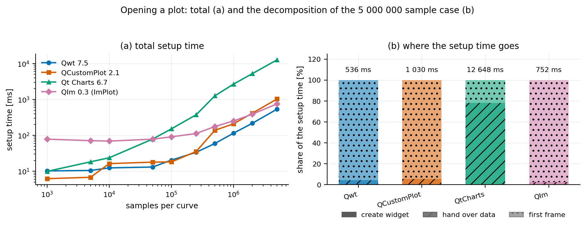

*图 15 —— `fig_setup_time.png`。左：从"创建绘图"到首帧完成的全部时间。右：最大测量规模下的分解。*

| $N$ | | Qwt | QCustomPlot | Qt Charts | QIm |
|---|---|---|---|---|---|
| 1 000 | 创建 | 1.5 | 0.1 | 1.0 | 0.2 |
| | 交接 | 0.07 | 0.04 | 1.7 | 0.04 |
| | 首帧 | 8.7 | 6.1 | 7.3 | **78.1** |
| 10 000 | 创建 | 2.2 | 0.1 | 1.2 | 0.2 |
| | 交接 | 0.1 | 0.3 | 12.3 | 0.04 |
| | 首帧 | 10.1 | 16.0 | 10.4 | **69.2** |
| 100 000 | 创建 | 2.1 | 0.1 | 1.2 | 0.3 |
| | 交接 | 0.6 | 1.0 | 112.2 | 0.5 |
| | 首帧 | 17.8 | 17.2 | 38.7 | **90.4** |
| 1 000 000 | 创建 | 1.0 | 0.1 | 1.5 | 0.3 |
| | 交接 | 3.9 | 10.4 | 2 075.0 | 5.7 |
| | 首帧 | **110.4** | 199.3 | 597.1 | 246.5 |
| 5 000 000 | 创建 | 1.1 | 0.1 | 1.4 | 0.3 |
| | 交接 | 21.0 | 55.7 | 9 900.2 | 18.9 |
| | 首帧 | **514.0** | 974.3 | 2 746.4 | 733.3 |

*表 12 —— 分解后的毫秒数。总计见原始 CSV 的 setup 列。*

首帧在所有配置中都占主导，它包含第一次完整光栅化，对若干库还包含一次性分配；而"交接"一行把各库在规模上分开。Qt Charts 需要 9.9 秒才能接收五百万个采样，Qwt 为 21.0 ms，相差 470 倍，4.4 节的探针说明了时间去向。打开一个大文件正是用户等待的时刻，也是 Qwt、QCustomPlot、QIm 三者第一次进入同一数量级的时刻（21.0 ms、55.7 ms、18.9 ms）。

"首帧"一行是 QIm 架构暴露其主要短板之处：一万采样点以内的图需要 69–78 ms 的首帧工作，其余三个库只需 6–18 ms。ImGui 与 ImPlot 上下文以及字体图集必须在绘制任何内容之前建立。这笔开销随之被摊薄，到 100 000 采样点时 QIm 的首帧已是第二便宜，到一百万点时最便宜；但一个需要打开许多小图的应用会反复支付这笔成本。

### 4.9 栅格与 OpenGL

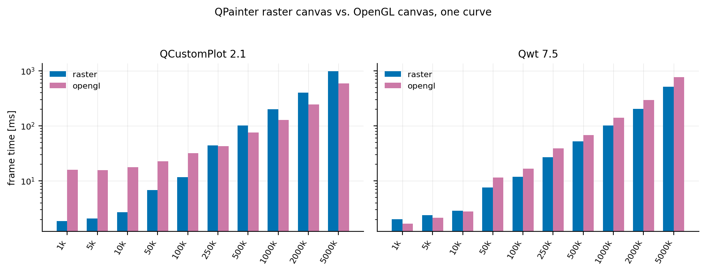

*图 16 —— `fig_backend.png`。两个同时提供两种后端的库，相同数据与画布。*

| $N$ | Qwt 栅格 | Qwt GL | 比值 | QCustomPlot 栅格 | QCustomPlot GL | 比值 |
|---|---|---|---|---|---|---|
| 1 000 | 2.025 | **1.669** | 0.82 | **1.872** | 16.067 | 8.58 |
| 10 000 | 2.891 | **2.795** | 0.97 | **2.710** | 17.908 | 6.61 |
| 100 000 | **11.850** | 16.693 | 1.41 | **11.770** | 32.240 | 2.74 |
| 250 000 | **26.947** | 39.258 | 1.46 | 44.119 | **43.154** | 0.98 |
| 500 000 | **52.239** | 67.912 | 1.30 | 102.421 | **76.358** | 0.75 |
| 1 000 000 | **102.181** | 140.210 | 1.37 | 200.432 | **128.322** | 0.64 |
| 5 000 000 | **515.598** | 774.786 | 1.50 | 985.524 | **593.822** | 0.60 |

*表 13 —— 帧时间中位数（ms）；比值是 GL 除以栅格，小于 1.0 表示 GL 路径胜出。*

两个同时提供两种后端的库表现相反。Qwt 的 GL 画布在小图上更快（1 000 点时 0.82 倍、10 000 点时 0.97 倍），随后在每一个更大的规模上落后，倍率 1.30–1.50 倍。它没有大额的 GL 固定开销，但每采样成本更高：同一套 `QPainter` 绘制经由 `QOpenGLPaintDevice` 时，必须先在 CPU 上把折线三角化再交给 GPU，而对一条长折线来说，这一过程的代价严格高于直接光栅化。

QCustomPlot 的 GL 绘制缓冲则相反：约 16 ms 的固定开销，在 1 000 点时是它自己栅格路径的 8.6 倍，但随规模增长得以收回。它在 100 000 到 250 000 采样之间反超自身的栅格后端，并在五百万点时取得 1.66 倍的领先。它的交叉点比 Qwt 早约一个数量级，因为两条 GL 路径的设计不同：Qwt 经由 `QOpenGLPaintDevice` 绘制到控件 FBO，QCustomPlot 则绘制到其自身由编译期选定、以 FBO 为后端的绘制缓冲。

两个结果都不支持"折线图就应开启 OpenGL"。它们支持的是一条交叉判据：当每帧几何量足够大、能够摊薄固定开销时，GL 才会胜出；同时说明交叉点的位置取决于具体实现，与是否使用 GPU 无关：一个库在 10 万点，另一个库则始终不出现交叉。

基准程序单独记录的 `glFinish` 等待（`gpu_sync_ms`）解释了两条 GL 路径为何表现如此不同：

| $N$ | Qwt GL 帧 | 其中 `glFinish` | QIm 帧 | 其中 `glFinish` |
|---|---|---|---|---|
| 1 000 | 1.669 | 1.610 | 0.985 | 1.190 |
| 10 000 | 2.795 | 2.413 | 1.895 | 1.761 |
| 100 000 | 16.693 | 5.672 | 12.292 | 10.153 |
| 500 000 | 67.912 | 0.698 | 41.029 | 23.334 |
| 1 000 000 | 140.210 | 0.614 | 80.770 | 46.797 |
| 5 000 000 | 774.786 | 0.551 | 579.485 | 495.988 |

*表 14 —— 帧时间中位数与其中的 `glFinish` 等待均值（ms）。等待量是库提交完毕后 GPU 仍需要的时间。*

Qwt 的 GL 画布是 CPU 瓶颈：50 万点及以上时 `glFinish` 不到一毫秒即返回，因为 CPU 已在 `QOpenGLPaintDevice` 中三角化折线数十毫秒，GPU 早已完成绘制。QIm 在同样规模上是 GPU 瓶颈：五百万点时一帧 579 ms 中有 496 ms 用于等待 GPU 光栅化 ImPlot 提交的几何；即便在一百万点，等待也占 81 ms 中的 47 ms。两个库以相反的方式使用 GPU，一个把瓶颈留在 CPU，一个把瓶颈转移到 GPU；对单条折线图而言，两者总体都没有变快。

（QCustomPlot 的 GL 适配器同样调用了 `glFinish`，但不像另外两个库那样单独记录等待时长；该等待已计入它的帧时间。）

### 4.10 同一份数据，四个库各自画出来

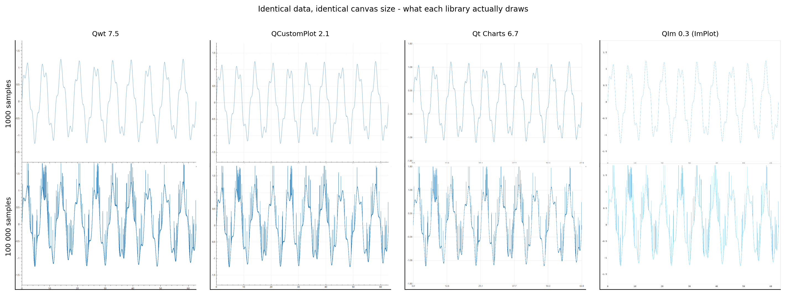

*图 17 —— `fig_render_comparison.png`。相同数据、相同画布尺寸，各库自己的全分辨率渲染（由基准程序导出）。*

各库版式不同（边距、刻度标签尺寸、坐标轴色调），这正是 3.6 节将每个库与自身渲染对比、而不跨库对比的原因。这张图还表明*像素预算*也不同：

| 库 | 1 000 采样时的着墨 | 100 000 采样时的着墨 |
|---|---|---|
| Qwt | 0.784 % | 4.382 % |
| QCustomPlot | 0.706 % | 5.431 % |
| Qt Charts | 1.385 % | 5.017 % |
| QIm | 0.287 % | 1.401 % |

*表 15 —— 低于着墨阈值的画布像素占比，即各库自己渲染同一份数据时覆盖了画布多少。*

同一条曲线，1 000 采样点时 Qt Charts 在画布上留下的着墨为 QIm 的 4.8 倍（1.385% 对 0.287%），100 000 采样点时是 3.6 倍。帧时间中位数相同的两个库并不一定在绘制同样多的内容；跨库比较截图的读者实际比较的是线宽与绘图区占比，而不只是渲染器。

## 5. 讨论

### 5.1 三种工况

第 4 节的测量并未收敛到单一排名，它给出三种各有胜者的工况，边界由"哪一项成本占主导"划定：

工况 1：小图（$N \lesssim 10^4$，曲线少）。每个库都宽裕地处于 60 Hz 预算之内，排序由零负载下的 $T_{\text{compose}} + T_{\text{transform}}$ 决定，即每帧固定开销。基于 GL 的库在此胜出，三个 `QPainter` 库之间的差别很小。对绘制少量小图的应用来说，这才是它实际所处的工况，相应的结论是：帧时间不作为选型判据，应按 API、功能与许可证选择。

工况 2：大静态图（$N \gtrsim 10^5$，数据很少变化）。此时每采样的变换与光栅化占主导，`QPainter` 各库之间的排序由"谁更高效地把 $N$ 个采样转换为一条折线"决定，GL 库的优势缩小为它仍然必须完成的 CPU 顶点展开。在这一工况中，*降采样策略*开始比库的选择更重要，因为降采样能去掉一个数量级的工作量，而任何管线调优都做不到。

工况 3：大动态图（$N \gtrsim 10^5$，每帧都更换数据）。此时 $T_{\text{handover}}$ 每帧都要支付，并叠加到其余所有成本之上。排序由库的数据 API 成本决定，而这里的差距远大于渲染本身的差距，因为各 API 的差别在于种类，不只是常数：两个库接受连续的 `double` 数组，一个把采样放在调用方无法整块交出的有序逐点容器中，还有一个要求调用方构造一串 `QPointF` 对象。4.4 节量化了这一点，它是最可能改变设计决策的一项测量，因为它在"重绘时间对 N"的图上完全不可见。

### 5.2 降采样是唯一具备数量级差异的手段

最有用的一个数字，是一百万采样点下"按原样绘制"与"经库自身降采样后绘制"的比值。任何管线调优（栅格对 GL、库对库）都远达不到这一幅度，保真度实验还表明成本最低的降采样并不是保真度最差的那些。由此得到两个推论：

* 把降采样留在各库默认值上进行的对比，测量的实际上是各库的默认配置，而这些默认值彼此也不可比。Qwt 7.5 无条件开启 LTTB 降采样（2.1 节），QIm 在 20 000 采样以上开启 MinMaxLTTB，QCustomPlot 在数据超过每像素列两个点后开启自适应采样，Qt Charts 则根本没有降采样可开。同一个库既可能是四者中最快的，也可能是最慢的，只取决于一个属性（Qwt）、一个 setter（QCustomPlot、QIm）或一个画布宽度（QCustomPlot 的密度触发条件）。
* *无法*降采样的库（Qt Charts 没有等价机制）在大 $N$ 处存在一个任何其他选择都无法抬高的上限。对序列动辄百万点的 Qt Charts 应用，解法是架构性的：在库外先降采样，或者对数据开窗。

保真度结果还解释了这些算法*为什么*不同，这一解释与降采样理论的预期一致：保留 min 与 max 的桶采样器按构造保持每个像素列的纵向包络，保留"桶内首尾两点"的采样器则会丢掉窄尖峰。实测的 `span_ratio` 与 `ink_ratio` 恰好把策略分成这两族。

### 5.3 GPU 的适用场合

后端对比是最清楚的一项阴性结果。对单条细折线，Qwt 与 QCustomPlot 的 GL 画布在轻载区都比栅格画布*更慢*，因为 GL 路径需要支付一笔栅格路径没有的每帧固定开销（上下文、FBO、绘制设备准备与合成），而折线本身短到用 CPU 光栅化并不构成瓶颈。只有当每帧几何工作量足够大（曲线多、画布大、重抗锯齿）时，GL 路径才有竞争力；这与[栅格与 OpenGL 报告](raster-vs-opengl.md)仅对 Qwt 推导出的交叉判据一致，并在一个独立实现 GL 绘制缓冲的第二个库上得到确认。

因此对*折线图*而言，开启 OpenGL 是针对特定负载的策略，而不是通用性能策略；测量指明了这些负载：只有当栅格引擎的逐段工作量占主导时，GL 才有优势。

### 5.4 实用选型表

| 场景 | 建议 | 依据（实测） |
|---|---|---|
| 仪表盘、许多小图、每个 < 10k 采样 | 均可，按 API 与功能选择 | 四者都远在帧预算之内，差异是亚毫秒级 |
| 一张大静态图、缩放平移、10 万–1000 万采样 | Qwt 或 QIm，开启降采样 | 两者都能降到与像素相称的预算；降采样主导帧时间 |
| 流式、每帧替换数据 | Qwt 或 QIm，保持较小的可见窗口 | 每采样交接成本最低；帧时间由窗口大小决定，与总数据量关系不大 |
| 曲线很多（≥ 20 条） | 避开 Qt Charts | 每曲线开销是四者中最大的 |
| Qt Charts 上的百万点序列 | 无法直接实现，必须在数据进入序列之前降采样 | 没有内置降采样，且交接成本在四者中最高 |
| 内存受限设备 | 原始存储选 Qwt、QCustomPlot 或 QIm；避免大量 Qt Charts 小序列 | 每采样存储与每曲线开销存在可测差异 |
| 对帧时间稳定性有要求（控制回路） | 小图优先栅格库 | GL 帧会引入合成路径的离散度 |
| 需要 GPU 加速重几何负载 | Qwt 或 QCustomPlot 的 GL 画布；在目标硬件上先验证交叉点 | GL 只在每帧几何量大时占优 |

### 5.5 测量结果对 API 设计的启示

这些测量还给出一个 API 层面的结论。绘图库强加给应用的三项成本（每采样存储、每采样交接、每采样绘制）由数据模型决定，而数据模型通常是 API 中事后最难修改的部分：

* 存 `double` 数组的库（Qwt、QIm）交接成本低、占用小，可以直接对接环形缓冲或内存映射文件。
* 把采样放在有序逐点容器中的库（QCustomPlot）为"有序、可迭代的容器"这份便利付出代价：在拷贝之外还有逐点插入成本。
* 存 `QPointF` 对象的库（Qt Charts）在交接与占用两方面都有成本，而且其 API 不允许调用方绕过对象构造。

对一个 60 Hz 刷新的图表而言，每采样交接成本乘以更新频率，是与帧时间本身同等重要的一项预算，而它恰恰是大多数基准略去的一项。

## 6. 有效性讨论与阴性结果

### 6.1 协议有意排除的部分

每一次帧测量都从"向库请求一帧"开始，到"该帧的像素存在"结束：栅格库在它自己的缓冲中，GL 库在帧缓冲中。其后的步骤（backing store 刷新、DWM 呈现）对四者一律排除。这一选择有明确的后果：

* 这些数字回答的是"一帧消耗多少 CPU/GPU 工作"，并不直接给出"用户观测到的帧率"。对栅格库两者接近（呈现是异步且流水的）；对 GL 库，可见帧率还取决于 Qt 的合成线程与 GPU 驱动的队列深度。
* 由于 `glFinish()` 计入 GL 帧，GL 的数字包含 GPU 执行时间；省略它则只能测到命令提交。基准程序将 `glFinish` 等待单独记录（`gpu_sync_ms`），可以看出一帧 GL 中有多少是 GPU 时间，其答案对一个库是"大部分"，对另一个库是"几乎没有"（表 14），这正是"CPU 瓶颈"与"GPU 瓶颈"的区别。没有这一列，两条截然不同的管线会呈现为同一个数字。

### 6.2 Qt Charts 的 OpenGL 序列：一项实测的阴性结果

Qt Charts 提供 `QXYSeries::setUseOpenGL(true)`，本应将它的帧时间与栅格路径并列报告。但它无法用同步帧协议测量，而且该失败并非计时假象：序列从未进入帧缓冲。

基准程序首先尝试与其他 GL 库相同的办法：为 `QChartView` 安装 `QOpenGLWidget` 视口并同步重绘。帧时间降至 0.001 ms，导出的图像中没有曲线。第二次尝试对视口使用 `QOpenGLWidget::grabFramebuffer()`，该方法会强制一次完整的 GL 合成（含回读），帧时间变得合理（100 000 采样时 3.3–4.7 ms），但图像仍为空。用 `chartbench_fidelity.py` 测量曲线区域的像素覆盖：

| Qt Charts 后端 | 曲线着墨（100 万尖峰采样） |
|---|---|
| 栅格（`QGraphicsScene` + `QPainter`） | 0.0586 |
| OpenGL（`setUseOpenGL(true)`，强制合成） | 0.0009 |

0.0009 来自坐标轴自身的着墨，序列的贡献为零。Qt Charts 在 backing store 刷新期间渲染 GL 序列，而同步帧协议无法到达该状态。适配器因此拒绝该 OpenGL 后端，不给一个不含任何绘制内容的帧报告数字；Qt Charts 在这里只以栅格路径出现。需要 GL 加速序列的应用，应先在目标 Qt 版本上确认序列确实显示，再采信任何加速比。

### 6.3 两处编译层面的修正及其对对比的影响

QCustomPlot 2.1.0 在 Qt 6.7 下无法直接编译。它在 `Q_MOC_RUN` 下把 `QCP` 命名空间声明为一个类以获得枚举反射；Qt 6 的 moc 会为该构造生成 `QtPrivate::TypeAndForceComplete<QCP, ...>`，而 `QCP` 在真实编译中是命名空间，于是编译失败。示例中的这份拷贝带有最小修复（真正的命名空间加 `Q_NAMESPACE`），这也是上游 QCustomPlot 2.1.1 的做法。该补丁不涉及渲染代码，只改变枚举*元对象*的声明方式，因此不影响实测帧时间。在 Qt 6 上编译 2.1.0 的读者会遇到同一个错误。

QIm 0.0.3 曾需要一次强制包含。`src/core/plot/QImPlotValueTrackerNode.h` 使用了 `QPointF` 却没有包含 `<QPointF>`，Qt 6.7 不再传递提供它。测量时示例以强制包含一个小的兼容头作为绕行，不去修改 submodule；该修复此后已进入上游，锁定的修订版本已携带它，绕行随之移除。

### 6.4 Qt Charts 的帧操作略有偏差

如 3.2 节所述，Qt Charts 的帧由 `QGraphicsView::render()` 而非 `viewport()->repaint()` 产出。差别是视口 blit，在 1000×700 画布上为亚毫秒常数，且只对 Qt Charts 省略。在 Qt Charts 有竞争力的规模（小 $N$）上，这是最大的单项偏离；Qt Charts 与其他库之间亚毫秒级的差异应视为落在协议噪声之内。

### 6.5 抗锯齿全部开启，这本身也是一项设定

四个库都在开启抗锯齿与 1 px 画笔的条件下绘制，这是常见默认值，也是数据图的现实配置。抗锯齿在各条管线中并非常数项：对 CPU 栅格引擎它按段倍增成本（边缘覆盖率计算），对 ImPlot 它把每段四边形从 4 个顶点变为带纹理的粗线，对 Qt Charts 它是整个场景上的一个 `QPainter` 渲染提示。因此这里不进行跨库的"开 AA 对关 AA"对比，那需要单独一项研究。

### 6.6 交接测量包含基准程序自身的成本

`t_update` 覆盖库所要求的那次调用：对 Qwt 与 QIm 是把窗口拷入库的容器，对 QCustomPlot 是拷进它的容器，对 Qt Charts 是构造其 API 所要求的 `QList<QPointF>`。最后一项并非基准程序引入的额外工作，Qt Charts 不提供裸数组入口；但它意味着交接对比测量的是该 API 的成本，而非某个假想的零拷贝路径。4.4 节在关键之处明确说明了这一点。

## 7. 结论

在八个维度而非单一维度上比较四个 Qt 绘图库，"谁最快"的答案从一张排名表变为一组工况：每帧固定开销决定几千采样点的小图，每采样变换与光栅化决定大静态图，数据 API 决定每帧都更换数据的大图。100 000 采样点时，三个 `QPainter` 库与 QIm 落在很窄的区间内；一百万采样点时，开启库自带降采样可带来 62 倍的收益，而在栅格与 OpenGL 之间切换的幅度不到 2 倍，且常常方向相反。

由此得到两条实用结论。对 60 Hz 刷新的图表，交接是每帧都要支付的固定支出，它在库间造成的差距大于渲染本身；四个库中只有 Qwt 与 QIm 接受裸数组，调用方不必构造列表。对单条细折线，GL 路径在轻载区更慢，只在栅格引擎逐段工作量占主导时才有竞争力：曲线多、画布大、重抗锯齿。

对正在选库的开发者，真正要回答的是"我的应用处在哪个工况，哪一项成本在支配它"，而不是"哪个最快"。基准程序、原始数据与分析脚本都在仓库中，因此这个问题可以针对具体负载回答。

## 参考文献

1. Qwt 7.5 源码：`src/plot/qwt_plot_curve.cpp`、`src/plot/qwt_point_mapper.cpp`、`src/plot/qwt_plot_canvas.cpp`、`src/plot/qwt_plot_opengl_canvas.cpp`、`src/plot/qwt_plot_abstract_canvas.cpp`。
2. QCustomPlot 2.1.0 源码：`examples/bench/chartbench/qcustomplot.cpp`（`QCPGraph::getOptimizedLineData`、`QCPPaintBufferPixmap`、`QCPPaintBufferGlFbo`）。
3. Qt Charts 6.7：`QChartView`、`QChart`、`QXYSeries`、`QValueAxis`（Qt 文档：*Qt Charts* 模块，`QAbstractSeries::setUseOpenGL`）。
4. QIm 0.0.3 源码：`src/core/plot/QImDownsamplingController.{h,cpp}`、`src/widgets/QImWidget.cpp`；Dear ImGui 与 ImPlot 源码位于 `3rdparty/`（`implot_items.cpp`、`RendererLineStrip`）。
5. Qwt 技术报告[面向屏幕的曲线降采样：LTTB 理论与 QWT7 的 MinMax 桶](curve-downsampling.md) —— 降采样算法、输出预算与保真度指标背后的理论。
6. Qwt 技术报告[SIMD argmin/argmax 向量化基准](simd-argminmax.md) —— Qwt 与 QIm 所用 MinMax 降采样的向量化内层循环。
7. Qwt 技术报告[Raster 与 OpenGL 渲染管线](raster-vs-opengl.md) —— 四段式帧模型与仅针对 Qwt 的 GL 交叉判据。
8. Qwt 技术报告[实时流式渲染策略](realtime-streaming.md) —— 流式负载的帧预算模型。
9. 测量基准：`examples/bench/chartbench`（本仓库），驱动脚本 `run-bench.sh`，协议见该示例的 `README.md`。
10. 分析与作图：`docs/assets/bench/chartbench_experiment.py`、`docs/assets/bench/chartbench_fidelity.py`，原始数据在 `docs/assets/bench/data/`。
