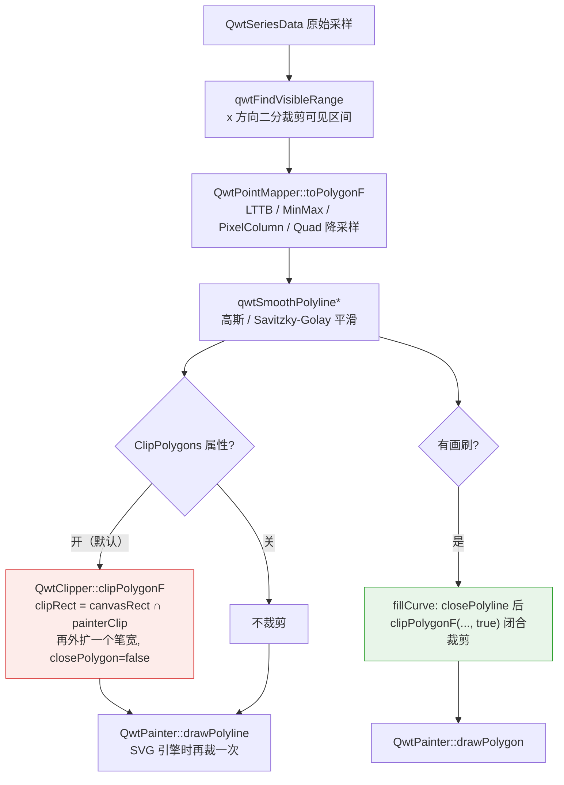
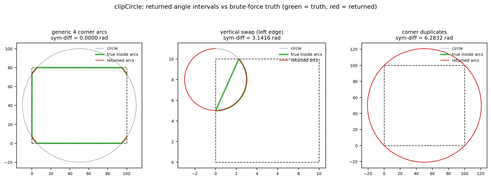

# 多边形裁剪算法（QwtClipper）：正确性、顶点放大率与退化输入

> **摘要** —— 绘图库把一条百万点折线交给光栅化器之前，先用一个轴对齐矩形把不可见部分切掉。这一步在 QWT7 中由 `src/core/qwt_clipper.cpp` 的 `QwtClipper` 命名空间承担，核心是四遍半平面扫描的 Sutherland–Hodgman 算法（多边形/折线）与一个角度扫描的圆裁剪器（`clipCircle`）。裁剪被放回渲染管线中形式化：裁剪矩形由画布矩形、painter 裁剪区与笔宽共同决定；每个公开函数都给出算法识别、伪代码与正确性论证。一个与源码逐操作对齐的 Python 重实现，配合直接调用 `qwtcore.dll` 真实实现的 C++ harness，完成 2337 组位精确交叉验证与平移/缩放序列下的顶点放大率测量。自交、共线、1px 视口、边界重合、重复点、NaN 等退化输入被逐一记录实测行为，随后是一份不回避负面结果的失效模式清单：其中包括 `clipCircle` 在圆心恰落于裁剪矩形左/右边线或圆恰过矩形角点时返回错误弧段的三个可复现反例（该组缺陷已在 v7.5.1 修复，4.4 节给出复测数据）。

> **摘要 — 核心结论**
>
> - 交叉验证：Python 重实现与真实 `QwtClipper`（本次复测用 Qt 5.14.2 msvc2017_64 构建的 `qwtcore.dll`，原始测量为 Qt 5.15.16；两次的 20 个语义探针一致）在 1323 组多边形用例与 1014 组圆用例上 2337/2337 位精确一致（`%.17g` 全精度比对），重实现可作为后续分析的可信模型
> - 顶点计数的精确会计恒等式：每一遍半平面扫描满足 $n_{k+1} = V_k + X_k$（保留顶点数 + 交点数），在平移/缩放全部 169 个序列步上 169/169 成立；全局关系 $n_{out} = V_{in} + X_{\partial R} + \Phi$ 中，对 $x$ 单调折线 $\Phi \equiv 0$（73/73 步），稳态放大率 $A = n_{out}/V_{in} \approx 1.029$
> - $\Phi > 0$ 的"幽灵边界点"只出现在闭合且非单调的流形上：Lissajous 曲线在完全错过视口时仍输出 8 个点（视口矩形边界被正反各走一遍），缩放序列中 $\Phi$ 最大 10、$A$ 最大 8.0；但按奇偶填充与非零环绕填充光栅化后与精确交集的像素差均为 0/160000，即填充语义不受影响，受影响的只有描边
> - `clipCircle` 在 300 组随机圆上与暴力角度采样的真值完全一致（最差对称差 0.000000 rad）；首发时记录的三个错误弧段反例（圆心恰在矩形左/右边线上，对称差 $\pi$ rad；圆恰过矩形角点，对称差最大 $2\pi$ rad 且取决于 1 ulp 浮点取整）在 v7.5.1 全部修复：复测中定向用例对称差全部归零（圆心在矩形角上一例表观残余 1.7e-5，为真值采样误差）、300/300 随机圆一致。半径 0 仍返回空集（QRectF::contains 拒绝零宽矩形的几何事实，Doxygen 注释未提及这一例外）
> - 整数路径的交点坐标用 `static_cast<int>` 向零截断（误差 $<1$ px 且符号相关），`QRectF → QPolygon` 重载用 `qCeil/qFloor` 向内取整（宽度不足 1 且内部没有整数坐标的浮点矩形在整数路径上必然裁剪为空）；单点多边形绕过全部四个 inside 测试被原样保留

---

## 1. 引言：裁剪在渲染管线中的位置与问题形式化

### 1.1 问题形式化

裁剪区域是轴对齐矩形 $R = [x_1, x_2] \times [y_1, y_2]$，其中边界由矩形的 `x()`、`x()+width()`、`y()`、`y()+height()` 给出，四个半平面测试为 $x \ge x_1$、$x \le x_2$、$y \ge y_1$、$y \le y_2$，全部含等号，即边界上的点算"内部"。被裁对象 $S$ 是一个点序列（edge stream）：`closePolygon = true` 时首尾隐式连边，视为闭合多边形；`false` 时视为开折线。输出是 $S$ 与 $R$ 的裁剪结果流，其中既包含 $S$ 落在 $R$ 内的顶点，也包含 $S$ 的边与 $\partial R$ 的交点。

这个定义刻意不说"输出是 $S \cap R$ 的多边形"：对开折线、自交流形，"交集多边形"本身没有唯一定义，而 Sutherland–Hodgman 给出的是一个确定的边流。第 2、5 节会精确刻画这个边流与各种"真值"（奇偶填充、非零环绕填充、描边）之间的关系。

裁剪窗是凸的（四个半平面的交），这一条性质决定了算法选型。逐段的 Liang–Barsky 或 Cohen–Sutherland 参数化裁剪对每条线段独立求交，输出彼此无关的段，要重建区域边界还得再做一次拼接；Weiler–Atherton、Greiner–Hormann 能裁任意裁剪多边形甚至带洞区域，代价是交点搜索结构与进出标记的簿记。对轴对齐凸窗，Sutherland–Hodgman 把问题分解为四遍独立的半平面扫描，每遍 $O(n)$、无搜索结构、缓冲可复用，是这条约束下最便宜的正确算法，QWT 的选择与 1974 年原论文的适用条件完全吻合。

### 1.2 为什么需要软件裁剪

QPainter 自带裁剪，QWT 仍维护一套软件裁剪，原因有三，都能在源码中找到依据：

1. SVG 引擎忽略裁剪。`qwt_painter.cpp:108` 的 `qwtIsClippingNeeded()` 只对 `QPaintEngine::SVG` 返回真，注释写明 "The SVG paint engine ignores any clipping"；此时 `QwtPainter::drawPolygon/drawPolyline/drawLine`（`qwt_painter.cpp:511–616`）必须自己裁。
2. 光栅引擎对远离视口的坐标很慢。`qwt_polar_grid.cpp:717` 的注释写着 "Qt4 is horrible slow, when painting primitives, with coordinates far outside the visible area."，`:775–777` 在此句之后还加了一句 "We need to clip."。
3. 深度缩放下的性能。`QwtPlotCurve::ClipPolygons` 的文档说明："In situations, where points are far outside the visible area (f.e when zooming deep) this might be a substantial improvement for the painting performance"（`qwt_plot_curve.h:224–226`）。

### 1.3 管线位置

`QwtPlotCurve::drawLines()`（`src/plot/qwt_plot_curve.cpp:583` 起）的顺序是：可见区间二分 → `QwtPointMapper` 降采样 → 渲染平滑 → 裁剪 → 拟合/绘制。裁剪在平滑之后，保证平滑滤波器看到完整邻域：



描边与填充分别走开/闭两种语义，这是理解后文失效模式的关键：同一个算法，`closePolygon` 的取值决定了输出边流是"折线片段串"还是"区域边界"。

### 1.4 裁剪调用点全表

| 调用点 | 文件:行 | 语义 | 裁剪矩形来源 |
|---|---|---|---|
| `QwtPlotCurve::drawLines` | `qwt_plot_curve.cpp:656,664` | 开折线 | `canvasRect ∩ painterClip`，外扩 `effectivePenWidth` |
| `QwtPlotCurve::drawSteps` | `qwt_plot_curve.cpp:936` | 开折线 | 同上 |
| `QwtPlotCurve::fillCurve` | `qwt_plot_curve.cpp:1213` | 闭合多边形 | `canvasRect ∩ painterClip`（不外扩） |
| `QwtPlotIntervalCurve::drawTube` | `qwt_plot_intervalcurve.cpp:526,545,548` | 填充闭合 / 描边开 | 填充用 `canvasRect.adjusted(-1,-1,1,1)`；描边外扩笔宽 |
| `QwtPlotShapeItem::draw` | `qwt_plot_shapeitem.cpp:433` | 每个子路径闭合 | `canvasRect` 外扩笔宽 |
| `QwtPolarCurve` | `qwt_polar_curve.cpp:441` | 开折线 | painter 窗口逆变换，外扩 `qCeil(max(1, penWidth))` |
| `QwtPolarGrid` 径向线 | `qwt_polar_grid.cpp:726` | 开折线（2 点） | `canvasRect` |
| `QwtPolarGrid` 同心圆 | `qwt_polar_grid.cpp:780` | `clipCircle` → 弧 | `canvasRect` |
| `QwtPainter` 各 wrapper | `qwt_painter.cpp:511–616` | 开/闭 | 仅 SVG 引擎：`painter->clipRegion().boundingRect()` |

`drawDots`/`drawSymbols` 不使用 `QwtClipper`，它们依赖 `QwtPointMapper::setBoundingRect(clipRect)` 与 `WeedOutPoints` 在映射阶段剔除视口外点。另外要说明：v7 的 `QwtClipper` 没有 `clipLine`/`clipPolyline`。公开 API 只有 `clipPolygon`（两个重载）、`clipPolygonF`、三个 `clipped*` 拷贝版本与 `clipCircle`；开折线统一走 `closePolygon = false` 的 Sutherland–Hodgman 路径。

## 2. 算法与正确性

### 2.1 Sutherland–Hodgman：四遍半平面扫描

`QwtPolygonClipper<Polygon, Rect, T>::clipPolygon`（`qwt_clipper.cpp:154`）对左、右、上、下四条边各做一遍扫描，中间结果在 `points1`/`points2` 两个缓冲之间乒乓传递（左→2，右→1，上→2，下→1，最终落回入参引用）。单遍 `clipEdge`（`:172`）的伪代码：

```text
算法 1  clipEdge(points, edge, closePolygon)
输入: 点流 points[0..n-1]，半平面测试 isInside，交点函数 intersection
输出: 裁剪后的点流 out

1. 若 n < 2: 若 n == 1 则 out += points[0]（不做 inside 测试!）; 返回 out
2. 若 closePolygon:                      # 先处理首尾隐式连边
     若 isInside(p0): { 若 !isInside(p_{n-1}): out += I(p0, p_{n-1}); out += p0 }
     否则若 isInside(p_{n-1}): out += I(p0, p_{n-1})
   否则: 若 isInside(p0): out += p0        # 开折线: 无隐式连边
3. 对 i = 1..n-1, 记 p1 = points[i], p2 = points[i-1]:
     若 isInside(p1): { 若 !isInside(p2): out += I(p1, p2); out += p1 }
     否则若 isInside(p2): out += I(p1, p2)
4. 返回 out
```

其中 $I(p_1, p_2)$ 是线段 $p_2 p_1$ 与当前裁剪线的交点。以左边为例（`:58–67`）：$\text{isInside}(p) \equiv p.x \ge x_1$，

$$
I(p_1, p_2) = \left( x_1,\; p_2.y + (x_1 - p_2.x)\cdot \frac{p_1.y - p_2.y}{p_1.x - p_2.x} \right)
$$

除法在 `double` 中进行，结果再 `static_cast` 回坐标类型（整数路径即向零截断，见 2.3）。四条边的完整定义如下，注意交点一律锚定在前一点 $p_2$ 上：

$$
\begin{aligned}
\text{Left}:&\quad \mathrm{in}(p) \equiv p.x \ge x_1, & I = \Big( x_1,\; p_2.y + (x_1 - p_2.x)\tfrac{p_1.y - p_2.y}{p_1.x - p_2.x} \Big) \\
\text{Right}:&\quad \mathrm{in}(p) \equiv p.x \le x_2, & I = \Big( x_2,\; p_2.y + (x_2 - p_2.x)\tfrac{p_1.y - p_2.y}{p_1.x - p_2.x} \Big) \\
\text{Top}:&\quad \mathrm{in}(p) \equiv p.y \ge y_1, & I = \Big( p_2.x + (y_1 - p_2.y)\tfrac{p_1.x - p_2.x}{p_1.y - p_2.y},\; y_1 \Big) \\
\text{Bottom}:&\quad \mathrm{in}(p) \equiv p.y \le y_2, & I = \Big( p_2.x + (y_2 - p_2.y)\tfrac{p_1.x - p_2.x}{p_1.y - p_2.y},\; y_2 \Big)
\end{aligned}
$$

公式里的运算顺序（先做坐标差、再除、乘、加）不是排版细节：交叉验证要求 Python 重实现与 C++ 输出位级相同，而 IEEE-754 下改变结合顺序就会改变最后一位。2337/2337 的位精确一致同时验证了两件事：重实现忠实，以及 MSVC `/O2`（默认 `/fp:precise`，不做 FMA 收缩）保持了源码写的运算顺序。

**命题 1（单遍会计恒等式）** 对 $n \ge 2$ 的输入，单遍输出满足 $|out| = V + X$，其中 $V$ 为输入中满足 `isInside` 的顶点数，$X$ 为本遍 `intersection` 的调用次数。*证明*：步骤 2 与步骤 3 对每个输入顶点至多发射一次（$p_0$ 在步骤 2、$p_i, i \ge 1$ 在步骤 3），且仅当它在半平面内；每次发射交点都对应一次且仅一次 `intersection` 调用，反之每次调用都恰好发射一个点。两类发射互不重叠，故 $|out| = V + X$。$n < 2$ 时恒等式不成立（单点被无条件复制），这是唯一的例外。$\square$

**命题 2（凸窗正确性，证明思路）** 对简单多边形与凸裁剪窗，归纳于遍数：第 $k$ 遍结束后，点流恰为区域 $S \cap H_1 \cap \dots \cap H_k$ 的边界流。归纳步即经典论证（Sutherland & Hodgman, 1974）：流中每条边按"内→内、内→外、外→内、外→外"四种情形分别发射 $\{p_1\}$、$\{I\}$、$\{I, p_1\}$、$\varnothing$，与半平面裁剪的边界构造一一对应；闭合流的隐式连边由步骤 2 补齐。$\square$ 自交输入不满足"简单多边形"前提，第 4.3 节用光栅化实验刻画其实际语义。

**命题 3（单遍放大率上界）** 单遍 $|out| \le 2n$（宽松界）；紧确界是 $1.5n + O(1)$，由交替进出的锯齿流达到。*证明*：每条输入段 $(p_2, p_1)$ 至多贡献 $[\,p_1 \text{ 在内}\,] + [\,\text{该段跨越裁剪线}\,] \le 2$，逐段求和即得 $|out| \le 2n$。但跨越蕴含恰一端在内，把每条跨越段分别记到它的在内端点与在外端点名下，得 $X \le 2V$ 且 $X \le 2(n - V)$，即 $X \le 2\min(V, n - V)$：当 $V \le n/2$ 时 $|out| = V + X \le 3V \le 1.5n$；当 $V > n/2$ 时 $|out| \le V + 2(n - V) = 2n - V < 1.5n$。故"全顶点在内且全段跨越"不可同时达到，$2n$ 在单遍内不可达；紧界在 $V = n/2$ 且每段都跨越（交替进出的锯齿流）时取得。$\square$ 实测锯齿（第 4.2 节）单遍比最大 $1.500$（$2000 \to 2999 = 1.5n - 1$），恰好逼近紧确界；$\approx 2n$ 是四遍累计的性质（$2000 \to 3998$）；每遍输出至多为该遍输入的 $1.5$ 倍，但四遍的交点各自独立计入。

### 2.2 开折线语义、拼接与幽灵边界点

`closePolygon = false` 时步骤 2 不补隐式连边，因此输出是若干"可见片段"的首尾相接串：片段 $k$ 的出边交点与片段 $k+1$ 的入边交点在流中相邻。由于 $R$ 是凸的，任意两点的连线仍在 $R$ 内，所以这些拼接弦不会画到视口外，但它们是画出来的。更隐蔽的是"幽灵边界段"：某遍扫描产生的两个交点（例如都在左边线上）在流中相邻，构成一条沿裁剪线的隐式段；后续遍会把这条隐式段当作真实几何再裁一次，若它跨越后面的裁剪线，就会凭空产生新的交点。记这类点为 $\Phi$，得到全局关系

$$
n_{out} = V_{in} + X_{\partial R} + \Phi,
$$

其中 $X_{\partial R}$ 是输入段与 $R$ 的四条边界线段（限定在边界范围内）的交点数。对 $x$ 单调的开折线（时序曲线的常态），每条竖直裁剪线至多被穿越一次，左边线上的隐式段不会出现，$\Phi \equiv 0$；对闭合且非单调的流形，$\Phi$ 可以很大：第 4.2 节测到 Lissajous 在视口完全错过曲线时 $V_{in} = 0$、$X_{\partial R} = 0$ 而 $n_{out} = 8$：输出是视口矩形边界被正向、反向各走一遍的 8 个点。

### 2.3 三个坐标域实例化与取整语义

模板 `QwtPolygonClipper<Polygon, Rect, T>` 被实例化三次，对应三个公开入口：

| 入口 | 矩形 | 点 | 裁剪区域 |
|---|---|---|---|
| `clipPolygonF(QRectF, QPolygonF)` | 浮点 | 浮点 | $[l, l+w] \times [t, t+h]$，含端点 |
| `clipPolygon(QRect, QPolygon)` | 整数 | 整数 | $[x, x+w] \times [y, y+h]$，含端点，即 $w+1$ 列 |
| `clipPolygon(QRectF, QPolygon)` | 浮点→整数 | 整数 | $[\lceil l \rceil, \lfloor r \rfloor] \times [\lceil t \rceil, \lfloor b \rfloor]$，向内取整 |

三条取整事实都有实测或源码依据。其一，整数路径的裁剪区域比 `QRect::right()`（$= x + w - 1$）多一列，因为 `clipEdge` 用的是 `m_clipRect.x() + m_clipRect.width()`（harness 探针：`QRect(0,0,10,10).right() == 9`，而裁剪上界是 10）。其二，浮点矩形到整数多边形的重载先做 `qCeil(left)/qFloor(right)/qCeil(top)/qFloor(bottom)`（`:371–374`），是保守向内取整：宽度不足 1 且内部没有整数的浮点矩形，整数路径必然裁为空，而浮点路径仍能交出 2 个交点（第 4.3 节实测：同一矩形 `(100.2, 100.7, 0.5, 90.3)`，F 路径 2 点、R 路径 0 点）。其三，整数交点坐标经 `static_cast<int>` 向零截断而非四舍五入，误差在 $(-1, 1)$ 内且符号相关（负坐标向零偏、正坐标向下偏）；这是解析结论，浮点路径无此误差。

除零不可达：左/右遍的 `isInside` 只依赖 $x$，两端点 inside 状态不同蕴含 $p_1.x \ne p_2.x$，故 `intersection` 的分母非零；上/下遍同理。NaN 坐标使所有比较为假（永远"在外"），但会把 NaN 传播进交点（第 4.3 节）。

向零截断的偏差可以写成如下形式，$y^\*$ 为真交点坐标、$\mathrm{trunc}$ 为 `static_cast<int>`：

$$
e = \mathrm{trunc}(y^\*) - y^\* = -\,\mathrm{frac}(y^\*), \qquad \mathrm{frac}(y) \equiv y - \mathrm{trunc}(y) \in (-1, 1), \qquad |e| < 1
$$

其中 $\mathrm{frac}(\cdot)$ 为带符号的截断小数部分（与 $y$ 同号；注意不同于取地板定义的小数部分 $y - \lfloor y \rfloor \in [0, 1)$，对负坐标二者相差 1）：正坐标一律向下偏（$e \le 0$）、负坐标一律向上偏（$e \ge 0$），偏置方向在 $y = 0$ 两侧翻转。实测 1px 整数视口把这个偏置暴露得很直接：预取整输入上线段 $(200, 890) \to (204, 764)$ 与 $x = 201$ 的交点真值为 858.5，向零截断得 858（半远离零的四舍五入会得 859），harness 与重实现的输出都是 `(201, 858)`；合成例 $y^\* = -0.5$ 截断得 0 而四舍五入得 $-1$，$y^\* = 2.7$ 截断得 2 而四舍五入得 3。浮点路径无此偏置，因此同一几何在 F 与 I 路径下的输出可以相差 1 px，这是设计使然：整数路径服务整数光栅化，浮点路径服务几何精确的导出。

### 2.4 clipCircle：角度扫描与弧段配对

`QwtCircleClipper::clipCircle`（`:254`）不用多边形算法，而是把圆与矩形四条直线的交点求出来、换算成角度、排序后配对成"可见弧"区间：

```text
算法 2  clipCircle(rect, pos, radius)
1. 对 Left, Top, Right, Bottom 四条边求切割点 cuttingPoints:
     竖直边 x: 若 |pos.x - x| < radius（严格!）, off = sqrt(r^2 - (pos.x-x)^2)
       候选 (x, pos.y ± off), 仅保留 y ∈ [top, bottom]（含端点）
     水平边 y: 对称处理, 候选 (pos.x ± off, y), 仅保留 x ∈ [left, right]
2. 若无切割点: cRect = 圆的外接矩形; 若 rect.contains(cRect) 返回 [(0, 2π)], 否则 []
3. angles = sort(toAngle(pos, p) for p in points)      # [0, 2π)
4. 合并容差 1e-9 rad 内的重复角度（相邻重复：角点被相邻两边各记一次；首尾重复：angles[0]+2π 与 angles[last]）
5. 对每个区段独立判定（含跨 0° 的回绕段）:
     for i, a0 in angles:# a1 = 下一角度, 最后一个区段的 a1 = angles[0] + 2π
       mid = a0 + 0.5*(a1-a0); 若 rect.contains(polar2pos(pos, r, mid)) 则输出 [a0, a1]
   （v7.5.1 起；首发实现用一次全局中点探针决定 (a0,a1),(a2,a3),... 或 (a1,a2),... 配对）
```

角度约定与 `qwtPolar2Pos`（`qwt_point_polar.h:161`，$y = p_y - r\sin a$）及 `QPainter::drawArc`（0° 在 3 点方向、逆时针为正）一致：`toAngle` 的非竖直分支把屏幕"右下"映到 $(3\pi/2, 2\pi)$、"左上"映到 $(\pi/2, \pi)$。竖直特例（`from.x == to.x` 时 `to.y <= from.y` 返回 $\pi/2$，否则 $3\pi/2$）v7.5.1 起与非竖直分支同约定；首发版本与此相反（历史缺陷见 5 节失效模式 7）。

**正确性思路**：圆与矩形边界横截相交时交点数为偶数，沿圆周 in/out 交替，故排序后按相邻对配对即可复原可见弧。v7.5.1 起改为：先按角度容差 $10^{-9}$ rad 合并重复切割点（角点被相邻两边各记一次，坐标可差几个 ulp），再对每个角度区段（含跨 0° 的回绕段）独立用中点探针判定归属；分类局部化后，重复点或缺失点（相切）不会再翻转其余区段的结论，单个切割点也不再触发 `angles[1]` 越界。区间以未回绕形式给出（上界可超过 $2\pi$），消费端 `qwt_polar_grid.cpp:788–793` 的 `span = max − min`（`span < 0 → += 360`）对两种写法都成立。切割点最多 8 个，复杂度 $O(k \log k)$。相切被严格不等式 `|Δ| < radius` 排除，此时落入步骤 2 的包含性回退：内切圆返回 $[0, 2\pi]$、外切圆返回空，两种情形都正确（第 4.4 节实测对称差 0）。

配对正确性的前提是"交替"：排序角度把圆周切成 $k$ 段间隙，横截情形下间隙的 in/out 状态严格交替。首发实现依赖一次全局中点探针定出全部配对，两个前提因此有两种被破坏的方式：竖直切割点拿到镜像角度（交替序列被错位）、角点被相邻两边重复登记（间隙长度退化为 0，中点探针落在矩形边界上）。这正好对应第 5 节的两个反例家族；v7.5.1 的合并 + 逐段分类消除了对交替序列与全局探针的依赖。

步骤 2 的 `QRectF::contains(QRectF)` 在 Qt 5（5.14.2 与 5.15.16 探针一致）上的真实语义与常见印象不同，harness 的 20 个探针给出经验规则：参数矩形先按负宽高归一化；退化宽度（$w = 0$，或被浮点吸收的宽度，如 $50 + 10^{-300} = 50$）一律返回 false；$w = 10^{-13}$ 返回 true；其余按含端点比较。直接后果：半径为 0 的圆（外接矩形宽 0）走不到 $[0, 2\pi]$ 分支，返回空集。

### 2.5 公开 API 与算法对应

| 函数 | 算法 | 备注 |
|---|---|---|
| `clipPolygon(const QRect&, QPolygon&, bool)` | Sutherland–Hodgman，整数域 | 原地修改 |
| `clipPolygon(const QRectF&, QPolygon&, bool)` | 同上，矩形先向内取整 | 原地修改 |
| `clipPolygonF(const QRectF&, QPolygonF&, bool)` | 同上，双精度 | 原地修改，渲染管线主用 |
| `clippedPolygon` ×2 / `clippedPolygonF` | 拷贝后调用上述 | 纯函数版本 |
| `clipCircle(const QRectF&, const QPointF&, double)` | 角度扫描（算法 2） | 返回 `QVector<QwtInterval>` |

## 3. 工程实现剖析

### 3.1 缓冲与早退

`clipPolygon` 开头有一段被 `#if 0` 关掉的早退（`:156–159`）：若裁剪矩形包含多边形包围盒则直接返回。它被禁用意味着每次调用都完整跑四遍扫描，包括多边形完全落在视口内的最常见情形。四遍都是 $O(n)$ 的 inside 测试加缓冲拷贝，没有交点计算，代价约为四次线性遍历；对 $10^5$ 点折线这是每帧数十万次（$4 \times 10^5$ 量级）数组写。启用早退需要一次 $O(n)$ 的包围盒计算，净收益取决于命中率，源码选择保守地不做。乒乓缓冲的 `reserve(qMin(256, n))`（`:162`）只压低小多边形的分配峰值。

### 3.2 裁剪矩形的构造

`drawLines` 中裁剪矩形不是画布矩形本身（`qwt_plot_curve.cpp:601–604`）：

```cpp
clipRect = qwtIntersectedClipRect(canvasRect, painter);   // canvasRect ∩ painter 裁剪区
const qreal pw = QwtPainter::effectivePenWidth(painter->pen());
clipRect = clipRect.adjusted(-pw, -pw, pw, pw);           // 外扩一个笔宽
```

外扩笔宽是为了让半宽为 $pw/2$ 的笔画在画布边缘不被软件裁剪切掉一半；`qwtIntersectedClipRect`（`:45`）再与 `painter->clipBoundingRect()` 求交，保证寄生绘图等共享画布的场景不会画到宿主区域外。`fillCurve` 不外扩（填充不需要笔画余量），`QwtPlotIntervalCurve` 的填充路径固定外扩 1.0。这些外扩量都直接进入 2.1 节的 $x_1, x_2, y_1, y_2$，因此"裁剪矩形比画布大几个像素"是设计而非误差。

### 3.3 属性开关

`ClipPolygons` 是 `QwtPlotCurve` 的默认绘制属性（`qwt_plot_curve.cpp:84`：`ClipPolygons | FilterPointsLTTB`）。关闭它不会改变屏幕上的正确性（光栅引擎自己会裁），但会失去 1.2 节的性能收益（SVG 导出与深度缩放都可能退化）；1.2 节提到的极坐标网格同心圆另由 `QwtPolarGrid::ClipGridLines` 控制，与 `ClipPolygons` 无关。

与裁剪正交但叠加生效的是 `QwtPainter` 的折线分块（`qwt_painter.cpp:150`，`splitSize = 6`）：它针对光栅引擎的短线缺陷与性能特性，把裁剪之后的流以步长 6 切成至多 7 点的小块（相邻块共享 1 点，`qwt_painter.cpp:170–171` 的 `i += splitSize` 与 `n = qMin(splitSize + 1, …)`）交给 `drawPolyline`。当分块启用时（光栅引擎且笔宽 > 1，或命中引擎缺陷判定），上文测得的 $n_{out}$ 直接决定绘制调用数 $\lceil n_{out}/6 \rceil$；幽灵点与拼接弦因此还会被切成独立的小绘制单元，进一步放大伪差的可见性。

## 4. 实验

### 4.1 设计

实验脚本 `docs/assets/algorithms/clipper_experiment.py`（Python 3.11 + numpy + matplotlib，Agg 后端，种子 20261012）包含与源码逐操作对齐的重实现：交点公式的乘加顺序、`static_cast<int>` 的向零截断、`qCeil/qFloor`、边处理顺序 Left→Right→Top→Bottom、`toAngle` 的竖直特例、1e-9 rad 的切割点合并、`from + 0.5*(to-from)` 的逐段中点判定全部照抄，使 IEEE-754 双精度结果可位级比对。交叉验证 harness `docs/assets/algorithms/clipper_check.cpp` 读取脚本生成的用例文件，调用真实 `qwtcore.dll`，以 `%.17g` 打印全部输出坐标；构建配方见该文件头注释（MSVC 2019 `/O2 /std:c++17`，链接 `build-release/lib` 下的 `qwtcore.lib`）。harness 不做任何墙钟计时（机器并行负载不可信），也不报告耗时数字。

用例规模：多边形 1323 组（浮点/整数/浮点矩形×整数点三种模式，开闭各半，含边界吸附、重复点、共线、自交、单点、空、负宽矩形、$\pm 10^6$ 大坐标、$10^{-13}$ 亚像素间隔、NaN 顶点与一条 5000 点 Lissajous 幽灵用例），圆 1014 组（1000 随机 + 14 个构造反例）。结果：多边形 1323/1323、圆 1014/1014，合计 2337/2337 位精确一致。harness 同时打印 Qt 语义探针，用于对齐重实现：`QRectF::contains(QPointF)` 四边全含（`(10,5)`、`(5,10)` 对 `QRectF(0,0,10,10)` 均返回 true），`QRectF::contains(QRectF)` 的经验规则见 2.4 节。除语义对齐外，交叉验证还修正过一处工具链偏差：MSVC 的 `istringstream >> double` 不可靠地解析用例文件里的 `nan` 记号（运行时探针 `nan_parse_isnan` 实测为 0），harness 改用 `strtod`（C99/C++11 保证可解析）读取坐标，NaN 用例才能进入位精确比对。

**表 1：交叉验证用例族**

| 族 | 数量 | 覆盖内容 |
|---|---:|---|
| F 随机（开/闭各半） | 700 | 浮点矩形与点，$n \in [0, 60]$；每 5 例把半数点吸附到矩形边界，每 7 例注入精确重复点 |
| I 随机（开/闭各半） | 300 | 整数矩形与点，含边界吸附 |
| R 随机（开/闭各半） | 300 | 浮点矩形（宽可小至 0.2）× 整数点，压内向取整路径 |
| 结构化对抗（多边形） | 23 | 空、单点内/外、水平穿越、完全在外、与矩形重合、沿边界、擦边、重复点、自交四边形、共线开/闭、锯齿、$\pm 10^6$ 大正方形、$10^{-13}$ 三角形、NaN 开/闭、I 路径自交四边形与矩形角重合、R 路径无整数列与零尺寸矩形、负宽矩形、5000 点 Lissajous 幽灵用例 |
| C 随机 | 1000 | 随机矩形、圆心、半径 |
| C 对抗 | 14 | 竖直交换 ×2、角点重复 ×2、内切、完全在内、完全在外、圆包含矩形、内/外相切、圆心在角、半径 0、圆心在上边线、角点相切 |

信号集：密集正弦折线（$N = 20000$，$y = 500 + 450\sin(2\pi x/60)$，开）、Lissajous 闭合曲线（$N = 5000$，$x = 480\sin(3t+0.5)$，$y = 380\sin 4t$，自交）、随机星形简单多边形（$N = 400$，闭）、锯齿折线（$N = 2000$，$y \in \{0, 1000\}$ 交替，开，最坏情形）。平移序列让视口横穿数据域；缩放序列以 0.6 的步长把视口缩向各自的固定目标点（正弦曲线上的点、正弦空白带、Lissajous 中心、星形最大半径顶点），从完全包含缩到 3.6 px。

### 4.2 顶点放大率

**表 2：平移序列汇总**（视口尺寸：正弦 800×600，Lissajous 300×300，星形 250×250）

| 信号 | $n_{in}$ | 步数 | 单遍恒等式 | $\Phi = 0$ 步数 | max $\Phi$ | max $A$ | 稳态 $A$ | 稳态 $n_{out}/n_{in}$ |
|---|---:|---:|---:|---:|---:|---:|---:|---:|
| 正弦（开，$x$ 单调） | 20000 | 49 | 49/49 | 49/49 | 0 | 2.000 | 1.029 | 0.0944–0.0972（视口完整落在数据域内的 step 8–40） |
| Lissajous（闭，自交） | 5000 | 47 | 47/47 | 1/47 | 10 | 1.116 | 1.02–1.07 | 0.05–0.09 |
| 星形多边形（闭，简单） | 400 | 26 | 26/26 | 4/26 | 4 | 6.000 | 1.65–3.67 | 0.055–0.235 |

正弦的稳态行（step 16：$V_{in} = 1890$、$X = 54$、$n_{out} = 1944$）展示了理论关系的用法：$A = 1 + X/V_{in} = 1 + 54/1890 = 1.029$，即放大率完全由"视口边界穿越数 / 可见顶点数"决定；穿越数 54 对应视口内约 13 个正弦周期在上下边界的出入（每周期 4 次）加左右边界 2 次。step 0 的 $A = 2.000$ 是边界重合产物：视口右界恰好落在折线首点 $x = 0$ 上，$V_{in} = 1$、$X = 1$，交点与顶点重合被发射两次。

**表 3：缩放序列汇总**（视口为正方形，边长 $L$ 按 $0.6^k$ 收缩）

| 序列 | 步数 | $\Phi = 0$ 步数 | max $\Phi$ | max $A$ | 末步 $n_{out}$ |
|---|---:|---:|---:|---:|---:|
| 正弦·曲线上的角 | 12 | 12/12 | 0 | 3.000 | 3（$L = 7.256$，$V_{in} = 1, X = 2$） |
| 正弦·空白带（穿越主导） | 12 | 12/12 | 0 | 1.091 | 0（$L \le 56$ 后视口错过曲线） |
| Lissajous·中心 | 12 | 1/12 | 10 | 8.000 | 8（$V_{in} = 0, X = 0$，全为幽灵点） |
| 星形·最大半径顶点 | 11 | 0/11 | 2 | 5.000 | 5（$V_{in} = 1, X = 2, \Phi = 2$） |

Lissajous 中心缩放是幽灵边界的完整标本：$L \le 129.6$ 后曲线不再进入视口（$V_{in} = X_{\partial R} = 0$），但四遍扫描在裁剪线上留下的隐式桥接段互相再裁，最终输出 8 个点：视口矩形 $[-64.8, 64.8]^2$ 的四个角各出现两次，边界被正反各走一遍。该用例同时进了交叉验证集，C++ 真实实现输出完全相同的 8 个点。

幽灵点的生成过程可以从逐遍点数读出（脚本对同一用例打印的 pass trace）：$5000 \to 2721 \to 442 \to 150 \to 8$。左遍的输出里，曲线"离开左半平面又回来"的每一对出/入交点在流中相邻（中间的顶点全部被切掉），构成沿左边线的竖直隐式段；右遍对这些点照单全收（它们满足 $x \le x_2$），并如法炮制出右边线上的隐式段；上遍把左、右两条竖直隐式段裁到顶边，交点正是矩形的左上、右上角（trace 中上遍输出的前两个点是 $(-64.8, -64.8)$ 与左边线上的一个远点）；下遍收尾，把四条隐式段的残端压成矩形的四个角，每角两次，于是"曲线完全不在视口内"的输入，输出却是视口矩形的完整边界。每一遍都满足命题 1 的会计恒等式（如 $2721 = V_L + X_L$），错误不来自任何单遍，而来自"桥接段被后续遍当作真实几何"这一算法语义。

**表 4：锯齿最坏情形**（$N = 2000$，视口 $[0,2000] \times [500 - h/2, 500 + h/2]$，$h$ 从 400 到 0.1 结果相同）

| 遍 | L | R | T | B |
|---|---:|---:|---:|---:|
| 输出点数 | 2000 | 2000 | 2999 | 3998 |
| 单遍比 | 1.000 | 1.000 | 1.500 | 1.333 |

每段都跨越上下两条裁剪线时，T 遍达到 $1.5n$（$V = 1000$ 个在内顶点 + $X = 1999$ 个交点），B 遍再叠加到 $3998 \approx 2n$，与命题 3 的 $2n$ 上界同阶。注意这是构造出来的最坏输入：真实曲线在 1px 高视口下的实测是 $n_{out} = 28$（100 点正弦，见 4.3 节），因为穿越数由信号频率而非点数决定。

需要说明实验与生产管线的衔接：本节的 $n_{in}$ 是原始信号，而生产中 `clipPolygonF` 拿到的是 `QwtPointMapper` 降采样（默认 `FilterPointsLTTB`，至多约 $4W$ 点）与平滑之后的流。这一差别不影响本节结论：Sutherland–Hodgman 的代价与放大率只取决于喂入的流及其与视口的几何关系；降采样改变的是 $n_{in}$ 本身（从 $10^6$ 降到 $10^3$ 量级），相当于把四遍扫描的起点左移几个数量级。反过来看，两个默认属性恰好互补：`FilterPointsLTTB` 在 $x$ 方向压缩顶点数，`ClipPolygons` 切掉 $y$ 方向越出视口的潜出：表 2 中稳态 54 次边界穿越正是降采样按设计保留极值而无法消除的那部分工作。


### 4.3 退化输入逐个实测

**表 5：退化输入行为**（裁剪矩形 `(100, 100, 200, 150)`，除非另注；全部经 C++ 交叉验证一致）

| 用例 | 输入 | $n_{out}$ | 实测行为 |
|---|---|---:|---|
| 单点在视口内 | 1 点 | 1 | 保留 |
| 单点在视口外 | 1 点 `(900,900)` | 1 | **原样保留**：`n < 2` 分支不做 inside 测试，开闭语义皆然 |
| 空多边形 | 0 点 | 0 | 空 |
| 完全在外（四侧） | 2 点 | 0 | 空，开闭一致 |
| 开折线包围视口 | 4 角正方形（开） | 2 | 幽灵弦 `(300,100)-(300,250)`：真值应为空，描边会画出一条右界竖线 |
| 闭多边形包围视口 | 4 角正方形（闭） | 4 | 输出视口四角：作为**填充区域**正确（交集即整个视口），作为描边错误 |
| 顶点恰在边界 | `(100,175)→(50,90)` | 2 | 边界顶点发射两次（一次作顶点、一次作交点）：`[(100,175),(100,175)]` |
| 擦边即离 | 3 点 | 3 | 同一边界点发射三次 |
| 内部重复点 | 4 点（两对重复） | 4 | 重复原样保留；重复不触发交点（两端 inside 状态相同，分母不会被求值） |
| 全共线（开） | 20 点直线 $y = 2x$ | 4 | `[(100,200),(100,200),(120,240),(125,250)]`：入边交点重复 |
| 全共线（闭） | 同上闭合 | 6 | 退化往返流，`(100,200)` 出现三次 |
| 1px 宽视口（浮点） | 100 点正弦 | 3 | `[(200,889.71),(200,889.71),(201,858.41)]`：边界顶点重复 + 右界交点 |
| 1px 高视口（浮点） | 100 点正弦 | 28 | 每个上下穿越贡献 2 点，与信号频率成正比而非 $N$ |
| 1px 宽视口（整数） | 同上取整 | 3 | `(201, 858)`：真交点 858.4094 被向零截断 |
| 零高整数矩形 | `(0,500,400,0)` | 34 | 区域退化为直线 $y = 500$ 仍非空，输出 34 个共线点 |
| 亚整数宽矩形（R 路径） | `(100.2,100.7,0.5,90.3)` | 0 | `qCeil/qFloor` 向内取整后区域为空 |
| 同一矩形（F 路径） | 同上 | 2 | 浮点路径交出 `(100.2,120),(100.7,120)` |
| NaN 顶点 | 4 点含 `(nan,nan)` | 3 | NaN 永远"在外"，但交点被污染：输出含 `(nan, 100.0)` |

自交输入的填充语义用 400×400 像素网格上的奇偶/非零环绕光栅化检验，真值为"像素在 $R$ 内且对输入流奇偶（或环绕）判定为内"：

**表 6：自交流的填充等价性**（裁剪矩形 `(0,0,230,400)`）

| 输入 | $n_{in}$ | $n_{out}$ | 奇偶填充差 | 环绕填充差 |
|---|---:|---:|---:|---:|
| 五角星 {5/2}（闭） | 5 | 7 | 0 px | 0 px |
| 五角星（开） | 5 | 7 | 0 px | 0 px |
| 星形简单多边形（对照） | 60 | 47 | 0 px | — |
| Lissajous（闭，自交） | 2000 | 1111 | 0 px | 0 px |

即在本组测试中，Sutherland–Hodgman 的边流输出在两种 Qt 填充规则下都与精确集合交集逐像素一致（0/160000）。这与教科书对自交多边形裁剪的警告并不矛盾：警告针对"输出应为简单多边形边界"的期望，而 QWT 的消费端（`QPainter::drawPolygon`、`QPainterPath`）只按填充规则解释边流，桥接段与重复点在奇偶/环绕计数下成对抵消。若把输出交给期望简单边界的消费者（面积、绕数查询、布尔运算），结果不可信。


### 4.4 clipCircle 与暴力真值对照

真值由 720000 个等距角度的采样给出（成员判定用探针确认的 `QRectF::contains(QPointF)` 语义），对称差以弧度计。下表为 v7.5.1 复测（同一脚本、修复后的库）：

**表 7：clipCircle 用例**（返回弧测度 / 真值测度 / 对称差，单位 rad）

| 用例 | 返回 | 真值 | 对称差 | 判定 |
|---|---:|---:|---:|---|
| 一般四角弧（rect 100×80，r=60） | 0.576168 | 0.576168 | 0.000000 | 正确 |
| 完全在内 | 6.283185 | 6.283185 | 0.000000 | 正确 |
| 完全在外 | 0 | 0 | 0.000000 | 正确 |
| 圆包含矩形 | 0 | 0 | 0.000000 | 正确 |
| 内切四边 | 6.283185 | 6.283185 | 0.000000 | 正确（相切走包含性回退） |
| 外切 | 0 | 0.000009 | 0.000009 | 正确（真值侧为采样伪差） |
| 内切左边 | 1.459453 | 1.459453 | 0.000000 | 正确 |
| 圆心在左边线（rect 10²，c=(0,8)，r=3） | 2.300518 | 2.300518 | 0.000000 | 正确（v7.5.1 修复前为 5.442120 / 3.141601） |
| 圆心在右边线（c=(10,3)，r=4） | 2.418861 | 2.418861 | 0.000000 | 正确（修复前为 5.560444 / 3.141584） |
| 圆恰过四角（r=√5000） | 0.000000 | 0 | 0.000000 | 正确（修复前返回整圆，对称差 $2\pi$） |
| 圆恰过四角 2（r=√32500） | 0 | 0 | 0.000000 | 正确（修复前为 4 个零长弧，浮点侥幸） |
| 圆心在矩形角上（c=(0,0)，r=50） | 1.570796 | 1.570796 | 0.000017 | 正确（修复前为 4.712398 / 3.141601；残余 1.7e-5 为真值采样误差） |
| 半径 0（圆心在内） | 0 | 6.283185 | 6.283185 | 返回空集与 QRectF::contains 的几何事实一致；真值列的 $2\pi$ 是零半径采样伪差（点测度为 0），注释未涵盖此情形（见 2.4 节） |
| 300 组随机圆 | — | — | 最差 0.000000 | 300/300 一致 |

三个错误家族都有明确机理（第 5 节失效模式 7、8），且都是零测配置：300 组随机圆无一命中；修复后三个家族的定向用例对称差全部归零（圆心在矩形角上一例表观残余 1.7e-5，为真值采样误差；复测见 `clipper_results.txt`）。修复前"圆恰过四角"的一对同构用例结局相反：第一例返回整圆（对称差 $2\pi$，最大可能错误），第二例返回 4 个零长弧（完全正确），差别仅在于中点探针 $r\cos(\pi/4)$ 的最后一位浮点取整落在矩形边界内侧还是外侧。同一段代码、同一类输入、两种结局，这正是"配对依赖 1 ulp"的含义。v7.5.1 合并角点重复后用逐段分类，复测两例都返回空列表（测度 0，与真值一致），不再存在这一对反例。



### 4.5 复现

本节全部数字来自同一次运行的 stdout（脚本逐行打印完整表格，下文摘录代表行）。复现两步：

```powershell
# 1) 构建 C++ 交叉验证 harness（MSVC 2019 x64 + Qt 5.14.2 msvc2017_64 + 预构建 qwtcore）
#    v7.5.1 复测：qwtcore 来自仓库内的 Qt5 构建目录（build-qt5），脚本用
#   QWT_QT5_BIN / QWT_CORE_BIN 覆盖运行时 PATH（默认值指向本机 Qt 5.14.2）
#    先用 vcvars64.bat 初始化 MSVC x64 环境；若 cl 找不到 SDK 头/库，把 Windows Kits 10（如 10.0.18362.0）
#    的 ucrt / shared / um（及 Lib 下 ucrt\x64、um\x64）追加进 INCLUDE / LIB，再执行：
cl /nologo /O2 /EHsc /std:c++17 /MD /DQWTCORE_DLL /I<repo>\src /I<repo>\src\core /I<qt>\include /I<qt>\include\QtCore /I<qt>\include\QtGui <repo>\docs\assets\algorithms\clipper_check.cpp /Fe:clipper_check.exe /link /LIBPATH:<repo>\build-release\lib /LIBPATH:<qt>\lib qwtcore.lib Qt5Core.lib Qt5Gui.lib
#    产物 clipper_check.exe 放到脚本 --scratch 指定的目录（默认 D:/tmp/qwt-scratch/clipper）

# 2) 跑全部实验：自测 -> 交叉验证 -> 平移/缩放 -> 退化 -> 圆 -> 插图
python docs\assets\algorithms\clipper_experiment.py
```

脚本先跑 5 个 smoke 用例（期望输出录自真实 C++ 运行，防止重实现自身漂移），再生成用例文件并调用 harness；harness 可执行文件缺失时打印 `XCHECK SKIPPED` 并继续纯 Python 实验。插图 `fig_clip_overview/amplify_pan/amplify_zoom/degenerate/circle.png` 写在 `docs/assets/algorithms/` 下。全程确定性（种子 20261012、Agg 后端、无墙钟计时），重复运行得到逐字节相同的 stdout 与图像。

## 5. 讨论：失效模式

1. **开折线的拼接弦与包围弦**。`closePolygon = false` 的输出是片段串，片段之间被 `drawPolyline` 连成弦；凸性保证弦留在 $R$ 内（伪差不会画到画布外），但它是可见伪差。最坏形态是"开折线包围视口而不进入"：实测输出 2 点幽灵弦 `(300,100)-(300,250)`，真值为空。降采样阶段挡不住它：可见区间二分只按 $x$ 外扩一个点，$y$ 方向的潜出-返回（曲线俯冲到画布下方再回来）原样进入裁剪器。触发条件苛刻（曲线在视口外绕成包围圈），但深度缩放下的闭合数据（如磁滞回线）并非不可能。
2. **闭合非单调流形的幽灵边界点**（$\Phi$）。Lissajous 完全错过视口时输出 8 点矩形边界（逐遍点数 $5000 \to 2721 \to 442 \to 150 \to 8$）；缩放序列 $\Phi$ 最大 10、$A$ 最大 8.0。填充语义不受影响（表 6 全 0），描边语义错误。$x$ 单调折线（时序曲线主场景）$\Phi \equiv 0$，73/73 步实测。
3. **单点直通**。$n < 2$ 分支不做 inside 测试，视口外的孤立点原样穿过四遍扫描。对 `drawPolyline` 无害（单点不画线），对期望"裁剪后必在窗内"的下游代码是陷阱。
4. **整数路径取整**。交点向零截断带来 $<1$ px 的符号相关偏差；整数裁剪区域为 $w+1$ 列；`QRectF → QPolygon` 重载向内取整，亚整数宽且内部无整数坐标的矩形必然裁空（内部恰有整数坐标时区域收缩为 1 列而非空；F 路径同矩形交 2 点）。需要像素级精确时应意识到整数路径的"含端点"区域比名义矩形大一列。
5. **边界重合产生重复顶点**。inside 测试含等号，落在边界上的顶点既作顶点又作交点被发射两次（擦边情形三次）。重复点不破坏填充（零面积），但会让下游的"去重/弦长"类逻辑看到零长段。
6. **NaN 传播**。NaN 顶点永远判为"在外"，却会通过交点公式把 NaN 写进输出坐标（实测 `(nan, 100.0)`）。与降采样篇的 NaN 语义（SIMD 比较天然忽略 NaN）不同，裁剪层的 NaN 会扩散；含 NaN 的数据应在映射阶段处理干净。
7. **clipCircle 的竖直特例符号反了（v7.5.1 已修复）**。首发版本的 `toAngle` 在 `from.x == to.x` 时把屏幕下方的点映到 $\pi/2$、上方映到 $3\pi/2$，与 `qwtPolar2Pos` 及该函数自身非竖直分支的约定相反。仅当圆心 $x$ 坐标恰等于矩形左/右边界时产生竖直切割点，此时排序错乱、配对翻转：左边线用例返回弧测度 5.442120 rad，真值 2.300518 rad，多出的 3.141601 rad 恰为圆在 $x < 0$ 的左半（完全在矩形外的那一半）。极坐标网格中极点被平移到画布边线整数像素上即可命中。v7.5.1 起竖直分支与非竖直分支同约定，左右边线定向用例复测对称差 0.000000 rad，用例固化进 `tests/clipper_test`。
8. **clipCircle 的角点重复破坏配对（v7.5.1 已修复）**。圆恰过矩形角点时，同一点被相邻两边各记一次，排序后出现重复角度，"中点 in 测试"落在边界上，结果正确与否取决于 1 ulp 浮点取整：实测一对同构用例一个返回整圆（对称差 $2\pi$）、一个返回零长弧（正确）。v7.5.1 起按容差合并重复角度，并对每个角度区段独立做中点探针；分类局部化后重复点只影响自身区段，"整圆 vs 零长弧"的 1 ulp 依赖消失（复测两例均返回空列表）。
9. **半径 0 与注释不符（行为属几何事实，注释未更新）**。Doxygen 注释声称"圆完全在裁剪矩形内时返回 $[0, 2\pi]$"，但 Qt 5（5.14.2/5.15.16）的 `QRectF::contains(QRectF)` 对零宽参数矩形返回 false（20 探针经验规则），半径 0 实际返回空集。绘制层面无影响（零半径弧不可见）；该行为是几何事实，源码注释至今未涵盖这一例外（`tests/clipper_test` 有说明）；若需要"零半径在内"的语义请把半径下限设为非零值。
10. **无早退的四遍扫描**。`#if 0` 的包围盒早退被禁用，完全可见的多边形也要付四遍 $O(n)$ 遍历。不报告墙钟数字（harness 按约定禁止计时），结构上的账是：四遍共 $4n$ 次 inside 测试与至多四次缓冲拷贝，与一次包围盒计算（$n$ 次比较加法）同阶；早退的净收益取决于"完全可见"的命中率，源码选择保守地不做。对恒在画布内的仪表盘类数据，关闭 `ClipPolygons` 是更直接的省法（6.4 节）。
11. **奇数切割点的理论风险（v7.5.1 已修复）**。首发实现假定切割点数为偶数并直接读取 `angles[1]` 推中点：浮点舍入若让角点附近的配对交点一边保留一边丢弃，奇数个切割点就会触发越界读（release 构建的 `QVector::operator[]` 无边界检查）。v7.5.1 的逐段分类对任意 $k \ge 1$ 都安全：单个切割点只产生"整圆减一点"或空集的二选一判定，不再有任何越界路径（`tests/clipper_test` 覆盖竖直边线、角点重复与相切用例）。

## 6. 代码实践

### 6.1 自定义 item 中手动裁剪

`clipped*` 系列返回副本，适合函数式写法；`clip*` 系列原地修改，适合复用缓冲：

```cpp
#include <qwt_clipper.h>
#include <qpolygon.h>

// 浮点路径：与 QwtPlotCurve 内部一致，描边语义用 closePolygon = false
QPolygonF polyline = myMappedData;                 // 已映射到画布坐标
const QRectF clipRect = canvasRect.adjusted(-pw, -pw, pw, pw);
QwtClipper::clipPolygonF(clipRect, polyline, false);   // 原地，无分配副本
QwtPainter::drawPolyline(painter, polyline);

// 填充语义必须用 true：闭合流的桥接段在奇偶/环绕填充下成对抵消
QPolygonF filled = myMappedData;
QwtClipper::clipPolygonF(clipRect, filled, true);
painter->setPen(Qt::NoPen);
QwtPainter::drawPolygon(painter, filled);

// 整数路径：widget 对齐渲染；注意区域是 [x, x+w] 含端点（w+1 列）
QPolygon intPoly = alignedPoints;
QwtClipper::clipPolygon(QRect(0, 0, width(), height()), intPoly, false);
```

> **警告 — 开折线裁剪后不要假设"点在窗内"**
>
> `closePolygon = false` 的输出可能包含视口外的孤立点（单点直通）、重复的边界点与 NaN 交点；包围视口的开折线还会得到幽灵弦。下游若做包围盒、命中测试或去重，需自行再过滤。

### 6.2 极坐标同心圆

`clipCircle` 的返回值直接喂 `drawArc`，回绕区间由消费端处理：

```cpp
const QVector<QwtInterval> arcs = QwtClipper::clipCircle(canvasRect, pole, radius);
for (const QwtInterval& intv : arcs) {
    if (intv.minValue() == 0.0 && intv.maxValue() == 2 * M_PI) {
        QwtPainter::drawEllipse(painter, outerRect);          // 整圆快路
    } else {
        double from = qwtDegrees(intv.minValue());
        double span = qwtDegrees(intv.maxValue()) - from;
        if (span < 0.0)
            span += 360.0;                                    // 回绕弧
        painter->drawArc(outerRect, qRound(from * 16), qRound(span * 16));
    }
}
```

> **历史问题 — 极点贴边与圆过角点（v7.5.1 已修复）**
>
> v7.5.1 之前，圆心 $x$ 恰在画布左/右边界像素上、或半径恰使圆过画布角点时，`clipCircle` 会返回多余弧段（旧版表 7 对称差最大 $2\pi$）；v7.5.1 起按容差合并重复切割点并逐段判定，定向用例对称差归零（表 7），无需再加扰动规避。

### 6.3 坐标域选择：F / I / R 三条路径

| 路径 | 入口 | 适用 | 代价 |
|---|---|---|---|
| F | `clipPolygonF` / `clippedPolygonF` | 浮点渲染、抗锯齿绘制、SVG/PDF 导出 | 无取整偏差，几何精确 |
| I | `clipPolygon(QRect, QPolygon)` | 整数对齐的 widget 渲染 | 区域为 $w+1$ 列；交点向零截断（$<1$ px、符号相关） |
| R | `clipPolygon(QRectF, QPolygon)` | 数据为整数、窗口为浮点 | 向内取整保证整数点不出浮点窗；亚整数宽且内部无整数坐标的矩形必然裁空 |

```cpp
// 导出路径：浮点几何精确，交点不引入取整偏差
const QPolygonF exportPoly = QwtClipper::clippedPolygonF(pageRectF, mapped, true);

// widget 路径：与 doAlign 的取整渲染一致；注意区域含 x+w 列
QPolygon widgetPoly = alignedPoints;
QwtClipper::clipPolygon(QRect(0, 0, canvasWidth, canvasHeight), widgetPoly, false);
```

选择规则只有一条：输出给谁用。交给光栅化整数网格的用 I/R，交给浮点路径（导出、`QPainterPath`、抗锯齿）的用 F；混用会把 2.3 节的取整语义带进不该有偏差的管线。

### 6.4 开关与性能影响

| 场景 | 建议 | 依据 |
|---|---|---|
| 默认曲线（时序、频谱） | 保持 `ClipPolygons` 开 | $\Phi \equiv 0$，$A \approx 1.03$，裁剪开销为四遍线性扫描 |
| 深度缩放（视口 ≪ 数据域） | 必须开 | 出界坐标是光栅/SVG 引擎的性能毒药 |
| SVG/PDF 导出 | 必须开 | SVG 引擎忽略 painter 裁剪，不开即破图 |
| 数据恒在画布内（仪表盘） | 可关 | 省四遍遍历；正确性不受影响 |
| 闭合自交形状（`QwtPlotShapeItem`） | 开，且保持 `ClipPolygons` 的闭合语义 | 表 6：填充逐像素正确 |

## 7. 小结

QwtClipper 把教科书算法落地到生产：四遍 Sutherland–Hodgman 扫描加一个角度扫描圆裁剪器，代码不足 500 行，却承载整条 2D 渲染管线的可见性契约。它的行为边界很清楚。单遍 $n_{k+1} = V_k + X_k$ 在 169/169 个序列步上无例外成立，全局放大率由边界穿越数决定，$x$ 单调折线的稳态代价仅 2.9% 的额外顶点。正确性依赖消费方式：边流输出在奇偶与非零环绕两种填充规则下与精确交集逐像素一致（0/160000），但同一边流作为描边会画出拼接弦与幽灵边界，因此正确性陈述必须绑定语义。退化配置的失败是结构性的而非偶发的：`toAngle` 的竖直特例符号、角点重复的配对歧义（这两条已在 v7.5.1 修复）、单点直通、NaN 交点污染，都直接读自源码分支结构，实验只是把它们从"可能"变成"可复现的坐标"。适用边界也因此清楚：时序/频谱类 $x$ 单调数据与填充类形状可以放心依赖默认配置；自交描边、极点贴边的极坐标网格（v7.5.1 之前）以及把裁剪输出当作简单多边形使用的下游代码，需要按第 5 节清单逐条设防。

## 8. 参考文献

1. Sutherland, I. E., Hodgman, G. W. *Reentrant Polygon Clipping.* Communications of the ACM, 17(1):32–42, 1974.
2. Liang, Y.-D., Barsky, B. A. *A New Concept and Method for Line Clipping.* ACM Transactions on Graphics, 3(1):1–22, 1984.（参数化线段裁剪的对照路线；QWT 未采用，开折线走 Sutherland–Hodgman 的 `closePolygon = false` 路径。）
3. Foley, J. D., van Dam, A., Feiner, S. K., Hughes, J. F. *Computer Graphics: Principles and Practice,* 2nd ed., Chapter 3（裁剪）. Addison-Wesley, 1990.
4. QWT7 源码：`src/core/qwt_clipper.h`、`src/core/qwt_clipper.cpp`（`QwtClip::LeftEdge/RightEdge/TopEdge/BottomEdge`、`QwtPolygonClipper`、`QwtCircleClipper`）。
5. QWT7 调用点：`src/plot/qwt_plot_curve.cpp`（`drawLines`/`drawSteps`/`fillCurve`）、`src/plot/qwt_plot_intervalcurve.cpp`、`src/plot/qwt_plot_shapeitem.cpp`、`src/plot/qwt_polar_curve.cpp`、`src/plot/qwt_polar_grid.cpp`、`src/plot/qwt_painter.cpp`（`qwtIsClippingNeeded`）。
6. Qt 5（5.14.2 与 5.15.16 探针一致）：`QRectF::contains` 语义由 `docs/assets/algorithms/clipper_check.cpp` 的 20 个运行时探针经验刻画（含端点、退化宽度拒绝、负宽高归一化）。
7. 实验与复现：`docs/assets/algorithms/clipper_experiment.py`（重实现 + 全部测量 + 插图）、`docs/assets/algorithms/clipper_check.cpp`（C++ 交叉验证 harness，2337 用例位精确比对；构建配方见文件头注释）。

*配套阅读：* [LTTB 降采样算法原理与 QWT7 的 MinMax 桶实现](curve-downsampling.md)：裁剪之前的可见区间二分与桶化降采样；[曲线渲染平滑：高斯卷积、Savitzky-Golay 回归与特征保护](curve-smoothing.md)：裁剪之前的平滑阶段；[NaN 渲染语义](nan-rendering.md)：与上文失效模式 6 对照的映射层 NaN 处理。
