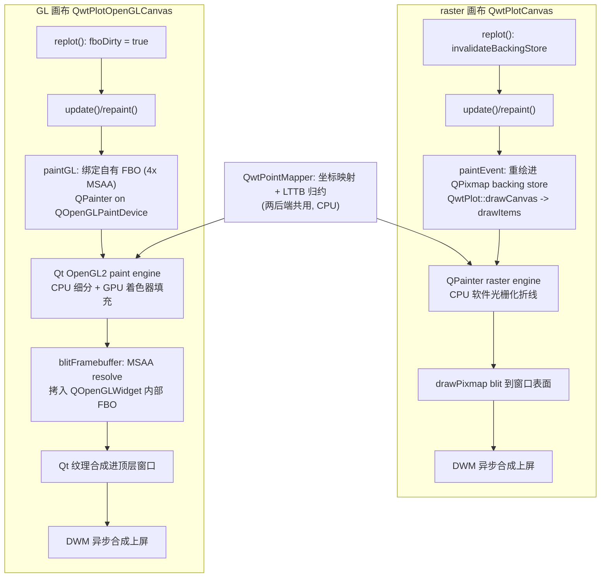
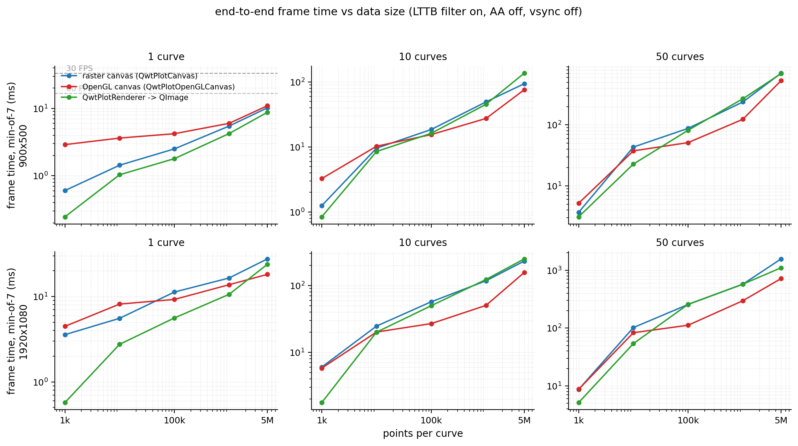
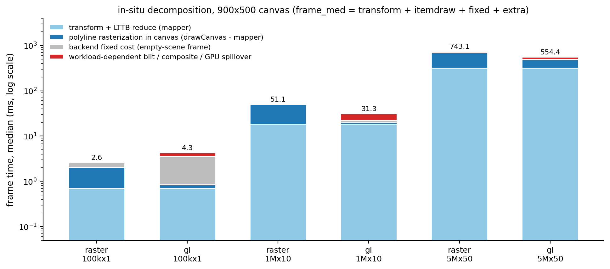
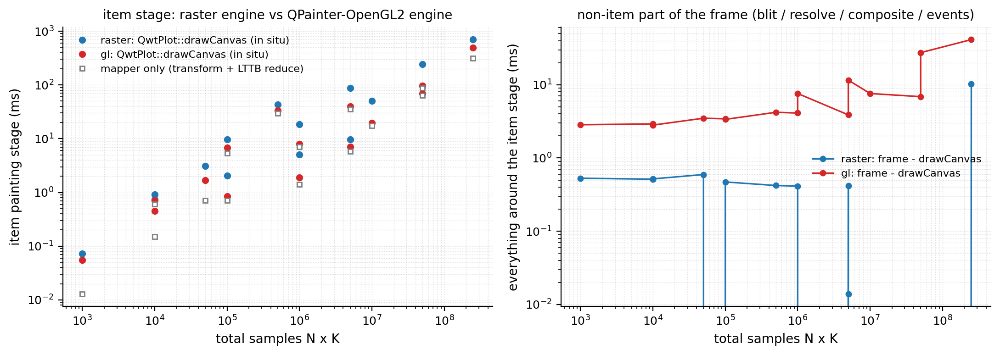
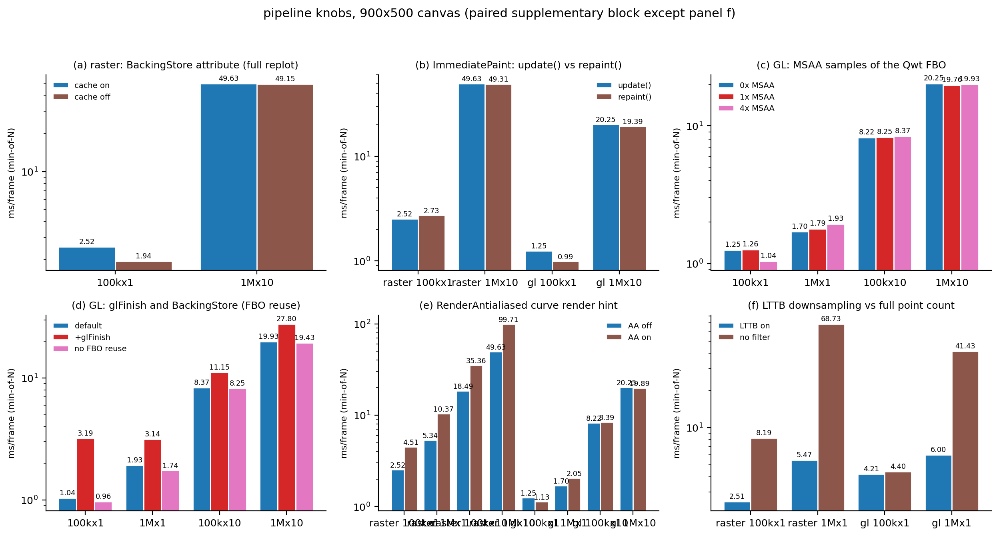
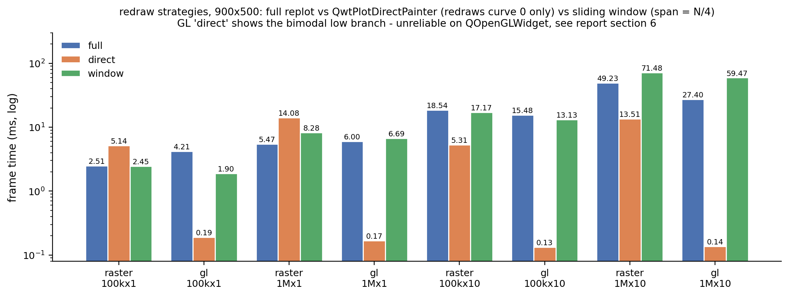
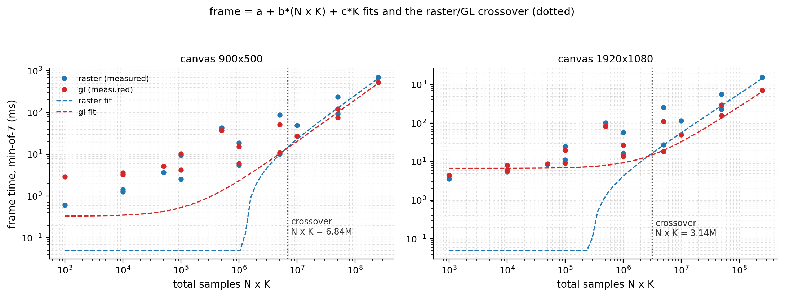
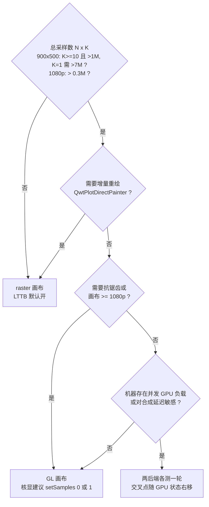

# Raster 与 OpenGL 渲染管线：端到端帧时间分解与选型判据

> **摘要** —— QWT 提供两种画布：软件光栅化的 `QwtPlotCanvas` 与基于 `QOpenGLWidget` 的 `QwtPlotOpenGLCanvas`。直觉认为上 GPU 一定更快，但源码显示 GL 画布并没有为曲线实现原生 GL 管线：`initializeGL()` 是空函数，所有 item 仍经 `QPainter` 在 `QOpenGLPaintDevice` 上绘制（Qt 的 OpenGL2 paint engine），再经 MSAA resolve、FBO blit、`QOpenGLWidget` 纹理合成与 DWM 上屏。一帧可以拆成四段：数据变换、光栅化、合成/resolve 与 blit/present。253 组实测单元（点数 1k–5M × 曲线数 1–50 × 画布 900×500/1920×1080 × 三种后端 × 多种重绘模式与开关）逐段量化，得到"何时值得上 OpenGL"的定量判据：在 Intel UHD 770 核显上，GL 画布的 item 绘制段在重载区比 raster 引擎快 2.2–4.6 倍，但每帧要额外付出合成固定开销（并发 GPU 负载下 2.4–4.5 ms，安静 GPU 下约 0.2 ms CPU 提交 + 1.2–7.9 ms GPU 完成），两条曲线的交叉点落在总采样数 $N \cdot K \approx 0.3\text{–}7\,\mathrm{M}$ 的区间内，取决于画布尺寸与机器 GPU 状态。

> **摘要 — 核心结论**
>
> - GL 画布不加速变换，只加速光栅化：`QwtPointMapper` 的 LTTB 归约（约 1.26 ms/百万点，取自 900×500 的 5M×50 单元）在两种后端完全相同；item 绘制段（`QwtPlot::drawCanvas` 原位计时）重载区 GL 比 raster 快 2.2–4.6 倍、轻载区仅约 1.3 倍（1M×10 曲线：19.8 ms vs 50.1 ms），单条 3848 点折线的光栅化调用 GL 引擎 0.044 ms vs raster 引擎 3.84 ms。
> - GL 的代价在合成：空场景整帧开销 raster 0.57 ms（900×500）/ 3.39 ms（1920×1080）；GL 在带并发 GPU 负载的桌面会话中为 2.39 ms / 4.54 ms，安静 GPU 上仅 0.19 ms CPU 提交，但 `glFinish` 显示 GPU 完成仍需追加 1.2–7.9 ms。
> - 选型判据（900×500、LTTB 开、AA 关）：单曲线 ≤5M 点 raster 画布更稳（1k 点时 GL 慢 4.8 倍）；$K \ge 10$ 且 $N \cdot K \gtrsim 1\,\mathrm{M}$（即 10 条曲线各 10 万点，$K = 1$ 时拟合交叉点推迟到约 $7\,\mathrm{M}$）或 1920×1080 下 $N \cdot K \gtrsim 0.3\,\mathrm{M}$ 时 GL 反超（1M×10：27.4 ms vs 49.2 ms，0.56 倍）；需要抗锯齿时 GL 优势急剧扩大（raster 开 AA 贵 1.8–2.0 倍，GL 开 AA 仅 1.0–1.14 倍）。
> - 增量重绘只能配 raster 画布：`QwtPlotDirectPainter` 在 raster + BackingStore 下会把 item 画两遍（1M×1 单曲线 14.1 ms，比整帧 replot 的 5.5 ms 还慢；关 cache 后 4.6 ms），在 GL 画布上则表现为双峰不稳定（0.13–1.1 ms，重测协议耗尽），不可依赖。
> - 超大点数下后端无关：5M×50（2.5 亿点）时变换段 316 ms 主导整帧（raster 707 ms / GL 534 ms），此时该做的是降采样或分窗，而不是换画布。

---

## 1. 引言：帧预算模型

一次 `replot()` 到像素上屏，代价可以写成四段之和：

$$
T_{\text{frame}} = T_{\text{xform}}(N, K) + T_{\text{rasterize}}(P, A) + T_{\text{compose}}(W \times H, S) + T_{\text{present}}(W \times H)
$$

其中 $N$ 为每曲线采样数、$K$ 为曲线数；$P = K \cdot \min(N,\, 4W)$ 是降采样后折线的顶点数（$W$ 为画布像素宽，输出预算约 $4W$ 点；这里的实测用的是 v7.4.2 的 MinMax 桶变体，桶预算 $2W$、每桶 2 点，v7.5.0 起默认的 `FilterPointsLTTB` 改为真 LTTB（$4W$ 桶、每桶 1 点），MinMax 桶移至 `FilterPointsMinMaxLTTB`，见《曲线降采样》篇）；$A$ 表示是否抗锯齿；$S$ 为 GL 的 MSAA 采样数。四段的物理位置在两种后端不同：

| 阶段 | raster 画布 | GL 画布 |
|---|---|---|
| $T_{\text{xform}}$：坐标映射 + LTTB 归约 | CPU（`QwtPointMapper`，SIMD argmin/argmax） | 同左，完全相同 |
| $T_{\text{rasterize}}$：折线光栅化 | CPU 软件光栅化（Qt raster paint engine） | GPU（Qt OpenGL2 paint engine，CPU 侧细分 + 顶点上传） |
| $T_{\text{compose}}$：合成 | backing store blit 到窗口表面 | MSAA resolve + FBO blit + `QOpenGLWidget` 纹理合成 |
| $T_{\text{present}}$：上屏 | DWM 异步合成 | DWM 异步合成（swap 入队） |

raster 侧四段全部在应用线程同步完成，帧时间即 CPU 时间；GL 侧 $T_{\text{rasterize}}$ 与部分 $T_{\text{compose}}$ 是 GPU 异步工作，应用线程看到的只是命令提交，除非显式 `glFinish` 或队列饱和。这个不对称决定了测量方法，也是结论出现分歧的原因，第 3 节展开。

问题形式化为：给定 $(N, K, W \times H, A)$ 与重绘模式，哪个后端使 $T_{\text{frame}}$ 更小？答案不是单一阈值，而是四段相对大小的竞争：$T_{\text{xform}}$ 与后端无关且随 $N \cdot K$ 线性增长；$T_{\text{rasterize}}$ 随 $P$（即 $K \cdot \min(N, 4W)$）增长且 GL 占优；$T_{\text{compose}} + T_{\text{present}}$ 是后端的固定开销，GL 在并发 GPU 负载下更高（空场景 900×500：raster 0.57 ms vs GL 2.39 ms，见 4.3 节）且随 $W \times H$ 与 $S$ 增长。交叉点因此同时依赖 $N \cdot K$、$K$、画布面积与机器 GPU 状态。

## 2. 两条管线的源码结构

### 2.1 raster 画布：backing store 与两条 paintEvent 路径

`QwtPlotCanvas` 是 `QFrame` 子类，构造函数默认打开三个 paint 属性（`src/plot/qwt_plot_canvas.cpp:59-61`）：`BackingStore | Opaque | HackStyledBackground`。`BackingStore` 持有一张与画布同尺寸的 `QPixmap`，`paintEvent()`（`qwt_plot_canvas.cpp:185-256`）据此分两条路径：backing store 有效且尺寸匹配时只做一次 `painter.drawPixmap(0, 0, *d->backingStore)`；失效时重新分配 pixmap、`QwtPainter::fillPixmap()` 填背景、`drawCanvas()` 全量重绘所有 item，再 blit 到窗口。

关键在于 `replot()` 每次都先使 backing store 失效（`qwt_plot_canvas.cpp:288-296`）：

```cpp
void QwtPlotCanvas::replot()
{
    invalidateBackingStore();
    if (testPaintAttribute(QwtPlotCanvas::ImmediatePaint))
        repaint(contentsRect());   // 同步
    else
        update(contentsRect());    // 异步，事件循环合并
}
```

所以整帧 replot 场景下 backing store 每帧都走"全量重绘 + blit"路径，它的收益只体现在局部失效场景（橡皮筋覆盖层、`QwtPlotDirectPainter` 增量绘制）。头文件注释也明确了这一定位："Disabling the cache might improve the performance for incremental paints (using QwtPlotDirectPainter)"（`qwt_plot_canvas.h:59-67`）。`ImmediatePaint` 决定 replot 走同步 `repaint()` 还是异步 `update()`。

曲线光栅化本身在 `QwtPlotCurve::drawLines()`（`src/plot/qwt_plot_curve.cpp:583-698`）：`QwtPointMapper::toPolygonF()` 完成坐标映射与 LTTB/MinMax 归约，`QwtClipper::clipPolygonF()` 裁剪，最后 `QwtPainter::drawPolyline()` 交给 QPainter。`QwtPainter` 对 raster 引擎有一个特殊优化：笔宽大于 1 时把折线切成 6 点的小段分批提交（`src/plot/qwt_painter.cpp:124-178`，注释 "Raster paint engine is much faster when splitting the polygon"）；1 px 线走单次 `drawPolyline`。

### 2.2 GL 画布：QPainter-on-FBO，没有原生 GL 管线

`QwtPlotOpenGLCanvas` 继承 `QOpenGLWidget` 与 `QwtPlotAbstractGLCanvas`（`src/plot/qwt_plot_opengl_canvas.h:55`）。四条源码事实决定了它的真实渲染路径：

第一，`initializeGL()` 是空实现，注释写着 "No operation - reserved for some potential use in the future"（`qwt_plot_opengl_canvas.cpp:184-187`）。Qwt 没有为曲线建立任何 shader、VBO 或自绘管线。

第二，默认构造函数强制 4× MSAA：`QSurfaceFormat fmt = format(); fmt.setSamples(4);`（`qwt_plot_opengl_canvas.cpp:65-66`）。

第三，`paintGL()`（`qwt_plot_opengl_canvas.cpp:190-251`）在 `BackingStore` 属性开启（默认开，`qwt_plot_abstract_canvas.cpp:566`）且硬件支持 blit 时：维护一个自有 `QOpenGLFramebufferObject`（samples 取自构造格式、CombinedDepthStencil 附件）；`fboDirty` 时绑定该 FBO、构造 `QOpenGLPaintDevice`、用 `QPainter` 调用 `draw()` 绘制全部 item；随后 `QOpenGLFramebufferObject::blitFramebuffer(nullptr, d->fbo)` 做 MSAA resolve 并拷贝进 `QOpenGLWidget` 的内部 FBO；最后由 Qt 的合成机制把纹理合成进顶层窗口、经 DWM 上屏。

第四，`invalidateBackingStore()` 只置 `fboDirty = true`（`qwt_plot_opengl_canvas.cpp:159-163`），而 `QwtPlotAbstractGLCanvas::replot()` 每帧调用它（`qwt_plot_abstract_canvas.cpp:755-764`）。与 raster 画布同理，GL 的"backing store"只在无 replot 的重绘（覆盖层移动、窗口激活）时省掉重绘，整帧 replot 下每帧全量重画 FBO。

bench 的诊断输出（stderr，`# gl:` 行）在 Qt 5.15.16 + Intel UHD 770 上确认了引擎身份：`paintGL` 内对 widget 开 `QPainter` 与对 `QOpenGLPaintDevice` 开 `QPainter`，`paintEngine()->type()` 均为 `QPaintEngine::OpenGL2`；甚至在 paint 事件之外对 `QOpenGLWidget` 开 `QPainter` 也得到 OpenGL2 引擎且 `active=1`。GL 上下文自身报告 `samples=0`——MSAA 发生在 Qwt 自有 FBO 上，不在上下文默认帧缓冲。Qt 文档对 `QOpenGLWidget` 的描述与此一致：渲染进 FBO、由 Qt 窗口合成机制把纹理合成进顶层窗口，含 `QOpenGLWidget` 的顶层窗口整体切换为 OpenGL 合成路径。



### 2.3 replot 流程与 autoReplot

`QwtPlot::replot()`（`src/plot/qwt_plot.cpp:690-712`）依次执行 `updateAxes()`（自动缩放重算 scale div）、`sendPostedEvents(LayoutRequest)`、再经 `invokeMethod(canvas, "replot")` 落到画布。`autoReplot` 默认为 true（`qwt_plot.cpp:198`）：任何 `setSamples()`/`attach()` 都会触发一次整帧重绘，流式应用必须 `setAutoReplot(false)` 后由刷新定时器统一驱动，否则帧预算里会混入不可控的重复重绘。`drawCanvas()`（`qwt_plot.cpp:1105-1115`）构建各轴 `QwtScaleMap` 后调用 `drawItems()` 遍历 item 列表逐个绘制，本文的原位计时正是重写这个虚函数实现的。

### 2.4 QwtPlotDirectPainter：两条路径与 GL 上的实测行为

`QwtPlotDirectPainter::drawSeries()`（`src/plot/qwt_plot_directpainter.cpp:183-258`）分两条路径。画布是 `QwtPlotCanvas` 且 backing store 有效时：先把 item 画进 backing store pixmap，若设了 `FullRepaint` 则 `canvas->repaint()` 结束。否则，由于 `qobject_cast<QwtPlotCanvas*>` 对 `QwtPlotOpenGLCanvas` 必然失败，走通用分支：记录 item 与区间、安装事件过滤器、`canvas->repaint(clipRegion)`；事件过滤器截获 `QEvent::Paint`，用 `QPainter(canvas)` 只画该 series（或 `CopyBackingStore` 时直接 blit backing store），返回 true 跳过画布自身的 paintEvent。

raster 画布 + BackingStore 的默认组合下，一次 `drawSeries()` 会把 item 画两遍（一遍进 pixmap、一遍经过滤器画到窗口），第 4.8 节的实测证实了这一点。GL 画布上的实测行为更微妙：`QPainter(canvas)` 在 paint 事件外得到 OpenGL2 引擎（画进 `QOpenGLWidget` 的 FBO），但 `QOpenGLWidget` 自身的更新机制仍让 `paintGL` 每帧运行（paint 计数与帧数一致，此时 `fboDirty=false`，`paintGL` 只做 blit 与合成）；同时帧时间呈双峰分布（0.13 ms 与 1.1 ms 两簇，重测协议两次耗尽），说明 `QPainter` 在 `QOpenGLWidget` 上 paint 事件外 begin 的成功与否不稳定，这与 Qt 文档"QPainter 只应在 paintGL 内使用"的约束吻合。结论：增量重绘路径是为 raster 画布设计的，GL 画布上不可依赖。

### 2.5 编译开关对 API 可用性的影响

`QWT_CONFIG_QWTOPENGL`（`CMakeLists.txt:57`，默认 ON）决定 `qwt_plot_opengl_canvas.h/.cpp` 是否参与编译（`src/plot/CMakeLists.txt:271-284`）。OFF 时头文件不存在，`#include <qwt_plot_opengl_canvas.h>` 直接编译失败：GL 画布的可用性是编译期决定的，运行期没有降级路径。示例里的 GL 代码虽然包在 `#ifndef QWT_NO_OPENGL` 中（`examples/2D/refreshtest/Settings.h:43`），但该宏在库与示例的 CMake 构建系统里从未被定义（仅 playground 的 qmake 脚本 playground.pri 定义过），refreshtest 的 CMakeLists 也不按 `QWT_CONFIG_QWTOPENGL` 条件化。这层保护实际不生效，OFF 时示例仍会因缺头文件而编译失败。Qt5 构建还额外编译 legacy 的 `QwtPlotGLCanvas`（基于 `QGLWidget`，Qt6 移除，`src/plot/CMakeLists.txt:278-281`），本文不涉及。

## 3. 帧时间分解方法学

### 3.1 测量口径

每个被测帧定义为 `plot.replot(); app.processEvents();`（widget 模式），`QElapsedTimer` 纳秒计时，计时区间覆盖 paintEvent/paintGL 与窗口系统 flush。Windows 上应用侧上屏是异步的：raster 路径的 flush 是位块传输到窗口重定向表面，GL 路径经 swapBuffers 入队，两者之后都由 DWM 按自己的节奏合成。bench 请求 `swapInterval=0`；GL 上下文实际报告 `swapInterval=1`，但实测帧时间远低于 16.7 ms 且无 vsync 量化，说明 DWM 合成开启时应用侧 swap 不阻塞。因此两种后端测得的都是"CPU 可见帧时间"，不含 DWM 最终上屏延迟，口径对称，但 GL 的 GPU 工作可能滞后于该窗口，3.4 节处理。

协议：warmup 3 帧 + 7 轮 × 30 帧（每轮逐帧计时），取 7 轮均值的最小值（min-of-7）作为单元成绩 `iter_min`，同时记录 median/max 与逐帧池化统计；若 $(\text{iter\_med} - \text{iter\_min}) / \text{iter\_min} > 30\%$ 则整协议重测（至多 2 次），重测次数记入 CSV 的 `retries` 列。253 个单元中 20 个触发重测（其中 10 个是 GL 空场景/direct 的双峰单元——direct 4 个、空场景 6 个，重测两次后仍离散，见第 6 节）；全部单元的迭代离散度（med−min）/min 中位数 0.048、p90 0.180。paint 事件计数（raster 的 paintEvent / GL 的 paintGL）用于验证每帧恰好一次绘制：full 模式下主矩阵单元的计数为 216 = 210（测量）+ 3（warmup）+ 约 3 次初始化/校准绘制，排除 `update()` 合并导致漏画。

### 3.2 分解工具

| 工具 | 覆盖阶段 | 说明 |
|---|---|---|
| `drawCanvas` 原位计时 | item 绘制段 | bench 子类重写 `QwtPlot::drawCanvas()` 虚函数，在真实管线内对 `drawItems` 全程计时（raster = 软件光栅化，GL = OpenGL2 引擎），均值入 CSV 的 `drawcanvas_ms` 列 |
| `mapper` 模式 | $T_{\text{xform}}$ | 直接驱动 `QwtPointMapper::toPolygonF()`（`QWT_EXPORT`，可从 qwtplot.dll 链接），不含任何光栅化 |
| 空场景（curves=0） | 后端固定开销 | 背景填充、blit/resolve、合成、flush、事件泵 |
| `renderto` 模式 | 离屏全量参考 | `QwtPlotRenderer::render()` → QImage：每帧执行布局激活 + 刻度尺 + item，无窗口系统 |
| `items` 模式 | 离屏 item 参考 | `drawItems()` → QImage |
| `--finish` | GPU 异步余量 | `paintGL` 尾部 `glFinish()`，与不 finish 的差值 = GPU 落后于 CPU 提交的量 |

分解恒等式（widget 模式，用逐帧中位数与 drawCanvas 均值配对）：

$$
T_{\text{frame}} = \underbrace{T_{\text{mapper}}}_{\text{变换}} + \underbrace{(T_{\text{drawCanvas}} - T_{\text{mapper}})}_{\text{画布内光栅化}} + \underbrace{T_{\text{empty}}}_{\text{后端固定}} + \underbrace{\varepsilon}_{\text{负载相关增量}}
$$

### 3.3 两个必须声明的测量局限

**离屏上下文效应。** 同一条 3820 点折线、同一张 backing store QPixmap，在 paintEvent 内绘制约 1.36–1.65 ms，在 paint 事件之外用新 QPainter 绘制约 2.33 ms；对 QImage/QPixmap、ARGB32/RGB32、painter 复用 5 次取最小等对照均无法消除该差异，机制未明（候选解释：光栅引擎内部状态预热、内存/缓存上下文）。因此 `items`/`renderto` 的离屏数值系统性偏高，只作为导出/打印路径的参考上界，不作为分解锚点；分解一律使用原位 `drawCanvas` 计时。

**机器 GPU 状态依赖（时代效应）。** raster 的帧时间在所有测量时段高度稳定（100k×1：2.51–2.59 ms），GL 则呈现两种状态：主矩阵时段（17:45–18:10，与另两个并行基准 agent 同机）空场景 2.39 ms、100k×1 为 4.21 ms；配对补充时段与控制时段（19:12 之后）空场景 0.19 ms、100k×1 为 1.04 ms，而 `glFinish` 版本为 2.60–3.19 ms。两种状态都能自洽解释：安静 GPU 上命令队列不饱和，应用线程提交即返回（帧时间 ≈ CPU 提交），GPU 完成滞后；并发 GPU 负载下队列饱和或 GPU 时间片被抢占，提交被阻塞，帧时间 ≈ GPU 完成时间。主矩阵的 GL 数值与 `glFinish` 数值同量级（1M×10：27.4 vs 27.8 ms），说明它代表"GPU 作为节奏资源的持续运行"状态，这正是实时绘图的常态；配对块代表突发/短程测量。下文同时给出两套口径并标注。

### 3.4 环境

Intel UHD Graphics 770 核显（共享内存，驱动 31.0.101.4887，GL 4.6.0）+ Core i7-14700 + 16 GB，Windows 10 19045，显示器 1920×1080；Qt 5.15.16（msvc2019_64）；QWT 7.4.2（commit 1b352c1），build-release 为 Ninja + MSVC 19.26、`/MD /O2 /Ob2 /DNDEBUG`；vsync 关闭（请求 swapInterval=0）。全部性能表均在此环境下测得；绝对数值随硬件（尤其独显）变化，相对关系与结论的适用边界见第 6 节。

### 3.5 复现

基准程序 `docs/assets/algorithms/raster_opengl_bench.cpp` 顶部注释含完整编译命令（MSVC 2019 x64 + Qt 5.15 + build-release 的 qwtplot/qwtcore 导入库）；运行需真实桌面会话（GL 模式在 offscreen 平台下无意义），并把 Qt 与 QWT 的 bin 目录加入 PATH。单单元调用形如：

```bash
raster_opengl_bench.exe gl 1000000 10 30 --w 900 --h 500 --msaa 4
#            模式  每曲线点数 曲线数 每轮帧数   画布尺寸      FBO 采样数
```

stdout 输出一行 CSV（27 列：配置 + 迭代 min/med/max + 逐帧池化统计 + drawCanvas 均值/调用数 + paint 计数），stderr 输出诊断（GL 厂商/渲染器/版本、各上下文 paint engine 类型、画布实际尺寸、分段计时、paint 计数、重测记录）。分析与出图：`python raster_opengl_experiment.py`，读取 `raster_opengl_results.csv` 并打印全部分析数字。CSV 头注释记录了 GPU/驱动/CPU/Qt/QWT/编译配置/协议与并发负载说明。

## 4. 实验

### 4.1 矩阵

主矩阵为点数 {1k, 10k, 100k, 1M, 5M} × 曲线数 {1, 10, 50} × 画布 {900×500, 1920×1080} × 后端 {raster, gl, renderto}，另加 `items`/`mapper` 参考模式、空场景基线、重绘模式子集（full/direct/window）、开关子集（cache、immediate、MSAA、finish、AA、filter）、以及 frames=31/32 标记的配对补充块与控制块，共 253 行原始数据（`docs/assets/algorithms/raster_opengl_results.csv`）。曲线为双正弦叠加信号，LTTB 降采样默认开启、抗锯齿默认关闭（与 `QwtPlotCurve` 库默认一致），笔宽 1 px。

### 4.2 主矩阵：端到端帧时间



900×500 画布（min-of-7，ms/帧；`dc` 为原位 item 绘制段）：

| 点数 | 曲线 | raster | gl | renderto | dc raster | dc gl | mapper | gl/raster |
|---:|---:|---:|---:|---:|---:|---:|---:|---:|
| 1k | 1 | 0.603 | 2.898 | 0.246 | 0.073 | 0.055 | 0.013 | 4.81 |
| 100k | 1 | 2.506 | 4.209 | 1.794 | 2.035 | 0.845 | 0.703 | 1.68 |
| 1M | 1 | 5.466 | 5.997 | 4.227 | 5.053 | 1.889 | 1.411 | 1.10 |
| 5M | 1 | 10.190 | 10.944 | 8.742 | 9.772 | 7.066 | 5.817 | 1.07 |
| 100k | 10 | 18.535 | 15.485 | 16.211 | 18.701 | 7.895 | 7.100 | 0.84 |
| 1M | 10 | 49.231 | 27.396 | 45.234 | 50.107 | 19.810 | 17.538 | 0.56 |
| 5M | 10 | 93.739 | 75.623 | 136.188 | 95.836 | 68.751 | 63.316 | 0.81 |
| 100k | 50 | 87.795 | 51.229 | 81.765 | 87.781 | 39.669 | 35.725 | 0.58 |
| 1M | 50 | 238.141 | 123.758 | 268.873 | 242.857 | 96.347 | 88.165 | 0.52 |
| 5M | 50 | 707.475 | 534.480 | 696.452 | 697.211 | 493.196 | 316.112 | 0.76 |

1920×1080 画布（同口径）：

| 点数 | 曲线 | raster | gl | renderto | dc raster | dc gl | gl/raster |
|---:|---:|---:|---:|---:|---:|---:|---:|
| 1k | 1 | 3.574 | 4.473 | 0.573 | 0.143 | 0.080 | 1.25 |
| 10k | 1 | 5.559 | 8.159 | 2.759 | 2.358 | 1.547 | 1.47 |
| 100k | 1 | 11.282 | 9.245 | 5.607 | 7.612 | 2.032 | 0.82 |
| 1M | 1 | 16.481 | 13.755 | 10.610 | 12.886 | 3.419 | 0.83 |
| 5M | 1 | 27.582 | 18.164 | 23.846 | 25.586 | 8.952 | 0.66 |
| 1k | 10 | 6.042 | 5.825 | 1.779 | 1.819 | 0.462 | 0.96 |
| 10k | 10 | 24.691 | 20.135 | 20.047 | 23.639 | 14.396 | 0.82 |
| 100k | 10 | 57.026 | 26.917 | 49.791 | 56.207 | 18.500 | 0.47 |
| 1M | 10 | 117.309 | 50.331 | 122.760 | 124.871 | 29.641 | 0.43 |
| 5M | 10 | 231.332 | 156.266 | 249.224 | 235.311 | 101.214 | 0.68 |
| 1k | 50 | 8.694 | 8.756 | 5.152 | 5.577 | 1.974 | 1.01 |
| 10k | 50 | 102.046 | 83.214 | 53.944 | 101.456 | 70.570 | 0.82 |
| 100k | 50 | 256.096 | 112.050 | 257.640 | 258.814 | 77.132 | 0.44 |
| 1M | 50 | 573.751 | 297.318 | 575.161 | 650.508 | 142.240 | 0.52 |
| 5M | 50 | 1572.087 | 719.226 | 1104.761 | 1619.559 | 381.367 | 0.46 |

换算成帧率看预算：900×500 下 raster 100k×1 为 399 FPS、gl 238 FPS，两者都远超 60 FPS 预算（16.7 ms）；1M×10 时 raster 20.3 FPS 已破预算而 gl 36.5 FPS 仍达标；1M×50 时两者都不可交互（4.2 / 8.1 FPS）。1920×1080 下 raster 100k×1 掉到 89 FPS、gl 108 FPS，1M×10 为 8.5 / 19.9 FPS。60 FPS 交互预算的可用域不能只用 $N \cdot K$ 概括，$K$ 本身同样压预算（每曲线折线光栅化代价随 $K$ 线性累积，即 5.1 节拟合的 $c \cdot K$ 项）：900×500 下 raster 后端单曲线 $N \le 5\,\mathrm{M}$ 都在预算内（5M×1 仅 10.2 ms），多曲线则大致要 $K \ge 10$ 且 $N \cdot K \lesssim 10^5$（10k×50 已达 43.3 ms）；GL 后端把 $K = 10$ 的边界推到 $N \cdot K \approx 10^6$（100k×10 为 15.5 ms），对 $K = 50$ 则无能为力（10k×50 两后端都超预算，37.5 / 43.3 ms）。完整判据见 5.1 节拟合与 5.2 节决策图。

表格直接给出三点。单曲线小数据量下 GL 全面落后：1k×1 时 2.898 vs 0.603 ms（4.8 倍），因为 GL 的固定合成开销（该时段 2.4–2.8 ms）远超整帧其余部分。曲线数增多后 GL 反超且差距拉大：1M×10 时 27.4 vs 49.2 ms（0.56 倍），因为光栅化代价随 $K$ 线性累积而 GL 引擎的每折线代价低一个量级。到 5M×50 两后端又重新收敛（707 vs 534 ms），因为变换段 316 ms 已占 GL 整帧近六成、raster 整帧四成半，后端选择不再重要。1920×1080 下 raster 的固定开销随面积涨到 3.39 ms（900×500 为 0.57 ms），交叉点整体左移：100k×1 起 GL 即占优。

`renderto`（`QwtPlotRenderer` → QImage）在小工作负载下最便宜（无窗口系统、无合成），但在大工作负载下并不比 widget 路径快（5M×10 时 136.2 vs raster 93.7 ms）：它每帧重跑布局激活与刻度尺绘制，且受 3.3 节离屏上下文效应影响。它的正确用途是导出（PDF/SVG/PNG 打印路径），不是交互渲染的替代品。

### 4.3 空场景：后端固定开销

| 后端 | 900×500 | 1920×1080 | 口径 |
|---|---:|---:|---|
| raster | 0.566 | 3.391 | 主矩阵时段，min-of-7 |
| gl | 2.390 | 4.537 | 主矩阵时段（GPU 受并发负载影响） |
| gl（msaa=4） | 0.191 | 0.249 | 配对块，安静 GPU，CPU 提交口径 |
| gl（msaa=0） | 0.187 | 0.214 | 配对块，安静 GPU |
| renderto | 0.210 | 0.478 | 布局 + 刻度尺，无窗口系统 |
| items | 0.022 | 0.173 | 仅 QImage 填充 |

raster 的固定开销随画布面积超线性增长（0.57 → 3.39 ms，面积 ×4.6 对应开销 ×6.0，高出线性约三成），成分是背景填充、backing store blit 与窗口 flush，全部 CPU 同步。GL 的固定开销在两种口径下差一个量级：安静 GPU 上 CPU 提交只要 0.19 ms，MSAA 0/1/4 之间差异 ≤0.06 ms（900×500）；1920×1080 配对块中 msaa=4 比 msaa=0 贵 0.57 ms（100k×1：2.517 vs 1.946 ms），即 4× MSAA 的 resolve 成本在大画布上才显形。并发 GPU 负载下 GL 固定开销涨到 2.4–4.5 ms：resolve、blit 与合成本身是 GPU 工作，与桌面其他 GPU 消费者竞争同一颗核显。

### 4.4 堆叠分解



900×500、逐帧中位数口径的分解（ms）：

| 后端 | 负载 | frame | 变换 | 画布内光栅化 | 固定 | 负载相关增量 |
|---|---|---:|---:|---:|---:|---:|
| raster | 100k×1 | 2.648 | 0.698 | 1.337 | 0.571 | 0.043 |
| gl | 100k×1 | 4.301 | 0.698 | 0.147 | 2.777 | 0.680 |
| raster | 1M×10 | 51.120 | 17.817 | 32.290 | 0.571 | 0.443 |
| gl | 1M×10 | 31.254 | 17.817 | 1.993 | 2.777 | 8.667 |
| raster | 5M×50 | 743.077 | 318.113 | 379.098 | 0.571 | 45.295 |
| gl | 5M×50 | 554.444 | 318.113 | 175.083 | 2.777 | 58.472 |

变换段两后端完全相同（共用 `QwtPointMapper`）；光栅化段 GL 比 raster 低一个量级到数倍；固定段 GL 高 4.9 倍（该时段口径）；GL 的"负载相关增量"在 1M×10 达 8.7 ms，主要是 GPU 完成时间溢出到帧窗口（`glFinish` 实验给出同量级的 7.9 ms，见 4.6 节）；raster 后端没有对应项，因为 CPU 光栅化是同步的。5M×50 处 raster 的光栅化段（379 ms）高于"50 条 × 3600 点折线"的朴素预期，包含变换流与光栅化写流交替造成的内存带宽干扰与持续负载下的降频，此处分解应视为 ±30% 量级的估计。表中"负载相关增量" ε 在脚本里被截断为非负：多个 raster 单元的原始 ε 略小于 0（如 1M×50 约 −3 ms，drawCanvas 均值略高于帧中位数减固定段），表中一律记 0。

### 4.5 item 绘制段：两个引擎的正面对决



原位 `drawCanvas` 计时（左图）显示：item 段随总采样数 $N \cdot K$ 增长，重载区逐单元 raster 的 item 段约为 GL 的 2.2–2.7 倍（1920×1080 下达 3.0–4.6 倍，轻载区收窄到约 1.3 倍）；拟合斜率之比仅约 1.4 倍（900×500 交互模型拟合：raster $b = 2.58$ ms/百万点 vs GL $b = 1.87$ ms/百万点，raster 的拟合斜率里混入了变换流与光栅化写流的交替干扰）。单点对照更极端：bench 在 `drawCanvas` 内用真实 painter 对同一条 3848 点折线计时，GL 引擎 `QwtPainter::drawPolyline` 耗时 0.044 ms，raster 引擎 3.84 ms（1M×1 负载，一次诊断采样；3.3 节的 3820 点来自另一个 dbg 诊断探针，两探针的映射包围盒略有不同，同一数据的 LTTB 输出点数因此略有差异），相差 87 倍。原因是 raster 引擎对 1 px 非抗锯齿折线逐段走 CPU 扫描转换，而 OpenGL2 引擎把折线细分成三角形后由 GPU 并行填充，CPU 侧只付提交代价。

右图（frame − drawCanvas）是"item 之外的一切"：raster 后端在 0.5–1 ms 平台且几乎不随负载增长；GL 后端在小负载时是 2–3 ms 平台（固定合成），大负载时随 GPU 完成时间上翘。GL 曲线在此图中始终高于 raster，两者并不交换；交叉点体现在总帧时间曲线的交换上，图形化表达见 4.2 节的端到端图（fig_rgl_fps）与 5.1 节的拟合图（fig_rgl_crossover）。多个 raster 重载单元的 iter_min − dc 原始值为负（dc 均值高于帧时间最小值），这些点在 log 轴上被自动剔除。

### 4.6 开关矩阵：MSAA、glFinish、FBO 复用、ImmediatePaint、cache



配对块（frames=31，所有变体背靠背运行，900×500，min-of-7，ms）：

| 负载 | msaa=0 | msaa=1 | msaa=4 | msaa=4 + glFinish | msaa=4 无 FBO 复用 |
|---|---:|---:|---:|---:|---:|
| gl 100k×1 | 1.250 | 1.264 | 1.036 | 3.189 | 0.965 |
| gl 1M×1 | 1.698 | 1.788 | 1.931 | 3.137 | 1.739 |
| gl 100k×10 | 8.216 | 8.247 | 8.365 | 11.154 | 8.246 |
| gl 1M×10 | 20.250 | 19.758 | 19.933 | 27.802 | 19.426 |

四条结论。其一，`glFinish` 差值（同 msaa=4 口径：2.2 / 1.2 / 2.8 / 7.9 ms）就是 GPU 落后于 CPU 提交的量，随光栅化工作量增长；任何不含 finish 的 GL 帧时间都是"提交口径"，持续运行时会向 finish 口径收敛（主矩阵数据印证）。其二，MSAA 采样数在 900×500 安静 GPU 上对帧时间影响 ≤0.5 ms 且非单调（四档负载的 msaa 0/1/4 极差依次为 0.23/0.23/0.15/0.49 ms，接近噪声水平，resolve 被 GPU 异步吸收），1920×1080 上 msaa=4 比 msaa=0 贵 0.57 ms；但在并发 GPU 负载时段，MSAA resolve 会与桌面竞争 GPU，放大为可见代价，核显上对帧率敏感的场景建议 `setSamples(0)` 或 1。其三，关掉 `BackingStore`（即不走 Qwt 自有 FBO + blit，直接在 `QOpenGLWidget` 内部 FBO 上画）在安静 GPU 上略快（0.965 vs 1.036 ms），差异在噪声内；该属性的真实用途仍是覆盖层场景的免重绘。其四，`ImmediatePaint`（`repaint()` 取代 `update()`）对 raster 基本中性（2.525 → 2.726 / 49.634 → 49.309 ms），对 GL 同样基本中性（同 msaa=4 严格配对：0.971 → 0.990 / 19.483 → 19.390 ms）；省掉的那次 UpdateRequest 往返不是可见成本，refreshtest 示例默认开启它得到的是同步重绘语义而非帧率。

raster 侧的 BackingStore 配对（supp2）：100k×1 开 2.525 / 关 1.940 ms，1M×10 开 49.634 / 关 49.153 ms。整帧 replot 场景下关 cache 更快，省掉一次 pixmap 分配与 blit；这与头文件注释的定位一致（cache 为增量/覆盖层场景服务）。

抗锯齿配对（同块；gl 列为同一 msaa=4 下 AA off/on 的严格配对，避免与 msaa=0 梯级行错配）：

| 负载 | raster AA off → on | 倍数 | gl AA off → on | 倍数 |
|---|---:|---:|---:|---:|
| 100k×1 | 2.525 → 4.513 | 1.79 | 0.986 → 1.128 | 1.14 |
| 1M×1 | 5.342 → 10.371 | 1.94 | 1.925 → 2.049 | 1.06 |
| 100k×10 | 18.493 → 35.362 | 1.91 | 8.321 → 8.395 | 1.01 |
| 1M×10 | 49.634 → 99.710 | 2.01 | 19.501 → 19.886 | 1.02 |

raster 引擎的抗锯齿是 CPU 上的覆盖采样混合，代价接近翻倍；GL 侧 AA 由引擎的描边细分与 FBO MSAA 承担，帧时间几乎不变。若产品要求抗锯齿曲线，1M×10 的对比是 99.7 ms vs 19.9 ms（5 倍），这是 GL 画布最强的场景。

### 4.7 无降采样的压力测试

关闭 LTTB（`filter=none`，1 曲线，900×500，相邻运行）：100k 点 raster 8.185 / gl 4.399 ms；1M 点 raster 68.727 / gl 41.426 ms。对照开启 LTTB 的 2.506 / 5.466 ms（100k×1 主矩阵）：无降采样时 raster 的光栅化代价随 $N$ 线性爆炸（1M 点 68.7 ms ≈ 每点 69 ns 的 CPU 扫描转换），GL 引擎的 GPU 填充对点数不敏感得多（41.4 ms，且其中约 19 ms 是变换段）。这组数据同时说明：降采样与换后端是两条正交的优化轴，先降采样通常收益更大（详见《曲线降采样》篇）。

### 4.8 重绘模式：整帧、DirectPainter、滚动窗口



900×500、min-of-7（ms/帧）：

| 后端 | 负载 | full replot | DirectPainter（重画曲线 0） | 滚动窗口（span = N/4） |
|---|---|---:|---:|---:|
| raster | 100k×1 | 2.506 | 5.145 | 2.452 |
| raster | 1M×1 | 5.466 | 14.084 | 8.279 |
| raster | 100k×10 | 18.535 | 5.310 | 17.171 |
| raster | 1M×10 | 49.231 | 13.507 | 71.477 |
| gl | 100k×1 | 4.209 | 0.191（双峰） | 1.896 |
| gl | 1M×10 | 27.396 | 0.137（双峰） | 59.470 |

raster + DirectPainter 的行为完全由源码结构解释：1M×1 单曲线时 direct 比 full 还慢（14.084 vs 5.466 ms），因为 BackingStore 开启时 item 被画两遍（backing store + 窗口，`drawcanvas` 列 5.53 ms 即单次 item 绘制）；关掉 cache 降到 4.577 ms，`CopyBackingStore` 属性（第二遍改为整幅 blit）为 9.075 ms。多曲线时 direct 的优势显现：1M×10 只重画一条曲线，13.507 ms vs full 49.231 ms。滚动窗口模式（每帧平移 $N/4$ 的显示窗、`setRawSamples` + `setAxisScale` + replot，模拟 renderbench 的流式场景）在 raster 上 1M×10 反而比 full 慢（71.5 vs 49.2 ms）：每帧的 Y 轴自动缩放要对可见窗做包围盒扫描、刻度尺与布局全部重算，省下的光栅化抵不过这些开销。

GL 画布上的 direct 数值（0.13–0.19 ms）低于空场景固定开销，物理上不可能包含完整的 FBO 合成。如 2.4 节所述，该路径在 `QOpenGLWidget` 上呈双峰不稳定（iter_med 约 1.0–1.1 ms，四个单元离散度 (med−min)/min 最大 7.2 倍，重测两次耗尽），不能作为有效测量，更不能作为选型依据。增量重绘场景请配 raster 画布。

paint 计数提供了旁证：raster + direct 模式下画布 paintEvent 计数为 3（仅初始绘制），说明 210 个测量帧全部走事件过滤器的增量路径、画布自身 paintEvent 被正确跳过；GL + direct 模式下 paintGL 计数为 624/623，这些单元 retries=2 重测耗尽，三轮协议共驱动约 630 帧（每轮 210 个测量帧），paintGL 仍约每帧一次，即 `QOpenGLWidget` 的自有更新机制在增量绘制之外仍逐帧触发 blit 与合成，增量并未省掉合成段。

### 4.9 尺寸缩放

raster 的固定开销与 item 光栅化都随画布面积增长：空场景 0.57 → 3.39 ms，100k×1 整帧 2.51 → 11.28 ms（900×500 → 1920×1080）。GL 的固定开销在同一跨度上 2.39 → 4.54 ms（主矩阵时段），增长更缓，因为合成是 GPU 工作，面积翻 4.6 倍对 GPU 只是填充率问题。后果是交叉点左移：1920×1080 下 100k×1 起 GL 就占优（9.245 vs 11.282 ms），1M×10 时 0.43 倍。大屏与高分屏因此更偏向 GL 画布。

### 4.10 变换段缩放：桶密度效应

变换段与后端无关，但并非简单的 $O(N \cdot K)$：mapper 模式的实测（min-of-7，ms）显示每点代价强烈依赖"每桶样本数"：

| 负载（每曲线点数 × 曲线数） | 900×500 | 1920×1080 | 每桶样本数（900×500） |
|---|---:|---:|---:|
| 1k×1 | 0.013 | 0.022 | 回退 Quad 归并 |
| 10k×1 | 0.611 | 1.224 | 5.6 |
| 100k×1 | 0.703 | 1.261 | 55.6 |
| 1M×1 | 1.411 | 2.124 | 555.6 |
| 5M×1 | 5.817 | 6.862 | 2777.8 |
| 10k×10 | 5.345 | 11.579 | 5.6 |
| 100k×10 | 7.100 | 12.541 | 55.6 |
| 1M×10 | 17.538 | 25.514 | 555.6 |
| 5M×10 | 63.316 | 71.694 | 2777.8 |
| 1M×50 | 88.165 | 130.704 | 555.6 |
| 5M×50 | 316.112 | 358.459 | 2777.8 |

每曲线 10k 点（每桶约 5.6 个样本）时 SIMD argmin/argmax 的水平归约开销主导，每点代价约 53 ns（取自 10k×10 单元；10k×1 约 61 ns），是每曲线 100k 点（每桶 55.6 样本、约 7 ns/点）的 7 倍多；每曲线 ≤3.6k 点时 `qwtMinMaxBucketReduce` 回退到 Quad 归并，代价几乎为零。1920×1080 的桶数翻倍（$N_b = 2W$），同一点数的桶更稀疏，因此变换更贵（10k×1：1.224 vs 0.611 ms）。中等点数 × 多曲线的负载（如 10k×50）里变换段会被桶密度放大，5M×50 处变换段 316 ms（约 12.6 GB/s 的内存带宽受限扫描）则完全主导整帧；两种情况下换后端都解决不了问题，应调整降采样预算或显示窗大小。

## 5. 选型判据

### 5.1 拟合模型与交叉点

对主矩阵 15 个单元/后端/尺寸拟合操作模型 $\text{frame} = a + b \cdot (N \cdot K) + c \cdot K$（$c \cdot K$ 捕捉"每曲线折线光栅化"在 $N > 4W$ 后饱和的特性；朴素形式 $a + bN + cK$ 的 $R^2$ 仅 0.56–0.63，弃用）：

| 后端 | 画布 | $a$ (ms) | $b$ (ms/百万点) | $c$ (ms/曲线) | $R^2$ |
|---|---|---:|---:|---:|---:|
| raster | 900×500 | −4.44 | 2.62 | 1.19 | 0.982 |
| gl | 900×500 | −0.22 | 2.00 | 0.55 | 0.993 |
| raster | 1920×1080 | −4.68 | 5.74 | 3.09 | 0.976 |
| gl | 1920×1080 | 5.16 | 2.61 | 1.58 | 0.973 |

令两模型相等解出帧级交叉点：900×500 为 $N \cdot K^* = 6.84\,\mathrm{M}$（主矩阵时段口径，GL 固定开销含并发 GPU 负载）；1920×1080 为 $3.14\,\mathrm{M}$。item 段（drawCanvas 拟合）的交叉点更低：$1.61\,\mathrm{M}$ / $2.64\,\mathrm{M}$。安静 GPU + glFinish 口径下（配对块），交叉点进一步左移至 $N \cdot K \approx 0.3\text{–}1\,\mathrm{M}$：100k×1 时 gl+finish 3.19 ms 仍略输 raster 2.53 ms，1M×1 时 3.14 vs 5.34 ms 已反超。实测逐点比较（900×500）：K=1 时 GL 全程不占优（1.07–4.81 倍慢）；K=10 时从 100k 点起占优（0.84/0.56/0.81）；K=50 时从 10k 点起占优（0.87/0.58/0.52/0.76）。



### 5.2 判据与决策图

把三套口径合并成工程判据（900×500、LTTB 开、AA 关、核显）：

- $N \cdot K \lesssim 10^5$ 且 $K = 1$：raster 画布。GL 的固定合成开销占整帧 57–82%，没有任何收益空间。
- $K \ge 10$ 且 $N \cdot K \gtrsim 10^6$（即每曲线 $N \ge 10^5$）：GL 画布开始回本；$K = 1$ 时 900×500 的交叉点推迟到 $N \cdot K \approx 7 \times 10^6$（拟合）；1920×1080 下阈值降到 $3 \times 10^5$。
- 需要抗锯齿：阈值再降一个量级，raster 的 AA 代价（约 2 倍）使 GL 在 $N \cdot K \gtrsim 10^5$ 即占优。
- 增量重绘（DirectPainter/示波器式追加）：raster 画布，且按场景关 BackingStore 或开 CopyBackingStore。
- $N \cdot K \gtrsim 10^8$：后端无关，先做降采样或分窗（变换段主导）。



### 5.3 向独显外推（推测，未实测）

本文全部数据来自核显（共享内存、与 CPU/DWM 竞争带宽）。独显上三个量会同时变化，方向相反：$T_{\text{rasterize}}$ 的 GL 优势扩大（独立填充率与显存带宽），但 $T_{\text{compose}}$ 中"FBO → 窗口表面"的跨设备拷贝可能引入额外同步与传输代价（独显 + DWM 的纹理共享路径因驱动而异），且 `QOpenGLWidget` 的纹理合成仍要回到窗口系统。定性推测：item 段交叉点左移（GL 更早占优），固定开销的绝对值未必下降。该段为外推推测，独显结论必须实测；bench 源码与脚本可直接复用。

## 6. 讨论：失效模式

1. **核显结论不可直接外推到独显**：共享内存模型下 GL 的 resolve/blit 与 CPU 光栅化竞争同一带宽池，独显上该竞争消失、但跨设备合成出现。见 5.3。
2. **机器 GPU 状态是一阶变量**：GL 的固定开销在并发 GPU 负载时段为 2.4–4.5 ms、安静时段 CPU 提交口径 0.19–0.25 ms，差一个量级；raster 不受影响（0.57 ms 稳定）。交叉点因此是一个区间（$0.3\text{–}7\,\mathrm{M}$）而非单点。任何 GL 基准都应报告机器 GPU 状态；本文用三个时段的对照块（frames=30/31/32）显式记录：

    | 量（900×500，min-of-7，ms） | 主矩阵时段 17:45–18:10 | 配对块 19:12–19:24 | 控制块 19:40 |
    |---|---:|---:|---:|
    | gl 空场景（msaa=4） | 2.390 | 0.191 | 0.214 |
    | gl 100k×1 | 4.209 | 1.036 | 0.989 |
    | gl 100k×1 + glFinish | — | 3.189 | 2.597 |
    | gl 1M×10 | 27.396 | 19.933 | 19.721 |
    | gl 1M×10 + glFinish | — | 27.802 | 26.814 |
    | raster 100k×1 | 2.506 | 2.525 | 2.586 |
    | raster 1M×10 | 49.231 | 49.634 | 49.702 |

    raster 行跨时段波动 ≤3.2%，GL 行在"并发负载"与"安静"两态间的跳变并不均匀（空场景 12.5 倍、100k×1 约 4.1 倍、1M×10 仅 1.37 倍），且安静态的无 finish 值与 finish 值之差恰为 GPU 完成时间，三列数据互相印证了 3.3 节的口径分析。主矩阵的 GL 数值与 finish 口径同量级，代表持续运行的保守估计；配对/控制块代表突发测量的乐观估计。选型时两者都应参考：前者决定稳态帧率，后者决定交互延迟下限。

3. **测量口径**：不含 `glFinish` 的 GL 帧时间是"CPU 提交"口径，持续运行会向"GPU 完成"口径收敛（主矩阵 ≈ finish 口径）；swapInterval 请求 0 但上下文报告 1，DWM 合成开启时应用侧 swap 不阻塞，故无 vsync 量化。换到全屏独占或 Linux 直接合成环境，结论的固定开销部分需要重测。
4. **QOpenGLWidget 不是原生 GL 窗口**：它是纹理 widget，paint 事件外开 QPainter 的行为不受保证（DirectPainter 双峰即由此）；同一顶层窗口内混排多个 QOpenGLWidget 或与普通 widget 重叠时合成代价还会变化。需要原生窗口语义（全屏独占、最低延迟）时 Qwt 的两种画布都不合适。
5. **驱动版本敏感**：OpenGL2 paint engine 的性能依赖驱动的细分/上传策略，Intel 31.0.101.4887 上的 0.044 ms/折线不保证在其他驱动（尤其老驱动或 ANGLE 后端）复现。
6. **Qt 版本边界**：本文仅测 Qt 5.15。Qt 6 的 `QOpenGLWidget` 合成路径类似，但 QPainter 的 GL 后端经 RHI 重写，item 段数值需要重测；Qt6 下 legacy `QwtPlotGLCanvas` 不存在。
7. **离屏上下文效应**：同一条折线在 paint 事件外绘制比事件内慢约 1.7 倍（机制未明），故 `items`/`renderto` 数值只作上界参考；导出路径的真实性能应以 `QwtPlotRenderer` 到目标设备（PDF/SVG/打印机）的实测为准。
8. **统计局限**：`drawcanvas_ms` 是含 warmup 调用的均值（216 次中 3–6 次为校准/预热绘制，稀释约 3%）；min-of-7 抑制了偶发尖峰但抑制不了系统性的时段差异；5M×50 角的分解含内存带宽干扰，误差 ±30%。

## 7. 代码实践

### 7.1 切换画布

`examples/2D/refreshtest` 的 Canvas 页签把本文的全部开关做成了 UI：Paint Cache（`BackingStore`）、Paint On Screen、Immediate Paint、OpenGL（`Plot.cpp:141-176`）。最小切换代码：

```cpp
#include <qwt_plot_canvas.h>
#include <qwt_plot_opengl_canvas.h>   // 需要 QWT_CONFIG_QWTOPENGL=ON

// 切到 OpenGL 画布；核显上建议显式控制 MSAA 与 swapInterval
QSurfaceFormat fmt = QSurfaceFormat::defaultFormat();
fmt.setSwapInterval(0);      // 高帧率/基准场景关垂直同步
fmt.setSamples(0);           // 关掉 Qwt 自有 FBO 的 4x MSAA（库默认 4）
plot->setCanvas(new QwtPlotOpenGLCanvas(fmt, plot));

// 切回 raster 画布（refreshtest 的默认形态：BackingStore 关、ImmediatePaint 开，见其 Settings.h:40-42；
// QwtPlotCanvas 构造函数默认开启 BackingStore，需显式关闭）
QwtPlotCanvas* canvas = new QwtPlotCanvas(plot);
canvas->setFrameStyle(QFrame::NoFrame);
canvas->setPalette(Qt::white);
canvas->setPaintAttribute(QwtPlotCanvas::BackingStore, false);
canvas->setPaintAttribute(QwtPlotCanvas::ImmediatePaint, true);
plot->setCanvas(canvas);
```

### 7.2 增量重绘与流式数据

`examples/2D/oscilloscope`（`Plot.cpp:118, 187-212`）是 DirectPainter 的标准用法：只画新增采样段，并按数据包围盒设置裁剪区域以减少 backing store 拷贝量；`examples/2D/realtime/IncrementalPlot.cpp:44, 92` 是生长曲线的同款模式。前提条件写在类注释里（`qwt_plot_directpainter.h:51-53`）：期间不能有任何触发 replot 的操作、也没有需要擦除的内容。滚动窗口场景（数据回卷）应改用整帧 replot 或 `examples/bench/renderbench` 的 `WindowedSeriesData` 模式，本文 4.8 节的 window 数据即该模式的成本画像。

```cpp
#include <qwt_plot_directpainter.h>

plot->setAutoReplot(false);                       // 流式数据必须关
QwtPlotDirectPainter* dp = new QwtPlotDirectPainter(plot);

// 每周期只画新增段；raster 画布 + 关 BackingStore 可避免双绘
static_cast<QwtPlotCanvas*>(plot->canvas())
    ->setPaintAttribute(QwtPlotCanvas::BackingStore, false);
dp->setClipRegion(clipRect);                      // 包围盒映射到像素
dp->drawSeries(curve, m_paintedPoints - 1, numPoints - 1);
```

### 7.3 刷新节奏

`autoReplot` 默认 true 是流式应用最常见的性能陷阱：每次 `setSamples()` 都触发整帧重绘。refreshtest 的 Update 下拉框还区分两种刷新：Repaint 只重绘画布（`QMetaObject::invokeMethod(canvas(), "replot", Qt::DirectConnection)`，轴不变时省掉 `updateAxes` 与布局），Replot 走完整 `QwtPlot::replot()`。轴固定的示波器类应用应选前者。

### 7.4 导出与离屏渲染

`QwtPlotRenderer`（`renderto` 模式）每帧重跑布局与刻度尺，交互场景不要用它代替 replot；它的价值在导出：`renderDocument()`/`renderTo()` 到 PDF/SVG/高分辨率 PNG 时走浮点几何路径，与本文的 widget 路径性能无关。

### 7.5 调参速查

| 场景 | 建议 | 依据 |
|---|---|---|
| 单曲线 ≤1M 点、900×500、无 AA | raster 画布，默认属性 | 4.2：GL 慢 1.1–4.8 倍 |
| K≥10 且 N·K≥1M（900×500；K=1 需 N≈7M） | GL 画布 | 4.2/5.1：0.43–0.84 倍 |
| 1080p 交互 | GL 画布（或接受 raster 的 3.4 ms 固定 blit） | 4.9 |
| 需要抗锯齿 | GL 画布；raster 侧 AA ≈2 倍代价 | 4.6 |
| 核显 + GL 画布 | `setSamples(0)` 或 1；并发 GPU 负载下 MSAA resolve 会被放大 | 4.3/4.6 |
| 示波器式追加数据 | raster 画布 + DirectPainter；关 BackingStore 或开 CopyBackingStore | 4.8 |
| 滚动窗口流式 | 整帧 replot + 固定显示窗；注意每帧 autoscale 包围盒扫描代价 | 4.8 |
| 定时器驱动刷新 | `setAutoReplot(false)` + ImmediatePaint | 2.3/4.6 |
| N·K ≥ 1e8 | 先降采样/分窗，后端无关 | 4.2/4.10 |
| 导出 PDF/SVG/PNG | QwtPlotRenderer，不参与交互帧预算 | 4.2/7.4 |

## 8. 小结

GL 画布在 QWT 7 中是 QPainter-on-FBO：它把折线光栅化从 CPU 搬到 GPU（重载区 item 段快 2.2–4.6 倍、抗锯齿近乎免费），代价是每帧固定的 resolve/blit/合成开销与对机器 GPU 状态的敏感。在 Intel UHD 770 上，900×500 单曲线小数据量场景 raster 画布全面占优（最多 4.8 倍）；曲线数 ≥10 且总采样数越过 $10^6$（1080p 下 $3 \times 10^5$，不限曲线数）、或需要抗锯齿时 GL 反超（最多 0.43 倍）；$10^8$ 点以上两后端都被变换段主导，优化方向应转向降采样。增量重绘是 raster 画布的专属优势区，GL 画布上的 DirectPainter 路径不稳定。这些边界全部建立在核显 + Qt5 + Windows/DWM 的实测上；独显、Qt6、Linux 合成器下的数值需要按同一方法重测。bench 源码、原始数据与分析脚本随仓库提供，判据的每个数字都可复算。

## 9. 参考文献

1. QWT 源码：`src/plot/qwt_plot_canvas.h/.cpp`（backing store、paintEvent、replot）、`src/plot/qwt_plot_opengl_canvas.h/.cpp`（FBO、QOpenGLPaintDevice、blit、空 initializeGL）、`src/plot/qwt_plot_abstract_canvas.h/.cpp`（GL 基类属性、drawCanvas/drawUnstyled）、`src/plot/qwt_plot_directpainter.h/.cpp`（增量重绘两路径）、`src/plot/qwt_plot.cpp`（replot/drawCanvas/drawItems）、`src/plot/qwt_plot_curve.cpp`（drawLines 映射器标志）、`src/plot/qwt_painter.cpp`（drawPolyline 分段策略）、`src/plot/CMakeLists.txt:271-284`（QWT_CONFIG_QWTOPENGL）。
2. Qt 文档：`QOpenGLWidget`（FBO 渲染与顶层窗口合成行为、paintGL 内 QPainter 约束）、`QOpenGLPaintDevice` / `QOpenGLFramebufferObject`（blitFramebuffer 与 MSAA resolve）。
3. 示例：`examples/2D/refreshtest`（画布/缓存/立即重绘开关面板）、`examples/2D/oscilloscope`（DirectPainter 增量绘制）、`examples/2D/realtime`（IncrementalPlot）、`examples/bench/renderbench`（WindowedSeriesData 滚动窗口与降采样对比）。
4. 本文配套基准：`docs/assets/algorithms/raster_opengl_bench.cpp`、`raster_opengl_results.csv`（253 行原始数据）、`raster_opengl_experiment.py`（分析与出图）。
5. 《LTTB 降采样算法原理与 QWT7 的 MinMax 桶实现》（curve-downsampling.md）：变换段的算法与 SIMD 实现。

*配套阅读：* [实时流式数据渲染策略：环形缓冲、DirectPainter 与帧预算模型](realtime-streaming.md) 讲本文 4.8 节的流式场景如何工程化；[曲线降采样：LTTB 与 MinMax 桶](curve-downsampling.md) 解释变换段为何与后端无关。
