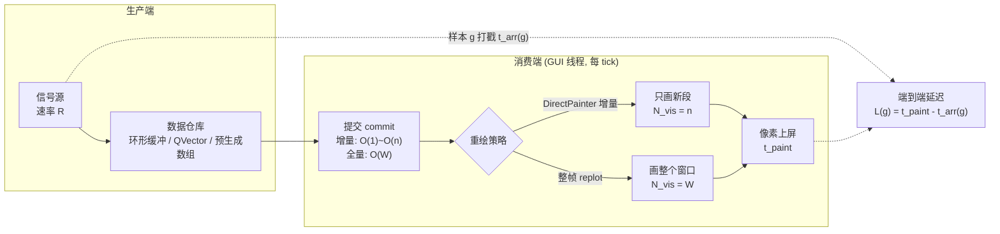
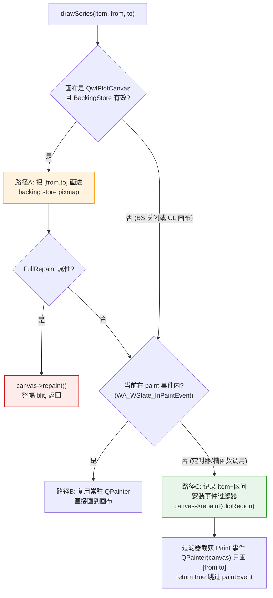
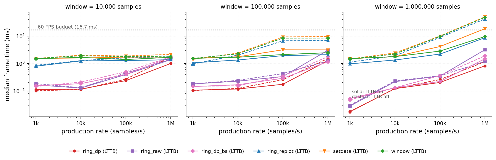
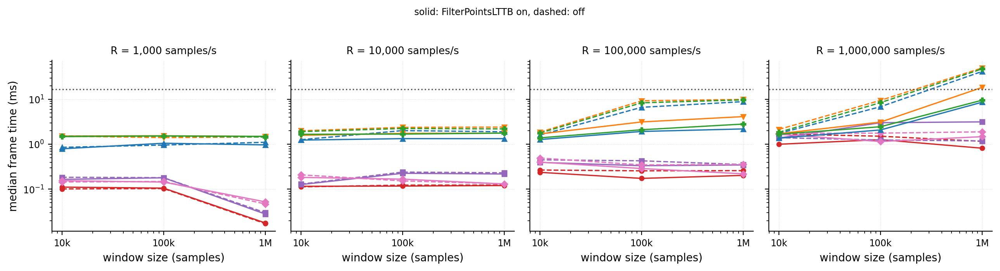
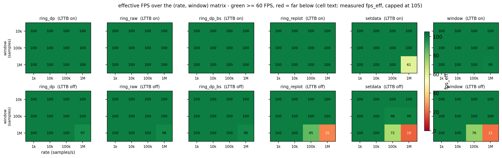
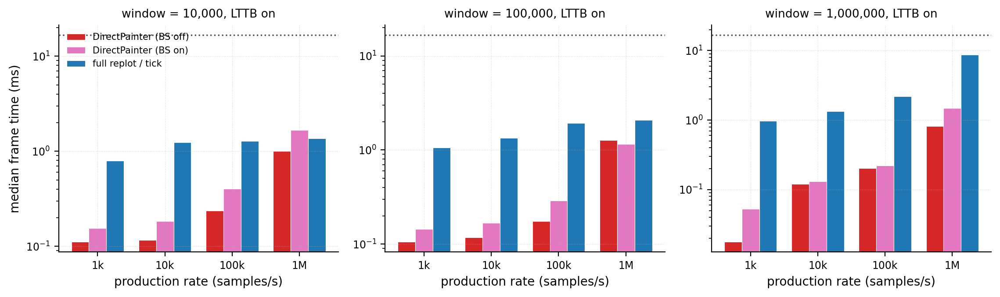
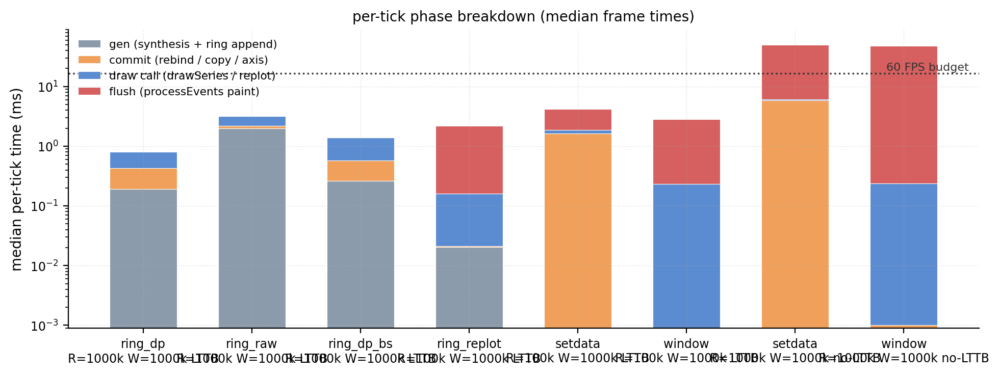
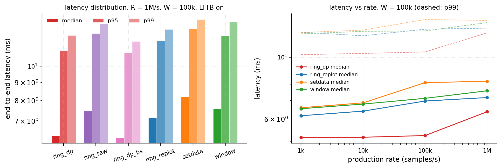
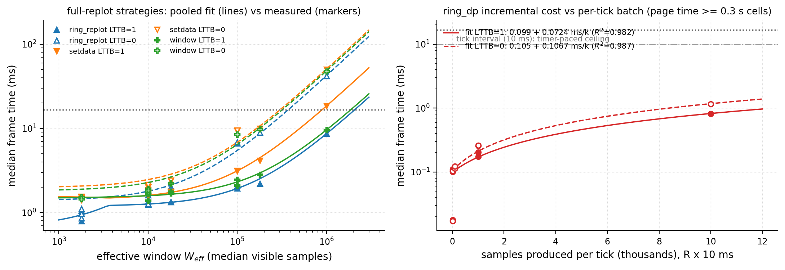

# 实时流式数据渲染策略：环形缓冲、DirectPainter 与帧预算模型

> **摘要** —— 示波器、振动监测、行情推送这类应用的共同难点是：数据以恒定速率 $R$ 持续到达，显示端却只能以有限帧率重绘，画布上还要保留最近 $W$ 个样本的窗口。本文把这个问题形式化为"生产—消费速率失配下的帧预算分配"，剖析 QWT 提供的三条数据通路——环形缓冲 + `QwtPlotDirectPainter` 增量绘制（`examples/2D/oscilloscope` 的标准模式）、周期性全量 `setSamples` + 整帧 replot（`examples/2D/cpuplot` 模式）、`WindowedSeriesData` 数据预生成、窗口视图按需滚动（`examples/bench/renderbench` 模式）——的源码级成本结构，指出它们的差别本质上是让每帧参与变换的样本数 $N_{\text{vis}}$ 等于新增量 $R\Delta t$ 还是整个窗口 $W$。在此之上建立一个可解出"可持续帧率"与"端到端延迟"的帧预算解析模型，并用一套 144 组配置的实测矩阵（4 档速率 × 3 档窗口 × 6 种通路 × LTTB 开关，i7-14700 + Intel UHD 770 + Qt 5.15.16）标定模型、划定 60 FPS 可行域。实测揭示两个反直觉结论：`DirectPainter` 增量把帧成本从 $O(W)$ 降到 $O(R\Delta t)$，在 $R=1\mathrm{M}/\mathrm{s}$、$W=1\mathrm{M}$ 的最恶劣单元上比整帧 replot 快 10.6 倍（0.82 ms vs 8.66 ms）且 12/12 单元全部维持 100 FPS；而"用 `setRawSamples` 触发 SIMD 变换"这条被广泛推荐的优化，在单线程流式场景下反而更慢——因为 `qwtSimdArgMinMax` 的 AVX2 路径返回前缺少 `VZEROUPPER`，把紧随其后的标量 `sin()` 生产循环拖慢约 10 倍，这一诊断与隔离微基准一致（补一句 `_mm256_zeroall()` 惩罚即消失）；惩罚大小依赖后续代码的寄存器使用形态，指令级机理尚未完全闭环（见[《SIMD argmin/argmax 向量化基准》](simd-argminmax.md) 4.5 节）。

> **摘要 — 核心结论**
>
> - **增量绘制是流式的默认正解**：环形缓冲 + `QwtPlotDirectPainter` 让帧成本只随每帧新增样本数 $R\Delta t$ 增长、与窗口 $W$ 无关，实测 12/12 个 $(R,W)$ 单元（含 $R=1\mathrm{M}/\mathrm{s}, W=1\mathrm{M}$）全部维持 100 FPS 定时器上限，帧时间 0.02–1.70 ms（混合口径：LTTB 开 0.02–1.27 ms、关最高至 1.70 ms）；画布 `paintEvent` 计数恒等于页边界整帧重绘次数（逐轮 0–291 视 $W/R$ 而定，代表单元为 3 次），其余约 300 帧增量全部走事件过滤器、画布自身重绘被正确跳过。
> - **60 FPS 可行域**：`DirectPainter` 增量在全部测试单元内都满足 16.67 ms 预算；整帧 replot + LTTB 在 $W \le 1\mathrm{M}$ 也达标（window 9.6 ms、ring_replot 8.7 ms），唯一例外是 `setdata` 在 $R=1\mathrm{M}, W=1\mathrm{M}$ 因每帧 $O(W)$ 拷贝提交（10.1 ms）叠加而破预算（18.5 ms）；一旦关闭 LTTB，整帧策略的失效边界由有效窗口 $W_{\text{eff}}=\min(R\cdot t, W)$ 决定：实测仅 $(R=1\mathrm{M}, W=1\mathrm{M})$ 跌破 60 FPS（42–50 ms，19–25 FPS）；$R=100\mathrm{k}$ 各单元仍在 72–100 FPS——其中 $W=1\mathrm{M}$ 单元因窗口在 3.3 s 内未充满（$W_{\text{eff}}\approx180\mathrm{k}$），按拟合斜率 40–48 ms/百万点外推，$W_{\text{eff}}$ 达 0.3–0.4 M 即破预算。
> - **`DirectPainter` 净收益 1.4–55 倍**：与整帧 replot 对照（ring_replot/ring_dp，LTTB 开），收益从 $R=1\mathrm{M}, W=10\mathrm{k}$ 的 1.4 倍（页每 tick 翻转、增量退化为整帧）到 $R=1\mathrm{k}, W=1\mathrm{M}$ 的 54.6 倍（新增段极小而整帧要画满百万点）；`BackingStore` 开启会触发 item 双绘，实测惩罚 1.1–2.9 倍。
> - **延迟由重绘节奏而非渲染成本主导**：端到端延迟中位数全矩阵为 5–116 ms，LTTB 开的非过载单元（$T_{\text{frame}} < 5$ ms）为 5.1–9.2 ms、深度过载单元由模型下界刻画；模型 $L_{\text{med}} \approx \Delta t_{\text{eff}}/2 + T_{\text{frame}}$ 在全部 144 单元的中位绝对误差仅 0.086 ms。想把延迟压到 5 ms 以下必须缩短 tick 间隔或改为样本到达即绘。
> - **SIMD 优化在单线程流式下反噬**：`setRawSamples` 命中 SIMD 变换路径本应更快，实测 ring_raw 反而比通用路径的 ring_dp 慢（$R=1\mathrm{M}, W=1\mathrm{M}$ 时 3.16 ms vs 0.82 ms）；根因是 `argMinMaxAVX2`（`src/core/qwt_simd_argminmax.cpp:141-203`）返回前未清 AVX 上半状态，隔离微基准（原始输出 `streaming_micro_results.txt`）显示后续标量 append 从 0.18 ms 涨到 1.91 ms、补 `_mm256_zeroall()` 后回到 0.15 ms。

---

## 1. 引言：流式渲染问题的形式化

### 1.1 生产—消费速率失配

示波器、声呐、振动监测、行情推送这类应用的共同结构是：数据以恒定速率 $R$（样本/秒）持续到达，显示端以帧率 $f$ 周期性重绘，画面上同时保留最近 $W$ 个样本（显示窗口）。三个量彼此独立，冲突不可避免：生产端每秒钟写入 $R$ 个样本，消费端每帧要决定"画什么、画多少、怎么画"。若每帧都把整个窗口交给渲染管线，帧成本随 $W$ 增长；若只画新增的 $R/f$ 个样本，帧成本随 $R/f$ 增长而与 $W$ 无关——但前提是画布上已有的像素不需要移动或擦除。这个前提何时成立，正是三种数据通路的分水岭。

形式化地，设第 $k$ 帧在时刻 $t_k$ 触发，帧成本为 $T_k$，则可持续帧率满足

$$
f_{\text{sustain}} = \min\left( f_{\text{tick}},\ \frac{1}{\overline{T}} \right), \qquad \overline{T} = \operatorname*{median}_k T_k
$$

其中 $f_{\text{tick}}$ 是驱动重绘的定时器频率（本文实验取 100 Hz，与 `examples/2D/oscilloscope` 的 10 ms 节奏一致）。60 FPS 交互预算要求 $\overline{T} \le 16.67$ ms。当 $\overline{T} > 1/f_{\text{tick}}$ 时定时器事件在事件循环中合并（coalescing），实际节奏退化为 $1/\overline{T}$，每帧消费的批量随之增大——系统进入过载区，端到端延迟开始由帧成本主导。

### 1.2 帧预算分解

[《Raster 与 OpenGL 渲染管线》篇](raster-vs-opengl.md)把一次整帧重绘分解为"变换 + 光栅化 + 合成 + 上屏"四段。流式场景在此之上还要加两段：**生产**（信号合成/采集搬运）与**提交**（把新数据交给绘图 item）。完整的每帧预算为

$$
T_{\text{frame}} = \underbrace{T_{\text{gen}}(n)}_{\text{生产}} + \underbrace{T_{\text{commit}}(W \text{ 或 } n)}_{\text{提交}} + \underbrace{T_{\text{xform}}(N_{\text{vis}})}_{\text{坐标变换+降采样}} + \underbrace{T_{\text{raster}}(P)}_{\text{光栅化}} + \underbrace{T_{\text{fixed}}}_{\text{轴/布局/合成}}
$$

其中 $n = R \cdot \Delta t$ 是每帧新增样本数（$\Delta t$ 为帧间隔），$N_{\text{vis}}$ 是本帧实际参与变换的样本数，$P = \min(N_{\text{vis}},\ 4W_c)$ 是降采样后的折线顶点数（$W_c$ 为画布像素宽，LTTB 桶预算见[《LTTB 降采样》篇](curve-downsampling.md)）。三种数据通路的本质区别，就是让 $N_{\text{vis}}$ 等于 $n$（增量绘制）还是等于 $W$（整帧重绘），以及 $T_{\text{commit}}$ 是 $O(1)$、$O(n)$ 还是 $O(W)$。



### 1.3 本文回答的三个问题

其一，三种提交/重绘组合（环形缓冲 + `QwtPlotDirectPainter`、周期性全量 `setSamples`、`WindowedSeriesData` 滚动窗口）各自的源码级成本结构是什么？其二，给定 $(R, W)$ 与重绘策略，可持续帧率与端到端延迟的解析模型长什么样、与实测偏差多大？其三，60 FPS 预算在 $(R, W)$ 平面上的可行域边界在哪里，`QwtPlotDirectPainter` 相对整帧 replot 的净收益多大、什么情况下反转为负？第 5 节用 144 组配置矩阵（4 档速率 × 3 档窗口 × 6 种通路 × LTTB 开关）逐一回答。

## 2. 三种数据通路剖析

### 2.1 oscilloscope 的 SignalData：不是环形缓冲

`examples/2D/oscilloscope` 是 Qwt 流式绘制的标准范本，但它的数据仓库 `SignalData`（`SignalData.cpp:12-50`）**并不是环形缓冲**：它是一个只追加的 `QVector<QPointF>`，配合"页"式截断工作。三个设计点值得逐一拆开。

**双缓冲批量提交。** 生产端 `append()`（`SignalData.cpp:87-107`）先把样本压入 `QMutex` 保护的 `pendingValues` 暂存队列，然后尝试 `tryLockForWrite()`：拿到写锁才把暂存队列整体冲刷进主向量并增量维护包围盒；拿不到（GUI 线程正持有读锁绘制）就直接返回，样本留在暂存队列等下一次 `append` 再试。生产线程**永不阻塞**，读写冲突被转化为暂存队列的延迟冲刷——这是一个无锁失败即退让（try-lock backoff）的批量提交协议，代价是 `pendingValues` 在 GUI 长期持锁时可能积压。

**页式窗口。** `Plot` 以固定时长 $T_{\text{page}}$（默认 10 s）为一"页"：页内 X 轴静止，曲线从左向右生长，`timerEvent` 每 10 ms 调 `updateCurve()`（`Plot.cpp:184-214`）用 DirectPainter 只画新增段；页末 `incrementInterval()`（`Plot.cpp:216-242`）调 `clearStaleValues()` 丢弃旧页数据、手动平移刻度（避免网格跳动）、整帧 `replot()` 开启新页。内存上界因此是 $R \cdot T_{\text{page}}$ 个样本——1M 样本/秒 × 10 s 页长意味着单页 160 MB 的 `QVector<QPointF>`，这是页式方案在高速率下的真实代价。

**消费端持读锁绘制。** `Plot::replot()` 与 `updateCurve()` 都在 `values().lock()`（读锁）内完成整个绘制过程（`Plot.cpp:163-172, 186-213`），保证绘制期间向量不被写端重分配。曲线数据通过自定义的 `CurveData : QwtSeriesData<QPointF>`（`Plot.cpp:86-113`）逐点虚函数读取——这使它在 `QwtPointMapper` 中落入**通用路径**而非 SIMD 快速路径（见 2.4 节），是一个容易被忽略的性能税。

### 2.2 真环形缓冲：定容、回卷与连续窗口

真环形缓冲把内存上界从 $R \cdot T_{\text{page}}$ 压到固定的 $W$ 个样本：写指针模 $W$ 回卷，最旧样本被最新样本原位覆盖。它与 Qwt 数据通路结合时有一个经典障碍：`QwtSeriesData::sample(i)` 要求按逻辑序（旧→新）访问，而回卷使物理内存不连续。两种解法：

- **取模索引**：自定义 `QwtSeriesData` 子类，`sample(i)` 内做 `(start + i) \% W`。实现最简单，但每点一次取模 + 虚函数调用，落入 mapper 通用路径。
- **双写镜像（doubled buffer）**：分配 $2W$ 槽位，样本 $g$ 同时写入槽 $g \bmod W$ 与槽 $(g \bmod W) + W$。任意长度 $\le W$ 的窗口 $[G-W, G)$ 在镜像数组中都是一段**连续区间** $[s, s+W)$（$s = G \bmod W$）——窗口滑动只是起始指针平移，且连续内存使 `setRawSamples(xs+s, ys+s, W)` 成为可能，从而命中 SIMD 快速路径。代价是 2× 内存与每样本两次写入。

本文基准的 `ring_dp` / `ring_raw` / `ring_dp_bs` / `ring_replot` 四种通路都建立在双写镜像环形缓冲上（SoA `double` 数组，容量 $2W$，读写锁协议镜像 SignalData）；差别只在提交与重绘方式。

### 2.3 全量 setData：COW 的真相与拷贝的位置

`QwtPlotCurve::setSamples(const QVector<QPointF>&)`（`qwt_plot_curve.cpp:1347-1350`）的实现是 `setData(new QwtPointSeriesData(samples))`。`QwtPointSeriesData` 继承 `QwtArraySeriesData<QPointF>`，其成员 `QVector<QPointF> m_samples` 按值保存——但 `QVector` 是隐式共享（COW）的：**构造时只增引用计数，不发生深拷贝**。真正的拷贝发生在应用侧：流式应用每帧都要把最新 $W$ 个样本装进一个 `QVector<QPointF>`（无论是从自有环形缓冲复制还是直接生成），这份 $O(W)$ 的填充才是"全量提交"的主体成本。`setData` 本身另有两笔小账：`delete` 上一帧的数据对象 + `new` 一个新的（每帧一次堆往返），以及 `dataChanged() → itemChanged() → autoRefresh()` 链（`qwt_series_store.h:157-164`、`qwt_plot_seriesitem.cpp:131-133`、`qwt_plot_item.cpp:495-501`）——`autoReplot` 默认为 **true**（`qwt_plot.cpp:135, 198`；触发点 `autoRefresh()` 在 :395-400）时这条链直接触发整帧 replot，若应用随后自己再 replot 一次，就是每帧双份重绘。流式应用必须 `setAutoReplot(false)`。

三个变体的语义差异（`qwt_plot_curve.cpp:1331-1530`）：

| API | 数据对象 | 拷贝语义 | mapper 路径资格 |
|---|---|---|---|
| `setSamples(QVector<QPointF>)` | `QwtPointSeriesData` | QVector COW 浅共享（应用侧填充是真实拷贝） | 通用路径（AoS `QPointF`） |
| `setSamples(QVector<QPointF>&&)` | 同上 | COW 浅共享，无深拷贝（具名右值仍绑定 `const&` 构造，实现未真正移动） | 通用路径 |
| `setSamples(const double* x, const double* y, int)` | `QwtPointArrayData<double>` | `memcpy` 深拷贝（`qwt_point_data.h:250-257`） | **SIMD 快速路径** |
| `setRawSamples(const double* x, const double* y, int)` | `QwtCPointerData<double>` | **零拷贝**，仅存指针；调用方保证生命周期与内容稳定 | **SIMD 快速路径** |

`setRawSamples` 的文档注释写明"setRawSamples is provided for efficiency. It is important to keep the pointers during the lifetime of the underlying QwtCPointerData class"（`qwt_plot_curve.cpp:1365-1366`）——引用语义把内存管理责任完全推给应用：绘制期间（含 GUI 线程外的任何 paint 事件）数组不得被重分配或改写，多线程下需要与 2.1 节相同的读写锁协议。`examples/2D/cpuplot` 是它的教科书用法：固定长度的历史数组每秒整体右移一格，`setRawSamples(m_timeData, data, count)` 零拷贝提交 + 整帧 `replot()`（`CpuPlot.cpp:160-187`）——低速率（1 Hz）、小窗口（60 点，`CpuPlot.h:11` 的 `HISTORY 60`）场景下全量重绘完全够用，不需要增量机制。

### 2.4 WindowedSeriesData：按需窗口与 SIMD 资格的丢失

`examples/bench/renderbench` 的 `WindowedSeriesData.h` 展示第三种通路：全量数据预先生成在 SoA `QVector<double>` 中，显示窗口用 `setWindow(offset, displaySize)` 滑动——提交是严格 $O(1)$ 的（改两个整数 + 作废包围盒缓存），没有任何逐帧拷贝。`sample(i)` 做 `offset + i` 索引（`WindowedSeriesData.h:69-73`），因此窗口内存连续；但它是自定义 `QwtSeriesData` 子类，`QwtPointMapper` 的快速路径通过 `dynamic_cast` 只认四个具体类型（`qwt_point_mapper.cpp:547-553`）：

```cpp
// qwt_point_mapper.cpp —— SIMD argmin/argmax 的数据源资格检查
if (auto* arr = dynamic_cast< const QwtPointArrayData< double >* >(series)) ...
if (auto* ptr = dynamic_cast< const QwtCPointerData< double >* >(series)) ...
if (auto* val = dynamic_cast< const QwtValuePointData< double >* >(series)) ...
if (auto* cval = dynamic_cast< const QwtCPointerValueData< double >* >(series)) ...
```

自定义子类一律落入逐点虚函数 `sample(i)` 的通用路径——LTTB 的每桶 argmin/argmax 失去 AVX2/SSE4.2 加速（《LTTB 降采样》篇 5.3 节）。双写镜像环形缓冲 + `setRawSamples` 指针重绑定（本文的 `ring_raw` 通路）正是为了在流式场景下同时拿到"零拷贝提交"与"SIMD 变换资格"。另一个隐藏成本：`WindowedSeriesData::boundingRect()` 在每次 `setWindow` 后作废缓存，重算是对整个窗口的 $O(W)$ 扫描（`WindowedSeriesData.h:75-96`）；只有开启轴自动缩放时 `QwtPlot::updateAxes()` 才会查询它（`qwt_plot_axis.cpp:862-864`），固定轴下这笔成本不存在——但一旦应用打开 `setAxisAutoScale`，每帧 replot 都会触发这次扫描。

## 3. QwtPlotDirectPainter 的真实行为

### 3.1 drawSeries 的三条路径

`QwtPlotDirectPainter::drawSeries(item, from, to)`（`qwt_plot_directpainter.cpp:183-258`）按画布类型与调用时机分三条路径：



三条路径的行为分别是：

- **路径 A（backing store 预绘）**：画布是 raster `QwtPlotCanvas` 且其 `BackingStore` 属性开启、pixmap 非空时（`qwtHasBackingStore`，`qwt_plot_directpainter.cpp:50-54`），先把新区间画进 backing store pixmap，使缓存与屏幕内容保持同步；若设置了 `FullRepaint` 属性则接着 `canvas->repaint()` 整幅 blit 并返回。
- **路径 B（常驻 painter）**：仅当调用发生在 paint 事件处理期间（Qt5 下判断 `WA_WState_InPaintEvent`，`qwt_plot_directpainter.cpp:210-216`）才成立，复用内部常驻的 `QPainter`；`AtomicPainter` 属性控制每次调用后是否关闭 painter。
- **路径 C（事件过滤器）**：定时器/槽函数中的常规调用（不在 paint 事件内）走这条路——记录 item 与区间、给画布安装事件过滤器、`canvas->repaint(clipRegion)` 同步触发一次局部重绘；过滤器截获 `QEvent::Paint`，用临时 `QPainter(canvas)` 只画登记的区间（或 `CopyBackingStore` 属性下直接 blit 整幅 pixmap），返回 true 跳过 `QwtPlotCanvas::paintEvent`（`qwt_plot_directpainter.cpp:241-316`）。

### 3.2 BackingStore 开启时的双绘真相

路径 A 与路径 C 不是互斥的：`BackingStore` 开启时（库默认，`qwt_plot_canvas.cpp:59-61`），一次 `drawSeries` 先走 A 把区间画进 pixmap，再继续走 C 把**同一区间再画一遍**到窗口表面。item 光栅化成本 ×2。oscilloscope 对此的对策是在自定义 Canvas 构造函数里直接关掉 BackingStore（`Plot.cpp:28-36`，注释明言"没有 overlay 时 QWidget 的内部 backing store 足够"）——`qwtHasBackingStore` 返回 false，路径 A 整体跳过，每帧只画一遍。`examples/2D/realtime` 的 `RandomPlot` 同样在启动采集前关闭它（`RandomPlot.cpp:117-118`）。第 5.3 节的 `ring_dp` 对 `ring_dp_bs` 配对实验量化了这个陷阱的代价。

### 3.3 回退与失效边界

头文件注释（`qwt_plot_directpainter.h:51-53`）写明了增量绘制的前提："Incremental painting will only help when no replot is triggered by another operation (like changing scales) and nothing needs to be erased." 展开成失效清单：

- **任何触发整帧重绘的操作都会清空增量收益**：改轴范围/刻度（`setAxisScale`、`setAxisScaleDiv`）、resize、图例变化、其他 item 的 `itemChanged`——画布 `paintEvent` 全量重画所有 item。oscilloscope 因此把轴操作压缩到页边界一次性完成，页内绝不动轴。
- **需要擦除的内容无法增量**：新样本若会覆盖旧像素（窗口回卷、Y 轴自动缩放改变映射），必须先擦后画，等价于整帧重绘。页式方案（页内数据只向右生长）正是为了回避擦除。
- **`FullRepaint` 属性**把每次 `drawSeries` 变成"画进 pixmap + 整幅 blit"——适合需要与 overlay 共存的场景，但 blit 成本随画布面积线性增长。
- **GL 画布不支持**：路径 A 的 `qobject_cast<QwtPlotCanvas*>` 对 `QwtPlotOpenGLCanvas` 必然失败，路径 C 在 `QOpenGLWidget` 上于 paint 事件外开 `QPainter` 的行为不受 Qt 保证——《Raster 与 OpenGL 渲染管线》篇 2.4/4.8 节的实测显示帧时间双峰不稳定（0.13–1.1 ms 两簇），不可作为选型依据。增量重绘请配 raster 画布。

第 5.3 节用画布 `paintEvent` 计数验证了增量路径的正确性：`ring_dp` 在 3 秒测量段内 `paintEvent` 次数恒等于页边界次数，全部增量帧都走路径 C 的过滤器、画布自身的 `paintEvent` 被正确跳过。

## 4. 帧预算模型

### 4.1 成本项与记号

记画布像素宽 $W_c$（本文 900），LTTB 开启时折线顶点数饱和于 $P = \min(N_{\text{vis}}, 4W_c) = \min(N_{\text{vis}}, 3600)$。各成本项按《Raster 与 OpenGL 渲染管线》篇的分解取锚：空场景整帧固定开销 $T_{\text{fixed}} \approx 0.57$ ms（900×500 raster，含背景填充/blit/flush）；SIMD 路径的变换段 $\sigma_{\text{simd}} \approx 1.4$ ms/百万点；raster 引擎整帧斜率（变换+光栅化）$b \approx 2.6$ ms/百万点（LTTB 开）；无降采样时 1M 点整帧约 69 ms（4.7 节）。本文第 5 节的拟合将给出流式场景自己的系数，并与这些锚点对照。

### 4.2 三种策略的每帧成本

**增量直绘（ring_dp 族）**：页内每帧只处理新增段 $n = R \cdot \Delta t$：

$$
T_{\text{frame}}^{\text{direct}} \approx \underbrace{\gamma \, n}_{\text{生产+环形写入}} + \underbrace{\beta \, n}_{\text{提交: 重绑定} + \text{裁剪框扫描}} + \underbrace{\tau \, n + \rho \min(n, 4W_c)}_{\text{变换} + \text{光栅化(仅新段)}} + \varepsilon
$$

其中 $\tau$ 是逐样本变换成本（通用路径或 SIMD 路径，取决于数据对象类型），$\rho$ 是逐折线点光栅化成本，$\varepsilon$ 是路径 C 的固定开销（`repaint(clipRegion)` + 过滤器 + `QPainter` 起止）。关键点：**$W$ 不出现在稳态成本里**——窗口大小只通过页边界影响帧率（下式）。页每 $W/R$ 秒翻转一次，边界帧成本 $T_{\text{page}} \approx T_{\text{fixed}} + T_{\text{axis}} + O(n)$（新页开启时可见区间近乎为空，二分裁剪把变换量压到刚越过边界的样本），摊销后

$$
\overline{T}^{\text{direct}} \approx T_{\text{frame}}^{\text{direct}} + \frac{R \cdot \Delta t}{W} \, T_{\text{page}}
$$

**整帧重绘（ring_replot / setdata / window）**：每帧 $N_{\text{vis}} = \min(G, W)$（$G$ 为已生产样本数，稳态下 $= W$）：

$$
T_{\text{frame}}^{\text{full}} \approx T_{\text{fixed}} + T_{\text{axis}} + \underbrace{\kappa \, W}_{\text{仅 setdata: 拷贝提交}} + \tau' \, W + \rho \min(W, 4W_c)
$$

$\tau'$ 与数据对象类型绑定：`QVector<QPointF>`（setdata）与自定义子类（window/ring_replot）走通用路径，`setRawSamples` 的 `QwtCPointerData<double>` 走 SIMD 路径。LTTB 关闭时 $\rho$ 项变为 $\rho' \, W$（全部顶点进光栅化器），$\rho' \gg \rho$。滑动轴每帧 `setAxisScale` 引入 $T_{\text{axis}}$：刻度重算（`divideScale`）+ 轴控件标签重排 + 布局检查（`qwt_plot.cpp:690-712` 的 `replot` 链），与 $W$ 无关但与画布/字体度量有关。

**WindowedSeriesData 与 setdata 的差别**只在提交项：$\kappa W$（逐帧填充 `QVector<QPointF>`）对 $O(1)$（`setWindow` 改两个整数）。二者变换成本相同（都是通用路径）时，差值就是拷贝提交的净成本——第 5.4 节直接测出这条差值曲线。

### 4.3 可持续帧率与 60 FPS 边界

$$
f_{\text{sustain}} = \min\left( \frac{1}{\Delta t},\ \frac{1}{\overline{T}} \right)
$$

60 FPS 可行条件 $\overline{T} \le 16.67$ ms 对两种策略给出不同的边界形状：

- 整帧重绘：$T^{\text{full}}(W)$ 单调增，边界是**最大窗口** $W^*$——解 $\kappa W + \tau' W + \rho \min(W, 4W_c) + C_0 = 16.67$。LTTB 开启时 $W > 3600$ 后光栅化项饱和，$W^*$ 主要由 $\kappa + \tau'$（提交+变换的逐样本成本）决定；LTTB 关闭时 $\rho' W$ 项主导，$W^*$ 缩小一个量级以上。
- 增量直绘：稳态成本与 $W$ 无关，边界是**最大生产速率** $R^*$——解 $\gamma n + \beta n + \tau n = 16.67$，$n^* = 16.67/(\gamma+\beta+\tau)$，$R^* = n^*/\Delta t$。但页边界摊销项随 $W$ 减小而增大：当 $W/R \lesssim$ 几帧时长时，几乎每帧都是边界帧，增量策略退化为整帧重绘——这是 $(R, W)$ 平面左下角的失效区，第 5.2 节的 $R=1\mathrm{M}, W=10\mathrm{k}$ 单元（页时长 10 ms = 1 帧）实测验证了退化。

### 4.4 端到端延迟模型

样本 $g$ 的到达时刻 $t_{\text{arr}}(g)$ 与其首次被绘制的帧完成时刻 $t_{\text{paint}}$ 之差为端到端延迟 $L(g)$。定时器节奏下，帧 $k$ 在 $t_k$ 触发并一次性消费 $[t_{k-1}, t_k)$ 内到达的全部样本，故同帧样本的延迟均匀散布于

$$
L \in \left[\, T_{\text{frame}},\ \Delta t_{\text{eff}} + T_{\text{frame}} \,\right], \qquad \Delta t_{\text{eff}} = \max(\Delta t,\ T_{\text{frame}})
$$

中位数与尾部的模型预测为

$$
L_{\text{med}} \approx \frac{\Delta t_{\text{eff}}}{2} + T_{\text{frame}}, \qquad L_{p99} \approx \Delta t_{\text{eff}} + T_{\text{frame}} + \delta_{\text{jitter}}
$$

未过载时 $\Delta t_{\text{eff}} = \Delta t = 10$ ms，$L_{\text{med}} \approx 5 + T_{\text{frame}}$——**延迟的下界由重绘节奏而非渲染成本决定**：想低于 5 ms 必须缩短 tick 间隔或改为样本到达即绘（realtime 示例的单点 `drawSeries` 模式）。过载时 $\Delta t_{\text{eff}} = T_{\text{frame}}$，$L_{\text{med}} \approx 1.5\, T_{\text{frame}}$，延迟随帧成本线性放大。第 5.5 节用全部 144 组配置检验该模型。

### 4.5 模型参数的来源

$\gamma, \beta, \tau, \rho, \kappa, T_{\text{fixed}}, T_{\text{axis}}$ 不由先验给定，而是对第 5 节实测数据做最小二乘拟合（脚本 `streaming_experiment.py`），拟合形式即 4.2 节的多项式结构；$T_{\text{fixed}}$、$\sigma_{\text{simd}}$、$\rho'$ 与《Raster 与 OpenGL 渲染管线》篇的独立测量交叉验证。模型与实测的偏差在第 5.6 节如实呈现。

## 5. 实验

### 5.1 环境、矩阵与计时协议

环境：Intel Core i7-14700 + Intel UHD 770 核显，16 GB RAM，Windows 10 19045，显示器 1920×1080；Qt 5.15.16（msvc2019_64）；QWT 7.x 维护分支 Release 构建（MSVC 2019 `/O2 /MD`，`build-release/`）；raster 画布 `QwtPlotCanvas`，contentsRect 精确调至 900×500；曲线单条、笔宽 1 px、抗锯齿关（库默认）、Y 轴固定 $[-1.5, 1.5]$（无自动缩放）。绝对数值随硬件变化，相对关系与边界形状稳定。

矩阵：生产速率 $R \in \{1\mathrm{k}, 10\mathrm{k}, 100\mathrm{k}, 1\mathrm{M}\}$ 样本/秒 × 窗口 $W \in \{10\mathrm{k}, 100\mathrm{k}, 1\mathrm{M}\}$ 样本 × 6 种数据通路 × `FilterPointsLTTB` 开/关，共 144 组配置。六种通路：`ring_dp`（双写镜像环形缓冲 + 自定义 `QwtSeriesData` + DirectPainter 增量，页边界整帧 replot，BackingStore 关——镜像 oscilloscope）、`ring_raw`（同 ring_dp，但每 tick 用 `setRawSamples(xs+s, ys+s, n)` 指针重绑定窗口，命中 SIMD mapper 路径）、`ring_dp_bs`（同 ring_dp，但 BackingStore 开——双绘陷阱探针）、`ring_replot`（同 ring_dp 提交，但每 tick 滑动轴整帧 replot——DirectPainter 净收益的对照组）、`setdata`（每 tick 填充 `QVector<QPointF>` 窗口拷贝 + `setSamples` + 滑动轴整帧 replot，BackingStore 开——镜像 cpuplot 的全量提交）、`window`（`WindowedSeriesData` 式预生成数组 + `setWindow(offset,n)` + 滑动轴整帧 replot，BackingStore 开——镜像 renderbench）。

计时协议（流式场景专用）：生产由 GUI 线程 `QTimer`（10 ms，`Qt::PreciseTimer`）驱动，每 tick 按累计取整 $G_k = \operatorname{round}(R \cdot t_k)$ 批量生成样本（累计取整消除逐 tick 舍入漂移），样本 $g$ 的虚拟到达时刻为 $t_{\text{arr}}(g) = (g + 0.5)/R$——即假设样本在相邻两 tick 之间均匀到达，与真实 DAQ 的 DMA 批量交接同构。每 tick 用 `QElapsedTimer` 分四段计时：gen（信号合成 + 环形写入）、commit（窗口重绑定/向量拷贝 + 裁剪框计算 + 轴更新）、draw（`drawSeries()` 或 `replot()` 调用本身）、flush（`processEvents()` 交付异步 paint，整帧策略的光栅化落在此段；增量策略的 draw 已同步完成、flush≈0）。每配置先跑 0.3 s 预热（丢弃），再连续采集 3.0 s；帧时间 > 2× 该轮中位数记为 drop；每配置重复 3 轮，配置级数值取"median 的 median"；3 轮中位数极差超过 50% 视为受并行任务干扰，自动追加 2 轮（本轮共 9/144 组触发）；配置间 sleep 1 s 降温、轮间 250 ms。端到端延迟逐样本采集：$L(g) = t_{\text{paint}} - t_{\text{arr}}(g)$，$t_{\text{paint}}$ 取该帧 flush 完成时刻（像素就绪），报告 median/p95/p99。每轮重建全部绘图对象，杜绝跨轮状态残留。基准程序 `docs/assets/algorithms/streaming_bench.cpp`（顶部含完整编译命令）自动跑完全部配置后自行退出，stdout 输出 CSV（`streaming_results.csv`，每轮一行），分析与出图见 `streaming_experiment.py`。

### 5.2 矩阵结果：帧时间与 60 FPS 可行域



全部 144 组配置的中位帧时间（median-of-medians，ms/帧）汇总于下表（LTTB 开）。fps_eff 一列在 100 表示定时器节奏未被打破（帧成本 < 10 ms tick），低于 100 表示进入过载合并区。

| R (样本/s) | W (样本) | ring_dp | ring_raw | ring_dp_bs | ring_replot | setdata | window |
|---:|---:|---:|---:|---:|---:|---:|---:|
| 1k | 10k | 0.112 | 0.166 | 0.155 | 0.795 | 1.529 | 1.486 |
| 1k | 100k | 0.106 | 0.180 | 0.144 | 1.056 | 1.550 | 1.534 |
| 1k | 1M | 0.018 | 0.028 | 0.052 | 0.971 | 1.500 | 1.502 |
| 10k | 10k | 0.116 | 0.127 | 0.184 | 1.242 | 1.584 | 1.674 |
| 10k | 100k | 0.118 | 0.227 | 0.168 | 1.338 | 1.750 | 1.690 |
| 10k | 1M | 0.121 | 0.218 | 0.131 | 1.337 | 1.777 | 1.777 |
| 100k | 10k | 0.238 | 0.397 | 0.400 | 1.278 | 1.703 | 1.393 |
| 100k | 100k | 0.174 | 0.334 | 0.289 | 1.933 | 3.150 | 2.109 |
| 100k | 1M | 0.203 | 0.347 | 0.221 | 2.200 | 4.140 | 2.824 |
| 1M | 10k | 1.004 | 1.377 | 1.676 | 1.369 | 1.722 | 1.679 |
| 1M | 100k | 1.270 | 3.029 | 1.153 | 2.089 | 3.125 | 2.463 |
| 1M | 1M | 0.820 | 3.161 | 1.482 | 8.659 | 18.476 | 9.598 |

三个直接可读的规律。其一，`ring_dp` 一列几乎与 $W$ 无关（0.02–1.27 ms），只随 $R$ 缓增——这正是 4.2 节"增量绘制使 $N_{\text{vis}} = R\Delta t$ 而非 $W$"的实测印证：帧成本由每 tick 新增的 $R\Delta t$ 个样本决定，窗口开多大都不影响稳态帧时间。其二，整帧策略（ring_replot/setdata/window）的帧时间随 $W$ 单调上升，$W=1\mathrm{M}$ 处三者分别到 8.66/18.48/9.60 ms——$O(W)$ 的变换扫描（以及 setdata 额外的 $O(W)$ 拷贝）在大窗口处显形。其三，$R=1\mathrm{M}, W=10\mathrm{k}$ 一列所有策略都收敛到 1.0–1.7 ms：此时页时长 $W/R = 10$ ms 恰等于 tick 间隔，`ring_dp` 每 tick 都触发页边界整帧重绘（实测 boundary_replots = 281 ≈ 帧数），增量优势消失，退化到与整帧策略同量级——这是 4.3 节预言的 $(R,W)$ 左下角失效区。

把 60 FPS 预算（16.67 ms）叠到 $(R, W)$ 平面上得到可行域：



沿窗口维度看更清楚：`ring_dp` 的曲线几乎水平（帧时间与 $W$ 解耦），而三条整帧曲线在 LTTB 关时以约 40–48 ms/百万点的斜率陡升、在 LTTB 开时斜率降到 7–17 ms/百万点——降采样把整帧策略的窗口承载能力抬高约一个数量级。



LTTB 开启时，`ring_dp`/`ring_raw`/`ring_dp_bs`/`ring_replot`/`window` 五种通路 12/12 单元全部 ≥60 FPS（多数达 100 FPS 上限），唯一破预算的是 `setdata` 在 $R=1\mathrm{M}, W=1\mathrm{M}$（18.48 ms，60.6 FPS 边缘）——它的每帧拷贝提交（10.1 ms，见 5.4）叠加整帧重绘后越线。LTTB 关闭时可行域急剧收缩，但失效边界由有效窗口 $W_{\text{eff}}=\min(R\cdot t, W)$（测量段内可见样本数的中位数，定义见 5.6 节）而非名义 $W$ 决定：实测仅 $(R=1\mathrm{M}, W=1\mathrm{M})$ 跌破 60 FPS（三策略 42–50 ms，19–25 FPS）；$R=100\mathrm{k}$ 各单元仍在 72–100 FPS——其中 $W=1\mathrm{M}$ 单元因 3.3 s 测量段内窗口未充满（$W_{\text{eff}}\approx180\mathrm{k}$），按 LTTB 关的拟合斜率 40–48 ms/百万点（5.6 节）外推，$W_{\text{eff}}$ 逼近 0.3–0.4 M 即破预算；$W\le100\mathrm{k}$ 单元则是 $W_{\text{eff}}$ 本身就小。`ring_dp` 增量族因为每帧只画 $R\Delta t$ 段而全域仍 ≥96 FPS（$R=1\mathrm{M}, W=1\mathrm{M}$ 关 LTTB 也仅 1.16 ms、96.6 FPS）。一句话概括 60 FPS 可持续条件：**用增量绘制则全域可达；用整帧重绘则需 LTTB 开启且 $W \lesssim 1\mathrm{M}$（`setdata` 因拷贝提交上限更低，约 $W \lesssim 0.9\mathrm{M}$）**。

### 5.3 DirectPainter 的净收益与双绘陷阱



`ring_dp`（增量）对 `ring_replot`（同提交、整帧）的比值就是 `DirectPainter` 剥离掉提交成本后的净收益（LTTB 开）：

| R | W=10k | W=100k | W=1M |
|---:|---:|---:|---:|
| 1k | 7.1× | 10.0× | 54.6× |
| 10k | 10.7× | 11.4× | 11.1× |
| 100k | 5.4× | 11.1× | 10.8× |
| 1M | 1.4× | 1.6× | 10.6× |

净收益的量级由"整帧要画多少 vs 增量只画多少"的比值决定。$R=1\mathrm{k}, W=1\mathrm{M}$ 处高达 54.6 倍：整帧每 tick 重画满窗 1M 点（0.97 ms），增量每 tick 只画新增的 $1\mathrm{k}\times10\mathrm{ms}=10$ 个点（0.018 ms）。反过来，$R=1\mathrm{M}, W=10\mathrm{k}$ 处只有 1.4 倍：页时长等于 tick 间隔，增量每 tick 都退化成页边界整帧重绘（5.2 节），两者做的是同一件事。$R=1\mathrm{M}, W=100\mathrm{k}$ 的 1.6 倍同理——页时长 100 ms 内约有 10 个 tick，但每 tick 新增 $10\mathrm{k}$ 点已接近整帧 100k 点的十分之一，增量优势被高生产速率稀释。这给出增量绘制的适用判据：**页时长 $W/R$ 应显著大于 tick 间隔**（经验值 $\ge 20\Delta t$），否则退回整帧更简单且不吃亏。

`paint_events` 列提供了增量路径正确性的硬证据：`ring_dp`/`ring_raw`/`ring_dp_bs` 在约 300 帧、3 秒的测量段内，画布 `paintEvent` 计数逐轮恒等于页边界整帧重绘次数 `boundary_replots`（0–291 视 $W/R$ 而定：代表单元 $R=1\mathrm{M}, W=1\mathrm{M}$ 为 3，页退化的 $R=1\mathrm{M}, W=10\mathrm{k}$ 单元则接近帧数），说明页边界以外的增量帧全部经由 3.1 节的路径 C（事件过滤器截获 Paint、只画登记区间、返回 true 跳过 `QwtPlotCanvas::paintEvent`）；三种整帧策略的 `paint_events` 则逐轮恒等于帧数（57–300 视过载程度而定：非过载单元每帧一次约 300，setdata $R=1\mathrm{M}, W=1\mathrm{M}$ LTTB 开因过载帧合并只有 182）。这与源码结构完全吻合。

`ring_dp_bs` 对 `ring_dp` 的比值是 3.2 节双绘陷阱的实测代价（LTTB 开）：

| R | W=10k | W=100k | W=1M |
|---:|---:|---:|---:|
| 1k | 1.39× | 1.36× | 2.94× |
| 10k | 1.58× | 1.42× | 1.08× |
| 100k | 1.68× | 1.66× | 1.08× |
| 1M | 1.67× | 0.91× | 1.81× |

`BackingStore` 开启后一次 `drawSeries` 把 item 画两遍（路径 A 进 pixmap + 路径 C 进窗口），惩罚普遍在 1.4–1.7 倍；$R=1\mathrm{k}, W=1\mathrm{M}$ 处放大到 2.94 倍，因为此时增量段本身极廉价（0.018 ms），双绘的固定开销占比最大。个别单元（$R=1\mathrm{M}, W=100\mathrm{k}$ 的 0.91×）出现比值 <1，是页边界重绘主导、双绘只作用于少数增量帧时的测量噪声，不改变整体结论。对策与 oscilloscope 一致：流式画布关掉 `BackingStore`（`QwtPlotCanvas::setPaintAttribute(BackingStore, false)`），或改用 `CopyBackingStore` 属性把第二遍降为一次整幅 blit。

### 5.4 提交路径成本与 SIMD 资格



把每 tick 拆成 gen（信号合成 + 环形写入）、commit（窗口重绑定/向量拷贝 + 裁剪框 + 轴更新）、draw（`drawSeries()`/`replot()` 调用）、flush（`processEvents()` 交付异步 paint）四段，三种提交方式的成本画像一目了然。

**全量拷贝提交（setdata）的成本是 $O(W)$。** `setdata` 每 tick 新建一个 `QVector<QPointF>` 并逐点填入最新 $W$ 个样本，`setSamples` 之后 COW 只增引用计数不再拷贝——所以真实成本全在应用侧这次填充。实测（$R=1\mathrm{M}$，窗口充满）commit 段为 $W=10\mathrm{k}$→0.12 ms、$100\mathrm{k}$→1.09 ms、$1\mathrm{M}$→10.13 ms，与 $W$ 线性。对照 `window`（`setWindow` 仅改两个整数，commit≈0）：同为整帧重绘、同走通用变换路径，二者帧时间之差就是这次拷贝的净成本——$W=1\mathrm{M}$ 处 setdata 18.48 ms vs window 9.60 ms，拷贝吃掉 8.88 ms，占整帧的 48%。这是"周期性全量 setData"模式在大窗口下的头号开销，也解释了 5.2 节为何唯独 setdata 在 $R=1\mathrm{M}, W=1\mathrm{M}$ 破 60 FPS。

**LTTB 对整帧策略的收益随 $W$ 放大。** $R=1\mathrm{M}$ 下关/开 LTTB 的帧时间比：window 在 $W=100\mathrm{k}$ 为 3.4 倍、$W=1\mathrm{M}$ 为 5.0 倍；ring_replot 在 $W=1\mathrm{M}$ 为 4.8 倍；setdata 因拷贝成本不随 LTTB 变化，比值被摊薄到 2.7 倍。$W=10\mathrm{k}$ 处三者都只有 1.1–1.3 倍——点数太少，降不降采样都快。这与《LTTB 降采样》篇的结论一致：降采样的价值只在 $N \gg 4W_c$ 时兑现。

**SIMD 变换资格在单线程流式下反噬。** 这是本文最反直觉的发现。按《LTTB 降采样》篇 5.3 节，只有 `QwtPointArrayData<double>`/`QwtCPointerData<double>` 等四个 SoA 类型能命中 `qwtSimdArgMinMax` 的 AVX2 快速路径（`qwt_point_mapper.cpp:547-553`），自定义 `QwtSeriesData` 子类落入逐点虚函数通用路径。直觉上 `ring_raw`（每 tick `setRawSamples` 指针重绑定 → `QwtCPointerData<double>` → SIMD）应当快过 `ring_dp`（自定义 `RingSeriesData` → 通用路径）。实测却相反（LTTB 开，帧时间比 ring_dp/ring_raw）：

| R | W=10k | W=100k | W=1M |
|---:|---:|---:|---:|
| 1k | 0.67× | 0.59× | 0.63× |
| 10k | 0.91× | 0.52× | 0.55× |
| 100k | 0.60× | 0.52× | 0.59× |
| 1M | 0.73× | 0.42× | 0.26× |

比值处处 <1，即 ring_raw 一律更慢，$R=1\mathrm{M}, W=1\mathrm{M}$ 处慢到 0.26 倍（3.16 ms vs 0.82 ms）。拆开相位看根因：ring_raw 在 $R=1\mathrm{M}$、$W\ge100\mathrm{k}$ 的单元 **gen 段涨到 1.93–1.98 ms，而做同样 appendBatch 的 ring_dp 只有 0.19–0.30 ms**——生产循环被拖慢了约 7 倍（$W=10\mathrm{k}$ 页退化单元例外：两者 gen 段相当，0.21–0.23 ms）。gen 段在两策略里是逐字节相同的代码（同样的 `splitmix64` + 两次 `std::sin` + 镜像写入），唯一差别是上一 tick 的 draw 段：ring_raw 走了 AVX2 的 `qwtSimdArgMinMax`，ring_dp 走标量通用路径。

根因指向 **AVX→SSE 转换惩罚**：`argMinMaxAVX2`（`src/core/qwt_simd_argminmax.cpp:141-203`）全程使用 256-bit `_mm256_*` 指令，却在返回前没有执行 VZEROUPPER。函数返回后 YMM 寄存器高 128 位处于"脏"状态，其后写入这些上半被弄脏寄存器的 legacy 编码 128-bit SSE 指令（这里是 MSVC `std::sin` 重度使用的 SSE 循环）会遭遇合并/虚假依赖停顿，直到上半状态被清零；惩罚大小依赖后续代码的寄存器使用形态——sin 重 SSE 生产循环命中，而姊妹篇[《SIMD argmin/argmax 向量化基准》](simd-argminmax.md) 4.5 节的短通用依赖链探针（64 条 legacy `ADDPD`）测不出可观测惩罚。由于生产者与消费者在本文基准里同处 GUI 线程、同处一个核，draw 段的 AVX2 直接污染了紧随其后的 gen 段。

隔离微基准（`streaming_micro_simd.cpp`，脱离 GUI，交替执行 append 与 reduce；单次运行的完整 stdout 已存 `streaming_micro_results.txt`）支持这条因果链：

| 场景 | append 中位耗时 |
|---|---:|
| append only | 0.181 ms |
| append + SIMD reduce（AVX2，缺 VZEROUPPER） | 1.913 ms |
| append + generic reduce（标量） | 0.151 ms |
| append + SIMD reduce + `_mm256_zeroall()` | 0.149 ms |
| append + SIMD reduce（复跑对照） | 1.886 ms |

补上一句 `_mm256_zeroall()`，惩罚（1.913 → 0.149 ms，复跑对照 1.886 ms 重现）完全消失，与把根因归于脏上半状态的隔离实验一致。但《SIMD》篇 4.5 节的链探针（短通用 `ADDPD` 依赖链、前置状态受控）测得脏状态几乎不向其后的通用代码征税（chain_after_dirty 14.20 对 chain_after_clean 13.87 ns）——两组数据可以并存：惩罚大小依赖后续代码形态（重 SSE 的 sin 循环命中、短通用链未命中），指令级机理尚未闭环，该篇已如实记录。draw 段本身也有次要贡献：增量段只有约 $R\Delta t = 10\mathrm{k}$ 点，分到 $2W_c = 1800$ 个桶后每桶仅约 5.6 个样本，SIMD 的向量加载 + 水平归约固定开销在这种小桶上得不偿失（《LTTB 降采样》篇 5.4 节已预警），因此 ring_raw 的 draw 段（0.98 ms）反而高于 ring_dp 的通用路径（0.38 ms）。

> **提示 — 两条实践结论**
>
> 其一，这是 QWT 库的一个缺陷，**v7.5.1 已修复**（修法见[《SIMD argmin/argmax 向量化基准》](simd-argminmax.md) 4.5b 节）：AVX2 内核移入独立编译单元并以 `/arch:AVX2` 编译，MSVC 在函数边界自动插入 `vzeroupper`，既消除对调用方标量代码的污染，也消除 AVX2 内核内部的固定开销。同机 A/B：本节的"append + SIMD reduce"段从 2.12 ms 回到 0.13 ms（与 append-only 持平），单次调用 446 → 13.5 ns。注意只加内联 `_mm256_zeroupper()` 无效（反汇编显示它被排到溢出存储与窄重载之间）。`argMinMaxSSE42` 路径只用 128-bit intrinsics，不弄脏上半状态，无需改动。其二，在典型的"独立采样线程 + GUI 消费线程"部署下（如 `QwtSamplingThread`），生产者跑在另一个核上，draw 段的 AVX2 不会污染它，gen 惩罚消失——但 draw 段自身"小桶上 SIMD 不划算"的开销仍在。因此对增量流式绘制，通用路径的自定义 `QwtSeriesData`（ring_dp）反而是更稳的默认选择；SIMD 资格的价值要在整帧重绘大窗口（每桶样本数足够多）时才兑现。

### 5.5 端到端延迟分布



延迟按 $L(g) = t_{\text{paint}} - t_{\text{arr}}(g)$ 逐样本采集（$t_{\text{arr}}$ 为虚拟到达时刻 $(g+0.5)/R$，$t_{\text{paint}}$ 为该样本首次被绘制帧的 flush 完成时刻）。LTTB 开、若干代表单元的中位/p95/p99（ms）：

| 通路 | R | W | L_med | L_p95 | L_p99 | T_frame | fps |
|---|---:|---:|---:|---:|---:|---:|---:|
| ring_dp | 100k | 100k | 5.24 | 9.77 | 10.45 | 0.174 | 100.0 |
| ring_dp | 1M | 1M | 5.91 | 10.49 | 11.33 | 0.820 | 100.0 |
| ring_dp_bs | 1M | 100k | 6.30 | 10.90 | 11.76 | 1.153 | 100.0 |
| ring_replot | 1M | 1M | 12.70 | 18.20 | 19.54 | 8.659 | 99.7 |
| setdata | 1M | 1M | 25.81 | 38.01 | 42.23 | 18.476 | 60.6 |
| window | 1M | 1M | 13.58 | 19.21 | 20.61 | 9.598 | 99.3 |

未过载时延迟中位数在 5–9 ms，且**主体由 tick 节奏而非帧成本决定**：样本平均要等半个 tick 间隔（$\Delta t/2 = 5$ ms）才被下一帧消费，帧成本按模型 $L_{\text{med}} \approx \Delta t/2 + T_{\text{frame}}$ 线性叠加其上——$T_{\text{frame}} < 1.5$ ms 的多数单元 $L_{\text{med}}$ 在 5–6.6 ms（无论帧时间是 0.17 ms 的 ring_dp 还是 1.15 ms 的 ring_dp_bs），较重的非过载单元随帧成本上浮：setdata 在 $R=100\mathrm{k}, W=1\mathrm{M}$（fps 99.8、$T_{\text{frame}}=4.14$ ms）实测 $L_{\text{med}}=9.15$ ms，恰是模型预测值 $5+4.14$。过载时 $\Delta t_{\text{eff}}$ 切换为 $T_{\text{frame}}$，延迟跳升：setdata 在 $R=1\mathrm{M}, W=1\mathrm{M}$（$T_{\text{frame}}=18.5$ ms > 10 ms tick）时 $L_{\text{med}}$ 跳到 25.8 ms、p99 到 42.2 ms。这条观察给出降低延迟的唯一有效手段——**缩短 tick 间隔或改样本到达即绘**（realtime 示例的单点 `drawSeries` 模式），单纯优化帧成本在欠载区对延迟无感。

### 5.6 模型 vs 实测



4.2 节的成本结构对实测做最小二乘拟合，整帧策略回归到"有效窗口" $W_{\text{eff}}$（测量段内可见样本数的中位数，处理低速率下窗口未充满的情形），增量策略回归到每 tick 批量 $n = R\Delta t$。拟合质量：

| 通路 | LTTB | 模型 | $R^2$ | 最大残差 |
|---|:--:|---|---:|---:|
| ring_replot | 开 | $T = 0.666 + 7.43\,W_{\text{eff}}[\mathrm{M}] + 0.146\min(W_{\text{eff}},3600)[\mathrm{k}]$ | 0.996 | 0.33 ms |
| ring_replot | 关 | $T = 1.386 + 40.8\,W_{\text{eff}}[\mathrm{M}]$ | 0.997 | 1.41 ms |
| setdata | 开 | $T = 1.563 + 17.0\,W_{\text{eff}}[\mathrm{M}] - 0.0373\min(W_{\text{eff}},3600)[\mathrm{k}]$ | 0.999 | 0.35 ms |
| setdata | 关 | $T = 1.980 + 48.5\,W_{\text{eff}}[\mathrm{M}]$ | 0.992 | 2.69 ms |
| window | 开 | $T = 1.481 + 8.07\,W_{\text{eff}}[\mathrm{M}] + 0.0067\min(W_{\text{eff}},3600)[\mathrm{k}]$ | 0.997 | 0.20 ms |
| window | 关 | $T = 1.812 + 46.3\,W_{\text{eff}}[\mathrm{M}]$ | 0.995 | 2.03 ms |
| ring_dp（增量） | 开 | $T = 0.099 + 0.0724\,n[\mathrm{k}]$ | 0.982 | — |
| ring_dp（增量） | 关 | $T = 0.105 + 0.1067\,n[\mathrm{k}]$ | 0.987 | — |

系数物理意义清晰：整帧策略的截距（0.67–1.98 ms）是每帧固定的轴/布局/画布 flush 开销，与《Raster 与 OpenGL 渲染管线》篇测得的 900×500 空场景 raster 固定开销 0.57 ms 同量级；LTTB 开的斜率（7.4–17 ms/百万点）是通用路径逐样本变换扫描，setdata 的 17.0 明显高于 window 的 8.07，差值正是每帧 $O(W)$ 拷贝提交（setdata/window 两条 LTTB 开拟合的第三项近零——折线顶点数饱和后不再有区分度，表中如实列出脚本输出的全部三项）；LTTB 关的斜率暴涨到 40–48 ms/百万点（全量变换 + 全量光栅化），与该篇 4.7 节"1M 点无降采样 raster 68.7 ms"的量级一致。增量策略的斜率极小（0.072 ms/千点），因为它每帧只处理 $R\Delta t$ 段——$n=10\mathrm{k}$（$R=1\mathrm{M}$）时模型给 0.82 ms，与实测吻合。

由整帧模型解 $T(W^*) = 16.67$ ms 得 60 FPS 的最大窗口（LTTB 开）：window $W^* \approx 1.9\mathrm{M}$、ring_replot $\approx 2.1\mathrm{M}$、setdata $\approx 0.9\mathrm{M}$（拷贝提交把上限压低一半）；LTTB 关时三者都缩到 $0.30\text{–}0.37\mathrm{M}$。增量模型解 $T(n^*) = 16.67$ 得 $n^* \approx 229\mathrm{k}$ 点/tick，对应 $R^* \approx 22.9\mathrm{M}/\mathrm{s}$（tick=10ms）——远超本文测试上限，说明增量绘制在可达的生产速率内不会因变换/光栅化触到 60 FPS 天花板，其真实约束是页边界频率（5.3 节）而非稳态帧成本。

延迟模型 $L_{\text{med}} \approx \Delta t_{\text{eff}}/2 + T_{\text{frame}}$（$\Delta t_{\text{eff}} = \max(\Delta t, T_{\text{frame}})$）在全部 144 单元的中位绝对误差仅 **0.086 ms**、均值 0.84 ms——非过载区几乎精确。误差集中在深度过载单元（setdata/window 在 $W=1\mathrm{M}$ 关 LTTB，$T_{\text{frame}}=48\text{–}50$ ms）：模型低估 30–40 ms，因为此时一个长帧期间累积的批量远大于 $\Delta t_{\text{eff}}$ 的均匀到达假设，队首样本的实际驻留时间逼近整个批处理窗口。这属于模型的一阶近似边界，如实记录：**延迟模型在 $T_{\text{frame}} \lesssim \Delta t$ 的设计区精确，深度过载时给出的是延迟下界而非点估计**。

## 6. 讨论：失效模式诚实清单

1. **生产超速率时基准与真实系统的行为不同**。本文基准的生产者在 GUI 线程内按墙钟批量生成，过载时批量增大但无积压——帧率下降、延迟按 $1.5\,T_{\text{frame}}$ 有界增长。真实系统若生产者在独立线程 + 队列（oscilloscope 的 `QwtSamplingThread` 模式），消费过载时队列无界增长：内存持续上涨、延迟无上界。工程处方是队列设上界 + 显式降载（丢弃最旧样本或就地聚合），这属于应用层职责，Qwt 不提供。
2. **SignalData 的 pendingValues 积压**。oscilloscope 的 `tryLockForWrite` 退让协议保证生产线程不阻塞，但若 GUI 线程几乎连续持有读锁（重场景每帧都画很久），`pendingValues` 会在两次成功冲刷之间持续增长（`SignalData.cpp:87-107`）——表现为内存缓涨与"绘制内容落后于生产内容"的额外延迟。页边界 `clearStaleValues` 只回收主向量，不清暂存队列。
3. **页式方案的内存峰值**。oscilloscope 的追加式向量在页末达到 $R \cdot T_{\text{page}}$ 个 `QPointF`：1M 样本/秒 × 10 s 页 = 10M 点 ≈ 160 MB，且 `clearStaleValues` 的重建过程瞬时翻倍。真环形缓冲把上界压到固定 $2W \times 16$ B（双写镜像 SoA），W=1M 时 32 MB。
4. **DirectPainter 的回退陷阱**。（a）`BackingStore` 开启时每帧双绘（3.2 节，实测见 5.3）；（b）页内任何轴操作、resize、图例/其他 item 变更都触发整帧 `paintEvent`，增量帧与整帧交替出现时收益归零；（c）`FullRepaint` 属性把增量绘制变成"pixmap 预绘 + 整幅 blit"；（d）GL 画布上路径 C 行为不受保证（《Raster 与 OpenGL 渲染管线》篇 4.8 节的双峰实测）；（e）任何需要擦除旧像素的场景（数据回卷且轴跟随、Y 自动缩放改变映射）都不能增量，头文件注释已明示（`qwt_plot_directpainter.h:51-53`）。
5. **小窗口 × 高速率使增量退化为整帧**。页时长 $W/R$ 接近或小于帧间隔时（如 $R=1\mathrm{M}, W=10\mathrm{k}$：页时长 10 ms），几乎每 tick 都是页边界帧，`ring_dp` 的帧成本收敛到整帧 replot（5.2 节实测），DirectPainter 只剩额外的事件过滤器开销。判据：$W/R \ge 20 \Delta t$ 时增量收益才充分兑现。
6. **多曲线竞争**。`drawSeries` 一次只画一个 item；$K$ 条曲线各自增量就要 $K$ 次同步 `repaint(clipRegion)` + 过滤器往返，每次都有 `QPainter` 起止与事件派发固定成本。当 $K \cdot T_{\text{seg}} + K \cdot \varepsilon > T_{\text{full}}(W, K)$ 时应改回整帧 replot——《Raster 与 OpenGL 渲染管线》篇 4.8 节的 1M×10 单元（只重画一条曲线 13.5 ms vs 整帧 49.2 ms）说明增量收益随 $K$ 稀释的方向。本文矩阵为单曲线，多曲线竞争未实测，判断依据为上述交叉关系。
7. **自动缩放的隐性扫描**。开启 `setAxisAutoScale` 后每次 `replot` 都查询 item 包围盒（`qwt_plot_axis.cpp:862-864`）：`WindowedSeriesData` 的包围盒缓存在每次 `setWindow` 后作废，等于每帧追加一次 $O(W)$ 通用路径扫描；追加式数据源若像 SignalData 一样增量维护包围盒则无此成本，但窗口回卷后"只增不减"的包围盒会失真（SignalData 在页边界重置）。
8. **autoReplot 默认开启**。每次 `setSamples`/`setRawSamples` 都经 `dataChanged → itemChanged → autoRefresh` 触发整帧 replot（`qwt_plot_item.cpp:495-501`）；应用再手动 replot 就是每帧双份。`setAutoReplot(false)` 是所有流式通路的第一行设置。
9. **drop 指标在亚毫秒帧时的语义**。帧时间 > 2× median 的判据在 median 仅 0.1–0.2 ms（定时器限速的轻载帧）时把操作系统调度抖动也计为 drop——此时 fps_eff 仍为 100，drop 计数应读作"调度噪声"而非真实丢帧；只有当 fps_eff 明显低于 $1/\Delta t$ 时 drop 才代表过载。
10. **AoS 容器的 SIMD 资格损失**。`QVector<QPointF>` 提交（最常见的 setSamples 用法）使 LTTB 变换落入逐点虚函数路径，同样数据量比 SoA + 原始指针慢（5.4 节量化）；应用侧改用 `setRawSamples(xPtr, yPtr, n)` 或 `setSamples(QVector<double>&&, QVector<double>&&)` 即可恢复 SIMD 资格。v7.5.1 之前单线程流式增量场景里 SIMD 资格会反噬（AVX2 内核带脏状态返回污染紧随其后的生产循环，5.4 节），该缺陷已随独立 AVX2 TU 修复——现在 SoA 路径在流式场景里不再有这一项惩罚。
11. **虚拟到达时间戳的口径**。延迟数字假设样本在 tick 间隔内均匀到达且消费端一次批处理——真实驱动若样本本身按块到达（如 USB 批量端点 1 ms 块），实际延迟分布是本文模型与到达抖动的卷积，中位数量级不变、尾部更宽。

## 7. 代码实践

### 7.1 oscilloscope 模式的精简骨架

下面的骨架把本文实测最优的通路组合成可直接编译的最小程序：双写镜像环形缓冲（零拷贝 + SIMD 资格）、`QwtPlotDirectPainter` 增量绘制（BackingStore 关、裁剪框限定重绘区域）、页式轴管理（页内静止、页边界平移重绘）。生产端以 `QTimer` 模拟；接真实采集线程时，把 `appendBatch` 放进生产线程并用 2.1 节的读写锁协议（`QReadWriteLock`：写端 `tryLockForWrite` 退让，读端在绘制期间持读锁）保护环形数组即可，其余代码不变。

```cpp
#include <QApplication>
#include <QTimer>
#include <QElapsedTimer>
#include <QVector>

#include <algorithm>
#include <cmath>

#include <qwt_plot.h>
#include <qwt_plot_canvas.h>
#include <qwt_plot_curve.h>
#include <qwt_plot_directpainter.h>
#include <qwt_scale_map.h>
#include <qwt_series_data.h>
#include <qwt_axis.h>

#ifndef M_PI // MSVC hides M_PI unless _USE_MATH_DEFINES is set; fall back
#define M_PI 3.14159265358979323846
#endif

// Double-mirror ring buffer: sample g lands in slot g%W and slot g%W+W,
// so the latest window of <= W samples is always one contiguous block.
class StreamRing
{
public:
    explicit StreamRing(int capacity) : m_cap(capacity), m_xs(2 * capacity), m_ys(2 * capacity) {}

    void append(double x, double y, long long g)
    {
        const int p = int(g % m_cap);
        m_xs[p] = m_xs[p + m_cap] = x;
        m_ys[p] = m_ys[p + m_cap] = y;
        m_count = g + 1;
    }
    long long count() const { return m_count; }
    int windowSize() const { return int(std::min<long long>(m_count, m_cap)); }
    int windowStart() const { return int((m_count - windowSize()) % m_cap); }
    const double* xs() const { return m_xs.constData(); }
    const double* ys() const { return m_ys.constData(); }

private:
    int m_cap;
    long long m_count = 0;
    QVector<double> m_xs, m_ys;
};

class StreamPlot : public QwtPlot
{
public:
    StreamPlot(double rate, int window, QWidget* parent = nullptr)
        : QwtPlot(parent), m_rate(rate), m_window(window), m_ring(window)
    {
        setAutoReplot(false);                       // mandatory for streaming

        auto* canvas = new QwtPlotCanvas(this);
        canvas->setPaintAttribute(QwtPlotCanvas::BackingStore, false); // avoid double paint
        canvas->setBorderRadius(0);
        setCanvas(canvas);

        setAxisScale(QwtAxis::YLeft, -1.5, 1.5);    // fixed Y: no autoscale scans
        setAxisScale(QwtAxis::XBottom, 0.0, m_window / m_rate);

        m_curve = new QwtPlotCurve("stream");
        m_curve->setStyle(QwtPlotCurve::Lines);
        m_curve->setPen(QColor("#4caf50"), 1.0);
        m_curve->setPaintAttribute(QwtPlotCurve::ClipPolygons, false);
        // FilterPointsLTTB is on by default - keep it
        m_curve->attach(this);

        m_direct = new QwtPlotDirectPainter(this);

        connect(&m_timer, &QTimer::timeout, this, &StreamPlot::onTick);
        m_timer.start(10);                          // 100 Hz consumer tick
        m_clock.start();
    }

private:
    void onTick()
    {
        // --- produce (replace with your acquisition callback/thread)
        const double t = double(m_clock.nsecsElapsed()) / 1e9;
        const long long target = long long(std::llround(m_rate * t));
        for (long long g = m_G; g < target; ++g)
            m_ring.append((g + 0.5) / m_rate, std::sin(2 * M_PI * 7 * (g + 0.5) / m_rate), g);
        m_G = target;

        // --- commit: O(1) pointer rebind of the contiguous window
        const int n = m_ring.windowSize();
        const int s = m_ring.windowStart();
        m_curve->setRawSamples(m_ring.xs() + s, m_ring.ys() + s, n); // zero copy, SIMD path

        // --- draw: page-static axis, incremental segment, full replot on page turn
        const long long page = (m_G - 1) / m_window;
        if (page > m_page)
        {
            m_page = page;
            const double pageLen = m_window / m_rate;
            setAxisScale(QwtAxis::XBottom, page * pageLen, (page + 1) * pageLen);
            m_direct->reset();
            replot();                               // page boundary: one full repaint
            m_painted = m_G;
            return;
        }
        if (m_G > m_painted)
        {
            int from = int(m_painted - (m_G - n));  // window index of the first new sample
            from = (from < 1) ? 0 : from - 1;       // 1-point overlap for line continuity
            const QwtScaleMap xMap = canvasMap(m_curve->xAxis());
            const QwtScaleMap yMap = canvasMap(m_curve->yAxis());
            const QRectF br = qwtBoundingRect(*m_curve->data(), size_t(from), size_t(n - 1));
            m_direct->setClipRegion(QwtScaleMap::transform(xMap, yMap, br).toRect());
            m_direct->drawSeries(m_curve, from, n - 1);
            m_painted = m_G;
        }
    }

    double m_rate;
    int m_window;
    StreamRing m_ring;
    QwtPlotCurve* m_curve = nullptr;
    QwtPlotDirectPainter* m_direct = nullptr;
    QTimer m_timer;
    QElapsedTimer m_clock;
    long long m_G = 0, m_painted = 0, m_page = 0;
};

int main(int argc, char* argv[])
{
    QApplication app(argc, argv);
    StreamPlot plot(1000000.0, 1000000);   // 1M samples/s, 1M window
    plot.resize(1000, 600);
    plot.show();
    return app.exec();
}
```

三处与朴素写法的关键差别，都来自前文的源码分析：`setRawSamples` 每 tick 重绑定的是环形数组上的**连续窗口**（双写镜像保证），提交 $O(1)$ 且保住 SIMD 变换资格；页内绝不触碰轴（任何 `setAxisScale` 都意味着整帧重绘）；`setClipRegion` 把增量重绘的 backing-store 拷贝量压到新数据包围盒（oscilloscope 注释：对慢速帧缓冲设备尤其重要）。需要滚动轴（数据右进左出）而非页式显示时，增量绘制不再成立（旧像素位置全部移动），应换 `window` 通路：预分配数组 + `setWindow` 滑动 + 整帧 replot，并确认 $T_{\text{full}}(W)$ 在预算内（5.6 节的 $W^*$ 边界）。

### 7.2 调参速查表

| 场景/症状 | 处方 | 依据 |
|---|---|---|
| 流式应用第一行设置 | `plot->setAutoReplot(false)` | 6-8：默认每次提交触发整帧 replot |
| 示波器式页显示、$W/R \ge 0.2$ s | 环形缓冲 + DirectPainter 增量 + 页边界 replot | 5.2/5.3：帧成本与 $W$ 无关 |
| 页时长 $W/R <$ 约 20 帧间隔 | 增量无收益，直接整帧（window 通路） | 6-5：页边界帧主导 |
| DirectPainter + 默认画布 | `setPaintAttribute(BackingStore, false)` 或改 `CopyBackingStore` | 3.2/5.3：双绘陷阱 |
| 需要滚动轴（非页式） | window/setdata 通路整帧 replot；确认 $W \le W^*$ | 4.3/5.6：$W^*$ 边界 |
| 变换段偏慢（大 $W$ + LTTB） | 数据容器换 SoA double + `setRawSamples`/`setSamples(QVector<double>&&)` | 5.4：SIMD 资格 |
| Y 轴自动缩放 + 大窗口 | 关掉自动缩放或增量维护包围盒 | 6-7：每帧 $O(W)$ 扫描 |
| 延迟中位数偏高但帧时间很小 | 缩短 tick 间隔（延迟下界 ≈ $\Delta t/2$） | 4.4/5.5 |
| 高速率下的内存峰值 | 真环形缓冲（$2W \times 16$ B）替代页式追加（$R \cdot T_{\text{page}} \times 16$ B） | 6-3 |
| 多曲线流式 | $K$ 大时整帧 replot 优于 $K$ 次增量；单条热曲线可单独增量 | 6-6 |
| GL 画布 + 流式增量 | 不可依赖，换 raster 画布 | 3.3 |
| 帧成本仍超预算 | 降采样之外考虑分窗/多画布；见《Raster 与 OpenGL 渲染管线》篇选型判据 | 4.2 |

## 8. 小结

选型判据三句话：**只要显示语义允许页式生长（页内数据只向右延伸、不需擦除旧像素），环形缓冲 + `QwtPlotDirectPainter` 增量绘制就是默认正解**，帧成本只随 $R\Delta t$ 增长、与 $W$ 解耦；页时长 $W/R$ 小于约 20 个 tick 间隔时增量退化为整帧（5.3 节判据），直接用整帧更简单；需要滚动轴时增量不成立，退回整帧重绘，此时 LTTB 必须开启、窗口须满足 5.6 节的 $W^*$ 上限，且周期性全量 `setSamples` 因每帧 $O(W)$ 拷贝提交上限最低——大窗口优先 `WindowedSeriesData` 式零拷贝滚动或 `setRawSamples` 指针重绑定，避免逐帧填充 `QVector<QPointF>`。

端到端延迟由重绘节奏主导：非过载区 $L_{\text{med}} \approx \Delta t/2 + T_{\text{frame}}$（实测 5–9 ms，半个 tick 的等待是大头），优化帧时间在欠载区对延迟无感，降延迟只能缩短 tick 或样本到达即绘；两个解析模型的拟合可信度见 5.6 节，可直接用于选型前估算。

两条边界必须诚实标注。其一，"用 `setRawSamples` 换 SIMD 变换资格"这条通用建议在**单线程流式增量**场景下反噬（5.4 节）：AVX2 路径缺 VZEROUPPER，污染同核紧随的标量生产循环，叠加增量段每桶仅约 5.6 样本使 SIMD 水平归约得不偿失；惩罚大小依赖后续代码形态，指令级机理尚未闭环（交叉证据见[《SIMD 篇》](simd-argminmax.md) 4.5 节），修复应采用该篇的 `/arch:AVX2` 编译方案。其二，全部数值来自核显 + Qt5 + Windows/DWM 的单机实测，相对关系（增量 ≪ 整帧、拷贝提交的 $O(W)$ 代价、LTTB 在大窗口的必要性）稳定，独显、Qt6/RHI、Linux 合成器下的绝对数值需按同一方法重测。基准程序、144 组原始数据、分析脚本与隔离微基准（原始输出 `streaming_micro_results.txt`）随仓库提供，每个数字都可复算。

## 9. 参考文献

1. QWT 源码：`src/plot/qwt_plot_directpainter.h/.cpp`（三条绘制路径、事件过滤器、属性语义）、`src/plot/qwt_plot_canvas.h/.cpp`（BackingStore、paintEvent 两分支、replot/invalidateBackingStore）、`src/plot/qwt_plot_curve.cpp:1331-1530`（setSamples/setRawSamples 全家族）、`src/plot/qwt_plot.cpp:690-712`（replot 链）、`src/plot/qwt_plot_axis.cpp:843-918`（updateAxes 与包围盒查询门控）、`src/plot/qwt_plot_item.cpp:495-501`（itemChanged → autoRefresh）、`src/plot/qwt_point_mapper.cpp:547-553, 1223-1250`（SIMD 资格 dynamic_cast 与归约优先级）、`src/core/qwt_series_data.h`、`src/core/qwt_point_data.h`、`src/core/qwt_series_store.h`（数据存储模板与 COW 行为）、`src/plot/qwt_sampling_thread.cpp:120-144`（采样线程节奏）。
2. QWT 示例：`examples/2D/oscilloscope`（SignalData 双缓冲提交协议、页式 DirectPainter 增量的标准范本）、`examples/2D/realtime`（IncrementalPlot 单点增量生长曲线）、`examples/2D/cpuplot`（setRawSamples + 定时全量 replot 的节流模式）、`examples/bench/renderbench`（WindowedSeriesData 滚动窗口与降采样对比基准）。
3. 本文配套基准：`docs/assets/algorithms/streaming_bench.cpp`（六通路 × 4 速率 × 3 窗口 × LTTB 开关的自动化矩阵）、`streaming_results.csv`（每轮一行原始数据）、`streaming_experiment.py`（聚合、模型拟合与出图，全部数字可复算）。
4. 《Raster 与 OpenGL 渲染管线：端到端帧时间分解与选型判据》（raster-vs-opengl.md）：帧成本四段分解方法学、空场景固定开销与 mapper 系数的独立测量、DirectPainter 在 GL 画布上的双峰失效、BackingStore 双绘的首次实测（其 4.8 节）。
5. 《LTTB 降采样算法原理与 QWT7 的 MinMax 桶实现》（curve-downsampling.md）：变换段的桶化归约算法、SIMD argmin/argmax 与 $4W_c$ 输出预算。
6. 《SIMD argmin/argmax 向量化基准：qwtSimdArgMinMax 的三路运行时派发》（simd-argminmax.md）：AVX2 路径约 325 ns 内部尾声开销的定位、VZEROUPPER 链探针实测与 `/arch:AVX2` 编译修复方案（其 4.5 节）——本文 5.4 节 SIMD 反噬的机理边界与修复建议的交叉证据来源。
7. Qt 文档：`QVector`（隐式共享/COW）、`QReadWriteLock`（tryLockForWrite 语义）、`QWidget::repaint/update`（同步与异步重绘）、`QTimer`（事件合并行为）。

*配套阅读：* [Raster 与 OpenGL 渲染管线：端到端帧时间分解与选型判据](raster-vs-opengl.md) —— 本文帧成本项的独立测量来源与 DirectPainter 在 GL 画布上的失效实测；[LTTB 降采样算法原理与 QWT7 的 MinMax 桶实现](curve-downsampling.md) —— 变换段的算法细节与保真度代价；[SIMD argmin/argmax 向量化基准](simd-argminmax.md) —— 5.4 节 VZEROUPPER 反噬的机理边界（链探针交叉证据）与 `/arch:AVX2` 修复方案。
