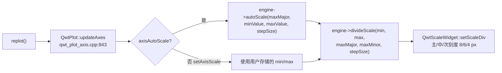
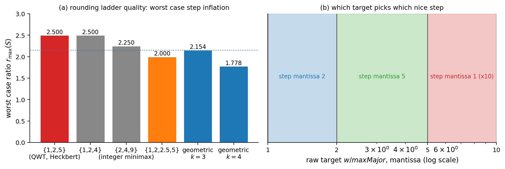
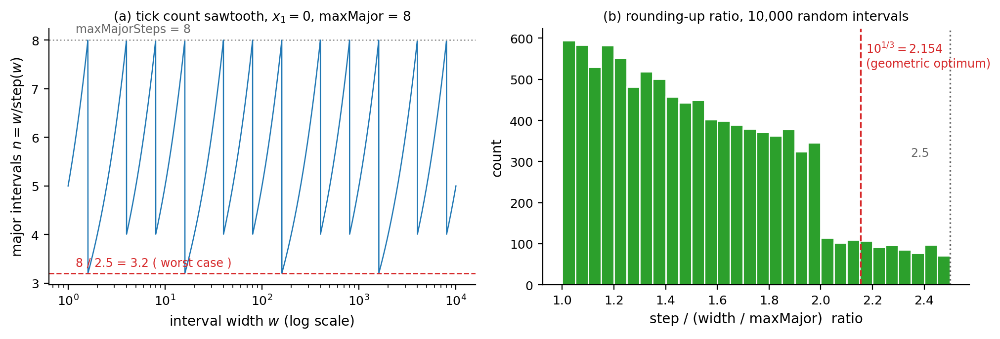
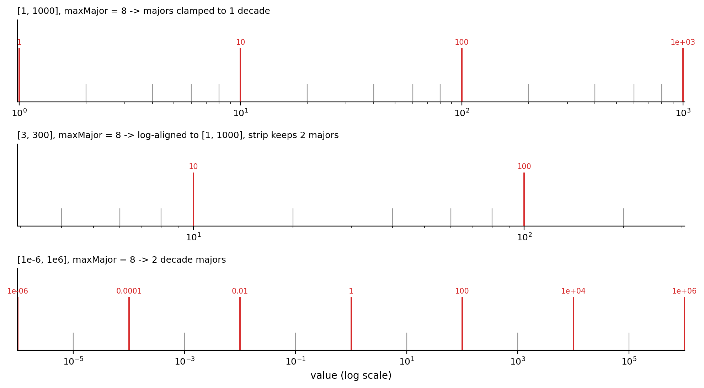
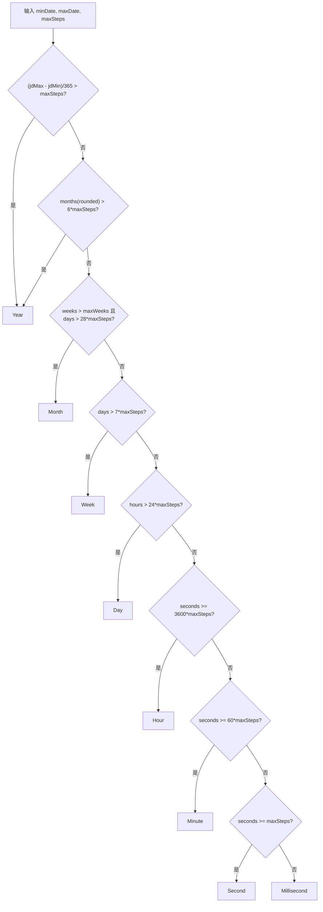
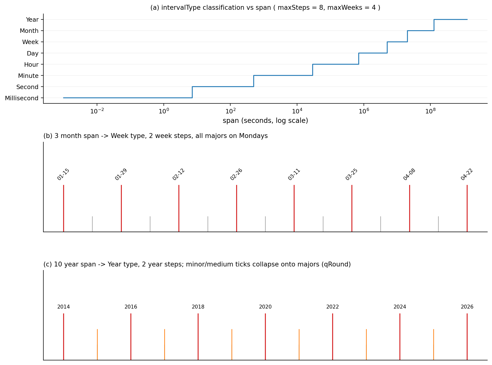

# 刻度引擎的"漂亮数字"算法：QwtScaleEngine 的步长生成与层级回退

> **摘要** —— 坐标轴刻度是绘图库里最"不起眼"却最影响可读性的组件：给定数据区间 $[x_1, x_2]$ 与刻度预算 $M$，引擎必须选出一个"人类友好"的步长 $s$（1–2 位有效数字）、把区间端点对齐到 $s$ 的整数倍、再铺出主/中/次三级刻度。本文以 QWT7 的三个引擎实现为对象——`QwtLinearScaleEngine`、`QwtLogScaleEngine`（`src/core/qwt_scale_engine.cpp`）与 `QwtDateScaleEngine`（`src/plot/qwt_date_scale_engine.cpp`）——逐行还原步长选择的算术（含 $10^{-6}$ 容差、整数折半循环、模糊比较），证明 $\{1,2,5\}$ 基准集合在"十进对偶闭包"意义下的唯一性并量化它与 minimax 最优解的差距（2.5 vs 2.154），剖析对数引擎的"主步长 $\geq 1$ 十进"钳制与亚十进线性回退，以及日期引擎从毫秒到年的八级分类回退决策树；全部结论由一个逐语句移植的 Python 重实现（10,000 个随机区间扫描 + 系统性边界区间）与真实 QWT 库的 C++ 交叉验证（linear 2000/2000、log 405/405、date 608/608 全一致）支撑。

> **摘要 — 核心结论**
>
> - 线性引擎的步长基准集合是 $\{1,2,5\}\times 10^k$，**不是** 1/2/2.5/5：`QwtScaleArithmetic::divideInterval`（`src/core/qwt_scale_engine.cpp:157`）的整数折半循环产生链 10→5→2→1，`floor(5/2)=2` 正是 2.5 被排除的原因；10,000 个随机区间上三个尾数的实测频率 30.29% / 29.41% / 40.30%，与对数均匀理论值 30.10% / 30.10% / 39.79% 相差不到 0.7 个百分点。
> - $\{1,2,5\}$ 并非 minimax 最优三元集：实测最坏步长膨胀比 2.5，高于整数最优 $\{2,4,9\}$ 的 2.25 与无约束几何最优 $10^{1/3}\approx 2.154$；它的唯一性在于是**唯一**在十进对偶 $s \mapsto 10/s$ 下闭合的三元整数集（10 的全部因子集去掉 10），这保证十进步长（尾数 1）折半、五分后仍落在阶梯上；尾数 2/5 的步长仍可能触发 $0.5s$ 回退。
> - `maxNumSteps` 是软约束：QwtPlot 管线（先 `autoScale` 对齐、再 `divideScale`）下 7.80% 的随机区间主刻度间隔数超过预算（实测最大 9 vs 预算 8），而直接调用 `divideScale` 的路径超额率为 0%。
> - 对数引擎的主步长被钳制为 $\geq 1$ 十进（`src/core/qwt_scale_engine.cpp:825`），且比值不足一个十进的区间整体委托给线性引擎：$[1,\sqrt{10}]$ 得到线性刻度 1, 1.5, 2, 2.5, 3；$[3,300]$ 在 maxMajor=8 下经对齐与裁剪后只剩 2 个主刻度（10, 100）。
> - 日期引擎的层级回退边界实测（maxSteps=8）：Millisecond→Second 约 7 s、→Minute 约 8 min、→Hour 约 8 h、→Day 约 8 d、→Week 约 56 d、→Month 约 224 d、→Year 约 4 a；Month 层只对超过约 7.4 个月的跨度开放，3 个月跨度回退到 Week（2 周步长、周一起点 locale 下主刻度全部落在周一），而 8.5 个月跨度会因 30 天/月的步长提示在二次分类中被改判为 Week。

---

## 1. 引言：刻度问题的形式化

### 1.1 问题陈述

设数据区间为 $[x_1, x_2]$（宽 $w = x_2 - x_1 > 0$），刻度预算为 $M$（QWT 中即 `maxMajorSteps`，`QwtPlot` 默认 8，见 `src/plot/qwt_plot_axis.cpp:46`）。刻度引擎的输出是一个三元组：对齐后的边界 $[a_1, a_2] \supseteq [x_1, x_2]$、步长 $s$、以及三级刻度位置集合（主刻度 MajorTick、中刻度 MediumTick、次刻度 MinorTick，见 `src/core/qwt_scale_div.h:50`）。优化目标可以非形式地写成三条：

1. **可读性**：$s = m \cdot 10^k$，尾数 $m$ 只有 1–2 位有效数字（"漂亮数字"）；
2. **信息量**：主刻度间隔数 $n = (a_2 - a_1)/s$ 满足 $n \le M$ 且尽量接近 $M$——刻度太稀浪费轴空间，太密则标签重叠；
3. **对齐性**：$a_1, a_2$ 是 $s$ 的整数倍，使端点标签同样是漂亮数字。

三条目标互相冲突：目标 1 把 $s$ 限制在离散阶梯 $\mathcal{L}$ 上，目标 2 希望 $s \approx w/M$，而 $w/M$ 几乎从不在 $\mathcal{L}$ 中。QWT 的取舍与 Heckbert 的经典方案一致——**向上取整到阶梯**：

$$
s = \left\lceil \frac{w}{M} \right\rceil_{\mathcal{L}} \;=\; \min\{\, \ell \in \mathcal{L} : \ell \ge w/M \,\}
$$

向上取整（而非四舍五入）保证对齐前 $n \le M$ 恒成立；代价是 $n$ 可以比 $M$ 小至 $M/2.5$（第 3.4 节的锯齿曲线量化了这一代价）。Heckbert 原文 *Nice Numbers for Graph Labels* 还给出一个四舍五入变体用于标签间距，QWT 只保留向上取整变体，把"舍"的自由度让给了对齐步骤。

### 1.2 三个引擎的分工

| 引擎 | 源文件 | 值域语义 | 步长单位 |
|---|---|---|---|
| `QwtLinearScaleEngine` | `src/core/qwt_scale_engine.cpp:476` | 十进浮点 | 数据单位 |
| `QwtLogScaleEngine` | `src/core/qwt_scale_engine.cpp:710` | 正实数，对数映射 | 十进（decade） |
| `QwtDateScaleEngine` | `src/plot/qwt_date_scale_engine.cpp:630` | 纪元毫秒（double） | 毫秒/秒/分/时/日/周/月/年 |

`QwtDateScaleEngine` 继承自线性引擎：毫秒级区间直接委托十进算术（`src/plot/qwt_date_scale_engine.cpp:898`），秒以上才启用日历语义。三者的公共骨架是 `QwtScaleEngine` 基类（属性 `Floating`/`Symmetric`/`IncludeReference`/`Inverted`、边距、容差算术 `QwtScaleArithmetic`）。

### 1.3 调用链：引擎何时被调用

`QwtPlot::updateAxes()`（`src/plot/qwt_plot_axis.cpp:843`）是唯一的标准入口，每次 `replot()` 触发：



两个默认参数值得记住：`maxMajor = 8`、`maxMinor = 5`（`src/plot/qwt_plot_axis.cpp:46-47`），刻度线长度主/中/次为 8/6/4 像素（`src/plot/qwt_abstract_scale_draw.cpp:48-50`）。注意 `autoScale` 算出的 `stepSize` 会作为**提示**回传给 `divideScale`——这个回传在日期引擎里会引发一次二次分类（第 5.6 节），是全文最重要的一个隐藏耦合。

## 2. 线性引擎：一次向上取整与两次对齐

### 2.1 步长选择：divideInterval 的整数折半循环

核心函数只有 24 行（`src/core/qwt_scale_engine.cpp:157`）：

$$
v = \frac{w - 10^{-6} w}{M}, \quad l = \log_{b}|v|, \quad p = \lfloor l \rfloor, \quad f = b^{\,l-p} \in [1, b)
$$

$$
n = b;\quad \textbf{while}\; n > 1 \;\wedge\; f \le \lfloor n/2 \rfloor :\; n \leftarrow \lfloor n/2 \rfloor;\quad s = n \cdot b^{\,p}
$$

三个细节决定了全部行为。其一，`divideEps` 先扣掉 $10^{-6} w$：折半循环的条件含等号（$f \le \lfloor n/2 \rfloor$），$f = 1.999998$ 与精确的 $f = 2.0$ 结果相同，容差真正防御的是 log/pow 往返噪声——没有这个容差，噪声可能让 $f$ 略超阶梯值（如 $2.0000000000000004 > 2$），折半循环提前停止、步长跳到上一档 $5 \cdot 10^p$。其二，折半循环里的 `n / 2` 是**无符号整数除法**：$b=10$ 时链为 $10 \to 5 \to 2 \to 1$，$\lfloor 5/2 \rfloor = 2$ 使 2.5 永远不可能出现；这正是"基准集合是 $\{1,2,5\}$ 还是 $\{1,2,2.5,5\}$"的答案（头文件注释 `qwt_scale_engine.h:156` 亦写明 $\{1,2,5\}\cdot 10^n$）。其三，$f$ 到阶梯的映射是分段常数：

| 目标尾数 $f$ | 选中 $n$ | 步长尾数 |
|---|---|---|
| $f = 1$ | 1 | 1 |
| $1 < f \le 2$ | 2 | 2 |
| $2 < f \le 5$ | 5 | 5 |
| $5 < f < 10$ | 10 | 1（进位到 $10^{p+1}$） |

即尾数空间 $[1,10)$ 被切成三段 $(1,2] \to 2$、$(2,5] \to 5$、$(5,10) \to 10$（外加端点 $f = 1 \to 1$，图 1b）。`base` 参数可改：$b=2$ 时链为 $2 \to 1$（只有 1 个尾数），$b=16$ 时为 $16 \to 8 \to 4 \to 2 \to 1$（4 个尾数），见实验 B3。

### 2.2 divideScale：对齐、铺刻度、裁剪

`QwtLinearScaleEngine::divideScale`（`src/core/qwt_scale_engine.cpp:533`）的签名是 `(x1, x2, maxMajorSteps, maxMinorSteps, stepSize = 0)`——第三个参数是**主刻度预算**（次刻度预算是第四个）而非最小步长，`stepSize` 为非零时作为给定步长（取绝对值）直接使用。流程：

1. 区间归一化；宽度超过 `double` 上限报 overflow 并返回空 division，宽度 $\le 0$ 返回空 division；
2. `stepSize == 0` 时按 2.1 节计算（`maxMajorSteps` 先钳到 $\ge 1$）；
3. `align()`（`:679`）把边界外扩到步长整数倍：`floorEps`/`ceilEps` 带 $10^{-6}$ 相对容差，另有一个 $10^{-12}$ 的绝对容差保护"本来就在格点上"的端点不被浮点误差推开；
4. `buildMajorTicks`（`:611`）在**对齐后**的区间上铺 $n = \mathrm{round}(w'/s)+1$ 个主刻度，上限硬截断 10000（`:614`，防止用户给定过小步长时内存爆炸）；
5. `buildMinorTicks`（`:636`）见 2.3 节；
6. `strip()` 用模糊比较（容差 $10^{-6} w$，`qwt_math.h:190`）把落在原区间外的刻度删掉；随后 `buildTicks` 再把与 0 模糊相等（容差 $10^{-6} s$）的刻度钉为精确 0.0；
7. 若 $x_1 > x_2$，反转整个 division。

> **说明 — 对齐与裁剪的次序**
>
> 主刻度先在对齐区间 $[a_1, a_2]$ 上生成、再裁剪回 $[x_1, x_2]$，因此 `QwtScaleDiv` 的边界始终是用户区间，而刻度是格点子集。第 6.2 节会看到这个次序让"主刻度数 $\le M$"在直接调用路径上恒成立、在管线路径上却可以被违反。

### 2.3 次刻度：qwtStepSize 与 0.5 倍回退

次步长由静态函数 `qwtStepSize`（`:54`，源码注释自嘲"this version often doesn't find the best ticks"）给出：先对 $(s, \text{maxMinorSteps})$ 再跑一次 `divideInterval`，若 $(\lceil s/s_{min}\rceil) \cdot s_{min}$ 模糊地超过 $s$（次刻度放不下），回退为 $0.5 s$。每个主刻度间隔内铺 $\lceil s/s_{min}\rceil - 1$ 个次刻度，个数为奇数时正中间那个升为中刻度。canonical 结构（单间隔、无裁剪，实验 A4）：

| 主步长尾数 | maxMinor | 次步长 | 每间隔 (次, 中) | 位置（占间隔比例） |
|---|---|---|---|---|
| 1 | 2–4 | 0.5 | (0, 1) | 0.5 中 |
| 1 | 5–8 | 0.2 | (4, 0) | 0.2, 0.4, 0.6, 0.8 |
| 2 | 2–3 | 1 | (0, 1) | 0.5 中 |
| 2 | 4–8 | 0.5 | (2, 1) | 0.25 次, 0.5 中, 0.75 次 |
| 5 | 2 | 5 | (0, 0) | 无次刻度 |
| 5 | 3–4 | **2.5（回退）** | (0, 1) | 0.5 中 |
| 5 | 5–8 | 1 | (4, 0) | 0.2, 0.4, 0.6, 0.8 |

第三行到第六行是 $\{1,2,5\}$ 阶梯自洽性的直接体现：尾数 5 的步长用 maxMinor=3 或 4 时，$5/2 = 2.5$ 不在阶梯上，"放不下"检查触发 $0.5s$ 回退，次刻度退化为一个中点刻度。10,000 个随机区间上该回退的触发率恰为 40.30%（maxMinor=3 与 4），等于尾数 5 的出现频率；QWT 默认的 maxMinor=5 下触发率 0%（实验 A5）。

源码里这个静态函数下方的 `#else` 分支还保留着旧实现（`:74-99`）：从 `maxSteps` 向下枚举步数、用 `qFuzzyCompare` 匹配 $n \cdot b^p$ 形式。注意 "this version often doesn't find the best ticks: f.e for 15: 5, 10" 这条注释紧跟 `#if 1` 之后、位于现行实现正上方——"this version" 指的是**现行版本**（上游对现行启发的自嘲），并非下方 `#else` 的旧实现。保留这段死代码是 Qwt 上游的传统：次刻度启发式的历史失败案例比文档更诚实。

### 2.4 autoScale：边距、对称与退化区间

`autoScale`（`:493`）先减去/加上 `lowerMargin`/`upperMargin`（线性引擎中是数据单位），按需 `symmetrize(reference())`、`extend(reference())`；宽度为 0 时用 `buildInterval` 造一个 $[v - 0.5|v|, v + 0.5|v|]$ 的区间（$v=0$ 时 $[-0.5, 0.5]$）；然后算步长、除非设置 `Floating` 否则 `align`。单点数据序列因此会得到一个宽度为原值 100% 的轴——日期引擎继承了这个行为，后果见第 7 节失效清单。

## 3. 步长基准的数论性质

### 3.1 最优性的正确问法

把尾数集合 $S = \{s_1 < s_2 < \cdots < s_k\} \subset [1, 10)$ 周期延拓成阶梯 $\mathcal{L} = S \cdot 10^{\mathbb{Z}}$。向上取整的最坏情况膨胀比是相邻阶梯比值的最大值（含跨十进的回绕）：

$$
r_{\max}(S) = \max\left( \frac{s_2}{s_1}, \frac{s_3}{s_2}, \ldots, \frac{s_k}{s_{k-1}}, \frac{10\, s_1}{s_k} \right)
$$

**命题（几何下界）** 对任意 $k$ 元集合，$r_{\max}(S) \ge 10^{1/k}$，等号当且仅当 $S$ 为几何级数 $\{10^{i/k}\}$。*证明*：$k$ 个比值（含回绕）的乘积恰为 $\frac{s_2}{s_1}\cdots\frac{10 s_1}{s_k} = 10$，故最大值不小于几何平均 $10^{1/k}$；几何级数使所有比值相等，取到等号。$\square$

于是 $k=3$ 的无约束最优是 $10^{1/3} = 2.154435$，$k=4$ 是 $10^{1/4} = 1.778279$（实验 B1 打印值）。

### 3.2 实测：{1,2,5} 不在最优解上

对 $\{1,\ldots,9\}$ 的全部 84 个三元子集穷举 $r_{\max}$（实验 B1）：最小值 2.25，由 $\{2,4,9\}$ 独占；$\{1,2,5\}$ 的 2.5 与 $\{1,2,4\}$、$\{2,4,8\}$、$\{2,5,8\}$、$\{2,5,9\}$ 并列第二档。四元集合（含半步长 1.5/2.5）的最小值 2.0，共十九个集合并列（含 $\{1,2,2.5,5\}$、$\{1,2,4,5\}$、$\{1,2,4,8\}$、$\{1.5,3,6,9\}$ 等，完整清单见实验 B1 输出）。结论必须诚实写出：**QWT 的 $\{1,2,5\}$ 在 minimax 意义下既不是三元最优也不是"整数三元最优"**，它比无约束最优多付 16% 的最坏步长膨胀（2.5/2.154）。

### 3.3 {1,2,5} 的真正唯一性：十进对偶闭包

定义对偶映射 $d(s) = \mathrm{mantissa}(10/s)$（把 $10/s$ 的尾数拉回 $[1,10)$）。穷举验证（实验 B2）：$\{1,\ldots,9\}$ 的三元子集中，满足 $d(S) = S$ 的**只有一个**，即 $\{1,2,5\}$——它恰是 10 的全部因子集 $\{1,2,5,10\}$ 去掉 10（也就是 10 的真因子集）。这个闭包性质的实践含义有三：

1. **次刻度可表示**：十进步长（尾数 1）的二等分与五等分仍是漂亮数字（$10^k/2 = 5\cdot10^{k-1}$、$10^k/5 = 2\cdot10^{k-1}$，即 $10/2 = 5$、$10/5 = 2$）；尾数 2/5 的步长对折半、五分并不封闭（$5/2 = 2.5$、$2/5 = 0.4$ 都不在阶梯上），仍可能触发 2.3 节的 $0.5s$ 回退。$\{2,4,9\}$ 的 $10/9 = 1.\overline{1}$、$10/4 = 2.5$ 都不在阶梯上，次刻度只能靠 $0.5s$ 回退硬凑。
2. **折半循环的不动点**：2.1 节的循环 $n \leftarrow \lfloor n/2 \rfloor$ 从 $b$ 出发生成的链就是 $b$ 的因子链（$b=10$: 10,5,2,1；$b=16$: 16,8,4,2,1；$b=12$: 12,6,3,1，实验 B3），对偶闭包保证链上每一步都仍是十进漂亮数字。
3. **标签算术封闭**：刻度值的加、减、半、五分之一在十进浮点下精确可表示，避免标签出现 0.30000000000000004 之类的尾巴。

换言之，$\{1,2,5\}$ 是"可读性 + 可细分性"约束下的唯一解，minimax 最优性不在它的目标函数里。图 1 把两种度量放在一起：左栏是各候选集合的 $r_{\max}$，右栏是尾数三段划分。



### 3.4 刻度密度锯齿：2.5 倍膨胀的可见后果

固定 $x_1 = 0$、$M = 8$，让宽度 $w$ 扫过 $[1, 10^4]$，主刻度间隔数 $n(w) = w / s(w)$ 是一条锯齿：在每个阶梯胞内 $n$ 从 $8/r$ 线性爬回 8（$r$ 为该胞的膨胀比），跨胞时跌落。实测 $n \in [3.2065, 7.9989]$，与理论界 $[8/2.5, 8] = [3.2, 8]$ 吻合（实验 B5）。这意味着**同一根轴在缩放过程中刻度数会在 3.2 到 8 之间振荡**——用户感受到的"缩放时刻度忽疏忽密"正是这条锯齿，而不是 bug；换成四元集合 $\{1,2,2.5,5\}$ 可把振幅压到 $[4, 8]$，代价是标签出现 2.5 这类半整数。



膨胀比 $s/(w/M)$ 的分布（图 2b，10,000 个随机区间）实测 min 1.000029、max 2.499898、mean 1.522731：上界严格小于 2.5（$\varepsilon$ 扣减使边界取不到），均值 1.52 说明"平均只用到预算的 66%"。尾数频率实测 30.29% / 29.41% / 40.30%，与对数均匀目标的理论值 $\log_{10}2 = 30.10\%$、$\log_{10}2 = 30.10\%$、$\log_{10}2.5 = 39.79\%$ 一致——这是 Benford 型定律：目标尾数在 $[1,10)$ 上对数均匀，落入 $(2,5]$ 的概率最大，故尾数 5 的步长最常见。

## 4. 对数引擎：十进为单位的第二套算术

### 4.1 值域钳制与两条回退

`QwtLogScaleEngine` 在构造时安装 `QwtLogTransform`，所有步长与边距以**十进**为单位（头文件警告，`qwt_scale_engine.h:190`）。`divideScale`（`:798`）先做两件事：

1. 区间钳制到 $[10^{-150}, 10^{150}]$（`QwtLogTransform::LogMin/LogMax`，`src/core/qwt_transform.cpp:31-34`）——非正下界被静默抬到 $10^{-150}$；
2. 若 $x_2/x_1 < b$（不足一个十进），**整体委托线性引擎**（`:811-816`）：对数轴上的窄区间用十进刻度毫无意义，直接给线性刻度。

主步长（十进）由 `divideInterval(log_b w, M)` 给出后立刻钳制：`if (stepSize < 1.0) stepSize = 1.0`（`:825`）——**主刻度间距至少一个十进**。这条钳制与 2.1 节的阶梯组合后有一个干净的推论：对数轴的主刻度永远落在 $b$ 的整数幂上（对齐在 log 空间做，步长 $\ge 1$ 保证 log 边界为整数）。

### 4.2 主刻度与次刻度的两个机制

主刻度在 log 空间等距（`:878`）：$\text{tick}_i = \exp(\ln a_1 + i \cdot \Delta)$，$\Delta = (\ln a_2 - \ln a_1)/(n-1)$。次刻度分两个机制（`:911`）：

- **单十进机制**（`step < 1.1`，即 step 恰为 1）：次步长 $= \mathrm{divideInterval}(1, \text{maxMinor}+1)$（十进），$numSteps = \mathrm{round}(1/s_{min})$，若 $s = b/numSteps \ge 1$ 则次刻度取几何位置 $v \cdot j s$；QWT 默认 maxMinor=5 给出 $s_{min}=0.2$、$numSteps=5$、$s=2$，即每个十进内 2, 4, 6, 8 四个次刻度；$9 \le$ maxMinor $\le 18$ 时才出现经典的 2–9 全分度；maxMinor $\ge 19$ 时 $s < 1$，退化为**值域等差**的次刻度（在 log 轴上视觉不等距，实验 C2 打印了 18 个等差位置与 5.5 处的中刻度）。
- **多十进机制**（`step \ge 1.1`）：次步长钳到 $\ge 1$ 十进，次因子 $\max(b^{s_{min}}, b)$，即次刻度至少隔一个十进；step=2、maxMinor=5 时每两个主刻度之间只有 1 个次刻度（隔 1 个十进），无中刻度（实验 C3）。

单十进机制的完整扫描（实验 C2，主步长 1 十进、区间 $[1,1000]$）：

| maxMinor | 次步长（十进） | numSteps | $s = 10/numSteps$ | 机制 | 每十进次刻度 | 中刻度 |
|---|---|---|---|---|---|---|
| 0 | — | — | — | 无次刻度 | — | — |
| 1–3 | 0.5 | 2 | 5 | 几何 | 5 | — |
| 4–8 | 0.2 | 5 | 2 | 几何 | 2, 4, 6, 8 | — |
| 9–18 | 0.1 | 10 | 1 | 几何 | 2, 3, …, 9 | — |
| 19–30 | 0.05 | 20 | 0.5 | **等差** | 1.45, 1.9, …, 9.55（18 个） | 5.5 |

最后一行是隐藏陷阱：`numSteps > 10` 使 $s < 1$，代码改走"值域等差"分支 $v + j v (b-1)/numSteps$，次刻度在**值域**上等距、在对数轴上向 decade 高端挤压，且中刻度落在 5.5 倍处。想让对数轴显示教科书式 2–9 分度，maxMinor 必须落在 $9 \le \text{maxMinor} \le 18$；$\ge 19$ 即切换到等差分支。

### 4.3 边界行为：三个反直觉案例

| 区间 | maxMajor/maxMinor | 结果 | 原因 |
|---|---|---|---|
| $[1, 1000]$ | 8/5 | 4 个主刻度 1, 10, 100, 1000；每十进 4 个次刻度 | `divideInterval(3,8)=0.5` 被钳到 1 十进 |
| $[1, \sqrt{10}]$ | 8/5 | 线性回退：主刻度 1, 1.5, 2, 2.5, 3 | 比值 3.16 < 10 |
| $[3, 300]$ | 8/5 | **只剩 2 个主刻度** 10, 100；8 个次刻度 | log 对齐到 $[10^0, 10^3]$ 后 strip 回 $[3,300]$ |
| $[10^{-6}, 10^{6}]$ | 8/5 | 7 个主刻度（2 十进间隔），6 个次刻度 | 12 十进 / 8 → 阶梯取 2 |
| $[0, 1000]$ | 8/5 | 9 个主刻度，从 $10^{-160}$ 到 $1$ | 下界钳到 $10^{-150}$ 后对齐再外扩一格 |

第三行是最值得警惕的：log 宽 2 十进、预算 8，本可给 0.5 十进主刻度，但钳制把步长抬到 1 十进，对齐把区间扩成 3 十进，strip 又砍掉两端——用户看到的是"8 的预算只画了 2 个标签"。第五行说明钳制不递归：对齐后的下界 $10^{-160}$ 低于 `LogMin`，而 `strip` 的模糊容差（$10^{-6} \times$ 区间宽 $\approx 10^{-3}$）把所有微小刻度都判为"在区间内"，于是轴上出现 $10^{-160}$ 这种物理上无意义的标签。



## 5. 日期引擎：八级分类与层级回退

### 5.1 数据模型与近似常量

日期轴的值是"纪元以来毫秒数"的 double（`src/core/qwt_date.h:41`）。`QwtDate::IntervalType` 八级：Millisecond、Second、Minute、Hour、Day、Week、Month、Year。每级的名义毫秒数（`qwt_date_scale_engine.cpp:38`）中 Month = 30 天、Year = 365 天是**近似常量**，只用于把"类型单位的步长"换算回毫秒提示；真实刻度位置全部由 `QDateTime` 日历算术（`addSecs`/`addMonths`/`addYears`）生成，因此月/年刻度天然不等距。

### 5.2 分类级联：intervalType 决策树

`intervalType(minDate, maxDate, maxSteps)`（`:753`）自上而下试探，第一命中即返回：



其中 `weeks > maxWeeks`（默认 `maxWeeks = 4`，`:610`）与 `days > 28·maxSteps` 的合取是 Month 层的唯一入口：**跨度不超过 maxWeeks 周、或不超过 28·maxSteps 天时，Month 根本不可达**。实测分类边界（maxSteps=8，实验 D5）：

| 回退边 | 跨度位置（扫描分辨率内） | 名义阈值 |
|---|---|---|
| Millisecond → Second | 6785–7174 ms | 8 s |
| Second → Minute | 4.727e5–4.998e5 ms | 8 min |
| Minute → Hour | 2.785e7–2.945e7 ms | 8 h |
| Hour → Day | 6.716e8–7.101e8 ms | 8 d |
| Day → Week | 54.87–58.02 d | 56 d |
| Week → Month | 221.6–234.3 d | 224 d |
| Month → Year | 1399–1479 d | 48 月 |

"rounded" 宽度指先把端点 floor/ceil 到该级再量宽（`qwtRoundedIntervalWidth`），所以实测边界比名义阈值略早或略晚一个取整单元。

### 5.3 每级的步长阶梯

`qwtDivideScale`（`:168`）按类型查整数阶梯表（向上取 $\lceil w/M \rceil$ 后取第一个不小于它的表值）：

| 类型 | 阶梯 |
|---|---|
| Second / Minute | 1, 2, 5, 10, 15, 20, 30, 60 |
| Hour | 1, 2, 3, 4, 6, 12, 24 |
| Day | $v \le 5$ 取 $\lceil v \rceil$，否则 $\lceil v/7 \rceil \cdot 7$（跳到周倍数） |
| Week | 1, 2, 4, 8, 12, 26, 52 |
| Month | 1, 2, 3, 4, 6, 12 |
| Year / Millisecond | 复用十进阶梯 `divideInterval(w, M, 10)` |

函数开头还有一条前缀规则：非 Day 类型且 $M < w \le 2M$ 时直接返回 2。穷举全部 6 个类型 × 宽度 1–400 × 预算 1–12 共 28,800 个组合（实验 B4），该规则与查表结果的差异为 **0**——因为每张表都含 2，前缀规则是纯粹的防御性早退，不改变任何输出。

### 5.4 对齐：每级有自己的"零点"

`alignDate`（`:966`）的对齐基准刻意不同：秒/分/时对齐全分钟/小时/天的起点；**Day 对齐到"当年第几天"的倍数**（以年初为零点，注释解释是为了平移时主刻度不跳动）；Week 对齐到 `dateOfWeek0(year, week0Type)`——ISO 8601 的 FirstThursday 或美式 FirstDay；Month 对齐到一月；Year 对齐到 1 月 1 日且跳过不存在的公元 0 年。`dateOfWeek0`（`src/core/qwt_date.cpp:556`）还依赖 `QLocale().firstDayOfWeek()` 决定周的起点日。实测（实验 D6，FirstThursday + 周一起点）：week0(2021) = 2021-01-04、week0(2023) = 2023-01-02、week0(2024) = 2024-01-01、week0(2025) = **2024-12-30**——2025 年的第 1 周从上一年 12 月 30 日开始，Week 型刻度的零点因此可以落在区间所在年之外。

### 5.5 刻度生成：三套循环

分类与步长确定后，`buildScaleDiv`（`:917`）把端点 floor/ceil 到类型边界，再分派：

- `qwtDivideToSeconds`（`:381`，类型 ≤ Week）：以 `addSecs(step·s)` 迭代主刻度；次刻度按 `addMSecs` 铺设，偶数分度时正中一个升为中刻度（源码另有 `i != 1` 排除：numMinorSteps = 2 时正中位即 i = 1，被排除，无中刻度）。仅当 timeSpec 为系统时区且类型 > Hour（或 Hour 且步长 > 1）时启用夏令时修正：主刻度值加上 UTC 偏移差，并对"被跳过的那个小时"用 `qwtDstTicks`（`:354`）补一组次刻度，避免刻度序列出现 0, 2, 3, 5 的错位。UTC 与时区偏移模式下不触发。
- `qwtDivideToMonths`（`:474`）：`addMonths` 迭代；步长 1 月时次刻度按天铺（maxMinor ≥ 30 → 每天、≥ 6 → 每 5 天、≥ 3 → 每 10 天、否则每 15 天），"15 日处升中刻度"只在 minStepDays ∈ {1, 5}（即 maxMinor ≥ 6）时成立——10 天步长的序列不经过 15 日，15 天步长被源码显式排除（`days == 15 && minStepDays != 15`）；步长 > 1 月时次刻度按月（`qwtDivideMajorStep` 的 Month 分支拒绝分数月，无 $0.5s$ 回退）。
- `qwtDivideToYears`（`:541`）：`addYears` 迭代，含公元前跳过 0 年的修正；次刻度用 `qRound(i·minStep)` 换算成年/月——这个 `qRound` 是第 7 节一个失效模式的源头。

### 5.6 提示回传引发的二次分类

`divideScale`（`:869`）在收到非零 `stepSize` 提示时会**重估预算**：`maxMajorSteps = ceil((max-min)/stepSize)`。由于 Month/Year 的提示用 30/365 天近似，重估后的预算可能比用户预算大，从而改变分类。实测案例（实验 D1 第五例）：跨度 2024-01-15 → 2024-09-15（8.5 个月），`autoScale` 判为 Month、步长 1 月、边界扩到 [01-01, 10-01]、提示 = 30 天 = 2.592e9 ms；`divideScale` 用提示重估得 maxMajor = ceil(274/30) = 10，Month 门槛变成 $28 \times 10 = 280 > 274$ 天不成立，分类**改判为 Week**，最终渲染出 10 个间隔 28 天的主刻度（01-01, 01-29, 02-26, …, 09-09）而不是月刻度。若提示按含 31 日的月份（31 天）换算，重估预算为 ceil(274/31) = 9、门槛 252 < 274，Month 分类将被保留——月长近似的取整效果直接翻转了输出类型。

### 5.7 周起点是运行时 locale 的函数

`QwtDate::floor/ceil/dateOfWeek0` 全部读取 `QLocale().firstDayOfWeek()`。同一 3 个月跨度（2024-01-15 → 04-15，Week 型、2 周步长）在两种 locale 下的主刻度（实验 D2/D2b）：

| locale | firstDayOfWeek | 主刻度 |
|---|---|---|
| en-GB（ISO 习惯） | Monday | 01-15, 01-29, 02-12, 02-26, 03-11, 03-25, 04-08, 04-22 |
| zh-CN（CLDR） | Sunday | 01-14, 01-28, 02-11, 02-25, 03-10, 03-24, 04-07, 04-21 |

刻度整体平移一天。跨平台/跨语言部署时这是日期轴"看起来不对齐"的第一嫌疑。



## 6. 实验

### 6.1 设计

实验脚本 `docs/assets/algorithms/scaleengine_experiment.py`（Python 3.11 + numpy + matplotlib，Agg 后端，种子 `0x5CA1E`）对三个引擎做**逐语句移植**：同样的 $10^{-6}$ 容差、同样的整数折半与截断语义（`static_cast<int>` 用向零截断模拟）、同样的浮点累加次序（次刻度用 `val += minStep` 递推而非乘法），日期部分用 `datetime` 复现 `QDateTime` 的日历算术（含 `daysTo` 的纯日期差语义、`addMonths` 的日钳制）。全部原始数字打印到 stdout；四张插图由同一脚本生成。

交叉验证 harness `docs/assets/algorithms/scaleengine_check.cpp` 链接预构建的 Release 库（`build-release/lib` 的 qwtcore.lib + qwtplot.lib，Qt 5.15.16 msvc2019_64），读入用例文件、打印 `autoScale` 结果与 `divideScale` 的主/次/中刻度计数及首末主刻度值；Python 侧以 `--cpp-check` 模式逐例比对（仅正确性比对，不做任何计时）。harness 内强制 `QLocale(en-GB)` 以固定周起点。

移植保真度是这套实验的生命线，几处容易写错的语义在此声明：`QDateTime::daysTo` 是纯日历日期差（时间差不足一天、截断后恒为 0）；`addMonths`/`addYears` 对 2 月 29/30 日做日钳制；`qwtAlignValue` 与 `static_cast<int>` 一律向零截断（负周数在年初会出现）；次刻度用 `val += minStep` 递推累加而非 `min + k·minStep` 乘法，以复制同样的浮点误差轨迹；`strip`/`contains` 的容差尺度是区间宽而非步长。任何一处写"想当然"都会在 6.6 节的对照中暴露。覆盖面之外同样要声明：DST 修正、BC/year-0 对齐与 `buildInterval` 的 double 溢出保护不在移植与交叉验证的覆盖范围内（harness 全程以 UTC 运行日期引擎），相关段落（5.5 节的 DST 分支、第 7 节第 11 条）为源码级分析。

### 6.2 线性引擎扫描（N = 10,000，maxMajor = 8，maxMinor = 5）

区间生成：$x_1 \sim U(-10^3, 10^3)$、$w = 10^{U(-3,6)}$，覆盖跨零与多数量级情形。

| 指标 | 实测 |
|---|---|
| 步长尾数频率 1 / 2 / 5 | 3029 (30.29%) / 2941 (29.41%) / 4030 (40.30%)，其他 0 |
| 对数均匀理论频率 | 30.10% / 30.10% / 39.79% |
| 膨胀比 min / max / mean | 1.000029 / 2.499898 / 1.522731 |
| 直接 divideScale 主间隔数 | mean 4.547，max 7，超额 0 (0.00%) |
| 管线（autoScale+divideScale）主间隔数 | mean 6.547，max 9，超额 780 (7.80%) |
| 次刻度回退率（maxMinor=2/3/4/5/8） | 0% / 40.30% / 40.30% / 0% / 0% |

管线路径的超额全部是 +1（9 vs 8）：`autoScale` 对齐把宽度最多撑大 $2s$，`divideScale` 拿到已对齐边界后不再收缩。直接路径的 max=7 而非 8 也有解释：随机端点几乎从不同时落在格点上，strip 会吃掉边界刻度。边界区间族 $[1, 10^k]$、$[0, 10^k]$（实验 A6）给出另一个细节：$k \ge 7$ 时 $[1, 10^k]$ 的首主刻度是 **0**——strip 的模糊容差 $10^{-6} w \ge 10$ 把区间外的 0 判为"在区间内"。

### 6.3 数论与锯齿

穷举与锯齿数字见 3.2–3.4 节：三元整数 minimax = 2.25（{2,4,9}），{1,2,5} = 2.5，四元最优 2.0，几何界 2.154435 / 1.778279；对偶闭包三元整数集唯一为 {1,2,5}；锯齿 $n \in [3.2065, 7.9989]$；前缀规则冗余性 28,800 组合 0 差异。

### 6.4 对数引擎案例

数字见 4.3 节表格；补充次刻度机制扫描（实验 C2，主步长 1 十进）：maxMinor 1–3 → 每十进 1 个次刻度（5 倍处）；4–8 → 2, 4, 6, 8；9–18 → 2–9 全分度；19–30 → 值域等差 18 个次刻度 + 5.5 倍处中刻度（log 轴上视觉不等距）。

### 6.5 日期引擎场景（UTC，maxMajor = 8，maxMinor = 5，完整管线）

| 场景 | autoScale 类型 | 对齐边界 | divideScale 类型/步长 | 主刻度 | 次/中 |
|---|---|---|---|---|---|
| 100 ms | Millisecond | 不变 | Millisecond / 20 ms | 6（每 20 ms） | 10 / 5 |
| 1 天 | Hour | 不变 | Hour / 3 h | 9（00,03,…,24） | 16 / 0 |
| 3 个月 | Week | 01-15 → 04-22 | Week / 2 周 | 8（周一起点 locale 下全周一） | 7 / 0 |
| 10 年 | Year | 2014-01-01 → 2026-01-01 | Year / 2 年 | 7（2014…2026 偶数年） | 12 / 6 |
| 8.5 个月 | Month | 01-01 → 10-01 | **Week / 4 周** | 10（间隔 28 天） | 20 / 10 |

10 年场景的次刻度结构值得单列（实验 D3/D7）：`qwtDivideMajorStep(2, 5, Year)` 走"分数年"分支得 minStep = 0.5 年，而 `qwtDivideToYears` 用 `qRound(i·0.5)` 换算月偏移，得到 [12, 12, 24]——i=1 与 i=2 都舍入成 1 年，i=3 舍入成 2 年（恰为下一个主刻度）。实测 6 个中刻度全部与某个次刻度同位置、12 个次刻度全部与主/中刻度同位置：**整个次刻度层没有提供任何新位置**。maxMinor=8 时更糟，月偏移为 [0, 12, 12, 12, 12, 24, 24]，首个次刻度直接压在主刻度上。v7.5.1 起 `QwtScaleDiv::setTicks()` 会删除这些重复值（[12, 12, 24] 归一为 [12, 24]），绘制层再跳过与主/中刻度同值的次刻度，因此视觉上不再有叠加，但"次刻度层不提供新位置"这一引擎行为本身未变——需要月刻度时仍应按本节提示设置预算。

### 6.6 交叉验证

| 引擎 | 用例数 | 一致 | 不一致 |
|---|---|---|---|
| linear（autoScale + 直接 + 管线） | 2000 | 2000 | 0 |
| log（直接，含 5 个退化用例） | 405 | 405 | 0 |
| date（直接 + 管线，含 8 个手工场景） | 608 | 608 | 0 |

比对项包括 autoScale 的对齐边界与步长提示、两种 divideScale 路径的三级刻度计数与首末主刻度值（日期按 0.5 ms 容差）。移植过程中该对照抓到两个真实移植错误：week0 年份丢失（C++ 的 `setDate` 设置完整日期）与周起点 locale 差异——二者修复后达到全一致，反向证明了对照的有效性。

## 7. 讨论：失效模式诚实清单

1. **maxNumSteps 是软约束（管线路径）**：实测 7.80% 的随机区间在 `autoScale → divideScale` 后主间隔数为 9（预算 8）。根因是对齐最多外扩 $2s$ 而步长不再重算。需要硬保证时自行调用 `divideScale` 并检查 `scaleDiv.ticks(MajorTick).size()`，或改用 `setAxisScaleDiv` 完全接管。
2. **对数窄区间静默变线性**：比值 $< b$ 的区间在对数轴上得到等差刻度（$[1,\sqrt{10}]$ → 1, 1.5, 2, 2.5, 3），标签格式仍按对数轴渲染时会出现非 10 幂的"对数标签"。
3. **对数主刻度钳制吃掉预算**：$[3,300]$ 在 maxMajor=8 下只有 2 个主刻度（4.3 节）。log 宽 2–4 十进且端点不对齐的区间是重灾区。
4. **非正下界的 $10^{-150}$ 钳制**：$[0, 1000]$ 产生 9 个从 $10^{-160}$ 开始的主刻度；strip 的模糊容差以区间宽为尺度，无法剔除这些微小值。含零或负值的数据不应直接交给对数引擎。
5. **日期 Month 层近乎关闭 + 提示回传改判**：maxWeeks=4 默认下 Month 只对 > 224 天（maxSteps=8）的跨度开放；3 个月跨度得到周刻度。8.5 个月跨度则因 30 天近似在二次分类中被改判为 Week（5.6 节）。要得到月刻度，条件是 maxWeeks **小于**跨度周数（默认 4 通常已满足）且 days > 28·maxSteps——`setMaxWeeks` 放大周上限只会让 `weeks > maxWeeks` 更难成立，效果是压制 Month、把长跨度留在 Week 分类；8.5 个月改判案例失败的门是 days > 28·10 = 280，调 maxWeeks 两个方向都救不了，正确解法是绕开提示回传（直接以 `stepSize = 0` 调用 `divideScale`）、调大 `maxMajor` 预算或自派生 `intervalType`。
6. **Year 型次刻度塌缩（v7.5.1 起绘制端与数据端去重）**：`qRound(i·minStep)` 使分数年偏移重复或落到主刻度上（[12, 12, 24]、[0, 12, …]），次刻度层信息量为零（6.5 节）；v7.5.1 起列表内重复值在 `setTicks()` 阶段被删除、与更长刻度重合的次刻度在 `draw()` 中被跳过（视觉无叠加，`tests/scale_draw_test`），但引擎的刻度生成仍会产出这些位置（归一化只发生在 `QwtScaleDiv::setTicks()`）——Year 型建议 maxMinor ≤ 3（偏移 [12]，行为正常）。
7. **周对齐依赖运行时 locale**：zh-CN 下周一变周日（5.7 节）。跨地区部署需 `QLocale::setDefault` 或自派生 `alignDate`。
8. **退化区间放大 100%**：单点日期序列（宽度 0）触发 `buildInterval`，2024-03-10 的单点被扩成 1990-01-01 → 2060-01-01（跨 70 年，Year 型）。线性轴同理会得到 $[0.5v, 1.5v]$。
9. **主刻度 10000 上限静默截断**：用户经 `setAxisScale` 给定极窄步长时，`buildMajorTicks` 截到 10000 个刻度且不报警（`:614`），轴的后半段将无刻度。
10. **strip 容差随区间宽放大**：$[1, 10^7]$ 的首主刻度为 0（区间外 1 个单位，容差 10）。宽区间 + 小步长组合下端点标签可能不属于数据范围。
11. **闰秒不在模型内**：Qt 的时间模型是 POSIX 毫秒，`qwtDstTicks` 只处理夏令时跳变；闰秒既不被表示也不会产生重复刻度——对秒级以下精度的长期序列，轴时间与 UTC 真实 elapsed 时间存在累计偏差（Qt 层面即如此，非 QWT 引入）。

> **修复说明（v7.5.1）— 刻度去重（数据侧 + 绘制侧）**
>
> 首发版本的 division 可能包含重复刻度值（本节第 6 项：Year 型的 `qRound(i·minStep)` 产出 [12, 12, 24]、[0, 12, …]），绘制层逐条绘制不做去重，重合处表现为粗线叠细线；依赖刻度列表做交互（如吸附）的代码需自行去重。v7.5.1 起：`QwtScaleDiv::setTicks()` 排序并删除重复值（同一列表内不再有重复项），`QwtAbstractScaleDraw::draw()` 跳过与更长刻度类型（中刻度/主刻度）同值的刻度——每个位置只画一次，且保留最长类型的长度。回归测试 `tests/scale_draw_test` 按 drawTick 调用计数验证（设备像素对齐的填充矩形渲染是幂等的，像素比对看不出差别）；重复值对交互代码的污染也随数据侧归一消失。

## 8. 代码实践

### 8.1 切换引擎与日期轴

仓库内两个直接参照：`examples/2D/bode`（对数轴，`Plot.cpp:70-72` 同时演示 `setAxisMaxMajor(XBottom, 6)` 收紧预算）与 `examples/2D/stockchart`（日期轴，`Plot.cpp:110-115`）。日期轴的标准配置是引擎与 scaleDraw 成对替换：

```cpp
#include <qwt_plot.h>
#include <qwt_date_scale_engine.h>
#include <qwt_date_scale_draw.h>

QwtPlot* plot = new QwtPlot;

// 数据以纪元毫秒存储；UTC 语义避免本地时区/夏令时干扰
QwtDateScaleEngine* engine = new QwtDateScaleEngine(Qt::UTC);
engine->setMaxWeeks(52);                     // 提高周上限 = 压制 Month 层：跨度周数不超过它时不进 Month 判定，全年视图（52 周）保持 Week 分类（上游 business-chart 用法，默认 4）；不会放开 Month 层
plot->setAxisScaleEngine(QwtAxis::XBottom, engine);

QwtDateScaleDraw* draw = new QwtDateScaleDraw(Qt::UTC);
draw->setDateFormat(QwtDate::Day, "yyyy-MM-dd");   // 覆盖默认标签格式
plot->setAxisScaleDraw(QwtAxis::XBottom, draw);

plot->setAxisMaxMajor(QwtAxis::XBottom, 6);  // 预算收紧：分类阈值同步变严
plot->setAxisMaxMinor(QwtAxis::XBottom, 3);  // Year 型避开 qRound 塌缩（<=3）
```

> **警告 — 引擎与 scaleDraw 的时区必须一致**
>
> `QwtDateScaleEngine(Qt::UTC)` 配 `QwtDateScaleDraw(Qt::LocalTime)` 会让刻度位置与标签相差一个时区偏移。两者都从构造参数取 timeSpec，没有联动检查。

### 8.2 自定义引擎：固定步长子类

继承 `QwtScaleEngine` 只需实现两个纯虚函数。下面是一个"步长固定为 0.25、边界不浮动"的引擎，可用于价格轴：

```cpp
#include <qwt_scale_engine.h>
#include <qwt_scale_div.h>

class FixedStepEngine : public QwtScaleEngine
{
public:
    void autoScale(int maxNumSteps, double& x1, double& x2, double& stepSize) const override
    {
        Q_UNUSED(maxNumSteps);
        stepSize = 0.25;
        // 对齐算术经公开的 QwtScaleArithmetic 手工完成
        x1 = QwtScaleArithmetic::floorEps(x1, stepSize);
        x2 = QwtScaleArithmetic::ceilEps(x2, stepSize);
    }

    QwtScaleDiv divideScale(double x1, double x2, int maxMajorSteps,
                            int maxMinorSteps, double stepSize) const override
    {
        // 组合一个线性引擎复用其铺刻度逻辑（步长作为给定值传入）
        QwtLinearScaleEngine linear(base());
        linear.setAttributes(attributes());
        return linear.divideScale(x1, x2, maxMajorSteps, maxMinorSteps,
                                  stepSize == 0.0 ? 0.25 : stepSize);
    }
};
```

`align` 是 `QwtLinearScaleEngine` 的 protected 成员，跨类不可借用；上例在 `autoScale` 里用公开的 `QwtScaleArithmetic::floorEps/ceilEps` 手写两行对齐，在 `divideScale` 里组合线性引擎复用铺刻度与次刻度逻辑——这是自定义引擎最省力的结构。

### 8.3 调参速查

| 需求 | 手段 | 依据 |
|---|---|---|
| 刻度更密/更疏 | `setAxisMaxMajor`（默认 8） | 分类与步长都以它为输入 |
| 去掉次刻度 | `setAxisMaxMinor(axis, 0)` | `buildTicks` 的 `maxMinorSteps > 0` 门 |
| 端点不取整 | `engine->setAttribute(QwtScaleEngine::Floating)` | 跳过 `align` |
| 轴过零点 | `setAttribute(IncludeReference)` + `setReference(0.0)` | `autoScale` 的 extend |
| 对数轴要 2–9 分度 | `setAxisMaxMinor(axis, 9)`（9–18 均可） | C2 表：9–18 才出全分度，≥ 19 退化为等差 |
| 日期轴要月刻度 | 保持 maxWeeks < 跨度周数（默认 4 通常已够）且跨度 > 28·maxMajor 天；被提示改判时直接以 `stepSize = 0` 调 `divideScale` | 5.2/5.6 节 Month 门槛 |
| 周刻度按 ISO 周一起点 | 运行前 `QLocale::setDefault` 周一 locale | 5.7 节 |

### 8.4 示例路径勘误

选题路线图曾列 `examples/2D/scaleengine`，该目录在当前仓库**不存在**；刻度/时间轴的真实示例是 `examples/2D/bode`（对数）、`examples/2D/stockchart`（日期 + 自定义 `QwtDateScaleDraw` 子类）、`examples/2D/cpuplot`（时间轴实时滚动）。本文所有示例引用以这三个为准。

## 9. 小结

QWT 的刻度引擎把"漂亮数字"问题解成一次向上取整加两次对齐，核心的步长与对齐算术（`divideInterval` + `align`）只有约五十行，但行为边界几乎全部藏在容差与整数语义里：$10^{-6}$ 的 `divideEps` 决定精确边界不跳档，`floor(5/2)=2` 决定阶梯是 1-2-5 而非 1-2-2.5-5，`strip` 的 $10^{-6} w$ 容差决定宽区间会容忍区间外刻度，`qRound` 的半进位决定 Year 型次刻度塌缩。$\{1,2,5\}$ 的选择不是 minimax 最优性的产物，而是十进可细分性的产物：它是唯一在十进对偶 $s \mapsto 10/s$ 下闭合的三元整数集，保证十进步长折半、五分后仍是漂亮数字，这个性质比 0.35 的最坏膨胀比差距更值钱；对数与日期两个派生引擎在这套算术上各自叠加了新的硬约束与失效面（主步长 $\geq 1$ 十进、Month 层的 224 天门槛、窄对数区间变线性、30 天近似翻转月/周分类）。使用上的判断准则可以压缩成一句：预算参数控制的是"期望"，对齐与钳制控制的是"实际"，两者之间的差额（实测均值 2 个间隔、尾部 +1）必须由调用方自己检查或接管。

## 10. 参考文献

1. Heckbert, P. *Nice Numbers for Graph Labels.* in *Graphics Gems*, Academic Press, 1990.（向上取整漂亮数字的原始出处）
2. QWT7 源码：`src/core/qwt_scale_engine.h/.cpp`（`QwtScaleArithmetic`、线性/对数引擎）、`src/core/qwt_scale_div.h`、`src/core/qwt_date.h/.cpp`、`src/core/qwt_math.h`（`qwtFuzzyCompare`）、`src/core/qwt_transform.cpp`（`LogMin/LogMax`）。
3. QWT7 源码：`src/plot/qwt_date_scale_engine.h/.cpp`（日期引擎）、`src/plot/qwt_date_scale_draw.cpp`（默认标签格式）、`src/plot/qwt_plot_axis.cpp`（`updateAxes` 管线与默认预算）、`src/plot/qwt_abstract_scale_draw.cpp`（刻度长度）。
4. QWT7 示例：`examples/2D/bode`（对数轴 + `setAxisMaxMajor`）、`examples/2D/stockchart`（日期轴 + 自定义 scaleDraw）、`examples/2D/cpuplot`（滚动时间轴）。
5. 实验脚本：`docs/assets/algorithms/scaleengine_experiment.py`（移植、扫描、插图）、`docs/assets/algorithms/scaleengine_check.cpp`（C++ 交叉验证 harness）。
6. Qt 文档：`QLocale::firstDayOfWeek()`、`QDateTime::addMonths/addYears` 的日钳制语义（CLDR 周起点数据）。

*配套阅读：* [实时流式数据渲染策略](realtime-streaming.md) —— 每次 replot 都会重跑一遍 `updateAxes`，流式场景下刻度引擎的调用频率与帧预算如何相处。
