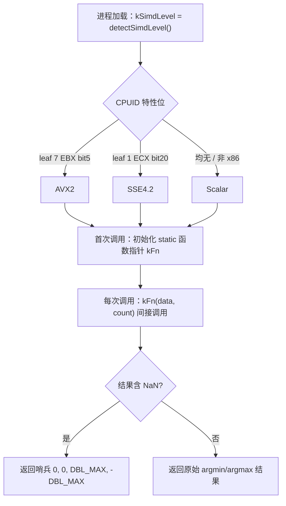

# SIMD argmin/argmax 向量化基准：qwtSimdArgMinMax 的三路运行时派发

> **摘要** —— QWT7 的 MinMax 桶降采样每个桶都要做一次 argmin/argmax，`qwtSimdArgMinMax`（`src/core/qwt_simd_argminmax.cpp`）以 AVX2 / SSE4.2 / 标量三路运行时派发承担这个内核。本文基于 i7-14700 + MSVC 发行版编译配置下的微基准（`docs/assets/algorithms/simd_bench.cpp`，原始数据 `simd_bench_results.csv`，min-of-7 协议、0 个重测点）实测三路的速度随数组长度（8 到 16M 元素）的变化、缓存层级与 roofline 位置，并按 MinMax 桶的真实调用方式（连续小分块）扫描每桶成本，给出"桶多小 SIMD 才划算"的定量判据。一组对照探针——vzeroupper 变体、/arch:AVX2 重编译 TU、rdtsc 五段计时、E-core 对照——把发行构建中 AVX2 路径每次调用约 325 ns 的固定开销定位到默认编译 TU 的水平归约尾声与 P-core 的组合效应。NaN 语义矩阵实测表明"NaN 被天然忽略"的说法在 NaN 污染 lane 的场景不成立，这解释了 `qwtMinMaxBucketReduce` 的 NaN 预扫描为什么是正确性防线而非可选优化。

> **摘要 — 核心结论**
>
> - AVX2 路径相对标量的加速比峰值 **2.82×**（512K 元素），L2 常驻区间（32K–256K）为 2.73–2.81×，DRAM（16M）回落到 2.03×；SSE4.2 对应 2.34–2.35× 与 1.81×——均低于"理论 3–4×"的估计
> - 默认编译的 AVX2 路径每次调用支付约 **325 ns 固定开销**（拟合 F = 325.17 ns，约合 1695 个周期），rdtsc 分段把它钉在水平归约尾声（reduce 段中位 252 ns；同一份代码在 /arch:AVX2 TU 中该段仅 5.2 ns）；该开销在 E-core 上完全消失（n=16 时 18.5 ns 对 P-core 的 332.3 ns）
> - 桶模式判据：派发路径（public→AVX2）只在桶大小超过 **约 481 个元素**后才快过标量（模型 449、实测插值 481），而 SSE4.2 路径在 4–4096 的全部实测桶大小上都最快——典型场景（1M 可见点、900 px 画布、每桶 556 元素）下每桶 254 ns，对 AVX2 派发路径的 551 ns（v7.5.1 修复后判据降到 4–8 个元素，见本节末条）
> - 三个内核在**所有尺寸**都处于计算/指令发射受限区：带宽平台 7.8 / 18.3 / 21.0 GB/s，低于 DRAM 天花板 28.0 GB/s，比 L2 天花板 213 GB/s 低一个数量级
> - **v7.5.1 修复**：AVX2 内核移入独立编译单元并以 `/arch:AVX2`（GCC/Clang 为 `-mavx2`）编译后，325 ns 固定开销与其对调用方标量代码的污染一并消失。同机 A/B（i7-1260P / Qt 6.7.3 / MSVC 2019，`simd_bench_results_v75{0,1}_*.csv`）：`qwtSimdArgMinMax` n=16 由 446 ns 降到 13.5 ns、n=256 由 549 降到 125 ns；流式"append + SIMD reduce"由 2.12 ms 降到 0.13 ms（等于 append-only 的 0.13–0.14 ms）。桶模式判据因此从约 481 个元素塌缩到约 4–8 个（chunk=4 时标量 20.2 ns 对 AVX2 21.9 ns，chunk=8 起 AVX2 反超）。注意：只加内联 `_mm256_zeroupper()` 的写法实测**无效**（同一构建 412 ns）——反汇编显示编译器把 VZEROUPPER 排在 256-bit 溢出存储与其窄重载之间，函数仍然带脏状态返回；5.4 节的建议据此改为独立 TU（可选方案 ①）。

> - NaN 语义矩阵实测 **12/33 个单元**与无 NaN 参考不一致，含"值正确、索引却指向 NaN 元素"的组合输出——任何含 NaN 的输入都必须走预扫描加标量分支

---

## 1. 引言：每帧一千八百次调用

MinMax 桶降采样（`FilterPointsLTTB`，见[降采样篇](curve-downsampling.md)第 4 节）把可见样本按索引切成 $N_b = \max(2, 2W)$ 个桶，对每个桶求 $y$ 的 argmin 与 argmax 并输出两个极值点。当 x、y 轴均为线性映射（`linearPath`，`src/plot/qwt_point_mapper.cpp:584,590`）、数据源能提供连续的 `double*` 且可见区间内没有 NaN 时，`qwtMinMaxBucketReduce` 对每个桶调用一次 `qwtSimdArgMinMax(raw.y + start, count)`（`qwt_point_mapper.cpp:616`）。这意味着内核的**每调用成本**要乘上每帧 $2W$ 次：900 px 宽的画布一帧调用 1800 次，1920 px 宽调用 3840 次。桶大小 $s = n/N_b$ 由可见点数与画布宽度共同决定——1M 个可见点落在 900 px 画布上，$s \approx 556$；这个量级恰好处于"向量化的并行收益"与"每次调用的固定开销"的拉锯地带，是本文定量回答的核心问题。

降采样篇 §5.4 对该内核只有一段概述和一句"AVX2 单桶相对标量理论 3–4×"的估计。本文是它的展开：用与发行库完全一致的编译配置实测三路实现，回答四个问题——加速比随数组长度如何变化；桶小到多少 SIMD 不再划算；内核在 roofline 图上处于什么位置；NaN 输入下三路各自的真实语义是什么。基准程序 `simd_bench.cpp`（1078 行）直接 `#include "qwt_simd_argminmax.cpp"`，主编译单元使用与 qwtcore.dll 相同的默认 MSVC x64 标志（SSE2 基线，无 `/arch` 开关），因此测到的是"用户拿到的二进制"的行为，而不是理想化构建的行为；这一点在 4.5 节会被证明至关重要。

实验矩阵分五组：整数组扫描（n = 8 到 16M，scalar/SSE4.2/AVX2/public 四路）、桶模式扫描（1M 数组按 4–4096 元素的 chunk 连续消费，复刻 mapper 的调用形态）、内存带宽参考（标量求和、AVX2 求和、memcpy 三个天花板内核）、固定开销定位探针（双编译单元对照、vzeroupper 变体、rdtsc 五段计时、通用过渡惩罚链探针）与 NaN 语义矩阵（12 种 NaN 分布模式 × 4 路，不计时）；另有 E-core 对照段在 lp16 上重跑关键变体。全部数据一次性采集于 `simd_bench_results.csv`，本文不补充新计时。

> **说明 — 模块命名澄清**
>
> 仓库 AGENTS.md 把 core 的该模块描述为"SIMD 加速的 argmin/argmax（SSE2/AVX2/NEON）"。源码实际情况是：三路派发为 **Scalar / SSE4.2 / AVX2**（`qwt_simd_argminmax.cpp:15-48`），SSE 路径依赖 `_mm_blendv_pd`（SSE4.1 指令）并以 SSE4.2 特性位判定，没有任何 NEON 分支——非 x86 平台（含 Apple Silicon）落到纯标量路径。本文以源码为准；ARM 侧未实测，见 5.2 节失效清单。

## 2. 三路实现剖析

### 2.1 CPUID 派发与编译期守卫

派发分两层。第一层在编译期：SSE4.2 实现体仅在 `defined(__SSE4_2__) || (_MSC_VER >= 1700)` 时编译，否则 `#define argMinMaxSSE42 argMinMaxScalar`；AVX2 实现体仅在 `defined(__AVX2__) || (_MSC_VER >= 1800)` 时编译，否则 `#define argMinMaxAVX2 argMinMaxSSE42`（`qwt_simd_argminmax.cpp:78,135-137,140,202-204`）。MSVC 自 VS2013 起允许在不加 `/arch` 开关的编译单元里直接书写 AVX2 intrinsics（按指令逐条发射 VEX 编码），所以 **Windows 发行构建三路俱全**；而 GCC/Clang 在默认 x86-64 基线下（不带 `-msse4.2`/`-mavx2`）两个宏都会塌缩，整个库只剩标量路径——同一份源码在不同工具链下的"三路"含金量并不相同。

第二层在运行期。`detectSimdLevel()` 在 MSVC 下依次查 CPUID leaf 7 的 EBX bit 5（AVX2）与 leaf 1 的 ECX bit 20（SSE4.2）；GCC/Clang 下用 `__builtin_cpu_supports("avx2"/"sse4.2")`，且被 `__x86_64__ || __i386__` 守卫，非 x86 直接返回 Scalar。结果存入命名空间级 `static const SimdLevel kSimdLevel`（动态初始化，进程内只执行一次）；公开入口 `qwtSimdArgMinMax` 内再用一个函数级 static 函数指针 `kFn` 完成间接调用，并对结果做哨兵替换：`isnan(minVal) || isnan(maxVal)` 时返回 $\{0, 0, \text{DBL\_MAX}, -\text{DBL\_MAX}\}$（`qwt_simd_argminmax.cpp:207-227`）。



派发本身的代价可以忽略：拟合固定成本 public 比 avx2 直调多 2.95 ns（F = 328.12 对 325.17 ns），n=8/16 的逐点差为 4.9/3.0 ns，n≥4096 后两者互有胜负、淹没在批间方差里。一个教科书式的缺口：MSVC 路径只查了 CPUID 特性位，没有经 OSXSAVE/XGETBV 确认操作系统开启 YMM 状态保存——在不保存 AVX 状态的 OS 上会直接非法指令。现代 Windows/Linux 均无此问题，但严格说检测序列不完整。

### 2.2 向量结构：双轨状态、水平归约与尾巴

两个 SIMD 实现结构相同，只差向量宽度（AVX2 每轮 4 个 double，SSE4.2 每轮 2 个）。每个 lane 独立维护**两条轨道**：值轨道 `minVec`/`maxVec`（初始化 ±DBL_MAX）与索引轨道 `minIdxVec`/`maxIdxVec`（以 double 存索引，初始化 lane 号）。主循环每轮：

$$
\begin{aligned}
\mathbf{p}_{\min} &\leftarrow \operatorname{blendv}\big(\mathbf{p}_{\min},\ \mathbf{i},\ \mathbf{v} <_{OQ} \mathbf{m}_{\min}\big), \qquad \mathbf{m}_{\min} \leftarrow \operatorname{minpd}\big(\mathbf{m}_{\min},\ \mathbf{v}\big) \\
\mathbf{p}_{\max} &\leftarrow \operatorname{blendv}\big(\mathbf{p}_{\max},\ \mathbf{i},\ \mathbf{v} >_{OQ} \mathbf{m}_{\max}\big), \qquad \mathbf{m}_{\max} \leftarrow \operatorname{maxpd}\big(\mathbf{m}_{\max},\ \mathbf{v}\big)
\end{aligned}
$$

其中 $\mathbf{v}$ 是本轮加载的 4（或 2）个元素，$\mathbf{i}$ 是它们的下标向量，比较用**有序谓词** `_CMP_LT_OQ`/`_CMP_GT_OQ`。注意 blend 用的是更新**前**的 $\mathbf{m}$，且值轨道走 `minpd`/`maxpd` 硬件指令、索引轨道走比较加 blend——两条轨道的更新规则并不等价，这是 2.3 节全部 NaN 麻烦的根源。

```text
lane:      3         2         1         0        （lane 号 = 元素下标 mod 4）
vals:    v[i+3]    v[i+2]    v[i+1]    v[i]       ← _mm256_loadu_pd（非对齐加载）
curIdx:  i+3.0     i+2.0     i+1.0     i+0.0      ← _mm256_set_pd，每轮重建
minVec:  各 lane 历史最小值（init +DBL_MAX）
minIdx:  各 lane 历史 argmin（double 存储）
```

`curIdx` 每轮用 `_mm256_set_pd(i+3.0, ...)` 重建，对应 4 次 int→double 转换加插入/拼接；增量方案（每轮一条 `vaddpd` 加常数 4.0）在基准里作为对照内核 `qb_kernel_incr` 实测，边际速率从 0.3644 降到 0.2600 ns/元素（4.5 节）。按 `simd_experiment.py` 从 MSVC /O2 反汇编清点的指令数：标量 6 条/元素，SSE4.2 8 条/元素（16 条/2 元素），AVX2 默认 6 条/元素（24 条/4 元素），增量索引变体 3.25 条/元素（13 条/4 元素）。

循环结束后的尾声分三步：四个累加向量 `_mm256_storeu_pd` 溢出到栈上数组；水平归约从 lane 0 出发、以**严格不等式**逐 lane 改进（平局时低 lane 优先）；不足一个向量宽的尾巴用标量循环收尾。SSE4.2 版的归约按 2 lane 手工展开（`qwt_simd_argminmax.cpp:101-119`，尾巴 `:121-130`），AVX2 版对 4 lane 用循环（`:166-186`，尾巴 `:188-197`）。返回值是 24 字节的 `QwtArgMinMaxResult` 结构体（两个 int 加两个 double，对齐 8、无填充；x64 调用约定下经隐藏指针 sret 传回）。索引以 double 存储在 $2^{53}$ 以内精确，`count` 是 int，容量上没有问题。

### 2.3 NaN 语义：机制推导与实测矩阵

头文件宣称 "NaN values are naturally ignored via IEEE 754 comparison semantics"（`qwt_simd_argminmax.h:26`）。这个宣称对索引轨道成立——有序谓词下 `NaN < x` 与 `x < NaN` 均为假，NaN 永远赢不了比较；但对值轨道不成立：Intel 手册规定 `MINPD`/`MAXPD` 在**任一操作数为 NaN 时返回第二操作数（src2）**，而代码写法是 `minpd(acc, vals)`，`vals` 恰是 src2。于是 NaN 进入某 lane 时发生两件事：比较为假、索引轨道不动；`minpd` 却把累加器覆盖成 NaN。此后该 lane 若再来真值 $v'$：`v' < NaN` 为假（索引仍不更新），`minpd(NaN, v') = v'`（值又恢复了）——**值轨道与索引轨道从此脱节**。三种实测后果（矩阵见下表，数据来自 CSV `nan` 段）：

- **值对、索引错**：NaN 先占 lane、真极值后到。`nan,avx2,8,p1` 给出 `max=1:1e+09`——最大值 1e9 本身正确，索引 1 却是那个 NaN 元素的位置。调用方若拿索引去读 `x[1]`，读到的是 NaN 坐标。
- **极值丢失**：真极值先在 lane 里、NaN 后到并覆盖累加器，水平归约时 NaN 又因无序比较被丢弃。`nan,sse42,16,last` 给出 `max=12:654854`，真最大 `9:1e+09` 整个消失。
- **索引/值不匹配对**：`nan,sse42,16,pair_mid` 给出 `min=3:-598535`——下标 3 处的真实值是 -846858，报告的 -598535 是另一轮 src2 覆盖的残留，二者拼成了一个不存在的样本。

标量路径有自己的坑：它以 `data[0]` 初始化，若首元素是 NaN，则所有比较恒假，整个结果冻结为 `0:NaN`（`nan,scalar,16,first`）。公开入口的哨兵检查会把任何含 NaN 的结果替换为 $\{0,0,\text{DBL\_MAX},-\text{DBL\_MAX}\}$（`nan,public,16,all` 与 `even_idx`），但头文件的契约只覆盖"全 NaN"情形——部分 NaN 时原始路径返回什么，属于未定义行为区。

实测矩阵（n=16，`makeData` 在 n/2 与 n/2+1 植入 -1e9/+1e9，故参考解通常是 `min=8 / max=9`；"同参考"表示与无 NaN 参考逐字段一致）：

| 模式 | 参考（无 NaN 语义） | scalar | SSE4.2 | AVX2（=public） |
|---|---|---|---|---|
| none | min=8:-1e+09 max=9:1e+09 | 同参考 | 同参考 | 同参考 |
| first | min=8:-1e+09 max=9:1e+09 | min=0:NaN max=0:NaN | 同参考 | 同参考 |
| last | min=8:-1e+09 max=9:1e+09 | 同参考 | min=8:-1e+09 max=12:654854 | 同参考 |
| mid | min=3:-846858 max=9:1e+09 | 同参考 | 同参考 | 同参考 |
| first+last | min=8:-1e+09 max=9:1e+09 | min=0:NaN max=0:NaN | min=8:-1e+09 max=12:654854 | 同参考 |
| all | min=-1:DBL_MAX max=-1:-DBL_MAX | min=0:NaN max=0:NaN | min=0:NaN max=0:NaN | raw min=0:NaN max=0:NaN / pub min=0:DBL_MAX max=0:-DBL_MAX |
| pair_mid | min=3:-846858 max=1:872635 | 同参考 | min=3:-598535 max=12:654854 | min=3:-846858 max=7:856568 |
| even_idx | min=3:-846858 max=9:1e+09 | min=0:NaN max=0:NaN | min=0:NaN max=0:NaN | raw min=0:NaN max=0:NaN / pub min=0:DBL_MAX max=0:-DBL_MAX |
| odd_idx | min=8:-1e+09 max=12:654854 | 同参考 | 同参考 | 同参考 |
| p1 | min=8:-1e+09 max=9:1e+09 | 同参考 | 同参考 | 同参考 |
| p2 | min=8:-1e+09 max=9:1e+09 | 同参考 | 同参考 | 同参考 |
| p3 | min=8:-1e+09 max=9:1e+09 | 同参考 | 同参考 | 同参考 |

11 个含 NaN 模式 × 3 条原始路径共 33 个单元，12 个与参考不一致（scalar 4、SSE4.2 5、AVX2 3）。n=8 的矩阵（CSV 行 254–313）额外暴露了 `avx2,p1 → max=1:1e+09`、`sse42,p2 → min=0:-1e+09`、`sse42,p3 → max=1:1e+09` 等索引错乱。规律与机制推导完全吻合：**NaN 落在哪个 lane、与该 lane 里的极值谁先谁后，决定错误形态**；`mid` 在 n=16 时三路全对，仅因植入极值恰好避开了被污染 lane 的组合。

这正是 `qwtMinMaxBucketReduce` 的用法边界：SIMD 快速路径的先决条件是可见区间**无 NaN**，由一遍 O(n) 的 `std::isnan` 预扫描把守（`qwt_point_mapper.cpp:598-604`）；一旦发现 NaN，整个归约切换到 NaN-aware 的标量桶路径（`:641-695`，逐元素 `continue` 跳过 NaN）。预扫描是正确性防线，不是优化——代价是每帧多一遍顺序扫描（本基准未单独计时预扫描）。NaN 在曲线渲染层面的后续语义（断线处理等）见 [NaN 渲染篇](nan-rendering.md)。

### 2.4 平局索引语义（解析，未实测）

三路实现都用严格不等式，标量路径因此返回**首个**极值下标。SIMD 路径的水平归约从 lane 0 出发、仅严格改进，平局时低 lane 优先；lane $j$ 持有下标 $\equiv j \pmod 4$ 的元素，于是"首个"变成了"lane 号最小的那个"。手推例子 $v = [9,9,9,1,1,9,9,9]$：全局最小 1 首现于下标 3（lane 3），下标 4（lane 0）与之相等；标量返回 3，AVX2 归约保留 lane 0 返回 4。基准的正确性测试用均匀随机 double（平局概率为零，`meta,correctness` PASS 覆盖 n=1..100000），不触及此差异。对桶降采样的影响：等值极值的 $y$ 相同、$x$ 不同，输出仍是合法包络点，但量化数据或平台段上 SIMD 路径与标量路径的像素输出可以有细微差别。此为源码推导结论，未在本 CSV 中实测。

## 3. 理论模型

### 3.1 每调用成本模型

对固定实现，单次调用时间近似线性：

$$
t(n) = F + n \cdot r
$$

$F$ 是每调用固定成本（函数调用与 sret、向量常量装载、溢出存储、水平归约、尾巴、派发间接跳转，以及 4.5 节要定位的混合状态尾声惩罚），$r$ 是边际速率（ns/元素）。两条路径 $a$、$b$ 的盈亏平衡点：

$$
n^* = \frac{F_a - F_b}{r_b - r_a}
$$

桶模式下总成本是 $N_b \cdot t(s)$，$s = n/N_b$——$F$ 被乘以桶数，这就是"每帧 $2W$ 次调用"对小桶的惩罚形式。4.2 与 4.4 节将分别对整数组扫描与桶模式拟合该模型。

### 3.2 Roofline：运算强度与实测天花板

argmin/argmax 只读不写，每元素加载 8 字节。以"退休指令数 / 加载字节数"定义运算强度 $\mathrm{AI}$，则执行时间下界为

$$
t \ge \max\left( \frac{\text{bytes}}{\mathrm{BW}_{\text{mem}}},\ \frac{\text{instr}}{\mathrm{Rate}_{\text{issue}}} \right)
$$

按 2.2 节的指令清点：标量与 AVX2 默认内核 $\mathrm{AI} = 0.75$ instr/byte，SSE4.2 为 1.0，增量索引 AVX2 为 0.41。内存侧天花板不用手册值，而是现场实测：`sum_scalar`（8 累加器求和）、`sum_avx2`（4×256-bit 求和）与 `memcpy` 三个参考内核给出各缓存层级的可达带宽（4.3 节）。把 argminmax 内核的实测平台带宽与 AI 画在同一张图上，即可判断它撞的是哪堵墙。

### 3.3 AVX-SSE 过渡惩罚与 vzeroupper 背景

256-bit VEX 指令把 YMM 寄存器高 128 位置为非零后，处理器进入"upper 状态脏"的标记；此后执行传统（legacy）编码的 SSE 指令时，硬件需要处理两种编码的状态混合。Intel 优化手册（3.6.4 节 "AVX-SSE Transition Penalties"）与 Agner Fog 的微架构手册都记录了这一惩罚，量级随世代变化，缓解手段是在 VEX 段结束后插入 `vzeroupper` 清零上半部。MSVC 只在以 `/arch:AVX`（或 `/arch:AVX2`）编译的 TU 里自动于函数边界插入 `vzeroupper`；默认标志的 TU 即使源码里写了 256-bit intrinsics，编译器也不插（`simd_bench.cpp:7-8` 的构建说明即为此设计）。`qwt_simd_argminmax.cpp` 全文没有显式 `_mm256_zeroupper`，而它恰恰是在默认标志 TU 里编译进 qwtcore.dll 的——这个组合的实测代价见 4.5 节。频率方面：本实验未测 AVX 负载下的降频（时钟探针 5.212 GHz 在 AVX 段之外测得）；文献口径是客户端 Raptor Lake 上 256-bit AVX2 无明显许可证降频，此条按文献值处理、不作实测声明。

## 4. 实验

### 4.1 测量协议与环境

数据全部来自 `simd_bench_results.csv`（2026-10-12 单次运行），由 `simd_experiment.py` 复算，本文所有拟合值与该脚本 stdout 一致。环境从 CSV 头部 `#` 注释与 `env` 行整理：

| 项目 | 值（CSV env 行） |
|---|---|
| CPU | Intel Core i7-14700（Raptor Lake-S：8 P-core + 12 E-core，28 逻辑处理器） |
| 缓存 | P-core：L1d 48 KB（12-way）+ L1i 32 KB，L2 2 MB（16-way，2 线程共享）；E-core 簇：L2 4 MB（4 线程共享）；L3 33 MB（11-way，28 线程） |
| 实测时钟 | P-core 5.212 GHz（xorshift64 依赖链估算，假设 6 周期/迭代）；E-core 4.099 GHz（lp16）；不变 TSC 2.1120 GHz |
| 编译器 | MSVC 1926（VS2019 工具集）`/O2 /std:c++17 /MD`；主 TU 默认 x64 标志（SSE2 基线，与发行 qwtcore 一致），对照 TU `/arch:AVX2` |
| 操作系统 | Windows x64 |
| 亲和性 | 基准线程绑定 lp0（P-core）；E-core 对照段绑 lp16 |
| 派发结果 | `env,simd_level = 2`（检测到 AVX2） |
| 计时协议 | 每点自动校准到约 50 ms/轮，3 轮预热 + 7 轮计时取最小；med/min > 1.30 整批重测（至多 3 批）。本次数据 **0 个重测点**，全部 scan 点最差 med/min = 1.267 |
| 正确性 | 三路 static 实现在干净数据 n = 1..100000 上逐位一致（`meta,correctness` PASS） |

数据生成用 mt19937_64 均匀分布 ±1e6，并在 `n/2`、`n/2+1` 植入 -1e9/+1e9 两个极值，避免极值靠近数组头尾带来的索引邻近伪差（`simd_bench.cpp:167-179`）。

### 4.2 尺寸扫描：加速比 vs 数组长度

整数组扫描覆盖 n = 8 到 16M（2 的幂），每点四路：三条 static 实现加公开派发入口。min-of-7 每调用耗时（ns）与相对标量的加速比：

| n | scalar | SSE4.2 | AVX2 | public | SSE4.2× | AVX2× |
|---:|---:|---:|---:|---:|---:|---:|
| 8 | 9.29 | 8.02 | 327.25 | 332.17 | 1.16 | 0.03 |
| 16 | 17.30 | 9.90 | 331.00 | 333.95 | 1.75 | 0.05 |
| 32 | 33.36 | 13.57 | 335.99 | 339.72 | 2.46 | 0.10 |
| 64 | 66.26 | 26.45 | 348.06 | 351.88 | 2.51 | 0.19 |
| 128 | 136.90 | 53.15 | 371.25 | 374.33 | 2.58 | 0.37 |
| 256 | 271.94 | 108.72 | 416.93 | 421.04 | 2.50 | 0.65 |
| 512 | 537.81 | 223.67 | 510.97 | 514.26 | 2.40 | 1.05 |
| 1024 | 1108.62 | 436.67 | 712.26 | 702.48 | 2.54 | 1.56 |
| 2048 | 2151.44 | 901.95 | 1071.49 | 1075.73 | 2.39 | 2.01 |
| 4096 | 4225.79 | 1716.99 | 1821.62 | 1818.83 | 2.46 | 2.32 |
| 8192 | 8401.80 | 3583.38 | 3480.97 | 3327.13 | 2.34 | 2.41 |
| 16384 | 16793.43 | 7162.47 | 6292.29 | 6296.59 | 2.34 | 2.67 |
| 32768 | 33450.54 | 14281.29 | 12266.60 | 12240.09 | 2.34 | 2.73 |
| 65536 | 67117.80 | 28614.96 | 24279.98 | 24232.13 | 2.35 | 2.76 |
| 131072 | 135169.75 | 57454.81 | 48188.20 | 48158.10 | 2.35 | 2.81 |
| 262144 | 270770.27 | 115726.95 | 96585.20 | 96601.17 | 2.34 | 2.80 |
| 524288 | 539208.79 | 230833.18 | 191529.23 | 191386.97 | 2.34 | **2.82** |
| 1048576 | 1073884.78 | 461527.10 | 382503.94 | 382732.82 | 2.33 | 2.81 |
| 2097152 | 2154482.61 | 938294.34 | 806604.76 | 788584.75 | 2.30 | 2.67 |
| 4194304 | 4406980 | 2199550 | 1939396.15 | 2105976 | 2.00 | 2.27 |
| 8388608 | 8833360 | 4645490 | 4170818.18 | 4274650 | 1.90 | 2.12 |
| 16777216 | 17657700 | 9741360 | 8693120 | 8586540 | 1.81 | 2.03 |


按缓存层级分区（分区边界：L1d 48 KB = 6144 doubles，P-core L2 2 MB = 262144 doubles，L3 33 MB ≈ 4.3M doubles）：L1 区（n ≤ 4K）SSE4.2 为 1.16–2.58×，AVX2 为 0.03–2.32×；L2 区（32K–256K）SSE4.2 2.34–2.35×，AVX2 2.73–2.81×；L3 区（512K–4M）SSE4.2 2.00–2.34×，AVX2 2.27–2.82×；DRAM 区（8M–16M）SSE4.2 1.81–1.90×，AVX2 2.03–2.12×。

三个反直觉点直接摆在表里。其一，**小数组上 AVX2 比标量慢一到两个数量级**（n=8 时 327.25 对 9.29 ns，0.03×）——不是向量加载或归约贵（4.5 节将证明循环本体只要 6.1 ns），而是发行构建的每次调用固定开销约 325 ns。其二，n ≤ 4096 区间 **SSE4.2 全面快于 AVX2**（4096 处 1717 对 1822 ns），两条边际速率曲线（0.4403 对 0.3644 ns/元素）的交点在 n ≈ 4243，与实测交越（4096 与 8192 之间）一致；AVX2 的 4 元素宽没有换来 2 倍吞吐，因为它每轮多付索引重建的约 11 条指令（2.2 节指令清点：6 对 8 条/元素，只差 25%）。其三，public 与 avx2 直调的差在小数组段（n ≤ 512）逐点稳定为 3–5 ns、拟合固定成本差 2.95 ns；大数组段两者互有胜负（n=2M 处差 -18.0 µs，n=4M 以上偏差可达约 8%），函数指针派发本身不是瓶颈。

对 t(n) = F + n·r 的最小二乘拟合（r 取 L2 常驻窗口 32K–1M，F 由 t(16) − 16r 回推）：

| 路径 | F (ns) | r (ns/元素) | 边际带宽 (GB/s) | r 折算周期/元素（5.212 GHz，换算值） |
|---|---:|---:|---:|---:|
| scalar | 0.91 | 1.0242 | 7.81 | 5.34 |
| SSE4.2 | 2.86 | 0.4403 | 18.17 | 2.30 |
| AVX2 | 325.17 | 0.3644 | 21.96 | 1.90 |
| public | 328.12 | 0.3646 | 21.94 | 1.90 |

盈亏平衡：AVX2 对 scalar 在 n = 491（实测 512 处首次反超，1.05×）；AVX2 对 SSE4.2 在 n = 4243；SSE4.2 对 scalar 在 n = 3——SSE4.2 路径实际上没有小数组门槛。作为参照，增量索引变体的拟合为 F ≈ 244 ns、r = 0.2600 ns/元素（30.8 GB/s）：把每轮 4 次 int→double 转换换成一条 `vaddpd`，边际速率改善 28.6%，但 F 依旧带着尾声惩罚（它仍在默认标志 TU 里编译）。

### 4.3 缓存层级与带宽：内核在哪里停下

三个参考内核给出内存侧的实测天花板，与 argminmax 内核自身的有效带宽（8n 字节 / 每调用时间）并列：

| n | sum_scalar | sum_avx2 | copy(读+写) | argminmax scalar | argminmax SSE4.2 | argminmax AVX2 |
|---:|---:|---:|---:|---:|---:|---:|
| 8192 | 73.9 | 214.2 | 136.5 | 7.8 | 18.3 | 18.8 |
| 32768 | 74.5 | 219.6 | 141.7 | 7.8 | 18.4 | 21.4 |
| 131072 | 75.0 | 214.9 | 139.5 | 7.8 | 18.2 | 21.8 |
| 262144 | 78.0 | 195.6 | 67.6 | 7.7 | 18.1 | 21.7 |
| 524288 | 55.2 | 79.3 | 60.4 | 7.8 | 18.2 | 21.9 |
| 1048576 | 55.4 | 77.1 | 67.4 | 7.8 | 18.2 | 21.9 |
| 2097152 | 52.1 | 64.3 | 50.1 | 7.8 | 17.9 | 20.8 |
| 4194304 | 21.5 | 41.7 | 43.6 | 7.6 | 15.3 | 17.3 |
| 8388608 | 22.9 | 29.2 | 30.6 | 7.6 | 14.4 | 16.1 |
| 16777216 | 21.7 | 26.8 | 30.0 | 7.6 | 13.8 | 15.4 |

（单位 GB/s，min-of-7；完整 12 个尺寸见 CSV `bandwidth` 段与 stdout 第 4 节。）


参考内核自身的缓存层级拐点清晰可读：sum_avx2 在 L1/L2 内维持 213–214 GB/s（区段聚合均值；逐点原始值 195.6–219.6 GB/s），跨过 2 MB（L2）落到 66 GB/s，跨过 33 MB（L3）落到 28 GB/s；DRAM 区（n ≥ 8M）三天花板为 sum_scalar 22.3、sum_avx2 28.0、copy 30.3 GB/s。与之对照，argminmax 内核的平台（L1/L2 常驻均值）只有 7.8 / 18.3 / 21.0 GB/s，**在每一个尺寸上都低于同尺寸的内存天花板**——包括 DRAM 区（AVX2 内核 15.4 对天花板 28.0 GB/s）。结论：这三个内核从 L1 到 DRAM 全程是计算/指令发射受限，从未真正撞到带宽墙；16M 处与天花板的差距来自内核只有 4 元素/轮的展开，不足以打满 DRAM 流（求和参考用了 16 元素/轮）。


把工作点画进 roofline（横轴 AI = 退休指令/加载字节，纵轴可达带宽）：

| 内核 | 指令/元素 | AI (instr/byte) | 平台带宽 (GB/s) | 有效发射率 (Ginstr/s) |
|---|---:|---:|---:|---:|
| scalar | 6 | 0.75 | 7.8 | 5.8 |
| SSE4.2 | 8 | 1.00 | 18.3 | 18.3 |
| AVX2 默认 | 6 | 0.75 | 21.0 | 15.8 |
| AVX2 增量索引 | 3.25 | 0.41 | 25.0（n=4096 点） | 10.2 |

标量内核的发射率只有 5.8 Ginstr/s（约 1.1 指令/周期）：同为 0.75 的 AI，AVX2 默认内核能发到 15.8——标量路径的瓶颈不是指令数而是**带分支的比较依赖链**（对照：纯求和的 sum_scalar 在同一台机器上跑到 74 GB/s，是标量 argminmax 平台 7.8 GB/s 的 9.5 倍）。SSE4.2 的发射率 18.3 Ginstr/s（约 3.5 指令/周期）反而高于 AVX2 默认的 15.8（约 3.0 指令/周期），与 Golden Cove 上 256-bit `vblendvpd`/`vminpd`/`vmaxpd` 的端口吞吐限制一致；增量索引变体把指令数砍到 3.25 条/元素后，n=4096 处达到 25.0 GB/s——仍是发射受限，离 L2 天花板 213 GB/s 还差 8.5 倍。这条 roofline 的实用含义：**继续加宽向量收益有限，减少每元素指令数（索引轨道）才是这个内核的正确优化轴**。

### 4.4 桶模式：桶多小 SIMD 才划算

桶模式复刻 `qwtMinMaxBucketReduce` 的调用形态：一个 1M 元素数组被切成连续 chunk，逐 chunk 调用内核（1M doubles = 8 MB，L3 常驻）。chunk 从 4 扫到 4096，其中 735 是非 2 幂的现实桶宽（chunk 起点大多不与 32 字节对齐，检验 `loadu` 路径）。每调用耗时（ns）：

| chunk | scalar | SSE4.2 | AVX2 | public | SSE4.2× | public× |
|---:|---:|---:|---:|---:|---:|---:|
| 4 | 15.6 | 10.5 | 337.8 | 342.7 | 1.49 | 0.05 |
| 8 | 25.0 | 12.6 | 342.5 | 344.5 | 1.98 | 0.07 |
| 16 | 39.1 | 16.2 | 345.3 | 351.0 | 2.42 | 0.11 |
| 32 | 60.7 | 22.8 | 349.6 | 351.9 | 2.67 | 0.17 |
| 64 | 97.5 | 36.1 | 360.4 | 365.1 | 2.70 | 0.27 |
| 128 | 167.8 | 64.6 | 383.9 | 387.5 | 2.60 | 0.43 |
| 256 | 305.1 | 121.2 | 433.1 | 435.2 | 2.52 | 0.70 |
| 512 | 570.0 | 233.8 | 523.0 | 550.4 | 2.44 | 1.04 |
| 735 | 797.4 | 334.6 | 609.2 | 612.6 | 2.38 | 1.30 |
| 1024 | 1124.4 | 462.7 | 770.6 | 715.0 | 2.43 | 1.57 |
| 4096 | 4240.5 | 1814.1 | 1833.4 | 1856.0 | 2.34 | 2.28 |


大 chunk 窗口 [256, 4096] 的拟合：scalar F = 51.67、r = 1.0236；SSE4.2 F = 9.59、r = 0.4407；AVX2 F = 352.90、r = 0.3631；public F = 345.82、r = 0.3684（ns，ns/元素）。r 与整数组扫描的拟合几乎重合（差约 1% 左右），说明连续分块没有引入额外的缓存行为；F 略高于整数组拟合（AVX2 352.9 对 325.2），差值是桶间循环与调用点组织的开销。**public 对 scalar 的盈亏平衡桶宽：模型 449、按 256/512 两点加速比（0.70/1.04）对数插值 481 个元素**。SSE4.2 则在全部实测 chunk 上都是最快路径——`simd_experiment.py` 逐 chunk 校验 "sse42 faster for EVERY measured chunk: True"，相对标量加速 1.49–2.70×。

非对齐桶宽没有额外账单：chunk = 735 的每调用实测 609.2 ns，落在大窗口拟合线（352.90 + 735 × 0.3631 = 619.8 ns）的 1.7% 以内。735 × 8 = 5880 字节使每个 chunk 的起点相对 32 字节边界漂移 24 B，`_mm256_loadu_pd` 的非对齐加载在 L2/L3 常驻数据上测不出跨缓存行惩罚。

把判据换算回真实渲染场景（模型值：由桶模式拟合 F + s·r 外推，非直接实测）：

| 场景 | 桶宽 s | scalar (ns/桶) | public→AVX2 (ns/桶) | SSE4.2 (ns/桶) | 每帧内核总时间（1800 或 3840 桶） |
|---|---:|---:|---:|---:|---|
| 1M 可见点，W=900 | 556 | 620 | 551 | 254 | 1.12 / 0.99 / 0.46 ms |
| 10M 可见点，W=900 | 5556 | 5738 | 2393 | 2458 | 10.3 / 4.3 / 4.4 ms |
| 1M 可见点，W=1920 | 260 | 318 | 442 | 124 | 1.22 / 1.70 / 0.48 ms（3840 桶） |

三行的含义：**普通桌面画布加百万点数据恰好踩在 AVX2 派发路径的盈亏线上**（s = 556 略高于 481，每帧只省 0.13 ms）；画布更宽或可见点更少时（s = 260）派发路径反而比标量慢 39%；只有数据量把桶撑大（s = 5556，10M 点）时 AVX2 才拿回 2.4× 的典型收益，而这时 SSE4.2 与它打平（2458 对 2393 ns）。注意 s = 5556 行是 L3 常驻假设下的外推——10M doubles 共 80 MB，超过 33 MB L3，真实场景会向 DRAM 区的较低速率滑落。另外 mapper 自身的回退（n ≤ 2N_b 时改走 Quad 归并，`qwt_point_mapper.cpp:578-581`）保证 s ≤ 2 的桶根本到不了内核，但 s 在 3 到约 480 之间的整个区段，当前派发到 AVX2 的选择都在做负功。

### 4.5 固定开销定位：一次 325 ns 的解剖

（本节与以下数据是对 **7.5.0 发行形态**的时点快照；v7.5.1 的修复与同机复测见 4.5b 节。）

n=8..256 区间 AVX2 路径的时间曲线几乎是水平的（327→417 ns），全部由 F ≈ 325 ns 主导；SSE4.2 没有这个台阶（F = 2.86 ns）。为定位它，基准在两个编译单元里构造了同一内核的一系列受控变体（`simd_bench.cpp` 的 `qb_*` 函数族），n=16 处每调用成本：

| 变体 | min (ns) | med (ns) | 说明 |
|---|---:|---:|---|
| call_loop_only | 6.12 | 6.20 | 只跑向量循环，累加器甩给 volatile sink，无尾声 |
| call_sse_direct | 10.56 | 10.71 | SSE4.2 路径（默认 TU） |
| call_sse_wrapped | 11.44 | 11.98 | SSE4.2 经 /arch:AVX2 TU 包装（包装开销对照） |
| call_scalar | 16.77 | 16.82 | 标量路径 |
| call_vz_only | 17.84 | 18.21 | 外部 vzeroupper 调用 + 标量（vz 调用开销对照，约 1 ns） |
| call_avx2_wrapped | 18.86 | 19.13 | **同一份 AVX2 代码，在 /arch:AVX2 TU 中编译** |
| call_vz_before_reduce | 94.50 | 94.61 | 默认 TU 内核，向量循环后、尾声前显式 vzeroupper |
| call_kernel_incr | 247.82 | 254.32 | 默认 TU，索引向量改增量式（循环变快，尾声不变） |
| call_avx2_pre_vz | 332.19 | 333.66 | 调用前 vzeroupper（进入时状态干净） |
| call_avx2_direct | 332.33 | 333.08 | 发行形态：默认 TU 的 AVX2 实现 |
| call_public | 335.24 | 348.65 | 公开入口（函数指针派发） |
| call_avx2_vz | 335.13 | 336.07 | 调用后 vzeroupper |
| call_avx2_via_avx2tu_ptr | 336.17 | 336.95 | 由 /arch:AVX2 TU 的调用方经函数指针调用默认 TU 的被调方 |
| call_avx2_direct_2x | 661.35 | 687.21 | 每轮两次直调（661.3 对 2×332.3=664.7：开销按调用次数叠加） |


排除法链条很干净：循环本体无罪（loop_only 6.1 ns）；调用方上下文无罪（经 AVX2 TU 调用仍是 336.2 ns）；调用点前后的状态清理无效（pre_vz 332.2、vz 后 335.1）；开销按调用次数线性叠加（2x = 661.3 ns）。**换到 /arch:AVX2 TU 编译，同一段源码从 332.3 ns 掉到 18.9 ns**；在默认 TU 里只于尾声前插一条 vzeroupper，掉到 94.5 ns。n=4096 处同样成立：direct 1832.0、wrapped 1548.7（差 283 ns ≈ F）、vz_before_reduce 1614.9。

rdtsc 五段计时（同一内核的逐字拷贝插 6 个检查点，中位值，段值受探针扰动、只用于定位不用于报绝对时间）把开销钉到了具体语句段：

| 段 | 默认 TU n=16 | /arch:AVX2 n=16 | 默认 TU n=4096 | /arch:AVX2 n=4096 |
|---|---:|---:|---:|---:|
| setup（常量装载） | 47.3 | 9.5 | 45.9 | 9.5 |
| loop（向量循环） | 9.5 | 8.0 | 1550.2 | 1574.8 |
| spill_store（4×溢出存储） | 5.7 | 5.7 | 4.7 | 5.2 |
| reduce（水平归约+标量比较） | **252.4** | 5.2 | **246.7** | 5.2 |
| tail（标量尾巴） | 5.2 | 5.2 | 4.7 | 5.7 |

（ns；默认 TU 的 reduce 段最小值也有 239–249 ns，非偶发。）循环段两个 TU 完全一致，异常集中在 reduce（约 247–252 ns，折合 5.212 GHz 下约 1300 周期）与 setup（36–38 ns 差额）——恰好是默认 TU 里以 legacy SSE 编码执行标量比较链、而寄存器 upper 状态刚被 256-bit 循环弄脏的两段；/arch:AVX2 TU 里编译器把尾声也发成 VEX 编码并在函数返回前自动插 vzeroupper，两段都恢复正常。

机理层面有一处不能闭环。按"脏 upper 状态 + legacy SSE = 过渡惩罚"的经典叙述，任何 legacy 指令链都应受罚；但通用探针（64 条依赖的 legacy `ADDPD`，前置状态受控）测出的脏-净差只有 **+0.33 ns**：

| 链探针（64 条依赖 legacy ADDPD + 前置状态） | min (ns) | med (ns) |
|---|---:|---:|
| chain_after_clean（前置 vzeroupper） | 13.87 | 14.15 |
| chain_after_dirty（前置一条 256-bit 加法，不清理） | 14.20 | 14.93 |
| chain_after_avx2_call（前置 argMinMaxAVX2 调用） | 353.24 | 353.95 |
| chain_after_sse_call（前置 argMinMaxSSE42 调用） | 20.54 | 23.35 |
| chain_after_avx2_vz（AVX2 调用 + vzeroupper） | 357.83 | 358.85 |
| chain_pre_vz_avx2_call（vzeroupper + AVX2 调用） | 355.17 | 357.63 |

`chain_after_avx2_call ≈ 调用成本 + 链成本`（353 ≈ 332 + 14 + 组织开销），说明被调方返回后遗留的脏状态**不向调用方的后续 legacy 代码征税**——缺 vzeroupper 在这台机器上没有外部性。惩罚只发生在默认编译内核自己的尾声里，而通用链探针复现不出来；差异候选是尾声特有的"256-bit 溢出存储紧跟 8 字节标量加载"（store-to-load forwarding 失败）与脏 upper 状态的叠加——vz_before_reduce 在溢出存储之前清态、消除了约 238 ns，支持这个候选，但其残余的约 76 ns（94.5 对 18.9）与 /arch:AVX2 TU 完全绕过 spill 往返的代码生成，都还缺反汇编级证据。**定位结论（尾声、默认编译标志、P-core 三者缺一不可）是稳固的；到指令级的触发机理未能完全闭环**，如实记录。

### 4.5b v7.5.1 修复与复测（i7-1260P）

修复把 AVX2 内核移到 `src/core/qwt_simd_argminmax_avx2.cpp`，由 CMake 以 `/arch:AVX2`（MSVC）/ `-mavx2`（GCC/Clang）单独编译，派发方（默认 x86-64 基线）只在 CPUID 判定支持 AVX2 后调用它，函数标记 `noinline` 以免 LTCG 把 AVX2 指令内联回基线 TU。同一台机器的 A/B（前 = 7.5.0 发行形态，后 = 本次修复）：

| 探针 / 场景 | 7.5.0 | v7.5.1 | 说明 |
|---|---:|---:|---|
| `call_avx2_direct` n=16 | 446.2 ns | **13.5 ns** | 发行形态的单次调用 |
| `call_avx2_direct` n=256 | 549.2 ns | **124.6 ns** | 固定开销消失后与 SSE4.2 拉开 |
| `call_public` n=16 | 478.0 ns | **15.9 ns** | 公开入口（函数指针派发） |
| `scan` 桶模式判据 | 约 481 元素 | **约 4–8 元素** | chunk=4：标量 20.2 / AVX2 21.9；chunk=8 起 AVX2 领先 |
| 流式 append（1800 次调用后） | 2.12 ms | **0.13 ms** | 与 append-only（0.13–0.14 ms）持平 |

机理核验（与 4.5 节的结论一致、并补上了当时的空白）：把内联 `_mm256_zeroupper()` 放进内核（本报告 5.4 节原先的建议 ②）在本机**没有效果**——同一构建 n=16 为 412 ns（相对 446 ns 仅 −8%）。反汇编（`dumpbin /disasm`，Release）显示编译器把 VZEROUPPER 排布在四条 32 字节溢出存储与其后的窄重载之间，并在其后仍发出 256-bit 重载，函数返回时上半状态依然是脏的；rdtsc 分段探针把残余开销定位在"溢出存储 + 窄重载"段（本机约 800 周期，探针自带扰动）。独立 AVX2 TU 让整个尾声都由 VEX 编码、编译器自动在返回前插 VZEROUPPER，两段异常同时消失。原始数据：本机 7.5.0 与 v7.5.1 两轮 CSV 与流式 stdout 随仓库提供。

### 4.6 E-core 对照：开销是 Golden Cove 特异的

i7-14700 是混合架构。把线程绑到 lp16（E-core，Gracemont，实测 4.099 GHz）重跑关键变体：

| 路径 | P-core n=16 | E-core n=16 | P-core n=4096 | E-core n=4096 |
|---|---:|---:|---:|---:|
| AVX2（默认 TU） | 332.33 | **18.46** | 1831.95 | 3502.21 |
| AVX2 + vz | 335.13 | 18.58 | 1880.91 | 3561.62 |
| SSE4.2 | 10.56 | 13.41 | 1801.24 | **2787.50** |
| scalar | 16.77 | 18.99 | 4227.83 | 4256.72 |

（ns，min-of-7。）两个结论。其一，**同一二进制在 E-core 上没有任何固定开销**（18.46 对 332.33 ns）——4.5 节的异常是"Golden Cove × 默认编译标志"的组合产物，Gracemont 对脏 upper 状态下执行 legacy 尾声不敏感（或未进入同样的状态机路径）。其二，E-core 上 **SSE4.2 反超 AVX2**（n=4096：2787.5 对 3502.2 ns，耗时低 20%；n=16：13.41 对 18.46 ns），与 Gracemont 的 256-bit 操作在 128-bit 数据通路上双拍执行的文献描述一致（此条为文献机理，本实验只给出数据）。AVX2 对 scalar 的加速比在 E-core 上只剩 1.22×（4256.7/3502.2），P-core 上是 2.31×（4227.8/1832.0）；n=16 处 E-core 的 AVX2（18.46 ns）也只与标量（18.99 ns）打平。

对库的现实含义：`detectSimdLevel` 是**每进程一次**的静态判定，感知不到线程当前跑在哪种核上。Windows 调度器完全可能把渲染线程放到 E-core——届时"AVX2 一定最快"的派发前提失效，最优路径是 SSE4.2。这是三路派发架构（ISA 检测 ≠ 微架构检测）在混合架构时代的盲区，数据在案。

## 5. 讨论

### 5.1 "理论 3–4×"与实测的差距在哪里

降采样篇给出的 3–4× 是按向量宽度直觉的解析估计。实测上限 2.82× 的缺口可以完整分解：AVX2 每轮多付索引重建（6 对理论最优 3.25 条指令/元素，增量变体实测 r 改善 28.6%）；256-bit blend/min/max 的发射率（15.8 Ginstr/s）反而低于 SSE4.2 的（18.3），4 元素宽的账面并行没有等比兑现；DRAM 区 4 元素/轮的展开打不满流（15.4 对 28.0 GB/s），加速比回落到 2.03×。而**在桶用法下真正杀死收益的是 F ≈ 325 ns**：s = 556 时它占派发路径每桶时间的 59%（325/551）。同参数下若尾声正常（wrapped F ≈ 19 ns）且索引用增量式（r ≈ 0.26），t(556) ≈ 19 + 145 = 164 ns，对 scalar 的 620 ns 是 3.8×（模型外推，两个参数各有实测锚点：18.86 ns 与 0.2600 ns/元素）——"理论 3–4×"其实是可达的，只是当前发行构建没有走到。

### 5.2 失效模式诚实清单

- **小桶固定开销（v7.5.1 已修复）**：首发构建里桶宽 < 约 481 元素时派发路径慢于纯标量（模型 449/插值 481），1920 px 画布 + 1M 可见点（s = 260）下每桶反而慢 39%（442 对 318 ns，模型值）——1080p 以上画布配百万点级数据的常见工况下 AVX2 派发在做负功。v7.5.1 的独立 AVX2 TU 把固定开销从约 325 ns 降到约 2 ns，判据随之塌缩到 4–8 个元素（4.5b 节同机 A/B），该区段的负功消失。
- **NaN 必须预扫描**：原始三路在部分 NaN 输入下 12/33 单元出错，含索引指向 NaN 元素的输出；库级用法靠 mapper 的 O(n) 预扫描加 NaN-aware 标量分支兜底，预扫描本身的成本未在本 CSV 中单独计时；直接使用 `qwtSimdArgMinMax` 的第三方调用方必须自己保证无 NaN——头文件"naturally ignored"的表述强于实测行为。
- **NEON/ARM 未实测**：源码无 NEON 分支，非 x86 平台一律标量路径；AGENTS.md 的"SSE2/AVX2/NEON"描述与源码不符（实为 SSE4.2/AVX2/无 NEON）。E-core 数据（4.6 节）已经说明"非 P-core 上 AVX2 未必占优"，ARM 上的行为只能存疑待测。同样，GCC/Clang 默认基线构建只剩标量路径（2.1 节编译期守卫），Linux 发行包的实际性能取决于打包方的 `-march` 选择，本文未测。
- **测量局限**：单台机器（i7-14700）、单一编译器（MSVC 1926）、Windows；数据是均匀随机数加两个植入极值，真实信号（平滑波、量化值）下标量路径的分支预测命中率会不同，加速比是信号依赖的，本 CSV 未做信号形态扫描；计时循环反复复用同一数组，预测器与缓存处于"热"态，冷启动成本未覆盖；时钟 5.212/4.099 GHz 是依赖链估算而非 MSR 实测；rdtsc 分段探针自带调度扰动（CSV note 列自标 `rdtsc_segments_perturbed`）；E-core 只有 n=16/4096 两个尺寸。
- **平局索引跨路径不一致**（2.4 节，解析）：等值极值下 SIMD 返回 lane 号最小者、标量返回首现者；随机测试数据不覆盖平局。
- **CPUID 检测不查 OS 支持**（2.1 节）：缺 OSXSAVE/XGETBV 步骤，现代 OS 下无实际影响，但序列不完整。

### 5.3 未能完全定位的点

4.5 节明说的"过渡惩罚触发机理未闭环"已在 v7.5.1 期间补上关键一环：反汇编显示内联 VZEROUPPER 会被调度到 256-bit 溢出存储与其窄重载之间、其后仍有 256-bit 重载，函数返回时上半状态依旧脏——这解释了"内联写法无效、独立 TU 有效"的差别（4.5b 节）；指令级的确切代价（为何 Golden Cove 上这一小段溢出往返值约 800 周期）仍只有反汇编层面的相关性证据。另有两点：`call_sse_wrapped` 在 n=4096 处比 `call_sse_direct` 慢 24%（2226.1 对 1801.2 ns）——/arch:AVX2 TU 会把 128-bit intrinsics 编成 VEX.128，理论上不该更慢，跨 TU 调用与编码差异的占比未拆解；桶模式 chunk=1024 处 public（715.0 ns）快过 avx2 直调（770.6 ns），与 n=16 处的方向相反，两批数据都干净（med/min ≈ 1.01–1.02），7% 的差是真实的但原因未明。如实呈现，不硬解释。

### 5.4 数据支持的改进方向

基准把改进空间量化好后，v7.5.1 已按第一条实施：AVX2 内核移入独立 TU 并以 `/arch:AVX2` 编译，消去了尾声与 setup 异常（4.5b 节同机 A/B：446 → 13.5 ns @ n=16；流式 append 2.12 → 0.13 ms）。注意只加内联 `_mm256_zeroupper()` 不解决问题（同一构建 412 ns，反汇编证据见 4.5b）——本文原先的建议 ② 在 MSVC 上不成立。其余方向仍未实施：索引向量改增量式再省 0.10 ns/元素（0.3644 → 0.2600）；两项正交，合计把桶判据从约 481 压到约 24 个元素（模型：19 + 0.26s = 0.91 + 1.0242s 的解）。更激进的选项——int64 索引 lane 消除 double 转换、4 路展开多累加器改善 DRAM 流（16M 处 15.4 对 28.0 GB/s 的余量）、按核类型（P/E）二级派发——各自对应本文一处实测短板，留待后续。

## 6. 代码实践

### 6.1 qwtSimdArgMinMax 公开 API

内核是 core 模块的导出 API（`QWTCORE_EXPORT`），可在自己的算法里复用。契约与实测语义：

```cpp
#include <qwt_simd_argminmax.h>   // src/core/，链接 qwtcore
#include <vector>
#include <cmath>

// 前提：data != nullptr && count >= 1；调用方保证 [data, data+count) 内无 NaN
//（NaN 语义见本文 2.3 节：部分 NaN 输入的行为未定义，勿依赖"天然忽略"）
const QwtArgMinMaxResult r = qwtSimdArgMinMax(v.data(), int(v.size()));

// r.minIdx / r.maxIdx：相对传入指针的 0 基下标（加 start 还原全局索引）
// r.minVal / r.maxVal：对应值；全 NaN 输入时返回哨兵 {0, 0, DBL_MAX, -DBL_MAX}
if (r.minVal == DBL_MAX && r.maxVal == -DBL_MAX) {
    // 哨兵：数组全为 NaN（或标量路径下首元素为 NaN 被哨兵替换）
}
```

模仿 `qwtMinMaxBucketReduce` 的安全用法——先预扫描，再决定走 SIMD 还是 NaN-aware 标量：

```cpp
bool hasNaN = false;
for (int i = from; i <= to; ++i)
    if (std::isnan(y[i])) { hasNaN = true; break; }

if (!hasNaN) {
    for (int b = 0; b < numBuckets; ++b) {
        const int start = from + int(b * bucketSize);
        const int count = qMin(from + int((b + 1) * bucketSize) - 1, to) - start + 1;
        if (count <= 0) continue;
        const QwtArgMinMaxResult r = qwtSimdArgMinMax(y + start, count);
        const int minI = start + r.minIdx;   // 局部索引 -> 全局索引
        const int maxI = start + r.maxIdx;
        // ... 消费 (minI, r.minVal) / (maxI, r.maxVal)
    }
} else {
    // NaN-aware 标量桶循环：逐元素 std::isnan 跳过，参考 qwt_point_mapper.cpp:641-695
}
```

> **提示 — 前置条件与空桶**
>
> `data != nullptr && count >= 1` 是头文件写死的契约（`qwt_simd_argminmax.h:31`），内核不做防御性检查；空桶防护是调用方的责任——mapper 的桶循环对 `count <= 0` 直接 `continue`（`qwt_point_mapper.cpp:613-614`），自建循环应保留同样的判断，否则 `count = 0` 时标量路径会越界读 `data[0]`（`qwt_simd_argminmax.cpp:59-60` 无条件以首元素初始化）；两条 SIMD 路径的主循环与尾循环都不执行、不读内存，但会返回与全 NaN 哨兵无法区分的初值 `{0, 0, DBL_MAX, -DBL_MAX}`，同样是无意义结果。

### 6.2 在自己的热循环里使用运行时派发 SIMD 的注意事项

把正文的实测结论收拢成一张可直接对照执行的清单，右列给出每条结论在本文中的出处数字：

| 事项 | 依据（本文实测） |
|---|---|
| 小调用别用当前发行的 AVX2 路径：n < 约 480 时标量更快；SSE4.2 路径 n ≥ 3 即占优 | 4.2/4.4 节盈亏平衡 491/449–481；SSE4.2 对 scalar n*=3 |
| 含 256-bit intrinsics 的运行时派发代码，编译单元要开 `/arch:AVX2`（或 GCC 目标属性），否则在默认标志 TU 里 MSVC 不插 vzeroupper，混合状态尾声可付出百倍于算法本体的代价 | 4.5 节：332.3 对 18.9 ns（n=16）；reduce 段 252 对 5 ns |
| 若不能控制编译标志，在向量循环与标量尾声之间显式 `_mm256_zeroupper()`，可拿回大部分开销 | vz_before_reduce 94.5 对 direct 332.3 ns |
| 索引向量用增量式（每轮一条向量加法），不要每轮从 int 重建 | kernel_incr r = 0.2600 对 0.3644 ns/元素 |
| 不要假设 NaN 会被"天然忽略"：值轨道（minpd/maxpd 的 src2 规则）与索引轨道（有序比较）在 NaN 下脱节 | 2.3 节矩阵 12/33 不一致 |
| 平局语义：SIMD 归约低 lane 优先，与标量"首现优先"不同，跨路径对比输出时要容忍索引差异 | 2.4 节解析 |
| 混合架构机器上，AVX2 未必处处最快：E-core 上 SSE4.2 反超，且派发是进程级静态的 | 4.6 节：2787.5 对 3502.2 ns（n=4096） |
| 自测协议：绑核 + 自动校准到 ~50 ms/轮 + 3 预热 + min-of-7 + med/min > 1.30 重测 | 4.1 节；本 CSV 0 重测点、最差 med/min 1.267 |

> **警告 — 桶式调用的隐性乘法**
>
> 每调用固定开销 F 会被调用次数放大：桶降采样一帧调用 $2W$ 次，F = 325 ns 在 1920 px 画布上一帧就是 3840 × 325 ns ≈ 1.25 ms 的纯税。把内核塞进任何"高频小调用"的循环前，先按 $t(n) = F + n \cdot r$ 算一遍盈亏平衡点。

## 7. 小结

三路运行时派发的工程骨架（CPUID 一次检测、静态函数指针、编译期守卫级联塌缩）是教科书式的，实测派发开销约 3 ns 也确实可忽略；但"检测到 AVX2 就走 AVX2"这个前提在两个实测场景下不成立——默认标志编译单元让 P-core 上的每次调用背了约 325 ns 的混合状态尾声（同代码 /arch:AVX2 TU 只要 18.9 ns，E-core 上 18.5 ns），而混合架构的 E-core 上 SSE4.2 本来就比 AVX2 快（2787.5 对 3502.2 ns，n=4096）。在 MinMax 桶的真实工况（每桶数百元素、每帧数千次调用）下，这两个问题叠加成"派发路径只在桶宽超过约 481 元素时才赢标量"的判据，典型桌面场景只勉强踩线。

内核本体在 L1 到 DRAM 的所有尺寸上都是指令发射受限（平台 7.8/18.3/21.0 GB/s，对 L2 天花板 213 GB/s），优化轴是每元素指令数而非向量宽度——增量索引变体 3.25 条/元素、r = 0.26 ns 已经把上限指了出来。NaN 语义的实测矩阵（12/33 不一致）说明"有序谓词天然忽略 NaN"只对索引轨道成立，值轨道的 `minpd` src2 规则会让两轨脱节；库用 O(n) 预扫描换语义安全的做法是当前实现下的正确选择，代价是含 NaN 数据完全失去 SIMD 加速。

本文结论的适用边界：i7-14700、MSVC 1926 默认标志、Windows、均匀随机数据。GCC/Clang 构建（默认只剩标量路径）、ARM/NEON（源码无此路径）、真实信号形态下的分支行为，均未覆盖。

## 8. 参考文献

1. QWT7 源码：`src/core/qwt_simd_argminmax.h` / `.cpp`（三路实现与派发）、`src/plot/qwt_point_mapper.cpp`（`qwtTryGetRawPointData`:545、NaN 预扫描:598、SIMD 桶循环:606、NaN-aware 标量桶:641、Quad 回退:578）。
2. 基准与分析资产：`docs/assets/algorithms/simd_bench.cpp`（双 TU 构建、9 个 `qb_*` 探针函数；CSV `probe` 段共 28 个测点名）、`simd_bench_results.csv`（本文全部实测数据）、`simd_experiment.py`（拟合、判据与 5 张图；运行 stdout 为数字的权威出处）。
3. Intel. *Intel 64 and IA-32 Architectures Optimization Reference Manual*——3.6.4 节 AVX-SSE Transition Penalties（vzeroupper 建议）；*Intel Intrinsics Guide*：MINPD/MAXPD 的 NaN 行为（任一操作数为 NaN 返回 src2）。
4. Agner Fog. *Optimizing software in C++* 及微架构手册（VEX/legacy 混用、脏 upper 状态、Gracemont 256-bit 双拍执行的文献机理）。
5. Williams, S., Waterman, A., Patterson, D. *Roofline: An Insightful Visual Performance Model for Multicore Architectures.* CACM 52(4), 2009.
6. 本系列：[LTTB 降采样算法原理与 QWT7 的 MinMax 桶实现](curve-downsampling.md)（§5.4 为本文概览；其"理论 3–4×"估计由本文 5.1 节校准）；[NaN 渲染篇](nan-rendering.md)（NaN 样本在曲线渲染层面的语义）。

*配套阅读：* [LTTB 降采样算法原理与 QWT7 的 MinMax 桶实现](curve-downsampling.md) —— 本篇是其 §5.4 SIMD 概览的展开。
