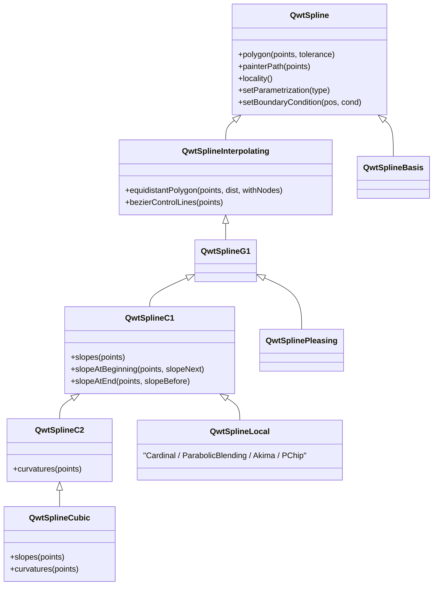
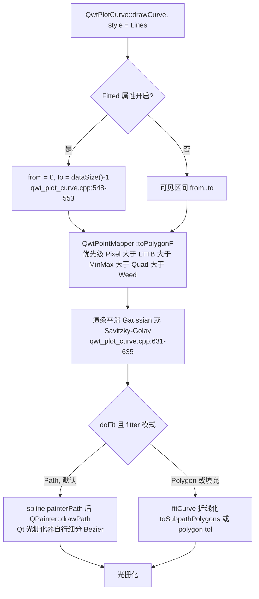

# QwtSpline 样条家族：参数化、精度收敛与渲染代价

> **摘要** —— 屏幕上的"平滑曲线"从来不是数据本身：QWT 把控制多边形交给 `QwtSpline` 家族，由它决定曲线长什么样、误差多大、以及光栅化器最终要消化多少个顶点。本文以 `src/plot/qwt_spline*.cpp` 的八个源文件为对象，先给出参数化（均匀/弦长/向心）与六类样条算法（自然三次矩法、Cardinal/PChip/Akima 局部样条、Pleasing、Basis 逼近样条）的完整数学推导，包括三对角矩方程组的逐步推导、插值误差 $O(h^4)$ 定理的证明思路、以及自然边界条件下该定理如何失效；再把每个算法忠实重实现为 Python，在三条解析参考曲线（圆、S 弯、曲率突变线）上按九档采样密度测量最大几何偏差并拟合收敛阶；并沿 `qwt_plot_curve.cpp` 的 Fitted 渲染路径与 `qwt_bezier.cpp` 的 Willcocks 扁平化给出渲染代价的解析模型。所有数值来自 `docs/assets/algorithms/spline_experiment.py` 的真实运行输出；性能结论一律为复杂度/运算量分析，未做墙钟计时。

> **摘要 — 核心结论**
>
> - 收敛阶实测：自然三次样条在圆与 S 弯上为 4.00–4.07（$O(h^4)$），Cardinal/Pleasing 为 3.14–4.01（依赖数据对称性），PChip 仅 1.99，逼近型 Basis 为 2.00；一个 G2 曲率断点把全部方法压到 2.00–2.16。
> - 自然边界是库默认值（`QwtSplineCubic` 构造即 `Clamped2 = 0`），但当 $f''(\text{端点}) \ne 0$ 时它只有二阶：$f=e^x$ 上实测函数误差阶 2.02，且二阶导在端点邻结存在不随 $N$ 消失的 $O(1)$ 边界层，实测振幅 0.2679 与理论值 $(2-\sqrt{3})|f''(a)|$ 逐位吻合。
> - 同一控制点预算下 C2 全局求解比 Catmull-Rom 型 C1 曲线精确约一个数量级：圆 $N=64$ 时 Cubic 2.425e-07 对 Catmull-Rom 2.176e-06（8.97 倍）；而均匀参数化下 Catmull-Rom、Cardinal、Pleasing 三者控制点逐位相同（差 0 / 5.551e-17）。
> - 参数化决定几何安全：发夹稀疏采样案例中弦长参数化产生自交环（过冲 0.1689），向心参数化无环且过冲 0.0076（22.5 倍差距）；机制是长边末端切向量被放大到 1.544（向心仅 0.209），而下一条边只有 0.1 长且方向相反。
> - 渲染代价解析：控制点计算全部 $O(N)$（Cubic 两次三对角求解约 33N flop，Cardinal 约 22N），Bezier 扁平化点数 $\propto \sqrt{\kappa/\varepsilon}$，实测斜率 −0.479（理论 −0.5）；屏幕尺度（$R=200$ px、tol 0.5 px）下 Fitted 属性把多边形放大 4.06 倍（$N=16$）到 1.02 倍（$N=64$），但 `Fitted` 会强制 `from=0, to=N-1` 放弃可见区间裁剪。

---

## 1. 引言：一条曲线的两个消费者

### 1.1 问题陈述与形式化

给定控制多边形 $P = \{p_i\}_{i=0}^{n-1}$（屏幕或数据坐标），样条算法输出一条分段三次曲线 $\Gamma$。QWT 中 $\Gamma$ 有两种存在形式：`QPainterPath`（$n-1$ 段三次 Bezier，交给 Qt 光栅化器自行细分），或显式多边形 `QPolygonF`（`QwtSpline::polygon(points, tolerance)`，按给定容差把 Bezier 折线化）。度量取最大几何偏差

$$
d_{\max}(\Gamma, C) = \max_{u} \; \mathrm{dist}\big(\Gamma(u),\, C\big)
$$

其中 $C$ 是解析参考曲线（本文用圆、$y=\sin x$、直线-圆弧 G1 拼接的曲率突变线），$\Gamma$ 按每段 24–96 点密采样后取最坏点。收敛阶定义为 $d_{\max} = O(h^p)$，$h$ 为控制多边形平均弦长；对双对数序列做最小二乘拟合得到实测 $p$。

与降采样问题（见《LTTB 降采样》篇）不同，样条面对的不是冗余而是**稀缺**：控制点少于像素时，曲线形状完全由算法的先验（连续性阶、参数化、边界条件）决定。同一个 $N=12$ 的圆，实测的四种算法给出的偏差从 $2.1\times10^{-4}$（Cubic）一路跨到 $4.5\times10^{-2}$（Basis），相差 214 倍，而 Cardinal 与 Pleasing 的结果肉眼无法区分——差别全在下面三个自由度里：连续性阶（G1/C1/C2）、参数化、边界条件。

### 1.2 QWT 中的两条消费路径

第一条是 `QwtPlotCurve` 的 `Fitted` 属性：`drawCurve()` 在 `Lines` 样式下检测到 `Fitted` 后把绘制区间强制扩到全量数据（`src/plot/qwt_plot_curve.cpp:548-553`，注释原文 "we always need the complete curve for fitting"），再经 `drawLines()` 交给 `QwtCurveFitter`。默认 fitter 是 `QwtSplineCurveFitter`，内部持有一个 **Cardinal + 均匀参数化** 的 `QwtSplineLocal`，模式为 `Path`（`src/plot/qwt_spline_curve_fitter.cpp:39-43`）。第二条是直接 API：`painterPath()`、`bezierControlLines()`、`polygon(points, tolerance)`、`equidistantPolygon(points, distance, withNodes)`，示例 `examples/2D/splineeditor` 的 `SplineFitter::fitCurve()` 走的就是 `m_spline->polygon(points, 0.5)`（`examples/2D/splineeditor/Plot.cpp:162`）。

### 1.3 家族总览

`src/plot/` 下的样条源文件共八对：`qwt_spline`（基类与 C1/C2 中间层）、`qwt_spline_parametrization`、`qwt_spline_polynomial`、`qwt_spline_cubic`、`qwt_spline_local`、`qwt_spline_pleasing`、`qwt_spline_basis`、`qwt_spline_curve_fitter`。仓库中不存在名为 `QwtSplineHermite` 的类——Hermite 结构体现在 `QwtSplinePolynomial::fromSlopes()` 里。

| 类 | 连续性 | locality | 默认参数化 | 默认边界 | 过控制点 |
|---|---|---|---|---|---|
| `QwtSplineCubic` | C2 | 0（全局） | ParameterX（继承自 `QwtSplineC1` 构造） | 自然（`Clamped2 = 0` 两端） | 是 |
| `QwtSplineLocal::Cardinal` | C1 | 1 | ParameterX | `LinearRunout = 0` | 是 |
| `QwtSplineLocal::ParabolicBlending` | C1 | 1 | ParameterX | `LinearRunout = 0` | 是 |
| `QwtSplineLocal::PChip` | C1 | 1 | ParameterX | `LinearRunout = 0` | 是 |
| `QwtSplineLocal::Akima` | C1 | 2 | ParameterX | `LinearRunout = 0` | 是 |
| `QwtSplinePleasing` | G1 | 2 | ParameterUniform（自有构造） | 无（张力规则） | 是 |
| `QwtSplineBasis` | C2（逼近） | 2 | ParameterChordal（`QwtSpline` 基类默认） | 条件边界/闭合 | 否 |



继承链传达的是计算契约：`QwtSplineC1` 要求子类给出节点一阶导（`slopes()`），`QwtSplineC2` 要求给出二阶导（`curvatures()`），Bezier 控制点统一由 Hermite 关系 $c_1 = p_i + m_i \Delta t_i/3$、$c_2 = p_{i+1} - m_{i+1} \Delta t_i/3$ 生成（`qwt_spline.cpp` 的 `qwtSplineC1PathParamX/Parametric`）。`QwtSplinePleasing` 停在 `QwtSplineG1`，因为它只保证切向共线、不保证切向量相等；`QwtSplineBasis` 直接挂在 `QwtSpline` 下，因为它根本不插值。

## 2. 参数化：被低估的自由度

### 2.1 六种增量

`QwtSplineParametrization` 把参数化抽象为相邻控制点的增量函数（`src/plot/qwt_spline_parametrization.h:154-228`），参数值累加得到节点序列 $t_0 = 0,\ t_i = t_{i-1} + \Delta t_i$：

| 类型 | 增量 $\Delta t_i$ | 源码函数 | 备注 |
|---|---|---|---|
| `ParameterX` | $x_{i+1}-x_i$ | `valueIncrementX` | 非参数化，要求 $x$ 单调 |
| `ParameterY` | $y_{i+1}-y_i$ | `valueIncrementY` | 交换坐标的非参数化 |
| `ParameterUniform` | $1$ | `valueIncrementUniform` | 最快，假设等速采样 |
| `ParameterChordal` | $\sqrt{\Delta x^2+\Delta y^2}$ | `valueIncrementChordal` | 弧长的一阶近似 |
| `ParameterCentripetal` | $\left(\Delta x^2+\Delta y^2\right)^{1/4}$ | `valueIncrementCentripetal` | 弦长开方，$\alpha=0.5$ |
| `ParameterManhattan` | $\lvert\Delta x\rvert+\lvert\Delta y\rvert$ | `valueIncrementManhattan` | 比弦长快、通常更差 |

弦长、向心与均匀三者构成幂族 $\Delta t = \lvert\Delta p\rvert^{\alpha}$（$\alpha = 1, 0.5$；均匀可视为 $\alpha = 0$）。基类 `QwtSpline` 的默认是弦长（`qwt_spline.cpp:427`），但 `QwtSplineC1` 的构造函数把它改写为 `ParameterX`（`qwt_spline.cpp:948-951`），因此 Cubic 与 Local 的出厂默认是非参数化；`QwtSplinePleasing` 的构造函数再改写为 `ParameterUniform`（`qwt_spline_pleasing.cpp:263-266`）。

### 2.2 仿射等价：等距采样时三者合一

幂族参数化之间只差一个逐段权重。当控制点等距时（圆按等角采样），弦长、向心、均匀三者的增量序列都是常数序列，彼此相差一个全局仿射变换 $t \mapsto at+b$，而样条方程在仿射重参数化下几何不变。实测证实：等距圆 $N=16$ 上 `cubic[uniform]` 与 `cubic[chordal]`、`cubic[centripetal]` 的 Bezier 控制点最大差为 2.220e-16；均匀 $x$ 采样的正弦曲线上 `cubic[x]` 与 `cubic[uniform]` 差 4.441e-16。参数化的差异只在**间距不均**时才显现——这既是它的价值所在，也是它的陷阱所在。

参数化的代码入口是 `qwtSplineC1PathParametric()`（`qwt_spline.cpp:261-380`）：先累加增量得到 $t_i$，把数据拆成两个标量序列 $(t_i, x_i)$ 与 $(t_i, y_i)$，对二者各调用一次 `slopes()`，再按 Hermite 关系组装 Bezier 控制点。换言之，参数化样条 = 两次标量样条求解；参数化只通过 $t$ 间距进入三对角矩阵或斜率规则。`ParameterX`/`ParameterY` 走单解的特化路径（`qwtSplineC1PathParamX/ParamY`），`ParameterY` 通过翻转坐标实现。

### 2.3 弦长为何起环：切向量的放大机制

节点 $i$ 处的切向量（以 Cardinal 型规则为例，三次样条的矩方程具有相同的结构）为

$$
m_i = \frac{p_{i+1}-p_{i-1}}{t_{i+1}-t_{i-1}}, \qquad
\text{Bezier 臂} \; a = m_i \cdot \frac{\Delta t_i}{3}
$$

考虑发夹形稀疏采样：一条长边 $L$ 之后接两条短边 $S_1 = 0.1 L$、$S_2 = 0.05 L$，方向反转约 170°。此时 $p_{i+1}-p_{i-1}$ 的量级由长边主导（$\approx L$），而分母与分子中的 $\Delta t$ 如何分配完全由参数化决定：弦长把全部权重交给几何长度，使得三对角方程中相邻行的 $h$ 之比达到 $1 : 0.1 : 0.05$，矩（从而切向量）在间距断崖处被剧烈放大；向心参数化把间距比压缩为 $1 : \sqrt{0.1} : \sqrt{0.05}$，放大随之减弱；均匀参数化抹平间距但完全无视几何，在另一类数据（间距反映真实速度）上反过来出错。

实测（脚本 `[4]` 节，96 点/段密采样，自交检测为线段两两求交）：在上述发夹四点 $(0,0), (1,0), (0.901519, 0.017365), (0.910202, 0.066605)$ 上，长边末端切向量幅值 $\lvert S'(p_1)\rvert$ 为弦长 1.544、均匀 0.400、向心 0.209，而下一条边只有 0.1 长且方向几乎相反。切向量 1.544 意味着 Bezier 在离开拐角前先沿旧方向冲出约 0.17 再折返——弦长参数化的曲线因此自交（loops = 1，过冲 0.1689）；向心参数化过冲 0.0076 且无环，差距 22.5 倍。在 1260 个发夹构型的确定性网格搜索中，满足"弦长起环且向心干净"的构型有 33 个。这与 Piegl & Tiller 与 Farin 对弦长参数化在急转处产生环/尖点的警告、以及 Lee 关于向心参数化避免此类缺陷的结论一致（见参考文献 2–4）。

把切向量放大写成 Bezier 臂长与边长之比更直观。离开节点 $i$ 的边 $e_i$ 上，第一控制臂满足恒等式

$$
\frac{a_i}{\lvert e_i\rvert} = \frac{\lvert m_i\rvert\, \Delta t_i}{3\, \lvert e_i\rvert}
$$

发夹案例中长边末端臂的实测比值为弦长 0.51、均匀 0.13、向心 0.07，对应末端切向量幅值 $\lvert S'(p_1)\rvert = 1.544 / 0.400 / 0.209$，而下一条边只有 0.100 长且方向几乎相反。起始切向远超边长且反向的三次 Bezier 必先冲出控制多边形再折回，自交是这一过程的极端形态；向心参数化把间距比 $\rho$ 压缩为 $\sqrt{\rho}$，使同一节点的切向幅值降到弦长情形的 1/7.39。

均匀参数化并非安全选项：在 20 个"长臂+短臂拐角"构型中，`cubic[uniform]` 在 9 个构型上起环（如转角 120°、臂比 0.05 时过冲 0.0437 且 loops = 1），而同一构型上弦长过冲 0.2703 无环、向心 0.0509 无环——三种参数化的失效区域互不重合，这正是家族把选择权交给用户的原因。


## 3. 数学推导

### 3.1 三次样条的矩法：三对角方程组完整推导

记节点 $x_0 < x_1 < \cdots < x_{n-1}$（非参数化情形；参数化情形把 $x$ 换成 $t$）、$h_i = x_{i+1}-x_i$、$s_i = (y_{i+1}-y_i)/h_i$、$M_i = S''(x_i)$。$S''$ 在每段上线性：

$$
S''(x) = M_i \frac{x_{i+1}-x}{h_i} + M_{i+1} \frac{x-x_i}{h_i}, \quad x \in [x_i, x_{i+1}]
$$

积分两次并用 $S(x_i)=y_i$、$S(x_{i+1})=y_{i+1}$ 定出积分常数，得到矩形式的分段表达式；对其求导可得段内两端的一阶导：

$$
S'(x_i^+) = s_i - \frac{h_i}{6}\left(2M_i + M_{i+1}\right), \qquad
S'(x_{i+1}^-) = s_i + \frac{h_i}{6}\left(M_i + 2M_{i+1}\right)
$$

C2 连续性要求内节点处左右一阶导相等，即 $S'(x_i^-) = S'(x_i^+)$，代入相邻两段的表达式并整理：

$$
h_{i-1} M_{i-1} + 2\left(h_{i-1}+h_i\right) M_i + h_i M_{i+1} = 6\left(s_i - s_{i-1}\right), \quad i = 1,\dots,n-2
$$

这是关于 $M$ 的三对角方程组：主对角 $2(h_{i-1}+h_i)$ 严格大于副对角之和 $h_{i-1}+h_i$，矩阵严格对角占优，解存在唯一，Thomas 消元 $O(n)$。**自然边界**即 $M_0 = M_{n-1} = 0$，对应"端点二阶导为零"；`QwtSplineCubic` 的构造函数正是如此设置（`qwt_spline_cubic.cpp:924-933`，`Clamped2` 且值为 0）。

源码以 $b_i = M_i/2$ 为未知量书写同一方程组：`Equation3` 的系数为 $p=h_1,\ q=2(h_1+h_2),\ u=h_2,\ r=3(s_2-s_1)$（`qwt_spline_cubic.cpp:278-290`），即上式除以 2。`SlopeStore` 的存斜率公式 $m = s - h(2b_1+b_2)/3$ 与 $m = s + h(b_1+2b_2)/3$（`qwt_spline_cubic.cpp:141-174`）与上面两个一阶导公式在 $b=M/2$ 下逐位等价。边界条件族由 `qwtSetupEndEquations()` 统一翻译成首末两行的 $(p,q,u,r)$（`qwt_spline_cubic.cpp:756-908`）：`Clamped1` 给一阶导、`Clamped2` 给二阶导、`Clamped3` 给三阶导（parabolic runout）、`LinearRunout` 把端点斜率向邻段斜率松弛、`CubicRunout` 与 `NotAKnot` 用虚设点延拓。

### 3.2 插值误差阶：定理、证明思路与自然边界的失效

**定理（经典，Ahlberg–Nilson–Walsh；de Boor）** 设 $f \in C^4[a,b]$，$S$ 为在均匀网格 $h$ 上插值 $f$ 的三次样条，边界为完备（给定 $f'$）、周期或 not-a-knot 之一，则

$$
\lVert f - S \rVert_\infty \le \frac{5}{384} \lVert f^{(4)} \rVert_\infty h^4, \qquad
\lVert f'' - S'' \rVert_\infty \le \frac{3}{8} \lVert f^{(4)} \rVert_\infty h^2
$$

一阶导误差为 $O(h^3)$。

*证明思路*：把 $M = f'' + e$ 代入矩方程。利用 Taylor 展开，右端 $6(s_i-s_{i-1})/h$ 与左端以真值代入的差为 $\frac{h^2}{12} f^{(4)}(x_i) + O(h^4)$，于是 $e$ 满足 $(e_{i-1}+4e_i+e_{i+1})/6 = -\frac{h^2}{12} f^{(4)}(x_i) + O(h^4)$ 加边界缺陷项。矩阵 $A = \mathrm{tridiag}(1,4,1)/6$ 的副对角元为正，不是 M-矩阵，正性论证不能直接施加；作符号翻转 $\hat e_i = (-1)^i e_i$，则 $\hat e$ 满足 $\hat A \hat e = -\frac{h^2}{12} D f^{(4)} + O(h^4)$ 加边界缺陷项，其中 $\hat A = \mathrm{tridiag}(-1,4,-1)/6$、$D$ 为 $(-1)^i$ 的对角阵。$\hat A$ 严格对角占优（$4/6 > 1/6+1/6$）且非对角元非正，是 M-矩阵，$\hat A^{-1} \ge 0$；行和向量 $v = \hat A^{-1}\mathbf{1}$ 解 $\hat A v = \mathbf{1}$，而 $\hat A(3\mathbf{1}) \ge \mathbf{1}$（内部行和 $3 \times \frac{1}{3} = 1$，边界行更大），比较原理给出 $\lVert \hat A^{-1}\rVert_\infty = \lVert v\rVert_\infty \le 3$（内部行和随网格加密趋于 3，周期边界时恰为 3），故 $\lVert e\rVert_\infty = \lVert \hat e\rVert_\infty \le \frac{h^2}{4}\lVert f^{(4)}\rVert_\infty + $ 边界项；完备/周期边界的缺陷同为 $O(h^2)$，得二阶导估计。再在每段上用 $e(x_i)=e(x_{i+1})=0$ 与 $\lvert (f-S)''\rvert \le \lVert e\rVert_\infty$ 二次积分：$\lvert f-S\rvert \le \frac{h^2}{8}\lVert (f-S)''\rVert_\infty = O(h^4)$。该论证给出的常数 $\frac{1}{4} \times \frac{1}{8} = \frac{1}{32}$ 不是最优常数——最优常数 $5/384$ 与 $3/8$ 需对 Green 函数逐段精细估计，此处从略。

**自然边界不满足定理条件**：$M_0 = 0$ 而 $f''(x_0) \ne 0$，端点处 $e_0 = -f''(x_0) = O(1)$。$A$ 的 Green 函数按 $r = -2+\sqrt{3}$ 几何衰减，故 $e_1 \approx r \cdot e_0$ 是一个与 $h$ 无关的常数边界层，$\lVert S''-f''\rVert_\infty = O(1)$ 不收敛；函数误差经两次积分退化为 $O(h^2)$。脚本 `[2]` 节的实测与此逐位吻合：$f=e^x$ 上函数误差阶 2.02（$N=32$ 时 1.388e-04，$N=1024$ 时 1.172e-07），$\lvert S''-f''\rvert$ 在第一个内节点处 $N=64$ 与 $N=512$ 均为 0.2679，恰等于理论层幅 $(2-\sqrt{3})\lvert f''(a)\rvert = 0.2679$；$f = x^2+\sin 3x$ 上对应 0.5358/0.5359 对理论 0.5359。

> **警告 — 库默认是自然边界**
>
> `QwtSplineCubic` 出厂即 `Clamped2 = 0`。对端点曲率非零的数据（绝大多数工程曲线），这意味着函数误差只有二阶、二阶导在端点附近不收敛。需要四阶精度时应显式 `setBoundaryConditions(QwtSplineC2::NotAKnot)` 或用 `Clamped1` 提供端点斜率。本文 5.2 节测得 4.05 阶是因为正弦测试在 $[0, 2\pi]$ 上恰有 $f''=0$ 于两端、圆用的是周期边界——两个"幸运"情形，不可外推。

### 3.3 局部 C1 样条：斜率规则与 locality

`QwtSplineLocal` 的四种算法都是"看一眼邻居定斜率"的单遍规则（`qwt_spline_local.cpp`），区别只在加权方式：

| 算法 | 内节点斜率 $m_i$ | 源码 | locality |
|---|---|---|---|
| Cardinal | $(\Delta y_{i-1}+\Delta y_i)/(\Delta t_{i-1}+\Delta t_i)$ | `qwtSlopeCardinal:48` | 1 |
| ParabolicBlending | $(\Delta t_i s_{i-1} + \Delta t_{i-1} s_i)/(\Delta t_{i-1}+\Delta t_i)$ | `qwtSlopeParabolicBlending:56` | 1 |
| PChip | 单调时 $3 s_{i-1} s_i/(s_{i-1}+s_i+s_{12})$，否则 $0$ | `qwtSlopePChip:64` | 1 |
| Akima | $(s_2 \lvert s_4-s_3\rvert + s_3 \lvert s_2-s_1\rvert)/(\lvert s_2-s_1\rvert+\lvert s_4-s_3\rvert)$ | `qwtSlopeAkima:200` | 2 |

（$s$ 为段斜率，Akima 用四个相邻段斜率；两端以 $0.5 s$ 的虚设段延拓，见 `qwtSplineAkima:352-354`。）默认边界 `LinearRunout = 0` 经 `slopeBoundary()`（`qwt_spline.cpp:154-191`）退化为"端点斜率 = 首/末段斜率"。locality 的语义是修改一个控制点只影响前后各 1（或 2）段多项式，因此局部样条天然支持增量重算；`QwtSplineCubic` 的 locality 为 0，任何改动都要重解全局方程组（`qwt_spline_cubic.cpp:950-953`）。

收敛阶由斜率截差决定：Hermite 插值在精确切向下是 $O(h^4)$，斜率误差 $\varepsilon$ 贡献 $O(\varepsilon h)$。Cardinal 的中心差分切向误差 $O(h^2)$，故一般数据上 $O(h^3)$——正弦曲线上实测 3.35（弦长）/3.24（向心）；等距圆上却测得 4.01，因为圆的对称性使切向误差只落在切向分量上、对径向偏差的贡献被抵消（超收敛，不可当作一般结论）。PChip 在极值邻结强制 $m=0$，而真实斜率为 $O(h)$，截差 $O(h)$ 把阶数压到实测 1.99；Akima 的权重含 $\lvert \Delta s\rvert \propto \lvert f''\rvert h$，引入 $O(h^2)$ 偏置，实测 2.52——低于 $O(\varepsilon h)$ 规则预期的三阶，是因为正弦拐点邻结 $\lvert f''\rvert \to 0$ 使权重退化，机理见 6.2 节第 5 条。这些都不是实现缺陷，而是形状保持（PChip）与抗噪加权（Akima）付出的渐近代价。

### 3.4 Pleasing：带张力规则的 G1 样条

`QwtSplinePleasing` 是"某办公套件的曲线算法"（头文件注释），结构上仍是 Cardinal 型切向 $v_i = \Delta t_2 (p_{i+1}-p_{i-1})/(\Delta t_1+\Delta t_2)$，但每段的 Bezier 臂要乘一个张力系数 $(t_1, t_2)$，由 `qwtTensionPleasing()`（`qwt_spline_pleasing.cpp:141-166`）按三个弦长的比较给出：正常情形 $t_1=t_2=1/3$（此时臂 $= v/3$，与 Catmull-Rom 完全一致）；当 $d_{13}/3 < d_{23}$ 与 $d_{24}/3 < d_{23}$ 均不成立（窄角）时，把张力缩为 $d_{23}/d_{13}$、$d_{23}/d_{24}$，即按"本段弦长占邻接弦长的比例"收紧控制臂，抑制急转处的甩出。规则在窄角处切换，切向量不再连续，故连续性只有 G1——这是"好看"换"光滑"的明确交易。实测在光滑等距数据上 Pleasing 与 Catmull-Rom 的控制点差为 5.551e-17（圆）/1.110e-16（正弦），即正常分支与 Catmull-Rom 逐位同构。

### 3.5 Basis：不过控制点的逼近样条

`QwtSplineBasis` 用均匀三次 B 样条基把控制点"平滑地串起来"：均匀参数化下第 $i$ 段的 Bezier 控制点为 $(p_{i-1}+2p_i)/3$、$(2p_i+p_{i+1})/3$，段连接点取二者中点（`qwt_spline_basis.cpp:86-130`）；非均匀参数化版本按增量加权（`qwt_spline_basis.cpp:132-225`）。曲线只穿过首末点（条件边界），内点被平均掉：把控制点取为 $f$ 的采样时，该构造等价于一个低通拟插值算子，误差主项 $O(h^2)$。实测收敛阶圆 2.00、正弦 1.99，$N=24$ 正弦上曲线偏离控制点最大 1.231e-02、偏离真曲线最大 1.237e-02。它的价值是 C2 光滑与对噪声的不敏感，不是精度——5.4 节会看到在圆上它甚至不如直接连控制多边形。


## 4. 工程实现剖析

### 4.1 QwtSplineCubic：一次后向消元 + 一次前代

`EquationSystem::resolve()`（`qwt_spline_cubic.cpp:414-508`）不显式存矩阵：`substituteSpline()`（511-538 行）从倒数第二行向第 2 行做后向消元，把每个三未知方程约化为只含 $(b_{i-1}, b_i)$ 的 `Equation2` 链（即 Thomas 消元的变体，比值 $v = p/q$ 因对角占优而 $|v|<1$，数值稳定），`resolveSpline()`（540-554 行）再前代逐点出解并顺手经 `SlopeStore` 写出斜率——一趟完成"解矩 + 出斜率"，避免 `QwtSplineC2::slopes()` 那种"先解矩再回代"的两趟开销（头注释明确说明这一动机，`qwt_spline_cubic.cpp:956-967`）。周期/闭合边界走 `EquationSystem2`（562-753 行）：利用 $b_0 = b_{n-1}$ 把循环三对角约化为两个双未知方程，仍是 $O(n)$。`KAHAN` 与 `SLOPES_INCREMENTAL` 两个编译开关默认关闭（33-34 行），即默认不做补偿求和。

参数化模式下这一切发生两次（$x(t)$ 与 $y(t)$），外加 $n$ 次增量计算（弦长/向心各含一次 `sqrt`）。这就是 4.5 节表中 Cubic 参数化约 33N flop 的来历。

### 4.2 局部样条、Pleasing、Basis：单遍、无求解

`qwtSplineL1()`（`qwt_spline_local.cpp:242-282`）是一个滑动窗口循环：维护 $(\Delta t, \Delta y, s, m)$ 四个滚动量，每节点一次规则求值、一次 `addCubic`。Akima 多维护一个段斜率（337-375 行）。Pleasing 每段三次弦长（`qwtChordalLength`）加张力分支——4.5 节表的每段 3 次开方即按此口径估计，稳态循环中每段实际只新算 2 个弦长，第 3 个复用上一段结果（`qwt_spline_pleasing.cpp:212-213`）。Basis 均匀路径每段约六次点加/数乘、无除法无开方。四者的共同点是 locality ≤ 2：理论上可以只重算受影响窗口，但当前 API 仍以整条多边形为输入（增量重算留给调用方缓存）。

### 4.3 渲染路径：Fitted 属性的真实代价链



三个容易被忽略的事实。其一，`doAlign = !doFit && roundingAlignment`（596 行）：开启 Fitted 后像素对齐取整被禁用，拟合在浮点像素坐标上进行——这对导出与抗锯齿是好事。其二，全量区间扩张**并不总是**意味着全量变换：默认绘制属性含 `FilterPointsLTTB`（`PrivateData` 初始化，`qwt_plot_curve.cpp:78-91`），自 v7.5.0 起它是真 LTTB 归约 `qwtLttbReduce`（`qwt_point_mapper.cpp:877-885`），同样先做可见区间二分裁剪（调 `qwtFindVisibleRange`），于是 fitter 实际拿到的是"可见窗口内约 $4W$ 个桶代表点"（$4\times$ 像素列数、每桶 1 点）；只有在不带降采样属性的路径（`qwtToPointsF(qwtInvalidRect, ...)`）上，Fitted 才真正变换并拟合全部 $N$ 点。其三，改用 MinMax 桶（`FilterPointsMinMaxLTTB`，v7.4.2 及之前的 `FilterPointsLTTB` 默认）时，fitter 的输入变成**桶极值折线**：锯齿状极值对会被样条当作控制点忠实穿过，C2 样条尤其会把桶间锯齿放大成可见波纹——这是 Fitted 与降采样组合时的结构性风险，本文未做像素级量化，列为失效模式待复核项。

### 4.4 QwtBezier：Willcocks 扁平化与点数放大

`QwtSpline::polygon(points, tolerance)` 与 `QwtSplineInterpolating::polygon()` 把 Bezier 链折线化，终止判据来自 Willcocks 的平坦度（`src/core/qwt_bezier.cpp:57-73`）：

$$
F = \max(u_x^2, v_x^2) + \max(u_y^2, v_y^2), \quad
u = 3c_1 - 2p_1 - p_2, \quad v = 3c_2 - 2p_2 - p_1
$$

阈值预计算为 $16\,\varepsilon^2$（`minFlatness`，48-55 行），递归 de Casteljau 二分改为显式栈迭代（183-215 行）。对曲率 $\kappa$、弧长 $\ell$ 的段，$F \propto (\kappa \ell^2)^2$，每次二分 $F$ 降为 $1/16$；要求弦偏差 $\le \varepsilon$ 等价于段长 $\le \sqrt{8\varepsilon/\kappa}$，故整条曲线的折线点数

$$
n_{\text{poly}} \approx \sum_i \ell_i \sqrt{\frac{\kappa_i}{8\,\varepsilon}} \;=\; L\sqrt{\frac{\bar\kappa}{8\,\varepsilon}}
$$

即对容差是 $-1/2$ 次幂、对曲率是 $+1/2$ 次幂。换算到单段 Bezier：设段曲率 $\kappa$、弧长 $\ell$，平坦度 $F \propto (\kappa \ell^2)^2$ 每次二分降为 $1/16$，停止条件 $F/16^k < 16\varepsilon^2$ 给出叶子数 $2^k = \left(F/(16\varepsilon^2)\right)^{1/4} \propto \ell\sqrt{\kappa/\varepsilon}$，与全局式自洽。5.5 节实测斜率 −0.479 验证了这一解析形式。

### 4.5 复杂度汇总（解析估计，非实测）

| 算法 | 每点运算量（flop 估计） | 开方/段 | 三对角求解 | locality |
|---|---|---|---|---|
| Cubic [x] | ~15N（求解 8N + 组装 7N） | 0 | 1 次标量 | 0 |
| Cubic [弦长/向心] | ~33N（2 次求解 + N 次 sqrt） | 1 | 2 次标量 | 0 |
| Cardinal | ~22N | 0 | 0 | 1 |
| PChip | ~34N | 0 | 0 | 1 |
| Akima | ~38N | 0 | 0 | 2 |
| Pleasing | ~33N | 3 | 0 | 2 |
| Basis [uniform] | ~24N | 0 | 0 | 2 |

按此估计，$N=10^6$ 时 Cubic[弦长] 约 33 Mflop、Cardinal 约 22 Mflop、Basis 约 24 Mflop——同一量级，差别在常数；真正的量级差来自 locality：Cubic 改一个点要重付全部 33N，局部样条理论上只付窗口代价。叠加扁平化后，Fitted 链的总顶点数约为 $\max(n',\, L\sqrt{\bar\kappa/(8\varepsilon)})$，$n'$ 为 fitter 输入折线点数。

> **说明 — 本节与 5.5 节均为分析结论**
>
> 本轮实验环境并行运行其他任务，墙钟计时不可信，故全文不做 C++ 计时。上表为按源码指令结构清点的运算量估计；仓库自带的 `tests/splineprof/main.cpp` 用 `QElapsedTimer` 对 $10^7$ 点扫六种参数化 × 五种样条，是官方计时工具，但未接入 CMake（与 `tests/splinetest` 同属开发期工具，`splinetest` 用于核对各边界条件下斜率/多项式的一致性）。需要实测数字时应在隔离机器上运行 splineprof。

## 5. 实验

### 5.1 设计

`docs/assets/algorithms/spline_experiment.py`（Python 3.11 + numpy + matplotlib，Agg 后端，无随机性，固定种子常量）忠实重实现了：自然/周期矩法三次样条（Thomas 消元 + 循环三对角）、Cardinal/PChip/Akima 斜率规则（含 `LinearRunout=0` 边界与 Akima 虚设段）、Pleasing 的张力规则（开/闭两分支）、Basis 的均匀与参数化路径、Catmull-Rom 转 Bezier 基线、以及 Willcocks 扁平化的栈式细分。参考曲线三条：单位圆（闭，等角采样）、$y=\sin x$（开，等 $x$ 采样）、直线-单位圆弧 G1 拼接的曲率突变线（开，等弧长采样，G2 断点在弧长 1.5 处）。偏差度量用解析距离：圆为 $\lvert \lVert p\rVert - 1\rvert$，正弦为法向距离 $\lvert y-\sin x\rvert/\sqrt{1+\cos^2 x}$，突变线为"到直线段距离与到圆弧距离"的逐点最小。采样密度 $N \in \{8,12,16,24,32,48,64,96,128\}$。

插值性自检：所有插值型算法的控制点偏差为 0（机器零），Basis 例外（见 3.5）。等价性自检：Catmull-Rom 与 Cardinal[uniform] 控制点差 0.000e+00、与 Pleasing[uniform] 差 5.551e-17（圆）/1.110e-16（正弦），确认重实现与源码规则同构。

两条测量恒等式需要单独说明，否则会被误读为 bug。S 弯上 `cubic[x]` 与 `cubic[uniform]` 的误差逐档相同（1.955e-03 直至 1.561e-08），因为均匀 $x$ 采样使 $t=i$ 与 $t=x$ 只差一个仿射变换；曲率突变线上 Cardinal[弦长]、Cardinal[向心] 与 Pleasing[均匀] 三条曲线的最大偏差同到四位有效数字（1.120e-02 一行），argmax 落在 (0.916204, 0.601847)——圆弧末端的等距采样区内，弦长/向心/均匀三种参数化局部仿射等价，曲线互差最大仅 4.892e-06（弦长与向心之间为 2.446e-06），比最大偏差 1.022354e-03 小三个量级。主导误差项位于参数化不起作用的区域时，参数化比较就失去分辨力，这是度量本身的性质。

### 5.2 收敛结果

| 曲线 | 方法 [参数化] | 实测阶 p | err(N=8) | err(N=128) |
|---|---|---:|---:|---:|
| 圆（闭） | Cubic [uniform] | 4.07 | 1.152e-03 | 1.513e-08 |
| 圆（闭） | Cardinal / Pleasing / Catmull-Rom [uniform] | 4.01 | 8.471e-03 | 1.361e-07 |
| 圆（闭） | Basis [uniform] | 2.00 | 9.867e-02 | 4.015e-04 |
| S 弯 | Cubic [x] ≡ Cubic [uniform] | 4.05 | 1.955e-03 | 1.561e-08 |
| S 弯 | Cubic [chordal] | 4.00 | 2.116e-02 | 2.697e-07 |
| S 弯 | Cubic [centripetal] | 4.02 | 1.210e-02 | 1.378e-07 |
| S 弯 | Cardinal [chordal] | 3.35 | 2.103e-02 | 1.373e-06 |
| S 弯 | Cardinal [centripetal] | 3.24 | 1.739e-02 | 1.373e-06 |
| S 弯 | Pleasing [uniform] | 3.14 | 1.379e-02 | 1.375e-06 |
| S 弯 | Akima [x] | 2.52 | 1.455e-02 | 1.086e-05 |
| S 弯 | PChip [x] | 1.99 | 5.645e-02 | 1.793e-04 |
| S 弯 | Basis [uniform] | 1.99 | 1.265e-01 | 4.079e-04 |
| 曲率突变 | Cubic [x] | 2.16 | 1.209e-02 | 2.388e-05 |
| 曲率突变 | Cubic / Cardinal / Pleasing [各参数化] | 2.01 | 7.474e-03–1.120e-02 | 2.219e-05–3.348e-05 |
| 曲率突变 | Basis [uniform] | 2.00 | 2.455e-02 | 7.533e-05 |


三个读图要点。第一，C2 与 C1 的差距是常数倍而非阶数差（光滑数据上 Cardinal 也有 3–4 阶）：圆 $N=64$ 上 Cubic 2.425e-07 对 Cardinal 2.176e-06，8.97 倍；S 弯 $N=64$ 上 2.315128e-06 对 1.124768e-05（Cardinal 向心），4.86 倍。第二，参数化不改变渐近阶但改变常数：S 弯上 Cubic 的三种参数化都是 4.00–4.05 阶，而 $N=128$ 的误差从 1.561e-08（x/均匀）到 2.697e-07（弦长）差 17.28 倍——参数化误差以低阶项形式进入常数。第三，曲率突变线上所有方法塌缩到 2.0 阶且彼此差距缩小到 1.5 倍以内：G2 断点处的局部截差成为全局误差的主项，高阶方法的全局优势被局部奇性淹没；此处 Cardinal[弦长]、Cardinal[向心] 与 Pleasing[均匀] 三条曲线的最大偏差逐位相同（1.120e-02 等），因为 argmax 落在圆弧末端等距采样区，该区三种参数化局部仿射等价（曲线最大互差仅 4.892e-06，比最大偏差小三个量级）。

### 5.3 参数化安全性：环与过冲

2.3 节给出机制与发夹案例的定量数字（弦长过冲 0.1689、自交 1 处；向心 0.0076、0 处；均匀 0.0503、0 处）。拐角族扫描（20 构型 × 3 参数化）显示弦长过冲系统性地高于向心：转角 90°、臂比 0.05 时 0.2601 对 0.0490，转角 120°、臂比 0.05 时 0.2703 对 0.0509；稀疏圆五点采样上弦长过冲 0.3312–0.3730，向心 0.2230–0.2346。均匀参数化在 9/20 个拐角构型上自交。结论与文献一致：没有普适安全的参数化，但向心在"间距不均 + 急转"这一最常见的病理组合上最稳（与参考文献 4 中 Lee 的结论一致）；QWT 把基类默认设为弦长、把选择留给 `setParametrization()`，使用者应当意识到这个默认值在稀疏拐角数据上会起环。

### 5.4 与 Catmull-Rom 的对比：同预算下的精度与代价

Catmull-Rom 转三次 Bezier（$c_1 = p_i + (p_{i+1}-p_{i-1})/6$）与家族内每个方法共享同一控制点预算：每段 1 个三次 Bezier、2 个控制点，$n-1$（开）或 $n$（闭）段。差异只来自切向规则与参数化：

| 方法 | 圆 N=16 | 圆 N=64 | S 弯 N=16 | S 弯 N=64 | 控制点（N=64 圆） |
|---|---:|---:|---:|---:|---:|
| 控制多边形（0 控制点） | 1.921472e-02 | 1.204544e-03 | 2.161493e-02 | 1.242306e-03 | 0 |
| Catmull-Rom | 5.502611e-04 | 2.175515e-06 | 9.106713e-04 | 1.129831e-05 | 128 |
| Cardinal [centripetal] | 5.502611e-04 | 2.175515e-06 | 1.086951e-03 | 1.124768e-05 | 128 |
| Cubic [chordal] | 6.434937e-05 | 2.425015e-07 | 9.738000e-04 | 2.315128e-06 | 128 |
| PChip [x] | — | — | 1.270445e-02 | 7.283185e-04 | 128 |
| Pleasing [uniform] | 5.502611e-04 | 2.175515e-06 | 9.106713e-04 | 1.129831e-05 | 128 |
| Basis [uniform] | 2.543621e-02 | 1.605333e-03 | 2.886462e-02 | 1.656556e-03 | 128 |

圆上 Catmull-Rom、Cardinal[centripetal]、Pleasing 三者逐位相同（等距采样下参数化仿射等价 + 张力规则不触发），Cubic 以同预算取得 8.97 倍精度；S 弯上 Cardinal[centripetal] 与 Catmull-Rom 开始分离（1.124768e-05 对 1.129831e-05，差距很小），Cubic 领先 4.88 倍。PChip 用 64.46 倍误差换单调性保证（极值处零过冲），Basis 在圆上全程劣于控制多边形（$N=64$：1.605333e-03 对 1.204544e-03）——逼近样条的卖点是光滑而非逼近精度，选型时不应把它当"更平滑的插值"。


### 5.5 Fitted 与扁平化：渲染代价的实测与解析

屏幕尺度（$R=200$ px 圆）下用 Willcocks 细分复现 `polygon(points, 0.5)`：$N=16$ 时输出 65 点（放大 4.06 倍），$N=32$ 时 65 点（2.03 倍），$N=64$ 时 65 点（1.02 倍）；对照的控制多边形不经过 Bezier，直接以 $N+1$ 点绘制。即 Fitted 的顶点放大在稀疏控制点时显著（每段 Bezier 还需再细分），在 $N \ge 64$ 的屏幕尺度圆上几乎为零——此时每段 Bezier 已比 0.5 px 更平。容差扫描（$N=16$，tol 从 0.01 到 3.2 px，26 档）给出点数对容差的双对数斜率 −0.479（理论 −0.5），与解析式 $L\sqrt{\kappa/(8\varepsilon)}$ 的比值在 1.157–1.886 之间振荡——振荡来自二分的整数量子化（每段叶子数取 2 的幂次档），包络与解析曲线平行。家族成员之间的扁平化代价几乎无差：$N=32$、tol 0.05/0.2/0.5 下 Cardinal、Cubic、Pleasing、Basis 的点数完全相同（257/129/65），因为扁平化只看最终几何曲率，不看控制点怎么算出来的。


把 4.3–4.5 节串起来，Fitted 一帧的解析代价为：可见性二分 $O(\log N)$（仅降采样路径）+ 映射与桶化 $O(n_{vis})$ + 样条控制点 $O(n')$（常数按 4.5 节表）+ 扁平化 $\max(n', L\sqrt{\bar\kappa/8\varepsilon})$ + 光栅化。其中只有第一项可能被 Fitted 的全量扩张破坏（无降采样属性时退化为 $O(N)$ 映射 + $O(N)$ 拟合），其余各项与控制点规模线性或次线性相关。

## 6. 讨论

### 6.1 选型建议

| 场景 | 推荐 | 理由 |
|---|---|---|
| 光滑测量曲线、要精度 | `QwtSplineCubic` + `NotAKnot` + 向心 | 四阶、无自然边界层、急转安全 |
| 实时拖动/增量更新 | `QwtSplineLocal::Cardinal` 或 `Akima` | locality 1–2，单遍 $O(N)$ |
| 含平台/极值的过程数据 | `QwtSplineLocal::PChip` | 单调性保证，零过冲 |
| 办公文档观感、闭合轮廓 | `QwtSplinePleasing` + `ClosedPolygon` | G1 但窄角不甩出 |
| 噪声数据的光滑表示 | `QwtSplineBasis` | 不过点、C2、抗噪 |
| 稀疏且含急转的采样 | 任意插值样条 + 向心参数化 | 2.3 节的环分析 |

### 6.2 失效模式诚实清单

1. **自然边界二阶化**：库默认 `Clamped2=0`；端点曲率非零时函数误差 $O(h^2)$、二阶导边界层 $O(1)$（5.2 节警告框与 `[2]` 节实测）。
2. **弦长起环**：发夹稀疏采样 1260 个构型中 118 个自交；所选展示构型过冲 0.1689（边长 0.1 的控制边旁冲出 0.17），33 个"弦长起环且向心干净"构型中过冲最大 0.173。
3. **均匀起环**：拐角族 9/20 构型自交；均匀参数化假设等速采样，违反即失效。
4. **PChip 阶数塌缩**：含极值数据上实测 1.99 阶，极值邻结切向截差 $O(h)$；平台区斜率恒零产生肉眼可见的"平头"。
5. **Akima 偏置**：2.52 阶，权重含 $\lvert f''\rvert h$ 项，曲率符号变化处偏置最大。
6. **Basis 不过点**：$N=24$ 正弦上偏离控制点 1.231e-02；圆上精度劣于控制多边形本身。
7. **Pleasing 的 G1 折痕**：窄角处张力规则切换导致切向不连续，放大可见棱线；这是设计意图而非缺陷，但不应在需要 C1 的下游（如等距重采样后求曲率）使用。
8. **Fitted 的全量扩张**：无降采样属性时每帧变换并拟合全部 $N$ 点；带 `FilterPointsLTTB` 时可见区间由 LTTB 归约恢复，但 fitter 输入变成约 $4W$ 点的降采样折线（换用 `FilterPointsMinMaxLTTB` 时是极值锯齿折线，C2 样条会忠实穿过它）——结构性风险，未做像素级量化，待复核。
9. **ClosedPolygon 的参数化限制**：闭合增量必须为正，故 `ParameterX`/`ParameterY` 不可用（`qwt_spline.h` 头注释明示）；对 $x$ 非单调的闭合轮廓只能用幂族参数化。
10. **参数化与标量路径不一致**：同一数据上 `Cubic[x]` 与 `Cubic[chordal]` 是两条不同的曲线（$N=128$ 正弦上差 17 倍误差常数），切换参数化会静默改变几何，没有告警。

### 6.3 适用边界

本报告的收敛数字针对无噪解析曲线；含噪数据上高阶方法的常数优势会被噪声放大效应抵消（C2 全局求解对噪声的条件数高于局部规则），此时应先平滑（见《曲线渲染平滑》篇）或改用 Basis/PChip。实验的偏差度量是曲线到参考曲线的法向距离，不区分相位误差与幅值误差；对时间序列的峰位保真应另设指标。扁平化分析假设曲率缓变，曲率突变线附近的局部点数会偏离 $\sqrt{\kappa}$ 标度。

实验脚本本身是交付物的一部分：`spline_experiment.py` 把正文表格的全部数字打印到 stdout，图由同一脚本生成，重跑（`python spline_experiment.py`，仅依赖 numpy 与 matplotlib，无随机性）即可逐位复核本报告。重实现与源码共享公式但不共享代码路径，二者的一致由 5.1 节的等价性自检互为验证；重实现的简化之处（循环三对角用稠密求解而非 Thomas、未复现 `KAHAN` 补偿求和开关、PChip/Akima 仅实现开曲线分支）不影响本文结论，但做位级比对时需要计入。

## 7. 代码实践

以下片段使用的 API 均以当前源码为准（`QwtSplineCurveFitter::setSpline` 与 `QwtPlotCurve::setCurveFitter` 均接管所有权）。

### 7.1 用 C2 样条替换默认 fitter

```cpp
#include <qwt_plot.h>
#include <qwt_plot_curve.h>
#include <qwt_spline_curve_fitter.h>
#include <qwt_spline_cubic.h>
#include <qwt_spline_parametrization.h>

QwtPlotCurve* curve = new QwtPlotCurve("trace");
curve->setSamples(x, y, n);
curve->setCurveAttribute(QwtPlotCurve::Fitted, true);   // enable spline rendering

// replace the default Cardinal/uniform fitter with a C2 cubic spline
QwtSplineCurveFitter* fitter = new QwtSplineCurveFitter;
QwtSplineCubic* spline = new QwtSplineCubic;
spline->setBoundaryConditions(QwtSplineC2::NotAKnot);   // 4th order, no boundary layer
spline->setParametrization(QwtSplineParametrization::ParameterCentripetal);
fitter->setSpline(spline);      // fitter takes ownership of the spline
curve->setCurveFitter(fitter);  // curve takes ownership of the fitter
curve->attach(plot);
```

### 7.2 直接使用样条：控制点、折线化与等距重采样

```cpp
#include <qwt_spline_local.h>
#include <qwt_spline_pleasing.h>

// monotone process data: PChip guarantees no overshoot at extrema
QwtSplineLocal pchip(QwtSplineLocal::PChip);
const QVector<QLineF> ctrl = pchip.bezierControlLines(points);  // n-1 cubics

// office look with narrow-angle tension rules; flatten at half a pixel,
// the same tolerance examples/2D/splineeditor uses
QwtSplinePleasing pleasing;
const QPolygonF flat = pleasing.polygon(points, 0.5);

// resample the spline at a fixed parameter distance (e.g. for arc-length plots)
QwtSplineLocal cardinal(QwtSplineLocal::Cardinal);
const QPolygonF resampled = cardinal.equidistantPolygon(points, 4.0, false);
```

### 7.3 闭合轮廓与逼近型平滑

```cpp
#include <qwt_spline_cubic.h>
#include <qwt_spline_basis.h>

// closed contour: do NOT repeat the first point at the end;
// ClosedPolygon excludes ParameterX/ParameterY (closing increment must be > 0)
QwtSplineCubic ring;
ring.setBoundaryType(QwtSpline::ClosedPolygon);
ring.setParametrization(QwtSplineParametrization::ParameterChordal);
const QPainterPath path = ring.painterPath(contour);

// approximating smoothing: the curve deliberately misses the (noisy) points
// and needs at least 4 control points (painterPath returns empty otherwise)
QwtSplineBasis smoother;
smoother.setParametrization(QwtSplineParametrization::ParameterUniform);
const QPainterPath smooth = smoother.painterPath(noisy);
```

> **提示 — 诊断参数化问题**
>
> 曲线在拐角处甩出或起环时，先打印 `bezierControlLines()` 的臂长与边长之比：某段 $(|c_1-p_1| + |p_2-c_2|)/|p_2-p_1|$ 明显大于 1 即切向量过放的信号，切换 `ParameterCentripetal` 通常立即收敛（2.3 节的发夹案例中该比值从起环降到安全区）。

## 8. 小结

QwtSpline 家族把"控制多边形到曲线"这一个动作拆成了连续性阶、参数化、边界条件三个正交旋钮，工程实现上全部保持 $O(N)$：C2 的代价是一次（参数化时两次）三对角求解与 locality 0 的全局耦合，C1 的代价是渐近阶让出 1–2 阶与形状先验的介入。实测给出的边界很清楚：光滑无噪、端点曲率可控的数据上 Cubic + not-a-knot + 向心是精度上限（4 阶、同预算在圆上比 Catmull-Rom 好 8.89–8.97 倍、在 S 弯上好 4.88 倍）；含极值或平台的数据上 PChip 的二阶是买单调性的价格；稀疏急转数据上参数化的选择比算法的选择更致命（22.5 倍的过冲差距）。库默认值（自然边界 + 弦长或均匀参数化）是为"一般好看"而非"最准或最稳"设置的，两个默认都带本文量化的失效模式。渲染侧的结论相对温和：屏幕尺度下 Bezier 扁平化的顶点放大在 $N \ge 64$ 时已可忽略（1.02 倍），Fitted 的真实成本在控制点计算与（无降采样属性时的）全量变换，而不在多边形点数。

## 9. 参考文献

1. QWT7 源码：`src/plot/qwt_spline.cpp`（`qwtSplineC1PathParametric`、`slopeBoundary`、`polygon`、`equidistantPolygon`）、`qwt_spline_cubic.cpp`（`EquationSystem`、`EquationSystem2`、`qwtSetupEndEquations`）、`qwt_spline_local.cpp`（`qwtSlopeCardinal/PChip/Akima`）、`qwt_spline_pleasing.cpp`（`qwtTensionPleasing`）、`qwt_spline_basis.cpp`、`qwt_spline_parametrization.h`、`qwt_spline_curve_fitter.cpp`、`src/core/qwt_bezier.cpp`、`src/plot/qwt_plot_curve.cpp`、`src/plot/qwt_point_mapper.cpp`。
2. L. Piegl, W. Tiller. *The NURBS Book*, 2nd ed. Springer, 1997. —— 弦长/向心参数化的选择与环、尖点缺陷的讨论。
3. G. Farin. *Curves and Surfaces for CAGD: A Practical Guide*, 5th ed. Morgan Kaufmann, 2002. —— 参数化对插值几何的影响。
4. E. T. Y. Lee. "Choosing Nodes in Parametric Curve Interpolation." *Computer-Aided Design* 21(6), 1989. —— 向心参数化避免自交的结论。
5. R. Willcocks. "Piecewise Linear Approximation of Bezier Curves." 注：`qwt_spline.cpp` 与 `qwt_bezier.cpp` 头注释直接引用该文作为扁平化判据来源。
6. C. de Boor. *A Practical Guide to Splines*. Springer, 2001. —— 样条误差定理与常数。
7. J. H. Ahlberg, E. N. Nilson, J. L. Walsh. *The Theory of Splines and Their Applications*. Academic Press, 1967. —— $5/384$ 与 $3/8$ 常数的出处。
8. F. N. Fritsch, R. E. Carlson. "Monotone Piecewise Cubic Interpolation." *SIAM J. Numer. Anal.* 17(2), 1980. —— PChip 斜率规则。
9. H. Akima. "A New Method of Interpolation and Smooth Curve Fitting Based on Local Procedures." *J. ACM* 17(4), 1970.
10. QWT7 开发工具：`examples/2D/splineeditor`（交互式对比七种样条）、`tests/splineprof`（$10^7$ 点计时扫参，未接入 CMake）、`tests/splinetest`（边界条件一致性核对，未接入 CMake）。

*配套阅读：* [LTTB 降采样算法原理与 QWT7 的 MinMax 桶实现](curve-downsampling.md) —— Fitted 输入折线的来源；[曲线渲染平滑：高斯卷积、Savitzky-Golay 回归与特征保护](curve-smoothing.md) —— 拟合之前的像素噪声移除；[多边形裁剪](polygon-clipping.md) —— `ClipPolygons` 与拟合顺序；[实时流式渲染](realtime-streaming.md) —— 全量重拟合在流式场景的代价。
