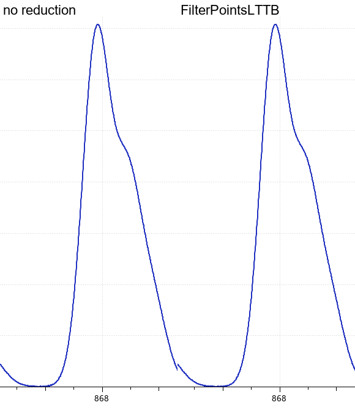
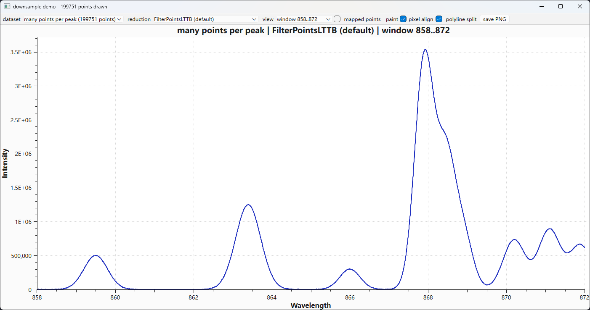

# 曲线像素对齐：为什么点越多反而越"锯齿"，以及该怎么设置

你有一条采样很密的曲线。放大到一个峰，它看起来像用一像素笔画的楼梯，尽管抗锯齿是开着的。换成同一组数据的粗采样版本，曲线却平滑了。问题既不在数据，也不在抗锯齿：Qwt 在光栅器看到曲线之前，就把每个顶点吸附到了设备像素网格上，而密集数据正是这个操作最容易暴露的地方。开关就是 `QwtPainter::setRoundingAlignment()`，`downsample_demo` 示例可以复现这个对比；完整推导与实测数据见技术报告[《曲线管线中的像素吸附》](../../tech-report/point-mapper-rounding.md)。

## 1. 先认症状

下图来自 `examples/2D/downsample_demo`。两个面板是同一数据集（每峰约 20 万点）、同一个谱峰、同一个默认降采样 `FilterPointsLTTB`，唯一区别是全局像素对齐开关：左边保持库默认（开启），右边关闭。画面是最高峰肩部的 3 倍最近邻放大。



左图的斜边以一个像素为单位逐级推进，像楼梯；右图的同一条曲线保留亚像素顶点，边缘由抗锯齿混合像素铺成，斜边连续。

需要记住的对照关系：

| 你看到的 | 实际含义 |
|---|---|
| 斜边由一像素台阶组成，只出现在每列采样很多的曲线上 | 顶点被吸附到像素网格（本篇主题） |
| 整条曲线糊成一片毛刺，看不出线 | 噪声，不是对齐问题——用渲染平滑 |
| 全范围视图正常，放大到峰才出现台阶 | 每列采样密集——正是本篇情形 |
| 只有导出的 PDF/SVG 平滑，屏幕上有台阶 | 同一个原因；导出本来就保留亚像素坐标 |

> **说明 — 这不是抗锯齿失效**
>
> 开关抗锯齿只改变边缘的柔和程度，不改变台阶本身。技术报告的对比图中，四个面板都启用了抗锯齿，带台阶的那几张里依然有混合像素。几何在 Qt 绘制之前就已经被量化了。

## 2. 一段话说清原因

每条 `QwtPlotCurve` 都通过 `QwtPointMapper` 把数据坐标转换成屏幕坐标。全局开关 `QwtPainter::setRoundingAlignment()` 默认打开，打开期间映射器会把每个转换后的顶点四舍五入到最近的设备像素。对于每像素列有多个采样的曲线，取整后的顶点只能以整像素为单位移动，折线于是变成一串水平段与垂直段，形成楼梯。而每列不足一个采样的曲线，列内根本没有顶点可吸附，这就是为什么稀疏数据在完全相同的设置下依然平滑。

这个开关是全局的：它作用于应用中的每条曲线、每个标记、网格和图例图标，而不是单个图项。所以修复方式通常是启动时调用一次，而不是逐条曲线配置。

## 3. 怎么选设置

大多数应用只需要在两种情况之间做选择。

### 3.1 抗锯齿屏幕绘图：关闭对齐

如果绘图是屏幕上的控件、你希望曲线平滑，在启动时把全局对齐关掉一次即可：

```cpp
#include <qwt_painter.h>

int main(int argc, char* argv[])
{
    QApplication app(argc, argv);

    // 保留亚像素顶点坐标：抗锯齿曲线保持平滑
    QwtPainter::setRoundingAlignment(false);

    // ……照常创建绘图与曲线……
    return app.exec();
}
```

其余一切不变。曲线、标记、网格、图例都照常工作，只是不再吸附坐标。非抗锯齿的细线在某些位置可能偏移半个像素或看起来略微柔和一点，这是换取平滑斜边的代价。

### 3.2 像素精确渲染：保持默认开启

如果你刻意要清晰、像素对齐的输出，例如要求每条细线都落在整像素上的工程图，保持默认设置即可：

```cpp
// 库的默认值：顶点吸附到设备像素网格
QwtPainter::setRoundingAlignment(true);
```

当你依赖 `FilterPoints`（去重过滤）时，也应该用这个设置：该过滤器合并映射到同一像素的采样，而不做吸附时几乎没有可合并的重复点。

### 3.3 导出 PDF 或 SVG：不用管

矢量导出本来就保留亚像素坐标；Qwt 会识别 PDF 与 SVG 绘制引擎并为它们跳过对齐。导出前不需要改这个开关，也不应该改：被吸附过的 PDF 会把阶梯带进印刷品。

决策表：

| 你的情况 | 设置 | 原因 |
|---|---|---|
| 屏幕上的抗锯齿绘图 | `setRoundingAlignment(false)` | 亚像素几何才是斜边平滑的来源 |
| 像素精确的细线绘制 | `setRoundingAlignment(true)`（默认） | 顶点落在真实像素上 |
| 用 `FilterPoints` 做去重 | `true`（默认） | 该过滤器按像素合并重复点 |
| PDF / SVG 导出 | 保持原样 | 导出本身忽略对齐 |
| `FilterPointsPixel` | 无关 | 该算法自己做像素分桶 |

## 4. 那降采样算法呢？

点抽稀与像素对齐是两个独立阶段，现代降采样算法并不需要像素对齐。在 100 万点的曲线上实测：使用 `FilterPointsLTTB`、`FilterPointsMinMaxLTTB`、`FilterPointsPixel` 或 `FilterPointsAdaptive` 之后，对齐开关对映射器耗时的影响小于 5%，因为只对选出的几千个顶点取整，而不是对 100 万个输入采样。

因此，密集、平滑、抗锯齿曲线的推荐组合是：

```cpp
QwtPainter::setRoundingAlignment(false);                    // 平滑的几何

QwtPlotCurve* curve = new QwtPlotCurve();
curve->setRenderHint(QwtPlotCurve::RenderAntialiased, true); // 平滑的边缘
curve->setSamples(samples);                                  // 默认就是 LTTB
curve->attach(plot);
```

有两个属性的行为不同，值得单独说明：

- `FilterPointsAggressive` 只在开启对齐时才生效。关闭对齐后，该属性不再做任何抽稀。它已被 `FilterPointsAdaptive` 取代，如果你原本用它，建议迁移。
- `FilterPointsPixel` 完全忽略对齐开关。它的输出是按列的最小/最大值包络，本身就包含水平连接，所以对平滑的密集曲线可能无论怎么设都显得有台阶。平滑数据优先用 `FilterPointsLTTB`（默认）或 `FilterPointsAdaptive`。

## 5. 亲手验证

示例 `examples/2D/downsample_demo` 直接服务于这个对比。它展示两条峰形相同、采样密度不同的谱线（可见窗口内一条约 20 万点，一条约 1.86 万点），并允许你实时切换降采样与两个绘制开关。



工具栏上有这些控件：

- **dataset**：`many points per peak`（每峰点多）或 `few points per peak`（每峰点少）；
- **reduction**：`no reduction`、`FilterPointsLTTB`（默认）、`FilterPointsPixel`、`FilterPointsAdaptive`，以及旧版过滤器；
- **view**：`window 858..872` 是效果最明显的放大峰区；
- **mapped points**：在每个真正被绘制的顶点上画红点，可以直观看到降采样保留了哪些点；
- **pixel align**：切换 `QwtPainter::setRoundingAlignment()`；
- **polyline split**：切换 `QwtPainter::setPolylineSplitting()`（与本现象无关，保留作对比）。

快速看到差异：选择 `many points per peak`、`FilterPointsLTTB`（默认）、`window 858..872`，然后反复点 **pixel align**。开启（默认）时能看到阶梯，关闭后斜边恢复平滑，这正是本篇开头那张对比图的复现方式。把数据集换成 `few points per peak`，同一个开关几乎没有任何变化，因为采样太稀疏，形成不了多顶点列。

批处理模式会把同样的矩阵渲染成 PNG，便于写文档或提交缺陷报告：

```bash
downsample_demo --batch out_default
downsample_demo --batch out_noround --noround
```

两个目录唯一的差别就是全局对齐开关，因此前后对比可复现。

## 6. 对照清单

1. 密集曲线有台阶，而同一数据的粗采样版本平滑？→ 就是这个效应，启动时调用 `QwtPainter::setRoundingAlignment(false)`。
2. 需要旧版 `FilterPointsAggressive`？→ 保持对齐开启，或迁移到 `FilterPointsAdaptive`。
3. 用了 `FilterPointsPixel` 仍有台阶？→ 那是该算法自身的包络，不是对齐开关；改用 `FilterPointsLTTB` 或 `FilterPointsAdaptive`。
4. 要导出 PDF/SVG？→ 无需操作，导出忽略对齐。
5. 想在改代码前先确认？→ `examples/2D/downsample_demo`，切换 **pixel align**。

## 相关示例

| 示例 | 展示内容 |
|---------|---------------|
| `examples/2D/downsample_demo` | 密集与稀疏谱线、全部降采样属性、实时像素对齐开关 |
| `examples/bench/renderbench` | 各降采样算法的耗时基准 |
| `examples/2D/curvesmoothing` | 去除降采样后残留的像素噪声 |

## 深入了解

- 技术报告：[《曲线管线中的像素吸附：`QwtPointMapper::RoundPoints` 与密集曲线阶梯》](../../tech-report/point-mapper-rounding.md)
- 技术报告：[《面向屏幕的曲线降采样：LTTB 理论与 QWT7 的 MinMax 桶》](../../tech-report/curve-downsampling.md)
- 教程：[渲染性能与曲线平滑](rendering-performance.md)
