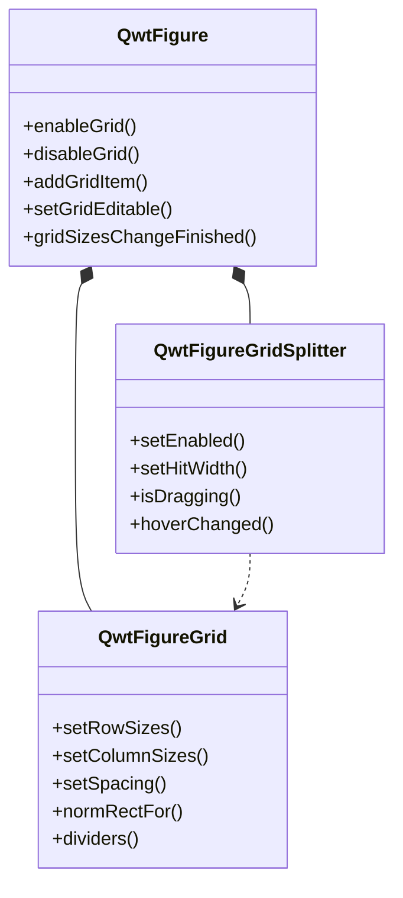
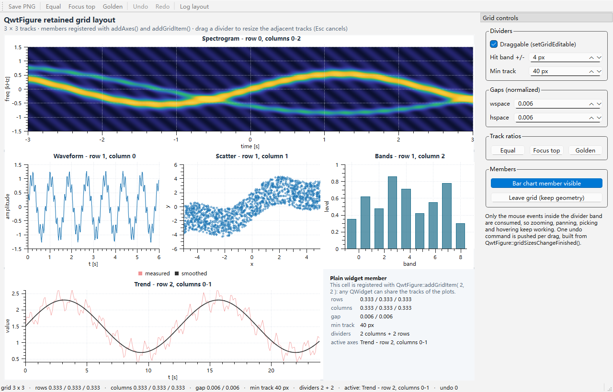
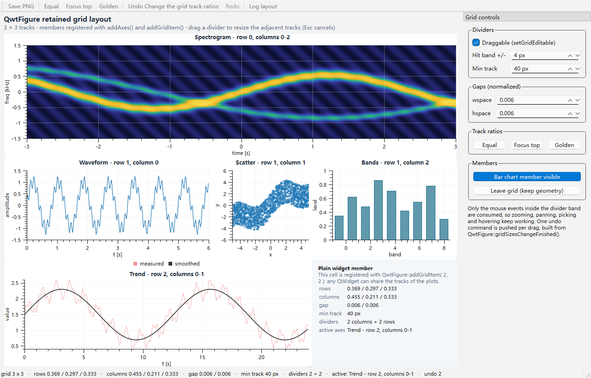
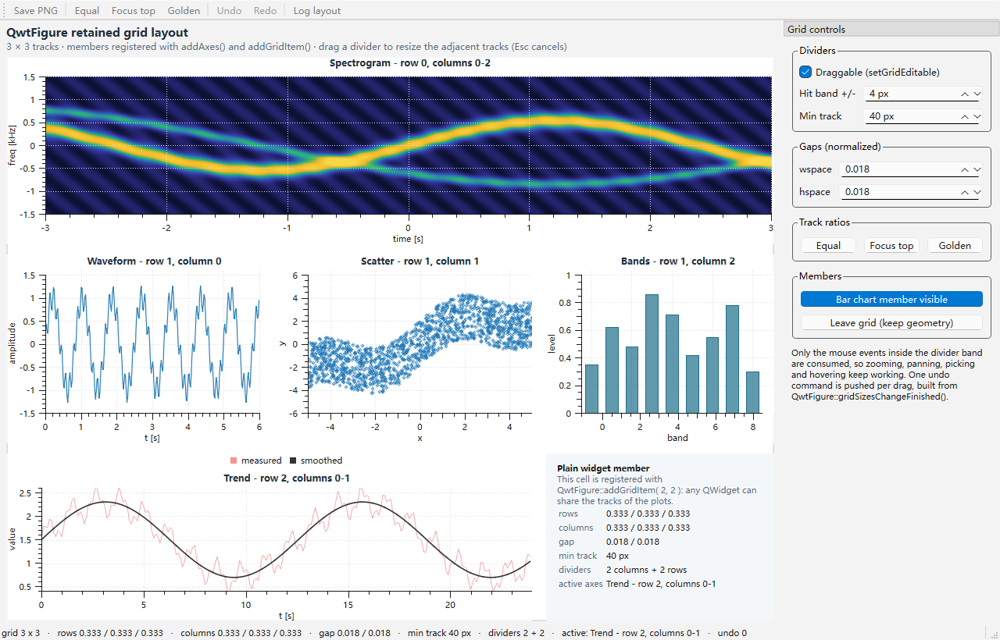
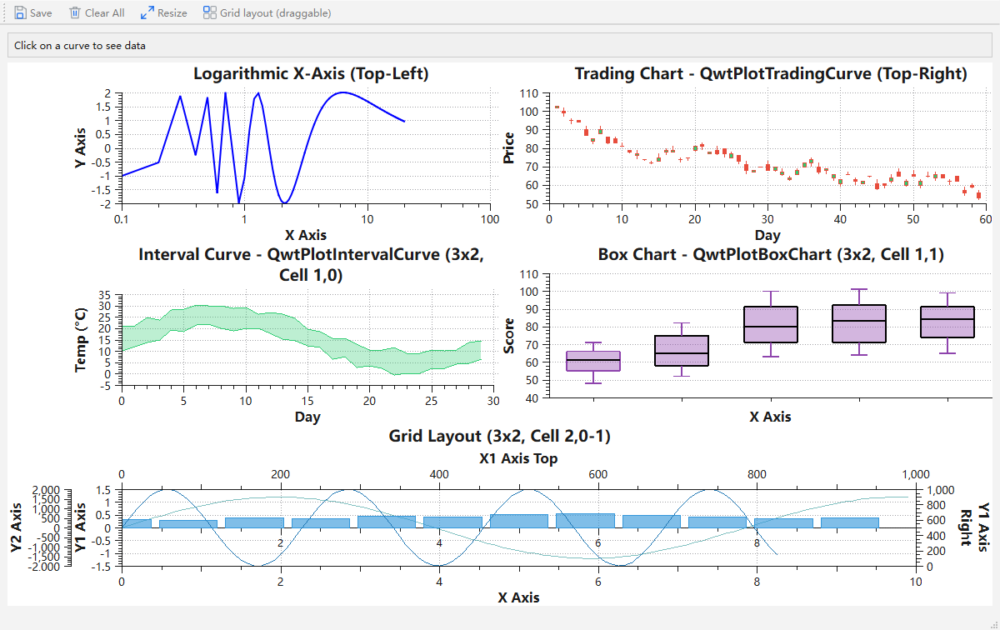
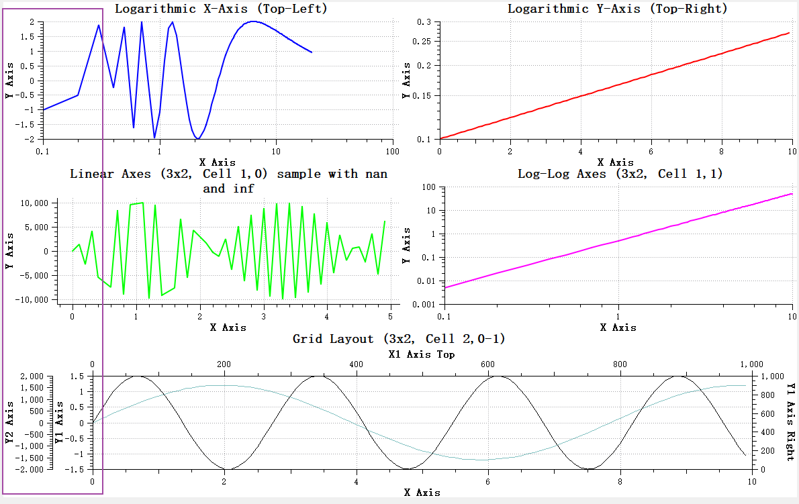
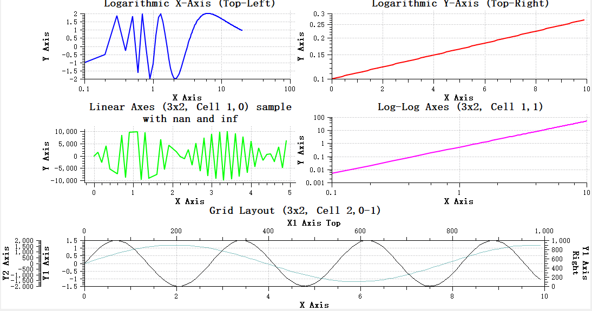
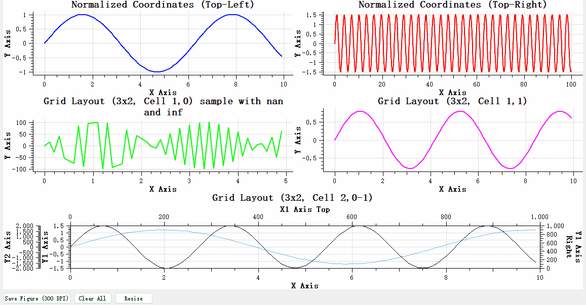

# QwtFigure绘图容器窗口

`QwtFigure`是一个类似 `matplotlib` 的 `Figure` 类的容器，用于组织和管理多个 `QwtPlot` 绘图组件。它提供归一化坐标定位、网格布局和保留式网格布局三种布局方式，支持创建寄生绘图（任意多个x轴和y轴）。

## 主要功能特性

### 1. 支持多种布局方式

- 归一化坐标布局：使用 `[0,1]` 范围内的坐标系统进行相对位置控制
- 网格布局：行列式的网格排列方式，方便创建多图组合
- 保留式网格布局：行列比例以轨道数据保存，可以设置、拖拽分隔条调整、持久化和撤销，缩放窗口后比例不变

### 2. 寄生绘图支持

- 可以为宿主绘图创建共享绘图区域但拥有独立坐标轴的寄生绘图
- 适用于在同一绘图区域内展示不同量级的数据

### 3. 图形导出功能

- 支持将整个图形导出为图片文件或 QPixmap
- 可指定 DPI 进行高分辨率输出

### 4. 外观定制

- 支持自定义背景色、边框颜色和线宽
- 支持复杂背景（渐变、纹理等）

## 使用方法

`QwtFigure`是一个窗口容器，可以进行多个子绘图（`QwtPlot`）布局

### 添加绘图组件

#### 使用归一化坐标添加

归一化坐标就是占`QwtFigure`窗口的百分比

```cpp
QwtPlot* plot = new QwtPlot;
// 添加一个占据图形左上角四分之一的绘图
figure->addAxes(plot, QRectF(0.0, 0.0, 0.5, 0.5));

// 或者使用分离参数形式
figure->addAxes(plot, 0.0, 0.0, 0.5, 0.5);
```

> **警告 — 归一化坐标注意事项**
>
> - 使用 Qt 标准的左上角坐标系
> - 归一化坐标范围为 [0,1]

#### 使用网格布局添加

网格布局参考`matplotlib`中的`subplot`布局方式

```cpp
// 创建一个2x2网格并添加绘图
QwtPlot* topPlot = new QwtPlot;
// 添加一个占据整个顶行（第0行，第0-1列）的绘图
figure->addAxes(topPlot, 2, 2, 0, 0, 1, 2);

// 添加一个到底部左侧单元格（第1行，第0列）的绘图
QwtPlot* bottomLeftPlot = new QwtPlot;
figure->addAxes(bottomLeftPlot, 2, 2, 1, 0);
```

> **说明 — 网格坐标只换算一次**
>
> 这个重载在添加时就把单元格换算成固定的归一化矩形，之后窗口缩放只会按比例缩放这些矩形，行、列的比例无法再改变。需要交互式调整比例时使用下面的保留式网格布局。

### 保留式网格布局

保留式网格（retained grid）把行列轨道比例和成员登记保存为布局的唯一数据源，figure 的每次几何变化都重新从轨道比例算出成员的矩形，而不是在添加时算一次。比例因此成为可以在运行时修改、拖拽、保存和撤销的数据，窗口缩放后依然保持。

这一功能面向需要交互调整布局的多子图界面。信号分析页把时域、频域和瀑布图放在同一套网格里，用户拖动分隔条就能放大某个子图；应用也可以把用户调整后的比例写入配置文件，下次启动时恢复。布局比例、成员登记和交互分属三个类：

| 类 | 职责 |
|----|------|
| `QwtFigure` | 对外入口：启用和退出网格、注册成员、开关分隔条交互、转发模型信号 |
| `QwtFigureGrid` | 轨道模型：行列比例、间隙、最小轨道像素、成员的 `(row, column, rowSpan, columnSpan)` 登记、单元格归一化矩形、分隔条位置 |
| `QwtFigureGridSplitter` | 交互：在分隔条附近的窄带内拦截鼠标事件，只修改相邻两条轨道的比例 |
| `QwtFigureLayout` | 消费方：布局时向模型查询成员的归一化矩形，再换算成像素矩形 |



模型只依赖 Qt，不引用 `QwtFigure` 和 `QwtFigureLayout`，所以轨道计算和 `normRectFor()` 可以脱离界面单独测试。`tests/figure_grid_test`、`tests/figure_grid_layout_test` 和 `tests/figure_grid_splitter_test` 分别覆盖模型、布局集成与交互。

#### 基本用法

启用网格要在添加成员之前完成，`addAxes()` 和非绘图成员用的 `addGridItem()` 都要求网格已经存在：

```cpp
QwtFigure* figure = new QwtFigure;
figure->enableGrid(2, 3);                       // 2 行 3 列，初始比例均等

QwtFigureGrid* grid = figure->grid();           // 轨道模型，enableGrid() 之后有效
grid->setRowSizes(QVector<qreal>() << 0.6 << 0.4);       // 输入会被归一化到和为 1
grid->setColumnSizes(QVector<qreal>() << 0.4 << 0.3 << 0.3);
grid->setSpacing(0.01, 0.01);                   // 单元格之间的间隙，同样是归一化值

figure->addAxes(wavePlot, 0, 0, 1, 2);          // 第 0 行，跨第 0-1 列
figure->addAxes(spectrumPlot, 1, 0);
figure->addAxes(heatmapPlot, 1, 1);

// 任何 QWidget 都可以作为成员，例如 3D 绘图控件或统计面板
figure->addGridItem(statsPanel, 0, 2, 2, 1);    // 第 2 列，跨两行

figure->setGridEditable(true);                  // 分隔条可拖动
```

`addAxes()` 会依次发出 `axesAdded()` 和 `currentAxesChanged()`，`addGridItem()` 不涉及坐标轴信号。再次调用 `enableGrid()` 会按新的行列数重建轨道、把比例复位为均等并清空成员登记，成员需要重新添加。

完整的演示位于 `examples/2D/figureGrid`：3×3 网格上有六个成员，包括一个跨三列的频谱图、三个单格绘图、一个跨两列的趋势图和一个用 `addGridItem()` 登记的普通控件；窗口右侧的面板集中了比例预设、间隙、最小轨道像素、命中宽度、撤销和成员增删，截图如下：



截图中的子图标题标注了各自的单元格位置。右侧的 wspace、hspace 与底部状态栏显示的是模型当前的归一化比例，拖动分隔条后这些数值同步更新。

#### 轨道比例、间隙与最小轨道

轨道是行、列各自独立的一维比例数组。所有输入都会按数组内的比例归一化到和为 1，调用方传入的数组不会被修改。

| 方法 | 说明 |
|------|------|
| `setup(int rowCount, int columnCount)` | 建立轨道，比例复位为 `1/rowCount` 和 `1/columnCount` |
| `rowCount()` / `columnCount()` | 轨道数量，网格禁用时为 0 |
| `rowSizes()` / `columnSizes()` | 当前归一化比例，和恒为 1 |
| `setRowSizes(sizes)` / `setColumnSizes(sizes)` | 设置比例。向量长度必须等于轨道数、元素必须为有限正数，否则打印警告并保持原值 |
| `setSpacing(wspace, hspace)` | 轨道间隙，归一化。`(trackCount - 1) * gap >= 1` 的请求会被拒绝，避免最后一条轨道被压成 0 |
| `wspace()` / `hspace()` | 读取当前间隙，用于持久化 |
| `setMinimumTrackPixels(px)` | 拖动时一条轨道的最小像素宽度，默认 40 |
| `normRectFor(row, col, rowSpan, colSpan)` | 单元格的归一化矩形 |
| `dividers()` | 当前可拖动的分隔条列表，包含方向、轨道索引和归一化位置 |

`normRectFor()` 按累计和计算矩形：left 是第 0 列到第 col-1 列的比例之和再加 col 个间隙，width 是第 col 列到第 col+colSpan-1 列的比例之和再加 colSpan-1 个间隙；行方向同理。结果会被夹到 `[0,1]`，因此间隙较大时最后一条轨道会被收窄，这是把矩形限制在 figure 内部的必然结果。

需要保存布局时直接读取模型，恢复时把间隙和比例分开设置，输入会被重新归一化：

```cpp
// 读取：比例与间隙都是归一化值
QVector<qreal> rows = grid->rowSizes();
QVector<qreal> columns = grid->columnSizes();
saveGridSettings(rows, columns, grid->wspace(), grid->hspace());   // 应用自己实现

// 恢复：先间隙、再比例，最后登记成员
grid->setSpacing(loadWSpace(), loadHSpace());
grid->setRowSizes(loadRows());
grid->setColumnSizes(loadColumns());
```

#### 拖动分隔条调整比例

`setGridEditable(true)` 会创建 `QwtFigureGridSplitter`（挂在 figure 下，由 figure 销毁），并在 figure 和覆盖单元格的控件上安装事件过滤器。只有落在分隔条附近窄带内的事件会被拦截，其余事件原样放行，缩放、平移、拾取和悬停照常工作：

- 鼠标距分隔条中心不超过 `QwtFigureGridSplitter::setHitWidth()` 像素（默认 4）时命中。两列之间的分隔条是竖线，光标为 `Qt::SplitHCursor`；两行之间的分隔条是横线，光标为 `Qt::SplitVCursor`。光标设置在鼠标实际所在的控件上（通常是画布），画布自身带有显式光标时也能显示，离开分隔带时还原该控件原来的光标
- 拖动只改变相邻两条轨道的比例，两条轨道的比例和保持不变，并受 `minimumTrackPixels()` 约束，任何一条轨道都不会被压到 0，轨道之间也不会重叠
- 拖动期间成员控件停止重绘，松手后恢复重绘并重绘整个 figure。每次鼠标移动只做一次同步布局，不会重复整图布局
- 拖动中按 `Esc` 恢复原始比例，且不发出完成信号。鼠标抓取丢失（`QEvent::UngrabMouse`，例如弹出菜单）或窗口失活时按同样方式取消，成员的重绘随即恢复
- 拖动开始时 figure 会抓取鼠标和键盘，松手事件总能回到分隔条，即使宿主在 canvas 上后装的过滤器消费了 move、release 事件
- Qt 按安装的相反顺序调用事件过滤器（后装的先调用）。宿主自己的 canvas 过滤器（拾取器、拖动处理器等）应在 `setGridEditable(true)` 之前安装；若之后才安装，再调用一次 `setGridEditable(true)` 即可，对已启用的分隔条再次启用会重新扫描并重装过滤器
- `QOpenGLWidget` 成员（3D 绘图）不会被拦截，3D 单元格的边界由相邻的 2D 绘图一侧负责命中。寄生绘图对鼠标事件透明，边界同样由宿主绘图负责

下面是 `examples/2D/figureGrid` 中拖动列分隔条和行分隔条之后的截图。第一列与第一行被放大，状态栏显示新的比例和两次撤销步骤：



`setGridEditable(true)` 要求网格已经启用，否则只打印警告，`isGridEditable()` 保持 false。`QwtFigure` 不提供取分隔条指针的接口；需要调整命中宽度或连接 `hoverChanged()` 时，在首次 `setGridEditable(true)` 之后用 `figure->findChild<QwtFigureGridSplitter*>()` 取得。

#### 撤销与实时预览

拖动过程中的中间状态通过 `sizesChanged()` 连续发出，适合做实时预览；一次交互结束时 `sizesChangeFinished()` 只发出一次，且只在比例确实变化时发出。接到 `QUndoStack` 上，整次拖动对应一条撤销命令：

```cpp
// 一条命令保存拖动前后的比例
class GridRatiosCommand : public QUndoCommand
{
public:
    GridRatiosCommand(QwtFigureGrid* grid, const QVector<qreal>& rows, const QVector<qreal>& columns,
                      const QVector<qreal>& oldRows, const QVector<qreal>& oldColumns)
        : m_grid(grid), m_rows(rows), m_columns(columns), m_oldRows(oldRows), m_oldColumns(oldColumns)
    {
    }

    void redo() override { m_grid->setRowSizes(m_rows); m_grid->setColumnSizes(m_columns); }
    void undo() override { m_grid->setRowSizes(m_oldRows); m_grid->setColumnSizes(m_oldColumns); }

private:
    QwtFigureGrid* m_grid;
    QVector<qreal> m_rows, m_columns, m_oldRows, m_oldColumns;
};

// 连接：一次拖动只压入一条命令
QObject::connect(grid, &QwtFigureGrid::sizesChangeFinished, figure,
                 [grid, undoStack, committedRows, committedColumns]() mutable {
                     const QVector<qreal> rows = grid->rowSizes();
                     const QVector<qreal> columns = grid->columnSizes();
                     if (rows == committedRows && columns == committedColumns) {
                         return;                  // 比例没有变化，不产生撤销步骤
                     }
                     undoStack->push(new GridRatiosCommand(grid, rows, columns, committedRows, committedColumns));
                     committedRows = rows;
                     committedColumns = columns;
                 });
```

`QwtFigure` 把两个信号转发为 `gridSizesChanged()` 和 `gridSizesChangeFinished()`，宿主也可以直接连接 figure 上的这两个信号，不必持有 `QwtFigureGrid` 指针。

#### 退出网格并保留几何

`disableGrid()` 把网格成员按当前屏幕上的几何换算成独立的归一化矩形，然后清空轨道和成员登记，子图停在原位置、尺寸不变。隐藏的成员按其单元格换算，避免使用过期的像素几何：

```cpp
// 退出网格：成员停在当前几何，成为普通归一化坐标成员
if (figure->disableGrid()) {
    // 之后可以继续用 setWidgetNormPos() 或操作蒙版调整
}

// 重新启用：轨道从均等开始，成员需要重新登记
figure->enableGrid(3, 3);
figure->grid()->setRowSizes(savedRows);          // 比例要自己保存
figure->addAxes(wavePlot, 0, 0, 1, 3);
figure->setGridEditable(true);                   // 分隔条交互同样要重新开启
```

退出网格不可逆：轨道比例、间隙和成员登记都会被丢弃，`isGridEnabled()` 随即返回 false，分隔条交互被关闭。重新启用网格后要再次调用 `setGridEditable(true)`，并重新登记成员。`examples/2D/figureGrid` 的「Leave grid (keep geometry)」按钮演示了退出与重新登记的完整流程。

#### 示例程序

`examples/2D/figureGrid` 是保留式网格的完整示例，核心代码如下：

```cpp
figure->enableGrid(3, 3);
figure->grid()->setSpacing(0.006, 0.006);

figure->addAxes(spectrumPlot, 0, 0, 1, 3);       // 第 0 行，跨三列
figure->addAxes(wavePlot, 1, 0);
figure->addAxes(scatterPlot, 1, 1);
figure->addAxes(barPlot, 1, 2);
figure->addAxes(trendPlot, 2, 0, 1, 2);          // 第 2 行，跨两列
figure->addGridItem(notesPanel, 2, 2);           // 普通控件成员

figure->setGridEditable(true);
```

工具栏提供 Equal、Focus top、Golden 三组比例预设和撤销、重做动作，右侧面板可以修改间隙、最小轨道像素与分隔条命中宽度，可以移除或重新添加成员，也可以退出或重新进入网格。下面是把间隙调大后的截图，单元格之间露出 figure 的背景色：



例子支持文档截图协议：`--variant drag` 用合成鼠标事件拖动两条分隔条，`--variant spacing` 切换到大间隙状态，对应 `examples/screenshots-manifest.json` 中的三条记录。重新生成截图的方式见 `examples/SCREENSHOTS.md`。

> **警告 — 分隔条与操作蒙版互斥**
>
> `QwtFigureGridSplitter` 依赖鼠标事件到达子绘图，`QwtFigureWidgetOverlay` 覆盖整个 figure 并吃掉子控件的事件，两者同时启用时分隔条收不到事件。网格可编辑时应关闭蒙版的 `FunResizePlot` 模式，或把蒙版设为对鼠标事件透明。

> **警告 — 成员控件的生命周期由调用方负责**
>
> `removeWidget()` 和 `disableGrid()` 都不会删除成员。移除的控件会被隐藏并解除父子关系（`setParent(nullptr)`），调用方要保证它的生命周期，重新添加时再交回 figure。

### 当前激活子图

在子绘图上按下鼠标即把该绘图设为 figure 的当前激活子图：`currentAxes()` 返回它并发出 `currentAxesChanged()`。真实的点击投递给绘图的 canvas，因此点击画布（以及绘图边框区域）都能激活。按下事件不会被消费，缩放、平移、拾取照常工作；再次点击已激活的绘图不会重复发信号。点击寄生绘图会激活其宿主绘图。

> **注意 — 画布替换**
>
> 激活过滤器装在添加绘图时该绘图所使用的画布上。之后替换画布（`QwtPlot::setCanvas()`）会使点击画布不再激活，仅点击绘图边框仍有效；重新添加绘图可恢复画布激活。

### 设置图形外观

图形的整体外观由 `QwtFigure` 的四个方法控制：`setFaceColor()` 用纯色填充背景，`setFaceBrush()` 接受任意 `QBrush`（例如用 `QLinearGradient` 做渐变背景），`setEdgeColor()` 与 `setEdgeLineWidth()` 则负责绘制边框：

```cpp
// 设置背景颜色
figure->setFaceColor(Qt::lightGray);

// 设置渐变背景
QLinearGradient gradient(0, 0, 0, 1);
gradient.setColorAt(0, Qt::white);
gradient.setColorAt(1, Qt::lightGray);
figure->setFaceBrush(QBrush(gradient));

// 设置边框
figure->setEdgeColor(Qt::black);
figure->setEdgeLineWidth(2);
```

### 寄生绘图使用

寄生绘图（parasite axes命名参考`matplotlib`）可以创建多个具有独立坐标轴的绘图，适用于在同一绘图区域内展示不同量级或单位数据。常用双y轴，多y轴等特殊的绘图场景

寄生绘图创建示例代码如下：

```cpp
// 创建宿主绘图
QwtPlot* hostPlot = new QwtPlot(figure);
figure->addAxes(hostPlot, 0.1, 0.1, 0.8, 0.8);

// 创建寄生绘图，默认显示在YRight轴并
QwtPlot* parasiteYRight = figure->createParasiteAxes(hostPlot, QwtAxis::YRight);

// 分别设置轴标题
hostPlot->setAxisTitle(QwtAxis::YLeft, "Primary Y");
parasiteYRight->setAxisTitle(QwtAxis::YRight, "Secondary Y");
```

> **警告 — 寄生绘图注意事项**
>
> - 寄生绘图不能作为当前激活的坐标轴
> - 寄生绘图会随着宿主轴的移除而被自动隐藏
> - 如果宿主绘图销毁，寄生绘图会跟随销毁

寄生绘图的详细使用方法请参考：[寄生绘图](parasite-axes.md)

下面是使用QwtFigure的较为完整的演示：

```cpp
// 创建 QwtFigure
QwtFigure* figure = new QwtFigure();
figure->setSizeInches(8, 6);      // 设置图形尺寸为8x6英寸
figure->setFaceColor(Qt::white);  // 设置背景颜色

// 示例1: 使用归一化坐标添加绘图
QwtPlot* plot1       = new QwtPlot();
...
figure->addAxes(plot1, 0.0, 0.0, 0.5, 0.3333333);  // 左上角

QwtPlot* plot2       = new QwtPlot();
...
figure->addAxes(plot2, 0.5, 0.0, 0.5, 0.33333333);  // 右上角

// 示例2: 使用网格布局添加绘图
QwtPlot* plot3       = new QwtPlot();
...
figure->addGridAxes(plot3, 3, 2, 1, 0);  // 3x2网格，第1行第0列（0base）

QwtPlot* plot4       = new QwtPlot();
...
figure->addGridAxes(plot4, 3, 2, 1, 1);  // 2x2网格，第1行第1列（0base）

// 示例3: 多坐标轴创建
//! 创建宿主绘图
QwtPlot* hostPlot = new QwtPlot();
hostPlot->setCanvasBackground(Qt::white);
...
//! 把主绘图添加到figure中
figure->addGridAxes(hostPlot, 3, 2, 2, 0, 1, 2);  // 3x2网格，第2行第0列，跨2列

//! 添加宿主坐标系
QwtPlot* parasitePlot = hostPlot->createParasiteAxes(QwtAxis::YLeft);
//! 宿主坐标轴的其他设置
```

上面例子的效果如下图：



### 图形导出

`QwtFigure` 通过 `saveFig()` 把整幅图形渲染成图片：一个重载按指定 DPI 直接写入图片文件（如 300 DPI 的打印级输出），另一个重载返回 `QPixmap`，便于后续加工或嵌入其他界面：

```cpp
// 保存为图片文件
figure->saveFig("figure.png", 300); // 300 DPI

// 获取 QPixmap
QPixmap pixmap = figure->saveFig(300);
```

### 坐标轴对齐

figure绘图窗口提供坐标轴对齐功能，子绘图刻度值如果差异较大，刻度是不对齐的，如下图所示：



这时，可以通过`QwtFigure::addAxisAlignment`函数指定坐标轴对齐

例如上面的例子，通过下面进行坐标轴对齐

```cpp
figure->addAxisAlignment({ plot1, plot3, hostPlot }, QwtAxis::YLeft);
figure->addAxisAlignment({ plot2, plot4 }, QwtAxis::YLeft);
```

上面的代码代表`plot1`, `plot3`, `hostPlot`这三个绘图的左坐标轴对齐。`plot2`, `plot4`这两个绘图的左坐标轴对齐

运行结果如下图：



> **警告 — 坐标轴对齐注意事项**
>
> 只有可显示的坐标轴才可以对齐，如果坐标轴不显示，是无法对齐的，例如上面例子的`plot2`, `plot4`和`hostPlot`的右坐标轴就无法对齐，因为`plot2`, `plot4`的坐标轴窗口不可见

## figure操作蒙版

`QwtFigureWidgetOverlay`是一个专门针对`QwtFigure`设计的操作蒙版类，它继承自`QwtWidgetOverlay`。这个类提供了在运行时对 `QwtFigure` 中的子绘图组件进行交互式操作的功能，包括调整绘图组件的大小和选择当前激活的绘图。

### 主要功能

1. 用户可以通过鼠标拖拽来调整 `QwtFigure` 中子绘图组件的尺寸和位置
2. 支持通过鼠标点击或键盘快捷键来选择当前激活的绘图组件
3. 操作过程中显示边框、控制点和尺寸信息作为视觉反馈

可以通过 `BuiltInFunctionsFlag` 枚举来控制蒙版的不同功能：

```cpp
enum BuiltInFunctionsFlag
{
    FunSelectCurrentPlot = 1,  // 选择当前绘图功能
    FunResizePlot        = 2   // 调整绘图大小功能
};
```

使用 `setBuiltInFunctionsEnable()` 方法可以动态启用或禁用这些功能。

蒙版提供了下面这些方法来自定义其外观：

- `setBorderPen()` - 设置边框画笔
- `setControlPointBrush()` - 设置控制点填充
- `setControlPointSize()` - 设置控制点尺寸
- `showPercentText()` - 控制是否显示尺寸百分比文本

### 使用方法

要使用 `QwtFigureWidgetOverlay`，只需创建其实例并将其附加到目标 `QwtFigure` 上：

```cpp
QwtFigure* figure = new QwtFigure();
// ... 添加一些绘图组件到figure ...

// 创建并显示操作蒙版
QwtFigureWidgetOverlay* overlay = new QwtFigureWidgetOverlay(figure);
overlay->show();
```

其效果如下图所示：



可以根据需要启用或禁用特定功能：

```cpp
// 禁用尺寸调整功能，只保留选择功能
overlay->setBuiltInFunctionsEnable(QwtFigureWidgetOverlay::FunResizePlot, false);

// 或者禁用选择功能，只保留尺寸调整功能
overlay->setBuiltInFunctionsEnable(QwtFigureWidgetOverlay::FunSelectCurrentPlot, false);
```

可以自定义蒙版的外观以匹配应用程序的整体风格：

```cpp
// 设置边框颜色和样式
overlay->setBorderPen(QPen(Qt::red, 2, Qt::DashLine));

// 设置控制点的颜色和样式
overlay->setControlPointBrush(QBrush(Qt::green));

// 设置控制点大小
overlay->setControlPointSize(QSize(10, 10));

// 隐藏百分比文本显示
overlay->showPercentText(false);
```

`QwtFigureWidgetOverlay` 提供了几个有用的信号来响应用户操作：

- `widgetNormGeometryChanged()` - 当绘图组件的归一化几何尺寸发生变化时发出
- `activeWidgetChanged()` - 当前激活的组件发生变化时发出

该蒙版是 `QwtFigure` 的交互编辑层。

> **示例 — 寄生绘图示例**
>
> 完整的示例代码可参阅`examples/2D/figure`