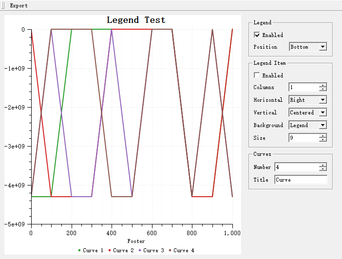

# 图例控件 - QwtLegend

`QwtLegend` 是绘图图例的显示控件，用于展示各绘图项的标题和图标。通过图例，用户可以识别不同曲线或数据系列的含义。

## 主要功能特性

**特性**

- ✅ **自动图例项生成**：根据绘图项自动生成图例条目
- ✅ **交互式图例**：支持点击图例项隐藏/显示对应绘图项（需通过 `setDefaultItemMode()` 开启）
- ✅ **灵活布局**：支持多种图例布局方式
- ✅ **样式自定义**：可自定义图例项的图标和文字样式

## 基本概念

### 图例位置

QwtPlot 支持四种图例位置：

| 位置 | 枚举值 | 说明 |
|------|--------|------|
| 左侧 | `LeftLegend` | YLeft轴左侧 |
| 右侧 | `RightLegend` | YRight轴右侧 |
| 底部 | `BottomLegend` | 绘图底部 |
| 顶部 | `TopLegend` | 绘图顶部 |

### 图例项组成

每个图例项由一个小图标和绘图项标题组成，图标根据该项的线条、符号或填充样式渲染。下面的示意图给出一个典型图例的组成：

```text
┌───────────────────────┐
│  [图标]  曲线标题      │  ← 图例项
│  ────  数据曲线A      │
│  ▬▬▬  数据曲线B      │
│  ○○○  散点数据        │
└───────────────────────┘
```

## 使用方法

图例演示的例子位于:`examples/2D/legends`，例子截图如下：



### 1. 插入图例

图例以 `QwtLegend` 控件的形式创建，再通过 `QwtPlot::insertLegend()` 交给绘图；第二个参数从四个 `QwtPlot::LegendPosition` 值（`LeftLegend`、`RightLegend`、`BottomLegend`、`TopLegend`，默认 `RightLegend`）中选择。下面的例子在右侧插入图例：

```cpp
#include <QwtPlot>
#include <QwtLegend>

QwtPlot* plot = new QwtPlot();

// 创建图例并插入
QwtLegend* legend = new QwtLegend();
plot->insertLegend(legend, QwtPlot::RightLegend);  // 右侧图例

// 其他位置选项：
// QwtPlot::LeftLegend   - 左侧
// QwtPlot::BottomLegend - 底部
// QwtPlot::TopLegend    - 顶部
```

### 2. 图例交互

图例项默认是只读的（`QwtLegendData::ReadOnly`）。交互通过 `QwtLegend::setDefaultItemMode()` 开启；`Checkable` 模式的图例会发出 `checked()` 信号，通常连接到槽里，用 `QwtPlot::infoToItem()` 切换对应绘图项的可见性：

```cpp
#include <QwtLegendData>

// 让图例条目可勾选（模式：ReadOnly、Clickable、Checkable）
legend->setDefaultItemMode(QwtLegendData::Checkable);

// 勾选/取消勾选时切换对应绘图项的显示状态
QObject::connect(legend, &QwtLegend::checked, plot,
    [plot](const QVariant& itemInfo, bool on, int) {
        if (QwtPlotItem* plotItem = plot->infoToItem(itemInfo))
            plotItem->setVisible(on);
    });

// Clickable 模式则发出 clicked(itemInfo, index) 信号，
// 具体响应完全由应用程序决定。
```

### 3. 设置图例位置和比例

图例占比决定图例可以占用绘图宽度或高度的比例。它既可作为 `insertLegend()` 的第三个参数直接传入，也可以事后通过 `QwtPlotLayout::setLegendPosition()` 与 `setLegendRatio()` 调整。下面的例子先为右侧图例保留 20% 宽度，再把它移到底部并占 15%：

```cpp
// 设置图例位置和占比
plot->insertLegend(legend, QwtPlot::RightLegend, 0.2);  // 右侧，占20%宽度

// 通过布局调整
QwtPlotLayout* layout = plot->plotLayout();
layout->setLegendPosition(QwtPlot::BottomLegend);
layout->setLegendRatio(0.15);  // 图例占15%
```

### 4. 图例样式配置

`QwtLegend` 是普通的 Qt 控件，可以用 `setFont()` 设置字体、用样式表设置背景与边框。单个图例条目是位于 `contentsWidget()` 内的 `QwtLegendLabel` 控件（`QwtTextLabel` 子类），可以通过 `legendWidget()`/`legendWidgets()` 按绘图项查找，也可以批量定制。下面的例子演示这三个层面的定制：

```cpp
#include <QwtLegendLabel>

// 设置图例字体
legend->setFont(QFont("Arial", 9));

// 设置图例背景
legend->setStyleSheet("background-color: white; border: 1px solid gray;");

// 设置图例项样式：条目都是 contentsWidget() 的子控件
const QList<QwtLegendLabel*> labels =
    legend->contentsWidget()->findChildren<QwtLegendLabel*>();
for (QwtLegendLabel* label : labels)
    label->setFont(QFont("Arial", 10));

// 单个条目可以通过对应绘图项的 item info 查找
//（curve 为任意挂载到 plot 上的 QwtPlotItem）
QwtLegendLabel* label = qobject_cast<QwtLegendLabel*>(
    legend->legendWidget(plot->itemToInfo(curve)));
```

### 5. 绘图项的图例属性

控制绘图项在图例中的显示样式：

```cpp
#include <QwtPlotCurve>

QwtPlotCurve* curve = new QwtPlotCurve("曲线A");

// 设置图例属性
curve->setLegendAttribute(QwtPlotCurve::LegendShowLine, true);    // 显示线条图标
curve->setLegendAttribute(QwtPlotCurve::LegendShowSymbol, true);  // 显示符号图标
curve->setLegendAttribute(QwtPlotCurve::LegendShowBrush, true);   // 显示填充图标

// 设置图例图标大小
curve->setLegendIconSize(QSize(20, 15));
```

### 6. 自定义图例图标

图例图标由虚方法 `QwtPlotItem::legendIcon()` 生成，派生类可以重写它绘制完全自定义的图标；图标尺寸则通过 `setLegendIconSize()` 控制。下面的代码设置了更大的图标尺寸，并指出自定义绘制的切入点：

```cpp
// 完全自定义图例图标
curve->setLegendIconSize(QSize(30, 20));

// 图例图标由QwtPlotItem::legendIcon()方法生成
// 可以在派生类中重写此方法实现自定义图标
```

### 7. 外部图例控件

图例可以放在绘图外部。QwtPlot 没有专门的“连接外部图例”方法——把绘图的 `legendDataChanged()` 信号连到外部 `QwtLegend` 的 `updateLegend()` 槽，再用 `QwtPlot::updateLegend()` 填充当前绘图项即可：

```cpp
// 创建外部图例
QwtLegend* externalLegend = new QwtLegend(parentWidget);

// 将绘图的 legendDataChanged() 信号连接到外部图例的 updateLegend() 槽
QObject::connect(plot, &QwtPlot::legendDataChanged,
    externalLegend, &QwtLegend::updateLegend);

// 用当前绘图项填充新图例
plot->updateLegend();

externalLegend->show();

// 图例会自动更新，但不会占用绘图空间
```

### 8. 内嵌图例项

使用 `QwtPlotLegendItem` 在画布内显示图例。位置通过 `setAlignmentInCanvas()` 用标准 `Qt::Alignment` 标志选择：

```cpp
#include <QwtPlotLegendItem>

// 创建内嵌图例（绘制在画布上）
QwtPlotLegendItem* legendItem = new QwtPlotLegendItem();
legendItem->attach(plot);

// 在画布内对齐（此处为右上角）
legendItem->setAlignmentInCanvas(Qt::AlignRight | Qt::AlignTop);
// 其他组合：Qt::AlignLeft|Qt::AlignTop（左上）、
// Qt::AlignLeft|Qt::AlignBottom、Qt::AlignRight|Qt::AlignBottom 等

// 可选：与画布边框的像素偏移
legendItem->setOffsetInCanvas(Qt::Horizontal | Qt::Vertical, 10);

// 设置背景
legendItem->setBackgroundBrush(QBrush(Qt::white));

// 设置边框
legendItem->setBorderPen(QPen(Qt::gray, 1));

// 设置最大列数
legendItem->setMaxColumns(1);
```

## 核心方法总结

### QwtPlot图例方法

| 方法 | 说明 |
|------|------|
| `insertLegend()` | 插入图例（位置与占比作为参数） |
| `legend()` | 返回当前图例 |
| `legendDataChanged()` | 用于驱动外部图例的信号 |
| `updateLegend()` | 发出所有绘图项的图例数据 |
| `itemToInfo()` / `infoToItem()` | 绘图项与图例 item info 的相互转换 |

### QwtLegend方法

| 方法 | 说明 |
|------|------|
| `setDefaultItemMode()` | 设置交互模式（`QwtLegendData::ReadOnly`/`Clickable`/`Checkable`） |
| `setMaxColumns()` | 设置最大列数 |
| `legendWidget()` / `legendWidgets()` | 返回某绘图项对应的条目控件 |
| `itemInfo()` | 返回条目控件对应的 item info |
| `contentsWidget()` | 返回容纳所有条目的控件 |
| `clicked()` / `checked()` | 交互信号 |

### QwtPlotItem图例方法

| 方法 | 说明 |
|------|------|
| `setItemAttribute()` | 在图例中显示/隐藏该项（`QwtPlotItem::Legend`） |
| `setLegendIconSize()` | 设置图标大小 |
| `legendIcon()` | 返回图例图标（派生类可重写） |
| `setTitle()` | 设置标题（图例文字） |

> **说明** `setLegendAttribute()`（`LegendShowLine`/`LegendShowSymbol`/`LegendShowBrush`）是 `QwtPlotCurve` 的方法，控制曲线如何渲染自己的图例图标。

> **提示 — 图例使用建议**
>
> - 少量曲线（<5条）：右侧图例
> - 多量曲线（5-10条）：底部图例
> - 大量曲线（>10条）：考虑使用内嵌图例或分组显示

> **示例 — 相关示例**
>
> - 图例演示：`examples/2D/legends`