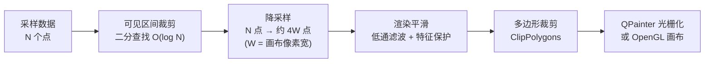

# 渲染性能与曲线平滑

当曲线只有几千个点时，怎么画都很快；当数据涨到几十万、上百万点，或者要以每秒几十帧的速度滚动刷新时，卡顿、毛刺、拖影就会一个个冒出来。这篇教程带你走一遍 QWT 的渲染性能优化路线：**从理解渲染管线开始，依次打开降采样、渲染平滑、硬件加速、实时绘制四件武器**，最后给出一份可直接对照的调优清单。

好消息是：QWT 7 的默认配置已经替你做了最重要的优化（降采样默认开启），多数应用不需要任何设置。这篇教程告诉你**默认行为是什么、什么时候需要更进一步、每一步怎么做**。

**本教程将覆盖**

- ✅ **渲染管线**：一条曲线从数据到像素经历了哪几步，每一步的开关在哪里
- ✅ **降采样**：百万点曲线如何在一帧内画完，四种过滤属性怎么选
- ✅ **渲染平滑**：去掉降采样后残留的像素级噪声，且不削矮峰值
- ✅ **硬件加速**：OpenGL 画布的适用场景
- ✅ **实时绘制**：示波器/监控类应用的增量绘制与交互工具选择
- ✅ **数据侧配合**：什么样的数据容器能触发最快的渲染路径

> 想深入了解算法原理与实验数据，本教程每一步都链接了对应的[技术报告](../../../tech-report/index.md)。

## 优化清单（先看结论）

赶时间的话，直接按这张表对号入座：

| 症状 | 手段 | 章节 |
|------|------|------|
| 大数据量曲线重绘慢、拖动卡 | 确认 `FilterPointsLTTB` 开启（默认已开）；必要时换 `FilterPointsPixel` | [第 2 节](#2-降采样驯服百万点曲线) |
| 曲线画出来像一条"噪声带" | 开启渲染平滑 `setSmoothAlgorithm()` | [第 3 节](#3-渲染平滑去掉像素级噪声) |
| 平滑后担心峰被削矮 | 保持默认的特征保护阈值 `setSmoothPreserveThreshold(3.0)` | [第 3 节](#3-渲染平滑去掉像素级噪声) |
| 曲线极多、重绘仍是瓶颈 | 换 OpenGL 画布 `QwtPlotOpenGLCanvas` | [第 4 节](#4-硬件加速opengl-画布) |
| 高频追加数据（示波器类） | `QwtPlotDirectPainter` 增量绘制，避免整图 replot | [第 5 节](#5-实时更新与交互) |
| 平移大场景时拖影/卡顿 | 在实时平移 `QwtPlotPanner` 与缓存平移 `QwtPlotCachePanner` 之间切换 | [第 5 节](#5-实时更新与交互) |
| 想榨干最后一滴性能 | 用原始指针数据源（`setRawSamples`）触发 SIMD 快路径；保证 x 单调 | [第 6 节](#6-数据侧配合) |

## 1. 理解渲染管线

优化的前提是知道时间花在哪里。一条 `QwtPlotCurve` 从数据到像素要经过这样几步：



每一步都有明确的职责与开关：

- **可见区间裁剪**：画布外的点根本不会参与绘制。前提是数据按 x 单调排列——单调时只需两次二分查找；乱序数据则退化为全量扫描；
- **降采样**：把可见的 N 个点压缩到约 4W 个（W 是画布像素列数）。这是大数据量场景**收益最大**的一步，由 `PaintAttribute` 控制（第 2 节）；
- **渲染平滑**：对降采样后的折线做低通滤波，去掉像素级毛刺，由 `setSmoothAlgorithm()` 控制（第 3 节）；
- **多边形裁剪与光栅化**：默认走 QPainter 软件光栅化；可整体切换到 OpenGL 画布（第 4 节）。

关键认知：**屏幕只有那么多像素**。一块 900 像素宽的画布最多表现 900 列像素，一百万个点里绝大多数落在相同的像素列上——把它们全部交给光栅化器纯属浪费。降采样就是"在画得出来的精度内，只画必要的点"。

## 2. 降采样：驯服百万点曲线

### 默认行为：什么都不用做

QWT 7 的 `QwtPlotCurve` **默认开启** `ClipPolygons | FilterPointsLTTB` 两个绘制属性。`FilterPointsLTTB` 使用"MinMax 桶"算法：把可见数据按索引分成约 2W 个桶，每个桶保留最小值和最大值两个点。这样一百万点的曲线，真正参与绘制的只有约 3600 个点（900 像素宽画布），且**任何尖峰都不会丢失**——每个桶的极值必然被保留。

仓库自带的基准示例 `examples/bench/renderbench` 用一百万点实测了各方案的耗时（680×490 画布、100 帧）：

| 方法 | 单帧耗时 | FPS |
|------|---------:|----:|
| 无降采样 | 262.1 ms | 3.8 |
| `FilterPoints`（仅去重复点） | 444.7 ms | 2.2 |
| `FilterPointsAggressive`（Quad 归并） | 175.4 ms | 5.7 |
| `FilterPointsPixel`（像素列归并） | 232.2 ms | 4.3 |
| **`FilterPointsLTTB`（默认，MinMax 桶）** | **133.5 ms** | **7.5** |

注意 `FilterPoints` 比不降采样还慢：它只剔除完全重合的点，百万点里几乎没有重合点，过滤检查反而成了纯开销。

### 动手：显式控制降采样属性

```cpp
#include <qwt_plot_curve.h>

QwtPlotCurve* curve = new QwtPlotCurve("sensor-a");
curve->setSamples(xData, yData, 1000000);   // 一百万点
curve->attach(plot);

// 默认已开启，显式写出便于阅读
curve->setPaintAttribute(QwtPlotCurve::ClipPolygons, true);
curve->setPaintAttribute(QwtPlotCurve::FilterPointsLTTB, true);

// 想要像素级最稳的包络（如纯噪声信号）时，切换到像素列桶
// curve->setPaintAttribute(QwtPlotCurve::FilterPointsPixel, true);
// curve->setPaintAttribute(QwtPlotCurve::FilterPointsLTTB, false);
```

多个过滤属性同时开启时，内部按 `FilterPointsPixel > FilterPointsLTTB > FilterPointsAggressive` 的优先级裁决，**建议一次只开一个**。

### 两种主力算法怎么选

| | `FilterPointsLTTB`（默认） | `FilterPointsPixel` |
|---|---|---|
| 分桶方式 | 按数据索引等分 | 按屏幕像素列 |
| 保留内容 | 每桶的最小/最大值（真实 x 位置） | 每列的首/最小/最大/末点（固定亚像素位） |
| 强项 | 形状保真、导出 PDF/SVG 时几何精确 | 像素级包络最稳（噪声信号） |
| 适合 | 绝大多数波形、频谱、趋势线 | 接近纯白噪声的信号、追求整数像素对齐 |

### 用 renderbench 亲手验证

`examples/bench/renderbench` 是专门的对比工具：可调数据量（1,000 – 10,000,000 点）、帧数与波形，`Run All (Compare)` 一键跑完全部五种方法并弹出 Markdown 报告；在同一批数据下切换 `Method` 还能**肉眼对比**窄峰的保留差异。


> 深入了解：算法推导、SIMD 加速与像素级保真度实验见技术报告[《LTTB 降采样算法原理与 QWT7 的 MinMax 桶实现》](../../../tech-report/curve-downsampling.md)。

## 3. 渲染平滑：去掉像素级噪声

### 为什么降采样之后还有毛刺

MinMax 桶"保留每桶极值"的性质有一个副作用：**随机噪声的极值也被完整保留**。十万点的含噪频谱降采样后，噪声带平均仍有 65 像素行厚——曲线看起来像一条毛糙的带子，而不是一条线。

渲染平滑解决这个问题：它在绘制管线中对降采样后的折线做低通滤波，**只改像素、不改数据**——`data()` 里的原始采样分毫未动，分析与导出仍然使用原始值。

### 动手：开启平滑

```cpp
QwtPlotCurve* curve = new QwtPlotCurve("spectrum");
curve->setSamples(samples);                                    // 100,000 点含噪频谱
curve->setPaintAttribute(QwtPlotCurve::FilterPointsLTTB, true); // 先降采样

curve->setSmoothAlgorithm(QwtPlotCurve::GaussianSmoothing);     // 高斯低通
curve->setSmoothWindow(15);            // 窗口 15 个折线点（默认 9）
curve->setSmoothPreserveThreshold(3.0); // 特征保护阈值（默认 3.0，0 = 关闭）
curve->attach(plot);
```

实测效果（100,000 点频谱、900×500 画布）：噪声带从 **65.4 像素行收敛到 6.1 像素行**，而窄峰的峰顶、深谷的谷底与未平滑渲染**逐像素行一致**——这就是特征保护的作用：超过噪声尺度约 2 倍的结构会被完整恢复到原始位置和高度。

### 高斯还是 Savitzky-Golay

| | `GaussianSmoothing` | `SavitzkyGolaySmoothing` |
|---|---|---|
| 噪声抑制 | 最强（残余约为输入的 29%） | 较弱（约 39%，同窗口） |
| 保峰能力 | 窄峰会被削矮（有闭式衰减公式） | 强得多（多项式保持） |
| 适合 | 常规去噪：频谱、采集信号 | 窄峰密集的谱线、色谱 |
| 补充参数 | — | `setSmoothPolynomialOrder(3)`，2 与 3 等价 |

选择口诀：**看噪声选高斯，看峰形选 SG**；SG 噪声偏大时把窗口加宽（21–31）即可补回。

### 用 curvesmoothing 示例交互调参

`examples/2D/curvesmoothing` 把两种算法、窗口、阶数、特征保护阈值全部做成了实时控件，并排显示"默认渲染 vs 平滑渲染"，还带 `Run Benchmark` 按钮（各跑 50 次 replot 计时）。把 `Preserve` 调到 0 可以直观看到窄峰"矮一截"——这就是特征保护存在的意义。


> 深入了解：两种滤波核的完整推导（矩条件、噪声增益恒等式、峰值衰减定理）与特征保护算法见技术报告[《曲线渲染平滑：高斯卷积、Savitzky-Golay 回归与特征保护》](../../../tech-report/curve-smoothing.md)。

## 4. 硬件加速：OpenGL 画布

降采样解决"点太多"，OpenGL 画布解决"画得太慢"：把光栅化从 CPU（QPainter）搬到 GPU。做法是换掉画布，其余代码零改动：

```cpp
#include <qwt_plot_opengl_canvas.h>

auto* canvas = new QwtPlotOpenGLCanvas(plot);
plot->setCanvas(canvas);   // 曲线、坐标轴等全部照常使用
```

适用判断：

- **值得换**：多条大曲线高频重绘（实时监控）、软件光栅化明显吃满一个 CPU 核（`refreshtest` 示例可直接对比两种画布的帧率）；
- **不必换**：静态图、导出图片/PDF（导出走 `QwtPlotRenderer`，与画布无关）、对 GPU 环境有兼容性顾虑的部署。

OpenGL 画布的 CMake 依赖配置、表面格式定制等完整说明见 [OpenGL 画布](opengl.md)。


## 5. 实时更新与交互

### 增量绘制：QwtPlotDirectPainter

示波器类应用每秒追加成千上万个点。每次追加都 `replot()` 整幅图是巨大的浪费——`QwtPlotDirectPainter` 只把**新增的部分**直接画到画布上：

```cpp
#include <qwt_plot_directpainter.h>

auto* directPainter = new QwtPlotDirectPainter(plot);
directPainter->setClipping(true);

// 数据追加后，只绘制新增区间，而不是整条曲线
directPainter->draw(curve, fromIndex, toIndex);
```

`examples/2D/oscilloscope` 与 `examples/2D/realtime` 演示了完整用法：滚动窗口 + 增量绘制 + 周期性全量 replot 校正。


### 交互工具的性能取向

| 工具 | 行为 | 性能特点 |
|------|------|---------|
| `QwtPlotPanner` | 拖动时**实时重绘** | 体验最好；场景重时可能掉帧 |
| `QwtPlotCachePanner` | 拖动时移动**像素缓存**，松手才重绘 | 再重的场景也不卡；拖动中看到的是缓存位图 |
| `QwtPlotAxisZoomer` | 框选缩放（绑定 2 轴） | 缩放总伴随全量重绘，配合降采样即可 |

大场景平移卡顿时的处方：换 `QwtPlotCachePanner`；反之若缓存拖影观感差，换回 `QwtPlotPanner`。两者的详细用法见[平移工具](panner.md)与[缩放工具](zoomer.md)。


### replot 节流

数据源高频推送时，不要每个样本都 `replot()`——用定时器把重绘合并到固定帧率（如 30–60 FPS）。`examples/2D/cpuplot` 演示了标准的"数据到达即缓存、定时器统一重绘"模式：


## 6. 数据侧配合

渲染管线跑多快，还取决于数据以什么形式交进来。三个要点：

1. **x 单调排列**：可见区间裁剪依赖二分查找，x 单调时是 O(log N)；乱序数据退化为全量扫描，百万点场景差距是数量级的。
2. **优先使用原始指针数据源**：`setRawSamples(xArray, yArray, n)` 或 `QwtPointArrayData<double>` / `QwtCPointerData<double>` 让降采样直接拿到连续的 `double*` 数组，触发 SIMD（AVX2/SSE4.2）逐桶 argmin/argmax 快路径；`QVector<QPointF>` 则走逐点虚函数访问的通用路径。使用 `setRawSamples` 时注意数组生命周期由你负责（见[曲线图文档](curve.md)）。
3. **NaN 不是免费的**：含 NaN 的数据会切分折线段，且使降采样退回标量路径。NaN 的行为与性能影响见 [NaN 数据处理](../general/nan-handling.md)，可用 `examples/2D/nanperf` 实测不同 NaN 比例下五种过滤属性的表现。

数据接入方式（`setSamples` 各重载、自定义 `QwtSeriesData`）的完整说明见[数据系列](../general/series-data.md)。

## 7. 调优清单

按顺序检查，做完一步测一步（`renderbench` / `Run Benchmark` 都能给出数字）：

1. 数据量超过画布宽度的 10 倍？→ 确认降采样开启（默认已开，别被 `setPaintAttribute(QwtPlotCurve::FilterPoints, ...)` 之类的旧代码覆盖掉）；
2. x 是否单调？数据源是否为原始指针容器？→ 否则先改数据侧（第 6 节）；
3. 噪声刺眼？→ 开渲染平滑，先看高斯 w=15、τ=3，峰被削矮再换 SG（第 3 节）；
4. 还是慢？→ 换 OpenGL 画布（第 4 节）；
5. 高频追加数据？→ `QwtPlotDirectPainter` 增量绘制 + 定时 replot 节流（第 5 节）；
6. 交互卡？→ 平移换缓存模式，缩放确认降采样生效（第 5 节）。

## 相关示例

| 示例 | 演示内容 |
|------|---------|
| `examples/bench/renderbench` | 五种降采样方法的耗时基准与肉眼对比 |
| `examples/2D/curvesmoothing` | 渲染平滑全参数交互调参与基准 |
| `examples/2D/nanperf` | NaN 比例 × 过滤属性的性能扫描 |
| `examples/2D/oscilloscope` | `QwtPlotDirectPainter` 增量绘制示波器 |
| `examples/2D/realtime` | 60 FPS 实时数据流 |
| `examples/2D/cpuplot` | 定时节流的监控曲线 |
| `examples/2D/refreshtest` | 画布刷新率对比（Raster vs OpenGL） |

## 深入了解

- 技术报告：[LTTB 降采样算法原理与 QWT7 的 MinMax 桶实现](../../../tech-report/curve-downsampling.md)
- 技术报告：[曲线渲染平滑：高斯卷积、Savitzky-Golay 回归与特征保护](../../../tech-report/curve-smoothing.md)
- 教程：[曲线图](curve.md)、[OpenGL 画布](opengl.md)、[平移工具](panner.md)、[缩放工具](zoomer.md)
